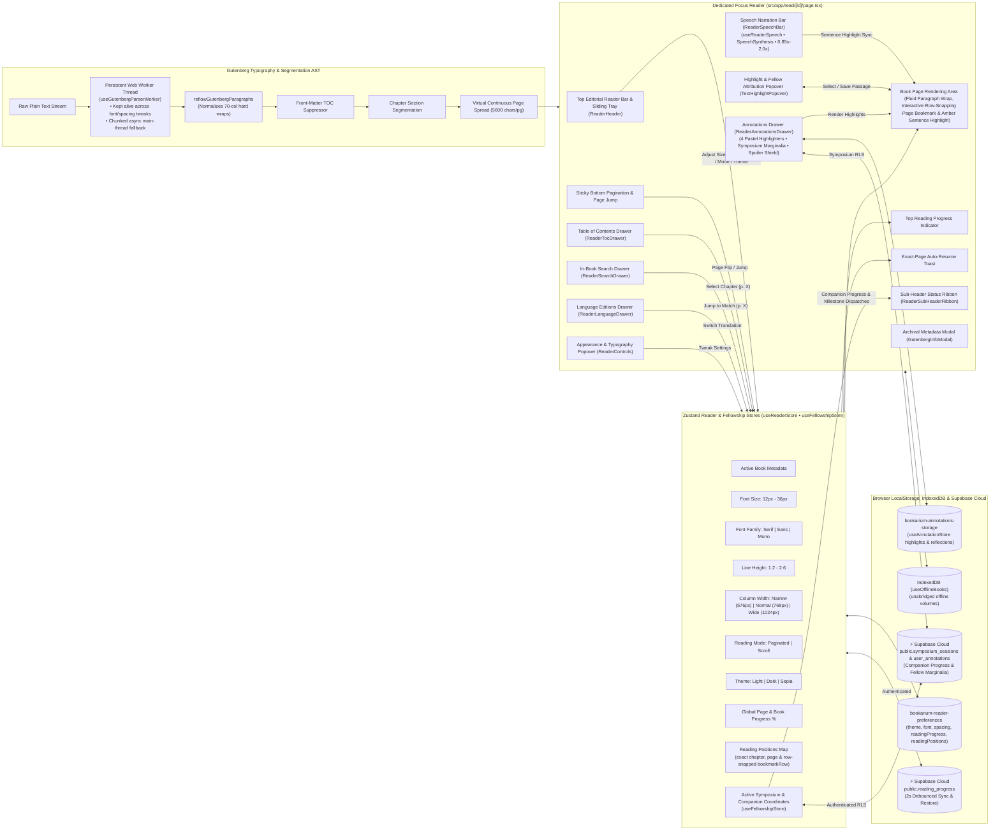
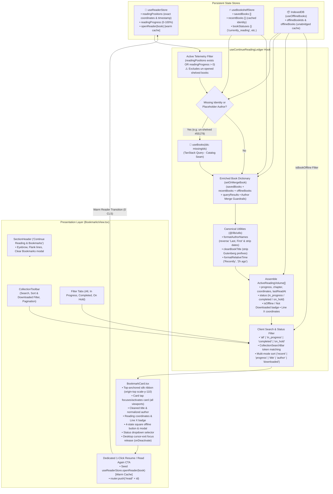

# Bookarium — 100% Legal Public Domain Library & Reader

> **Pure Literature. Zero Paywalls. Zero API Keys Required.**

[](https://antigravity.google)
[-black?style=flat-square&logo=next.js)](https://nextjs.org/)
[](https://react.dev/)
[](https://www.typescriptlang.org/)
[](https://tailwindcss.com/)
[](https://nodejs.org/)
[](https://supabase.com/)
[](public/sw.js)
[](https://vercel.com/)
[](https://github.com/calin-m/Bookarium/actions/workflows/ci.yml)
[](docs/QUALITY_AUDIT_REPORT.md)
[](docs/QUALITY_AUDIT_REPORT.md)
[](docs/QUALITY_AUDIT_REPORT.md)
[](ROADMAP.md)
[](LICENSE)

---

An open-source, offline-first web application and reader for discovering, reading, and downloading public domain books (Project Gutenberg / CC0). Built with **Next.js 16 App Router**, **Tailwind CSS v4**, and **Zustand** persistence, deployed on the **Vercel Edge Platform**, developed with **[Google AI / Antigravity](https://antigravity.google)**, and verified by a deterministic **7-Gateway Quality Engine**.

Bookarium is powered by a self-hosted **Supabase PostgreSQL** catalog (78,000+ volumes) featuring GIN full-text search and pre-computed author lifespan indexes, delivering sub-50ms single-book lookups and dependable ~1–2s catalog page queries (compared to 20–60s queue delays on public APIs). To guarantee continuous uptime and zero-configuration setups, it includes an automatic failover to the upstream **Gutendex REST API** and Project Gutenberg mirrors whenever the database is unseeded, unreachable, or undergoing maintenance.

---

## 🎨 Design Inspiration & Aesthetic Philosophy

Bookarium's visual identity and tactile layout are deeply inspired by classical editorial typography, archival letterpress printing, and modern Figma bookstore design systems:

* **Figma Editorial Concept**: Inspired by the minimalist elegance of curated bookstore layouts, specifically referencing the [Booksaw — Bookstore E-Commerce Website Design Template](https://www.figma.com/community/file/1521831984874247291/booksaw-bookstore-ecommerce-website-design-template) on the Figma Community.
* **Open-Book Skeuomorphic Details**: Custom open-book card spreads with subtle center spine creases (`.book-center-crease`), realistic paper texture shadows (`shadow-booksaw`), and page depth elevation.
* **Warm Editorial Palettes & 100% Solid Surfaces**:
  * **Day / Standard**: Crisp cream-paper tones (`#fcfbf9`, `#ffffff`) with rich obsidian ink typography and 100% solid, non-transparent surfaces.
  * **Sepia / Cozy Coffee (Warm Midtone)**: Warm roasted espresso and cafe mocha tones (`#2b1d16`, `#3c281e`, `#332219`) with steamed milk cream typography (`#fef6eb`) and warm caramel amber accents (`#f59e0b`) for eye comfort in ambient evening light.
  * **Dark Mode**: High-contrast slate obsidian canvas (`#0e1117`, `#161b26`) preserving focus in low-light settings.
* **Refined Typography**: Pairings of classic literary serifs, clean sans-serifs, and monospace archival metadata accents.

---

## 📚 Living Documentation & Quality Assurance Matrix

| Document / Artifact | Scope & Verification Status | Live Resource Link |
|---|---|---|
| 📋 **Quality Audit & Test Suite Catalog** | 7-Gateway status summary, live coverage metrics, and complete index of all 2019 tests across 189 test suites. | [`docs/QUALITY_AUDIT_REPORT.md`](docs/QUALITY_AUDIT_REPORT.md) |
| 📊 **CI/CD Quality Telemetry** | Machine-readable JSON summary of build metrics, test suites, and coverage passes. | [`docs/quality-audit-results.json`](docs/quality-audit-results.json) |
| 🏛️ **Living Architecture Matrix (C4)** | AST-driven component inventory, route handlers, Zustand state, and dependency graphs. | [`docs/ARCHITECTURE.md`](docs/ARCHITECTURE.md) |
| 📖 **Gutenberg Parser & Segmentation Reference** | AST-compiled specification of the Gutenberg parser subsystem, heuristic regex contracts, pagination limits, and subtitle extraction rules. | [`docs/GUTENBERG_PARSER.md`](docs/GUTENBERG_PARSER.md) |
| 🗺️ **Living Product Roadmap** | AST-verified roadmap with 0% drift, feature milestone tracking, and live progress metrics. | [`ROADMAP.md`](ROADMAP.md) |
| 📜 **Living Changelog** | Keep a Changelog 1.0.0 & SemVer release history across all milestones. | [`CHANGELOG.md`](CHANGELOG.md) |
| ⚖️ **Architecture Decision Records (ADRs)** | 71 validated ADRs (ADR-001 through ADR-071) governing zero-API keys, state architecture, SEO rate-shielding, Web Speech narration, offline IndexedDB engines, completed reading state latches, enterprise polymorphism/encapsulation, Vitest performance architecture, self-hosted Supabase catalog caching, autonomous full-catalog Gutenberg ingestion, root body modal portaling, Reader Circles & Literary Symposiums (Dual Reading), Tailwind CSS v4 Oxide & supply-chain hardening, WCAG 2.2 AA focus trapping, zero-any TypeScript strictness, overlay dynamic code-splitting, Phase 5 monolith decomposition, canonical auth redirect origin hardening, layered dual-band overlapping highlights, unified overlapping marginalia cards, >= 85% Vitest coverage enforcement, 7-layer author lifespan self-healing, tier-adaptive gliding active underline cradle, unified personal collection 'downloaded' filtering & smart bookshelf, zero-CLS layout stabilization, catalog pagination smooth-scroll stabilization & header brand page-1 reset, tablet bookshelf spine modal & dedicated bookmark resume CTA, dedicated Favorites cover grid, tablet Notebook toolbar & unified active-shelf clear action, 7-pillar SAST & OWASP security suite & zero-warning ESLint gate, interactive in-page row-snapping bookmark & tablet single-column Notebook layout, offline-first PWA resilience, adaptive offline catalog, bi-directional store outbox sync & Project Gutenberg mirror compliance, and reading ledger offline author preservation, merge guardrails & IndexedDB self-healing. | [`docs/DECISIONS.md`](docs/DECISIONS.md) |
| 🔒 **Security Policy & Responsible Disclosure** | Supported versions, vulnerability reporting protocols, and architectural safeguards. | [`SECURITY.md`](SECURITY.md) |
| 🤝 **Contributor Guidelines** | Onboarding guide, local development quickstart, testing protocols, and conventional commits. | [`CONTRIBUTING.md`](CONTRIBUTING.md) |
| 🕊️ **Code of Conduct** | Contributor Covenant v2.1 standards for an inclusive, welcoming community. | [`CODE_OF_CONDUCT.md`](CODE_OF_CONDUCT.md) |
| 🚀 **CI/CD Pipeline Guide** | Developer runbook and pipeline execution workflows. | [`docs/PIPELINE_GUIDE.md`](docs/PIPELINE_GUIDE.md) |
| 🛠️ **Developer Maintenance Hub** | Local setup, environment configuration, and contributor commands. | [`DEVELOPMENT.md`](DEVELOPMENT.md) |

---

## 🛡️ The 7-Gateway Quality Engine

The repository enforces a closed-loop quality verification engine before any release or commit:

```
+-----------------------------------------------------------------------------+
|                     7-GATEWAY CLOSED-LOOP VERIFICATION                      |
+-----------------------------------------------------------------------------+
| Pass 0.5  | Secret & Boundary   | Scans secrets & client bundle boundaries  |
| Pass 0.75 | 7-Pillar SAST/OWASP | CVEs, SSRF, XSS, Redirects, RLS & Headers |
| Pass 1    | TypeScript Engine   | Strict typecheck with 0 compile errors    |
| Pass 2    | Vitest Server Mocks | Validates MSW v2 handlers and query hooks |
| Pass 3    | Vitest Client UI    | Unit & integration tests (95/95/92/85 cov)|
| Pass 4    | Living Docs Sync    | Auto-updates ARCHITECTURE, AUDIT, & CHANGE|
| Pass 5    | ADR Validation      | Validates DECISIONS.md sequential schema  |
| Pass 6    | Quality & Dead Code | ESLint (--max-warnings 0) and Knip audit  |
| Pass 7    | Production Build    | Compiles Next.js production bundle        |
+-----------------------------------------------------------------------------+
```

🔒 **Pre-Commit Enforcement**: Any failure in Passes 0.5 through 7 immediately halts execution, outputs exact error telemetry, and automatically blocks the commit from being created.

---

<!-- BEGIN:latest-release -->
## 🛠️ Latest Improvements (v2.8.1)

- **Bookshelf Cloud-Sync Metadata Preservation, Per-User Sync Coalescing, Atomic Store Selectors & Cross-Layer Habit Telemetry (`src/lib/bookshelf-cloud-sync.ts`, `src/stores/useBookshelfStore.ts`, `src/components/presentation/Navbar.tsx`, `src/components/presentation/BookCard.tsx`, `src/components/presentation/BookPreviewModal.tsx`, `src/components/presentation/BookshelfRack.tsx`, `src/app/page.tsx`, `supabase/schema.sql`, `src/types/database.types.ts`, `src/lib/reading-analytics.ts`, `src/stores/useHabitsStore.ts`, `src/lib/accolades-engine.ts`, `ADR-071`)**: Added `mergeCloudBookWithLocal` to preserve local `subjects`, `bookshelves`, `translators`, `languages`, `download_count`, and `formats` during cloud sync; added per-user in-flight mutex coalescing (`inFlightOutboxFlushes`, `inFlightCloudSyncs`), parallel `Promise.all` table fetching (`safeSelectByUser`), multi-shelf `book_id` deduplication, and single-commit `set(nextState)` in `bookshelf-cloud-sync.ts`; removed the redundant mount-time `syncWithCloud` effect from `useHydratedBookshelf()`; exported atomic selector hooks `useIsBookFavorite` and `useHydratedBookshelfCounts` for `Navbar`, `BookCard`, and `BookPreviewModal`; stabilized the `BookshelfRack` General shelf key and scoped `useBooks` / `usePrefetchNextPage` in `src/app/page.tsx`; and added idempotent `completed_books_count` persistence to `public.user_reading_habits` along with `calculateCompletedBooksCount`, `resolvePublicReadingHabits`, and `computeAccoladesSummary`.
- **Offline-First PWA Resilience, Red Offline Account Indicator, Adaptive Offline Catalog & Undownloaded Volume Restriction Parity (`src/hooks/useNetworkStatus.ts`, `src/components/presentation/Navbar.tsx`, `src/components/presentation/CatalogOfflineView.tsx`, `src/app/page.tsx`, `src/components/ui/Modal.tsx`, `src/components/presentation/DownloadDrawer.tsx`, `src/components/presentation/BookCard.tsx`, `src/components/presentation/BookPreviewModal.tsx`, `src/components/presentation/NotablePassagesSpread.tsx`, `src/components/presentation/bookshelf/BookshelfMobileModal.tsx`, `src/components/presentation/bookshelf/BookshelfSpine.tsx`, `src/components/presentation/BookmarkCard.tsx`, `src/components/presentation/NotebookView.tsx`, `src/components/presentation/NotebookQuoteCard.tsx`, `src/hooks/reader/useContinueReadingLedger.ts`, `ADR-069`)**: Created `useNetworkStatus` reactive hook (`useSyncExternalStore`); styled the `Navbar` Account link and Guest Sign-In button in red (`destructive`) with a red status dot (`data-testid="navbar-offline-dot"`) when offline and routed offline guests to `/account`; configured the Catalog to automatically serve the user's downloaded books from IndexedDB (powering the 3D Hero spotlight, search, topic/language/era filters, sorting, and `<BookGrid />` with an offline banner) when cached books exist, or `<CatalogOfflineView />` when 0 books are downloaded; renamed the download modal to `"Download Hub"`, enforced viewport height safety (`max-h-[calc(100dvh-2rem)] sm:max-h-[90dvh]`) in `Modal.tsx`, compacted `DownloadDrawer` with a responsive `sm:grid-cols-2` 2×2 format grid, and added an Offline Mode Notice Banner with format link disabling; unified undownloaded offline books (`isUnavailableOffline`) with copyright-restricted books (`isRestricted`) across all viewports with cover/spine dimming (`opacity-65 grayscale-[35%]`), `Not Downloaded` status badges (deduplicated to the Volume Header in `NotebookView`), `Unavailable Offline` notice banners, and disabled `"Read"` / `"Resume"`, `"Save Offline"`, `"Get"` / `<Download />` format drawer triggers, and Notebook `"Read Passage"` buttons; and gated residual background queries while enriching local metadata resolution with `offlineBooks`.
- **Secondary Offline Restriction Parity & Profile Resiliency (`src/components/account/AccountSymposiumSection.tsx`, `src/components/reader/ReaderLanguageDrawer.tsx`, `src/components/profile/PublicProfileView.tsx`, `src/app/u/[username]/page.tsx`, `src/app/page.tsx`, `ADR-069`)**: Extended offline parity to Reader Circles, Symposiums, international editions drawer, and scholar profile pages by dimming uncached symposium cards with `Not Downloaded` badges and replacing reader launch links with disabled `Unavailable Offline` buttons; disabled fellow invitations, live symposium launches, and invitation responses when offline; disabled uncached editions in `ReaderLanguageDrawer` while allowing cached editions with `Downloaded` badges; enforced offline fallback on `/u/[username]` and public bookshelves for authenticated scholars with disabled live invitations and disabled uncached shelf links; and enriched favorite books with `offlineBooks` so offline favorites preserve full metadata.
- **Reading Ledger Offline Author Preservation, Merge Guardrails & IndexedDB Self-Healing (`src/hooks/reader/useContinueReadingLedger.ts`, `src/lib/offline-storage.ts`, `src/hooks/useOfflineBooks.ts`, `src/stores/useReaderStore.ts`, `src/stores/useBookshelfStore.ts`, `ADR-070`)**: Resolved the issue where books saved for offline reading reverted to "Anonymous" on page refresh on `/bookmarks` by verifying authentic non-placeholder authors in `missingIds` to trigger background metadata fetching, preventing candidate books with placeholder authors from overwriting authentic domain authors in `setOrMergeBook`, healing placeholder authors in `bookDictionary` using `readingPositions`, resolving authentic authors from local shelf and reader stores before defaulting to "Anonymous" in `getAllOfflineBookMetas()` with asynchronous IndexedDB back-fill (`patchOfflineBookAuthors`), and updating `useReaderStore.enrichReadingPositions`, `saveReadingPosition`, and `useBookshelfStore.enrichSavedBooks` to heal placeholder authors when incoming fresh books provide authentic names without numeric lifespans.

> 📖 **Complete Historical Ledger**: For full chronological release notes, breaking changes, and migration details across all versions, see [**`CHANGELOG.md`**](CHANGELOG.md).
<!-- END:latest-release -->

---

## 🌐 Data Sources & Infrastructure

Bookarium runs on an open, decentralized architecture requiring **Zero Paid Developer Keys**:

| Service / Source | Endpoint / Provider | Description & Usage |
|---|---|---|
| **Self-Hosted Supabase Catalog** | [`public.books`](#step-3-populate-public-domain-book-catalog-optional) (PostgreSQL) | Primary catalog provider hosting 78,000+ Project Gutenberg titles with automated GIN full-text search (`search_vector`) and pre-computed author lifespan indexes, delivering sub-50ms single-book copyright verification, consistent ~1–2s 32-volume catalog page searches, and zero-egress searches. |
| **Gutendex REST API** | [`gutendex.com`](https://gutendex.com/) • [`GitHub`](https://github.com/garethbjohnson/gutendex) | Resilient upstream search fallback created by [Gareth B. Johnson](https://github.com/garethbjohnson/gutendex) indexing 70,000+ titles with strict `copyright=false` filtering. Engaged automatically when Supabase is unseeded or offline. |
| **Project Gutenberg CDN & Mirrors** | [`gutenberg.org`](https://www.gutenberg.org/) • Mirrors | Content delivery network and mirrors (`aleph.gutenberg.org`, `gutenberg.pglaf.org`, `gutenberg.readingroo.ms`) providing plain text (`.txt`), official EPUB packages (`.epub.images`), Kindle/MOBI formats, and web-ready HTML. |
| **Wikidata SPARQL Knowledge Graph** | [`query.wikidata.org`](https://query.wikidata.org/) • [`CC0 1.0`](https://www.wikidata.org/) | Open public-domain bibliographic knowledge graph (`wdt:P2034` Project Gutenberg eBook ID, `wdt:P407` / `wdt:P424` language of work) powering relational FRBR work clustering across multilingual editions (`public.book_translations`). |
| **Supabase (Auth, Sync & Catalog)** | [`supabase.com`](https://supabase.com/) | Cloud authentication, user library synchronization (bookshelves, annotations, progress, streaks, accolades) with RLS user isolation, and self-hosted public domain catalog. |
| **Vercel Edge Platform** | [`vercel.com`](https://vercel.com/) | High-performance edge deployment, dynamic SSR route handlers, zero-config production caching, global CDN delivery, and cookie-less aggregate performance telemetry (Vercel Web Analytics & Speed Insights). |
| **Public Domain Archive Proxies** | `/api/books` & `/api/books/content` | Next.js server-side route proxies providing caching, Strangler Fig dual-provider catalog resolution, Tier 1/Tier 2 content streaming, and guaranteed public domain integrity before client delivery. |

---

## 🎯 Key Features & Capabilities

Bookarium is structured around five core engineering pillars:

### 1. 🎨 Tactile Editorial Design & 3D Book Physics
* **Booksaw Editorial Aesthetic**: Classical typography inspired by fine art bookstore catalogues, featuring open-book card spreads with center spine creases, realistic paper shadows, and 100% solid non-transparent surfaces across Day (`#fcfbf9`), Cozy Coffee Sepia (`#2b1d16`), and Dark Obsidian (`#0e1117`) themes.
* **Hourly Rotating 3D Featured Book (27-Masterwork Curated Anthology)**: Expanded pool of 27 verified public domain masterworks across world literature (Austen, Shelley, Tolstoy, Hugo, Dostoevsky, Brontë, Kafka, Stevenson, Dumas, Machiavelli, Sun Tzu, Marcus Aurelius, Homer, Alcott, Poe, Verne, Thoreau, Twain) rotated every UTC hour with zero-cron deterministic synchronization.
  * **Synchronized Dynamic SSR & Zero-Flash Pre-Hydration**: Edge-stamped geo-cookie (`bookarium-geo-country`) extracted at the Next.js `layout.tsx` boundary synchronously seeds the jurisdiction store and aligns server snapshots with the client, completely eliminating pre-hydration fallback swaps (e.g. *Frankenstein* #0 flashing before the hourly volume) and guaranteeing 0.00 Cumulative Layout Shift.
  * **Interactive Open-Cover Physics**: On desktop hover, the hardbound volume smoothly elevates and opens 180° on its spine hinge, displaying opening reflections on the Left Page and notable excerpts on the Right Page. Clicking pins the volume open or closed.
  * **Physical 60–120 FPS Page Turn**: Shuffling passages flips a physical 3D leaf across the spine with synchronized ink reveals.
* **Daily Rotating Editorial Classic of the Day & 36 Literary Quotes**: Dedicated editorial showcase positioned beneath the catalog grid presenting a unified public domain masterpiece with authentic title, author, publication year, verbatim literary quote, and 1-click reader handoff. Evaluated directly on initial SSR with territorial copyright filtering (e.g. Life+100 Mexico protection) and dynamic anti-collision intelligence that automatically skips candidate books matching the current Hero spotlight to guarantee two unique masterworks on every visit. Supported by an expanded collection of 36 iconic literary passages in "Words That Shaped Humanity" (`LiteraryQuotes.tsx`) with safe shuffling and author lifespan governance.
* **Interactive 3D Book Preview Modal**: Clicking or tapping any book card cover launches a 3D hardcover preview modal with fluid FLIP geometry transitions, subpixel return landing, chapter shuffling, and 1-click reader handoff.
* **Studio Bookshelf Bookcase & Catalog Spine Isolation**: Hardwood shelf alcove with 8 authentic spine binding colorways (Oxblood, Navy, Emerald, Saddle, Plum, Charcoal, Teal, Espresso), convex specular curvature, gilded lettering, and pull-forward hover scaling. Dynamically isolates personal library management controls (custom multi-shelf tabs, "New Shelf", guest sync prompts, and individual offline volume management) strictly to the Bookshelf view (`/bookshelf`), ensuring the Catalog spine view remains a distraction-free, pure 3D browsing bookcase with a **Zero-CLS Floating Cloud Sync Badge** that smoothly overlays real-time sync status. Features **Deterministic Zero-Shift Shelf Capacity & Cloud Ordering**: Viewport-clamped capacity calculation (`calculateShelfCapacity`, with a uniform 12-book per-row cap on `/bookshelf` and a 24px bottom cursor leeway bridge on spine hover cards) aligns initial render calculations to `max-w-7xl` (`1280px`) container constraints, eliminating horizontal spine sliding and 29 &rarr; 18 book wrapping jumps on page refresh, paired with zero-CLS toolbar anchoring across empty custom shelves (`ADR-063`), deterministic secondary PostgreSQL order tie-breakers (`.order('book_id', { ascending: true })`) in cloud sync queries, and session-persistent auto-healing tracking in `sessionStorage`.
* **Directional Stepped Scroll Navigation**: Dynamic scroll detection (`useScrollDirection`) smoothly hides the top header on scroll down, docks the catalog filter toolbar to `top-0`, and instantly reveals navigation on upward scroll gestures. Configurable in Account Settings between **Smart Auto-Hide** and **Always Fixed**.
* **Responsive Filter Drawer & Push-Content Layout**: Persistent left-docked drawer on desktop & ultrawide viewports (≥ 1280px / `xl:`) shifting main content to the right (`xl:pl-96`) for non-blocking catalog browsing; smoothly adapts to a focused slide-out overlay with soft backdrop blur (`backdrop-blur-xs`) on laptops, vertical monitors, and mobile devices—guaranteeing 100% unclipped facet typography with zero text truncation.
* **Tactile Mobile Single-Row Sticky Catalog Toolbar**: Compact ~44px mobile toolbar unifying search filter triggers, real-time API health status, view mode toggling (Grid vs. Spine Shelf), and deep-archive pagination in a single horizontal row, maximizing vertical screen real estate for book covers. Features an enhanced tactile numeric page input with auto-selection on tap/focus (`inputMode="numeric"`), decoupled blank editing state, `aria-pressed` size states, and smooth scrolling to `#catalog-section` on page size change.
* **Windowed Chunk Sub-Pagination & Predictive Prefetching**: Seamlessly reconciles upstream API batching with responsive client layouts by sub-slicing the catalog's native 32-volume batch into viewport-optimized pages (8 books/page on mobile `grid-cols-2`, 16 books/page on desktop `md:grid-cols-4`). Sub-page turns execute in 0ms directly from client memory without network delay. A widened predictive prefetch buffer triggers background loading on Sub-page 3 (mobile) or Sub-page 1 (desktop), providing a 15–25 second network lead time before reaching batch boundaries.
* **Explicit Catalog Search Activation & 2-Character Guardrail**: Replaced keystroke debouncing with intentional search submission (<kbd>Enter</kbd> or clicking "Search") to eliminate redundant API spam against public upstream servers. Enforces a client-side and server-side 2-character minimum guardrail with accessible inline validation (`aria-live="polite"`), preventing heavy 1-character full-table scans while fully permitting classical two-character literary titles (*It*, *Oz*, *Up*, *Po*).
* **Unified Native Input Architecture & Search Focus Harmonization**: Standardized all search bars across Catalog, Bookshelf, Favorites, Bookmarks, Notebooks, and Reader Search Drawer to a native `<input>` architecture with `rounded-xl` curvature, subtle pre-hover warming (`hover:border-primary/40`), and a crisp 150ms outward primary ring bloom. The Catalog hero bar integrates floating inset controls (Search button and clear `X`) directly within the input's padding, delivering authentic native focus without enclosing action buttons inside the glow.

### 2. 📖 Dedicated Focus Reader & Typography Engine
* **Unabridged Reading Canvas (`/read/[id]`)**: Full-screen, distraction-free reading with exact chapter and page coordinate auto-resume toasts and 1-click restart option.
* **Gutenberg Paragraph Reflow Engine**: Normalizes legacy 70-character hard linebreaks into fluid prose across Narrow (`576px`), Normal (`768px`), and Wide (`1024px`) layouts while preserving double-spaced paragraphs, dialogue, and indented poetry.
* **Granular Typography Popover (`Aa`)**: Real-time font sizing (12px–36px) and dynamic line height (1.2–2.6) with 1-click presets (`14px / 18px / 24px` and `1.4 / 1.8 / 2.2`), font family selection (Serif, Sans, Mono), and reading mode toggling (Paginated / Scroll).
* **Mobile Pinch-to-Zoom Scaling**: Two-finger pinch gestures adjust font sizing with a transient HUD size badge.
* **Global Sentence-Snapped Virtual Pagination**: Virtual page engine with a 500-entry memory LRU cache for instant sub-millisecond virtual page turns without redundant calculation.
* **Integrated Reading Drawers**:
  * **Table of Contents (`ReaderTocDrawer`)**: Instant chapter navigation with live start-page badges, read-time estimates, and front-matter anthology story detection.
  * **In-Book Search (`ReaderSearchDrawer`)**: Real-time regex scanner across the unabridged volume with highlighted matches (`<mark>`), chapter grouping, match counters, and keyboard shortcut invocation (`Ctrl+F` / `/`).
  * **Language Editions (`ReaderLanguageDrawer`)**: Discovers authentic foreign language Gutenberg editions and translations with 1-click reading handoff.
* **Persistent Web Worker Lifecycle**: Single long-lived Web Worker (`useGutenbergParserWorker`) retained across typography tweaks, eliminating UI thread lag with non-blocking async fallback.

### 3. 🌐 Universal Languages, Historical Editions & Web Speech Narration
* **Catalog & Archive Filtering (12 Primary Languages)**: Full catalog search and facet filtering across English, French, German, Spanish, Italian, Latin, Ancient & Modern Greek, Portuguese, Dutch, Russian, Chinese, and Romanian via the unified `<LanguageSelector />`.
* **Authentic Project Gutenberg Historical Editions & Translations (`ReaderLanguageDrawer`)**: In-reader discovery of authentic public domain translations and historical language editions indexed from Project Gutenberg catalog relations (FRBR work mapping). Readers can switch seamlessly between authentic translations with zero latency.
* **Native Browser Translation Guidance**: Integrated guidance for Chrome, Edge, Safari, and Firefox built-in translation features for modern on-the-fly multi-language reading without third-party scrapers or ToS violations.
* **Synchronized W3C Voice Read-Aloud (Text-to-Speech)**: Offline-first narration (`window.speechSynthesis`) with automatic language-voice pairing, amber visual sentence highlight tracking, speed presets (0.85x–2.0x), sentence navigation, and OS-level MediaSession lockscreen controls.

### 4. ⚡ Offline-First Persistence, Cloud Sync & Data Sovereignty
* **Clean Path URL & Symmetric SSR Hydration Architecture**: Canonical routes (`/`, `/bookshelf`, `/favorites`, `/notebook`, `/bookmarks`) powered by Next.js server rewrites, client history synchronization, and symmetric `parseFiltersFromUrl` query parsing—guaranteeing identical server-rendered HTML and client hydration on deep paginated URLs (e.g. `?page=8`) with zero layout shift and 0 CLS.
* **Bookmarks & Continue Reading Ledger (`/bookmarks`)**: Dedicated reading ledger tracking active volumes with tactile bookmark cards, top-anchored silk ribbon markers (`origin-top scale-y-110`), live progress percentages, last-read coordinates, multi-attribute sorting and filtering (Recent, Progress, Title, Author, Downloaded), status filters (All, In Progress, Completed, On Hold), and 1-click chapter resume.
  * **Authentic Reading Telemetry**: Strictly enrolls volumes with active coordinates or progress, eliminating unopened placeholder clutter.
  * **Two-Way Dynamic Hydration & Offline Author Guardrails**: Resolves un-shelved book identities and placeholder (`"Anonymous"`) authors via TanStack React Query, protects enriched `bookDictionary` entries against placeholder-author regression (`setOrMergeBook`), back-fills IndexedDB offline volume metadata (`patchOfflineBookAuthors`), and automatically pre-seeds warm reader state for instant 0ms transitions.
  * **Completed Reading Progress Latch & "Read Again" Flow**: Resuming a finished volume safely locks 100% progress and the "Completed" badge without regressions. Completed bookmark cards feature a dedicated "Read Again" action allowing readers to restart reading from Page 1 without destroying historical ledger completion achievements.
  * **Tactile Active Zone & 4-State Offline Controls**: Single-column mobile focus tracking (`< 768px`) dynamically activating bookmark cards in the viewport focus band, multi-column tap-to-activate with outside-click dismissal and desktop cursor-exit / blur focus release (`onDeactivate`), top-anchored ribbon stretch on card hover, and a dedicated 4-state square offline button preserving the neutral `<HardDriveDownload />` icon until downloaded (emerald) and transitioning to `<Trash2 />` (destructive red) on hover with removal confirmation modal.
* **In-Reader Highlighting & Literary Commonplace Notebook (`/notebook`)**:
  * **4 Editorial Pastel Highlighters** (Warm Canary, Antique Amber, Sage Mint, Dusty Rose) with palette-harmonized `overlapRingClass` borders across Light, Sepia, and Dark themes, coarse-pointer touch dismissal, and a chapter-scoped annotation drawer (`ReaderAnnotationsDrawer.tsx`).
  * **Unified Overlapping Marginalia Cards (`All` Mode)**: Automatic pairing of intersecting personal and Fellow Scholar highlights (`pairOverlappingAnnotations` & `computeSharedQuoteSegments`) into a single composite card displaying the union quote, an inline highlighted overlap span, dual attribution (`You + Fellow`), and stacked reflection callouts.
  * **1-Click Save Fellow Passage**: Instant `+ Save to My Notes` / `+ Add My Note` actions across the in-book highlight popover (`TextHighlightPopover.tsx`), the in-reader Annotations Drawer, and the Commonplace Notebook.
  * **Click-and-Drag & Wheel Filter Carousels**: Desktop pointer click-and-drag (with 5px deadzone and capture-phase click suppression) and vertical-wheel-to-horizontal scrolling (`attachHorizontalDragAndWheelScroll`) across note color filter pill bars, paired with full-text search, volume/chronological grouping, and 1-click academic citation copying.
* **Native IndexedDB Offline Book Storage, Adaptive Offline Catalog & Cross-Device Controls**: Zero-dependency browser storage (`BookariumOfflineDB`) bypassing the 5MB `localStorage` limit, enabling readers to individually download books for offline reading across desktop, tablet, and mobile in compliance with Project Gutenberg anti-scraping policies. Features reactive network status detection (`useNetworkStatus.ts`) with a **Red Offline Account Indicator** in `Navbar.tsx`, an **Adaptive Offline Catalog** that automatically serves the reader's downloaded books from IndexedDB (powering search, filters, sorting, and the 3D Hero spotlight) when offline or displays `CatalogOfflineView.tsx` when 0 books are cached, reactive cross-instance event broadcast (`OFFLINE_BOOKS_UPDATED_EVENT`), loading spinner telemetry (`OFFLINE_DOWNLOADING_EVENT`), the dynamic **Bookshelf `Downloaded (N)` Smart Shelf Pill** (`DOWNLOADED_SHELF_ID`) with auto-fallback to General, the unified **`Downloaded` filter option** across Bookshelf, Favorites, Bookmarks, and Commonplace Notebook collection toolbars, unified top `SectionHeader` **Active-Shelf-Aware Clearing** (`Clear Bookshelf` on General, `Clear "<Shelf Name>" Shelf` on custom shelves, and `Clear Downloaded Shelf` on the `Downloaded` smart shelf), offline-aware format disabling in `DownloadDrawer` ("Get" hub), interactive `Downloaded` status badges on `BookCard` with card-level hover transitions and tactile removal confirmation modals (`RemoveOfflineBookModal`), standardized 4-state offline action buttons across `BookmarkCard`, `BookshelfSpine`, and `BookshelfMobileModal`, and automated orphaned cache cleanup upon shelf deletion.
* **Authoritative Cloud State Reconciliation (`lastBookshelfSyncAt`)**: Optional Supabase PostgreSQL cloud sync with Row Level Security (RLS). Initial sync migrates local guest books to the cloud; subsequent syncs treat Supabase as the authoritative source of truth, gracefully pruning titles deleted on another device while pre-sync outbox flushing (`flushOutbox`) safeguards offline additions.
* **High-Performance Database Query Planner Optimization**: Implemented `{ count: 'estimated' }` planner statistics in `src/lib/catalog/supabase-provider.ts` across 78,000+ catalog rows, completely eliminating PostgreSQL `57014` statement timeouts and slashing query latency from `>3,000ms` down to **`~275ms`**.
* **Sanitized Sign-Out & Account Isolation**: Pre-logout outbox drain and clean state wipe (`clearBookshelf()`) prevent cross-account contamination while raw downloaded texts in IndexedDB are preserved on device.
* **Bi-Directional Cloud Reading Progress**: 2000ms debounced upsert to `public.reading_progress`, restoring chapter and scroll coordinates across devices for authenticated accounts while remaining 0ms/zero-network for guest readers.
* **Reading Streaks, Dual Immersion Telemetry & Annual Reading Challenges (`/account`)**: Offline-first literary activity tracking calculating consecutive daily streaks with a **5-minute active immersion threshold** (`300s`), longest streaks, 7-day calendar activity indicators, and total literary immersion duration. Disentangles telemetry into distinct **Reading Time** (visual focus with 2-minute idle guard) and **Listening Time** (uninterrupted Text-to-Speech audio narration retaining time in background tabs). Includes an interactive annual reading challenge progress bar with user-adjustable volume targets, real-time pace tracking, dynamic countdown prompts (`Xm / 5m logged today`), and multi-device Supabase cloud synchronization with Last-Write-Wins (LWW) conflict resolution.
* **Full Data Sovereignty & Portability**: Single-click RFC 4180 CSV export and portable JSON backup (`src/lib/library-backup.ts` & `src/lib/backup-validator.ts`) with defensive schema validation and merge/replace restore strategies.
* **Zero-Tracking Privacy Architecture (`/privacy`)**: Zero third-party trackers, zero advertising beacons, cookie-less operation (Art. 5(3) exempt), privacy-first anonymous aggregate telemetry (Vercel Web Analytics & Speed Insights), and self-service account data deletion in User Settings (`/account`).
* **Technical SEO, Social OpenGraph & Upstream Rate-Shielding**: Native Next.js 16 crawl directives (`robots.ts`) explicitly disallow search query parameters (`?search=*`, `?topic=*`) to protect public upstream catalog servers from bot query exhaustion. Dynamic server layouts (`/read/[id]/layout.tsx`) resolve book identities directly from self-hosted Supabase with an in-memory cache and 24-hour Next.js edge caching (`revalidate: 86400`) to generate rich OpenGraph and Twitter cards (`summary_large_image`) featuring authentic book covers, while injecting safe Schema.org `Book`, `WebSite`, and `WebApplication` (`isAccessibleForFree: true`) JSON-LD structured data.

### 5. 🤝 Reader Circles, Literary Symposiums & Scholarly Honors
* **Reader Circles & Literary Symposiums (Dual Reading)**:
  * **Mutual Reader Circle Fellowships (`public.reader_circles`)**: Opt-in two-way fellowship connections (`useFellowshipStore.ts`, `AccountSymposiumSection.tsx`) with zero-PII `@username` resolution (`public.lookup_scholar_by_username`), companion identity RLS resolution allowing connected fellows to view each other's live handle even when set to Private Sanctuary (`is_public = false`), automated profile identity sync triggers (`handle_profile_identity_sync`), and privacy-preserving `display_name` attribution.
  * **Per-Volume Literary Symposium Pacts (`public.symposium_sessions`)**: Co-read specific volumes (`SymposiumInviteModal.tsx`) with synchronized companion progress micro-pills, chapter-milestone dispatches (`ReaderSubHeaderRibbon.tsx`), layered dual-band in-book highlights (`ReaderSurface.tsx`), `All | Mine | Fellows` source filters, and a chapter-bound **Spoiler Shield** (`Up to Ch. X` vs. `All Chapters`).
* **Deterministic Literary Accolades & Ex-Libris Bookplates**:
  * **Pure Client-Side Accolades Engine (`src/lib/accolades-engine.ts`)**: Evaluates reading streaks, historical eras, commonplace marginalia, and Symposium companionship (*Seven-Day Sage*, *Ancient Antiquarian*, *Century Voyager*, *Commonplace Scholar*, *Societas Litterarum*, and the 4-tier canonical volume ladder: *Bibliophile Novice*, *Canonical Scholar*, *Master of the Canon*, and *The Laureate's Crown*).
  * **Tactile Ex-Libris Bookplates (`ExLibrisBookplate.tsx`)**: Archival woodcut-bordered bookplates with desktop 3D perspective tilt, specular sheen gradients, unlock celebration modals (`AccoladeCelebrationModal.tsx`), and 3-plate showcase pinning (`public.user_accolades`).
* **Opt-In Public Scholar Sanctuaries (`/u/[username]`)**:
  * Dedicated public profile page (`PublicProfileView.tsx`, `PinnedAccoladesShelf.tsx`) showcasing scholar biography, pinned Ex-Libris bookplates, public bookshelves, annual reading challenge progress, and 1-click *Invite to Reader Circle* / *Invite to Symposium* actions, protected by strict `is_public` Row-Level Security (`PrivateProfileNotice.tsx`).

### 6. ⚖️ 100% Airtight Jurisdictional Copyright Governance & Legal Compliance
* **Autonomous Multi-Jurisdiction Engine (`src/lib/copyright-engine.ts`)**: Decoupled, zero-dependency validation engine enforcing exact public domain thresholds based on the user's geographic jurisdiction (year 2026 cutoff calculations):
  * **United States (17 U.S.C. § 304)**: Published on or before 1930 or cleared by Project Gutenberg US (`copyright === false`).
  * **Life + 70 (EU 27, UK, Canada, Australia, New Zealand, Japan)**: Author and translator death year $\le 1955$ ($2026 - 71$).
  * **Life + 100 (Mexico, Côte d'Ivoire)**: Author and translator death year $\le 1925$ ($2026 - 101$).
  * **Life + 80 (Colombia, Spain pre-1987 deaths)**: Author and translator death year $\le 1945$ ($2026 - 81$).
* **Declarative Copyright Subsystem Encapsulation (`useBookCopyright.ts` & `CopyrightNoticeBanner.tsx`)**: Unified copyright logic behind a single declarative facade hook (`useBookCopyright`) and a standardized presentation banner (`CopyrightNoticeBanner`), decoupling legal lifespan calculations from UI layouts and eliminating duplicated evaluation across 8 presentation components.
* **Joint Authorship & Derivative Protection**: Calculates protection from the death of the *last surviving co-author* (Berne Convention Art. 7bis) and independently validates translator derivative works (Berne Convention Art. 2(3)). Includes `partitionBooksByJurisdiction` for cleanly separating legal collections.
* **Fail-Closed Longevity Heuristics**: Applies a strict human longevity upper bound ($birth\_year \le currentYear - term - 101$) for missing death dates, and strictly fails closed outside the US when author lifespans cannot be verified.
* **Next.js 16 Root Proxy Geo-Context & Dynamic SSR Seeding (`src/proxy.ts`, `src/app/layout.tsx`)**: Automatically resolves the visitor's ISO 3166-1 alpha-2 country code via edge headers (`x-vercel-ip-country`, `cf-ipcountry`), stamps a non-tracking `bookarium-geo-country` cookie, supports regional development overrides (`?country=XX`), and synchronously seeds the jurisdiction store during server-side rendering for instant zero-flash hydration.
* **HTTP 451 Streaming Gatekeeper (`/api/books/content`)**: Evaluates incoming text streaming requests against a 24h LRU metadata cache (`src/app/api/books/content/metadata-cache.ts`). If protected under the visitor's local law, the server returns an **`HTTP 451: Unavailable For Legal Reasons`** response detailing the restricting author, local statute, and projected public domain entry date.
* **Hyperlink Neutralization & Presentation Isolation**:
  * **Download Drawer (`DownloadDrawer.tsx`)**: Direct download links are completely omitted from the DOM when restricted, satisfying European Court of Justice (*GS Media*) and UK hyperlink communication case law, replaced with a prominent legal restriction banner (`CopyrightNoticeBanner`).
  * **Book Cards (`BookCard.tsx`)**: Displays an amber `"Protected ([Country])"` badge and disables the reading action as `"Restricted"`.
  * **Dedicated Reader Legal View (`ReaderErrorView.tsx`)**: Renders an archival shield view with full statutory rationale and a 1-click `"Return to Library"` action.
* **Edge CDN Cache Partitioning**: Both `/api/books` and `/api/books/content` routes stamp `Vary: x-vercel-ip-country, Accept-Encoding` to guarantee zero regional cache poisoning across global CDN edge nodes.
* **Confidential Notice & Takedown Intake Channel (`/copyright`)**: When configured via `NEXT_PUBLIC_LEGAL_CONTACT_FORM`, activates an official private intake portal (such as Google Forms or Tally) for authors, translators, and literary estates to submit copyright notices, DMCA inquiries, or territorial verification requests confidentially without requiring a developer GitHub account. Gracefully falls back to GitHub Issues if unconfigured.

---

## 🏛️ System Architecture Diagrams

### 1. End-to-End System Context & Data Flow

```mermaid
flowchart TD
    User["👤 Reader / Public Domain Scholar"]
    
    subgraph FrontendSPA ["Client SPA Layer (Next.js 16 App Router)"]
        Providers["providers.tsx\n(QueryClient, Auth Init, Cloud Sync & Dynamic AuthModal)"]
        SWReg["ServiceWorkerRegister.tsx & public/sw.js\n(App Shell v4, Static Asset Warmup & Offline Fallback)"]
        AuthModalNode["AuthModal.tsx & EmailSentView.tsx\n(Sign-In, Sign-Up, OAuth, Magic Link & Reset)"]
        Nav["Navbar.tsx\n(Brand Reset, View Switcher, Tier-Adaptive Gliding Active Underline Cradle, Theme Cycler)"]
        Hero["HeroSearch.tsx\n(Dynamic 3D Rotating Spotlight & Search)"]
        Hero3D["HeroFeaturedBook3D.tsx\n(3D Open-Cover Hinge & Leaf-Flip Engine)"]
        Toolbar["StickyCatalogToolbar.tsx\n(Desktop Sticky Sub-Header, Mobile Capsule Dock, Top-Margin Docking & Split Quick-Clear)"]
        FilterDrawer["AdvancedFilterDrawer.tsx\n(Staged Filter Execution, Multi-Select Touch Chips: Eras, Topics, Languages, Formats)"]
        EditorialQuote["EditorialQuoteSection.tsx\n(Classic of the Day & Collision Guard)"]
        LiteraryQuotes["LiteraryQuotes.tsx\n(Words That Shaped Humanity & Safe Shuffling)"]
        CopyrightBanner["CopyrightNoticeBanner.tsx\n(Declarative Territorial Restriction & Public Domain Notice)"]
        ContentAdvisory["ContentAdvisoryBanner.tsx\n(Non-blocking Mature/Historical Context Advisory)"]
        CollectionToolbarNode["CollectionToolbar.tsx\n(Responsive Workbench: Integrated Search, Sort, Downloaded Filter, Tablet Icon Mode Toggles & Top-Pagination)"]
        PaginationNode["Pagination.tsx\n(Accessible Numeric Page Navigation)"]
        BookPreviewModalNode["BookPreviewModal.tsx\n(Desktop 3D Open-Book Preview Spread)"]
        BookshelfRackNode["BookshelfRack.tsx & BookshelfSpine.tsx\n(3D Hardwood Shelf, Custom Shelves & <1024px Touch Modal Trigger)"]
        BookshelfMobileModalNode["BookshelfMobileModal.tsx\n(Mobile & Tablet <1024px Action & Curation Sheet)"]
        RemoveOfflineModalNode["RemoveOfflineBookModal.tsx\n(Offline Cache Eviction Confirmation)"]
        CatalogOfflineNode["CatalogOfflineView.tsx\n(Offline Catalog Notice & Collection Quick-Links)"]
        SymposiumInviteModalNode["SymposiumInviteModal.tsx\n(1-on-1 Literary Symposium Companion Picker)"]
        AccoladesEngine["accolades-engine.ts • ExLibrisBookplate.tsx • AccoladeCelebrationModal.tsx"]
        PublicSanctuaryNodes["PublicProfileView.tsx • PinnedAccoladesShelf.tsx • PrivateProfileNotice.tsx"]
        
        subgraph Views ["Primary Application Views (/ & Edge Rewrites)"]
            Grid["Catalog View (/)\n(Smooth Scroll Navigation, Adaptive Offline Downloaded Dataset, 2-Col Mobile Grid & 3D Hardwood Shelf)"]
            ShelfView["Bookshelf View (/bookshelf)\n(Curated Library, Custom Named Shelves, Downloaded (N) Smart Shelf, Active-Shelf Clear & 12-Book Row Cap)"]
            FavView["Favorites View (/favorites)\n(Dedicated Cover Grid, Star Ratings & Personal Curation)"]
            MarksView["Bookmarks View (/bookmarks)\n(Tactile Reading Ledger, Row-Level Line Badges, Dedicated Resume CTA & 4-State Offline Controls)"]
            NoteView["Commonplace Notebook (/notebook)\n(Highlights, Reflections, Tags, Single-Column Tablet Grid & Tablet Icon Mode Switcher)"]
            AccView["Account Hub (/account)\n(Library Stats, Cloud Sync & JSON Backup)"]
            PrivacyView["Privacy Architecture (/privacy)\n(Zero-Tracker Manifesto, COPPA/GDPR Art. 8 & Functional Geo-Cookies)"]
            CopyrightView["Copyright Governance (/copyright)\n(Public Domain Manifesto, Multi-Jurisdiction Rules & DMCA Channel)"]
            HabitsCard["AccountHabitsCard.tsx\n(Reading Streaks, Daily Progress, Annual Challenge)"]
            AccoladesCard["AccountAccoladesCard.tsx\n(Literary Honors, Showcase & Ex-Libris Bookplates)"]
            SymposiumCard["AccountSymposiumSection.tsx\n(Reader Circles & Literary Symposiums)"]
            PrefsCard["AccountPreferencesSection.tsx\n(AccountNarrationSubPanel • AccountPortabilitySubPanel)"]
            ProfilePage["Public Scholar Sanctuary (/u/[username])\n(Public Profile, Pinned Accolades & Fellowship CTA)"]
            ReaderPage["Focus Reader Page (/read/[id])\n(Continuous Pagination, Subtitles, AST)"]
        end
        
        subgraph ReaderDrawers ["Portaled Mutual-Exclusion Dialogs (z-10000)"]
            TocDrawer["ReaderTocDrawer\n(Rich Subtitles & Page Numbers)"]
            SearchDrawer["ReaderSearchDrawer\n(In-Volume Live Text Search)"]
            ControlsDrawer["ReaderControls\n(Typography, Speech & Themes)"]
            LangDrawer["ReaderLanguageDrawer\n(International Editions Handoff)"]
            AnnotDrawer["ReaderAnnotationsDrawer\n(In-Volume Highlights, Notes & Deep Links)"]
            DownDrawer["DownloadDrawer\n(Download Hub: Offline Cache & Compact 2x2 Format Grid)"]
        end
        
        subgraph StateStores ["Zustand Persistent State & Offline Engine"]
            StoreShelf[("⚡ useBookshelfStore\n(saved, likes, queue, history, shelves, clearCustomShelfBooks)")]
            StoreReader[("📖 useReaderStore\n(typography, progress map, coordinates)")]
            StoreTheme[("🎨 useThemeStore\n(day, sepia, obsidian)")]
            StoreAuth[("🔐 useAuthStore\n(session, cloud migration, profile)")]
            StorePref[("⚙️ usePreferencesStore\n(sticky scroll, layout choices)")]
            StoreAnnot[("🖍️ useAnnotationStore\n(pastel highlights, notes, tags)")]
            StoreHabits[("🔥 useHabitsStore\n(streak, 5m threshold, dual immersion, cloud)")]
            StoreAccolades[("🎖️ useAccoladesStore\n(accolades, showcase pinning, celebrations, cloud)")]
            StoreFellowship[("🤝 useFellowshipStore\n(reader circles, symposiums, companion progress, cloud)")]
            SyncCoordinator["🔄 sync-utils.ts\n(Unified 6-Store Cloud Sync Coordinator)"]
            BookshelfSyncEngine["🔄 bookshelf-cloud-sync.ts\n(Outbox Replay, Tombstone Filtering & Cloud Sync)"]
            BackupEngine["📦 library-backup.ts & backup-validator.ts\n(Schema v1.0–v2.2 JSON Backup & RFC 4180 CSV)"]
            StoreJurisdiction[("🌐 useJurisdictionStore\n(country, rule, dev override, cookie sync)")]
            StoreOffline[("📦 IndexedDB Engine\n(unabridged offline volume cache)")]
        end
        
        subgraph ReaderEngine ["Reader Runtime & Web Speech Subsystem"]
            SessionHook["📖 useReaderSession\n(Position Memory, Deep Links & Reflow Healing)"]
            SpeechHook["🔊 useReaderSpeech\n(SpeechSynthesis, Boundary Sync, Auto-Flip)"]
            TimerHook["⏱️ useReadingTimer\n(Dual Immersion: 2-min Idle Guard + TTS Audio Bypass)"]
            WorkerHook["⚙️ useGutenbergParserWorker\n(Persistent Worker Chapter AST)"]
            LedgerHook["🔖 useContinueReadingLedger\n(Two-Way Hydration & 0ms Resume)"]
            AnnotatorEngine["🖍️ reader-annotator.ts\n(Computational Interval Partitioning & Highlighter)"]
        end
        
        HookCopyright["⚖️ useBookCopyright\n(Declarative Facade: Rules, Lifespans & Status)"]
        HookNetwork["📡 useNetworkStatus\n(Reactive Online/Offline External Store Hook)"]
        HookAutoHeal["🩺 useCollectionAutoHeal\n(Author Lifespan Scanning & Auto-Rehydration)"]
        HookCatalogFilters["🎛️ useCatalogFilters\n(Default Recently Added Sort, Atomic Filter Staging, Multi-Era Bounding, URL Serialization)"]
        QueryBooks["🔄 useBooks & usePrefetchNextPage\n(Windowed Sub-Pages & Predictive Prefetch)"]
        QueryContent["🔄 useBookContent(url, bookId)\n(Offline-Always IndexedDB Check to CDN Stream)"]
        QueryTranslate["🌐 useBookTranslations\n(International Editions Relational Handoff)"]
        Telemetry["📊 Vercel Telemetry\n(Analytics & Speed Insights)"]
    end

    subgraph ServerLayer ["Next.js Root Proxy & Edge Routing Layer"]
        RootProxy["Next.js 16 Root Proxy (src/proxy.ts)\n(Edge Geo-IP: x-vercel-ip-country, Dev ?country=XX, Cookie Stamping)"]
        ProxyBooks["GET /api/books\n(SWR 3600s Cache, Latency Tracking, Rate Limit, Seam Controller)"]
        CatalogSeam["Catalog Seam & Dual Providers (src/lib/catalog/)\n(supabase-provider.ts • gutendex-provider.ts)"]
        ProxyContent["GET /api/books/content\n(Tier 1 Supabase DB • Tier 2 Gutenberg Multi-Mirror, Anti-SSRF)"]
        ProxyBookTranslations["GET /api/books/translations\n(Edge SWR Cache, Zero False Positives, FRBR Work Mapping)"]
        AuthCallback["GET /auth/callback\n(PKCE & Token-Hash OTP Verification, Origin Sanitizer)"]
        LayoutServer["Server Layout (/read/[id])\n(React.cache, ISR 24h, OpenGraph, JSON-LD)"]
    end

    subgraph LegalLayer ["Jurisdictional Copyright & Content Safety Engine"]
        EngineCore["isBookPublicDomainInJurisdiction\n(US 1930 Cutoff, Life+70, Life+100, Life+80)"]
        JointAuthors["Joint Authorship Guard (Berne Art. 7bis)"]
        Translators["Translator Protection (Berne Art. 2(3))"]
        ContributorFilter["Contributor Role Filter\n(Illustrator/Artist Non-Blocking Exclusion)"]
        ContentScanner["Content Advisory Engine (src/lib/content-advisory.ts)\n(LOC Subject & Bookshelf Lexical Scanner)"]
        CountryResolver["Country Resolver (src/lib/country-resolver.ts)\n(Edge Geo-IP, Cookie Sync, Timezone Inference)"]
        MetaCache["Metadata Lifespan Cache\n(metadata-cache.ts • 24h LRU)"]
    end

    subgraph UpstreamServices ["100% Public Domain & Cloud Infrastructure"]
        Gutendex["🌐 Gutendex Search API\n(Upstream Search Fallback)"]
        GutenbergCDN["🌐 Project Gutenberg Mirrors\n(aleph.gutenberg.org, gutenberg.pglaf.org, gutenberg.readingroo.ms, www.gutenberg.org)"]
        WikidataSPARQL["🌐 Wikidata SPARQL (CC0 1.0)\n(P2034 Gutenberg ID & P407/P424 Language Clusters)"]
        SupabaseCloud[("⚡ Supabase Cloud (PostgreSQL)\n(public.books, book_translations, profiles, shelves, progress, habits, accolades)")]
        SyncEngine["🔄 Gutenberg Catalog Sync Engine\n(scripts/sync-gutenberg-catalog.js • .github/workflows/catalog-sync.yml)"]
        SyncTranslations["🔄 Relational Translations Sync\n(scripts/ingest-translations.js • .github/workflows/translations-sync.yml)"]
        VercelEdge["⚡ Vercel Edge Platform\n(Cookie-less Analytics & Speed Insights)"]
    end

    User --> RootProxy
    RootProxy --> Providers
    Providers --> SWReg
    Providers --> AuthModalNode
    Providers --> SyncCoordinator
    RootProxy --> Nav
    RootProxy --> Hero
    Hero --> Hero3D
    RootProxy --> Toolbar
    RootProxy --> AuthCallback
    AuthCallback -->|Verified Session Exchange| SupabaseCloud
    Toolbar --> FilterDrawer
    FilterDrawer --> HookCatalogFilters
    HookCatalogFilters --> QueryBooks
    Toolbar --> Grid
    Grid --> CopyrightBanner
    Grid --> ContentAdvisory
    Grid --> HookCopyright
    Grid --> HookNetwork
    Grid -->|Zero Offline Books| CatalogOfflineNode
    Nav --> HookNetwork
    Grid --> EditorialQuote
    Grid --> LiteraryQuotes
    Grid --> BookPreviewModalNode
    Grid --> BookshelfRackNode
    ShelfView --> BookshelfRackNode
    BookshelfRackNode --> BookshelfMobileModalNode
    BookshelfRackNode --> BookPreviewModalNode
    ShelfView --> RemoveOfflineModalNode
    FavView --> RemoveOfflineModalNode
    MarksView --> RemoveOfflineModalNode
    BookPreviewModalNode --> SymposiumInviteModalNode
    Nav --> Views
    FavView --> HookAutoHeal
    ShelfView --> HookAutoHeal
    MarksView --> HookAutoHeal
    NoteView --> HookAutoHeal
    SymposiumCard --> HookAutoHeal
    HookCopyright --> EngineCore
    ContentAdvisory --> ContentScanner
    DownDrawer --> ContentAdvisory
    AccView --> HabitsCard
    AccView --> AccoladesCard
    AccoladesCard --> AccoladesEngine
    AccView --> SymposiumCard
    AccView --> PrefsCard
    PrefsCard --> BackupEngine
    SymposiumCard --> StoreFellowship
    ProfilePage --> PublicSanctuaryNodes
    PublicSanctuaryNodes --> StoreFellowship
    SyncCoordinator --> StoreShelf
    SyncCoordinator --> StoreReader
    SyncCoordinator --> StoreAnnot
    SyncCoordinator --> StoreHabits
    SyncCoordinator --> StoreAccolades
    SyncCoordinator --> StoreFellowship
    StoreShelf --> BookshelfSyncEngine
    BookshelfSyncEngine -->|Cloud Sync via RLS| SupabaseCloud
    StoreFellowship -->|Circles & Symposium Sync| SupabaseCloud
    StoreAnnot -->|Marginalia & Symposium Sync| SupabaseCloud
    StoreOffline -->|Adaptive Offline Catalog| Grid
    StoreOffline -->|Offline Volumes & Smart Shelf| ShelfView
    StoreOffline -->|Offline Volumes Filter| LedgerHook
    ShelfView --> CollectionToolbarNode
    FavView --> CollectionToolbarNode
    MarksView --> CollectionToolbarNode
    NoteView --> CollectionToolbarNode
    Grid --> PaginationNode
    ShelfView --> PaginationNode
    FavView --> PaginationNode
    MarksView --> PaginationNode
    NoteView --> PaginationNode
    
    Grid --> QueryBooks
    QueryBooks --> ProxyBooks
    ProxyBooks --> CatalogSeam
    CatalogSeam --> EngineCore
    CatalogSeam -->|"Primary: Estimated-Count Fast Scan / <50ms Single-Book"| SupabaseCloud
    CatalogSeam -.->|Fallback on unseeded/offline| Gutendex
    SyncEngine -->|Weekly Cron pg_catalog.csv.gz Stream| SupabaseCloud
    QueryBooks -.->|Client Failover on 504| Gutendex
    
    ReaderPage --> QueryContent
    ReaderPage --> ReaderDrawers
    ReaderPage --> ReaderEngine
    ReaderPage --> TimerHook
    ReaderPage --> AnnotatorEngine
    AnnotatorEngine --> StoreAnnot
    QueryContent --> ProxyContent
    ProxyContent --> MetaCache
    MetaCache -->|1. Supabase public.books check| SupabaseCloud
    MetaCache -.->|2. Fallback to Gutendex & Featured Fixtures| Gutendex
    MetaCache --> EngineCore
    EngineCore --> JointAuthors
    EngineCore --> Translators
    ProxyContent -->|Tier 1: Instant DB Text| SupabaseCloud
    ProxyContent -->|Tier 2: Multi-Mirror Fallback| GutenbergCDN
    ReaderPage --> QueryTranslate
    LangDrawer --> QueryTranslate
    QueryTranslate -->|Tier 1: Relational Work Mapping| ProxyBookTranslations
    ProxyBookTranslations -->|100% Precision Relational Query| SupabaseCloud
    QueryTranslate -.->|Tier 2: Client Author AST Fallback| Gutendex
    SyncTranslations -->|Weekly & On-Demand Ingestion| SupabaseCloud
    SyncTranslations -.->|Wikidata P2034 Query & Fallback Snapshot| WikidataSPARQL
    
    Views --> StateStores
    HabitsCard --> StoreHabits
    AccoladesCard --> StoreAccolades
    TimerHook --> StoreHabits
    ReaderEngine --> StateStores
    StoreShelf -->|Cloud Sync via RLS| SupabaseCloud
    StoreReader -->|Progress Sync| SupabaseCloud
    StoreAuth -->|Session Auth| SupabaseCloud
    StoreHabits -->|Habits Sync via RLS| SupabaseCloud
    StoreAccolades -->|Accolades Sync via RLS| SupabaseCloud
    Telemetry -.->|Anonymous Metrics| VercelEdge
```



---

### 2. Focus Reader State & Typography Engine



---

### 3. Bookmarks & Continue Reading Ledger Architecture



---

## ⚡ Quick Start

### 1. Prerequisites
- **Node.js**: `>= 20.0.0` (Node 22 LTS recommended)
- **npm**: `>= 10.0.0`

### 2. Installation & Local Development

```bash
# 1. Clone the repository and install dependencies
npm install

# 2. Start local development server (automatically launches browser)
npm run dev:open

# 3. Or launch full development environment with background test watcher
npm run dev:all
```

The application will be accessible at [http://localhost:3000](http://localhost:3000). *(Bookarium operates seamlessly in 100% offline-first mode using browser storage with zero environment setup required).*

### 3. Regional Copyright & Jurisdictional Testing
Bookarium strictly enforces territorial copyright compliance in accordance with international public domain statutes:
- **In Production (Vercel)**: Automatically inspects the client's network connection via `x-vercel-ip-country` (tamper-proof edge IP header).
- **In Local Development (`localhost:3000`)**: Automatically infers your country via your machine's **System Timezone** (e.g. `Europe/Bucharest` $\rightarrow$ `RO` / Life+70), displaying the authentic regional catalog out-of-the-box (55,182 volumes in the EU vs. 78,500 in the U.S.).
- **Testing Other Jurisdictions Locally**:
  - Append `?country=XX` to the URL (e.g. `http://localhost:3000/?country=US` or `http://localhost:3000/?country=MX`).
  - Or define `DEV_COUNTRY=XX` in `.env.local` to permanently anchor your local environment to any ISO 3166-1 country code.

---

## 🗄️ Supabase Cloud Database & Authentication Setup (Optional)

Bookarium uses Supabase PostgreSQL for optional cloud authentication, cross-device bookshelf & favorites synchronization, and reading progress tracking. Follow these steps to provision your database in under 2 minutes:

### Step 1: Create a Free Supabase Project & Configure Environment
1. Go to [supabase.com](https://supabase.com/) and create a new project.
2. Note your **Project URL** and **anon public API Key** from **Project Settings $\to$ API**.
3. Create a `.env.local` file in the project root:

```env
NEXT_PUBLIC_SUPABASE_URL=https://your-project-id.supabase.co
NEXT_PUBLIC_SUPABASE_ANON_KEY=your-supabase-anon-key
```

### Step 2: Run Database Schema Script
1. In your Supabase Dashboard, open the **SQL Editor** from the left sidebar.
2. Click **New Query**, copy and paste the contents of [`supabase/schema.sql`](supabase/schema.sql), and click **Run**.
3. The script is **100% idempotent** and safely provisions all database tables, Row Level Security (RLS) policies, indexes, and triggers:

| Database Object | Type | Purpose & Security Governance |
|---|---|---|
| `public.profiles` | Table (RLS) | User display name, unique @username handle, scholar bio, opt-in public switch, saved books and custom shelf visibility toggles (`show_saved_books`, `show_custom_shelves`), and telemetry visibility with zero-PII public RLS reads (`is_public = true`) and authenticated-only mutations with `WITH CHECK` integrity. |
| `public.bookshelves` | Table (RLS) | Master default 'General' shelf and custom user-created collection shelves with granular public/private privacy enforcement (`is_public = true`) and authenticated-only mutations with `WITH CHECK` integrity. |
| `public.bookshelf_items` | Table (RLS) | Volumes filed in specific bookshelves with uniqueness constraints, parent bookshelf ownership verification on insert/update/delete, public shelf isolation, and cascade-optimized foreign key index on `user_id`. |
| `public.user_favorites` | Table (RLS) | Cross-device synchronized favorited titles with authenticated-only user isolation. |
| `public.reading_progress` | Table (RLS) | Chapter coordinates, progress %, in-page row bookmark offset, and cached volume metadata with authenticated-only `WITH CHECK` integrity. |
| `public.user_annotations` | Table (RLS) | Passage highlights (yellow, amber, mint, rose), personal scholarly notes, and cross-volume Symposium Fellow marginalia. |
| `public.user_book_curation` | Table (RLS) | Personal 1–5 star ratings and reading status classification. |
| `public.user_reading_habits` | Table (RLS) | Reading streaks, daily session dates, annual goal targets, completed books count (`completed_books_count`), and dual immersion duration (reading & listening). |
| `public.user_accolades` | Table (RLS) | Unlocked literary accolades, timestamps, showcase pinning, and personal bookplate metadata. |
| `public.reader_circles` | Table (RLS) | Persistent two-way Fellow Scholar connections (`pending` / `accepted`) with `ON DELETE CASCADE` and strict participant-only RLS policies. |
| `public.symposium_sessions` | Table (RLS) | Per-volume Literary Symposium reading pacts (`pending`, `active`, `completed`) with synchronized chapter/progress coordinates and participant-only RLS. |
| `public.books` | Table (RLS) | High-performance self-hosted public domain catalog with GIN full-text search (`search_vector`), indexed languages, subjects, download metrics, pre-computed author lifespan bounds (`max_author_death_year`, `min_author_birth_year`) for sub-50ms single-book copyright resolution and ~1–2s catalog searches, optional full plain-text caching (`content`) for instant reader streaming, and public read RLS (`FOR SELECT USING (true)`). |
| `public.book_translations` | Table (RLS) | Relational routing junction table linking Project Gutenberg volumes to canonical literary works and multi-language translations (FRBR model). Microscopic footprint (< 2.5 MB for 75,000 books), zero text duplication, foreign key cascading on book deletion, and public read RLS (`FOR SELECT USING (true)`). |
| `public.handle_new_user()` | Trigger | Automatically provisions profile and default General shelf on auth creation (RPC execution revoked from `PUBLIC`, `anon`, `authenticated`, immutable `search_path`). |
| `public.delete_current_user()` | RPC Function | Cascade user data erasure and complete self-service account deletion (authenticated-only execution, null session guard, immutable `search_path`). |
| `public.lookup_scholar_by_username()` | RPC Function | Zero-PII handle resolution returning minimal `(id, username, display_name)` so scholars can invite Fellow Scholars by `@username` even when their sanctuary is private (`is_public = false`). |
| `public.books_search_vector_trigger()` | Trigger | Automatically maintains `search_vector` on book insert/update (RPC execution revoked from `PUBLIC`, `anon`, `authenticated`, immutable `search_path`). |

### Step 3: Populate Public Domain Book Catalog (Optional)
To activate the self-hosted PostgreSQL book catalog and bypass third-party rate limits, you have three options:

#### Option A: Autonomous Full-Catalog Sync (78,000+ Titles — Recommended)
Stream Project Gutenberg's complete official catalog dump directly into Supabase without copy-pasting SQL:
```bash
# 1. Quick test run (first 100 books, ~2 seconds):
npm run catalog:sync -- --limit=100

# 2. Full autonomous catalog population (78,000+ titles in ~2 minutes):
npm run catalog:sync
```
> [!TIP]
> **Hands-Free Weekly Sync & GitHub Actions Automation**: Add `NEXT_PUBLIC_SUPABASE_URL` and `SUPABASE_SERVICE_ROLE_KEY` to your repository's **GitHub Secrets** (`Settings -> Secrets and variables -> Actions`). Two scheduled GitHub Actions workflows automate background catalog and translation updates while keeping your Supabase free tier active:
>
> 1. **Gutenberg Catalog Sync ([`.github/workflows/catalog-sync.yml`](.github/workflows/catalog-sync.yml))**:
>    - **Schedule**: Every Sunday at `02:00 UTC`.
>    - **Action**: Streams newly added Gutenberg titles and batch-upserts metadata into `public.books`, then automatically chains relational translation clustering into `public.book_translations`.
>    - **Manual Dispatch**: Can be triggered on-demand with custom inputs (`limit`, `update_existing`, `dry_run`) directly from the GitHub Actions tab.
> 2. **Gutenberg Translations Sync ([`.github/workflows/translations-sync.yml`](.github/workflows/translations-sync.yml))**:
>    - **Schedule**: Every Sunday at `03:00 UTC` (1 hour after catalog sync).
>    - **Action**: Dedicated standalone workflow that clusters Wikidata translation statements into canonical literary works without re-streaming the full 78,000-book catalog.
>    - **Manual Dispatch**: Can be triggered on-demand with custom inputs (`limit`, `update_existing`, `dry_run`) directly from the GitHub Actions tab.

#### Option B: Curated Masterworks Starter Seed (10 Books)
If you prefer a quick starter seed for local development:
```bash
# Generate curated SQL seed file with 10 masterworks
npm run catalog:ingest -- --curated --dry-run
```
Paste and run [`supabase/seed_books.sql`](supabase/seed_books.sql) in your Supabase SQL Editor.

#### Option C: Ingest Relational Translations (Multilingual Edition Links)
Populate verified relational book translations linking historical editions across languages:
```bash
# 1. Dry run / clustering validation (no database writes):
npm run translations:sync -- --dry-run

# 2. Quick test run (first 200 Wikidata translation clusters):
npm run translations:sync -- --limit=200

# 3. Full live translation clustering & Supabase upsert:
npm run translations:sync -- --all

# 4. Generate atomic offline SQL seed file (optional):
npm run translations:sync -- --limit=200 --output=supabase/seed_translations.sql
```
Paste and run [`supabase/seed_translations.sql`](supabase/seed_translations.sql) in your Supabase SQL Editor if seeding offline.

Once seeded, `/api/books` automatically routes queries to your self-hosted Supabase PostgreSQL catalog with predictable ~1–2s catalog page responses and sub-50ms single-book lookups, eliminating the 20–60s wait times and timeouts common on public APIs.

### Step 4: Configure Authentication Redirect URLs
1. In your Supabase Dashboard, navigate to **Authentication $\to$ URL Configuration**.
2. Set **Site URL** to your canonical public domain:
   - `https://bookarium.vercel.app` (for production — **never** use a branch or deployment preview URL such as `https://bookarium-git-*.vercel.app`, which is gated by Vercel Deployment Protection) or `http://localhost:3000` (for local-only projects).
3. Under **Redirect URLs**, add the following allowed callback patterns:
   - `https://bookarium.vercel.app/**`
   - `http://localhost:3000/**`
   - *(Or explicitly list `/auth/callback`, `/auth/confirm-deletion`, and `/account` for both origins).*

---

### 🚀 Production Deployment on Vercel

Bookarium is architected for zero-config deployment on **[Vercel](https://vercel.com/)**:

1. Push your repository branch to GitHub.
2. Import the project into the [Vercel Dashboard](https://vercel.com/new).
3. Under **Environment Variables**, optionally set:
   * `NEXT_PUBLIC_SUPABASE_URL` = your Supabase project URL
   * `NEXT_PUBLIC_SUPABASE_ANON_KEY` = your Supabase public anon key
4. Click **Deploy** — Vercel will automatically build the Next.js 16 production bundle, configure edge caching, and provision serverless API proxies.
---

## 🔒 Enterprise Security & Resiliency Architecture

Bookarium implements a defense-in-depth security model across the edge, serverless runtime, and client layers:

| Security Vector | Implementation & File Path | Protection Mechanism |
|---|---|---|
| **Sliding-Window Rate Limiting** | [`src/lib/rate-limiter.ts`](src/lib/rate-limiter.ts) & [`src/lib/api-utils.ts`](src/lib/api-utils.ts) | Zero-dependency in-memory sliding-window rate limiter protecting upstream Project Gutenberg APIs (60 req/min on `/api/books`, 30 req/min on `/api/books/content`) with automatic 30s garbage collection, anti-spoofing IP resolution (prioritizing edge platform headers and rightmost hop extraction), and `429 Too Many Requests` status with `Retry-After`. |
| **Dual-Provider Failover & Cloud Outage Immunity** | [`src/lib/catalog/`](src/lib/catalog/), [`src/stores/useBookshelfStore.ts`](src/stores/useBookshelfStore.ts) & [`src/lib/bookshelf-cloud-sync.ts`](src/lib/bookshelf-cloud-sync.ts) | Automatic Strangler Fig failover transparently degrading `/api/books` and `/api/books/content` from primary Supabase PostgreSQL to the upstream Gutendex REST API and Project Gutenberg harvest mirrors (`aleph.gutenberg.org`, `gutenberg.pglaf.org`, `gutenberg.readingroo.ms`) ahead of `www.gutenberg.org` upon database latency or cloud outages. Reading positions, bookmarks, audio telemetry, account profiles, annotations, and downloaded texts remain 100% functional offline via IndexedDB and local Zustand storage, with automatic `online` event reconciliation (`flushOutbox`). |
| **HTTP Security Headers** | [`next.config.ts`](next.config.ts) | Enforces Content-Security-Policy (`default-src 'self'`, `frame-ancestors 'none'`), Cross-Origin-Opener-Policy (`same-origin`), HSTS (`max-age=63072000; includeSubDomains; preload`), Clickjacking defense (`X-Frame-Options: SAMEORIGIN`), MIME-type sniffing prevention (`X-Content-Type-Options: nosniff`), Referrer Policy (`strict-origin-when-cross-origin`), and Permissions Policy (`camera=(), microphone=(), geolocation=()`). |
| **SSRF & Upstream Stream Bounding** | [`src/app/api/books/content/route.ts`](src/app/api/books/content/route.ts) & [`src/app/api/books/content/url-validator.ts`](src/app/api/books/content/url-validator.ts) | Upstream URL whitelisting (`isSafeUpstreamUrl`) restricting fetches strictly to approved Project Gutenberg harvest mirrors and domains (`aleph.gutenberg.org`, `gutenberg.pglaf.org`, `gutenberg.readingroo.ms`, `www.gutenberg.org`, `gutenberg.org`), strict numeric ID regex verification (`^\d{1,8}$`), `redirect: 'manual'` with relative `Location` origin resolution preventing open redirect hops, and a 15MB payload streaming threshold preventing memory exhaustion DoS. |
| **Open Redirect & Canonical Auth Origin Defense** | [`src/app/auth/callback/route.ts`](src/app/auth/callback/route.ts) & [`src/lib/redirect-sanitizer.ts`](src/lib/redirect-sanitizer.ts) | Path sanitization (`sanitizeRedirectPath`) guaranteeing OAuth and magic-link redirect paths strictly originate from trusted relative roots (`/^\/[^\/\\]/`), paired with canonical origin normalization (`resolveCanonicalAuthOrigin`, `buildAuthRedirectUrl`) so protected Vercel preview URLs never leak into outgoing confirmation emails and cross-device email verification (`token_hash` OTP and PKCE fallback) lands cleanly on the public domain. |
| **Next.js Edge Session Proxy** | [`src/proxy.ts`](src/proxy.ts) & [`src/lib/supabase/middleware.ts`](src/lib/supabase/middleware.ts) | Lightweight edge proxy invoking `@supabase/ssr` `updateSession` to seamlessly refresh auth tokens and cookies across route transitions with non-blocking fallback handling. |
| **ReDoS & Main Thread Protection** | [`src/lib/gutenberg-parser.ts`](src/lib/gutenberg-parser.ts) | Non-backtracking regular expressions (`[^\n]{0,80}`) and bounded passage analysis window (capped at 120,000 characters) eliminating regular expression denial of service (ReDoS) and event loop freezing on massive multi-megabyte classical tomes. |
| **LRU Pagination Memory Cache** | [`src/lib/gutenberg-parser.ts`](src/lib/gutenberg-parser.ts) | 500-entry memory cache (`Map<string, string[]>`) for paginated chapter views, delivering instant sub-millisecond virtual page turns with zero redundant recalculation. |
| **Relational Data Purge & Account Deletion** | [`src/stores/useAuthStore.ts`](src/stores/useAuthStore.ts) | Comprehensive cascading cleanup across all 11 user-linked PostgreSQL tables (`symposium_sessions`, `reader_circles`, `user_accolades`, `user_annotations`, `reading_progress`, `user_favorites`, `user_book_curation`, `user_reading_habits`, `bookshelf_items`, `bookshelves`, `profiles`) with `delete_current_user` RPC execution (`auth.users` cascade), session revocation, and complete erasure of all 6 local Zustand/IndexedDB stores (`useBookshelfStore`, `useAnnotationStore`, `useHabitsStore`, `useAccoladesStore`, `useFellowshipStore`, `useReaderStore`). |
| **Anti-Enumeration Scholar Sanctuaries** | [`src/components/profile/PrivateProfileNotice.tsx`](src/components/profile/PrivateProfileNotice.tsx) & [`src/app/u/[username]/page.tsx`](src/app/u/[username]/page.tsx) | Strict opt-in privacy default (`is_public = false`), unified "Scholar Sanctuary Not Found" state preventing user enumeration across private and non-existent profiles, and zero-PII exposure ensuring emails and auth credentials are never queried or rendered. |
| **Datacenter Proximity & Edge Optimization** | [`vercel.json`](vercel.json) | Pins serverless execution to `iad1` (Washington D.C. / US-East) directly adjacent to Gutenberg/Gutendex nodes with dedicated memory and payload compression (`gzip, deflate, br`). |
| **Jurisdictional Copyright & Geo-IP Resolution** | [`src/lib/country-resolver.ts`](src/lib/country-resolver.ts) & [`src/lib/copyright-engine.ts`](src/lib/copyright-engine.ts) | Strict territorial copyright compliance enforcing U.S. 17 U.S.C. § 304, Life+70 (EU/UK/CA/AU), Life+80 (CO/ES), and Life+100 (MX) rules with fail-closed author longevity heuristics. In production, Vercel edge IP headers (`x-vercel-ip-country`) strictly gate catalog filtering and return `HTTP 451 Unavailable For Legal Reasons` for protected text streams. In local development, automatically infers developer's physical country via System Timezone (`Europe/Bucharest` $\rightarrow$ `RO` / Life+70) with optional `.env.local` (`DEV_COUNTRY=XX`) and browser query override (`?country=XX`) support. |

---

## 🛠️ CLI Command Matrix

| Command | Action / Description |
|---|---|
| `npm run dev` | Starts Next.js development server at `http://localhost:3000` |
| `npm run dev:open` | Starts dev server and opens your default browser concurrently |
| `npm run dev:all` | Starts dev server, Vitest test watcher, and browser concurrently |
| `npm run verify` | **Runs the full 7-Gateway Quality Engine** before commits |
| `npm run security:audit` | Runs Pass 0.5 & Pass 0.75 (7-Pillar SAST & OWASP Security Suite) standalone |
| `npm test` | Runs the full Vitest suite with V8 code coverage report |
| `npm run test:fast` | Runs Vitest test suites without coverage calculation for rapid developer validation |
| `npm run test:ui` | Launches Vitest interactive visual testing UI |
| `npm run test:watch` | Runs Vitest in reactive watch mode for TDD |
| `npm run typecheck` | Validates TypeScript types across all `.ts`/`.tsx` files |
| `npm run lint` | Runs ESLint 9 rules and Core Web Vitals checks (`--max-warnings 0`) |
| `npm run knip` | Audits repository for unused exports and dead dependencies |
| `npm run docs:sync` | Auto-generates `docs/ARCHITECTURE.md`, `docs/GUTENBERG_PARSER.md`, `ROADMAP.md`, `CHANGELOG.md`, and `docs/QUALITY_AUDIT_REPORT.md` from source AST |
| `npm run catalog:sync` | Streams Project Gutenberg's catalog dump (78,000+ titles) and batch-upserts into Supabase |
| `npm run catalog:ingest` | Generates curated SQL seed files (`supabase/seed_books.sql`) for local setup |
| `npm run translations:sync` | Clusters multilingual translations across Gutenberg volumes and batch-upserts into Supabase (`--all`, `--limit=N`, `--dry-run`, `--output=file.sql`) |
| `npm run adr:new -- "Title"` | Creates a new Architecture Decision Record in `docs/DECISIONS.md` |
| `npm run build` | Compiles optimized Next.js 16 production bundle |

---

## 🙏 Acknowledgements & Open-Source Credits

* **[Google AI / Antigravity](https://antigravity.google)**: For powering the autonomous agentic engineering, architectural refactoring, and deterministic quality verification driving the development of this codebase.
* **[Project Gutenberg](https://www.gutenberg.org/)**: For pioneering the public domain digitization movement and preserving thousands of classic literary masterpieces for humanity.
* **[Gutendex by Gareth B. Johnson](https://github.com/garethbjohnson/gutendex)**: For creating and maintaining the high-performance, open-source RESTful JSON web API for Project Gutenberg metadata.
* **[Wikidata / Wikimedia Foundation (CC0 1.0)](https://www.wikidata.org/)**: For providing the open, public-domain SPARQL knowledge graph and bibliographic entity identifiers (`P2034`) powering Bookarium's multilingual FRBR translation clustering.
* **[Booksaw Bookstore Design Template (CC BY 4.0)](https://www.figma.com/community/file/1521831984874247291/booksaw-bookstore-ecommerce-website-design-template)**: For inspiring the warm, tactile bookstore aesthetic and skeuomorphic open-book layouts.

---

## ⚖️ License & Public Domain Notice

Licensed under the **MIT License**. All queried literature and book texts originate from **Project Gutenberg** and are in the **Public Domain** (Zero Copyright / CC0) in accordance with international public domain statutes. For detailed term calculations, Berne Convention rules, and our confidential notice & takedown portal, see our [**Copyright & Licensing**](https://bookarium.vercel.app/copyright) policy.
