# Bookarium — 100% Legal Public Domain Library & Reader

> **Pure Literature. Zero Paywalls. Zero API Keys Required.**

[](https://antigravity.google)
[-black?style=flat-square&logo=next.js)](https://nextjs.org/)
[](https://react.dev/)
[](https://www.typescriptlang.org/)
[](https://tailwindcss.com/)
[](https://nodejs.org/)
[](https://supabase.com/)
[](public/sw.js)
[](https://vercel.com/)
[](https://github.com/calin-m/Bookarium/actions/workflows/ci.yml)
[](docs/QUALITY_AUDIT_REPORT.md)
[](docs/QUALITY_AUDIT_REPORT.md)
[](docs/QUALITY_AUDIT_REPORT.md)
[](ROADMAP.md)
[](LICENSE)

---

An open-source, offline-first web application and reader for discovering, reading, and downloading over **78,000 free public domain books** (Project Gutenberg / CC0) — with **no account, subscription, or API key required**. Built with **Next.js 16 App Router**, **Tailwind CSS v4**, and **Zustand** persistence, deployed on the **Vercel Edge Platform**, developed with **[Google AI / Antigravity](https://antigravity.google)**, and verified by a deterministic **7-Gateway Quality Engine**.

## 📖 What You Can Do on Bookarium

* **📚 Browse & Filter 78,000+ Free Classic Books (`/`)**:
  * Search by title, author, or keyword, or combine multiple filters at once across **32 Project Gutenberg book categories** (Fiction, Sci-Fi & Fantasy, Mystery, Gothic, Romance, Philosophy, History, Children's Literature, Poetry, Drama, Science, Mythology, and more), **20 languages**, **historical time periods** (from Antiquity to the Early 20th Century), and **e-book file formats**.
  * Preview sample chapters and notable quotes inside an interactive **3D open book** before starting a volume, and switch your view between a visual **Cover Grid** and a **3D Bookshelf** where books stand side-by-side by their spines.
* **🤝 Co-Read Books with Friends, Share Notes & Track Reading Habits (`/account`, `/u/[username]`)**:
  * Everything works privately on your device without signing up, or you can optionally create a free account to **sync your shelves, bookmarks, highlights, and notes across all your devices**.
  * **Shared Reading & Shared Notes**: Connect with friends by `@username` to **read the same book together**—see each other's live chapter progress, **view and respond to each other's highlights and margin notes directly inside the book and in your Notebook**, and turn on the **Spoiler Shield** to automatically hide a friend's notes from chapters you haven't reached yet.
  * **Streaks, Goals & Achievements**: Track daily reading and listening time, build daily reading streaks, set a yearly book goal, unlock reading achievements, and customize a public or private reader profile.
* **✍️ Highlight Text & Write Margin Notes (`/notebook`)**:
  * Select any sentence or paragraph while reading to **highlight it in 4 colors** and attach your own **written notes**.
  * Review all of your saved highlights and notes in one central **Notebook**—organized either by book or in chronological order—and filter them by highlight color, keyword search, or whether they include a personal note.
* **✈️ Read Offline Without Internet or Download E-Book Files**:
  * **One-Click Browser Offline Reading**: Save individual books directly to your browser (`Save Offline`) so you can browse your saved library and read full books **completely offline** (on flights, commutes, or as an installed mobile/desktop app).
  * **Download Standard E-Book Files**: Download any book as an **EPUB** (for Apple Books, Kobo, Nook, or PocketBook), **Kindle (MOBI)**, **Plain Text (UTF-8)**, or **HTML** file for external e-readers.
* **🏛️ Organize Your Shelves, Ratings & Reading Progress (`/bookshelf`, `/favorites`, `/bookmarks`)**:
  * Save books to a general shelf or create your own **custom-named shelves**, mark **Favorites**, rate books from **1 to 5 stars**, and track your reading status (**Want to Read**, **Reading**, **On Hold**, or **Finished**).
  * View all the books you have in progress in a dedicated **Bookmarks** list showing your current chapter, page, bookmarked line, and completion percentage so you can jump right back in.
* **📖 Read Comfortably with Custom Fonts, Themes & Line-Level Bookmarks (`/read/[id]`)**:
  * Read complete, unabridged books in a clean, distraction-free view that automatically formats archival plain-text files into readable chapters and pages.
  * Customize **Day (Light)**, **Sepia (Warm Coffee)**, or **Dark** themes, and adjust **font style** (Serif, Sans-Serif, Monospace), **font size** (`12px–36px`), **line spacing**, **page width**, and **page brightness** (`30%–100%`).
  * **Bookmark Any Specific Line**: Drag the margin bookmark ribbon to the **exact line on a page** where you stopped reading—even if you resize the font or switch between a phone and a desktop screen, the reader remembers that exact sentence and highlights it for you.
  * **Search Inside Any Book & Switch Languages**: Search for any word or phrase across the entire book with instant chapter/page jump links, and switch between available **translated editions** of the same work in one click.
* **🔊 Listen with Built-In Read-Aloud Audio (Text-to-Speech)**:
  * Have any book read aloud using your device's natural voices, complete with live word-by-word highlighting on the page, adjustable speaking speed, and automatic page turning when a page finishes.

---

## 🎨 Design Inspiration & Aesthetic Philosophy

Bookarium's visual identity and tactile layout are deeply inspired by classical editorial typography, archival letterpress printing, and modern Figma bookstore design systems:

* **Figma Editorial Concept**: Inspired by the minimalist elegance of curated bookstore layouts, specifically referencing the [Booksaw — Bookstore E-Commerce Website Design Template](https://www.figma.com/community/file/1521831984874247291/booksaw-bookstore-ecommerce-website-design-template) on the Figma Community.
* **Open-Book Skeuomorphic Details**: Custom open-book card spreads with subtle center spine creases (`.book-center-crease`), realistic paper texture shadows (`shadow-booksaw`), and page depth elevation.
* **Warm Editorial Palettes & 100% Solid Surfaces**:
  * **Day / Standard**: Crisp cream-paper tones (`#fcfbf9`, `#ffffff`) with rich obsidian ink typography and 100% solid, non-transparent surfaces.
  * **Sepia / Cozy Coffee (Warm Midtone)**: Warm roasted espresso and cafe mocha tones (`#2b1d16`, `#3c281e`, `#332219`) with steamed milk cream typography (`#fef6eb`) and warm caramel amber accents (`#f59e0b`) for eye comfort in ambient evening light.
  * **Dark Mode**: High-contrast slate obsidian canvas (`#0e1117`, `#161b26`) preserving focus in low-light settings.
* **Refined Typography**: Pairings of classic literary serifs, clean sans-serifs, and monospace archival metadata accents.

---

## 📚 Living Documentation & Quality Assurance Matrix

| Document / Artifact | Scope & Verification Status | Live Resource Link |
|---|---|---|
| 📋 **Quality Audit & Test Suite Catalog** | 7-Gateway status summary, live coverage metrics, and complete index of all 2484 tests across 239 test suites. | [`docs/QUALITY_AUDIT_REPORT.md`](docs/QUALITY_AUDIT_REPORT.md) |
| 📊 **CI/CD Quality Telemetry** | Machine-readable JSON summary of build metrics, test suites, and coverage passes. | [`docs/quality-audit-results.json`](docs/quality-audit-results.json) |
| 🏛️ **Living Architecture Matrix (C4)** | AST-driven component inventory, route handlers, Zustand state, and dependency graphs. | [`docs/ARCHITECTURE.md`](docs/ARCHITECTURE.md) |
| 📖 **Gutenberg Parser & Segmentation Reference** | AST-compiled specification of the Gutenberg parser subsystem, heuristic regex contracts, pagination limits, and subtitle extraction rules. | [`docs/GUTENBERG_PARSER.md`](docs/GUTENBERG_PARSER.md) |
| 🗺️ **Living Product Roadmap** | AST-verified roadmap with 0% drift, feature milestone tracking, and live progress metrics. | [`ROADMAP.md`](ROADMAP.md) |
| 📜 **Living Changelog** | Keep a Changelog 1.0.0 & SemVer release history across all milestones. | [`CHANGELOG.md`](CHANGELOG.md) |
| ⚖️ **Architecture Decision Records (ADRs)** | 80 validated ADRs (`ADR-001` through `ADR-080`) governing zero-API-key operation, 10-store offline-first & 6-store Supabase cloud sync, multi-jurisdiction copyright compliance, 3D reader & typography AST, 7-pillar SAST/OWASP & 9-rule AST security gates (`ADR-073`), multi-tier Vercel Edge CDN caching, and unified Sunday catalog/translation/quote ingestion (`ADR-080`). | [`docs/DECISIONS.md`](docs/DECISIONS.md) |
| 🔒 **Security Policy & Responsible Disclosure** | Supported versions, vulnerability reporting protocols, and architectural safeguards. | [`SECURITY.md`](SECURITY.md) |
| 🤝 **Contributor Guidelines** | Onboarding guide, local development quickstart, testing protocols, and conventional commits. | [`CONTRIBUTING.md`](CONTRIBUTING.md) |
| 🕊️ **Code of Conduct** | Contributor Covenant v2.1 standards for an inclusive, welcoming community. | [`CODE_OF_CONDUCT.md`](CODE_OF_CONDUCT.md) |
| 🚀 **CI/CD Pipeline Guide** | Developer runbook and pipeline execution workflows. | [`docs/PIPELINE_GUIDE.md`](docs/PIPELINE_GUIDE.md) |
| 🛠️ **Developer Maintenance Hub** | Local setup, environment configuration, and contributor commands. | [`DEVELOPMENT.md`](DEVELOPMENT.md) |

---

## 🛡️ The 7-Gateway Quality Engine

The repository enforces a closed-loop quality verification engine before any release or commit:

```
+-----------------------------------------------------------------------------+
|                     7-GATEWAY CLOSED-LOOP VERIFICATION                      |
+-----------------------------------------------------------------------------+
| Pass 0.5  | Secret & Boundary   | Secrets, env parity & AST graph isolation |
| Pass 0.75 | 7-Pillar SAST/OWASP | CVEs, 9-rule AST taint, SSRF, XSS & RLS   |
| Pass 1    | TypeScript Engine   | Strict typecheck with 0 compile errors    |
| Pass 2    | Vitest Server Mocks | Validates MSW v2 handlers and query hooks |
| Pass 3    | Vitest Client UI    | Unit & integration tests (95/95/92/85 cov)|
| Pass 4    | Living Docs Sync    | Auto-updates ARCHITECTURE, AUDIT, & CHANGE|
| Pass 5    | ADR & Parity Gate   | ADRs, 1:1 SQL<->TS & 100% 1:1 test parity |
| Pass 6    | Quality & Dead Code | ESLint (--max-warnings 0) and Knip audit  |
| Pass 7    | Production Build    | Compiles Next.js production bundle        |
+-----------------------------------------------------------------------------+
```

🔒 **Pre-Commit Enforcement**: Any failure in Passes 0.5 through 7 immediately halts execution, outputs exact error telemetry, and automatically blocks the commit from being created.

---

<!-- BEGIN:latest-release -->
## 🛠️ Latest Improvements (v2.9.21)

- **Selective Catalog Projection, 11-Column Metadata Trimming & Native 2-Spread PostgREST Slicing (`ADR-080`)**: Omitted `quotes` and 4 unmapped columns (`max_author_death_year, min_author_birth_year, created_at, updated_at`) from `CATALOG_METADATA_COLUMNS` (~15% leaner catalog rows), introduced `CATALOG_WITH_QUOTES_COLUMNS` for explicit `hasQuotes` queries, warmed the 60s healthcheck cache on successful queries, and projected 2 spreads via PostgREST `quote0:quotes->0, quote1:quotes->1`.
- **48-Volume 12-Hour Rotating Quote Pool & Interaction-Gated Hero 3D Book Quotes (`ADR-080`)**: Right-sized `DEFAULT_QUOTE_POOL_LIMIT` from `600` (`~320 KB`) to `48` (`~22 KB`, ~93% smaller payload) with `selectRotatingQuotePoolCandidateIds` on a 12-hour cycle (`QUOTE_POOL_CACHE_TTL_MS = 12h`) so 14 weekly batches (`672` slots/week) cycle 100% of all `~564` weekly quote-enriched books at `~44 KB/day`, and gated `HeroFeaturedBook3D` `useFeaturedQuotes` on `isBookOpen || hasShuffled` when pool quotes exist.
- **Multi-Tier Vercel Edge CDN Offloading, 5-Layer Caching Architecture Diagram & Automated Package Badge Sync (`ADR-080`)**: Routed `fetchFeaturedQuotesMap` (`useFeaturedQuotes`) through 7-day Edge-cached `/api/books?ids=...&has_quotes=true&include_restricted_metadata=true` (`s-maxage=604800, Vary: Accept-Encoding`), set `s-maxage=43200` on `?pool=quotes`, extended catalog Edge cache to 24h (`s-maxage=86400`), upgraded `/api/books/translations` to `s-maxage=604800`, added `max-age=86400` to `/api/books/content`, added Diagram 13 (`Multi-Tier Caching, Supabase Egress Shielding & Gutenberg Mirror Cover/Text Waterfall`) to `docs/ARCHITECTURE.md` & `README.md`, and automated `package.json` -> `README.md` dependency badge sync (`Next.js 16.4.5`, `Tailwind CSS 4.3.5`) with Pass 5 verification.
- **PostgreSQL RLS `InitPlan` (`(select auth.uid())`), Single-Permissive-Policy Consolidation & Redundant Index Pruning (`ADR-073`)**: Resolved all 55 Supabase Database Linter Performance `WARN` advisories (`35` `0003_auth_rls_initplan` + `20` `0006_multiple_permissive_policies`) and both `0005_unused_index` `INFO` advisories by wrapping all `auth.uid()` calls in RLS policies as `(select auth.uid())` (`InitPlan`), consolidating `public.user_annotations` `SELECT` into `"Fellows can view annotations in active symposiums"` (`37` policies), dropping `idx_books_subjects` and `idx_book_translations_work_id` (`21` explicit indexes), and enforcing RLS invariants in `Pass 0.75` Pillar 6.
- **Unified Sequential Sunday Ingestion Pipeline, Permanent `catalog-cache` Release Snapshot & `quote-diff.json` Handoff (`ADR-080`)**: Consolidated scheduled Sunday ingestion (`Catalog` -> `Translations` -> `Quotes`) into `catalog-sync.yml` while making `quotes-sync.yml` and `translations-sync.yml` manual-only (`workflow_dispatch`), added `--cache-file=gutenberg-catalog-cache.json.gz` (`catalog-cache` GitHub Release asset with `>= 50,000` safety floor) to diff all 78,461 books and withdrawn IDs 100% in RAM (`--skip-rdf-if-cached` skipping the ~70 MB RDF archive download when cached), and added `--diff-output` / `--diff-file=quote-diff.json` to pass Two-Tier `candidatePoolIds`, `promotedIds`, and `demotedIds` directly to `sync-featured-quotes.js` with zero database pool discovery scans.
- **Centralized Dynamic Browser Tab Title Hierarchy (`ADR-080`)**: Simplified the default browser tab title on the Catalog homepage (`/`) strictly to `Bookarium` (`SITE_CONFIG.NAME`), added dynamic view title synchronization in `src/app/page.tsx` inheriting capitalized view labels from `NAVBAR_VIEW_CONFIG[activeView].label` (`Bookarium | Bookshelf`, `Bookarium | Favorites`, `Bookarium | Notebook`, `Bookarium | Bookmarks`), and exported `SITE_CONFIG.READER_NAME = 'Reader'` to format server and client book reader titles as `Bookarium | Reader | <Title> — <Author>`.

> 📖 **Complete Historical Ledger**: For full chronological release notes, breaking changes, and migration details across all versions, see [**`CHANGELOG.md`**](CHANGELOG.md).
<!-- END:latest-release -->

---

## 🌐 Data Sources & Infrastructure

Bookarium runs on an open, decentralized architecture requiring **Zero Paid Developer Keys**:

| Service / Source | Endpoint / Provider | Description & Usage |
|---|---|---|
| **Dedicated Supabase Catalog** | [`public.books`](#step-3-populate-public-domain-book-catalog-optional) (PostgreSQL) | Primary catalog provider hosting 78,000+ Project Gutenberg titles with automated GIN full-text search (`search_vector`) and pre-computed author lifespan indexes, delivering sub-50ms single-book copyright verification, consistent ~1–2s 32-volume catalog page searches, and zero-egress searches. |
| **Gutendex REST API** | [`gutendex.com`](https://gutendex.com/) • [`GitHub`](https://github.com/garethbjohnson/gutendex) | Resilient upstream search fallback created by [Gareth B. Johnson](https://github.com/garethbjohnson/gutendex) indexing 70,000+ titles with strict `copyright=false` filtering. Engaged automatically when Supabase is unseeded or offline. |
| **Project Gutenberg CDN & Mirrors** | [`gutenberg.org`](https://www.gutenberg.org/) • Mirrors | Content delivery network and mirrors (`aleph.gutenberg.org`, `gutenberg.pglaf.org`, `gutenberg.readingroo.ms`) providing plain text (`.txt`), official EPUB packages (`.epub.images`), Kindle/MOBI formats, and web-ready HTML. |
| **Wikidata SPARQL Knowledge Graph** | [`query.wikidata.org`](https://query.wikidata.org/) • [`CC0 1.0`](https://www.wikidata.org/) | Open public-domain bibliographic knowledge graph (`wdt:P2034` Project Gutenberg eBook ID, `wdt:P407` / `wdt:P424` language of work) powering relational FRBR work clustering across multilingual editions (`public.book_translations`). |
| **Supabase (Auth, Sync & Catalog)** | [`supabase.com`](https://supabase.com/) | Cloud authentication, user library synchronization (bookshelves, annotations, progress, streaks, accolades) with RLS user isolation, and dedicated public domain catalog. |
| **Vercel Edge Platform** | [`vercel.com`](https://vercel.com/) | High-performance edge deployment, dynamic SSR route handlers, zero-config production caching, global CDN delivery, and cookie-less aggregate performance telemetry (Vercel Web Analytics & Speed Insights). |
| **Public Domain Archive Proxies** | `/api/books`, `/api/books/content` & `/api/books/translations` | Next.js server-side route proxies providing multi-tier Vercel Edge CDN caching (`12h` 48-volume rotating quote pool, `24h` 11-column catalog & plain-text/OG card streams, `7d` quote/metadata ID batches, FRBR translations, and `?type=cover` Gutenberg mirror cover image proxy), Strangler Fig dual-provider catalog resolution, Tier 1/Tier 2 content streaming, and guaranteed public domain integrity before client delivery. |

---

## 🎯 Key Features & Capabilities

Bookarium is structured around six core engineering pillars:

### 1. 🎨 Tactile Editorial Design & 3D Book Physics
* **Booksaw Editorial Aesthetic**: Classical typography inspired by fine art bookstore catalogues, featuring open-book card spreads with center spine creases, realistic paper shadows, and 100% solid non-transparent surfaces across Day (`#fcfbf9`), Cozy Coffee Sepia (`#2b1d16`), and Dark Obsidian (`#0e1117`) themes.
* **Hourly Rotating 3D Featured Book (48-Volume 12h Rotating Quote Pool & 27-Masterwork Canon)**: Powered by the shared **Two-Tier Bounded Quote Pool (`Top 500 Popular + Rolling 64 Most Recent` in `public.books.quotes`)** delivered via a **48-Volume 12-Hour Rotating Edge Cache (`GET /api/books?pool=quotes`, `s-maxage=43200`)** with native PostgREST 2-spread slicing (`quote0`, `quote1`, cycling all `~564` weekly books across 14 half-day batches at `~22 KB`/request) and priority pinning of the 27 curated world literature masterworks, rotated every UTC hour with zero-cron deterministic synchronization (`selectHourlyHeroFromPool`).
  * **Synchronized Dynamic SSR & Zero-Swap Hydration**: Edge-stamped geo-cookie (`bookarium-geo-country`) extracted at the Next.js `layout.tsx` boundary synchronously seeds the jurisdiction store and aligns server snapshots with the client (`ssrMatch`), guaranteeing 0.00 Cumulative Layout Shift on refresh.
  * **Interactive Open-Cover Physics & Interaction-Gated Deep Spreads**: On desktop hover or click, the hardbound volume opens 180° on its spine hinge, rendering the 2 cached pool spreads immediately on paint and upgrading on-demand (`isBookOpen || hasShuffled`) to all 10–16 spreads via the 7-day Edge-cached `/api/books?ids=...&has_quotes=true` endpoint with physical 60–120 FPS page-turn animations.
* **Daily Rotating Editorial Classic of the Day & Words That Shaped Humanity**: Dedicated editorial showcase (`EditorialQuoteSection.tsx`) with territorial copyright filtering, Hero anti-collision protection, and 1-click reader handoff (`selectDailyClassicFromPool`), paired with **"Words That Shaped Humanity"** (`LiteraryQuotes.tsx`) featuring unbiased book-first Fisher-Yates shuffling and a 36-passage offline/unseeded fallback.
* **Interactive 3D Book Preview Modal**: Clicking or tapping any book cover launches a 3D hardcover preview spread (`BookPreviewModal.tsx`) with FLIP geometry transitions, Notable Passages shuffling, and 1-click reader handoff.
* **Studio Bookshelf Bookcase & Deterministic 2-Shelf Capacity**: Hardwood shelf alcove (`BookshelfRack.tsx`, `BookshelfSpine.tsx`) with 8 spine binding colorways, convex specular curvature, gilded lettering, and dynamic 2-shelf capacity coupling (`useBookshelfCapacity`) that fills Shelf 1 then Shelf 2 sequentially from left to right with zero layout shift and elevated hover card stacking (`z-20`).
* **Stepped Scroll Navigation, Bottom Sliding Filter Drawers & Ambient Capsule Dock**: Configurable header auto-hide (`useScrollDirection`), hardware-accelerated bottom sliding filter drawers (`BottomSheetDrawerShell.tsx`, `AdvancedFilterDrawer.tsx`, `CollectionFilterDrawer.tsx`) with high-contrast active chips, and a floating **Ambient Capsule Dock** (`AmbientCapsuleDock.tsx`) paired with auto-dismissing mobile/tablet floating search (`CollectionFloatingSearch.tsx`).
* **Windowed Sub-Pagination, Predictive Prefetching & Intentional Search**: Sub-slices 32-volume upstream batches into viewport-optimized pages (`8` on mobile, `16` on desktop) with `0ms` in-memory sub-page turns, background prefetching (`usePrefetchNextPage`), and intentional <kbd>Enter</kbd>/button search activation with a 2-character minimum guardrail.

### 2. 📖 Dedicated Focus Reader & Typography Engine
* **Unabridged Reading Canvas & 3-Page Activation Threshold (`/read/[id]`)**: Distraction-free reading with exact chapter/page auto-resume toasts, 1-click restart, and a **3-Page Reading Activation Threshold** (`useReaderHabitTelemetry.ts`, `useReaderSession.ts`) before auto-enrolling a volume as `currently_reading`.
* **Gutenberg Paragraph Reflow & Persistent Web Worker AST**: Normalizes legacy 70-character hard linebreaks into fluid prose across Narrow (`576px`), Normal (`768px`), and Wide (`1024px`) layouts while preserving dialogue and poetry via a long-lived Web Worker (`useGutenbergParserWorker`) and a 500-entry LRU virtual pagination engine.
* **Granular Typography, Page Brightness (`Aa`) & Two-Tier Custom Defaults**: Real-time font sizing (`12px–36px`), line height (`1.2–2.6`), page brightness (`30%–100%`), font family (Serif, Sans, Mono), and mode (Paginated / Scroll), with **Two-Tier Preset Management (`Save as My Default`, `Revert to My Default`, `Factory Reset`)** synced via `public.profiles.preferences` JSONB.
* **Cross-Display Silk Bookmark (`bookmarkText`) & Exit Reminder Modal**: Draggable row-snapping silk ribbon (`ReaderRowBookmark.tsx`) that persists the canonical text passage (`bookmarkText`) across font/viewport reflows, decouples passive page flipping from pinned bookmarks, and gently prompts unbookmarked reader exits (`ReaderExitBookmarkModal.tsx`).
* **Single-Tap Immersive Mode, Draggable Tools Pod & Integrated Drawers**: Touch-tap header/footer slide-away, vertically draggable floating tools pod (`ReaderFloatingToolsPod.tsx`), `1200×630` canvas reading card export (`ReaderShareModal.tsx`), two-finger pinch-to-zoom, and portaled drawers for **Table of Contents** (`ReaderTocDrawer`), **In-Book Regex Search** (`ReaderSearchDrawer`), **Language Editions** (`ReaderLanguageDrawer`), **Marginalia** (`ReaderAnnotationsDrawer`), and **Downloads** (`DownloadDrawer`).

### 3. 🌐 Universal Languages, Historical Editions & Web Speech Narration
* **20-Language Catalog & Archive Filtering (12 Primary + 8 Extended)**: Full search and facet filtering across 20 languages via `<LanguageSelector />` and `AdvancedFilterDrawer`.
* **Relational FRBR Historical Editions & Translations (`ReaderLanguageDrawer`)**: In-reader discovery of authentic foreign-language Gutenberg editions indexed via Wikidata `P2034` relational work clusters (`public.book_translations`) with 7-day Edge CDN caching and client author-AST fallback.
* **Synchronized W3C Voice Read-Aloud (Text-to-Speech)**: Offline-first narration (`window.speechSynthesis`, `useReaderSpeech.ts`) with automatic language-voice pairing, amber sentence highlight tracking, speed presets (`0.85x–2.0x`), and OS MediaSession lockscreen controls, plus native browser translation guidance.

### 4. ⚡ Offline-First Persistence, Cloud Sync & Data Sovereignty
* **Native IndexedDB Offline Storage, Cover Blob Cache & Adaptive Offline Catalog**: Persists unabridged book texts and binary cover `Blob`s (`BookariumOfflineDB`, `useOfflineCoverImage.ts` via `/api/books/content?type=cover`) for `0ms` offline reading. Includes App Shell `v7` Service Worker caching (`public/sw.js`), an **Adaptive Offline Catalog** (`useOfflineCatalogFallback.ts`), the **`Downloaded (N)` Smart Shelf**, and unified `Downloaded` filtering across all personal collections.
* **Bookmarks & Continue Reading Ledger (`/bookmarks`)**: 2-column archival reading ledger with silk ribbon markers, live progress percentages, multi-attribute sorting, status filtering, completed book progress latching (`Read Again` flow), and 7-layer author lifespan self-healing (`isPlaceholderAuthor` guardrails).
* **In-Reader Highlighting, Dual-State Marginalia & Commonplace Notebook (`/notebook`)**: 4 pastel highlighters with page-boundary partial span matching, a **Dual-State Read/Edit Marginalia Popover** (`TextHighlightPopover.tsx`), composite union cards for overlapping personal + Fellow Scholar highlights (`pairOverlappingAnnotations`), and 1-click academic citation export.
* **6-Store Authoritative Cloud Sync & Multi-Tier Vercel Edge CDN Offloading**: Bi-directional Supabase outbox reconciliation across shelves, progress, annotations, habits, accolades, and fellowships with `TOKEN_REFRESHED` wake-up re-sync, paired with `{ count: 'estimated' }` planner scans, 11-column selective projection, `(select auth.uid())` RLS `InitPlan` policies (`37` policies across `14` tables), and Multi-Tier Edge CDN caching (`12h` / `24h` / `7d`) that cuts quote discovery egress by **>99% (`~44 KB/day`)**.
* **Hardened Authentication, Reading Habits & 3-Tier Zero-Retention Erasure (`/account`, `/privacy`)**: Supports Email/Password, Magic Link, and Google OAuth 2.0 PKCE with Cloudflare Turnstile + Honeypot bot protection, Connected Accounts linking, dual Reading/Listening streak & annual challenge telemetry (`useHabitsStore`), Dynamic OpenGraph Reading Quote Cards, and a **Two-Step Email-Verified 3-Tier Zero-Retention Data Erasure Protocol** (`public.delete_current_user()` + device storage wipe).

### 5. 🤝 Reader Circles, Literary Symposiums & Scholarly Honors
* **Mutual Reader Circle Fellowships (`public.reader_circles`)**: Opt-in two-way fellowship connections (`useFellowshipStore.ts`, `AccountSymposiumSection.tsx`) with zero-PII `@username` lookup (`public.lookup_scholar_by_username`) and automated profile identity sync triggers (`handle_profile_identity_sync`).
* **Per-Volume Literary Symposium Pacts (`public.symposium_sessions`)**: Co-read specific volumes (`SymposiumInviteModal.tsx`) with synchronized companion progress micro-pills, layered dual-band in-book highlights, `All | Mine | Fellows` filters, and a chapter-bound **Spoiler Shield**.
* **Deterministic Literary Accolades, Ex-Libris Bookplates & Public Sanctuaries (`/u/[username]`)**: Client-side accolades engine (`src/lib/accolades-engine.ts`) unlocking 3D woodcut **Ex-Libris Bookplates** (`ExLibrisBookplate.tsx`) and opt-in public scholar profiles (`PublicProfileView.tsx`) protected by strict `is_public` Row-Level Security.

### 6. ⚖️ 100% Airtight Jurisdictional Copyright Governance & Legal Compliance
* **Autonomous Multi-Jurisdiction Engine (`src/lib/copyright-engine.ts` & `useBookCopyright.ts`)**: Enforces statutory public domain cutoffs by visitor country (year 2026): **United States** (`published <= 1930` or `copyright === false`), **Life + 70** (EU, UK, CA, AU, NZ, JP: `death <= 1955`), **Life + 80** (CO, ES pre-1987: `death <= 1945`), and **Life + 100** (MX, CI: `death <= 1925`), including Joint Authorship (Berne Art. 7bis), Translator Protection (Berne Art. 2(3)), and fail-closed longevity heuristics.
* **Edge Geo-IP Seeding, HTTP 451 Gatekeeper & Hyperlink Neutralization**: `src/proxy.ts` resolves `x-vercel-ip-country` / `cf-ipcountry` (or `?country=XX` in dev) for zero-flash SSR seeding; `/api/books/content` enforces **`HTTP 451: Unavailable For Legal Reasons`** for territorially restricted works; `DownloadDrawer`, `BookCard`, and `ReaderErrorView` neutralize restricted download links (`CopyrightNoticeBanner.tsx`); territorial routes partition Edge caches via `Vary: x-vercel-ip-country, Accept-Encoding`; and `/copyright` provides a confidential notice & takedown intake channel.

---

<!-- BEGIN:architecture-diagrams -->
## 🏛️ System Architecture

> For the complete living specification, comprehensive C4 models, temporal sequence workflows, and failure recovery trees, see [**docs/ARCHITECTURE.md**](docs/ARCHITECTURE.md).

### 1. End-to-End System Context & Data Flow

```mermaid
flowchart TD
    User["👤 Reader / Public Domain Scholar"]
    
    subgraph FrontendSPA ["Client SPA Layer (Next.js 16 App Router)"]
        Providers["providers.tsx\n(QueryClient, Auth Init, Cloud Sync, GlobalTitleTooltip & Dynamic AuthModal)"]
        SWReg["ServiceWorkerRegister.tsx & public/sw.js\n(App Shell v7, Static Asset Warmup & Offline Fallback)"]
        AuthModalNode["AuthModal.tsx & EmailSentView.tsx\n(Sign-In, Sign-Up, Turnstile CAPTCHA, Honeypot, OAuth, Magic Link & Reset)"]
        Nav["Navbar.tsx\n(Brand Reset, View Switcher, Single-Phase Gliding Active Underline Cradle, Theme Cycler)"]
        Hero["HeroSearch.tsx\n(Precision Viewport Fold Docking, 3D Rotating Spotlight & Search)"]
        Hero3D["HeroFeaturedBook3D.tsx\n(3D Open-Cover Hinge, Leaf-Flip Engine & Fluid Kinematics)"]
        Toolbar["StickyCatalogToolbar.tsx\n(Desktop/Tablet Sticky Sub-Header, Flush Bottom Docking & Universal Ambient Capsule Dock)"]
        FilterDrawer["AdvancedFilterDrawer.tsx\n(Universal Bottom Sliding Panel, Staged Filter Execution, Multi-Select Touch Chips)"]
        EditorialQuote["EditorialQuoteSection.tsx\n(Classic of the Day & Collision Guard)"]
        LiteraryQuotes["LiteraryQuotes.tsx\n(Words That Shaped Humanity & Safe Shuffling)"]
        CopyrightBanner["CopyrightNoticeBanner.tsx\n(Declarative Territorial Restriction & Public Domain Notice)"]
        ContentAdvisory["ContentAdvisoryBanner.tsx\n(Non-blocking Mature/Historical Context Advisory)"]
        CollectionToolbarNode["CollectionToolbar.tsx\n(Responsive Workbench: Single-Row Mobile Layout, Search, Compact Icon Sort & View Mode Toggles)"]
        CollectionBottomDockNode["CollectionBottomDock.tsx • CollectionFloatingSearch.tsx • CollectionFilterDrawer.tsx\n(Universal Ambient Dock, Animated Light Aura, Floating Search & Bottom Sliding Drawer)"]
        PaginationNode["Pagination.tsx\n(Accessible Numeric Page Navigation)"]
        BookPreviewModalNode["BookPreviewModal.tsx & NotablePassagesSpread.tsx\n(3D Open-Book Preview Spread, Notable Passages & Jurisdictional Protection)"]
        BookshelfRackNode["BookshelfRack.tsx & BookshelfSpine.tsx\n(Dynamic 2-Shelf Capacity, Sequential Left-to-Right Fill, 3D Hardwood Shelf, Kinetic Strip, <1024px Touch Sheet & >=1024px Spines)"]
        BookshelfMobileModalNode["BookshelfMobileModal.tsx\n(Mobile & Tablet <1024px Action & Curation Sheet)"]
        RemoveOfflineModalNode["RemoveOfflineBookModal.tsx • RemoveCollectionBookModal.tsx\n(Offline Cache & Collection Eviction Confirmations)"]
        CatalogOfflineNode["CatalogOfflineView.tsx\n(Offline Catalog Notice & Collection Quick-Links)"]
        SymposiumInviteModalNode["SymposiumInviteModal.tsx\n(1-on-1 Literary Symposium Companion Picker)"]
        AccoladesEngine["accolades-engine.ts • ExLibrisBookplate.tsx • AccoladeCelebrationModal.tsx"]
        PublicSanctuaryNodes["PublicProfileView.tsx • PinnedAccoladesShelf.tsx • PrivateProfileNotice.tsx"]
        
        subgraph Views ["Primary Application Views (/ & Edge Rewrites)"]
            Grid["Catalog View (/)\n(Smooth Scroll Navigation, Adaptive Offline Downloaded Dataset, 2-Col Mobile Grid & 3D Hardwood Shelf)"]
            ShelfView["Bookshelf View (/bookshelf)\n(Curated Library, Dynamic 2-Shelf Capacity, Sequential Left-to-Right Shelf Fill, Downloaded (N) Smart Shelf & Active-Shelf Clear)"]
            FavView["Favorites View (/favorites)\n(Dedicated Cover Grid, Star Ratings & Personal Curation)"]
            MarksView["Bookmarks View (/bookmarks)\n(Tactile Reading Ledger, 2-Col Archival Grid, Status Filter, Direction-Aware Sort & Dedicated Resume CTA)"]
            NoteView["Commonplace Notebook (/notebook)\n(Highlights, Reflections, Tags, 2-Col Archival Grid, Tactile Scroll Focus (<1024px) & View Mode Scrubber)"]
            AccView["Account Hub (/account)\n(Library Stats, Cloud Sync & Preferences)"]
            PrivacyView["Privacy Architecture (/privacy)\n(Zero-Tracker Manifesto, 3-Tier Data Erasure, COPPA & Geo-Cookies)"]
            CopyrightView["Copyright Governance (/copyright)\n(Public Domain Manifesto, Multi-Jurisdiction Rules & DMCA Channel)"]
            HabitsCard["AccountHabitsCard.tsx\n(Reading Streaks, Daily Progress, Annual Challenge)"]
            AccoladesCard["AccountAccoladesCard.tsx\n(Literary Honors, Showcase & Ex-Libris Bookplates)"]
            SymposiumCard["AccountSymposiumSection.tsx\n(Reader Circles & Literary Symposiums)"]
            PrefsCard["AccountPreferencesSection.tsx\n(AccountTypographySubPanel • AccountNarrationSubPanel • Two-Tier Custom Defaults)"]
            ProfilePage["Public Scholar Sanctuary (/u/[username])\n(Public Profile, Pinned Accolades & Fellowship CTA)"]
            ReaderPage["Focus Reader Page (/read/[id])\n(Continuous Pagination, Subtitles, AST)"]
        end
        
        subgraph ReaderDrawers ["Portaled Mutual-Exclusion Dialogs (z-10000)"]
            TocDrawer["ReaderTocDrawer\n(Rich Subtitles & Page Numbers)"]
            SearchDrawer["ReaderSearchDrawer\n(In-Volume Live Text Search)"]
            ControlsDrawer["ReaderControls\n(Typography, Speech & Themes)"]
            LangDrawer["ReaderLanguageDrawer\n(International Editions Handoff)"]
            AnnotDrawer["ReaderAnnotationsDrawer\n(In-Volume Highlights, Notes & Deep Links)"]
            DownDrawer["DownloadDrawer\n(Download Hub: Offline Cache & Compact 2x2 Format Grid)"]
        end
        
        subgraph StateStores ["Zustand Persistent State & Offline Engine"]
            StoreShelf[("⚡ useBookshelfStore\n(saved, likes, queue, history, shelves, clearCustomShelfBooks)")]
            StoreReader[("📖 useReaderStore\n(typography, progress map, coordinates)")]
            StoreTheme[("🎨 useThemeStore\n(day, sepia, obsidian)")]
            StoreAuth[("🔐 useAuthStore\n(session, cloud migration, profile)")]
            StorePref[("⚙️ usePreferencesStore\n(sticky scroll, layout choices, customDefaults)")]
            StoreAnnot[("🖍️ useAnnotationStore\n(pastel highlights, notes, tags)")]
            StoreHabits[("🔥 useHabitsStore\n(streak, 5m threshold, dual immersion, cloud)")]
            StoreAccolades[("🎖️ useAccoladesStore\n(accolades, showcase pinning, celebrations, cloud)")]
            StoreFellowship[("🤝 useFellowshipStore\n(reader circles, symposiums, companion progress, cloud)")]
            SyncCoordinator["🔄 sync-utils.ts & preferences-sync.ts\n(Unified 6-Store & 13-Key Preferences Cloud Sync Coordinator)"]
            BookshelfSyncEngine["🔄 Domain Cloud-Sync Engines\n(bookshelf-cloud-sync • annotation-cloud-sync • fellowship-cloud-sync • reader-cloud-sync)"]
            StoreJurisdiction[("🌐 useJurisdictionStore\n(country, rule, dev override, cookie sync)")]
            StoreOffline[("📦 IndexedDB Engine\n(unabridged offline volume cache)")]
        end
        
        subgraph ReaderEngine ["Reader Runtime & Web Speech Subsystem"]
            SessionHook["📖 useReaderSession & useReaderHabitTelemetry\n(Position Memory, Deep Links, Reflow Healing & Habit Telemetry)"]
            SpeechHook["🔊 useReaderSpeech\n(SpeechSynthesis, Boundary Sync, Auto-Flip)"]
            TimerHook["⏱️ useReadingTimer\n(Dual Immersion: 2-min Idle Guard + TTS Audio Bypass)"]
            WorkerHook["⚙️ useGutenbergParserWorker\n(Persistent Worker Chapter AST)"]
            LedgerHook["🔖 useContinueReadingLedger\n(Two-Way Hydration & 0ms Resume)"]
            AnnotatorEngine["🖍️ reader-annotator.ts & reader-bookmark-geometry.ts\n(Interval Partitioning, Canonical Span Matcher & Row Geometry)"]
        end
        
        HookCopyright["⚖️ useBookCopyright\n(Declarative Facade: Rules, Lifespans & Status)"]
        HookNetwork["📡 useNetworkStatus & useOfflineCatalogFallback\n(Reactive Online/Offline Store & Adaptive Offline Catalog)"]
        HookAutoHeal["🩺 useCollectionAutoHeal & useNotebookMetadataResolver\n(Author Lifespan & Marginalia Metadata Auto-Rehydration)"]
        HookCatalogFilters["🎛️ useCatalogFilters & useAccountSecurityActions\n(Catalog Filter Staging & OWASP Account Security Workflows)"]
        QueryBooks["🔄 useBooks, useFeaturedQuotes, useQuoteEnrichedBooks & usePrefetchNextPage\n(Windowed Sub-Pages, Primary Quotes JSONB, Live Enrichment & Predictive Prefetch)"]
        QueryContent["🔄 useBookContent(url, bookId)\n(Offline-Always IndexedDB Check to CDN Stream)"]
        QueryTranslate["🌐 useBookTranslations\n(International Editions Relational Handoff)"]
        Telemetry["📊 Vercel Telemetry\n(Analytics & Speed Insights)"]
    end

    subgraph ServerLayer ["Next.js Root Proxy & Edge Routing Layer"]
        RootProxy["Next.js 16 Root Proxy (src/proxy.ts)\n(Edge Geo-IP: x-vercel-ip-country, Dev ?country=XX, Cookie Stamping)"]
        ProxyBooks["GET /api/books\n(Edge CDN: 12h Quote Pool • 24h Catalog • 7d Quote/Meta IDs, Rate Limit, Seam Controller)"]
        CatalogSeam["Catalog Seam & Dual Providers (src/lib/catalog/)\n(supabase-provider.ts • gutendex-provider.ts)"]
        ProxyContent["GET /api/books/content\n(24h Text & OG Card • 7d Cover Image Proxy • Tier 1 DB / Tier 2 4-Mirror Waterfall)"]
        ProxyBookTranslations["GET /api/books/translations\n(7d Edge SWR Cache • s-maxage=604800 • FRBR Work Mapping)"]
        AuthCallback["GET /auth/callback\n(PKCE & Token-Hash OTP Verification, Origin Sanitizer)"]
        LayoutServer["Server Layout (/read/[id])\n(React.cache, ISR 24h, OpenGraph, JSON-LD)"]
    end

    subgraph LegalLayer ["Jurisdictional Copyright & Content Safety Engine"]
        EngineCore["isBookPublicDomainInJurisdiction\n(US 1930 Cutoff, Life+70, Life+100, Life+80)"]
        JointAuthors["Joint Authorship Guard (Berne Art. 7bis)"]
        Translators["Translator Protection (Berne Art. 2(3))"]
        ContributorFilter["Contributor Role Filter\n(Illustrator/Artist Non-Blocking Exclusion)"]
        ContentScanner["Content Advisory Engine (src/lib/content-advisory.ts)\n(LOC Subject & Bookshelf Lexical Scanner)"]
        CountryResolver["Country Resolver (src/lib/country-resolver.ts)\n(Edge Geo-IP, Cookie Sync, Timezone Inference)"]
        MetaCache["Metadata Lifespan Cache\n(metadata-cache.ts • 24h LRU)"]
    end

    subgraph UpstreamServices ["100% Public Domain & Cloud Infrastructure"]
        Gutendex["🌐 Gutendex Search API\n(Upstream Search Fallback)"]
        GutenbergCDN["🌐 Project Gutenberg Mirrors\n(aleph.gutenberg.org, gutenberg.pglaf.org, gutenberg.readingroo.ms, www.gutenberg.org)"]
        WikidataSPARQL["🌐 Wikidata SPARQL (CC0 1.0)\n(P2034 Gutenberg ID & P407/P424 Language Clusters)"]
        SupabaseCloud[("⚡ Supabase Cloud (PostgreSQL)\n(public.books, book_translations, profiles, shelves, progress, habits, accolades)")]
        SyncEngine["🔄 Gutenberg Catalog Sync Engine\n(scripts/sync-gutenberg-catalog.js • .github/workflows/catalog-sync.yml)"]
        SyncTranslations["🔄 Relational Translations Sync\n(scripts/ingest-translations.js • .github/workflows/translations-sync.yml)"]
        SyncQuotes["🔄 Featured Quotes Sync Engine\n(scripts/sync-featured-quotes.js • .github/workflows/quotes-sync.yml)"]
        VercelEdge["⚡ Vercel Edge Platform\n(Cookie-less Analytics & Speed Insights)"]
    end

    User --> RootProxy
    RootProxy --> Providers
    Providers --> SWReg
    Providers --> AuthModalNode
    Providers --> SyncCoordinator
    RootProxy --> Nav
    RootProxy --> Hero
    Hero --> Hero3D
    RootProxy --> Toolbar
    RootProxy --> AuthCallback
    AuthCallback -->|Verified Session Exchange| SupabaseCloud
    Toolbar --> FilterDrawer
    FilterDrawer --> HookCatalogFilters
    HookCatalogFilters --> QueryBooks
    Toolbar --> Grid
    Grid --> CopyrightBanner
    Grid --> ContentAdvisory
    Grid --> HookCopyright
    Grid --> HookNetwork
    Grid -->|Zero Offline Books| CatalogOfflineNode
    Nav --> HookNetwork
    Grid --> EditorialQuote
    Grid --> LiteraryQuotes
    Grid --> BookPreviewModalNode
    Grid --> BookshelfRackNode
    ShelfView --> BookshelfRackNode
    BookshelfRackNode --> BookshelfMobileModalNode
    BookshelfRackNode --> BookPreviewModalNode
    ShelfView --> RemoveOfflineModalNode
    FavView --> RemoveOfflineModalNode
    MarksView --> RemoveOfflineModalNode
    BookPreviewModalNode --> SymposiumInviteModalNode
    Nav --> Views
    FavView --> HookAutoHeal
    ShelfView --> HookAutoHeal
    MarksView --> HookAutoHeal
    NoteView --> HookAutoHeal
    SymposiumCard --> HookAutoHeal
    HookCopyright --> EngineCore
    ContentAdvisory --> ContentScanner
    DownDrawer --> ContentAdvisory
    AccView --> HabitsCard
    AccView --> AccoladesCard
    AccoladesCard --> AccoladesEngine
    AccView --> SymposiumCard
    AccView --> PrefsCard
    SymposiumCard --> StoreFellowship
    ProfilePage --> PublicSanctuaryNodes
    PublicSanctuaryNodes --> StoreFellowship
    SyncCoordinator --> StoreShelf
    SyncCoordinator --> StoreReader
    SyncCoordinator --> StoreAnnot
    SyncCoordinator --> StoreHabits
    SyncCoordinator --> StoreAccolades
    SyncCoordinator --> StoreFellowship
    StoreShelf --> BookshelfSyncEngine
    BookshelfSyncEngine -->|Cloud Sync via RLS| SupabaseCloud
    StoreFellowship -->|Circles & Symposium Sync| SupabaseCloud
    StoreAnnot -->|Marginalia & Symposium Sync| SupabaseCloud
    StoreOffline -->|Adaptive Offline Catalog| Grid
    StoreOffline -->|Offline Volumes & Smart Shelf| ShelfView
    StoreOffline -->|Offline Volumes Filter| LedgerHook
    ShelfView --> CollectionToolbarNode
    FavView --> CollectionToolbarNode
    MarksView --> CollectionToolbarNode
    NoteView --> CollectionToolbarNode
    Grid --> PaginationNode
    ShelfView --> PaginationNode
    FavView --> PaginationNode
    MarksView --> PaginationNode
    NoteView --> PaginationNode
    
    Grid --> QueryBooks
    QueryBooks --> ProxyBooks
    ProxyBooks --> CatalogSeam
    CatalogSeam --> EngineCore
    CatalogSeam -->|"Primary: Estimated-Count Fast Scan / <50ms Single-Book"| SupabaseCloud
    CatalogSeam -.->|Fallback on unseeded/offline| Gutendex
    SyncEngine -->|Weekly Cron Snapshot Diff & pg_catalog.csv.gz Stream| SupabaseCloud
    QueryBooks -.->|Client Failover on 504| Gutendex
    
    ReaderPage --> QueryContent
    ReaderPage --> ReaderDrawers
    ReaderPage --> ReaderEngine
    ReaderPage --> TimerHook
    ReaderPage --> AnnotatorEngine
    AnnotatorEngine --> StoreAnnot
    QueryContent --> ProxyContent
    ProxyContent --> MetaCache
    MetaCache -->|1. Supabase public.books check| SupabaseCloud
    MetaCache -.->|2. Fallback to Gutendex & Featured Fixtures| Gutendex
    MetaCache --> EngineCore
    EngineCore --> JointAuthors
    EngineCore --> Translators
    ProxyContent -->|Tier 1: Instant DB Text| SupabaseCloud
    ProxyContent -->|Tier 2: Multi-Mirror Fallback| GutenbergCDN
    ReaderPage --> QueryTranslate
    LangDrawer --> QueryTranslate
    QueryTranslate -->|Tier 1: Relational Work Mapping| ProxyBookTranslations
    ProxyBookTranslations -->|100% Precision Relational Query| SupabaseCloud
    QueryTranslate -.->|Tier 2: Client Author AST Fallback| Gutendex
    SyncTranslations -->|Weekly & On-Demand Ingestion| SupabaseCloud
    SyncTranslations -.->|Wikidata P2034 Query & Fallback Snapshot| WikidataSPARQL
    SyncQuotes -->|Weekly Delta & On-Demand Two-Tier Quotes JSONB Upsert| SupabaseCloud
    SyncQuotes -.->|8.0s–16.0s Float-Paced PGLAF Mirror Stream| GutenbergCDN
    
    Views --> StateStores
    HabitsCard --> StoreHabits
    AccoladesCard --> StoreAccolades
    TimerHook --> StoreHabits
    ReaderEngine --> StateStores
    StoreShelf -->|Cloud Sync via RLS| SupabaseCloud
    StoreReader -->|Progress Sync| SupabaseCloud
    StoreAuth -->|Session Auth| SupabaseCloud
    StoreHabits -->|Habits Sync via RLS| SupabaseCloud
    StoreAccolades -->|Accolades Sync via RLS| SupabaseCloud
    Telemetry -.->|Anonymous Metrics| VercelEdge
```



---

### 📚 Living Architecture Directory (13 Interactive Diagrams)

| # | Architectural Diagram | Primary Layer & Subsystem | Living Architecture Specification |
|---|---|---|---|
| **1** | **End-to-End System Context & Data Flow** | Global System Context, Edge Proxy & Client SPA | [docs/ARCHITECTURE.md#1-end-to-end-system-context--data-flow](docs/ARCHITECTURE.md) |
| **2** | **Focus Reader State & Typography Engine** | Reader Runtime, Web Speech & Virtual Pagination | [docs/ARCHITECTURE.md#2-focus-reader-state--typography-engine](docs/ARCHITECTURE.md) |
| **3** | **Bookmarks & Continue Reading Ledger Architecture** | Offline Ledger, Row Snap & Metadata Curation | [docs/ARCHITECTURE.md#3-bookmarks--continue-reading-ledger-architecture](docs/ARCHITECTURE.md) |
| **4** | **Cross-Store, Worker & DOM Event Bus Diagram** | Reactivity, Custom Events & Worker IPC | [docs/ARCHITECTURE.md#1-cross-store-worker--dom-event-bus-diagram](docs/ARCHITECTURE.md) |
| **5** | **Cold Launch & 6-Store Cloud Reconciliation** | Edge Geo-IP, Hydration & RLS Outbox Replay | [docs/ARCHITECTURE.md#1-cold-launch-edge-geo-ip-resolution-hydration--6-store-cloud-outbox-reconciliation](docs/ARCHITECTURE.md) |
| **6** | **Focus Reader Launch & Multi-Mirror Stream** | HTTP 451 Gatekeeping, 4 Gutenberg Mirrors & Worker AST | [docs/ARCHITECTURE.md#2-focus-reader-launch-jurisdictional-gatekeeping-http-451-multi-mirror-streaming--worker-ast](docs/ARCHITECTURE.md) |
| **7** | **Offline Mutation Queueing & Reconnect Replay** | PWA App Shell v7, IndexedDB & Outbox Queue | [docs/ARCHITECTURE.md#3-offline-mutation-queueing-adaptive-offline-catalog--reconnect-outbox-replay](docs/ARCHITECTURE.md) |
| **8** | **GitHub Actions & Database Ingestion Topology** | Cron Pipelines, Concurrency Locks, Feeds & Service-Role Upserts | [docs/ARCHITECTURE.md#1-github-actions--database-ingestion-topology](docs/ARCHITECTURE.md) |
| **9** | **Hermetic Testing, MSW v2 & V8 Coverage Pipeline** | 4-Tier Test Suites, AST Taint & 7 Gateways | [docs/ARCHITECTURE.md#1-hermetic-testing-msw-v2-interception-sastowasp--v8-coverage-pipeline](docs/ARCHITECTURE.md) |
| **10** | **External Integration Topology Diagram** | Boundary Contracts, Allowlisted Mirrors & Timeouts | [docs/ARCHITECTURE.md#1-external-integration-topology-diagram](docs/ARCHITECTURE.md) |
| **11** | **Multi-Tier Failover & Self-Healing Decision Diagram** | Circuit Breakers, Mirror Cascades & Worker Fallback | [docs/ARCHITECTURE.md#1-multi-tier-failover--self-healing-decision-diagram](docs/ARCHITECTURE.md) |
| **12** | **Edge Routing, Regional Compute & Cron Topology** | Vercel Edge PoPs, iad1 Serverless & Weekly Cron | [docs/ARCHITECTURE.md#1-edge-routing-regional-compute-pinning-iad1--autonomous-cron-topology](docs/ARCHITECTURE.md) |
| **13** | **Multi-Tier Caching, Egress Shielding & Cover/Text Waterfall** | 5-Layer Cache Hierarchy, Edge TTLs & Gutenberg Cover/Text Proxy | [docs/ARCHITECTURE.md#2-multi-tier-caching-supabase-egress-shielding--gutenberg-mirror-covertext-waterfall](docs/ARCHITECTURE.md) |
<!-- END:architecture-diagrams -->

---

## ⚡ Quick Start

### 1. Prerequisites
- **Node.js**: `>= 22.0.0` (Node 22 LTS or Node 24 LTS recommended)
- **npm**: `>= 10.0.0`

### 2. Installation & Local Development

```bash
# 1. Clone the repository and install dependencies
npm install

# 2. Start local development server (automatically launches browser)
npm run dev:open

# 3. Or launch full development environment with background test watcher
npm run dev:all
```

The application will be accessible at [http://localhost:3000](http://localhost:3000). *(Bookarium operates seamlessly in 100% offline-first mode using browser storage with zero environment setup required).*

### 3. Regional Copyright & Jurisdictional Testing
Bookarium strictly enforces territorial copyright compliance in accordance with international public domain statutes:
- **In Production (Vercel)**: Automatically inspects the client's network connection via `x-vercel-ip-country` (tamper-proof edge IP header).
- **In Local Development (`localhost:3000`)**: Automatically infers your country via your machine's **System Timezone** (e.g. `Europe/Bucharest` $\rightarrow$ `RO` / Life+70), displaying the authentic regional catalog out-of-the-box (55,182 volumes in the EU vs. 78,500 in the U.S.).
- **Testing Other Jurisdictions Locally**:
  - Append `?country=XX` to the URL (e.g. `http://localhost:3000/?country=US` or `http://localhost:3000/?country=MX`).
  - Or define `DEV_COUNTRY=XX` in `.env.local` to permanently anchor your local environment to any ISO 3166-1 country code.

---

## 🗄️ Supabase Cloud Database & Authentication Setup (Optional)

Bookarium uses Supabase PostgreSQL for optional cloud authentication, cross-device bookshelf & favorites synchronization, and reading progress tracking. Follow these steps to provision your database in under 2 minutes:

### Step 1: Create a Free Supabase Project & Configure Environment
1. Go to [supabase.com](https://supabase.com/) and create a new project.
2. Note your **Project URL** and **anon public API Key** from **Project Settings $\to$ API**.
3. Create a `.env.local` file in the project root:

```env
NEXT_PUBLIC_SUPABASE_URL=https://your-project-id.supabase.co
NEXT_PUBLIC_SUPABASE_ANON_KEY=your-supabase-anon-key
# Optional: Cloudflare Turnstile Site Key for Auth Modal bot & signup-spam protection
NEXT_PUBLIC_TURNSTILE_SITE_KEY=
# Optional: Google Search Console HTML meta verification token
NEXT_PUBLIC_GOOGLE_SITE_VERIFICATION=
```

*(Optional: To enable **Continue with Google** OAuth 2.0 login and **Connected Accounts** linking, enable the **Google** provider under **Supabase Dashboard $\to$ Authentication $\to$ Providers**, enable **Manual Linking** under **Authentication $\to$ User Signups**, and add your site URL + `/auth/callback` under **Authentication $\to$ URL Configuration**. See [`DEVELOPMENT.md`](DEVELOPMENT.md#-google-oauth--account-linking-setup-supabase-dashboard--google-cloud-console) for the step-by-step guide.)*

### Step 2: Run Database Schema Script
1. In your Supabase Dashboard, open the **SQL Editor** from the left sidebar.
2. Click **New Query**, copy and paste the contents of [`supabase/schema.sql`](supabase/schema.sql), and click **Run**.
3. The script is **100% idempotent** and safely provisions all `14` database tables, `37` consolidated `(select auth.uid())` Row Level Security (RLS) policies, `21` explicit indexes, and `5` stored functions/triggers:

| Database Object | Type | Purpose & Security Governance |
|---|---|---|
| `public.profiles` | Table (RLS) | Scholar display name, unique `@username`, bio, public sanctuary toggles (`is_public`, `show_saved_books`, `show_custom_shelves`), and `preferences` JSONB (`active` & `customDefaults`). |
| `public.bookshelves` | Table (RLS) | Default `'General'` shelf and custom collection shelves with granular public/private visibility (`is_public = true`) and owner-only write RLS. |
| `public.bookshelf_items` | Table (RLS) | Volumes filed in bookshelves with parent shelf ownership verification, public shelf read isolation, and cascade-indexed `user_id`. |
| `public.user_favorites` | Table (RLS) | Cross-device synchronized favorited titles with authenticated user isolation. |
| `public.reading_progress` | Table (RLS) | Chapter coordinates, progress %, row-snapped `bookmark_text`, and cached volume metadata. |
| `public.user_annotations` | Table (RLS) | 4-color pastel highlights, scholarly notes, and consolidated Symposium Fellow marginalia RLS. |
| `public.user_book_curation` | Table (RLS) | Personal 1–5 star ratings and reading status (`want_to_read`, `currently_reading`, `finished`, `on_hold`). |
| `public.user_reading_habits` | Table (RLS) | Reading streaks, daily session dates, annual goal targets, `completed_books_count`, and dual reading/listening duration. |
| `public.user_accolades` | Table (RLS) | Unlocked literary accolades, timestamps, and 3-plate Ex-Libris showcase pinning. |
| `public.reader_circles` | Table (RLS) | Two-way Fellow Scholar connections (`pending` / `accepted`) with `ON DELETE CASCADE` and participant-only RLS. |
| `public.symposium_sessions` | Table (RLS) | Per-volume Literary Symposium pacts (`pending`, `active`, `completed`) with synchronized companion coordinates. |
| `public.books` | Table (RLS) | Dedicated 78,000+ book catalog with GIN `search_vector`, indexed languages, `download_count`, author lifespan bounds (`max_author_death_year`, `min_author_birth_year`), `quotes` JSONB (`10–16` spreads/volume), optional `content` text cache, and public read RLS. |
| `public.book_translations` | Table (RLS) | Relational FRBR junction table linking Gutenberg volumes to canonical literary works across languages (`< 2.5 MB` for 75,000 books). |
| `public.handle_new_user()` | Trigger | Provisions `public.profiles` and the default `'General'` shelf on `auth.users` insert (`SET search_path = ''`, execute revoked from `PUBLIC, anon, authenticated`). |
| `public.handle_profile_identity_sync()` | Trigger | Propagates updated scholar `username` and `display_name` across active `symposium_sessions` and `user_annotations` (`SET search_path = ''`). |
| `public.delete_current_user()` | RPC Function | Atomic 11-table + `storage.objects` user data erasure prior to `auth.users` deletion (`authenticated`-only, `SET search_path = ''`). |
| `public.lookup_scholar_by_username()` | RPC Function | Zero-PII handle resolution returning minimal `(id, username, display_name)` for Reader Circle invitations (`authenticated`-only, `SET search_path = ''`). |
| `public.books_search_vector_trigger()` | Trigger | Maintains `search_vector` across `title`, `subjects`, and `bookshelves` with an `IS DISTINCT FROM` guard that skips recomputation on `download_count`-only updates. |

### Step 3: Populate Public Domain Book Catalog (Optional)
To activate the dedicated PostgreSQL book catalog and bypass third-party rate limits, choose any of the four ingestion workflows below (see [**`docs/PIPELINE_GUIDE.md`**](docs/PIPELINE_GUIDE.md#-autonomous-ingestion-pipelines--telemetry-reference) for full CLI flags, console telemetry banners, and GitHub Actions run-report tables):

#### Option A: Autonomous Full-Catalog Sync (78,000+ Titles — Recommended)
```bash
# 1. Quick test run (first 100 books, ~2 seconds):
npm run catalog:sync -- --limit=100

# 2. Full autonomous catalog population (78,000+ titles in ~2 minutes):
npm run catalog:sync
```
> [!TIP]
> **Hands-Free Weekly Sync & GitHub Actions Automation**: Add `NEXT_PUBLIC_SUPABASE_URL` and `SUPABASE_SERVICE_ROLE_KEY` (and optionally `GUTENBERG_CONTACT_EMAIL` for outbound `User-Agent` contact attribution across Project Gutenberg, PGLAF mirrors, and Wikidata SPARQL) to **GitHub Secrets** (`Settings -> Secrets and variables -> Actions`):
>
> 1. **Unified Sunday Ingestion Pipeline ([`.github/workflows/catalog-sync.yml`](.github/workflows/catalog-sync.yml))**:
>    - **Schedule**: Every Sunday at `02:00 UTC` (plus on-demand `workflow_dispatch`).
>    - **Sequential 3-Step Flow**:
>      1. **Catalog Sync (`catalog:sync`)**: Restores the permanent **`catalog-cache` GitHub Release snapshot** (`gutenberg-catalog-cache.json.gz`, skipping the `~70 MB` `rdf-files.tar.bz2` download when cached and saving `~39 MB/week` of Supabase read egress), streams `pg_catalog.csv.gz` across official Gutenberg mirrors, exact-diff upserts new/changed books and reconciles withdrawn IDs in `public.books`, updates the `catalog-cache` Release asset, and emits `quote-diff.json`.
>      2. **Relational Translations Sync (`translations:sync`)**: Clusters Wikidata `P2034` multilingual editions into `public.book_translations`.
>      3. **Featured Quotes Delta Sync (`quotes:sync --diff-file=quote-diff.json`)**: Consumes `quote-diff.json` with zero database pool-discovery queries, prunes demoted quotes, and ingests `10–16` multi-quote spreads across the **Two-Tier Bounded Quote Pool (`Top 500 Popular + Rolling 64 Most Recent`)** via PGLAF bulk mirrors (`8.0s–16.0s` float pacing), publishing a Markdown **Run Report** to the GitHub Actions job summary.
> 2. **Manual On-Demand Utility Workflows ([`translations-sync.yml`](.github/workflows/translations-sync.yml) & [`quotes-sync.yml`](.github/workflows/quotes-sync.yml))**:
>    - Configured as `workflow_dispatch`-only manual utilities (no overlapping cron schedules and no 60-day GitHub Actions inactivity warnings) so you can trigger targeted translation updates or custom quote backfills (`limit`, `ids`, `mirror_pglaf`/`mirror_aleph`/`mirror_readingroo`, `force_refresh`, `dry_run`) anytime from the **Actions** tab.

#### Option B: Curated Masterworks Starter Seed (10 Books)
```bash
npm run catalog:ingest -- --curated --dry-run
# Then paste and run supabase/seed_books.sql in the Supabase SQL Editor
```

#### Option C: Ingest Relational Translations (Multilingual Edition Links)
```bash
npm run translations:sync -- --dry-run      # Validate clustering without DB writes
npm run translations:sync -- --limit=200    # Quick 200-cluster test sync
npm run translations:sync -- --all          # Full live translation clustering & upsert
```

#### Option D: Ingest Featured Literary Quotes (`10–16` Multi-Quote Spreads/Book)
```bash
npm run quotes:sync -- --dry-run            # Extract quotes to supabase/seed_quotes.sql
npm run quotes:sync -- --ids=1342,84,2701   # Sync specific classics by Gutenberg ID
npm run quotes:sync -- --limit=50           # Live Two-Tier batch (40 Popular + 10 Recent)
npm run quotes:sync -- --ids=1342 --force   # Re-extract & overwrite quotes for specific IDs
```

Once seeded, `/api/books` automatically routes queries to your dedicated Supabase PostgreSQL catalog with predictable ~1–2s catalog page responses and sub-50ms single-book lookups, eliminating the 20–60s wait times and timeouts common on public APIs.

### Step 4: Configure Authentication Redirect URLs
1. In your Supabase Dashboard, navigate to **Authentication $\to$ URL Configuration**.
2. Set **Site URL** to your canonical public domain:
   - `https://bookarium.vercel.app` (for production — **never** use a branch or deployment preview URL such as `https://bookarium-git-*.vercel.app`, which is gated by Vercel Deployment Protection) or `http://localhost:3000` (for local-only projects).
3. Under **Redirect URLs**, add the following allowed callback patterns:
   - `https://bookarium.vercel.app/**`
   - `http://localhost:3000/**`
   - *(Or explicitly list `/auth/callback`, `/auth/confirm-deletion`, and `/account` for both origins).*

---

### 🚀 Production Deployment on Vercel

Bookarium is architected for zero-config deployment on **[Vercel](https://vercel.com/)**:

1. Push your repository branch to GitHub.
2. Import the project into the [Vercel Dashboard](https://vercel.com/new).
3. Under **Environment Variables**, optionally set:
   * `NEXT_PUBLIC_SUPABASE_URL` = your Supabase project URL
   * `NEXT_PUBLIC_SUPABASE_ANON_KEY` = your Supabase public anon key
   * `NEXT_PUBLIC_GITHUB_REPO` = your hosted GitHub repository URL (auto-detected if omitted)
   * `NEXT_PUBLIC_TURNSTILE_SITE_KEY` = your optional Cloudflare Turnstile public site key
4. Click **Deploy** — Vercel will automatically build the Next.js 16 production bundle, configure edge caching, and provision serverless API proxies.
---

## 🔒 Enterprise Security & Defense-in-Depth

Bookarium enforces an automated 7-Pillar SAST & OWASP defense-in-depth model across the edge, serverless runtime, and offline client layers. For the complete 14-vector security matrix, AST taint engine specifications, and vulnerability disclosure protocol, see [**SECURITY.md**](SECURITY.md).

---

## 🛠️ CLI Command Matrix

| Command | Action / Description |
|---|---|
| `npm run dev` | Starts Next.js development server at `http://localhost:3000` |
| `npm run dev:open` | Starts dev server and opens your default browser concurrently |
| `npm run dev:all` | Starts dev server, Vitest test watcher, and browser concurrently |
| `npm run verify` | **Runs the full 7-Gateway Quality Engine** before commits |
| `npm run security:audit` | Runs Pass 0.5 & Pass 0.75 (7-Pillar SAST & OWASP Security Suite) standalone |
| `npm test` | Runs the full Vitest suite with V8 code coverage report |
| `npm run test:fast` | Runs Vitest test suites without coverage calculation for rapid developer validation |
| `npm run test:ui` | Launches Vitest interactive visual testing UI |
| `npm run test:watch` | Runs Vitest in reactive watch mode for TDD |
| `npm run typecheck` | Validates TypeScript types across all `.ts`/`.tsx` files |
| `npm run lint` | Runs ESLint 10 rules and Core Web Vitals checks (`--max-warnings 0`) |
| `npm run knip` | Audits repository for unused exports and dead dependencies |
| `npm run docs:sync` | Auto-generates `docs/ARCHITECTURE.md`, `docs/GUTENBERG_PARSER.md`, `ROADMAP.md`, `CHANGELOG.md`, and `docs/QUALITY_AUDIT_REPORT.md` from source AST |
| `npm run catalog:sync` | Streams Project Gutenberg's `pg_catalog.csv.gz` (and `rdf-files.tar.bz2` on cold start or `--refresh-rdf`), diffs all 78,000+ books in RAM via `--cache-file=gutenberg-catalog-cache.json.gz`, upserts new/changed rows in Supabase, and emits `--diff-output=quote-diff.json` |
| `npm run catalog:ingest` | Generates curated SQL seed files (`supabase/seed_books.sql`) for local setup |
| `npm run translations:sync` | Clusters multilingual translations across Gutenberg volumes and batch-upserts into Supabase (`--all`, `--limit=N`, `--dry-run`, `--output=file.sql`) |
| `npm run quotes:sync` | Maintains the **Two-Tier Bounded Quote Pool (`Top 500 Popular + Rolling 64 Most Recent`)** in `public.books.quotes` via `--diff-file=quote-diff.json` (or DB index scan fallback) and PGLAF bulk mirrors (`8.0s–16.0s` float pacing), publishing a Run Report to `$GITHUB_STEP_SUMMARY` |
| `npm run build` | Compiles optimized Next.js 16 production bundle |

---

## 🙏 Acknowledgements & Open-Source Credits

* **[Google AI / Antigravity](https://antigravity.google)**: For powering the autonomous agentic engineering, architectural refactoring, and deterministic quality verification driving the development of this codebase.
* **[Project Gutenberg](https://www.gutenberg.org/)**: For pioneering the public domain digitization movement and preserving thousands of classic literary masterpieces for humanity.
* **[Gutendex by Gareth B. Johnson](https://github.com/garethbjohnson/gutendex)**: For creating and maintaining the high-performance, open-source RESTful JSON web API for Project Gutenberg metadata.
* **[Wikidata / Wikimedia Foundation (CC0 1.0)](https://www.wikidata.org/)**: For providing the open, public-domain SPARQL knowledge graph and bibliographic entity identifiers (`P2034`) powering Bookarium's multilingual FRBR translation clustering.
* **[Booksaw Bookstore Design Template (CC BY 4.0)](https://www.figma.com/community/file/1521831984874247291/booksaw-bookstore-ecommerce-website-design-template)**: For inspiring the warm, tactile bookstore aesthetic and skeuomorphic open-book layouts.

---

## ⚖️ License & Public Domain Notice

Licensed under the **MIT License**. All queried literature and book texts originate from **Project Gutenberg** and are in the **Public Domain** (Zero Copyright / CC0) in accordance with international public domain statutes. For detailed term calculations, Berne Convention rules, and our confidential notice & takedown portal, see our [**Copyright & Licensing**](https://bookarium.vercel.app/copyright) policy.
