# Architecture Matrix & Living Technical Reference — Bookarium

> **Auto-Generated Living Architecture**: Programmatically compiled from Source AST via `scripts/lib/ast-parser.js` (Governance Rule 2).  
> **Last Synchronized**: `2026-11-13`  
> **Topology Health**: `245` Modules Analyzed • `1004` Static Linkages • `0` Circular Dependencies • `0` Orphaned Modules

---

## 🏛️ System Architecture & Data Flow

Bookarium is built on a **100% Pure Live API Architecture** with real-time telemetry, zero local mock archives, and deterministic state isolation.

### 1. End-to-End System Context & Data Flow

```mermaid
flowchart TD
    User["👤 Reader / Public Domain Scholar"]
    
    subgraph FrontendSPA ["Client SPA Layer (Next.js 16 App Router)"]
        Providers["providers.tsx\n(QueryClient, Auth Init, Cloud Sync, GlobalTitleTooltip & Dynamic AuthModal)"]
        SWReg["ServiceWorkerRegister.tsx & public/sw.js\n(App Shell v7, Static Asset Warmup & Offline Fallback)"]
        AuthModalNode["AuthModal.tsx & EmailSentView.tsx\n(Sign-In, Sign-Up, Turnstile CAPTCHA, Honeypot, OAuth, Magic Link & Reset)"]
        Nav["Navbar.tsx\n(Brand Reset, View Switcher, Single-Phase Gliding Active Underline Cradle, Theme Cycler)"]
        Hero["HeroSearch.tsx\n(Precision Viewport Fold Docking, 3D Rotating Spotlight & Search)"]
        Hero3D["HeroFeaturedBook3D.tsx\n(3D Open-Cover Hinge, Leaf-Flip Engine & Fluid Kinematics)"]
        Toolbar["StickyCatalogToolbar.tsx\n(Desktop/Tablet Sticky Sub-Header, Flush Bottom Docking & Universal Ambient Capsule Dock)"]
        FilterDrawer["AdvancedFilterDrawer.tsx\n(Universal Bottom Sliding Panel, Staged Filter Execution, Multi-Select Touch Chips)"]
        EditorialQuote["EditorialQuoteSection.tsx\n(Classic of the Day, Collision & isPoolSettled Guard)"]
        LiteraryQuotes["LiteraryQuotes.tsx\n(Words That Shaped Humanity, Safe Shuffling & isPoolSettled Guard)"]
        CopyrightBanner["CopyrightNoticeBanner.tsx\n(Declarative Territorial Restriction & Public Domain Notice)"]
        ContentAdvisory["ContentAdvisoryBanner.tsx\n(Non-blocking Mature/Historical Context Advisory)"]
        CollectionToolbarNode["CollectionToolbar.tsx\n(Responsive Workbench: Single-Row Mobile Layout, Search, Compact Icon Sort & View Mode Toggles)"]
        CollectionBottomDockNode["CollectionBottomDock.tsx • CollectionFloatingSearch.tsx • CollectionFilterDrawer.tsx\n(Universal Ambient Dock, Animated Light Aura, Floating Search & Bottom Sliding Drawer)"]
        PaginationNode["Pagination.tsx\n(Accessible Numeric Page Navigation)"]
        BookPreviewModalNode["BookPreviewModal.tsx & NotablePassagesSpread.tsx\n(3D Open-Book Preview Spread, Notable Passages & Jurisdictional Protection)"]
        BookshelfRackNode["BookshelfRack.tsx & BookshelfSpine.tsx\n(Dynamic 2-Shelf Capacity, Sequential Left-to-Right Fill, 3D Hardwood Shelf, Kinetic Strip, <1024px Touch Sheet & >=1024px Spines)"]
        BookshelfMobileModalNode["BookshelfMobileModal.tsx\n(Mobile & Tablet <1024px Action & Curation Sheet)"]
        RemoveOfflineModalNode["RemoveOfflineBookModal.tsx • RemoveCollectionBookModal.tsx\n(Offline Cache & Collection Eviction Confirmations)"]
        CatalogOfflineNode["CatalogOfflineView.tsx\n(Offline Catalog Notice & Collection Quick-Links)"]
        SymposiumInviteModalNode["SymposiumInviteModal.tsx\n(1-on-1 Literary Symposium Companion Picker)"]
        AccoladesEngine["accolades-engine.ts • ExLibrisBookplate.tsx • AccoladeCelebrationModal.tsx"]
        PublicSanctuaryNodes["PublicProfileView.tsx • PinnedAccoladesShelf.tsx • PrivateProfileNotice.tsx"]
        
        subgraph Views ["Primary Application Views (/ & Edge Rewrites)"]
            Grid["Catalog View (/)\n(Smooth Scroll Navigation, Adaptive Offline Downloaded Dataset, 2-Col Mobile Grid & 3D Hardwood Shelf)"]
            ShelfView["Bookshelf View (/bookshelf)\n(Curated Library, Dynamic 2-Shelf Capacity, Sequential Left-to-Right Shelf Fill, Downloaded (N) Smart Shelf & Active-Shelf Clear)"]
            FavView["Favorites View (/favorites)\n(Dedicated Cover Grid, Star Ratings & Personal Curation)"]
            MarksView["Bookmarks View (/bookmarks)\n(Tactile Reading Ledger, 2-Col Archival Grid, Status Filter, Direction-Aware Sort & Dedicated Resume CTA)"]
            NoteView["Commonplace Notebook (/notebook)\n(Highlights, Reflections, Tags, 2-Col Archival Grid, Tactile Scroll Focus (<1024px) & View Mode Scrubber)"]
            AccView["Account Hub (/account)\n(Library Stats, Cloud Sync & Preferences)"]
            PrivacyView["Privacy Architecture (/privacy)\n(Zero-Tracker Manifesto, 3-Tier Data Erasure, COPPA & Geo-Cookies)"]
            CopyrightView["Copyright Governance (/copyright)\n(Public Domain Manifesto, Multi-Jurisdiction Rules & DMCA Channel)"]
            HabitsCard["AccountHabitsCard.tsx\n(Reading Streaks, Daily Progress, Annual Challenge)"]
            AccoladesCard["AccountAccoladesCard.tsx\n(Literary Honors, Showcase & Ex-Libris Bookplates)"]
            SymposiumCard["AccountSymposiumSection.tsx\n(Reader Circles & Literary Symposiums)"]
            PrefsCard["AccountPreferencesSection.tsx\n(AccountTypographySubPanel • AccountNarrationSubPanel • Two-Tier Custom Defaults)"]
            ProfilePage["Public Scholar Sanctuary (/u/[username])\n(Public Profile, Pinned Accolades & Fellowship CTA)"]
            ReaderPage["Focus Reader Page (/read/[id])\n(Continuous Pagination, Subtitles, AST)"]
        end
        
        subgraph ReaderDrawers ["Portaled Mutual-Exclusion Dialogs (z-10000)"]
            TocDrawer["ReaderTocDrawer\n(Rich Subtitles & Page Numbers)"]
            SearchDrawer["ReaderSearchDrawer\n(In-Volume Live Text Search)"]
            ControlsDrawer["ReaderControls\n(Typography, Speech & Themes)"]
            LangDrawer["ReaderLanguageDrawer\n(International Editions Handoff)"]
            AnnotDrawer["ReaderAnnotationsDrawer\n(In-Volume Highlights, Notes & Deep Links)"]
            DownDrawer["DownloadDrawer\n(Download Hub: Offline Cache & Compact 2x2 Format Grid)"]
        end
        
        subgraph StateStores ["Zustand Persistent State & Offline Engine"]
            StoreShelf[("⚡ useBookshelfStore\n(saved, likes, queue, history, shelves, clearCustomShelfBooks)")]
            StoreReader[("📖 useReaderStore\n(typography, progress map, coordinates)")]
            StoreTheme[("🎨 useThemeStore\n(day, sepia, obsidian)")]
            StoreAuth[("🔐 useAuthStore\n(session, cloud migration, profile)")]
            StorePref[("⚙️ usePreferencesStore\n(sticky scroll, layout choices, customDefaults)")]
            StoreAnnot[("🖍️ useAnnotationStore\n(pastel highlights, notes, tags)")]
            StoreHabits[("🔥 useHabitsStore\n(streak, 5m threshold, dual immersion, cloud)")]
            StoreAccolades[("🎖️ useAccoladesStore\n(accolades, showcase pinning, celebrations, cloud)")]
            StoreFellowship[("🤝 useFellowshipStore\n(reader circles, symposiums, companion progress, cloud)")]
            SyncCoordinator["🔄 sync-utils.ts & preferences-sync.ts\n(Unified 7-Store Outbox/LWW & 13-Key Preferences Cloud Sync Coordinator)"]
            BookshelfSyncEngine["🔄 Domain Cloud-Sync Engines\n(bookshelf-cloud-sync • annotation-cloud-sync • fellowship-cloud-sync • reader-cloud-sync)"]
            StoreJurisdiction[("🌐 useJurisdictionStore\n(country, rule, dev override, cookie sync)")]
            StoreOffline[("📦 IndexedDB Engine\n(unabridged offline volume cache)")]
        end
        
        subgraph ReaderEngine ["Reader Runtime & Web Speech Subsystem"]
            SessionHook["📖 useReaderSession & useReaderHabitTelemetry\n(Position Memory, Deep Links, Reflow Healing & Habit Telemetry)"]
            SpeechHook["🔊 useReaderSpeech\n(SpeechSynthesis, Boundary Sync, Auto-Flip)"]
            TimerHook["⏱️ useReadingTimer\n(Dual Immersion: 2-min Idle Guard + TTS Audio Bypass)"]
            WorkerHook["⚙️ useGutenbergParserWorker\n(Persistent Worker Chapter AST)"]
            LedgerHook["🔖 useContinueReadingLedger\n(Two-Way Hydration & 0ms Resume)"]
            AnnotatorEngine["🖍️ reader-annotator.ts & reader-bookmark-geometry.ts\n(Interval Partitioning, Canonical Span Matcher & Row Geometry)"]
        end
        
        HookCopyright["⚖️ useBookCopyright\n(Declarative Facade: Rules, Lifespans & Status)"]
        HookNetwork["📡 useNetworkStatus & useOfflineCatalogFallback\n(Reactive Online/Offline Store & Adaptive Offline Catalog)"]
        HookAutoHeal["🩺 useCollectionAutoHeal & useNotebookMetadataResolver\n(Author Lifespan & Marginalia Metadata Auto-Rehydration)"]
        HookCatalogFilters["🎛️ useCatalogFilters & useAccountSecurityActions\n(Catalog Filter Staging & OWASP Account Security Workflows)"]
        QueryBooks["🔄 useBooks, useFeaturedQuotes, useQuoteEnrichedBooks & usePrefetchNextPage\n(Windowed Sub-Pages, Primary Quotes JSONB, Live Enrichment & Predictive Prefetch)"]
        QueryContent["🔄 useBookContent(url, bookId)\n(Offline-Always IndexedDB Check to CDN Stream)"]
        QueryTranslate["🌐 useBookTranslations\n(International Editions Relational Handoff)"]
        Telemetry["📊 Vercel Telemetry\n(Analytics & Speed Insights)"]
    end

    subgraph ServerLayer ["Next.js Root Proxy & Edge Routing Layer"]
        RootProxy["Next.js 16 Root Proxy (src/proxy.ts)\n(Edge Geo-IP: x-vercel-ip-country, Dev ?country=XX, Public RSC Auth Bypass)"]
        ProxyBooks["GET /api/books\n(Edge CDN: 12h Quote Pool • 24h Catalog • 7d Quote/Meta IDs, Rate Limit, Seam Controller)"]
        CatalogSeam["Catalog Seam & Dual Providers (src/lib/catalog/)\n(supabase-provider.ts • gutendex-provider.ts)"]
        ProxyContent["GET /api/books/content\n(24h Text & OG Card • 7d Cover Image Proxy • Tier 1 DB / Tier 2 4-Mirror Waterfall)"]
        ProxyBookTranslations["GET /api/books/translations\n(7d Edge SWR Cache • s-maxage=604800 • FRBR Work Mapping)"]
        AuthCallback["GET /auth/callback\n(PKCE & Token-Hash OTP Verification, Origin Sanitizer)"]
        LayoutServer["Server Layout (/read/[id])\n(reader-layout-utils.ts • server-rsc-nav.ts • React.cache • ISR 24h • OpenGraph & JSON-LD)"]
        ProfileLayoutServer["Server Layout (/u/[username])\n(profile-layout-utils.ts • server-rsc-nav.ts • 500-Entry 5m LRU • Zero-PII & Anti-Enumeration)"]
        StaticSeoRoutes["SSR Metadata & Crawler Gateways\n(/privacy & /copyright Layouts • /auth/confirm-deletion noindex • robots.ts • sitemap.ts)"]
    end

    subgraph LegalLayer ["Jurisdictional Copyright & Content Safety Engine"]
        EngineCore["isBookPublicDomainInJurisdiction\n(US 1930 Cutoff, Life+70, Life+100, Life+80)"]
        JointAuthors["Joint Authorship Guard (Berne Art. 7bis)"]
        Translators["Translator Protection (Berne Art. 2(3))"]
        ContributorFilter["Contributor Role Filter\n(Illustrator/Artist Non-Blocking Exclusion)"]
        ContentScanner["Content Advisory Engine (src/lib/content-advisory.ts)\n(LOC Subject & Bookshelf Lexical Scanner)"]
        CountryResolver["Country Resolver (src/lib/country-resolver.ts)\n(Edge Geo-IP, Cookie Sync, Timezone Inference)"]
        MetaCache["Metadata Lifespan Cache\n(metadata-cache.ts • 24h LRU)"]
    end

    subgraph UpstreamServices ["100% Public Domain & Cloud Infrastructure"]
        Gutendex["🌐 Gutendex Search API\n(Upstream Search Fallback)"]
        GutenbergCDN["🌐 Project Gutenberg Mirrors\n(aleph.gutenberg.org, gutenberg.pglaf.org, gutenberg.readingroo.ms, www.gutenberg.org)"]
        WikidataSPARQL["🌐 Wikidata SPARQL (CC0 1.0)\n(P2034 Gutenberg ID & P407/P424 Language Clusters)"]
        SupabaseCloud[("⚡ Supabase Cloud (PostgreSQL)\n(public.books, book_translations, profiles, shelves, progress, habits, accolades)")]
        SyncEngine["🔄 Gutenberg Catalog Sync Engine\n(scripts/sync-gutenberg-catalog.js • .github/workflows/catalog-sync.yml)"]
        SyncTranslations["🔄 Relational Translations Sync\n(scripts/ingest-translations.js • .github/workflows/translations-sync.yml)"]
        SyncQuotes["🔄 Featured Quotes Sync Engine\n(scripts/sync-featured-quotes.js • .github/workflows/quotes-sync.yml)"]
        VercelEdge["⚡ Vercel Edge Platform\n(Cookie-less Analytics & Speed Insights)"]
    end

    User --> RootProxy
    User --> LayoutServer
    User --> ProfileLayoutServer
    User -->|"Legal, Privacy & Sitemap"| StaticSeoRoutes
    LayoutServer -->|"SSR Catalog/Hero Lookup (React.cache)"| SupabaseCloud
    ProfileLayoutServer -->|"Zero-PII Public Handle Check"| SupabaseCloud
    ProfileLayoutServer --> ProfilePage
    ProfilePage -.->|"SSR/Client Public Profile Query"| SupabaseCloud
    StaticSeoRoutes --> PrivacyView
    StaticSeoRoutes --> CopyrightView
    RootProxy --> Providers
    Providers --> SWReg
    Providers --> AuthModalNode
    Providers --> SyncCoordinator
    RootProxy --> Nav
    RootProxy --> Hero
    Hero --> Hero3D
    RootProxy --> Toolbar
    RootProxy --> AuthCallback
    AuthCallback -->|Verified Session Exchange| SupabaseCloud
    Toolbar --> FilterDrawer
    FilterDrawer --> HookCatalogFilters
    HookCatalogFilters --> QueryBooks
    Toolbar --> Grid
    Grid --> CopyrightBanner
    Grid --> ContentAdvisory
    Grid --> HookCopyright
    Grid --> HookNetwork
    Grid -->|Zero Offline Books| CatalogOfflineNode
    Nav --> HookNetwork
    Grid --> EditorialQuote
    Grid --> LiteraryQuotes
    Grid --> BookPreviewModalNode
    Grid --> BookshelfRackNode
    ShelfView --> BookshelfRackNode
    BookshelfRackNode --> BookshelfMobileModalNode
    BookshelfRackNode --> BookPreviewModalNode
    ShelfView --> RemoveOfflineModalNode
    FavView --> RemoveOfflineModalNode
    MarksView --> RemoveOfflineModalNode
    BookPreviewModalNode --> SymposiumInviteModalNode
    Nav --> Views
    FavView --> HookAutoHeal
    ShelfView --> HookAutoHeal
    MarksView --> HookAutoHeal
    NoteView --> HookAutoHeal
    SymposiumCard --> HookAutoHeal
    HookCopyright --> EngineCore
    ContentAdvisory --> ContentScanner
    DownDrawer --> ContentAdvisory
    AccView --> HabitsCard
    AccView --> AccoladesCard
    AccoladesCard --> AccoladesEngine
    AccView --> SymposiumCard
    AccView --> PrefsCard
    SymposiumCard --> StoreFellowship
    ProfilePage --> PublicSanctuaryNodes
    PublicSanctuaryNodes --> StoreFellowship
    SyncCoordinator --> StoreShelf
    SyncCoordinator --> StoreReader
    SyncCoordinator --> StoreAnnot
    SyncCoordinator --> StoreHabits
    SyncCoordinator --> StoreAccolades
    SyncCoordinator --> StoreFellowship
    StoreShelf --> BookshelfSyncEngine
    BookshelfSyncEngine -->|Cloud Sync via RLS| SupabaseCloud
    StoreFellowship -->|Circles & Symposium Sync| SupabaseCloud
    StoreAnnot -->|Marginalia & Symposium Sync| SupabaseCloud
    StoreOffline -->|Adaptive Offline Catalog| Grid
    StoreOffline -->|Offline Volumes & Smart Shelf| ShelfView
    StoreOffline -->|Offline Volumes Filter| LedgerHook
    ShelfView --> CollectionToolbarNode
    FavView --> CollectionToolbarNode
    MarksView --> CollectionToolbarNode
    NoteView --> CollectionToolbarNode
    Grid --> PaginationNode
    ShelfView --> PaginationNode
    FavView --> PaginationNode
    MarksView --> PaginationNode
    NoteView --> PaginationNode
    
    Grid --> QueryBooks
    QueryBooks --> ProxyBooks
    ProxyBooks --> CatalogSeam
    CatalogSeam --> EngineCore
    CatalogSeam -->|"Primary: Estimated-Count Fast Scan / <50ms Single-Book"| SupabaseCloud
    CatalogSeam -.->|Fallback on unseeded/offline| Gutendex
    SyncEngine -->|Weekly Cron Snapshot Diff & pg_catalog.csv.gz Stream| SupabaseCloud
    QueryBooks -.->|Client Failover on 504| Gutendex
    
    ReaderPage --> QueryContent
    ReaderPage --> ReaderDrawers
    ReaderPage --> ReaderEngine
    ReaderPage --> TimerHook
    ReaderPage --> AnnotatorEngine
    AnnotatorEngine --> StoreAnnot
    QueryContent --> ProxyContent
    ProxyContent --> MetaCache
    MetaCache -->|1. Supabase public.books check| SupabaseCloud
    MetaCache -.->|2. Fallback to Gutendex & Featured Fixtures| Gutendex
    MetaCache --> EngineCore
    EngineCore --> JointAuthors
    EngineCore --> Translators
    ProxyContent -->|Tier 1: Instant DB Text| SupabaseCloud
    ProxyContent -->|Tier 2: Multi-Mirror Fallback| GutenbergCDN
    ReaderPage --> QueryTranslate
    LangDrawer --> QueryTranslate
    QueryTranslate -->|Tier 1: Relational Work Mapping| ProxyBookTranslations
    ProxyBookTranslations -->|100% Precision Relational Query| SupabaseCloud
    QueryTranslate -.->|Tier 2: Client Author AST Fallback| Gutendex
    SyncTranslations -->|Weekly & On-Demand Ingestion| SupabaseCloud
    SyncTranslations -.->|Wikidata P2034 Query & Fallback Snapshot| WikidataSPARQL
    SyncQuotes -->|Weekly Delta & On-Demand Two-Tier Quotes JSONB Upsert| SupabaseCloud
    SyncQuotes -.->|8.0s–16.0s Float-Paced PGLAF Mirror Stream| GutenbergCDN
    
    Views --> StateStores
    HabitsCard --> StoreHabits
    AccoladesCard --> StoreAccolades
    TimerHook --> StoreHabits
    ReaderEngine --> StateStores
    StoreShelf -->|Cloud Sync via RLS| SupabaseCloud
    StoreReader -->|Progress Sync| SupabaseCloud
    StoreAuth -->|Session Auth| SupabaseCloud
    StoreHabits -->|Habits Sync via RLS| SupabaseCloud
    StoreAccolades -->|Accolades Sync via RLS| SupabaseCloud
    Telemetry -.->|Anonymous Metrics| VercelEdge
```

---

### 2. Focus Reader State & Typography Engine

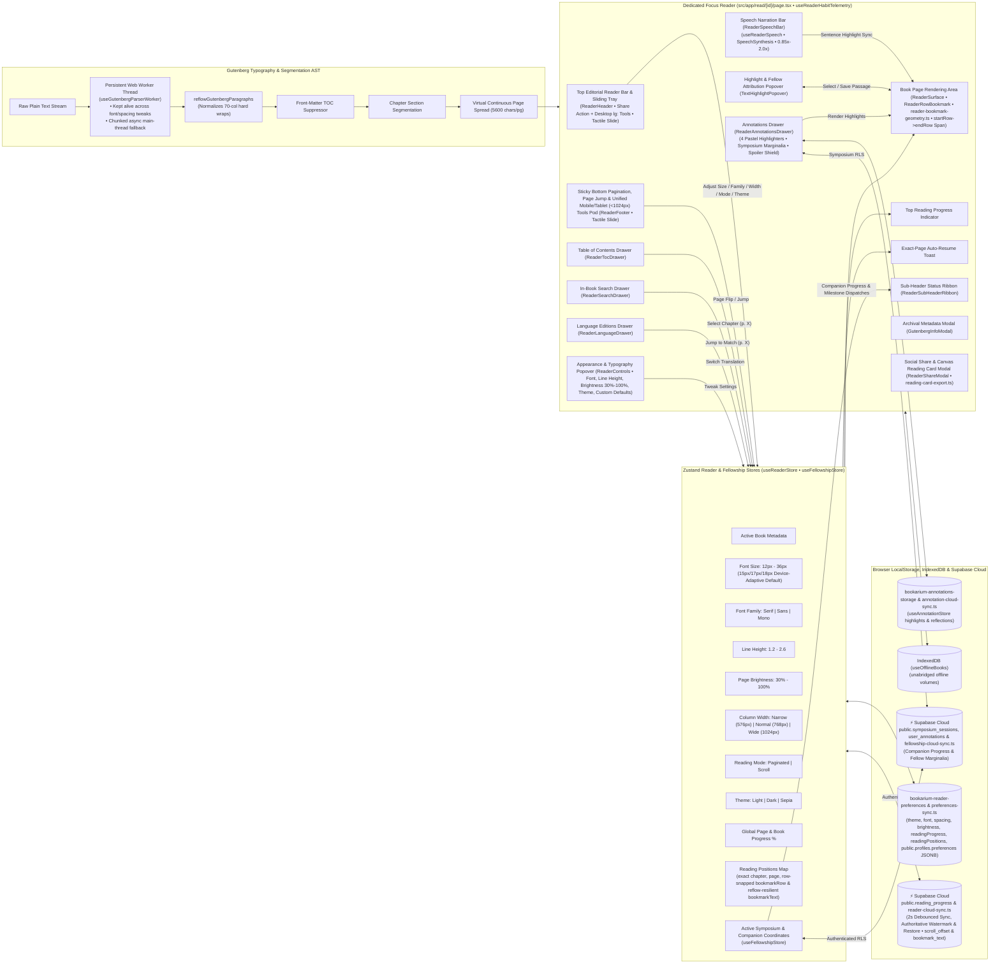

---

### 3. Bookmarks & Continue Reading Ledger Architecture

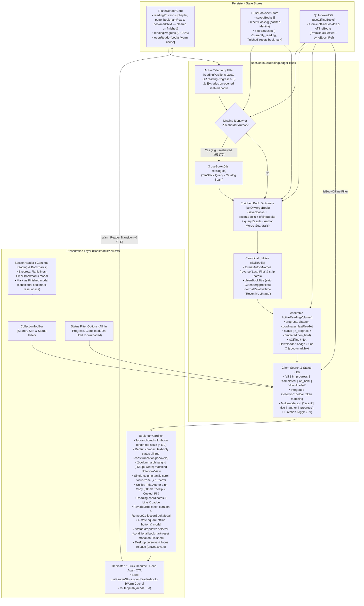

---

## 🧩 Component Catalog & Props Interface Matrix

Auto-extracted dynamically from **106 Production UI Components** using Babel AST:

| Component | Category | Exported Props Interface | Primary Props & Signals | Module Link |
| :--- | :--- | :--- | :--- | :--- |
| **`AccoladeCelebrationModal`** | Accolades | `AccoladeCelebrationModalProps` | `accolade`, `onDismiss` | [`src/components/accolades/AccoladeCelebrationModal.tsx`](src/components/accolades/AccoladeCelebrationModal.tsx) |
| **`ExLibrisBookplate`** | Accolades | `ExLibrisBookplateProps` | `definition`, `progress`, `onTogglePin`, `isPinningDisabled` | [`src/components/accolades/ExLibrisBookplate.tsx`](src/components/accolades/ExLibrisBookplate.tsx) |
| **`AccountAccoladesCard`** | Account | `AccountAccoladesCardProps` | `userId` | [`src/components/account/AccountAccoladesCard.tsx`](src/components/account/AccountAccoladesCard.tsx) |
| **`AccountDeleteModal`** | Account | `AccountDeleteModalProps` | `isOpen`, `onClose`, `userEmail`, `isSendingDeletionEmail`, `deletionEmailSent`, `deleteError`, `onRequestDeletion` | [`src/components/account/AccountDeleteModal.tsx`](src/components/account/AccountDeleteModal.tsx) |
| **`AccountHabitsCard`** | Account | `AccountHabitsCardProps` | `userId`, `completedBooksCount` | [`src/components/account/AccountHabitsCard.tsx`](src/components/account/AccountHabitsCard.tsx) |
| **`AccountIdentityCard`** | Account | `AccountIdentityCardProps` | `user`, `profile`, `formattedDate`, `displayName`, `onDisplayNameChange`, `onSaveProfile`, `isSaving`, `saveSuccess`, `saveError`, `onResendVerification`, `isResendingVerification`, `resendSuccess`, `resendError`, `resendCooldown`, `stats`, `onOpenLibraryBreakdown`, `onSignOut` | [`src/components/account/AccountIdentityCard.tsx`](src/components/account/AccountIdentityCard.tsx) |
| **`AccountNarrationSubPanel`** | Account | `AccountNarrationSubPanelProps` | `isActive`, `speechRate`, `onSpeechRateChange`, `speechVoiceURI`, `onSpeechVoiceChange`, `speechAutoPageAdvance`, `onSpeechAutoPageAdvanceChange`, `speechHighlightEnabled`, `onSpeechHighlightEnabledChange`, `onResetSpeechPreferences` | [`src/components/account/AccountNarrationSubPanel.tsx`](src/components/account/AccountNarrationSubPanel.tsx) |
| **`AccountPreferencesSection`** | Account | `AccountPreferencesSectionProps` | `theme`, `onThemeChange`, `stickyScrollEnabled`, `onStickyScrollChange`, `fontFamily`, `onFontFamilyChange`, `fontSize`, `onFontSizeChange`, `lineHeight`, `onLineHeightChange`, `brightness`, `onBrightnessChange`, `readingMode`, `onReadingModeChange`, `columnWidth`, `onColumnWidthChange`, `spoilerShieldEnabled`, `onSpoilerShieldChange`, `exitBookmarkReminderEnabled`, `onExitBookmarkReminderChange`, `speechRate`, `onSpeechRateChange`, `speechVoiceURI`, `onSpeechVoiceChange`, `speechAutoPageAdvance`, `onSpeechAutoPageAdvanceChange`, `speechHighlightEnabled`, `onSpeechHighlightEnabledChange`, `onResetSpeechPreferences`, `hasCustomDefaults`, `isAtCustomDefaults`, `isAtFactoryDefaults`, `onSaveCustomDefaults`, `onRevertToCustomDefaults`, `onResetToFactoryDefaults` | [`src/components/account/AccountPreferencesSection.tsx`](src/components/account/AccountPreferencesSection.tsx) |
| **`AccountPublicProfileSection`** | Account | `AccountPublicProfileSectionProps` | `user`, `profile`, `onUpdateProfile` | [`src/components/account/AccountPublicProfileSection.tsx`](src/components/account/AccountPublicProfileSection.tsx) |
| **`AccountSecuritySection`** | Account | `AccountSecuritySectionProps` | `currentPassword`, `newPassword`, `confirmPassword`, `showPassword`, `copiedPassword`, `isUpdatingPassword`, `passwordSuccess`, `passwordError`, `strength`, `isRecoveryMode`, `isSendingResetEmail`, `resetEmailSent`, `resetEmailError`, `resetCooldown`, `onCurrentPasswordChange`, `onNewPasswordChange`, `onConfirmPasswordChange`, `onToggleShowPassword`, `onGeneratePassword`, `onUpdatePassword`, `onRequestPasswordReset`, `onSignOut`, `onOpenDeleteModal`, `userEmail`, `hasGoogleIdentity`, `hasPasswordIdentity`, `canUnlinkGoogle`, `googleIdentityEmail`, `isLinkingGoogle`, `isUnlinkingGoogle`, `identitySuccess`, `identityError`, `onLinkGoogle`, `onUnlinkGoogle` | [`src/components/account/AccountSecuritySection.tsx`](src/components/account/AccountSecuritySection.tsx) |
| **`AccountSymposiumSection`** | Account | `AccountSymposiumSectionProps` | `userId` | [`src/components/account/AccountSymposiumSection.tsx`](src/components/account/AccountSymposiumSection.tsx) |
| **`AccountTypographySubPanel`** | Account | `AccountTypographySubPanelProps` | `theme`, `fontFamily`, `onFontFamilyChange`, `fontSize`, `onFontSizeChange`, `lineHeight`, `onLineHeightChange`, `brightness`, `onBrightnessChange`, `readingMode`, `onReadingModeChange`, `columnWidth`, `onColumnWidthChange`, `spoilerShieldEnabled`, `onSpoilerShieldChange`, `exitBookmarkReminderEnabled`, `onExitBookmarkReminderChange` | [`src/components/account/AccountTypographySubPanel.tsx`](src/components/account/AccountTypographySubPanel.tsx) |
| **`FellowshipInvitationsSubTab`** | Account/symposium | `FellowshipInvitationsSubTabProps` | `userId`, `pendingCircles`, `pendingSymposiums`, `isOffline`, `onAcceptCircleInvite`, `onDeclineCircleInvite`, `onCancelCircleInvite`, `onAcceptSymposiumInvite`, `onDeclineSymposiumInvite`, `onCancelSymposiumInvite` | [`src/components/account/symposium/FellowshipInvitationsSubTab.tsx`](src/components/account/symposium/FellowshipInvitationsSubTab.tsx) |
| **`ReaderCircleSubTab`** | Account/symposium | `ReaderCircleSubTabProps` | `acceptedFellows`, `isOffline`, `inviteHandle`, `onInviteHandleChange`, `isInviting`, `inviteError`, `inviteSuccess`, `onInviteSubmit`, `onOpenSymposiumWithFellow`, `onRequestRemoveFellow` | [`src/components/account/symposium/ReaderCircleSubTab.tsx`](src/components/account/symposium/ReaderCircleSubTab.tsx) |
| **`SymposiumPactsSubTab`** | Account/symposium | `SymposiumPactsSubTabProps` | `userId`, `activeSymposiums`, `isOffline`, `isBookOffline`, `onOpenNewSymposiumModal`, `onRequestLeaveSymposium` | [`src/components/account/symposium/SymposiumPactsSubTab.tsx`](src/components/account/symposium/SymposiumPactsSubTab.tsx) |
| **`AuthModal`** | Auth | _Autonomous_ | None (Self-Contained) | [`src/components/auth/AuthModal.tsx`](src/components/auth/AuthModal.tsx) |
| **`EmailSentView`** | Auth | `EmailSentViewProps` | `title`, `email`, `messagePrefix`, `subtitle`, `resendSuccess`, `onResend`, `isResending`, `resendCooldown`, `onBackToSignIn`, `backButtonLabel` | [`src/components/auth/EmailSentView.tsx`](src/components/auth/EmailSentView.tsx) |
| **`ReadingStatusSelector`** | Bookshelf | `ReadingStatusSelectorProps` | `status`, `onChange`, `bookId`, `bookTitle`, `size`, `showClear`, `className` | [`src/components/bookshelf/ReadingStatusSelector.tsx`](src/components/bookshelf/ReadingStatusSelector.tsx) |
| **`ContentCrossfade`** | Motion | `ContentCrossfadeProps` | `transitionKey`, `children`, `variant`, `className`, `style`, `dataTestId` | [`src/components/motion/ContentCrossfade.tsx`](src/components/motion/ContentCrossfade.tsx) |
| **`motion-config`** | Motion | _Autonomous_ | None (Self-Contained) | [`src/components/motion/motion-config.ts`](src/components/motion/motion-config.ts) |
| **`MotionReveal`** | Motion | `MotionRevealProps` | `children`, `delay`, `className` | [`src/components/motion/MotionReveal.tsx`](src/components/motion/MotionReveal.tsx) |
| **`StaggerGroup`** | Motion | `StaggerGroupProps` | `children`, `className` | [`src/components/motion/StaggerGroup.tsx`](src/components/motion/StaggerGroup.tsx) |
| **`AdvancedFilterDrawer`** | Presentation | `AdvancedFilterDrawerProps` | `isOpen`, `onClose`, `selectedEra`, `onEraChange`, `selectedSort`, `onSortChange`, `selectedTopic`, `onTopicChange`, `selectedLanguage`, `onLanguageChange`, `selectedFormat`, `onFormatChange`, `onApplyFilters`, `onResetAll`, `activeFilterCount` | [`src/components/presentation/AdvancedFilterDrawer.tsx`](src/components/presentation/AdvancedFilterDrawer.tsx) |
| **`BookCard`** | Presentation | `BookCardProps` | `book`, `isOffline`, `hideOfflineBadge`, `onDownloadClick`, `onRemoveOfflineClick`, `onPreviewClick`, `isPreviewActive`, `activeView`, `onTopicClick` | [`src/components/presentation/BookCard.tsx`](src/components/presentation/BookCard.tsx) |
| **`BookGrid`** | Presentation | `BookGridProps` | `books`, `isLoading`, `isError`, `onRetry`, `page`, `onPageChange`, `hasNextPage`, `onDownloadClick`, `onRemoveOfflineClick`, `onPreviewClick`, `activePreviewBookId`, `emptyTitle`, `emptyDescription`, `viewMode`, `onViewModeChange`, `initialViewMode`, `showViewToggle`, `onBrowseCatalog`, `searchQuery`, `onClearSearch`, `activeView`, `showShelfControls`, `totalBooksCount`, `onTopicClick`, `pageSize` | [`src/components/presentation/BookGrid.tsx`](src/components/presentation/BookGrid.tsx) |
| **`BookmarkCard`** | Presentation | `BookmarkCardProps` | `volume`, `isOffline`, `isDownloadingOffline`, `isActive`, `onActivate`, `onDeactivate`, `onToggleOffline`, `onResume`, `onStatusChange`, `onClear` | [`src/components/presentation/BookmarkCard.tsx`](src/components/presentation/BookmarkCard.tsx) |
| **`BookmarksView`** | Presentation | `BookmarksViewProps` | `onBrowseCatalog` | [`src/components/presentation/BookmarksView.tsx`](src/components/presentation/BookmarksView.tsx) |
| **`BookPreviewModal`** | Presentation | `BookPreviewModalProps` | `book`, `originRect`, `isOpen`, `activeView`, `isOffline`, `isDownloadingOffline`, `onToggleOffline`, `onWillClose`, `onClose`, `onReadBook` | [`src/components/presentation/BookPreviewModal.tsx`](src/components/presentation/BookPreviewModal.tsx) |
| **`BookshelfRack`** | Presentation | `BookshelfRackProps` | `books`, `onBookClick`, `onDownloadClick`, `onBrowseCatalog`, `searchQuery`, `onClearSearch`, `showShelfControls`, `totalBooksCount` | [`src/components/presentation/BookshelfRack.tsx`](src/components/presentation/BookshelfRack.tsx) |
| **`CatalogMobileBottomDock`** | Presentation | `CatalogMobileBottomDockProps` | `isMobileDockVisible`, `mobileDockThreshold`, `mobileDockIdleTimeoutMs`, `isSearchOpen`, `onSearchToggle`, `searchQuery`, `isFiltersOpen`, `onOpenFilters`, `activeFilterCount`, `viewMode`, `onViewModeChange`, `currentSort`, `onSortToggle` | [`src/components/presentation/CatalogMobileBottomDock.tsx`](src/components/presentation/CatalogMobileBottomDock.tsx) |
| **`CatalogOfflineView`** | Presentation | `CatalogOfflineViewProps` | `onNavigateView`, `savedCount`, `favoriteCount`, `bookmarksCount`, `annotationsCount` | [`src/components/presentation/CatalogOfflineView.tsx`](src/components/presentation/CatalogOfflineView.tsx) |
| **`CatalogTelemetryBadge`** | Presentation | `CatalogTelemetryBadgeProps` | `page`, `activeFetching`, `latencyMs`, `catalogSource`, `isError` | [`src/components/presentation/CatalogTelemetryBadge.tsx`](src/components/presentation/CatalogTelemetryBadge.tsx) |
| **`CollectionBottomDock`** | Presentation | `CollectionBottomDockProps` | `isVisible`, `threshold`, `idleTimeoutMs`, `searchQuery`, `isSearchOpen`, `onSearchToggle`, `activeFilterCount`, `isFiltersOpen`, `onOpenFilters`, `modeType`, `viewMode`, `onViewModeToggle`, `sortDirection`, `onDirectionToggle`, `isDirectionDisabled`, `onScrollToTop`, `className` | [`src/components/presentation/CollectionBottomDock.tsx`](src/components/presentation/CollectionBottomDock.tsx) |
| **`CollectionClearConfirmModal`** | Presentation | `CollectionClearConfirmModalProps` | `isOpen`, `onClose`, `title`, `heading`, `description`, `confirmLabel`, `onConfirm` | [`src/components/presentation/CollectionClearConfirmModal.tsx`](src/components/presentation/CollectionClearConfirmModal.tsx) |
| **`CollectionFilterDrawer`** | Presentation | `CollectionFilterDrawerProps` | `isOpen`, `onClose`, `title`, `subtitle`, `activeFilterCount`, `onResetAll`, `onApply`, `shelfOptions`, `selectedShelfId`, `onSelectShelf`, `shelfSectionTitle`, `viewMode`, `onViewModeChange`, `sortOptions`, `selectedSort`, `onSortChange`, `sortSectionTitle`, `sortDirection`, `onDirectionToggle`, `onDirectionChange`, `isDirectionDisabled` | [`src/components/presentation/CollectionFilterDrawer.tsx`](src/components/presentation/CollectionFilterDrawer.tsx) |
| **`CollectionFloatingSearch`** | Presentation | `CollectionFloatingSearchProps` | `isOpen`, `onClose`, `searchQuery`, `onSearchChange`, `searchPlaceholder`, `searchAriaLabel`, `clearAriaLabel`, `submitOnEnter`, `onSubmit`, `contentAnchorId`, `autoCloseOnSubmit` | [`src/components/presentation/CollectionFloatingSearch.tsx`](src/components/presentation/CollectionFloatingSearch.tsx) |
| **`CollectionSortDropdown`** | Presentation | `CollectionSortDropdownProps` | `value`, `onChange`, `options`, `ariaLabel`, `className`, `icon`, `hideLeadingIcon`, `sortDirection`, `onDirectionToggle`, `isDirectionDisabled`, `directionAriaLabel`, `dataTestId`, `selectTestId`, `compactOnMobile` | [`src/components/presentation/CollectionSortDropdown.tsx`](src/components/presentation/CollectionSortDropdown.tsx) |
| **`CollectionToolbar`** | Presentation | `CollectionToolbarProps` | `searchQuery`, `onSearchChange`, `searchPlaceholder`, `searchAriaLabel`, `clearAriaLabel`, `searchTestId`, `totalCount`, `filteredCount`, `filterValue`, `onFilterChange`, `filterOptions`, `filterAriaLabel`, `filterIcon`, `sortValue`, `onSortChange`, `sortOptions`, `sortAriaLabel`, `sortDirection`, `onDirectionToggle`, `isDirectionDisabled`, `directionAriaLabel`, `currentPage`, `totalPages`, `onPageChange`, `paginationAriaLabel`, `itemCountLabel`, `extraControls`, `singleRowOnMobile`, `hiddenOnMobile`, `className` | [`src/components/presentation/CollectionToolbar.tsx`](src/components/presentation/CollectionToolbar.tsx) |
| **`CollectionTopPagination`** | Presentation | `CollectionTopPaginationProps` | `currentPage`, `totalPages`, `onPageChange`, `className`, `ariaLabel` | [`src/components/presentation/CollectionTopPagination.tsx`](src/components/presentation/CollectionTopPagination.tsx) |
| **`ContentAdvisoryBanner`** | Presentation | `ContentAdvisoryBannerProps` | `matchedSubject`, `message`, `title`, `compact`, `testId`, `className` | [`src/components/presentation/ContentAdvisoryBanner.tsx`](src/components/presentation/ContentAdvisoryBanner.tsx) |
| **`CopyrightNoticeBanner`** | Presentation | `CopyrightNoticeBannerProps` | `country`, `ruleDescription`, `reason`, `publicDomainYear`, `title`, `subtext`, `compact`, `testId`, `className` | [`src/components/presentation/CopyrightNoticeBanner.tsx`](src/components/presentation/CopyrightNoticeBanner.tsx) |
| **`DownloadDrawer`** | Presentation | `DownloadDrawerProps` | `book`, `isOpen`, `onClose` | [`src/components/presentation/DownloadDrawer.tsx`](src/components/presentation/DownloadDrawer.tsx) |
| **`EditorialQuoteSection`** | Presentation | `EditorialQuoteSectionProps` | `heroBookId`, `className` | [`src/components/presentation/EditorialQuoteSection.tsx`](src/components/presentation/EditorialQuoteSection.tsx) |
| **`Footer`** | Presentation | _Autonomous_ | None (Self-Contained) | [`src/components/presentation/Footer.tsx`](src/components/presentation/Footer.tsx) |
| **`HeroFeaturedBook2DCard`** | Presentation | `HeroFeaturedBook2DCardProps` | `featuredBook`, `onReadFeaturedBook`, `coverQuote`, `coverLineClampClass`, `quoteRevealClass`, `isTurningLeaf`, `canShuffle`, `onShuffle` | [`src/components/presentation/HeroFeaturedBook2DCard.tsx`](src/components/presentation/HeroFeaturedBook2DCard.tsx) |
| **`HeroFeaturedBook3D`** | Presentation | `HeroFeaturedBook3DProps` | `featuredBook`, `onReadFeaturedBook`, `isQuoteDataReady` | [`src/components/presentation/HeroFeaturedBook3D.tsx`](src/components/presentation/HeroFeaturedBook3D.tsx) |
| **`HeroSearch`** | Presentation | `HeroSearchProps` | `search`, `onSearchChange`, `onSearch`, `selectedTopic`, `onTopicChange`, `onTopicSelect`, `selectedLanguage`, `onLanguageChange`, `onReadFeaturedBook`, `featuredBook`, `books` | [`src/components/presentation/HeroSearch.tsx`](src/components/presentation/HeroSearch.tsx) |
| **`LanguageSelector`** | Presentation | `LanguageSelectorProps` | `value`, `onChange`, `variant`, `id`, `dataTestId`, `className`, `showIcon` | [`src/components/presentation/LanguageSelector.tsx`](src/components/presentation/LanguageSelector.tsx) |
| **`LiteraryQuotes`** | Presentation | _Autonomous_ | None (Self-Contained) | [`src/components/presentation/LiteraryQuotes.tsx`](src/components/presentation/LiteraryQuotes.tsx) |
| **`Navbar`** | Presentation | `NavbarProps` | `activeView`, `onViewChange`, `onBrandReset`, `isVisible`, `hasShadow`, `initialIsAuthenticated` | [`src/components/presentation/Navbar.tsx`](src/components/presentation/Navbar.tsx) |
| **`NotablePassagesSpread`** | Presentation | `NotablePassagesSpreadProps` | `passage`, `title`, `hasContentAdvisory`, `cardHeight`, `isRestricted`, `isUnavailableOffline`, `country`, `isLoading`, `evaluation` | [`src/components/presentation/NotablePassagesSpread.tsx`](src/components/presentation/NotablePassagesSpread.tsx) |
| **`NotebookQuoteCard`** | Presentation | `NotebookQuoteCardProps` | `annotation`, `pairedFellowAnnotation`, `matchingOwnAnnotation`, `bookTitle`, `bookAuthor`, `isRestricted`, `isUnavailableOffline`, `jurisdictionCountry`, `isActive`, `onActivate`, `isEditing`, `onStartEdit`, `onCancelEdit`, `onSaveNote`, `onUpdateColor`, `onRequestDeleteReflection`, `onRequestDeleteAnnotation`, `onJumpToReader`, `onSaveFellowAsOwn` | [`src/components/presentation/NotebookQuoteCard.tsx`](src/components/presentation/NotebookQuoteCard.tsx) |
| **`NotebookView`** | Presentation | `NotebookViewProps` | `onBrowseCatalog` | [`src/components/presentation/NotebookView.tsx`](src/components/presentation/NotebookView.tsx) |
| **`OpenBookLeftPageSpread`** | Presentation | `OpenBookLeftPageSpreadProps` | `bookId`, `title`, `authorDisplay`, `passage`, `rightHeaderLabel`, `primarySubject`, `fullPrimarySubject`, `subjectMaxWidthClass`, `cardHeight`, `hasCommentary`, `isRestricted`, `isUnavailableOffline`, `country`, `contentAdvisory`, `restrictedBadgeTestId`, `offlineBadgeTestId`, `advisoryTestId`, `enableCopyMeta`, `copyMetaTestId`, `copyTooltipAuthor`, `bodyTestId`, `quotesContainerTestId`, `secondaryQuoteTestId`, `tertiaryQuoteTestId`, `quoteRevealClass`, `scrollableBody` | [`src/components/presentation/OpenBookLeftPageSpread.tsx`](src/components/presentation/OpenBookLeftPageSpread.tsx) |
| **`StickyCatalogToolbar`** | Presentation | `StickyCatalogToolbarProps` | `page`, `onPageChange`, `hasNextPage`, `viewMode`, `onViewModeChange`, `onOpenFilters`, `isFiltersOpen`, `activeFilterCount`, `activeFilterChips`, `onClearAllFilters`, `isFetching`, `onPrefetchNext`, `latencyMs`, `catalogSource`, `isError`, `pageSize`, `onPageSizeChange`, `isHeaderVisible`, `isVisible`, `isDocked`, `isMobileDockVisible`, `mobileDockThreshold`, `mobileDockIdleTimeoutMs`, `currentSort`, `onSortToggle`, `isSearchOpen`, `onSearchToggle`, `searchQuery` | [`src/components/presentation/StickyCatalogToolbar.tsx`](src/components/presentation/StickyCatalogToolbar.tsx) |
| **`BookshelfManageModals`** | Presentation (Bookshelf) | `BookshelfManageModalsProps` | `isCreatingShelf`, `newShelfName`, `newShelfIsPublic`, `onNewShelfNameChange`, `onNewShelfIsPublicChange`, `onCloseCreateShelf`, `onCreateShelf`, `editingShelfId`, `editingShelfName`, `editingShelfIsPublic`, `onEditingShelfNameChange`, `onEditingShelfIsPublicChange`, `onCloseRenameShelf`, `onRenameShelf`, `deletingShelfId`, `onCloseDeleteShelf`, `onDeleteShelf`, `isClearingOfflineShelf`, `onCloseClearOfflineShelf`, `onConfirmClearOfflineShelf`, `isSubmitting` | [`src/components/presentation/bookshelf/BookshelfManageModals.tsx`](src/components/presentation/bookshelf/BookshelfManageModals.tsx) |
| **`BookshelfMobileModal`** | Presentation (Bookshelf) | `BookshelfMobileModalProps` | `selectedMobileBook`, `isClosingMobileSheet`, `onClose`, `readingProgress`, `isSaved`, `isFavorite`, `isOffline`, `isDownloadingOffline`, `onToggleSave`, `onToggleFavorite`, `onToggleOffline`, `onBookClick`, `onDownloadClick`, `cloudBookshelves`, `cloudBookshelfItems`, `defaultShelfId`, `currentActiveShelfId`, `userId`, `onMoveBookToShelf`, `activeView`, `className` | [`src/components/presentation/bookshelf/BookshelfMobileModal.tsx`](src/components/presentation/bookshelf/BookshelfMobileModal.tsx) |
| **`BookshelfSpine`** | Presentation (Bookshelf) | `BookshelfSpineProps` | `book`, `bookIndex`, `readingProgress`, `isSaved`, `isFavorite`, `isOffline`, `isDownloadingOffline`, `onToggleSave`, `onToggleFavorite`, `onToggleOffline`, `onSpineClick`, `onBookClick`, `onDownloadClick`, `cloudBookshelves`, `cloudBookshelfItems`, `defaultShelfId`, `currentActiveShelfId`, `userId`, `onMoveBookToShelf`, `isActive` | [`src/components/presentation/bookshelf/BookshelfSpine.tsx`](src/components/presentation/bookshelf/BookshelfSpine.tsx) |
| **`NotebookFilterStrip`** | Presentation/notebook | `NotebookFilterStripProps` | `selectedColor`, `onSelectColor`, `marginaliaSourceFilter`, `onSelectSourceFilter`, `ownCount`, `fellowCount`, `pairedAllCount`, `sourceFilteredItems` | [`src/components/presentation/notebook/NotebookFilterStrip.tsx`](src/components/presentation/notebook/NotebookFilterStrip.tsx) |
| **`NotebookVolumeGroup`** | Presentation/notebook | `NotebookVolumeGroupProps` | `group`, `isUnavailableOffline`, `onOpenVolume`, `renderQuoteCard` | [`src/components/presentation/notebook/NotebookVolumeGroup.tsx`](src/components/presentation/notebook/NotebookVolumeGroup.tsx) |
| **`QuickColorSwatchPopover`** | Presentation/notebook | `QuickColorSwatchPopoverProps` | `annotationId`, `activeColor`, `savedColor`, `isEditing`, `onSelectColor` | [`src/components/presentation/notebook/QuickColorSwatchPopover.tsx`](src/components/presentation/notebook/QuickColorSwatchPopover.tsx) |
| **`PinnedAccoladesShelf`** | Profile | `PinnedAccoladesShelfProps` | `pinnedItems` | [`src/components/profile/PinnedAccoladesShelf.tsx`](src/components/profile/PinnedAccoladesShelf.tsx) |
| **`PrivateProfileNotice`** | Profile | `PrivateProfileNoticeProps` | `username` | [`src/components/profile/PrivateProfileNotice.tsx`](src/components/profile/PrivateProfileNotice.tsx) |
| **`PublicProfileView`** | Profile | `PublicProfileViewProps` | `profile`, `pinnedAccolades`, `habits`, `bookshelves` | [`src/components/profile/PublicProfileView.tsx`](src/components/profile/PublicProfileView.tsx) |
| **`ServiceWorkerRegister`** | Pwa | _Autonomous_ | None (Self-Contained) | [`src/components/pwa/ServiceWorkerRegister.tsx`](src/components/pwa/ServiceWorkerRegister.tsx) |
| **`DeleteAnnotationModal`** | Reader | `DeleteAnnotationModalProps` | `isOpen`, `onClose`, `onConfirm`, `annotation`, `title`, `description` | [`src/components/reader/DeleteAnnotationModal.tsx`](src/components/reader/DeleteAnnotationModal.tsx) |
| **`GutenbergInfoModal`** | Reader | `GutenbergInfoModalProps` | `isOpen`, `onClose`, `bookId`, `title`, `author`, `theme`, `subjects`, `bookshelves` | [`src/components/reader/GutenbergInfoModal.tsx`](src/components/reader/GutenbergInfoModal.tsx) |
| **`QuoteDeletePreview`** | Reader | `QuoteDeletePreviewProps` | `selectedText`, `note` | [`src/components/reader/QuoteDeletePreview.tsx`](src/components/reader/QuoteDeletePreview.tsx) |
| **`ReaderAnnotationsDrawer`** | Reader | `ReaderAnnotationsDrawerProps` | `isOpen`, `onClose`, `annotations`, `fellowAnnotations`, `hasActiveSymposium`, `symposiumCompanionUsername`, `symposiumCompanionDisplayName`, `activeChapterIndex`, `marginaliaSourceFilter`, `onSourceFilterChange`, `spoilerShieldEnabled`, `onToggleSpoilerShield`, `bookTitle`, `theme`, `onJumpToAnnotation`, `onDeleteAnnotation`, `onUpdateNote`, `onSaveFellowAnnotation` | [`src/components/reader/ReaderAnnotationsDrawer.tsx`](src/components/reader/ReaderAnnotationsDrawer.tsx) |
| **`ReaderControls`** | Reader | `ReaderControlsProps` | `isOpen`, `onClose`, `fontSize`, `onFontSizeChange`, `lineHeight`, `onLineHeightChange`, `fontFamily`, `onFontFamilyChange`, `theme`, `onThemeChange`, `brightness`, `onBrightnessChange`, `readingMode`, `onReadingModeChange`, `columnWidth`, `onColumnWidthChange`, `hasCustomDefaults`, `isAtCustomDefaults`, `isAtFactoryDefaults`, `onRevertToCustomDefaults`, `onResetToFactoryDefaults`, `exitBookmarkReminderEnabled`, `onExitBookmarkReminderChange` | [`src/components/reader/ReaderControls.tsx`](src/components/reader/ReaderControls.tsx) |
| **`ReaderDrawerShell`** | Reader | `ReaderDrawerShellProps` | `isOpen`, `onClose`, `title`, `titleIcon`, `theme`, `children`, `ariaLabel`, `closeAriaLabel`, `backdropTestId`, `panelTestId`, `className`, `role` | [`src/components/reader/ReaderDrawerShell.tsx`](src/components/reader/ReaderDrawerShell.tsx) |
| **`ReaderErrorView`** | Reader | `ReaderErrorViewProps` | `activeTheme`, `onRetry`, `error`, `bookTitle`, `bookAuthor` | [`src/components/reader/ReaderErrorView.tsx`](src/components/reader/ReaderErrorView.tsx) |
| **`ReaderExitBookmarkModal`** | Reader | `ReaderExitBookmarkModalProps` | `isOpen`, `onClose`, `onConfirmExitWithoutSaving`, `onConfirmBookmarkAndExit`, `bookTitle`, `currentPage`, `isUnderThreshold`, `theme`, `initialReminderEnabled`, `onToggleReminder` | [`src/components/reader/ReaderExitBookmarkModal.tsx`](src/components/reader/ReaderExitBookmarkModal.tsx) |
| **`ReaderFloatingToolsPod`** | Reader | `ReaderFloatingToolsPodProps` | `theme`, `onToggleSearch`, `onToggleControls`, `onToggleAnnotations`, `onToggleSpeech`, `onToggleTranslations`, `onThemeChange`, `isTocOpen`, `isSearchOpen`, `isControlsOpen`, `isAnnotationsOpen`, `isSpeechOpen`, `isTranslationsOpen`, `isSelectionPopoverOpen`, `annotationsCount`, `isHidden`, `scheduleIdleDimRef` | [`src/components/reader/ReaderFloatingToolsPod.tsx`](src/components/reader/ReaderFloatingToolsPod.tsx) |
| **`ReaderFooter`** | Reader | `ReaderFooterProps` | `globalPage`, `totalBookPages`, `chapterTitle`, `chapterPage`, `chapterPageCount`, `onPrevPage`, `onNextPage`, `onPageJump`, `isPrevDisabled`, `isNextDisabled`, `readingMode`, `theme`, `currentChapterIndex`, `totalChapters`, `onSelectChapter`, `onToggleToc`, `onToggleControls`, `onToggleSearch`, `onToggleSpeech`, `onToggleAnnotations`, `onToggleTranslations`, `onThemeChange`, `isTocOpen`, `isControlsOpen`, `isSearchOpen`, `isSpeechOpen`, `isAnnotationsOpen`, `isTranslationsOpen`, `isSelectionPopoverOpen`, `annotationsCount`, `isHidden` | [`src/components/reader/ReaderFooter.tsx`](src/components/reader/ReaderFooter.tsx) |
| **`ReaderHeader`** | Reader | `ReaderHeaderProps` | `title`, `author`, `bookId`, `progress`, `onBack`, `isTocOpen`, `onToggleToc`, `isSearchOpen`, `onToggleSearch`, `isControlsOpen`, `onToggleControls`, `isTranslationsOpen`, `onToggleTranslations`, `isSpeechOpen`, `onToggleSpeech`, `isAnnotationsOpen`, `onToggleAnnotations`, `annotationsCount`, `theme`, `totalChapters`, `currentChapterIndex`, `onThemeChange`, `resumeNotice`, `onRestart`, `onDismissResume`, `translations`, `isTranslationsLoading`, `onSelectTranslation`, `symposiumCompanion`, `symposiumMilestoneNotice`, `onDismissSymposiumMilestone`, `isHidden` | [`src/components/reader/ReaderHeader.tsx`](src/components/reader/ReaderHeader.tsx) |
| **`ReaderLanguageDrawer`** | Reader | `ReaderLanguageDrawerProps` | `isOpen`, `onClose`, `translations`, `onSelectTranslation`, `theme` | [`src/components/reader/ReaderLanguageDrawer.tsx`](src/components/reader/ReaderLanguageDrawer.tsx) |
| **`ReaderLoadingView`** | Reader | `ReaderLoadingViewProps` | `activeTheme` | [`src/components/reader/ReaderLoadingView.tsx`](src/components/reader/ReaderLoadingView.tsx) |
| **`ReaderRowBookmark`** | Reader | `ReaderRowBookmarkProps` | `bookmarkElRef`, `effectiveStartRow`, `effectiveEndRow`, `bookmarkSpanRows`, `estimatedMaxBookmarkRows`, `lineStepPx`, `isBookmarkActive`, `isDraggingBookmark`, `getMaxBookmarkRows`, `computeRowFromClientY`, `onStartDrag`, `onEmitRowChange` | [`src/components/reader/ReaderRowBookmark.tsx`](src/components/reader/ReaderRowBookmark.tsx) |
| **`ReaderSearchDrawer`** | Reader | `ReaderSearchDrawerProps` | `isOpen`, `onClose`, `chapters`, `fontSize`, `onSelectMatch`, `bookTitle`, `theme` | [`src/components/reader/ReaderSearchDrawer.tsx`](src/components/reader/ReaderSearchDrawer.tsx) |
| **`ReaderShareModal`** | Reader | `ReaderShareModalProps` | `isOpen`, `onClose`, `bookId`, `title`, `author`, `theme`, `progress`, `currentChapterIndex`, `totalChapters` | [`src/components/reader/ReaderShareModal.tsx`](src/components/reader/ReaderShareModal.tsx) |
| **`ReaderSpeechBar`** | Reader | `ReaderSpeechBarProps` | `speech`, `isOpen`, `onClose`, `isDrawerOpen`, `isPlaying`, `isPaused`, `currentSentenceIndex`, `totalSentences`, `rate`, `availableVoices`, `naturalVoices`, `standardVoices`, `selectedVoice`, `onPlay`, `onPause`, `onResume`, `onSkipNext`, `onSkipPrev`, `onRateChange`, `onVoiceChange`, `theme`, `bookTitle`, `currentPage`, `totalPages`, `isPrevDisabled`, `isNextDisabled` | [`src/components/reader/ReaderSpeechBar.tsx`](src/components/reader/ReaderSpeechBar.tsx) |
| **`ReaderSubHeaderRibbon`** | Reader | `ReaderSubHeaderRibbonProps` | `bookId`, `progress`, `totalChapters`, `currentChapterIndex`, `theme`, `resumeNotice`, `onRestart`, `onDismissResume`, `onOpenInfoModal`, `symposiumCompanion`, `symposiumMilestoneNotice`, `onDismissSymposiumMilestone` | [`src/components/reader/ReaderSubHeaderRibbon.tsx`](src/components/reader/ReaderSubHeaderRibbon.tsx) |
| **`ReaderSurface`** | Reader | `ReaderSurfaceProps` | `theme`, `brightness`, `fontFamily`, `fontSize`, `lineHeight`, `columnWidth`, `readingMode`, `chapter`, `currentPageText`, `chapterPage`, `bookmarkRow`, `bookmarkText`, `onBookmarkRowChange`, `activeChapterIndex`, `totalChapters`, `isLoading`, `isError`, `error`, `onRetry`, `bookTitle`, `bookAuthor`, `onPreviousPage`, `onNextPage`, `onFontSizeChange`, `onTapSurface`, `isSpeechOpen`, `highlightedSentence`, `annotations`, `targetAnnotationId`, `onSelectAnnotation`, `onTextSelected` | [`src/components/reader/ReaderSurface.tsx`](src/components/reader/ReaderSurface.tsx) |
| **`ReaderTocDrawer`** | Reader | `ReaderTocDrawerProps` | `isOpen`, `onClose`, `chapters`, `activeChapterIndex`, `onSelectChapter`, `bookTitle`, `theme` | [`src/components/reader/ReaderTocDrawer.tsx`](src/components/reader/ReaderTocDrawer.tsx) |
| **`TextHighlightPopover`** | Reader | `TextHighlightPopoverProps` | `isOpen`, `selectedText`, `position`, `activeColor`, `existingNote`, `existingAnnotationId`, `fellowAnnotation`, `isFellowOnly`, `onSelectColor`, `onSaveNote`, `onDelete`, `onCopyQuote`, `onClose`, `theme` | [`src/components/reader/TextHighlightPopover.tsx`](src/components/reader/TextHighlightPopover.tsx) |
| **`VolumeCompletionModal`** | Reader | `VolumeCompletionModalProps` | `isOpen`, `onClose`, `bookTitle`, `bookRating`, `onRateChange`, `onOpenBookshelf` | [`src/components/reader/VolumeCompletionModal.tsx`](src/components/reader/VolumeCompletionModal.tsx) |
| **`SymposiumInviteModal`** | Symposium | `SymposiumInviteModalProps` | `isOpen`, `onClose`, `bookId`, `bookTitle`, `preselectedFellow` | [`src/components/symposium/SymposiumInviteModal.tsx`](src/components/symposium/SymposiumInviteModal.tsx) |
| **`AmbientCapsuleDock`** | UI | `AmbientCapsuleDockProps` | `effectiveVisible`, `isDockDimmed`, `asideTestId`, `auraTestId`, `ariaLabel`, `maxWidthClass`, `className`, `onPointerEnter`, `onPointerLeave`, `onPointerDown`, `children` | [`src/components/ui/AmbientCapsuleDock.tsx`](src/components/ui/AmbientCapsuleDock.tsx) |
| **`BackToTop`** | UI | `BackToTopProps` | `threshold`, `className` | [`src/components/ui/BackToTop.tsx`](src/components/ui/BackToTop.tsx) |
| **`Badge`** | UI | `BadgeProps` | `variant`, `size` | [`src/components/ui/Badge.tsx`](src/components/ui/Badge.tsx) |
| **`BottomSheetDrawerShell`** | UI | `BottomSheetDrawerShellProps` | `isOpen`, `onClose`, `titleId`, `title`, `subtitle`, `icon`, `dialogTestId`, `backdropTestId`, `closeBtnTestId`, `resetBtnTestId`, `applyBtnTestId`, `activeCount`, `activeFilterCount`, `headerPaddingClass`, `bodyClassName`, `onResetAll`, `onApply`, `children` | [`src/components/ui/BottomSheetDrawerShell.tsx`](src/components/ui/BottomSheetDrawerShell.tsx) |
| **`BrandLogo`** | UI | `BrandLogoProps` | `idPrefix`, `className`, `testId` | [`src/components/ui/BrandLogo.tsx`](src/components/ui/BrandLogo.tsx) |
| **`Button`** | UI | _Autonomous_ | None (Self-Contained) | [`src/components/ui/Button.tsx`](src/components/ui/Button.tsx) |
| **`Card`** | UI | `CardProps` | `variant` | [`src/components/ui/Card.tsx`](src/components/ui/Card.tsx) |
| **`ConfirmActionModal`** | UI | `ConfirmActionModalProps` | `isOpen`, `onClose`, `onConfirm`, `title`, `heading`, `description`, `confirmLabel`, `cancelLabel`, `icon`, `children`, `maxWidth`, `buttonSize`, `modalTestId`, `dialogTestId`, `confirmTestId`, `cancelTestId` | [`src/components/ui/ConfirmActionModal.tsx`](src/components/ui/ConfirmActionModal.tsx) |
| **`CursorTooltip`** | UI | `CursorTooltipProps` | `isVisible`, `mousePos`, `offset`, `children`, `className`, `testId`, `multiline` | [`src/components/ui/CursorTooltip.tsx`](src/components/ui/CursorTooltip.tsx) |
| **`EditorialUnderlineTabs`** | UI | `EditorialUnderlineTabsProps` | `tabs`, `activeTab`, `onSelectTab`, `ariaLabel`, `wrapperClassName`, `navRole`, `buttonRole`, `selectionAttr`, `inactiveLabelClass`, `hideInactiveCountOnMobile`, `compactPadding` | [`src/components/ui/EditorialUnderlineTabs.tsx`](src/components/ui/EditorialUnderlineTabs.tsx) |
| **`Input`** | UI | `InputProps` | `icon`, `onClear` | [`src/components/ui/Input.tsx`](src/components/ui/Input.tsx) |
| **`Modal`** | UI | `ModalProps` | `isOpen`, `onClose`, `title`, `children`, `className`, `maxWidth`, `showCloseButton`, `backdropClassName`, `backdropTestId`, `testId` | [`src/components/ui/Modal.tsx`](src/components/ui/Modal.tsx) |
| **`Pagination`** | UI | `PaginationProps` | `currentPage`, `totalPages`, `onPageChange`, `totalItems`, `pageSize`, `className` | [`src/components/ui/Pagination.tsx`](src/components/ui/Pagination.tsx) |
| **`PasswordStrengthMeter`** | UI | `PasswordStrengthMeterProps` | `strength`, `className` | [`src/components/ui/PasswordStrengthMeter.tsx`](src/components/ui/PasswordStrengthMeter.tsx) |
| **`RemoveCollectionBookModal`** | UI | `RemoveCollectionBookModalProps` | `isOpen`, `collectionType`, `bookTitle`, `onClose`, `onConfirm` | [`src/components/ui/RemoveCollectionBookModal.tsx`](src/components/ui/RemoveCollectionBookModal.tsx) |
| **`RemoveOfflineBookModal`** | UI | `RemoveOfflineBookModalProps` | `isOpen`, `bookTitle`, `onClose`, `onConfirm`, `isLoading` | [`src/components/ui/RemoveOfflineBookModal.tsx`](src/components/ui/RemoveOfflineBookModal.tsx) |
| **`SectionHeader`** | UI | `SectionHeaderProps` | `eyebrow`, `title`, `subtitle`, `titleAs`, `showFlankLines`, `className`, `titleClassName`, `children` | [`src/components/ui/SectionHeader.tsx`](src/components/ui/SectionHeader.tsx) |
| **`StarRating`** | UI | `StarRatingProps` | `value`, `onChange`, `size`, `readOnly`, `showLabel`, `compactOnMobile`, `className` | [`src/components/ui/StarRating.tsx`](src/components/ui/StarRating.tsx) |

---

## ⚡ State Management & Store Architecture

Zustand client-side state stores programmatically verified across **10 Persistent Modules**:

### 1. `useAccoladesStore` ([`src/stores/useAccoladesStore.ts`](src/stores/useAccoladesStore.ts))
* **Storage Key**: `STORAGE_KEYS.ACCOLADES` (localStorage)
* **Role & State**: Deterministic literary accolades evaluation, celebration queues, personal showcase pinning (max 3 bookplates), offline pin mutation queue (`pendingPinUpdates`), per-user coalesced (`coalesceInFlightByUser`) Supabase cloud synchronization with dirty-rerun tracking, and opt-in `15,000ms` passive mount cooldown (`lastAccoladesSyncByUser`, `invalidateAccoladesSyncCooldown`).

### 2. `useAnnotationStore` ([`src/stores/useAnnotationStore.ts`](src/stores/useAnnotationStore.ts))
* **Storage Key**: `STORAGE_KEYS.ANNOTATIONS` (localStorage)
* **Role & State**: Scholar marginalia, categorical pastel highlights (Yellow, Amber, Mint, Rose), co-reader Fellow Marginalia (`fellowAnnotations`), cross-volume global fellow marginalia sync (`fetchAllFellowAnnotations`), companion profile enrichment & placeholder protection (`enrichFellowAnnotations`, `resolveStaleFellowProfiles`), chapter-bound Spoiler Shield (`spoilerShieldEnabled`), per-user coalesced (`coalesceInFlightByUser`) cloud outbox synchronization with retry-loop-safe dirty tracking, and opt-in `15,000ms` passive mount/drawer cooldowns (`lastPassiveAnnotationSyncByUser`, `lastFellowBookSyncByKey`, `invalidateAnnotationSyncCooldown`) decoupled from persisted `lastAnnotationSyncAt` LWW tracking.

### 3. `useAuthStore` ([`src/stores/useAuthStore.ts`](src/stores/useAuthStore.ts))
* **Storage Key**: `bookarium-auth-profile` (localStorage)
* **Role & State**: Supabase session authentication with module-scoped `inFlightInitialUserCheck` Strict-Mode deduplication and synchronous `INITIAL_SESSION` racing protection, Google OAuth PKCE (`signInWithOAuth`), connected identities linking/unlinking (`linkOAuthIdentity`, `unlinkOAuthIdentity`), anti-lockout protection (`hasPasswordIdentity`), transient reload error resilience (`sessionData.session.user` preservation), Cloudflare Turnstile `captchaToken` forwarding (`signInWithPassword`, `signUpWithPassword`, `signInWithOtp`, `resetPasswordForEmail`, `resendVerificationEmail`), anonymous local `getSession()` guard before `getUser()`, pre-sync active JWT session verification (`hasSupabaseAuthCookie`, `shouldVerifyCloudSession`, `verifyActiveCloudSession`) with cookie-clearance guest reconciliation (`bookarium-auth-hint=guest`), offline-persisted profile & user state (`bookarium-auth-profile`), optimistic offline profile outbox (`pendingProfileUpdates`), shared `coalesceInFlightByUser` profile coalescing, OWASP current-password re-authentication (`updatePassword`), complete 10-store session teardown & IndexedDB/speech/sessionStorage erasure on account deletion (`clearLocalUserStores`), and cloud profile synchronization with live companion identity propagation.

### 4. `useBookshelfStore` ([`src/stores/useBookshelfStore.ts`](src/stores/useBookshelfStore.ts))
* **Storage Key**: `STORAGE_KEYS.BOOKSHELF` (localStorage)
* **Role & State**: Personal library collections, reading queue, reading history, custom named shelves, active-shelf-aware book clearing (`clearSavedBooks`, `clearCustomShelfBooks`), placeholder-to-authentic author & subject/format self-healing (`enrichSavedBooks`), atomic selector hooks (`useIsBookSaved`, `useIsBookFavorite`, `useHydratedBookshelfCounts`, `useBookRating`, `useReadingStatus`), deletion tombstones, ratings, opt-in `15,000ms` passive mount cooldown (`invalidateBookshelfSyncCooldown`), and cloud outbox reconciliation (`DELETE_BOOK`, `INSERT_BOOK`, `DELETE_FAVORITE`, `UPSERT_FAVORITE`, `UPSERT_CURATION`, `DELETE_CURATION`, `MOVE_BOOK`, `UPDATE_SHELF`) via `bookshelf-cloud-sync.ts`.

### 5. `useFellowshipStore` ([`src/stores/useFellowshipStore.ts`](src/stores/useFellowshipStore.ts))
* **Storage Key**: `bookarium-fellowship-storage` (localStorage)
* **Role & State**: Opt-in 1-on-1 Reader Circle fellowships, per-volume Literary Symposium sessions, companion progress coordinates, offline symposium progress outbox (`pendingSymposiumProgress`), scholar handle formatting (`formatFellowScholarLabel`, `isPlaceholderUsername`), pending invitation badges, `verifyActiveCloudSession` session guard + per-user coalesced (`coalesceInFlightByUser`) Supabase cloud synchronization, and opt-in `15,000ms` passive mount cooldowns (`lastFellowshipSyncByUser`) automatically invalidated across membership/symposium mutations.

### 6. `useHabitsStore` ([`src/stores/useHabitsStore.ts`](src/stores/useHabitsStore.ts))
* **Storage Key**: `STORAGE_KEYS.HABITS` (localStorage)
* **Role & State**: Reading streaks with 5-minute active immersion threshold, daily calendar activity dates, annual volume challenge goals, deduplicated completed books count (`completed_books_count`), dual immersion telemetry (reading vs listening), strict `isRemoteAlreadyConverged` no-op upsert skipping, per-user coalesced (`coalesceInFlightByUser`) Supabase cloud synchronization, and opt-in `15,000ms` passive mount cooldown (`lastHabitsSyncByUser`, `invalidateHabitsSyncCooldown`) bypassed while debounce timers or dirty flags are pending.

### 7. `useJurisdictionStore` ([`src/stores/useJurisdictionStore.ts`](src/stores/useJurisdictionStore.ts))
* **Storage Key**: In-Memory (Ephemeral)
* **Role & State**: Client-side geographic jurisdiction state, cookie synchronization (bookarium-geo-country), developer country overrides, and synchronous regional capability resolution.

### 8. `usePreferencesStore` ([`src/stores/usePreferencesStore.ts`](src/stores/usePreferencesStore.ts))
* **Storage Key**: `STORAGE_KEYS.PREFERENCES` (localStorage)
* **Role & State**: Reader display choices, sticky header auto-hide preferences, Web Speech API narration configuration (`speechRate`, `speechVoiceURI`, `speechAutoPageAdvance`, `speechHighlightEnabled`), saved personal default preset (`customDefaults`), and cloud sync timestamp (`preferencesUpdatedAt`).

### 9. `useReaderStore` ([`src/stores/useReaderStore.ts`](src/stores/useReaderStore.ts))
* **Storage Key**: `STORAGE_KEYS.READER_SETTINGS` (localStorage)
* **Role & State**: Active book payload with verified lifespan preservation, typography settings (size, family, line height), page brightness (`30%–100%`), persistent reading mode (`paginated` vs `scroll`) and column width (`narrow` / `normal` / `wide`), chapter/page/row coordinates (`bookmarkRow`) and cross-display/font-reflow resilient passage anchor (`bookmarkText`, cleared on finished status), bookmark deletion tombstones (`deletedPositionBookIds`), persisted dirty edit tracking (`dirtyPositionBookIds` cleared via snapshot-guarded `clearUploadedDirtyPositions` with `0%` Page-1 ghost dirty-flag scrubbing & stale debounce timer cancellation across `saveReadingPosition`, `syncReadingPositionToCloud` `!row`, and `syncWithCloud`), upload-verified monotonic sync watermark (`lastReaderSyncAt` anchored via `Math.max(syncSnapshotStartedAtMs, maxRemoteTimeMs)` for authoritative cross-device remote deletion pruning without clobbering standalone `Finished` curation), placeholder-to-authentic author & lifespan self-healing (`enrichReadingPositions`, `saveReadingPosition`), opt-in `15,000ms` passive mount cooldown (`lastReaderSyncByUser`, `invalidateReaderSyncCooldown`), and per-user coalesced (`coalesceInFlightByUser`) bidirectional Supabase `reading_progress` sync with `2,000ms` single-book debouncing, batched multi-book `Promise<boolean>` upserts (`buildReadingProgressCloudRow`, `upsertReadingProgressBatch`), `SELECT`-gated legacy orphan `.delete()` (`isGhostCloudRow`), and full `resetReaderSession()` teardown parity.

### 10. `useThemeStore` ([`src/stores/useThemeStore.ts`](src/stores/useThemeStore.ts))
* **Storage Key**: `STORAGE_KEYS.THEME` (localStorage)
* **Role & State**: Global application theme state (Day Paper, Sepia Parchment, Obsidian Dark) with immediate document class application and synchronous cookie synchronization (`bookarium-theme-preference`) for Zero-Flash SSR hydration.

---

## 🔄 Event Bus, Cross-Store Reactivity & State-Flow Topology

Bookarium coordinates state transitions across 10 Zustand stores, IndexedDB, off-thread Web Workers, the PWA Service Worker, and Supabase Cloud via a deterministic reactive event bus:

### 1. Cross-Store, Worker & DOM Event Bus Diagram

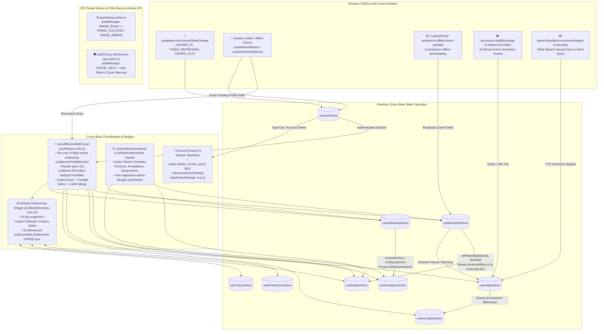

### 2. Reactive Signals, Custom Events & Worker IPC Matrix

| Event / Signal Channel | Emitter Module | Subscriber Module(s) | Payload Contract | Architectural Side-Effect |
| :--- | :--- | :--- | :--- | :--- |
| **`bookarium-offline-books-updated`** | [`src/lib/offline-storage.ts`](src/lib/offline-storage.ts) | [`src/hooks/useOfflineBooks.ts`](src/hooks/useOfflineBooks.ts), [`src/components/presentation/BookshelfRack.tsx`](src/components/presentation/BookshelfRack.tsx) | `CustomEvent<void>` | Re-enumerates IndexedDB keys/metadata and updates `Downloaded (N)` smart shelf & offline badges across all mounted components. |
| **`bookarium-offline-downloading`** | [`src/hooks/useOfflineBooks.ts`](src/hooks/useOfflineBooks.ts) | [`src/hooks/useOfflineBooks.ts`](src/hooks/useOfflineBooks.ts) (all instances) | `CustomEvent<{ bookId: number; isDownloading: boolean }>` | Synchronizes spinner/downloading button states across BookCard, BookmarkCard, BookshelfSpine, and DownloadDrawer. |
| **`bookarium:auth-token-refreshed`** | [`src/stores/useAuthStore.ts`](src/stores/useAuthStore.ts) | [`src/app/providers.tsx`](src/app/providers.tsx) | `CustomEvent<void>` | Bypasses the `15,000ms` sync cooldown to re-trigger `syncAllStoresWithCloud()` immediately after background JWT `TOKEN_REFRESHED` recovery so queued mutations flush under the fresh token. |
| **`window` `online` / `offline`** | Browser Network Stack | [`src/hooks/useNetworkStatus.ts`](src/hooks/useNetworkStatus.ts), [`src/app/providers.tsx`](src/app/providers.tsx) | `Event` (`navigator.onLine`) | Switches UI to offline restriction parity (`isUnavailableOffline`), activates IndexedDB catalog fallback, and flushes all 7 cloud-synced store outboxes upon reconnect. |
| **`supabase.auth.onAuthStateChange`** | [`src/app/providers.tsx`](src/app/providers.tsx) | [`src/stores/useAuthStore.ts`](src/stores/useAuthStore.ts), [`src/lib/sync-utils.ts`](src/lib/sync-utils.ts) | `(event, session)` | Hydrates scholar profile, verifies active JWT session (`verifyActiveCloudSession`), triggers `syncAllStoresWithCloud`, and reconciles `public.profiles.preferences` JSONB. |
| **`setReadingStatus(id, "finished")`** | [`src/stores/useBookshelfStore.ts`](src/stores/useBookshelfStore.ts) | [`src/stores/useReaderStore.ts`](src/stores/useReaderStore.ts), [`src/stores/useHabitsStore.ts`](src/stores/useHabitsStore.ts), [`src/stores/useAccoladesStore.ts`](src/stores/useAccoladesStore.ts) | `(bookId: number, status: ReadingStatus)` | Clears `bookmarkRow` (`0`) and `bookmarkText` (`undefined`), updates `completed_books_count`, and evaluates Ex-Libris accolades. |
| **`removeFellow` / `endSymposium`** | [`src/stores/useFellowshipStore.ts`](src/stores/useFellowshipStore.ts) | [`src/stores/useAnnotationStore.ts`](src/stores/useAnnotationStore.ts) | `(fellowId: string)` / `(sessionId: string)` | Invokes `pruneFellowAnnotationsByFellow` / `pruneFellowAnnotationsForSymposium` to evict stale co-reader marginalia immediately. |
| **`schedulePreferencesCloudSync`** | [`src/lib/preferences-sync.ts`](src/lib/preferences-sync.ts) | [`src/stores/usePreferencesStore.ts`](src/stores/usePreferencesStore.ts), [`src/stores/useReaderStore.ts`](src/stores/useReaderStore.ts), [`src/stores/useThemeStore.ts`](src/stores/useThemeStore.ts) | `ProfilePreferencesPayload` (`active`, `customDefaults`, `updatedAt`) | Coalesces 13 typography, theme, layout, spoiler-shield, and speech settings into a 2,000ms debounced LWW cloud upsert. |
| **`Worker: PARSE_BOOK`** | [`src/hooks/reader/useGutenbergParserWorker.ts`](src/hooks/reader/useGutenbergParserWorker.ts) | [`src/workers/gutenberg.worker.ts`](src/workers/gutenberg.worker.ts) | `{ type: "PARSE_BOOK", requestId, text, charsPerPage }` | Executes off-thread paragraph reflow, TOC suppression, chapter segmentation, and virtual page slicing; replies with `PARSE_SUCCESS` or `PARSE_ERROR`. |
| **`ServiceWorker: CACHE_URLS`** | [`src/components/pwa/ServiceWorkerRegister.tsx`](src/components/pwa/ServiceWorkerRegister.tsx) | [`public/sw.js`](public/sw.js) | `{ type: "CACHE_URLS", urls: string[] }` | Warms `bookarium-app-shell-v7` CacheStorage with `/`, `/account`, `/read/1342`, and discovered `/_next/static/` JS/CSS chunks. |

### 3. Client Storage, Conflict-Resolution & Account Erasure Parity Matrix (Rule 9 / GDPR Art. 17)

| Storage Domain / Store | Local Storage Key & Medium | Cloud PostgreSQL Table(s) | Sync & Conflict-Resolution Strategy | 3-Layer Account Erasure Parity (`deleteAccount`) |
| :--- | :--- | :--- | :--- | :--- |
| **`useBookshelfStore`** | `bookarium-bookshelf-storage` (`localStorage`) | `public.bookshelves`, `public.bookshelf_items`, `public.user_favorites`, `public.user_book_curation` | Sequential Outbox Replay (`outbox[]`) + Deletion Tombstones (`deletedBookIds`, `deletedFavoriteIds`) + Non-Regressive Metadata Merge (`mergeCloudBookWithLocal`) | 1. `delete_current_user()` RPC + `ON DELETE CASCADE`<br>2. Client `.delete()` fallback<br>3. `clearBookshelf()` (`savedBooks`, `favoriteBooks`, `outbox`, `cloudBookshelves`) |
| **`useReaderStore`** | `bookarium-reader-preferences` (`localStorage`) | `public.reading_progress` | 2,000ms Debounced Single-Book Upsert + Batched Multi-Book Upsert (`upsertReadingProgressBatch`, `Promise<boolean>` upload verification) + `SELECT`-Gated Ghost Cleanup (`isGhostCloudRow`) & Ghost Dirty-Flag Scrubbing + Authoritative Non-Dirty Deletion Pruning (`lastReaderSyncAt` monotonic anchor, `dirtyPositionBookIds`, `clearUploadedDirtyPositions`, `dirtyReaderSyncUsers` rerun) + `coalesceInFlightByUser` + Timestamp Last-Write-Wins (`lastReadAt >= remoteTime`) + Tombstones (`deletedPositionBookIds`) + Fractional `scroll_offset` (`page + row/1000`) | 1. `delete_current_user()` RPC + `ON DELETE CASCADE`<br>2. Client `.delete()` fallback<br>3. `resetReaderSession()` + `clearReadingPositions()` + `resetReaderAppearanceToDefaults()` |
| **`useAnnotationStore`** | `bookarium-annotations-storage` (`localStorage`) | `public.user_annotations` | Outbox Replay (`outbox[]`) + Tombstones (`deletedIds`) + LWW Timestamp (`updatedAt`) + Passive `15s` Mount Cooldown (`lastPassiveAnnotationSyncByUser`) + Symposium RLS (`reconcileFellowAnnotationsWithSymposiums`) | 1. `delete_current_user()` RPC + `ON DELETE CASCADE`<br>2. Client `.delete()` fallback<br>3. `clearAnnotations()` (wipes personal & fellow marginalia + outbox) |
| **`useFellowshipStore`** | `bookarium-fellowship-storage` (`localStorage`) | `public.reader_circles`, `public.symposium_sessions` | Outbox Queue (`pendingSymposiumProgress`) + Passive `15s` Mount Cooldown & Mutation Invalidation (`lastFellowshipSyncByUser`) + Participant RLS (`requester_id`/`recipient_id`, `host_id`/`fellow_id`) + Trigger Identity Propagation | 1. `delete_current_user()` RPC + `ON DELETE CASCADE`<br>2. Client `.or(...)` `.delete()` fallback<br>3. `clearFellowship()` |
| **`useHabitsStore`** | `bookarium-reading-habits` (`localStorage`) | `public.user_reading_habits` | Union Merge of `activityDates[]` + Max Streak/Minutes/Completed Books Reconciliation | 1. `delete_current_user()` RPC + `ON DELETE CASCADE`<br>2. Client `.delete()` fallback<br>3. `clearHabits()` |
| **`useAccoladesStore`** | `bookarium-accolades-storage` (`localStorage`) | `public.user_accolades` | Pending Pin Mutation Queue (`pendingPinUpdates`) + Idempotent `(user_id, accolade_id)` Upsert | 1. `delete_current_user()` RPC + `ON DELETE CASCADE`<br>2. Client `.delete()` fallback<br>3. `clearAccolades()` |
| **`useAuthStore`** | `bookarium-auth-profile` (`localStorage`) | `public.profiles`, `auth.users`, `storage.objects` | Optimistic Offline Profile Outbox (`pendingProfileUpdates`) + Pre-Sync Active JWT Guard (`verifyActiveCloudSession`) & Cookie-Clearance Guest Reconciliation | 1. `delete_current_user()` purges 11 tables, `storage.objects`, and `auth.users`<br>2. Clears `bookarium-auth-profile` & Supabase session cookies |
| **`usePreferencesStore` & `useThemeStore`** | `bookarium-preferences-storage`, `bookarium-theme-storage` (`localStorage`) | `public.profiles.preferences` (`JSONB`) | 2,000ms Debounced LWW Timestamp (`preferencesUpdatedAt`) across `active` & `customDefaults` 13-key snapshots | Reset to `FACTORY_PREFERENCES` (`theme: "light"`, `stickyScroll: true`, default TTS) via `clearLocalUserStores({ wipeDeviceStorage: true })` |
| **Quote Pool & Passage LRU Caches** | `bookarium-quote-enriched-books-v1`, `bookarium-extracted-passages-v1` (`localStorage`) | `public.books.quotes` (`JSONB`, Read-Only) | `12h` TTL 48-volume (`limit <= 600` max) 2-spread rotating pool (`useBooks.ts`) + `30-day` TTL / `100`-book LRU dynamically extracted passages (`useBookPassageShuffle.ts`) | Public domain literary quote caches (zero user PII); `bookarium-extracted-passages-v1` cleared via `clearCachedBookPassages()` |
| **`offline-storage` (IndexedDB)** | `bookarium-offline-db` -> `books` (`IndexedDB`) | _Device-Local Unabridged Cache_ | Offline-First Read (`networkMode: "always"`) + Asynchronous Author Lifespan Back-Fill (`patchOfflineBookAuthors`) + Cover Blob Cache | Wiped completely via `clearAllOfflineBooks()` during `clearLocalUserStores({ wipeDeviceStorage: true })` |
| **Reader Scroll & SSR Hydration Cookies** | `bookarium-reader-scroll-*` (`sessionStorage`), `bookarium-geo-country`, `bookarium-theme-preference`, `bookarium-auth-hint`, `sb-*-auth-token` (`Cookie`) | _Ephemeral / Edge SSR Session_ | Synchronous Edge Geo-IP Stamping (`src/proxy.ts`), Zero-Flash SSR Theme/Auth Hint Hydration (`src/app/layout.tsx`), & Per-Tab Scroll Offset Restoration | `sessionStorage` scroll keys purged on account deletion; `bookarium-auth-hint` reset to `guest`; `bookarium-theme-preference` reset to `light`; `sb-*-auth-token` session cookies cleared |

---

## ⏱️ Runtime Execution Workflows (Temporal Sequence Diagrams)

### 1. Cold Launch, Edge Geo-IP Resolution, Hydration & 7-Store Cloud Outbox Reconciliation

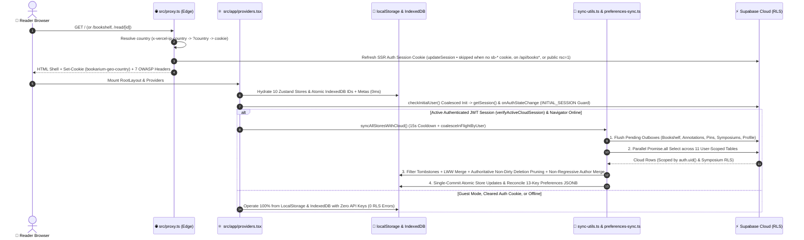

### 2. Focus Reader Launch, Jurisdictional Gatekeeping (`HTTP 451`), Multi-Mirror Streaming & Worker AST

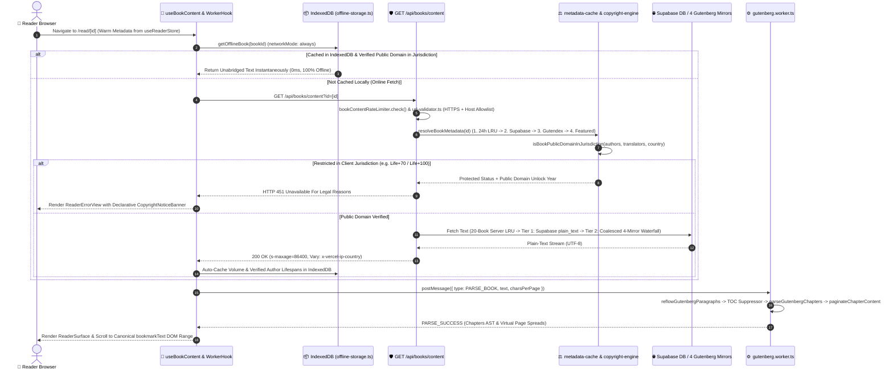

### 3. Offline Mutation Queueing, Adaptive Offline Catalog & Reconnect Outbox Replay

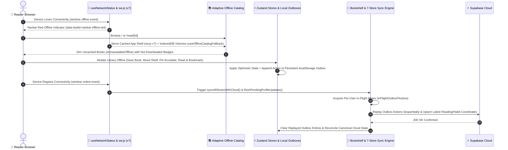

---

## 🌐 API Routes, App Router Entrypoints, Query Hooks & Reader Engine

### 1. API & Server Route Handlers (Edge Proxy, Auth & Telemetry)

| Endpoint / Route | Method(s) | Source File | Cache & Security Strategy | Upstream Target |
| :--- | :--- | :--- | :--- | :--- |
| **`/api/books`** | `GET` | [`src/app/api/books/route.ts`](src/app/api/books/route.ts) | `s-maxage=86400` (Catalog) / `s-maxage=43200` (`?pool=quotes`, 12h rotating 48-book default) / `s-maxage=604800` (`?ids=...&has_quotes=true` & `include_restricted_metadata=true`) • Sliding-Window Rate Limit (60 req/min) • `503 no-store` DB-down anti-poisoning guard | Supabase `public.books` (`searchBooks` / `fetchQuoteEnrichedPool`) -> `https://gutendex.com/books/` (search failover) |
| **`/api/books/content`** | `GET` | [`src/app/api/books/content/route.ts`](src/app/api/books/content/route.ts) | `max-age=86400, s-maxage=86400, stale-while-revalidate=604800` (text & `type=card` OpenGraph PNG) / `max-age=604800, s-maxage=604800, stale-while-revalidate=2592000` (`type=cover`, non-US metadata check bypassed) • `globalThis` 20-Book LRU (`bookContentLruCache`), In-Flight Mirror Coalescing (`inFlightMirrorFetches`), Anti-SSRF Allowlist, Binary Cover Streaming, Stateless `next/og` Reading Card Unfurling (`decodeReadingCardShareToken`) & Jurisdictional Gate | Supabase `plain_text` -> Gutenberg Multi-Mirror CDN & `next/og` `ImageResponse` |
| **`/api/books/translations`** | `GET` | [`src/app/api/books/translations/route.ts`](src/app/api/books/translations/route.ts) | `max-age=86400, s-maxage=604800, stale-while-revalidate=2592000` • Sliding-Window Rate Limit & Jurisdictional Filter | Supabase `public.book_translations` & `public.books` |
| **`/auth/callback`** | `GET` | [`src/app/auth/callback/route.ts`](src/app/auth/callback/route.ts) | `No-Store Auth Exchange` • PKCE & OTP Verification + Canonical Origin Redirect Sanitizer | Supabase Auth (`exchangeCodeForSession`, `verifyOtp`) |

### 2. App Router Pages, Layouts, Providers & Styling Entrypoints

| Route / URI | Entrypoint Type | Rendering Strategy | Source File | Architectural Responsibility |
| :--- | :--- | :--- | :--- | :--- |
| **`/account`** | Route Layout & SSR Metadata | React Server Component (SSR / Static) | [`src/app/account/layout.tsx`](src/app/account/layout.tsx) | Server layout defining canonical metadata and robots noindex directives for the Scholar Account Hub. |
| **`/account`** | App Page | Client Interactive (`"use client"`) | [`src/app/account/page.tsx`](src/app/account/page.tsx) | Scholar Account Hub for Reading Habits, Literary Accolades, Reader Circles & Symposiums, Cloud Sync, and Preferences. |
| **`/auth/confirm-deletion`** | Route Layout & SSR Metadata | React Server Component (SSR / Static) | [`src/app/auth/confirm-deletion/layout.tsx`](src/app/auth/confirm-deletion/layout.tsx) | Server layout enforcing `robots: { index: false, follow: false }` metadata on the account deletion confirmation route. |
| **`/auth/confirm-deletion`** | App Page | Client Interactive (`"use client"`) | [`src/app/auth/confirm-deletion/page.tsx`](src/app/auth/confirm-deletion/page.tsx) | Two-step email-verified account deletion confirmation page executing `delete_current_user()` RPC. |
| **`/copyright`** | Route Layout & SSR Metadata | React Server Component (SSR / Static) | [`src/app/copyright/layout.tsx`](src/app/copyright/layout.tsx) | Server layout defining canonical SEO, OpenGraph, and Twitter summary metadata for Copyright & Public Domain Governance. |
| **`/copyright`** | App Page | React Server Component (SSR / Static) | [`src/app/copyright/page.tsx`](src/app/copyright/page.tsx) | Multi-Jurisdictional Public Domain Copyright Governance manifesto, territory rules table, and takedown notice channel. |
| **`/`** | App Error Boundary | Client Interactive (`"use client"`) | [`src/app/error.tsx`](src/app/error.tsx) | Route-level React Error Boundary providing graceful recovery UI and diagnostic fallback. |
| **`/`** | App Error Boundary | Client Interactive (`"use client"`) | [`src/app/global-error.tsx`](src/app/global-error.tsx) | Root document-level React Error Boundary catching fatal top-level layout exceptions. |
| **`/ (Global CSS)`** | Tailwind CSS v4 Oxide Theme & 3D Book Surface Stylesheet | PostCSS / Tailwind CSS v4 Oxide Bundle | [`src/app/globals.css`](src/app/globals.css) | Tailwind CSS v4 Oxide stylesheet defining Day (`#fcfbf9`), Cozy Coffee Sepia (`#2b1d16`), and Dark Obsidian (`#0e1117`) theme tokens, 3D hardcover book hinge physics (`.book-center-crease`, `.preserve-3d`), directional view-slide keyframes (`.animate-view-slide-left`, `.animate-view-slide-right` with `360ms` tactile slide & nested `.animate-page-turn` suppression inside `@media (max-width: 1366px), (pointer: coarse)` vs. `0ms` outer switch & preserved `180ms` inner `.animate-page-turn` on `> 1366px` non-tactile PCs), and custom reader scrollbars. |
| **`/`** | Root Layout | React Server Component (SSR / Static) | [`src/app/layout.tsx`](src/app/layout.tsx) | Root HTML shell, canonical `SITE_CONFIG.NAME` (`Bookarium`) tab/OpenGraph title, font initialization, theme class hydration, SSR hourly/daily featured book seeds (`getHourlyFeaturedBook`, `getDailyClassicBook`), and global React Query / Service Worker provider wrapper. |
| **`/`** | App Streaming & Pre-Hydration Splash Boundary | React Server Component (SSR / Static) | [`src/app/loading.tsx`](src/app/loading.tsx) | Next.js App Router streaming & pre-hydration loading splash boundary rendering the vector Bookarium crest and animated loading indicator. |
| **`/manifest.webmanifest`** | PWA Metadata Route | React Server Component (SSR / Static) | [`src/app/manifest.ts`](src/app/manifest.ts) | Progressive Web App (PWA) Web App Manifest configuring standalone display, theme colors, and multi-resolution icons. |
| **`/`** | App 404 Boundary | React Server Component (SSR / Static) | [`src/app/not-found.tsx`](src/app/not-found.tsx) | Editorial 404 Not Found boundary with direct navigation back to the public domain catalog. |
| **`/`** | App Page | Client Interactive (`"use client"`) | [`src/app/page.tsx`](src/app/page.tsx) | Primary SPA workbench hosting Catalog, Bookshelf, Favorites, Bookmarks, and Commonplace Notebook views with edge URL rewrites, sort-aware unfiltered Catalog headings (`CATALOG_SORT_TITLES` resolving `Recent Books`, `Popular Books`, and `Oldest Books` via `VIEW_CONTENT_CONFIG.catalog.getTitle({ search, topic, era, sort })` while preserving `Search Catalog` precedence when filters or search terms are active), asymmetric directional collection transitions (`NAVBAR_TRANSITION_ORDER` slide into/between collections on both tactile swipes and `Navbar` tab clicks/taps + instantaneous `0ms` return to `catalog` so repeated `Catalog` -> `Bookshelf` transitions replay reliably), 12-hour sliding-cache hero/editorial boundary guards (`selectHourlyHeroFromPool`, `selectDailyClassicFromPool`), and dynamic `NAVBAR_VIEW_CONFIG` tab title synchronization (`Bookarium` / `Bookarium | <View>`). |
| **`/privacy`** | Route Layout & SSR Metadata | React Server Component (SSR / Static) | [`src/app/privacy/layout.tsx`](src/app/privacy/layout.tsx) | Server layout defining `SITE_CONFIG.SITE_URL` canonical SEO, OpenGraph, and Twitter summary metadata for the Privacy Architecture manifesto. |
| **`/privacy`** | App Page | React Server Component (SSR / Static) | [`src/app/privacy/page.tsx`](src/app/privacy/page.tsx) | Zero-Tracker Privacy Architecture manifesto, functional geo-cookie disclosure, COPPA / GDPR Art. 8 governance, and 3-Tier Zero-Retention Erasure Protocol. |
| **`/ (Root Provider)`** | Root Client Provider & Auth/Sync Orchestrator | Client Interactive (`"use client"`) | [`src/app/providers.tsx`](src/app/providers.tsx) | Root client provider initializing TanStack `QueryClient`, Strict-Mode-coalesced Supabase authentication (`initializeAuth`, `onAuthStateChange`, unthrottled `bookarium:auth-token-refreshed`), `15,000ms` render-pure `lastSyncTimeRef` cooldown guarding `syncAllStoresWithCloud` reconciliation and `online` / `visibilitychange` flushes, `GlobalTitleTooltip` stylized tooltip delegation, and dynamic `AuthModal` rendering. |
| **`/read/[id]`** | Route Layout & SSR Metadata | React Server Component (SSR / Static) | [`src/app/read/[id]/layout.tsx`](src/app/read/[id]/layout.tsx) | Server layout generating ISR 24h dynamic `Bookarium | Reader | <Title> — <Author>` (`SITE_CONFIG.READER_NAME`), featured `openingLine` + tag/translator-enriched `<meta name="keywords">`, OpenGraph `book:author`/`book:tag`, Twitter Card, Schema.org Book JSON-LD (`identifier`, `bookFormat`, `MediaObject` `encoding`, `birthDate`/`deathDate` contributors, `sameAs`, `genre`, `keywords`), companion `BreadcrumbList` JSON-LD, and timeout-safe invalid/confirmed-missing `noindex` via `React.cache` and `buildReaderSeoMetadataPayload`, verifying signed `x-bookarium-share-token` (`decodeReadingCardShareToken`) to bind `/api/books/content?id=<id>&type=card&s=<token>` (`1200×630`) as the primary social preview image. |
| **`/read/[id]`** | App Page | Client Interactive (`"use client"`) | [`src/app/read/[id]/page.tsx`](src/app/read/[id]/page.tsx) | Dedicated distraction-free Focus Reader with warm `currentBook` metadata reuse (`hasCompleteCurrentBook`), continuous pagination, Web Worker AST segmentation, TTS narration, and Symposium marginalia. |
| **`/robots.txt`** | SEO Metadata Route | React Server Component (SSR / Static) | [`src/app/robots.ts`](src/app/robots.ts) | Search engine crawler directives allowing canonical routes (`/`, `/privacy`, `/copyright`, `/read/`, `/u/`) while blocking catalog filter query permutations (`search`, `topic`, `languages`, `sort`, `era`, `format`, `mime_type`, `page`, `size`, `view`), `/api/*`, `/auth/*`, and `/account` (preserving `?s=` Reading Card share tokens). |
| **`/sitemap.xml`** | SEO Metadata Route | React Server Component (SSR / Static) | [`src/app/sitemap.ts`](src/app/sitemap.ts) | Synchronous zero-DB XML sitemap generator indexing primary views, `/privacy`, `/copyright`, and curated classics combining `FEATURED_CLASSIC_BOOK_IDS` and `FEATURED_HERO_BOOKS`. |
| **`/u/[username]`** | Route Layout & SSR Metadata | React Server Component (SSR / Static) | [`src/app/u/[username]/layout.tsx`](src/app/u/[username]/layout.tsx) | Server layout emitting dynamic OpenGraph `profile`, Twitter cards, canonical `/u/<username>`, and `ProfilePage` JSON-LD for opt-in public scholars via `isClientSideNavigation()` fast-path and `fetchPublicScholarProfileSummary`, collapsing private and nonexistent handles to identical `noindex` fallback. |
| **`/u/[username]`** | App Page | Client Interactive (`"use client"`) | [`src/app/u/[username]/page.tsx`](src/app/u/[username]/page.tsx) | Public Scholar Sanctuary displaying pinned Ex-Libris bookplates, public profile stats, and 1-on-1 Literary Fellowship invitation actions. |

### 3. Custom Hooks (Data Queries & Reader Subsystems)

| Hook Name | Subsystem / Layer | Source File | Architectural Responsibility |
| :--- | :--- | :--- | :--- |
| **`useAccountSecurityActions`** | Hooks | [`src/hooks/useAccountSecurityActions.ts`](src/hooks/useAccountSecurityActions.ts) | Account Hub security, profile display name, email verification resend cooldown, password strength/generation/recovery, and account deletion workflow hook. |
| **`useAmbientDockScrollState`** | Hooks | [`src/hooks/useAmbientDockScrollState.ts`](src/hooks/useAmbientDockScrollState.ts) | Shared scroll-idle dimming (`opacity-30`), top-threshold (`isAtTop`), and pointer wake (`onPointerEnter` / `onPointerLeave`) state machine for floating bottom capsule docks (`CatalogMobileBottomDock`, `CollectionBottomDock`). |
| **`useBookCopyright`** | Hooks | [`src/hooks/useBookCopyright.ts`](src/hooks/useBookCopyright.ts) | Declarative jurisdictional copyright facade hook coordinating territory rules, author lifespan restrictions, and public domain badges. |
| **`useBookPassageShuffle`** | Hooks | [`src/hooks/useBookPassageShuffle.ts`](src/hooks/useBookPassageShuffle.ts) | Autonomous 3-tier literary quote selection (`book.quotes` -> 30-day / 100-entry `localStorage` LRU cache `bookarium-extracted-passages-v1` / dynamic passages -> curated fallback), jurisdictional protection suppression (`isRestricted` gating), and multi-chapter shuffle engine (`readCachedBookPassages`, `writeCachedBookPassages`, `clearCachedBookPassages`). |
| **`useBookshelfCapacity`** | Hooks | [`src/hooks/useBookshelfCapacity.ts`](src/hooks/useBookshelfCapacity.ts) | Hydration-safe physical shelf spine capacity hook (`useSyncExternalStore`) dynamically coupling Bookshelf page size (2 shelves x capacity) and row limits across mobile (6), tablet (10), laptop (14), and desktop (18). |
| **`useCatalogFilters`** | Hooks | [`src/hooks/useCatalogFilters.ts`](src/hooks/useCatalogFilters.ts) | Catalog filter state URL binding, default Recently Added (descending) sort, atomic filter staging, multi-era bounding calculation, and multi-filter query synchronization. |
| **`useCollectionAutoHeal`** | Hooks | [`src/hooks/useCollectionAutoHeal.ts`](src/hooks/useCollectionAutoHeal.ts) | Unified multi-collection auto-healing pipeline scanning and rehydrating missing author lifespans across Favorites, Bookshelves, Reading Positions, Annotations (Personal & Fellow), and Active Symposiums. |
| **`useCopyFeedback`** | Hooks | [`src/hooks/useCopyFeedback.ts`](src/hooks/useCopyFeedback.ts) | Transient clipboard copy state hook with automatic timer cleanup (`copy`, `isCopied`, `copiedKey`) for share URLs and scholar handles. |
| **`useCursorTooltip`** | Hooks | [`src/hooks/useCursorTooltip.ts`](src/hooks/useCursorTooltip.ts) | Adaptive cursor tooltip hook (`300ms` default delay, `0ms` action buttons, viewport boundary clamping) powering `CursorTooltip` and `GlobalTitleTooltip`. |
| **`useHasMounted`** | Hooks | [`src/hooks/useHasMounted.ts`](src/hooks/useHasMounted.ts) | SSR hydration barrier hook preventing client-server markup mismatches. |
| **`useMobileViewportCardFocus`** | Hooks | [`src/hooks/useMobileViewportCardFocus.ts`](src/hooks/useMobileViewportCardFocus.ts) | Shared single-column (`< 1024px`) viewport scroll focus band (`0.22–0.62` viewport ratio) and outside-tap dismissal hook for `BookmarkCard` and `NotebookQuoteCard`. |
| **`useMobileViewSwipe`** | Hooks | [`src/hooks/useMobileViewSwipe.ts`](src/hooks/useMobileViewSwipe.ts) | Tactile touch gesture navigation hook enabling horizontal view swiping across primary views strictly on mobile and tactile tablets (`isSwipeEnabled = (isMobile || isTouchDevice) && !isAnyModalActive`; disabled on `> 1366px` non-tactile desktop PCs). |
| **`useNetworkStatus`** | Hooks | [`src/hooks/useNetworkStatus.ts`](src/hooks/useNetworkStatus.ts) | Reactive browser online/offline external store hook (`useSyncExternalStore`) driving red offline Account indicators, adaptive offline Catalog fallback, and network-gated controls. |
| **`useNotebookMetadataResolver`** | Hooks | [`src/hooks/useNotebookMetadataResolver.ts`](src/hooks/useNotebookMetadataResolver.ts) | Multi-source volume metadata resolver (`resolveVolumeMeta`, `missingBookIds`, `isMetadataLoading`) healing missing titles, authors, and languages across Personal and Fellow Marginalia. |
| **`useOfflineBooks`** | Hooks | [`src/hooks/useOfflineBooks.ts`](src/hooks/useOfflineBooks.ts) | Atomic IndexedDB cache enumeration via `Promise.allSettled` (`readOfflineIdsAndMetas`, `applyOfflineSnapshot`, `syncEpochRef`, `isMountedRef` for `offlineIds`, `offlineBooks`, and `isLoaded`) with synchronous non-blocking quota updates, reactive cross-instance event broadcast (`OFFLINE_BOOKS_UPDATED_EVENT`), loading state propagation (`OFFLINE_DOWNLOADING_EVENT`), author lifespan normalization (`normalizeOfflineAuthors`), idle missing cover backfill, and individual-only offline book download/deletion management with local cover Blob persistence. |
| **`useOfflineCatalogFallback`** | Hooks | [`src/hooks/useOfflineCatalogFallback.ts`](src/hooks/useOfflineCatalogFallback.ts) | Local IndexedDB offline catalog filtering, topic/language/author-lifespan matching, sorting, and sub-page slicing hook when offline. |
| **`useOfflineCoverImage`** | Hooks | [`src/hooks/useOfflineCoverImage.ts`](src/hooks/useOfflineCoverImage.ts) | Shared IndexedDB offline book cover Blob hydration (`getOfflineBookCover`) and automatic `URL.createObjectURL` / `URL.revokeObjectURL` lifecycle cleanup hook (`BookCard`, `BookPreviewModal`, `HeroFeaturedBook3D`). |
| **`usePerformanceTier`** | Hooks | [`src/hooks/usePerformanceTier.ts`](src/hooks/usePerformanceTier.ts) | Hardware concurrency and memory heuristic detection for fluid 60fps animations. |
| **`usePersonalCollectionsController`** | Hooks | [`src/hooks/usePersonalCollectionsController.ts`](src/hooks/usePersonalCollectionsController.ts) | Centralized controller hook for Bookshelf and Favorites filtering, bidirectional sorting, custom shelf resolution, pagination reset, and clear-confirmation modal state (`src/app/page.tsx`). |
| **`useReadingTimer`** | Hooks | [`src/hooks/useReadingTimer.ts`](src/hooks/useReadingTimer.ts) | Reader session telemetry tracking visual reading with 2-minute idle guard and TTS narration audio bypass. |
| **`useScrollDirection`** | Hooks | [`src/hooks/useScrollDirection.ts`](src/hooks/useScrollDirection.ts) | Stepped directional scroll detection with hero dock tracking (`isDocked`), 3-state navigation visibility (`isHeaderVisible`, `isToolbarVisible`), and user auto-hide preference persistence. |
| **`useTouchDevice`** | Hooks | [`src/hooks/useTouchDevice.ts`](src/hooks/useTouchDevice.ts) | SSR-safe tactile capability and viewport boundary detection (`(pointer: coarse)` or `maxTouchPoints > 0` within `<= 1366px`) gating horizontal view swiping on tablets and mobile while excluding `> 1366px` desktop viewports. |
| **`useVisualViewportKeyboard`** | Hooks | [`src/hooks/useVisualViewportKeyboard.ts`](src/hooks/useVisualViewportKeyboard.ts) | Mobile software virtual keyboard elevation hook leveraging the Visual Viewport API (`window.visualViewport`) to dynamically elevate floating inputs above tactile on-screen keyboards. |
| **`useBookContent`** | Queries | [`src/hooks/queries/useBookContent.ts`](src/hooks/queries/useBookContent.ts) | TanStack Query (`networkMode: "always"`) fetching book plain text with canonical `/api/books/content?id=<bookId>` cache keys, IndexedDB offline-first check, multi-store lifespan verification (`resolveAuthoritativeLocalAuthors`), and online server-gatekeeper deferral. |
| **`useBooks`** | Queries | [`src/hooks/queries/useBooks.ts`](src/hooks/queries/useBooks.ts) | TanStack Query fetching catalog volumes (`useBooks` with client-side round-trip `performance.now()` latency telemetry), featured book quotes (`useFeaturedQuotes` with local `readCachedQuoteEnrichedBooks` cache-first lookup and 7-day Edge-cached `/api/books?ids=...&has_quotes=true` routing), and the shared `48`-volume (`limit <= 600` max) 12h Edge-cached rotating quote pool (`useQuoteEnrichedBooks` via `/api/books?pool=quotes`, 2-spread quota trimming, 12-hour `!isCacheFresh` gating, zero-swap `ssrMatch` hydration, and an `isPoolSettled` signal with `QUOTE_POOL_SETTLE_TIMEOUT_MS` safety net so consumers reveal quotes exactly once) powering Hero (Full Pool), Classic of the Day (Classics Filter), and Words That Shaped Humanity (3-Distinct-Book Fisher-Yates Rotation) with sub-pagination and client failover. |
| **`useBookTranslations`** | Queries | [`src/hooks/queries/useBookTranslations.ts`](src/hooks/queries/useBookTranslations.ts) | Sequential Two-Tier TanStack Query resolving international language translations and editions (`Tier 1` `/api/books/translations?id=<id>` relational lookup -> `Tier 2` `/api/books?search=...` AST fallback gated on `!isDbLoading && !hasDbEditions` and `!isOffline`). |
| **`useContinueReadingLedger`** | Reader | [`src/hooks/reader/useContinueReadingLedger.ts`](src/hooks/reader/useContinueReadingLedger.ts) | Headless continue reading ledger with authentic telemetry enrollment, placeholder-author detection (`hasAuthenticAuthor`), non-regressive author merge guardrails (`setOrMergeBook`), `readingPositions` author healing, query hydration, multi-attribute sorting, and offline volume filtering (`useOfflineBooks`). |
| **`useGutenbergParserWorker`** | Reader | [`src/hooks/reader/useGutenbergParserWorker.ts`](src/hooks/reader/useGutenbergParserWorker.ts) | Persistent Web Worker chapter segmentation and layout pagination calculations. |
| **`useReaderAnnotationActions`** | Reader | [`src/hooks/reader/useReaderAnnotationActions.ts`](src/hooks/reader/useReaderAnnotationActions.ts) | Encapsulated Focus Reader text-selection popover state, overlapping fellow/own annotation matching (`matchedPopoverAnnotations`), and highlight/note CRUD handlers (`src/app/read/[id]/page.tsx`). |
| **`useReaderDrawers`** | Reader | [`src/hooks/reader/useReaderDrawers.ts`](src/hooks/reader/useReaderDrawers.ts) | Mutual exclusivity coordination for in-reader tool drawers and modals. |
| **`useReaderExitBookmark`** | Reader | [`src/hooks/reader/useReaderExitBookmark.ts`](src/hooks/reader/useReaderExitBookmark.ts) | Encapsulated reader exit interception, cross-device `findCanonicalTextSpan` bookmark-ahead reflow resolution (`hasBookmarkAhead`), layered drawer-first & `Escape` key dismissal, 3-page activation threshold modal gating, and line-1 bookmark placement (`src/app/read/[id]/page.tsx`). |
| **`useReaderGestures`** | Reader | [`src/hooks/reader/useReaderGestures.ts`](src/hooks/reader/useReaderGestures.ts) | Touch swipe detection, tactile single-finger tap detection (`onTapSurface`) for immersive bar toggling, keyboard shortcuts, selection gesture conflict guards, and damped 2-finger pinch-to-zoom (`14px` deadzone `PINCH_DEADZONE_PX` + `24px`/step `PINCH_PIXELS_PER_STEP`) with non-passive touch/WebKit gesture cancellation. |
| **`useReaderHabitTelemetry`** | Reader | [`src/hooks/reader/useReaderHabitTelemetry.ts`](src/hooks/reader/useReaderHabitTelemetry.ts) | Reader session lifecycle, book identity self-healing, `Bookarium | Reader | <Title> — <Author>` client tab title synchronization (`SITE_CONFIG.READER_NAME`), 3-page reading activation threshold (`currently_reading` / `finished`), Literary Symposium companion progress sync, and idle-aware habit telemetry coordinator. |
| **`useReaderSession`** | Reader | [`src/hooks/reader/useReaderSession.ts`](src/hooks/reader/useReaderSession.ts) | Reading coordinates restoration, decoupled `pinnedBookmark` (`PinnedBookmarkCoordinate`) persistence across passive page turns, 3-page activation threshold, cross-page `bookmarkText` reflow self-healing on font-size re-pagination, resume ribbons, and cloud session synchronization. |
| **`useReaderSpeech`** | Reader | [`src/hooks/reader/useReaderSpeech.ts`](src/hooks/reader/useReaderSpeech.ts) | Browser-native Web Speech synthesis with boundary word highlighting and auto-flip. |

---

## 🧠 Domain Engines & Pure Computational Utilities

Pure business logic, historical engines, and layout algorithms verified across **49 Domain Modules** using Babel AST:

| Engine / Utility | Subsystem / Layer | Source File | Primary Exported Primitives | Architectural Responsibility |
| :--- | :--- | :--- | :--- | :--- |
| **`metadata-cache`** | Edge Route Engine | [`src/app/api/books/content/metadata-cache.ts`](src/app/api/books/content/metadata-cache.ts) | `CachedMetadata`, `CachedBookContentEntry`, `MAX_METADATA_CACHE_ENTRIES`, `getCachedBookContent`, `setCachedBookContent` _(+5 more)_ | 3-tier `globalThis`-anchored in-memory LRU author lifespan cache (`__bookariumMetadataCache`, 24h TTL, 1,000 entries) resolving contributor birth/death years via Supabase `public.books`, upstream Gutendex API, and `FEATURED_HERO_BOOKS` fallback, paired with a `globalThis`-anchored 20-book plain-text LRU cache (`bookContentLruCache` / `__bookariumContentLruCache`, `getCachedBookContent`, `setCachedBookContent`, `clearBookContentCache`, 24h TTL, <= 1.8M chars) shielding Project Gutenberg mirrors across `Vary: x-vercel-ip-country` edge misses. |
| **`url-validator`** | Edge Route Engine | [`src/app/api/books/content/url-validator.ts`](src/app/api/books/content/url-validator.ts) | `isSafeUpstreamUrl`, `sanitizeUpstreamUrl` | Zero-trust anti-SSRF upstream URL validator enforcing HTTPS, relative Location redirect resolution, and strict Project Gutenberg hostname allowlisting (`gutenberg.org`, `aleph.gutenberg.org`, `gutenberg.pglaf.org`, `gutenberg.readingroo.ms`). |
| **`reader-layout-utils`** | SSR Route Engine | [`src/app/read/[id]/reader-layout-utils.ts`](src/app/read/[id]/reader-layout-utils.ts) | `isClientSideNavigation`, `MAX_SERVER_METADATA_CACHE_ENTRIES`, `serverMetadataCache`, `isConfirmedMissingBook`, `clearConfirmedNotFoundCache` _(+6 more)_ | Server-side metadata resolution (`fetchBookData`), confirmed-missing ID tracking (`isConfirmedMissingBook`), re-exported `isClientSideNavigation`, and non-visual SEO payload builder (`buildReaderSeoMetadataPayload` with featured `openingLine` hooks, lifespan contributors, and encoding MIME formats) for `/read/[id]` OpenGraph, Twitter Card, and Schema.org JSON-LD generation. |
| **`profile-layout-utils`** | SSR Route Engine | [`src/app/u/[username]/profile-layout-utils.ts`](src/app/u/[username]/profile-layout-utils.ts) | `PublicScholarMetadataSummary`, `PublicScholarResolution`, `MAX_PROFILE_CACHE_ENTRIES`, `PROFILE_CACHE_TTL_MS`, `normalizeScholarHandle` _(+4 more)_ | Zero-PII Public Scholar metadata resolver (`fetchPublicScholarProfileSummary`), 5-minute / 500-entry LRU cache (`hasCachedScholarProfile`), SQL `ILIKE` `_`-wildcard neutralization, and anti-enumeration `private_or_missing` collapsing for `/u/[username]`. |
| **`accolades-engine`** | Core Domain | [`src/lib/accolades-engine.ts`](src/lib/accolades-engine.ts) | `determineBookEra`, `isAncientBook`, `BuildAccoladeContextParams`, `buildAccoladeContext`, `getAccoladeById` _(+2 more)_ | Historical literary accolades evaluation engine, criteria matching, milestone progress calculation, summary aggregation (`computeAccoladesSummary`), and era determination. |
| **`book.adapter`** | Adapters | [`src/lib/adapters/book.adapter.ts`](src/lib/adapters/book.adapter.ts) | `normalizeAuthorName`, `extractFormatUrl`, `isCanonicalBook`, `toCanonicalBook`, `toGutendexBook` _(+7 more)_ | Bidirectional domain transformation between Gutendex API schemas, canonical Book models, and Supabase cloud persistence payloads. |
| **`annotation-cloud-sync`** | Core Domain | [`src/lib/annotation-cloud-sync.ts`](src/lib/annotation-cloud-sync.ts) | `HighlightColor`, `MarginaliaSourceFilter`, `Annotation`, `FellowAnnotation`, `AnnotationOutboxAction` _(+11 more)_ | Scholarly annotation and fellow marginalia cloud synchronization helpers, RFC 4122 v4 UUID generator (`generateValidAnnotationUuid`), non-regressive scholar handle resolution (`setOrUpdateFellowMapEntry`, `buildFellowScholarsMap`), and outbox payload mappers. |
| **`api-utils`** | Core Domain | [`src/lib/api-utils.ts`](src/lib/api-utils.ts) | `RateLimitInfo`, `getClientIp`, `createRateLimitErrorResponse` | Server-side API route helpers, IP address extraction, and standardized rate limit error response generation. |
| **`book-metadata`** | Core Domain | [`src/lib/book-metadata.ts`](src/lib/book-metadata.ts) | `ResolvedBookIdentity`, `ResolveBookMetadataParams`, `cleanBookTitle`, `isPlaceholderAuthor`, `isPlaceholderTitle` _(+4 more)_ | Author and title cleaning, placeholder author heuristics (`isPlaceholderAuthor`, `resolvePrimaryAuthorName`), verified lifespan checks (`hasVerifiedLifespans`), dictionary author enrichment (`enrichAuthorMap`), and defensive editorial metadata normalization (including `subjects` and `bookshelves` on `ResolvedBookIdentity`). |
| **`book-sorting`** | Core Domain | [`src/lib/book-sorting.ts`](src/lib/book-sorting.ts) | `BookshelfSortOption`, `FavoritesSortOption`, `BOOKSHELF_SORT_OPTIONS`, `FAVORITES_SORT_OPTIONS`, `BookSortBaseField` _(+8 more)_ | Deterministic multi-attribute book sorting algorithms, collection sort/filter options, and shared offline volume filtering (`filterBooksByOfflineState`) for title, author, year, downloads, reading progress, and recency. |
| **`book-tags`** | Core Domain | [`src/lib/book-tags.ts`](src/lib/book-tags.ts) | `BookTagSet`, `resolveBookTags` | Semantic book tag normalizer mapping verbose Library of Congress subjects and Gutenberg bookshelves to canonical zero-truncation badges (<= 14 chars) with responsive mobile/desktop allocation and administrative prefix sanitization. |
| **`bookshelf-cloud-sync`** | Core Domain | [`src/lib/bookshelf-cloud-sync.ts`](src/lib/bookshelf-cloud-sync.ts) | `OutboxActionInput`, `OutboxAction`, `BookshelfSyncSlice`, `BookshelfGetState`, `BookshelfSetState` _(+12 more)_ | Bidirectional cloud reconciliation engine for bookshelves, shelf items, and favorite books, featuring non-regressive local metadata preservation (`mergeCloudBookWithLocal`), per-user in-flight mutex & `coalesceInFlightByUser` outbox flushing (`executeFlushOutbox`, `dirtyOutboxFlushUsers`, `markBookshelfOutboxDirty`), opt-in `15,000ms` passive mount cooldown (`invalidateBookshelfSyncCooldown`), concurrent `Promise.all` table fetching, multi-shelf `book_id` deduplication, outbox mutation replay, tombstone filtering, single-commit atomic state reconciliation, and deterministic ordering. |
| **`gutendex-provider`** | Catalog | [`src/lib/catalog/gutendex-provider.ts`](src/lib/catalog/gutendex-provider.ts) | `GutendexCatalogProvider`, `gutendexProvider` | Upstream Gutendex REST catalog provider implementing ICatalogProvider with 15s timeout control, primary topic/mimeType failover normalization, error mapping, and jurisdictional copyright filtering. |
| **`query-parser`** | Catalog | [`src/lib/catalog/query-parser.ts`](src/lib/catalog/query-parser.ts) | `DEFAULT_QUOTE_POOL_LIMIT`, `parseCatalogQuery` | Canonical query parameter extractor and sanitizer for catalog queries (`parseCatalogQuery`), normalizing whitespace, pagination (`limit <= 100` standard or `DEFAULT_QUOTE_POOL_LIMIT = 48` / `limit <= 600` when `pool=quotes`), author lifespans, and edge geo-country fallback cascades. |
| **`supabase-provider`** | Catalog | [`src/lib/catalog/supabase-provider.ts`](src/lib/catalog/supabase-provider.ts) | `CATALOG_METADATA_COLUMNS`, `CATALOG_WITH_QUOTES_COLUMNS`, `QUOTE_POOL_COLUMNS`, `DEFAULT_QUOTE_POOL_LIMIT`, `QUOTE_POOL_CACHE_TTL_MS` _(+8 more)_ | Dedicated Supabase PostgreSQL catalog provider implementing ICatalogProvider with passively warmed cached healthcheck (60s TTL), `globalThis`-anchored 5m / 64-query catalog response cache (`__bookariumCatalogQueryCache`, isolated per mock client, cleared via `resetHealthCache`) + passive `__bookariumMetadataCache` pre-warming, 11-column `CATALOG_METADATA_COLUMNS` projection, GIN full-text search_vector queries across title/subjects/bookshelves, MIME charset prefix matching, author lifespan bounds, bounded dynamic backfill (`MAX_BACKFILL_ITERATIONS = 2`), and Primary-Key-Scoped 48-volume (`limit <= 600` max) 12h rotating 2-spread Quote Pool assembly (`fetchQuoteEnrichedPool`, `selectRotatingQuotePoolCandidateIds`) for sub-50ms single-book lookups and ~1-2s catalog page queries. |
| **`content-advisory`** | Core Domain | [`src/lib/content-advisory.ts`](src/lib/content-advisory.ts) | `ContentAdvisoryResult`, `MATURE_CONTENT_KEYWORDS`, `evaluateContentAdvisory` | Autonomous content advisory evaluation engine scanning Library of Congress subject classifications and bookshelves for mature themes, erotic literature, and sensitive historical context with non-blocking user guidance. |
| **`copyright-engine`** | Core Domain | [`src/lib/copyright-engine.ts`](src/lib/copyright-engine.ts) | `Author`, `JurisdictionRule`, `CopyrightEvaluationResult`, `EU_MEMBER_STATES`, `LIFE_70_COUNTRIES` _(+15 more)_ | Multi-jurisdictional copyright engine evaluating public domain status across US, EU/Berne (Life + 70), Mexico (Life + 100), and Colombia/Spain (Life + 80), with joint authorship (Art. 7bis), translator protection (Art. 2(3)), and longevity heuristics. |
| **`country-resolver`** | Core Domain | [`src/lib/country-resolver.ts`](src/lib/country-resolver.ts) | `GEO_COOKIE_NAME`, `DEV_OVERRIDE_COOKIE_NAME`, `TIMEZONE_COUNTRY_MAP`, `getCountryFromTimezone`, `resolveClientCountry` | Synchronous and edge geographic country resolution coordinating timezone mapping, geo-cookies, and developer overrides. |
| **`fellowship-cloud-sync`** | Core Domain | [`src/lib/fellowship-cloud-sync.ts`](src/lib/fellowship-cloud-sync.ts) | `isPlaceholderUsername`, `formatFellowScholarLabel`, `healProfileIdentity`, `fetchScholarProfilesMap`, `resolveSelfScholarIdentity` | Fellowship scholar handle validation (`isPlaceholderUsername`), label formatting (`formatFellowScholarLabel`), profile identity healing (`healProfileIdentity`), and Supabase `public.profiles` batch lookup (`fetchScholarProfilesMap`). |
| **`gutenberg-parser`** | Core Domain | [`src/lib/gutenberg-parser.ts`](src/lib/gutenberg-parser.ts) | `* (./gutenberg)` | Root domain facade barrel re-exporting all Gutenberg segmentation, pagination, reflow, and passage extraction subsystems. |
| **`index`** | Gutenberg | [`src/lib/gutenberg/index.ts`](src/lib/gutenberg/index.ts) | `* (./types)`, `* (./reflow)`, `* (./pagination)`, `* (./metadata)`, `* (./segmentation)` _(+1 more)_ | Gutenberg subsystem barrel aggregating types, reflow, pagination, metadata, segmentation, and passage algorithms. |
| **`metadata`** | Gutenberg | [`src/lib/gutenberg/metadata.ts`](src/lib/gutenberg/metadata.ts) | `LANGUAGE_NAME_TO_CODE_MAP`, `normalizeLanguageToCode`, `extractGutenbergHeaderMetadata` | Gutenberg plain-text header/footer metadata extraction, author/title/language detection, and ISO code normalization. |
| **`pagination`** | Gutenberg | [`src/lib/gutenberg/pagination.ts`](src/lib/gutenberg/pagination.ts) | `clearPaginationCache`, `paginateChapterContent`, `getCharsPerPage`, `calculateReadingTime`, `calculateVolumePageSpread` | Continuous chapter pagination algorithms with UTF-8 curly-quote/guillemet sentence boundary snapping, character-per-page geometry calculations, and reading time estimation. |
| **`passages`** | Gutenberg | [`src/lib/gutenberg/passages.ts`](src/lib/gutenberg/passages.ts) | `extractDynamicBookPassages`, `formatCleanQuote`, `SpreadQuoteLayoutOptions`, `ResolvedSpreadQuoteLayout`, `resolveSpreadQuoteLayout` | Dynamic book passage and quote extraction engine identifying compelling prose segments with dialogue and character markers. |
| **`reflow`** | Gutenberg | [`src/lib/gutenberg/reflow.ts`](src/lib/gutenberg/reflow.ts) | `formatGutenbergTypography`, `reflowGutenbergParagraphs` | Typography text-reflow heuristics (`reflowGutenbergParagraphs`, `formatGutenbergTypography`) repairing Project Gutenberg hard line wraps while preserving alternating-indent verse, short stanzas, and scene breaks, and normalizing `--` -> `—` and `_italic_` wrappers. |
| **`segmentation`** | Gutenberg | [`src/lib/gutenberg/segmentation.ts`](src/lib/gutenberg/segmentation.ts) | `stripDuplicateLeadingChapterHeading`, `parseGutenbergChapters` | Robust chapter and section boundary detection (`parseGutenbergChapters`, `stripDuplicateLeadingChapterHeading`) with Roman numeral, Strategy 1B spelled-word / Stave / Letter divisions, TOC deduplication, and zero-offset-shift display heading deduplication. |
| **`types`** | Gutenberg | [`src/lib/gutenberg/types.ts`](src/lib/gutenberg/types.ts) | `ChapterSection`, `GUTENBERG_PARSER_CONFIG`, `DynamicBookPassage` | Canonical TypeScript interfaces and configurations for the Project Gutenberg parsing engine and AST nodes. |
| **`in-book-search`** | Core Domain | [`src/lib/in-book-search.ts`](src/lib/in-book-search.ts) | `BookSearchMatch`, `InBookSearchResult`, `searchInBook` | Full-text in-volume search algorithm with canonical typography matching (`--` <-> `—`, curly/straight quotes), diacritic fallback, context snippet generation, and matched coordinate navigation. |
| **`notebook-sorting`** | Core Domain | [`src/lib/notebook-sorting.ts`](src/lib/notebook-sorting.ts) | `NotebookDisplayItem`, `NotebookBookDetails`, `NotebookVolumeGroupItem`, `NotebookChronoSortOption`, `NotebookVolumeSortOption` _(+14 more)_ | Pure sorting, filtering, volume grouping (`filterAndGroupNotebookEntries`, `parseNotebookSortValue`), and sort-key decomposition engine for the Commonplace Literary Notebook (`NotebookView`). |
| **`offline-storage`** | Core Domain | [`src/lib/offline-storage.ts`](src/lib/offline-storage.ts) | `OFFLINE_BOOKS_UPDATED_EVENT`, `notifyOfflineStorageChanged`, `OfflineBookMetadata`, `StorageQuotaInfo`, `OfflineBookRecord` _(+15 more)_ | IndexedDB storage abstraction providing offline book content caching, cover image Blob persistence (`saveOfflineBook`, `getOfflineBookCover`, `fetchAndPatchOfflineCover`), local store author resolution and asynchronous IndexedDB author back-fill (`patchOfflineBookAuthors`), storage change notifications (`notifyOfflineStorageChanged`), quota calculation, and LRU eviction. |
| **`password`** | Core Domain | [`src/lib/password.ts`](src/lib/password.ts) | `PasswordStrength`, `generateStrongPassword`, `evaluatePasswordStrength` | Cryptographically secure password generation and multi-factor entropy evaluation engine. |
| **`preferences-sync`** | Core Domain | [`src/lib/preferences-sync.ts`](src/lib/preferences-sync.ts) | `ScholarPreferencesSnapshot`, `ReaderAppearanceSnapshot`, `ProfilePreferencesPayload`, `FACTORY_PREFERENCES`, `getFactoryPreferences` _(+13 more)_ | Unified 13-key scholar preferences snapshot coordinator (`ScholarPreferencesSnapshot`, `FACTORY_PREFERENCES`, `getFactoryPreferences` with device-adaptive `15px`/`17px`/`18px` font size), two-tier custom default preset & factory reset actions (`saveCurrentAsCustomDefaults`, `revertToCustomDefaults`, `resetAllPreferencesToFactoryDefaults`, `resetReaderAppearanceToDefaults`), and debounced Last-Write-Wins Supabase `public.profiles.preferences` JSONB cloud synchronization (`schedulePreferencesCloudSync`, `reconcileCloudPreferencesWithLocal`). |
| **`rate-limiter`** | Core Domain | [`src/lib/rate-limiter.ts`](src/lib/rate-limiter.ts) | `RateLimitOptions`, `RateLimitResult`, `InMemoryRateLimiter`, `booksApiRateLimiter`, `bookContentRateLimiter` | In-memory sliding-window rate limiter with burst mitigation for API routes. |
| **`reader-annotator`** | Core Domain | [`src/lib/reader-annotator.ts`](src/lib/reader-annotator.ts) | `AnyAnnotation`, `isFellowAnnotation`, `AnnotationSpan`, `UnifiedAnnotationItem`, `SourcePairedAnnotation` _(+9 more)_ | Scholarly marginalia interval partitioning, character-index-mapped canonical span matching (`findCanonicalTextSpan`, `findAllCanonicalTextSpans`), overlapping annotation pairing (`pairOverlappingAnnotations`), and shared quote span segmentation (`computeSharedQuoteSegments`). |
| **`reader-bookmark-geometry`** | Core Domain | [`src/lib/reader-bookmark-geometry.ts`](src/lib/reader-bookmark-geometry.ts) | `TextNodeSegment`, `collectContentTextSegments`, `measureCharRect`, `findBestTextMatch`, `extractRowTextFromElement` _(+1 more)_ | DOM text-node walker (`collectContentTextSegments`), character range measurement (`measureCharRect`), ratio-weighted passage matching (`findBestTextMatch`), and binary-searched row text/span resolution (`extractRowTextFromElement`, `resolveTextRowSpanInElement`). |
| **`reader-cloud-sync`** | Core Domain | [`src/lib/reader-cloud-sync.ts`](src/lib/reader-cloud-sync.ts) | `ReaderTheme`, `ReaderFontFamily`, `BookReadingPosition`, `hasEmbeddedLifespans`, `isGhostReadingPosition` _(+3 more)_ | Reading position cloud synchronization helpers, ghost-row filtering (`isGhostReadingPosition`, `isGhostCloudRow`), fractional row-bookmark decoding (`decodeRemoteReadingPosition`), and lifespan-preserving author extraction (`extractVerifiedAuthors`). |
| **`reading-analytics`** | Core Domain | [`src/lib/reading-analytics.ts`](src/lib/reading-analytics.ts) | `DayActivity`, `StreakStats`, `AnnualGoalProgress`, `ReadingSessionTelemetry`, `formatLocalDate` _(+6 more)_ | Streak calculation, 5-minute immersion thresholds, reading speed metrics, annual reading goal progress, deduplicated completed volume counting (`calculateCompletedBooksCount`), and public scholar habit telemetry resolution (`resolvePublicReadingHabits`). |
| **`reading-card-export`** | Core Domain | [`src/lib/reading-card-export.ts`](src/lib/reading-card-export.ts) | `ReadingCardConfig`, `SocialPlatformId`, `SocialShareTarget`, `DecodedReadingCardToken`, `ReadingCardPalette` _(+11 more)_ | Client-side HTML5 2D `<canvas>` reading card generator (`renderReadingCardToCanvas`, `exportReadingCardBlob`, `wrapCanvasText`, `CARD_PALETTES`), book-bound FNV-1a signed Base64URL share token codec (`encodeReadingCardShareToken`, `decodeReadingCardShareToken`, `buildReadingCardShareUrl`, `computeShareTokenSignature`), and zero-key social Web Intent URL builder (`buildReadingShareText`, `buildSocialShareUrls`) across X, Reddit, WhatsApp, Telegram, Bluesky, Facebook, LinkedIn, and Email. |
| **`redirect-sanitizer`** | Core Domain | [`src/lib/redirect-sanitizer.ts`](src/lib/redirect-sanitizer.ts) | `sanitizeRedirectPath`, `resolveCanonicalAuthOrigin`, `buildAuthRedirectUrl`, `resolveCanonicalShareOrigin`, `buildBookShareUrl` | Open-redirect prevention, canonical authentication origin resolver, and origin-validated book share URL builder (`sanitizeRedirectPath`, `resolveCanonicalAuthOrigin`, `buildAuthRedirectUrl`, `buildShareUrl`). |
| **`safe-storage`** | Core Domain | [`src/lib/safe-storage.ts`](src/lib/safe-storage.ts) | `safeLocalStorage` | Universal SSR-safe storage adapter (`safeLocalStorage`) for Zustand `persist` middleware, eliminating Node 22 experimental localStorage warnings and providing safe no-op setItem execution during server rendering with browser try/catch boundaries. |
| **`scroll-utils`** | Core Domain | [`src/lib/scroll-utils.ts`](src/lib/scroll-utils.ts) | `SmartScrollOptions`, `smartScrollToContent`, `HorizontalScrollOptions`, `attachHorizontalDragAndWheelScroll`, `resolveScrubbedTabId` _(+5 more)_ | Smart smooth-scrolling engine with visibility viewport heuristics, top offset calculation, header avoidance, horizontal pointer click-and-drag + wheel scrolling (`attachHorizontalDragAndWheelScroll`), live touch-swipe / mouse-drag tab scrubbing, and zero-drift scroll preservation (`runPreservingScrollPosition`). |
| **`server-rsc-nav`** | Core Domain | [`src/lib/server-rsc-nav.ts`](src/lib/server-rsc-nav.ts) | `isClientSideNavigation` | Server-only Next.js App Router RSC navigation and prefetch header detector (`isClientSideNavigation`) isolated from client bundles. |
| **`smart-search`** | Core Domain | [`src/lib/smart-search.ts`](src/lib/smart-search.ts) | `normalizeSearchText`, `extractSearchTokens`, `matchesSmartSearch`, `getBookSearchHaystack`, `filterBooksSmart` | Fuzzy multi-token search engine querying titles, authors, and subjects with punctuation normalization. |
| **`speech-utils`** | Core Domain | [`src/lib/speech-utils.ts`](src/lib/speech-utils.ts) | `normalizeSpeechLang`, `isVoiceLanguageCompatible`, `isNaturalVoice`, `cleanVoiceName`, `getVoiceQualityScore` _(+2 more)_ | Web Speech API voice selection heuristics identifying natural/neural/cloud synthesis voices, BCP-47 locale normalization, book-language voice compatibility filtering, and quality score sorting (`getVoiceQualityScore`, `sortVoicesByQuality`, `resolveBestVoice`). |
| **`client`** | Supabase | [`src/lib/supabase/client.ts`](src/lib/supabase/client.ts) | `sanitizeSupabaseUrl`, `createClient` | Browser-side Supabase client initialization with credential sanitization and local session persistence. |
| **`middleware`** | Supabase | [`src/lib/supabase/middleware.ts`](src/lib/supabase/middleware.ts) | `SUPABASE_AUTH_COOKIE_PATTERN`, `updateSession` | Next.js edge middleware helper managing Supabase auth tokens and cookie refresh cycles while short-circuiting anonymous requests without `sb-*` cookies. |
| **`server`** | Supabase | [`src/lib/supabase/server.ts`](src/lib/supabase/server.ts) | `createClient` | Server-side Supabase client initialization using Next.js cookies for authenticated route handlers. |
| **`sync-utils`** | Core Domain | [`src/lib/sync-utils.ts`](src/lib/sync-utils.ts) | `coalesceInFlightByUser`, `hasSupabaseAuthCookie`, `shouldVerifyCloudSession`, `verifyActiveCloudSession`, `SessionVerifiableClient` _(+2 more)_ | Unified bidirectional cloud synchronization coordinator (`syncAllStoresWithCloud`, `clearLocalUserStores`, re-exported `coalesceInFlightByUser`) returning active per-user in-flight Promises directly (`p1 === p2`), enforcing pre-sync active JWT session verification (`hasSupabaseAuthCookie`, `shouldVerifyCloudSession`, `verifyActiveCloudSession`), and coordinating 10-store local teardown parity. |
| **`utils`** | Core Domain | [`src/lib/utils.ts`](src/lib/utils.ts) | `cn`, `BookFormatInfo`, `extractBookFormats`, `formatDownloadCount`, `calculateReadingTime` _(+6 more)_ | Core presentation utilities: Tailwind CSS class merging (clsx + twMerge), author formatting, and format badges. |

---

## 🔄 Background Data Pipelines & Automation Engines

Automated ingestion pipelines, periodic synchronization jobs, and GitHub Actions CI/CD workflows (outside `src/`):

### 1. GitHub Actions & Database Ingestion Topology

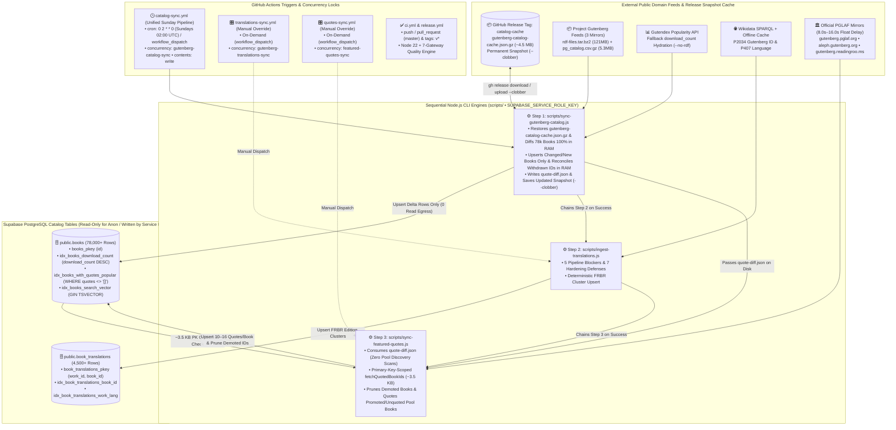

### 2. CLI Pipelines & GitHub Actions Workflows Inventory

| Pipeline / Tool | Execution Mode | Source File | Schedule / Trigger | Architectural Responsibility & Database Index Contract |
| :--- | :--- | :--- | :--- | :--- |
| **`sync-gutenberg-catalog`** | Node.js Streaming CLI | [`scripts/sync-gutenberg-catalog.js`](scripts/sync-gutenberg-catalog.js) | `npm run catalog:sync` / Sunday Cron (`0 2 * * 0`) | Restores `gutenberg-catalog-cache.json.gz` (`--cache-file`), streams official Project Gutenberg `rdf-files.tar.bz2` (121MB) and `pg_catalog.csv.gz` (5.3MB) across 3 mirrors, diffs all 78,461 books and withdrawn IDs 100% in RAM (`filterChangedOrNewBooks` & `reconcileWithdrawnCatalogBooks` with cold-start Supabase fallback), upserts only new/changed rows while keeping `quotes` untouched, writes `quote-diff.json` (`--diff-output`), and updates the `catalog-cache` release asset (`>= 50,000` safety floor). |
| **`ingest-translations`** | Node.js Batch & Sync CLI | [`scripts/ingest-translations.js`](scripts/ingest-translations.js) | `npm run translations:sync` / Chained Sunday Step 2 | FRBR relational translation ingestion engine enforcing 5 Pipeline Blockers and 7 Hardening Defenses with live Supabase upserting (`idx_book_translations_cluster`). |
| **`sync-featured-quotes`** | Node.js Multi-Worker CLI | [`scripts/sync-featured-quotes.js`](scripts/sync-featured-quotes.js) | `npm run quotes:sync` / Chained Sunday Step 3 | Consumes `quote-diff.json` (`--diff-file`) from Step 1 (or falls back to index scans on standalone manual runs) to maintain the Two-Tier Bounded Quote Pool (`Top 500 Popular + Rolling 64 Most Recent`) in `public.books.quotes` via Primary-Key-Scoped `fetchQuotedBookIds` (`~3.5 KB`), prioritizing `promotedIds`, pruning `demotedIds`, and writing a zero-query Run Report (`formatRunReport`) to `$GITHUB_STEP_SUMMARY`. |
| **`ingest-catalog`** | Node.js Batch CLI | [`scripts/ingest-catalog.js`](scripts/ingest-catalog.js) | `npm run catalog:ingest` / On-Demand | Curated masterworks starter seeding and plain-text caching (`--with-content`) generating `supabase/seed_books.sql`. |
| **`catalog-sync.yml`** | GitHub Actions Workflow | [`.github/workflows/catalog-sync.yml`](.github/workflows/catalog-sync.yml) | `cron: 0 2 * * 0` (Sundays) / On-Demand | Unified weekly Sunday CI cron workflow (`concurrency: gutenberg-catalog-sync`, `permissions: contents: write`) restoring `gutenberg-catalog-cache.json.gz` from the permanent `catalog-cache` GitHub Release, streaming `rdf-files.tar.bz2` and `pg_catalog.csv.gz` across 3 official Gutenberg mirrors into `public.books` via 100% in-RAM diffing (`filterChangedOrNewBooks` & `reconcileWithdrawnCatalogBooks` preserving `quotes`), publishing the updated snapshot (`--clobber`), and sequentially chaining `ingest-translations.js` and `sync-featured-quotes.js --diff-file=quote-diff.json`. |
| **`translations-sync.yml`** | GitHub Actions Workflow | [`.github/workflows/translations-sync.yml`](.github/workflows/translations-sync.yml) | On-Demand (`workflow_dispatch`) • Chained in `catalog-sync.yml` | On-demand (`workflow_dispatch`) GitHub Actions workflow (`concurrency: gutenberg-translations-sync`) clustering upstream Wikidata `P2034`/`P407` editions and syncing to `public.book_translations` via `idx_book_translations_cluster` (scheduled Sunday execution is unified inside `catalog-sync.yml`). |
| **`quotes-sync.yml`** | GitHub Actions Workflow | [`.github/workflows/quotes-sync.yml`](.github/workflows/quotes-sync.yml) | On-Demand (`workflow_dispatch`) • Chained in `catalog-sync.yml` | On-demand (`workflow_dispatch`) GitHub Actions workflow (`concurrency: featured-quotes-sync`) populating `10–16` multi-quote spreads per book across the Two-Tier Bounded Quote Pool (`500 Popular + 64 Recent`) or specific `--ids` via selectable PGLAF mirrors (scheduled Sunday execution is unified inside `catalog-sync.yml` via `quote-diff.json`). |
| **`ci.yml`** | GitHub Actions Workflow | [`.github/workflows/ci.yml`](.github/workflows/ci.yml) | `push` / `pull_request` (`master`) | Continuous Integration pipeline executing the 7-Gateway Quality Engine, ESLint zero-warning check, Vitest coverage, and production build verification on Node 22. |
| **`release.yml`** | GitHub Actions Workflow | [`.github/workflows/release.yml`](.github/workflows/release.yml) | `push` (`tags: v*`) / On-Demand (`workflow_dispatch`) | Automated GitHub Release publisher triggered on `v*` tags or manual `workflow_dispatch`, executing the full 7-Gateway Quality Engine and extracting release notes from `CHANGELOG.md`. |

---

## 🗄️ Database Architecture & Row Level Security (RLS) Policies

Bookarium uses Supabase PostgreSQL for optional cloud synchronization and dedicated database catalog serving, verified across **14 Database Tables** (47 RLS policies & 7 payload ceiling CHECK constraints) with strict Row Level Security (Rule 9):

| Table Name | Read Access / RLS | Write Authority & Mutating Actors | Runtime Consumers (Stores, Providers & CLI) | Domain Role & Security Description |
| :--- | :--- | :--- | :--- | :--- |
| **`supabase_migrations.schema_migrations`** | Enabled (`No Client Access`) | `service_role` / Supabase Migration Runner | _Supabase CLI / Studio Tracker_ | Internal Supabase migration ledger preventing `42P01` dashboard warnings and tracking applied DDL versions with RLS enabled. |
| **`public.profiles`** | Enabled (`auth.uid()`) | `auth.uid() = user_id` (Authenticated Scholar) | `useAuthStore` / `usePreferencesStore` / `useFellowshipStore` (`fellowship-cloud-sync.ts`) / `/u/[username]` (`page.tsx`, `profile-layout-utils.ts`) | User profile display name, `@username` handle, theme preferences, typography choices, and unified `preferences` JSONB (`active` & `customDefaults` presets, auto-created on signup, with opt-in `is_public` anonymous SSR/client reads for `/u/[username]` (`serverProfileCache` 5m LRU + SQL `ILIKE` wildcard post-filter) and companion identity RLS resolution for Reader Circles & Symposiums). |
| **`public.bookshelves`** | Enabled (`auth.uid()`) | `auth.uid() = user_id` (Authenticated Scholar) | `useBookshelfStore` (`bookshelf-cloud-sync.ts`) | Default master "General" shelf and custom user-created named shelves. |
| **`public.bookshelf_items`** | Enabled (`auth.uid()`) | `auth.uid() = user_id` (Authenticated Scholar) | `useBookshelfStore` (`bookshelf-cloud-sync.ts`) | Books filed in specific shelves with user-scoped uniqueness constraints. |
| **`public.user_favorites`** | Enabled (`auth.uid()`) | `auth.uid() = user_id` (Authenticated Scholar) | `useBookshelfStore` (`bookshelf-cloud-sync.ts`) | Cross-device synchronized favorited titles. |
| **`public.reading_progress`** | Enabled (`auth.uid()`) | `auth.uid() = user_id` (Authenticated Scholar) | `useReaderStore` (`reader-cloud-sync.ts`) | Chapter index, progress %, in-page row bookmark offsets, highlighted bookmark line text (`bookmark_text`), and cached volume metadata. |
| **`public.user_annotations`** | Enabled (`auth.uid()`) | `auth.uid() = user_id` (Authenticated Scholar) | `useAnnotationStore` (`annotation-cloud-sync.ts`) | Passage text highlights (4 pastel palettes), scholarly notes, and cross-volume Symposium Fellow marginalia. |
| **`public.user_book_curation`** | Enabled (`auth.uid()`) | `auth.uid() = user_id` (Authenticated Scholar) | `useBookshelfStore` (`bookshelf-cloud-sync.ts`) | Personal 1–5 star ratings and reading status classification. |
| **`public.user_reading_habits`** | Enabled (`auth.uid()`) | `auth.uid() = user_id` (Authenticated Scholar) | `useHabitsStore` | Reading streaks (5-min threshold), daily activity dates, annual challenge goals, completed books count, and dual immersion telemetry. |
| **`public.user_accolades`** | Enabled (`auth.uid()`) | `auth.uid() = user_id` (Authenticated Scholar) | `useAccoladesStore` | Unlocked literary accolades, timestamps, showcase pinning, and personal bookplate metadata. |
| **`public.books`** | Enabled (`Public Read`) | `TO service_role` Only (`catalog-sync.yml`, `quotes-sync.yml`, CLI) | `SupabaseCatalogProvider` / `useFeaturedQuotes` / `useQuoteEnrichedBooks` / `sync-gutenberg-catalog.js` / `sync-featured-quotes.js` | Dedicated Supabase public domain catalog (`78,000+` rows) with GIN full-text search vector, pre-computed author lifespan bounds, primary `quotes` JSONB (`10–16` multi-quote spreads per volume across the `<= 564` Two-Tier Bounded Quote Pool), and optional plain-text caching. |
| **`public.book_translations`** | Enabled (`Public Read`) | `TO service_role` Only (`translations-sync.yml`, `catalog-sync.yml`, CLI) | `useBookTranslations` / `SupabaseCatalogProvider` / `ingest-translations.js` | Relational FRBR literary work clusters (`4,500+` rows) mapping Project Gutenberg editions across languages with zero false positives. |
| **`public.reader_circles`** | Enabled (`auth.uid()`) | `auth.uid()` Participant (`requester_id` / `recipient_id`) | `useFellowshipStore` (`fellowship-cloud-sync.ts`) | Mutual Literary Fellowship pairings (pending/accepted) with RLS participant isolation. |
| **`public.symposium_sessions`** | Enabled (`auth.uid()`) | `auth.uid()` Participant (`host_id` / `fellow_id`) | `useFellowshipStore` (`fellowship-cloud-sync.ts`) | Dual-reading Literary Symposium sessions tracking shared volume progress and chapter coordinates for two fellows. |

### 1. Stored Logic, Triggers & RPC Functions (7 Functions / Guards)

Programmatically extracted from `CREATE OR REPLACE FUNCTION` and `CREATE TRIGGER` statements in [`supabase/schema.sql`](supabase/schema.sql):

| Database Function / Trigger | Type | Target Table(s) | Functionality & Security Scope |
| :--- | :--- | :--- | :--- |
| **`public.handle_new_user()`** | Trigger / Function (`on_auth_user_created`) | `auth.users` -> `public.profiles`, `public.bookshelves` | Auto-provisions scholar profile and default `General` shelf on signup (`SECURITY DEFINER`, `SET search_path = ''`, RPC execution revoked from `PUBLIC`, `anon`, `authenticated`). |
| **`public.delete_current_user()`** | RPC Function | `auth.users` | Atomic server-side 11-table + `storage.objects` user data erasure prior to `auth.users` account deletion (`SECURITY DEFINER`, `SET search_path = ''`, authenticated-only execution, null session guard). |
| **`public.books_search_vector_trigger()`** | Trigger / Function (`trigger_books_search_vector`) | `public.books` | Automatically generates and updates `search_vector tsvector` from `title`, `subjects`, and `bookshelves` on insert or when `title`, `subjects`, or `bookshelves` change (`IS DISTINCT FROM` guard skips `to_tsvector()` recomputation on `download_count`-only updates; `SET search_path = ''`, RPC execution revoked from `PUBLIC`, `anon`, `authenticated`). |
| **`public.lookup_scholar_by_username()`** | RPC Function | `public.profiles` | Zero-PII handle resolution returning minimal `(id, username, display_name)` so scholars can invite Fellow Scholars by `@username` even when their sanctuary is private (`SECURITY DEFINER`, `SET search_path = ''`, authenticated-only, `1..64` char input bounds guard). |
| **`public.handle_profile_identity_sync()`** | Trigger / Function (`trg_profile_identity_sync`) | `public.profiles` -> `reader_circles`, `symposium_sessions` | Propagates scholar `@username` and `display_name` updates across active/pending fellowship circles and symposium sessions on profile update (`SECURITY DEFINER`, `SET search_path = ''`, RPC execution revoked from `PUBLIC`, `anon`, `authenticated`). |
| **`public.enforce_fellowship_update_guard()`** | Trigger / Function (`trg_reader_circles_update_guard`, `trg_symposium_sessions_update_guard`) | `public.reader_circles`, `public.symposium_sessions` | Locks immutable keys, acceptance authority, and opposite-participant progress/identity columns against unauthorized modification (`SECURITY DEFINER`, `SET search_path = ''`, RPC execution revoked from `PUBLIC`, `anon`, `authenticated`). |
| **`public.rls_auto_enable() (Guard)`** | Conditional Hardening Block | `pg_proc` (`public.rls_auto_enable`) | Idempotent `DO $$` guard revoking RPC execution from `PUBLIC, anon, authenticated` and locking `search_path = ''` if provisioned on the remote Supabase instance. |

### 2. Search, Uniqueness & Foreign-Key Indexes (21 Explicit Indexes)

Programmatically extracted from `CREATE [UNIQUE] INDEX IF NOT EXISTS` statements in [`supabase/schema.sql`](supabase/schema.sql):

| Index Name | Index Type | Target Table | Indexed Expression & Filter | Query & Integrity Responsibility |
| :--- | :--- | :--- | :--- | :--- |
| **`unique_profile_username_lower`** | Partial Unique Index | `public.profiles` | `(lower(trim(username))) WHERE username IS NOT NULL` | Case-insensitive partial unique index (`lower(trim(username)) WHERE username IS NOT NULL`) enforcing globally unique scholar `@username` handles. |
| **`unique_user_default_bookshelf`** | Partial Unique Index | `public.bookshelves` | `(user_id) WHERE is_default = true` | Partial unique index (`(user_id) WHERE is_default = true`) guaranteeing each scholar has at most one master `General` shelf. |
| **`unique_user_shelf_name`** | Unique B-Tree Index | `public.bookshelves` | `(user_id, lower(trim(name)))` | Case-insensitive composite unique index (`(user_id, lower(trim(name)))`) preventing duplicate custom shelf names per user. |
| **`idx_bookshelf_items_user_id`** | B-Tree Index | `public.bookshelf_items` | `(user_id)` | B-Tree foreign-key index on `(user_id)` accelerating user-scoped shelf item queries and cascading account deletion. |
| **`idx_user_annotations_user_book`** | B-Tree Index | `public.user_annotations` | `(user_id, book_id)` | Composite B-Tree index on `(user_id, book_id)` for fast per-volume highlight and marginalia lookups. |
| **`idx_user_book_curation_user_book`** | B-Tree Index | `public.user_book_curation` | `(user_id, book_id)` | Composite B-Tree index on `(user_id, book_id)` for personal 1–5 star ratings and reading status lookups. |
| **`idx_user_reading_habits_user`** | B-Tree Index | `public.user_reading_habits` | `(user_id)` | B-Tree index on `(user_id)` accelerating streak and dual immersion telemetry queries. |
| **`unique_user_accolade`** | Unique B-Tree Index | `public.user_accolades` | `(user_id, accolade_id)` | Composite unique index on `(user_id, accolade_id)` ensuring idempotent accolade unlocks per scholar. |
| **`idx_user_accolades_user`** | B-Tree Index | `public.user_accolades` | `(user_id)` | B-Tree index on `(user_id)` for fast Ex-Libris bookplate and pinned showcase queries. |
| **`idx_books_search_vector`** | GIN Index | `public.books` | `(search_vector)` | Inverted GIN index on `search_vector` TSVECTOR for sub-second multi-word full-text and subject/bookshelf catalog search. |
| **`idx_books_languages`** | GIN Index | `public.books` | `(languages)` | Inverted GIN index on `languages` TEXT[] for array-containment language filtering (`languages && ARRAY[...]`). |
| **`idx_books_download_count`** | B-Tree Index | `public.books` | `(download_count DESC)` | Descending B-Tree index on `(download_count DESC)` for popularity sorting across 78,000+ volumes. |
| **`idx_books_author_death_year`** | B-Tree Index | `public.books` | `(max_author_death_year)` | B-Tree index on `(max_author_death_year)` for sub-50ms server-side jurisdictional copyright filtering. |
| **`idx_books_with_quotes_popular`** | Partial B-Tree Index | `public.books` | `(download_count DESC) WHERE quotes <> '[]'::jsonb` | Partial descending B-Tree index on `(download_count DESC) WHERE quotes <> '[]'::jsonb` for sub-10ms lookups of quote-enriched volumes. |
| **`idx_book_translations_book_id`** | B-Tree Index | `public.book_translations` | `(book_id)` | B-Tree index on `(book_id)` for instant single-book translation lookups in `ReaderLanguageDrawer`. |
| **`idx_book_translations_work_lang`** | B-Tree Index | `public.book_translations` | `(work_id, language)` | Composite B-Tree index on `(work_id, language)` for canonical FRBR literary work cluster traversal and language-filtered edition resolution (alongside `book_translations_pkey (work_id, book_id)`). |
| **`idx_reader_circles_requester`** | B-Tree Index | `public.reader_circles` | `(requester_id)` | B-Tree index on `(requester_id)` for outbound Reader Circle fellowship and companion RLS lookups. |
| **`idx_reader_circles_recipient`** | B-Tree Index | `public.reader_circles` | `(recipient_id)` | B-Tree index on `(recipient_id)` for inbound Reader Circle invitation and companion RLS lookups. |
| **`idx_symposium_sessions_host`** | B-Tree Index | `public.symposium_sessions` | `(host_id)` | B-Tree index on `(host_id)` for host-side Literary Symposium and fellow marginalia RLS evaluation. |
| **`idx_symposium_sessions_fellow`** | B-Tree Index | `public.symposium_sessions` | `(fellow_id)` | B-Tree index on `(fellow_id)` for fellow-side Literary Symposium and companion progress queries. |
| **`idx_symposium_sessions_book`** | B-Tree Index | `public.symposium_sessions` | `(book_id)` | B-Tree index on `(book_id)` for volume-scoped Symposium session and shared annotation lookups. |

### 3. Schema DDL, Offline SQL Seeds & Authority Cache Artifacts

| Artifact File | Classification | File Size | Architectural Responsibility |
| :--- | :--- | :--- | :--- |
| [`supabase/schema.sql`](supabase/schema.sql) | Canonical Idempotent DDL & RLS Schema | `50.9 KB` | Single source of truth defining all 14 database tables, 47 granular RLS policies (with `(select auth.uid())` `InitPlan` scalar subquery wrapping and single-permissive-policy-per-action consolidation), 7 stored functions/triggers (5 row triggers), 7 payload ceiling CHECK constraints, and 21 explicit search/uniqueness indexes. |
| [`supabase/seed_books.sql`](supabase/seed_books.sql) | Curated Public Domain Catalog Seed | `11.4 KB` | Idempotent starter SQL seed (`ON CONFLICT (id) DO UPDATE`) provisioning curated Project Gutenberg masterworks for zero-network local development. |
| [`supabase/seed_translations.sql`](supabase/seed_translations.sql) | Relational FRBR Translations Seed | `12.1 KB` | Idempotent SQL seed (`ON CONFLICT (work_id, book_id) DO UPDATE`) linking multilingual Project Gutenberg editions into canonical literary works. |
| [`scripts/data/wikidata-translations-cache.json`](scripts/data/wikidata-translations-cache.json) | Offline Wikidata Authority Snapshot | `2.0 KB` | Verified CC0 Wikidata SPARQL authority cache (`P2034` Gutenberg IDs + `P407` language tags) enabling deterministic offline translation clustering when Wikidata is unreachable. |

### 4. Query-to-Index Execution Plan & 78k-Row Anti-Timeout Contracts

Because `public.books` stores `78,000+` volumes (with `77,500+` rows having `download_count = 0` and optional wide `content TEXT` / `quotes JSONB` TOAST columns) under Supabase PostgREST's `8s` `statement_timeout`, every runtime and CLI query adheres to a strict index-alignment contract:

| Query Caller & Module | PostgREST / SQL Query Shape | Target PostgreSQL Index | Chunk / Limit Bound | Enforced Anti-Timeout Invariants (Forbidden Anti-Patterns) |
| :--- | :--- | :--- | :--- | :--- |
| **Catalog Search & Browse** ([`src/lib/catalog/supabase-provider.ts`](src/lib/catalog/supabase-provider.ts)) | `SELECT <CATALOG_METADATA_COLUMNS> ... ORDER BY download_count DESC` (or `id ASC/DESC`) + optional `textSearch(search_vector)`, `overlaps(languages)`, `lte(max_author_death_year)` | `idx_books_download_count`, `idx_books_search_vector` (GIN), `idx_books_languages` (GIN), `idx_books_author_death_year`, `books_pkey` | `range(from, to)` (`<= 100` rows) + `count: "estimated"` | **Never** select `content` or unrequested `quotes` in catalog list queries (`CATALOG_METADATA_COLUMNS` omits `quotes`; only selected via `CATALOG_WITH_QUOTES_COLUMNS` when `hasQuotes=true`); **never** chain `.order('id', { ascending: true })` onto single-column `idx_books_download_count`. |
| **Single-Book & Batch ID Lookup** ([`src/lib/catalog/supabase-provider.ts`](src/lib/catalog/supabase-provider.ts), [`src/hooks/queries/useBooks.ts`](src/hooks/queries/useBooks.ts)) | `SELECT ... FROM public.books WHERE id = $1` or `.in('id', normalizedIds)` via 7-day Edge-cached `/api/books?ids=...&has_quotes=true` (`useFeaturedQuotes` when `cachedSpreads.length < 3` and book is opened/shuffled) | `books_pkey` (`INTEGER PRIMARY KEY`) | `1` to `100` IDs per query | Direct B-Tree Primary Key lookup (`< 2ms`); cached 7d on Vercel Edge (`s-maxage=604800`); backfills all 16 spreads on demand when the 2-spread pool is cached. |
| **Quote-Enriched Books Discovery** ([`src/lib/catalog/supabase-provider.ts`](src/lib/catalog/supabase-provider.ts) `fetchQuoteEnrichedPool` via `/api/books?pool=quotes` & [`src/hooks/queries/useBooks.ts`](src/hooks/queries/useBooks.ts) `fetchQuoteEnrichedBooks`) | Step 1: `FEATURED_HERO_BOOKS` + `LITERARY_QUOTES` IDs + `select('id').order('download_count', DESC).limit(500)` + `order('id', DESC).limit(64)`; Step 2: `selectRotatingQuotePoolCandidateIds` 12h window slice -> `.in('id', selectedCandidateIds).neq('quotes', '[]').order('download_count', DESC).limit(48)` (`<= 600` max) with native PostgREST 2-spread projection (`quote0:quotes->0, quote1:quotes->1`) | `idx_books_download_count` + `books_pkey` (`.in('id', selectedCandidateIds)`) | `~564` candidate IDs -> `limit = 48` default (`<= 600` max, Edge CDN `s-maxage=43200`, browser `max-age=3600`, `~22 KB` wire transfer) | **Never** execute an unbounded `.neq('quotes', '[]').order('download_count', DESC)` without `.in('id', ...)` (prevents 78,000-row index walk); 14 weekly 12h batches (`672` slots/week) cycle all 564 books at `~44 KB/day`. |
| **Featured Quotes Sync Pipeline** ([`scripts/sync-featured-quotes.js`](scripts/sync-featured-quotes.js), `catalog-sync.yml` Step 3 & `quotes-sync.yml`) | Step 1: Consumes `quote-diff.json` (`--diff-file`) from `sync-gutenberg-catalog.js` (or `ORDER BY download_count DESC LIMIT 1000` + `.in('id', PRIORITY_HERO_BOOK_IDS)` + `ORDER BY id DESC LIMIT 320` on standalone manual runs); Step 2: `fetchQuotedBookIds` via `.in('id', chunk).neq('quotes', '[]')` (`~3.5 KB`); Step 3: `.in('id', selectedIds)` for `content, quotes` | `books_pkey` (+ `idx_books_download_count` on standalone fallback) | `200` IDs/chunk (`fetchQuotedBookIds`); `25` IDs/chunk (`pruneOutOfWindowBookQuotes`) | **Zero full-table scans (`< 15ms` total)**: `quote-diff.json` eliminates pool discovery scans on Sunday runs; `content` is hydrated only for selected unquoted batch IDs; `fetchQuotedBookIds` is strictly Primary-Key-Scoped. |
| **Gutenberg Catalog Sync Pipeline** ([`scripts/sync-gutenberg-catalog.js`](scripts/sync-gutenberg-catalog.js) & `catalog-sync.yml` Step 1) | Step 1: In-RAM diff via `gutenberg-catalog-cache.json.gz` (`--cache-file`) in `filterChangedOrNewBooks` (cold-start fallback: `.select(CATALOG_DIFF_SELECT_COLUMNS).in('id', batchIds)`); Step 2: `upsert(toUpsert, { onConflict: 'id', ignoreDuplicates: false })` on new/changed rows only via sticky dynamic write chunks (`[25, 100]`); Step 3: In-RAM withdrawn-book detection via `cachedBookIds` in `reconcileWithdrawnCatalogBooks` (cold-start fallback: keyset `select('id').gt('id', lastId).order('id', ASC).limit(1000)`) | `books_pkey` (`ON CONFLICT (id)` & cold-start keyset scan) | `0` DB reads for unchanged rows when snapshot cached (`200` rows/batch on cold start); sticky dynamic write chunks (`100 -> 50 -> 25` on `57014`); `50,000` min-catalog & `500` max-prune circuit breakers | **Zero read egress on unchanged rows, zero `quotes` overwrite & zero GIN dirtying on `download_count` updates**: `gutenberg-catalog-cache.json.gz` (`catalog-cache` GitHub Release) diffs 78,461 books in RAM (~39 MB/week egress saved) and writes `quote-diff.json`. |
| **FRBR Translations Sync & Lookup** ([`scripts/ingest-translations.js`](scripts/ingest-translations.js), `/api/books/translations`) | `SELECT ... FROM public.book_translations WHERE book_id = $1` -> `WHERE work_id = $2` | `idx_book_translations_book_id`, `book_translations_pkey (work_id, book_id)`, `idx_book_translations_work_lang` | `500` rows/upsert batch (halving on `57014`) | 2-hop indexed B-Tree join resolves all multilingual editions of a work in `< 5ms` with zero full-table scans. |
| **7-Store Scholar Cloud Outbox Sync** ([`src/lib/sync-utils.ts`](src/lib/sync-utils.ts), `bookshelf-cloud-sync.ts`, `reader-cloud-sync.ts`, `annotation-cloud-sync.ts`, `fellowship-cloud-sync.ts`, `preferences-sync.ts`) | Pre-sync active JWT session check (`verifyActiveCloudSession`) + user-scoped `.eq('user_id', user.id)` / `.or('requester_id.eq...,recipient_id.eq...')` with per-user in-flight Promise coalescing (`coalesceInFlightByUser`) & batched multi-book `reading_progress` upsert (`upsertReadingProgressBatch`) | `idx_bookshelf_items_user_id`, `idx_user_annotations_user_book`, `idx_user_book_curation_user_book`, `idx_user_reading_habits_user`, `idx_user_accolades_user`, `idx_reader_circles_*`, `idx_symposium_sessions_*` | Per-user rows (`2,000ms` debounce on single-book `reading_progress` & `profiles.preferences`; single batched array upsert on multi-book healing) | Every `WHERE user_id = (select auth.uid())` RLS policy is backed by a dedicated B-Tree index on `user_id` / participant ID and guarded against unauthenticated `42501` writes. |

---

## 📚 Configuration, Anthologies & Design Token Catalog

Programmatically extracted from **13 Configuration Modules** in `src/config/` using Babel AST:

| Configuration Module | Source File | Exported Constants & Fixtures | Exported Pure Functions | Canonical Interfaces / Types |
| :--- | :--- | :--- | :--- | :--- |
| **`accolades-config`** | [`src/config/accolades-config.ts`](src/config/accolades-config.ts) | `ACCOLADE_TIER_CONFIG`, `ACCOLADE_CATEGORIES (6 items)`, `ACCOLADES_CATALOG (14 items)` | _None_ | `TierVisualTokens` |
| **`annotation-tokens`** | [`src/config/annotation-tokens.ts`](src/config/annotation-tokens.ts) | `ANNOTATION_COLOR_CONFIG`, `ANNOTATION_COLOR_LIST`, `ALL_COLORS_FILTER_BADGE` | _None_ | `AnnotationColorTheme` |
| **`api-endpoints`** | [`src/config/api-endpoints.ts`](src/config/api-endpoints.ts) | `API_ENDPOINTS` | _None_ | _None_ |
| **`catalog-filters`** | [`src/config/catalog-filters.ts`](src/config/catalog-filters.ts) | `INITIAL_VISIBLE_FACET_COUNT`, `INITIAL_VISIBLE_LANGUAGE_COUNT`, `LITERARY_ERAS (7 items)`, `SORT_OPTIONS (3 items)`, `GENRE_FACETS (33 items)`, `HERO_POPULAR_TOPICS (13 items)`, `CATALOG_LANGUAGES (21 items)`, `FORMAT_FILTERS (5 items)` | _None_ | `EraOption`, `SortOption`, `GenreFacet`, `LanguageOption`, `FormatFilter` |
| **`featured-books`** | [`src/config/featured-books.ts`](src/config/featured-books.ts) | `BookPassage`, `FEATURED_HERO_BOOKS (27 items)`, `FEATURED_HERO_BOOK` | `getBookPassages`, `hasCuratedBookPassages`, `getJurisdictionSafeFeaturedBooks`, `getHourlyHeroBook`, `getDailyEditorialBook`, `isClassicCatalogBook`, `gutendexBookToFeaturedHeroBook`, `selectHourlyHeroFromPool`, `selectDailyClassicFromPool` | `FeaturedHeroBook` |
| **`library-tokens`** | [`src/config/library-tokens.ts`](src/config/library-tokens.ts) | `LIBRARY_THEMES` | `getLibraryTheme` | `LibrarySectionTheme`, `LibrarySectionKey` |
| **`literary-quotes`** | [`src/config/literary-quotes.ts`](src/config/literary-quotes.ts) | `LITERARY_QUOTES (36 items)` | `getJurisdictionSafeLiteraryQuotes`, `selectHourlyLiteraryQuotes` | `LiteraryQuote` |
| **`reader-config`** | [`src/config/reader-config.ts`](src/config/reader-config.ts) | `READER_FONT_CONFIG`, `READER_GESTURE_CONFIG` | `resolveDefaultReaderFontSize` | _None_ |
| **`reader-themes`** | [`src/config/reader-themes.ts`](src/config/reader-themes.ts) | `NEXT_READER_THEME`, `READER_THEMES` | `getReaderTheme` | `ReaderThemeConfig` |
| **`routes`** | [`src/config/routes.ts`](src/config/routes.ts) | `ROUTES` | _None_ | _None_ |
| **`site-config`** | [`src/config/site-config.ts`](src/config/site-config.ts) | `SITE_CONFIG`, `STORAGE_KEYS` | `resolveRepositoryUrl`, `buildDescriptiveUserAgent`, `resolveGoogleSiteVerification` | _None_ |
| **`translation-languages`** | [`src/config/translation-languages.ts`](src/config/translation-languages.ts) | `POPULAR_TRANSLATION_LANGUAGES (18 items)`, `ALL_TRANSLATION_LANGUAGES` | `resolveTranslationLanguage` | `TranslationLanguage` |
| **`views.config`** | [`src/config/views.config.ts`](src/config/views.config.ts) | `NAV_ITEMS`, `NAVBAR_VIEW_CONFIG`, `VIEW_CONTENT_CONFIG` | _None_ | `NavViewId`, `ViewId`, `NavItemConfig`, `ViewContentStrategy` |

---

## 📐 Domain Type Contracts & Data Models

Programmatically extracted from **4 TypeScript Type Modules** in `src/types/` using Babel AST:

| Type Definition Module | Source File | Exported Interfaces | Exported Type Aliases |
| :--- | :--- | :--- | :--- |
| **`accolades.types`** | [`src/types/accolades.types.ts`](src/types/accolades.types.ts) | `AccoladeEvaluationContext`, `AccoladeDefinition`, `UnlockedAccolade`, `AccoladeProgress`, `AccoladeEvaluationResult` | `AccoladeId`, `AccoladeTier`, `AccoladeCategory` |
| **`book.types`** | [`src/types/book.types.ts`](src/types/book.types.ts) | `Author`, `BookPassage`, `GutendexBook`, `GutendexResponse`, `BookCuration`, `Book`, `ActiveReadingVolume` | `ReadingStatus`, `LedgerFilter`, `LedgerItemStatus` |
| **`catalog.types`** | [`src/types/catalog.types.ts`](src/types/catalog.types.ts) | `CatalogQueryOptions`, `CatalogQueryResult`, `ICatalogProvider` | _None_ |
| **`database.types`** | [`src/types/database.types.ts`](src/types/database.types.ts) | `Database` | `Json`, `Profile`, `Bookshelf`, `BookshelfItem`, `UserFavorite`, `ReadingProgress`, `UserAnnotation`, `UserBookCuration`, `UserReadingHabits`, `UserAccolade`, `DatabaseBook`, `BookTranslationRow`, `BookTranslationInsert`, `BookTranslationUpdate`, `ReaderCircleRow`, `SymposiumSessionRow` |

---

## ⚙️ Background Web Worker, Offline PWA & Static Asset Pipeline (`src/workers/` & `public/`)

### 1. Off-Thread Compute & Service Worker Runtime

| Worker Module | Source File | Architectural Responsibility |
| :--- | :--- | :--- |
| **`gutenberg.worker`** | [`src/workers/gutenberg.worker.ts`](src/workers/gutenberg.worker.ts) | Dedicated off-thread Web Worker parsing raw Project Gutenberg plain-text AST, calculating chapter segmentation boundaries, and computing fluid paginated layouts without blocking the UI thread. |
| **`sw`** | [`public/sw.js`](public/sw.js) | Progressive Web App (PWA) Service Worker (`bookarium-app-shell-v7`) providing offline App Shell caching (`/` + `/account` + `/read/1342`), HTML-embedded `/_next/static/` chunk extraction, `_rsc` Flight isolation, cross-origin pass-through, and `/read/*` navigation fallback for 100% offline reading. |

### 2. Static & PWA Multi-Resolution Asset Inventory (`public/` — 9 Assets)

| Asset File | Format | Size | Architectural Role & Platform Target |
| :--- | :--- | :--- | :--- |
| [`public/favicon.ico`](public/favicon.ico) | `ICO` | `7.5 KB` | Multi-resolution 32-bit RGBA binary icon container (`16×16`, `32×32`, `48×48`) with soaring book brand emblem for browser tabs. |
| [`public/icon.svg`](public/icon.svg) | `SVG` | `7.5 KB` | Scalable vector soaring book brand emblem with 3-tiered page depths, sunlit amber peaks, core terracotta arches, and deep burnt outer wings. |
| [`public/icons/apple-touch-icon.png`](public/icons/apple-touch-icon.png) | `PNG` | `88.3 KB` | High-DPI iOS / iPadOS Home Screen Web Clip icon (`512×512` PNG). |
| [`public/icons/icon-1024.png`](public/icons/icon-1024.png) | `PNG` | `235.2 KB` | Ultra-High-DPI tablet PWA splash screen and application icon (`1024×1024` PNG, `purpose: "any"`). |
| [`public/icons/icon-192.png`](public/icons/icon-192.png) | `PNG` | `31.9 KB` | Standard PWA Web App Manifest home screen icon (`192×192` PNG, `purpose: "any"`). |
| [`public/icons/icon-512.png`](public/icons/icon-512.png) | `PNG` | `109.3 KB` | High-DPI PWA splash screen and desktop application icon (`512×512` PNG, `purpose: "any"`). |
| [`public/icons/icon-maskable-192.png`](public/icons/icon-maskable-192.png) | `PNG` | `21.1 KB` | Android adaptive launcher maskable icon with safe-zone padding (`192×192` PNG, `purpose: "maskable"`). |
| [`public/icons/icon-maskable-512.png`](public/icons/icon-maskable-512.png) | `PNG` | `77.5 KB` | High-DPI Android adaptive launcher maskable icon (`512×512` PNG, `purpose: "maskable"`). |
| [`public/sw.js`](public/sw.js) | `JS` | `9.0 KB` | PWA Service Worker (`bookarium-app-shell-v7`) managing App Shell caching, static asset discovery, and offline route navigation fallback. |

---

## 🌐 Root Edge Reverse Proxy & Geographic Layer

| Module | Source File | Responsibilities & Security Directives |
| :--- | :--- | :--- |
| **`proxy`** | [`src/proxy.ts`](src/proxy.ts) | Next.js 16 Edge proxy extracting client IP country (`x-vercel-ip-country`), setting `bookarium-geo-country` cookie on page routes (skipping `updateSession` on `/api/books*`, `/auth/*`, `/sw.js`, `/manifest.webmanifest`, Next.js `<Link>` prefetches, `x-bookarium-sw-precache: 1` warm requests, and public client-side RSC navigations `rsc: 1` outside `/account*` to preserve Vercel Edge CDN `s-maxage` caching and eliminate redundant Supabase Auth `GET /user` bursts), returning bare `NextResponse.next()` when no valid share token is present so `x-middleware-override-headers` is omitted while forwarding validated `?s=<token>` share parameters via `x-bookarium-share-token` to Server Component layouts, handling development query override (`?country=XX`), and enforcing strict security headers. |

---

## 🔧 Workspace Configuration, Styling, Deployment & Governance Matrix

Root build, compiler, styling, deployment, static analysis, and multi-agent governance manifests verified across **21 Workspace Configuration Files**:

| Configuration / Manifest | Source File | Subsystem / Layer | Architectural & Governance Responsibility |
| :--- | :--- | :--- | :--- |
| **`next.config.ts`** | [`next.config.ts`](next.config.ts) | Next.js 16 Build, Rewrites & OWASP Headers | Configures Next.js 16 App Router image remote patterns (`gutenberg.org`), clean path Edge rewrites (`/bookshelf`, `/favorites`, `/notebook`, `/bookmarks` -> `/?view=*`), and all 7 mandatory OWASP HTTP security headers (`Content-Security-Policy` with production `unsafe-eval` stripping, `Strict-Transport-Security`, `X-Content-Type-Options`, `X-Frame-Options`, `Referrer-Policy`, `Permissions-Policy`, `Cross-Origin-Opener-Policy`). |
| **`vercel.json`** | [`vercel.json`](vercel.json) | Edge Deployment & Datacenter Pinning | Pins serverless function execution to `iad1` (Washington D.C. / US-East) adjacent to Project Gutenberg & Gutendex nodes with 1024 MB memory and 30s max duration for `/api/books/**` routes. |
| **`tsconfig.json`** | [`tsconfig.json`](tsconfig.json) | TypeScript 5.9 Strict Compiler Config | Enforces `strict: true`, `noEmit: true`, `moduleResolution: "bundler"`, `jsx: "react-jsx"`, and `@/* -> ./src/*` path aliases across all source and test files. |
| **`tailwind.config.ts`** | [`tailwind.config.ts`](tailwind.config.ts) | Editorial Design System & Theme Tokens | Defines Booksaw editorial color variables (`background`, `foreground`, `primary`, `surface-elevated`), serif/sans/mono font stacks, `shadow-booksaw` depth shadows, and 3D page-turn keyframes. |
| **`postcss.config.mjs`** | [`postcss.config.mjs`](postcss.config.mjs) | Tailwind CSS v4 Oxide PostCSS Pipeline | Registers `@tailwindcss/postcss` v4 Oxide compiler plugin for zero-runtime CSS generation. |
| **`src/app/globals.css`** | [`src/app/globals.css`](src/app/globals.css) | Global Theme Palettes, View Slide & 3D Book Physics CSS | Configures `@import "tailwindcss"`, `@config "../../tailwind.config.ts"`, Day (`#fcfbf9`), Cozy Coffee Sepia (`#2b1d16`), and Dark Obsidian (`#0e1117`) CSS custom properties, 3D perspective book spreads (`.book-center-crease`, `.preserve-3d`), directional view-slide keyframes (`.animate-view-slide-left`, `.animate-view-slide-right` with `360ms` tactile slide & nested `.animate-page-turn` suppression inside `@media (max-width: 1366px), (pointer: coarse)` vs. `0ms` outer switch & preserved `180ms` inner `.animate-page-turn` on `> 1366px` non-tactile PCs), and custom reader scrollbars (`--reader-sb-*`). |
| **`eslint.config.mjs`** | [`eslint.config.mjs`](eslint.config.mjs) | ESLint 10 Flat Config, Zero-Any & 9-Rule AST Security Gate | Enforces `eslint-config-next/core-web-vitals`, `eslint-config-next/typescript`, strict `@typescript-eslint/no-explicit-any: "error"`, and the in-repo `bookarium-security` AST & intra-procedural taint plugin (9 rules) across both `src/**` and `scripts/**` (`scripts/**/*.js` scoped CJS `require()` allowance) with `--max-warnings 0`. |
| **`knip.json`** | [`knip.json`](knip.json) | Dead Code & Orphan Dependency Auditor | Configures Knip entrypoints (`src/proxy.ts`, `src/workers/*.ts`, `src/components/motion/*.tsx`) to guarantee zero unused files, zero dead exports, and zero orphan dependencies in Pass 6. |
| **`vitest.config.mts`** | [`vitest.config.mts`](vitest.config.mts) | Vitest Runner & Tiered V8 Coverage Gate (95/95/92/85) | Configures JSDOM test environment, `src/test/setup.ts` bootstrap, `maxWorkers: 4`, and hard V8 coverage thresholds (`lines: 95%`, `statements: 95%`, `functions: 92%`, `branches: 85%`). |
| **`.husky/pre-commit`** | [`.husky/pre-commit`](.husky/pre-commit) | Git Pre-Commit Quality & Approval Gate | Executes `npm run gate:approve` (`scripts/approval-gate.js`) and `npm run verify` (`scripts/verify-build.js`), then stages all synchronized release/doc/governance outputs prior to commit creation. |
| **`AGENTS.md & .agents/AGENTS.md`** | [`.agents/AGENTS.md`](.agents/AGENTS.md) | Enterprise Multi-Agent Governance Protocol | Canonical specification of Rules 0–9 (Approval-First Execution, Living AST Docs Co-Evolution, Zero-Bloat AST Truth, 95/95/92/85 Co-Located Testing, Public Domain Integrity, Conventional Commits, 7-Gateway Engine, ADRs, Secret Prevention, and Idempotent RLS Schema Co-Evolution). |
| **`.agents/hooks.json`** | [`.agents/hooks.json`](.agents/hooks.json) | Deterministic Hook Manifest Ledger | Machine-verified governance hook manifest defining `pre_commit` and `post_doc_sync` npm command bindings validated by `scripts/approval-gate.js`. |
| **`LICENSE`** | [`LICENSE`](LICENSE) | MIT Open-Source Licensing Mandate | Canonical MIT license governing all Bookarium source code and verified continuously by Pass 0.75 (Pillar 5) and Pass 5. |
| **`.github/pull_request_template.md`** | [`.github/pull_request_template.md`](.github/pull_request_template.md) | GitHub Pull Request Verification Checklist | Structured PR review template enforcing architectural summary, co-located Vitest coverage (`>= 95%`), and 7-Gateway Pass verification. |
| **`.github/dependabot.yml`** | [`.github/dependabot.yml`](.github/dependabot.yml) | Automated Dependency Maintenance Config | Weekly Dependabot configuration monitoring npm packages and GitHub Actions versions for security patches and supply-chain freshness. |
| **`.github/ISSUE_TEMPLATE/bug_report.yml`** | [`.github/ISSUE_TEMPLATE/bug_report.yml`](.github/ISSUE_TEMPLATE/bug_report.yml) | Version-Synced Issue Intake Form (Bug Report) | Structured YAML issue form automatically synchronized with `RELEASES[0].version` (`e.g. vX.Y.Z`) during `npm run docs:sync`. |
| **`.github/ISSUE_TEMPLATE/feature_request.yml`** | [`.github/ISSUE_TEMPLATE/feature_request.yml`](.github/ISSUE_TEMPLATE/feature_request.yml) | Public-Domain Aligned Feature Intake Form | Structured feature proposal form guarding zero-API-key, offline-first PWA, and Project Gutenberg compliance boundaries. |
| **`.github/ISSUE_TEMPLATE/good_first_issue.yml`** | [`.github/ISSUE_TEMPLATE/good_first_issue.yml`](.github/ISSUE_TEMPLATE/good_first_issue.yml) | Contributor Onboarding Issue Template | Curated starter-task template enforcing `95%` V8 coverage and co-located testing standards for new contributors. |
| **`.github/ISSUE_TEMPLATE/config.yml`** | [`.github/ISSUE_TEMPLATE/config.yml`](.github/ISSUE_TEMPLATE/config.yml) | GitHub Issue Chooser Configuration | Enforces structured intake (`blank_issues_enabled: false`) across all repository issue workflows. |
| **`.github/FUNDING.yml`** | [`.github/FUNDING.yml`](.github/FUNDING.yml) | Open-Source Sponsorship Manifest | Declares optional maintainer patronage metadata without affecting Bookarium's 100% free, zero-API-key user experience. |
| **`.github/assets/README.md`** | [`.github/assets/README.md`](.github/assets/README.md) | Documentation & Showcase Visual Index | Documents static showcase screenshots and brand banners referenced by root GitHub documentation. |

---

## 🧪 Hermetic Testing, MSW v2 Network Isolation & Coverage Architecture

Bookarium enforces a 4-tier hermetic testing and security verification architecture across **246 Test Suites** (`241` co-located `src/**/*.test.{ts,tsx}` suites + `5` CLI pipeline suites in `scripts/`) with zero external network calls:

### 1. Hermetic Testing, MSW v2 Interception, SAST/OWASP & V8 Coverage Pipeline

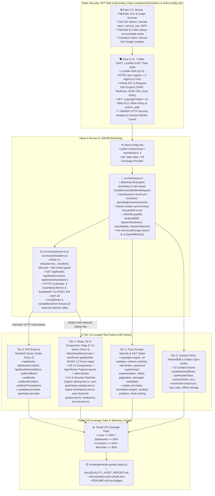

### 2. Test Harness & Interception Primitives Matrix

| Test Harness Module | Source File | Testing Layer | Architectural Responsibility |
| :--- | :--- | :--- | :--- |
| **`setup`** | [`src/test/setup.ts`](src/test/setup.ts) | JSDOM & Browser API Test Bootstrap | Global Vitest setup bootstrapping `@testing-library/jest-dom/vitest`, fail-closed MSW v2 server lifecycle (`handleUnhandledMswRequest`, `resetHandlers`, `close`), pre-test `next/dynamic` chunk resolution (`pendingDynamicImports`), `localStorage` sanitization, and deterministic JSDOM polyfills (`matchMedia`, `ResizeObserver`, `IntersectionObserver`, `scrollTo`, `SpeechSynthesis`, `IndexedDB`). |
| **`handlers`** | [`src/mocks/handlers.ts`](src/mocks/handlers.ts) | MSW v2 HTTP Interception Handlers | Canonical Mock Service Worker v2 HTTP request handlers, fail-closed `handleUnhandledMswRequest` guard (blocking unmocked external/Supabase URLs and same-origin `/api/*` calls), hosted `*.supabase.co` & local `:54321` `(rest|auth|storage|realtime|functions|graphql)/v1` 503 catch-alls, and `mockBooks` fixtures intercepting `/api/books`, `/api/books/content`, `/api/books/translations`, Gutendex API, and allowlisted HTTPS Project Gutenberg mirrors for zero-network deterministic testing. |
| **`server`** | [`src/mocks/server.ts`](src/mocks/server.ts) | MSW v2 Node Server Instance | Node.js `setupServer(...handlers)` singleton providing hermetic request interception across all unit and integration test suites. |
| **`vitest.config.mts`** | [`vitest.config.mts`](vitest.config.mts) | Vitest Runner & Tiered V8 Coverage Engine (95/95/92/85) | Vite-native test runner configuration (`jsdom`, `maxWorkers: 4`, `@` path alias) enforcing the hard tiered V8 coverage floor (`lines: 95%`, `statements: 95%`, `functions: 92%`, `branches: 85%`) while excluding non-executable type contracts and barrels. |
| **`bookarium-security.test.ts`** | [`scripts/eslint-rules/bookarium-security.test.ts`](scripts/eslint-rules/bookarium-security.test.ts) | AST & Request-Taint Security Suite | Unit & codebase-wide AST verification tests for all 9 `bookarium-security` ESLint rules and intra-procedural request taint analysis (`Sources -> Sanitizers -> Sinks`). |
| **`ingest-catalog.test.ts`** | [`scripts/ingest-catalog.test.ts`](scripts/ingest-catalog.test.ts) | CLI Data Pipeline Test Suite | Hermetic unit tests verifying `ingest-catalog.js` URL/User-Agent resolvers, `CURATED_CLASSICS` SQL seed generation, `computeLifespanBounds`, and incremental content update SQL without running the CLI entrypoint. |
| **`ingest-translations.test.ts`** | [`scripts/ingest-translations.test.ts`](scripts/ingest-translations.test.ts) | CLI Data Pipeline Test Suite | Hermetic unit & integration tests verifying Wikidata SPARQL FRBR work clustering, 5 Pipeline Blockers, 7 Hardening Defenses, and SQL seed generation. |
| **`sync-featured-quotes.test.ts`** | [`scripts/sync-featured-quotes.test.ts`](scripts/sync-featured-quotes.test.ts) | CLI Data Pipeline Test Suite | Hermetic unit & integration tests verifying Two-Tier Bounded Quote Pool blending (`Top 500 Popular + Rolling 64 Most Recent`, `40 + 10` split with backfill), `--diff-file=quote-diff.json` zero-scan pool consumption, post-batch `1-for-1` sliding window auto-pruning, single-line console progress (`formatConsoleSummary`) and Markdown summary reporting (`formatRunReport`), per-mirror PGLAF workers (`gutenberg.pglaf.org`, `aleph.gutenberg.org`, `gutenberg.readingroo.ms`), and `public.books.quotes` JSONB upserts. |
| **`sync-gutenberg-catalog.test.ts`** | [`scripts/sync-gutenberg-catalog.test.ts`](scripts/sync-gutenberg-catalog.test.ts) | CLI Data Pipeline Test Suite | Hermetic unit & integration tests verifying Project Gutenberg `rdf-files.tar.bz2` and `pg_catalog.csv.gz` streaming decompression across 3 mirrors, CSV RFC 4180 parsing, author lifespan extraction, in-RAM `--cache-file=gutenberg-catalog-cache.json.gz` snapshot diffing and `--diff-output=quote-diff.json` emission (`hasCatalogMetadataChanged`, `filterChangedOrNewBooks` preserving `quotes`), withdrawn-book reconciliation (`reconcileWithdrawnCatalogBooks`), and sticky dynamic Supabase batch upserts. |

### 3. Architectural Layer Test Suite Distribution (246 Suites)

| Architectural Layer | Target File Scope | Co-Located Suites | Verified Assertions | Hermetic & Security Testing Strategy |
| :--- | :--- | :--- | :--- | :--- |
| **App Router Pages, Layouts & API Routes** | `src/app/**/*.test.{ts,tsx}` | `31` | `323` | NextRequest/NextResponse edge route verification, MSW v2 upstream failover, SSR metadata, and full-page user journeys. |
| **React 19 UI & Presentation Components** | `src/components/**/*.test.tsx` | `106` | `963` | `@testing-library/react` + `userEvent` accessible role assertions (`getByRole`), WCAG 2.2 focus trapping, confirmation modals, and viewport interaction parity. |
| **Zustand Persistent State Stores** | `src/stores/*.test.ts` | `10` | `228` | Local storage hydration, optimistic outbox mutations, tombstone filtering, LWW conflict resolution, per-user in-flight coalescing (`coalesceInFlightByUser`), pre-sync active JWT session verification (`verifyActiveCloudSession`), batched multi-book `reading_progress` upserts, and 10-store session teardown. |
| **Custom Hooks & TanStack Queries** | `src/hooks/**/*.test.{ts,tsx}` | `35` | `332` | `renderHook` with `QueryClientProvider` + MSW v2 network interception, IndexedDB offline-first reads, Web Speech TTS, and reading ledger hydration. |
| **Domain Engines, Security Primitives & Gutenberg AST** | `src/lib/**/*.test.ts` | `43` | `503` | Pure computational & security verification (multi-jurisdictional copyright, SSRF/redirect sanitizers, rate limiter, Gutenberg AST segmentation/reflow/pagination, interval annotator). |
| **Configuration, Anthologies & Design Tokens** | `src/config/*.test.ts` | `13` | `56` | Schema integrity, curated 27-masterwork anthology lifespan validation, 12-hour sliding-cache hero/editorial boundary guards (`FEATURED_HERO_ID_SET`, `toFallbackHeroWithRawBook`), and theme/accolade token invariants. |
| **Background Web Worker & Edge Reverse Proxy** | `src/workers/*.test.ts` & `src/proxy.test.ts` | `2` | `15` | Off-thread Web Worker message lifecycle (`PARSE_BOOK`) and Edge Geo-IP / cookie / Supabase session refresh proxy tests. |
| **Hermetic Network Mocks & Test Interception** | `src/mocks/*.test.ts` | `1` | `4` | Fail-closed MSW v2 request/response handler unit contracts, Gutendex/Gutenberg mirror fixtures, and Supabase 503 safety-net verification (`src/mocks/handlers.test.ts`). |
| **CLI Data Ingestion Pipelines & AST Security Rules** | `scripts/**/*.test.ts` | `5` | `102` | Hermetic `pg_catalog.csv.gz` streaming decompression, RFC 4180 CSV parsing, in-RAM `gutenberg-catalog-cache.json.gz` snapshot diffing, `quote-diff.json` hand-off, PGLAF mirror-first featured quotes extraction, Wikidata SPARQL FRBR translation clustering, and 9-rule ESLint AST & request-taint security verification. |

---

## 🗂️ Repository Directory & Living Documentation Topology Map

### 1. Structural Directory Map

| Workspace Path | Architectural Layer & Contents |
| :--- | :--- |
| **`src/app/`** | Next.js 16 App Router pages, SSR layouts, metadata routes (`manifest.ts`, `robots.ts`, `sitemap.ts`), global providers (`providers.tsx`), and serverless API route handlers (`/api/books/**`, `/auth/callback`). |
| **`src/components/`** | 106 production React 19 UI components & motion config primitives organized across `account/`, `accolades/`, `auth/`, `bookshelf/`, `motion/`, `presentation/` (including `bookshelf/`), `profile/`, `pwa/`, `reader/`, `symposium/`, and `ui/`, each paired with co-located `*.test.{ts,tsx}` suites. |
| **`src/stores/`** | 10 Zustand client-side state stores (`useBookshelfStore`, `useReaderStore`, `useAuthStore`, `useFellowshipStore`, `useAnnotationStore`, `useAccoladesStore`, `useHabitsStore`, `useJurisdictionStore`, `usePreferencesStore`, `useThemeStore`) with `localStorage` persistence and bi-directional Supabase cloud outbox synchronization. |
| **`src/hooks/`** | 35 custom React hooks organized into `queries/` (TanStack Query v5 data fetching), `reader/` (Web Speech TTS, session coordinates, gestures, worker AST, reading ledger), and root UI/network/copyright hooks (`useNetworkStatus`, `useOfflineBooks`, `useBookCopyright`, `useCatalogFilters`, `useCollectionAutoHeal`). |
| **`src/lib/`** | 49 domain computational engines, App Router route helpers, and adapters covering Gutenberg AST segmentation/pagination/reflow (`gutenberg/`), dual-provider catalog resolution (`catalog/`), Supabase SSR/browser clients (`supabase/`), multi-jurisdictional copyright (`copyright-engine.ts`), IndexedDB storage (`offline-storage.ts`), interval annotation partitioning (`reader-annotator.ts`), cloud bookshelf sync (`bookshelf-cloud-sync.ts`), and co-located `src/app/**` server route utilities (`metadata-cache.ts`, `url-validator.ts`, `reader-layout-utils.ts`, `profile-layout-utils.ts`). |
| **`src/config/`** | 13 centralized design token, routing, theme, language, era, literary quote, and 27-masterwork curated anthology configuration modules. |
| **`src/types/`** | 4 canonical TypeScript type contract modules (`book.types.ts`, `database.types.ts`, `catalog.types.ts`, `accolades.types.ts`) defining zero-any domain and PostgreSQL row schemas. |
| **`src/workers/`** | Dedicated off-thread Web Worker (`gutenberg.worker.ts`) executing Gutenberg plain-text segmentation and virtual page layout calculations. |
| **`src/mocks/ & src/test/`** | Hermetic MSW v2 Node interception server (`server.ts`, `handlers.ts`, `handlers.test.ts`, fail-closed `handleUnhandledMswRequest`) and JSDOM test environment bootstrap (`setup.ts`). |
| **`public/`** | Progressive Web App Service Worker (`public/sw.js` `v7`) and multi-resolution soaring open book brand emblem icons (`favicon.ico`, `icon.svg`, `public/icons/*.png`). |
| **`supabase/`** | Idempotent PostgreSQL schema (`schema.sql`) with 14 tables, 47 RLS policies, 7 functions/triggers, and 21 explicit indexes, plus offline SQL seeds (`seed_books.sql`, `seed_translations.sql`). |
| **`scripts/`** | 15 Node.js CLI automation, Babel AST documentation compilation (`lib/ast-parser.js`), custom ESLint AST & request-taint security rules (`eslint-rules/bookarium-security.js`), 7-Gateway verification (`verify-build.js`), Gutenberg catalog streaming (`sync-gutenberg-catalog.js`), PGLAF mirror-first featured quotes extraction (`sync-featured-quotes.js`), and Wikidata FRBR translation clustering (`ingest-translations.js`) tools, plus offline authority cache (`scripts/data/`) and CLI test suites. |
| **`docs/`** | Living architectural reference (`ARCHITECTURE.md`), 80 Architecture Decision Records (`DECISIONS.md`), AST-compiled parser specification (`GUTENBERG_PARSER.md`), CI/CD runbook (`PIPELINE_GUIDE.md`), and live 7-Gateway quality telemetry (`QUALITY_AUDIT_REPORT.md`, `quality-audit-results.json`). |
| **`.github/workflows/ & .husky/`** | Automated GitHub Actions CI/CD & release publisher (`ci.yml`, `release.yml`), unified Sunday sequential catalog/translation/quote ingestion (`catalog-sync.yml` with permanent `catalog-cache` GitHub Release snapshot & `quote-diff.json` handoff), on-demand manual maintenance workflows (`translations-sync.yml`, `quotes-sync.yml`), GitHub collaboration/automation templates (`ISSUE_TEMPLATE/*.yml`, `pull_request_template.md`, `dependabot.yml`, `FUNDING.yml`, `.github/assets/README.md`), plus Husky pre-commit quality gates. |

### 2. Living Documentation & Governance Artifacts Catalog

| Document / Artifact | Maintenance Mode | Generator / Verification Script | Scope & Architectural Purpose |
| :--- | :--- | :--- | :--- |
| **[`README.md`](README.md)** | Hybrid (Curated + Script-Synced) | `scripts/generate-changelog.js` & `scripts/generate-quality-report.js` | Primary project overview, system architecture diagrams, Supabase setup guide, and live test/coverage/release blocks. |
| **[`docs/ARCHITECTURE.md`](docs/ARCHITECTURE.md)** | 100% AST-Generated | `scripts/generate-architecture-matrix.js` | Complete 360° full-repository C4 architecture map, event/state-flow bus, temporal sequence workflows, external integration boundaries, failure/retry topology, edge deployment & 5-layer caching hierarchy, AST-verified environment variable bindings, component/store/hook/utility/config/type matrices, database schema & indexes, testing harness, and module dependency topology. |
| **[`docs/DECISIONS.md`](docs/DECISIONS.md)** | Append-Only Governance Ledger | `_Append-Only Ledger_ (Validated in Pass 5)` | Sequential Architectural Decision Records (ADR-001 through ADR-080) documenting context, trade-offs, and consequences. |
| **[`docs/GUTENBERG_PARSER.md`](docs/GUTENBERG_PARSER.md)** | 100% AST-Generated | `scripts/generate-parser-docs.js` | Technical reference for the Gutenberg plain-text segmentation, paragraph reflow, virtual pagination, and passage extraction engine. |
| **[`docs/QUALITY_AUDIT_REPORT.md`](docs/QUALITY_AUDIT_REPORT.md)** | 100% Telemetry-Generated | `scripts/generate-quality-report.js` | Human-readable 7-Gateway audit summary, V8 coverage metrics, and collapsible catalog of all 246 test suites and 2,550 tests. |
| **[`docs/quality-audit-results.json`](docs/quality-audit-results.json)** | 100% Telemetry-Generated | `scripts/generate-quality-report.js` | Machine-readable JSON telemetry of all 7 gateway passes, coverage percentages, ESLint/Knip counts, and suite totals. |
| **[`ROADMAP.md`](ROADMAP.md)** | 100% AST-Generated | `scripts/generate-roadmap.js` | Zero-drift product roadmap verifying feature completion directly against source files and AST patterns across Milestones 0–11. |
| **[`CHANGELOG.md`](CHANGELOG.md)** | 100% Script-Generated | `scripts/generate-changelog.js` | Chronological Keep a Changelog 1.0.0 & SemVer release ledger across all application versions. |
| **[`docs/PIPELINE_GUIDE.md`](docs/PIPELINE_GUIDE.md)** | Curated Engineering Runbook | _Source-of-Truth Runbook_ | Operational guide for the 7-Gateway Quality Engine, GitHub Actions workflows, and catalog/translation ingestion pipelines. |
| **[`DEVELOPMENT.md`](DEVELOPMENT.md) & [`CONTRIBUTING.md`](CONTRIBUTING.md)** | Curated Contributor Guides | _Source-of-Truth Guides_ | Local development environment setup, testing standards, and conventional commit protocols. |
| **[`SECURITY.md`](SECURITY.md) & [`CODE_OF_CONDUCT.md`](CODE_OF_CONDUCT.md)** | Curated Governance Policies | _Source-of-Truth Policies_ | Vulnerability disclosure policy, OWASP defense-in-depth overview, and Contributor Covenant v2.1 standards. |
| **[`AGENTS.md`](AGENTS.md) & [`.agents/AGENTS.md`](.agents/AGENTS.md)** | Immutable Agent Governance | _Canonical Agent Rules_ | Master operational rules (Rules 0–9) governing human and AI multi-agent engineering in Bookarium. |

---

## 🔗 AST Module Interconnection & Topology Matrix

Every source file is analyzed for upstream imports, downstream consumers, and its co-located Vitest suite to guarantee zero orphaned or untested code:

| Module / Component | Upstream Dependencies (Imports) | Downstream Consumers (Consumed By) | Co-Located Test Suite | Role & Responsibilities |
| :--- | :--- | :--- | :--- | :--- |
| [`app/account/layout.tsx`](src/app/account/layout.tsx) | _Root Primitive_ | _App Route Entry_ | [`app/account/layout.test.tsx`](src/app/account/layout.test.tsx) | App Router Layout |
| [`app/account/page.tsx`](src/app/account/page.tsx) | `stores/useAuthStore`, `hooks/useNetworkStatus`, `stores/useBookshelfStore`, `stores/useAnnotationStore`, `stores/useReaderStore`, `stores/useThemeStore`, `stores/usePreferencesStore`, `stores/useHabitsStore`, `stores/useFellowshipStore`, `hooks/useScrollDirection`, `components/presentation/Navbar`, `components/presentation/Footer`, `components/ui/Button`, `components/ui/BackToTop`, `components/ui/EditorialUnderlineTabs`, `components/account/AccountIdentityCard`, `components/account/AccountHabitsCard`, `components/account/AccountAccoladesCard`, `components/account/AccountPublicProfileSection`, `components/account/AccountSymposiumSection`, `components/account/AccountSecuritySection`, `components/account/AccountPreferencesSection`, `lib/scroll-utils`, `components/account/AccountDeleteModal`, `lib/reading-analytics`, `lib/preferences-sync`, `hooks/useAccountSecurityActions`, `hooks/useMobileViewSwipe`, `config/views.config`, `config/routes`, `types/database.types` | `ServiceWorkerRegister.tsx` | [`app/account/page.test.tsx`](src/app/account/page.test.tsx) | App Router Page |
| [`metadata-cache.ts`](src/app/api/books/content/metadata-cache.ts) | `config/api-endpoints`, `config/site-config`, `config/featured-books`, `lib/copyright-engine`, `lib/catalog/supabase-provider`, `lib/supabase/client` | `app/api/books/content/route.ts` | [`metadata-cache.test.ts`](src/app/api/books/content/metadata-cache.test.ts) | Server Route Utility |
| [`app/api/books/content/route.ts`](src/app/api/books/content/route.ts) | `config/site-config`, `lib/rate-limiter`, `lib/api-utils`, `lib/copyright-engine`, `lib/country-resolver`, `lib/utils`, `lib/reading-card-export`, `./url-validator`, `./metadata-cache`, `lib/catalog/supabase-provider`, `lib/supabase/client` | _App Route Entry_ | [`app/api/books/content/route.test.ts`](src/app/api/books/content/route.test.ts), [`app/api/books/content/route.security.test.ts`](src/app/api/books/content/route.security.test.ts) | Server Route Handler |
| [`url-validator.ts`](src/app/api/books/content/url-validator.ts) | _Root Primitive_ | `app/api/books/content/route.ts` | [`url-validator.test.ts`](src/app/api/books/content/url-validator.test.ts) | Server Route Utility |
| [`app/api/books/route.ts`](src/app/api/books/route.ts) | `lib/rate-limiter`, `lib/api-utils`, `lib/copyright-engine`, `lib/catalog/query-parser`, `lib/catalog/gutendex-provider`, `lib/catalog/supabase-provider`, `types/catalog.types` | _App Route Entry_ | [`app/api/books/route.test.ts`](src/app/api/books/route.test.ts) | Server Route Handler |
| [`app/api/books/translations/route.ts`](src/app/api/books/translations/route.ts) | `lib/rate-limiter`, `lib/api-utils`, `lib/catalog/supabase-provider`, `lib/country-resolver` | _App Route Entry_ | [`app/api/books/translations/route.test.ts`](src/app/api/books/translations/route.test.ts) | Server Route Handler |
| [`app/auth/callback/route.ts`](src/app/auth/callback/route.ts) | `lib/supabase/server`, `config/site-config`, `lib/redirect-sanitizer` | _App Route Entry_ | [`app/auth/callback/route.test.ts`](src/app/auth/callback/route.test.ts) | Server Route Handler |
| [`app/auth/confirm-deletion/layout.tsx`](src/app/auth/confirm-deletion/layout.tsx) | _Root Primitive_ | _App Route Entry_ | [`app/auth/confirm-deletion/layout.test.tsx`](src/app/auth/confirm-deletion/layout.test.tsx) | App Router Layout |
| [`app/auth/confirm-deletion/page.tsx`](src/app/auth/confirm-deletion/page.tsx) | `stores/useAuthStore`, `components/presentation/Navbar`, `components/presentation/Footer`, `components/ui/Button`, `config/routes` | _App Route Entry_ | [`app/auth/confirm-deletion/page.test.tsx`](src/app/auth/confirm-deletion/page.test.tsx) | App Router Page |
| [`app/copyright/layout.tsx`](src/app/copyright/layout.tsx) | `config/site-config` | _App Route Entry_ | [`app/copyright/layout.test.tsx`](src/app/copyright/layout.test.tsx) | App Router Layout |
| [`app/copyright/page.tsx`](src/app/copyright/page.tsx) | `components/presentation/Navbar`, `components/presentation/Footer`, `components/ui/BackToTop`, `config/routes`, `config/site-config` | _App Route Entry_ | [`app/copyright/page.test.tsx`](src/app/copyright/page.test.tsx) | App Router Page |
| [`error.tsx`](src/app/error.tsx) | `components/ui/Button`, `config/routes` | _Direct Root Consumer_ | [`error.test.tsx`](src/app/error.test.tsx) | App Error / 404 Boundary |
| [`global-error.tsx`](src/app/global-error.tsx) | _Root Primitive_ | _Direct Root Consumer_ | [`global-error.test.tsx`](src/app/global-error.test.tsx) | App Error / 404 Boundary |
| [`app/layout.tsx`](src/app/layout.tsx) | `./providers`, `config/site-config`, `proxy`, `lib/copyright-engine`, `stores/useThemeStore`, `./globals.css` | _App Route Entry_ | [`app/layout.test.tsx`](src/app/layout.test.tsx) | App Router Layout |
| [`loading.tsx`](src/app/loading.tsx) | `components/ui/BrandLogo`, `config/site-config` | _Direct Root Consumer_ | [`loading.test.tsx`](src/app/loading.test.tsx) | App Loading / Splash Boundary |
| [`manifest.ts`](src/app/manifest.ts) | `config/site-config` | _Direct Root Consumer_ | [`manifest.test.ts`](src/app/manifest.test.ts) | App Metadata Route |
| [`not-found.tsx`](src/app/not-found.tsx) | `components/ui/Button`, `config/routes` | _Direct Root Consumer_ | [`not-found.test.tsx`](src/app/not-found.test.tsx) | App Error / 404 Boundary |
| [`app/page.tsx`](src/app/page.tsx) | `components/presentation/Navbar`, `components/presentation/HeroSearch`, `components/presentation/StickyCatalogToolbar`, `components/presentation/BookGrid`, `components/presentation/EditorialQuoteSection`, `components/presentation/LiteraryQuotes`, `components/presentation/bookshelf/BookshelfMobileModal`, `components/presentation/AdvancedFilterDrawer`, `components/presentation/DownloadDrawer`, `components/presentation/BookPreviewModal`, `app/read/[id]/page`, `components/presentation/NotebookView`, `components/presentation/BookmarksView`, `components/presentation/CatalogOfflineView`, `components/presentation/CollectionBottomDock`, `components/presentation/CollectionFloatingSearch`, `components/presentation/CollectionFilterDrawer`, `components/presentation/CollectionClearConfirmModal`, `components/ui/RemoveOfflineBookModal`, `components/ui/SectionHeader`, `components/presentation/Footer`, `hooks/queries/useBooks`, `hooks/useCatalogFilters`, `hooks/useMobileViewSwipe`, `hooks/useTouchDevice`, `hooks/useScrollDirection`, `stores/useReaderStore`, `stores/usePreferencesStore`, `hooks/useOfflineBooks`, `hooks/useOfflineCatalogFallback`, `hooks/useNetworkStatus`, `hooks/useCollectionAutoHeal`, `hooks/usePersonalCollectionsController`, `hooks/useHasMounted`, `types/book.types`, `components/ui/Button`, `components/presentation/CollectionToolbar`, `components/ui/Pagination`, `lib/scroll-utils`, `lib/book-sorting`, `lib/book-metadata`, `config/routes`, `config/site-config`, `config/views.config` | _App Route Entry_ | [`app/page.test.tsx`](src/app/page.test.tsx) | App Router Page |
| [`app/privacy/layout.tsx`](src/app/privacy/layout.tsx) | `config/site-config` | _App Route Entry_ | [`app/privacy/layout.test.tsx`](src/app/privacy/layout.test.tsx) | App Router Layout |
| [`app/privacy/page.tsx`](src/app/privacy/page.tsx) | `components/presentation/Navbar`, `components/presentation/Footer`, `components/ui/BackToTop`, `config/routes`, `config/site-config` | _App Route Entry_ | [`app/privacy/page.test.tsx`](src/app/privacy/page.test.tsx) | App Router Page |
| [`providers.tsx`](src/app/providers.tsx) | `stores/useAuthStore`, `stores/useJurisdictionStore`, `stores/useThemeStore`, `lib/sync-utils`, `components/pwa/ServiceWorkerRegister`, `components/ui/CursorTooltip`, `components/auth/AuthModal` | `app/layout.tsx`, `Navbar.tsx` | [`providers.test.tsx`](src/app/providers.test.tsx) | Root Client Provider |
| [`app/read/[id]/layout.tsx`](src/app/read/[id]/layout.tsx) | `config/site-config`, `lib/book-metadata`, `lib/reading-card-export`, `./reader-layout-utils` | _App Route Entry_ | [`app/read/[id]/layout.test.tsx`](src/app/read/[id]/layout.test.tsx) | App Router Layout |
| [`app/read/[id]/page.tsx`](src/app/read/[id]/page.tsx) | `hooks/queries/useBookContent`, `hooks/queries/useBooks`, `hooks/queries/useBookTranslations`, `stores/useReaderStore`, `stores/useThemeStore`, `lib/gutenberg-parser`, `hooks/reader/useGutenbergParserWorker`, `config/reader-themes`, `lib/book-metadata`, `lib/reader-annotator`, `components/reader/ReaderHeader`, `components/reader/ReaderFooter`, `components/reader/ReaderTocDrawer`, `components/reader/ReaderSearchDrawer`, `components/reader/ReaderControls`, `components/reader/ReaderLanguageDrawer`, `components/reader/ReaderSpeechBar`, `components/reader/ReaderSurface`, `components/reader/ReaderLoadingView`, `components/reader/TextHighlightPopover`, `components/reader/ReaderAnnotationsDrawer`, `components/reader/DeleteAnnotationModal`, `components/reader/VolumeCompletionModal`, `components/reader/ReaderExitBookmarkModal`, `hooks/reader/useReaderDrawers`, `hooks/reader/useReaderSpeech`, `hooks/reader/useReaderSession`, `hooks/reader/useReaderHabitTelemetry`, `hooks/reader/useReaderAnnotationActions`, `hooks/reader/useReaderExitBookmark`, `hooks/useNetworkStatus`, `stores/usePreferencesStore`, `lib/preferences-sync`, `stores/useAnnotationStore`, `stores/useFellowshipStore`, `stores/useAuthStore`, `stores/useBookshelfStore`, `config/routes` | `app/page.tsx`, `ServiceWorkerRegister.tsx`, `useOfflineBooks.ts` | [`app/read/[id]/page.test.tsx`](src/app/read/[id]/page.test.tsx) | App Router Page |
| [`reader-layout-utils.ts`](src/app/read/[id]/reader-layout-utils.ts) | `types/book.types`, `config/api-endpoints`, `config/site-config`, `config/featured-books`, `lib/catalog/supabase-provider`, `lib/supabase/client`, `lib/book-metadata`, `lib/book-tags`, `lib/utils`, `lib/server-rsc-nav`, `types/database.types` | `app/read/[id]/layout.tsx` | [`reader-layout-utils.test.ts`](src/app/read/[id]/reader-layout-utils.test.ts) | Server Route Utility |
| [`robots.ts`](src/app/robots.ts) | `config/site-config` | _Direct Root Consumer_ | [`robots.test.ts`](src/app/robots.test.ts) | App Metadata Route |
| [`sitemap.ts`](src/app/sitemap.ts) | `config/site-config`, `config/featured-books` | _Direct Root Consumer_ | [`sitemap.test.ts`](src/app/sitemap.test.ts) | App Metadata Route |
| [`app/u/[username]/layout.tsx`](src/app/u/[username]/layout.tsx) | `config/site-config`, `lib/server-rsc-nav`, `./profile-layout-utils` | _App Route Entry_ | [`app/u/[username]/layout.test.tsx`](src/app/u/[username]/layout.test.tsx) | App Router Layout |
| [`app/u/[username]/page.tsx`](src/app/u/[username]/page.tsx) | `lib/supabase/client`, `stores/useAuthStore`, `stores/useBookshelfStore`, `stores/useReaderStore`, `stores/useAccoladesStore`, `stores/useHabitsStore`, `config/routes`, `config/accolades-config`, `lib/reading-analytics`, `components/presentation/Navbar`, `components/presentation/Footer`, `components/ui/BackToTop`, `components/profile/PrivateProfileNotice`, `components/profile/PublicProfileView`, `components/profile/PinnedAccoladesShelf` | _App Route Entry_ | [`app/u/[username]/page.test.tsx`](src/app/u/[username]/page.test.tsx) | App Router Page |
| [`profile-layout-utils.ts`](src/app/u/[username]/profile-layout-utils.ts) | `lib/catalog/supabase-provider`, `lib/supabase/client` | `app/u/[username]/layout.tsx` | [`profile-layout-utils.test.ts`](src/app/u/[username]/profile-layout-utils.test.ts) | Server Route Utility |
| [`AccoladeCelebrationModal.tsx`](src/components/accolades/AccoladeCelebrationModal.tsx) | `types/accolades.types`, `config/accolades-config`, `stores/useAccoladesStore` | `AccountAccoladesCard.tsx` | [`AccoladeCelebrationModal.test.tsx`](src/components/accolades/AccoladeCelebrationModal.test.tsx) | Accolades & Bookplate Component |
| [`ExLibrisBookplate.tsx`](src/components/accolades/ExLibrisBookplate.tsx) | `types/accolades.types`, `config/accolades-config`, `lib/accolades-engine` | `AccountAccoladesCard.tsx`, `PinnedAccoladesShelf.tsx` | [`ExLibrisBookplate.test.tsx`](src/components/accolades/ExLibrisBookplate.test.tsx) | Accolades & Bookplate Component |
| [`AccountAccoladesCard.tsx`](src/components/account/AccountAccoladesCard.tsx) | `config/accolades-config`, `types/accolades.types`, `stores/useAccoladesStore`, `stores/useHabitsStore`, `stores/useBookshelfStore`, `stores/useReaderStore`, `stores/useAnnotationStore`, `stores/useFellowshipStore`, `lib/accolades-engine`, `lib/reading-analytics`, `components/ui/EditorialUnderlineTabs`, `components/accolades/ExLibrisBookplate`, `components/accolades/AccoladeCelebrationModal` | `app/account/page.tsx` | [`AccountAccoladesCard.test.tsx`](src/components/account/AccountAccoladesCard.test.tsx) | Account Hub Component |
| [`AccountDeleteModal.tsx`](src/components/account/AccountDeleteModal.tsx) | `components/ui/Modal`, `components/ui/Button` | `app/account/page.tsx` | [`AccountDeleteModal.test.tsx`](src/components/account/AccountDeleteModal.test.tsx) | Account Hub Component |
| [`AccountHabitsCard.tsx`](src/components/account/AccountHabitsCard.tsx) | `stores/useHabitsStore` | `app/account/page.tsx` | [`AccountHabitsCard.test.tsx`](src/components/account/AccountHabitsCard.test.tsx) | Account Hub Component |
| [`AccountIdentityCard.tsx`](src/components/account/AccountIdentityCard.tsx) | `types/database.types`, `components/ui/Button`, `components/ui/Input`, `config/routes` | `app/account/page.tsx` | [`AccountIdentityCard.test.tsx`](src/components/account/AccountIdentityCard.test.tsx) | Account Hub Component |
| [`AccountNarrationSubPanel.tsx`](src/components/account/AccountNarrationSubPanel.tsx) | `lib/speech-utils`, `components/ui/ConfirmActionModal` | `AccountPreferencesSection.tsx` | [`AccountNarrationSubPanel.test.tsx`](src/components/account/AccountNarrationSubPanel.test.tsx) | Account Hub Component |
| [`AccountPreferencesSection.tsx`](src/components/account/AccountPreferencesSection.tsx) | `config/reader-config`, `stores/useThemeStore`, `stores/useReaderStore`, `components/ui/EditorialUnderlineTabs`, `components/ui/ConfirmActionModal`, `./AccountNarrationSubPanel`, `./AccountTypographySubPanel` | `app/account/page.tsx` | [`AccountPreferencesSection.test.tsx`](src/components/account/AccountPreferencesSection.test.tsx) | Account Hub Component |
| [`AccountPublicProfileSection.tsx`](src/components/account/AccountPublicProfileSection.tsx) | `types/database.types`, `stores/useAuthStore`, `hooks/useNetworkStatus`, `config/routes`, `components/ui/EditorialUnderlineTabs`, `components/ui/Button`, `components/ui/Input` | `app/account/page.tsx` | [`AccountPublicProfileSection.test.tsx`](src/components/account/AccountPublicProfileSection.test.tsx) | Account Hub Component |
| [`AccountSecuritySection.tsx`](src/components/account/AccountSecuritySection.tsx) | `components/ui/Button`, `components/ui/Input`, `components/ui/PasswordStrengthMeter`, `hooks/useNetworkStatus`, `lib/password` | `app/account/page.tsx` | [`AccountSecuritySection.test.tsx`](src/components/account/AccountSecuritySection.test.tsx) | Account Hub Component |
| [`AccountSymposiumSection.tsx`](src/components/account/AccountSymposiumSection.tsx) | `stores/useFellowshipStore`, `hooks/useNetworkStatus`, `hooks/useOfflineBooks`, `components/ui/ConfirmActionModal`, `components/ui/EditorialUnderlineTabs`, `components/motion/ContentCrossfade`, `./symposium/SymposiumPactsSubTab`, `./symposium/ReaderCircleSubTab`, `./symposium/FellowshipInvitationsSubTab`, `components/symposium/SymposiumInviteModal` | `app/account/page.tsx` | [`AccountSymposiumSection.test.tsx`](src/components/account/AccountSymposiumSection.test.tsx) | Account Hub Component |
| [`AccountTypographySubPanel.tsx`](src/components/account/AccountTypographySubPanel.tsx) | `config/reader-config`, `stores/useThemeStore`, `stores/useReaderStore` | `AccountPreferencesSection.tsx` | [`AccountTypographySubPanel.test.tsx`](src/components/account/AccountTypographySubPanel.test.tsx) | Account Hub Component |
| [`FellowshipInvitationsSubTab.tsx`](src/components/account/symposium/FellowshipInvitationsSubTab.tsx) | `stores/useFellowshipStore`, `types/database.types`, `components/ui/Button` | `AccountSymposiumSection.tsx` | [`FellowshipInvitationsSubTab.test.tsx`](src/components/account/symposium/FellowshipInvitationsSubTab.test.tsx) | Account Hub Component |
| [`ReaderCircleSubTab.tsx`](src/components/account/symposium/ReaderCircleSubTab.tsx) | `stores/useFellowshipStore`, `components/ui/Button`, `components/ui/Input`, `config/routes` | `AccountSymposiumSection.tsx` | [`ReaderCircleSubTab.test.tsx`](src/components/account/symposium/ReaderCircleSubTab.test.tsx) | Account Hub Component |
| [`SymposiumPactsSubTab.tsx`](src/components/account/symposium/SymposiumPactsSubTab.tsx) | `stores/useFellowshipStore`, `types/database.types`, `components/ui/Button`, `config/routes` | `AccountSymposiumSection.tsx` | [`SymposiumPactsSubTab.test.tsx`](src/components/account/symposium/SymposiumPactsSubTab.test.tsx) | Account Hub Component |
| [`AuthModal.tsx`](src/components/auth/AuthModal.tsx) | `config/routes`, `stores/useAuthStore`, `stores/useBookshelfStore`, `components/ui/Button`, `components/ui/Input`, `components/ui/PasswordStrengthMeter`, `lib/password`, `components/motion/ContentCrossfade`, `./EmailSentView` | `providers.tsx` | [`AuthModal.test.tsx`](src/components/auth/AuthModal.test.tsx) | Authentication Component |
| [`EmailSentView.tsx`](src/components/auth/EmailSentView.tsx) | `components/ui/Button` | `AuthModal.tsx` | [`EmailSentView.test.tsx`](src/components/auth/EmailSentView.test.tsx) | Authentication Component |
| [`ReadingStatusSelector.tsx`](src/components/bookshelf/ReadingStatusSelector.tsx) | `types/book.types`, `stores/useReaderStore`, `components/ui/Modal`, `components/ui/Button` | `BookPreviewModal.tsx`, `BookshelfMobileModal.tsx` | [`ReadingStatusSelector.test.tsx`](src/components/bookshelf/ReadingStatusSelector.test.tsx) | Bookshelf Presentation Component |
| [`ContentCrossfade.tsx`](src/components/motion/ContentCrossfade.tsx) | `lib/utils` | `AccountSymposiumSection.tsx`, `AuthModal.tsx`, `BookmarksView.tsx`, `ReaderAnnotationsDrawer.tsx`, `ReaderSearchDrawer.tsx`, `ReaderTocDrawer.tsx` | [`ContentCrossfade.test.tsx`](src/components/motion/ContentCrossfade.test.tsx) | Motion & Transition Primitive |
| [`MotionReveal.tsx`](src/components/motion/MotionReveal.tsx) | `./motion-config` | _Direct Root Consumer_ | [`MotionReveal.test.tsx`](src/components/motion/MotionReveal.test.tsx) | Motion & Transition Primitive |
| [`StaggerGroup.tsx`](src/components/motion/StaggerGroup.tsx) | `./motion-config` | _Direct Root Consumer_ | [`StaggerGroup.test.tsx`](src/components/motion/StaggerGroup.test.tsx) | Motion & Transition Primitive |
| [`motion-config.ts`](src/components/motion/motion-config.ts) | _Root Primitive_ | `MotionReveal.tsx`, `StaggerGroup.tsx` | [`motion-config.test.ts`](src/components/motion/motion-config.test.ts) | Motion & Transition Primitive |
| [`AdvancedFilterDrawer.tsx`](src/components/presentation/AdvancedFilterDrawer.tsx) | `components/ui/BottomSheetDrawerShell`, `config/catalog-filters` | `app/page.tsx` | [`AdvancedFilterDrawer.test.tsx`](src/components/presentation/AdvancedFilterDrawer.test.tsx) | Presentation Component |
| [`BookCard.tsx`](src/components/presentation/BookCard.tsx) | `hooks/useCursorTooltip`, `components/ui/CursorTooltip`, `types/book.types`, `lib/utils`, `lib/book-tags`, `stores/useBookshelfStore`, `stores/useReaderStore`, `components/ui/Badge`, `components/ui/Button`, `components/ui/Card`, `components/ui/StarRating`, `config/routes`, `hooks/useBookCopyright`, `hooks/useOfflineBooks`, `hooks/useOfflineCoverImage`, `hooks/useNetworkStatus`, `components/ui/RemoveOfflineBookModal`, `components/ui/RemoveCollectionBookModal` | `BookGrid.tsx`, `BookPreviewModal.tsx` | [`BookCard.test.tsx`](src/components/presentation/BookCard.test.tsx) | Presentation Component |
| [`BookGrid.tsx`](src/components/presentation/BookGrid.tsx) | `types/book.types`, `./BookCard`, `./BookshelfRack`, `components/ui/Button`, `hooks/useOfflineBooks` | `app/page.tsx` | [`BookGrid.test.tsx`](src/components/presentation/BookGrid.test.tsx) | Presentation Component |
| [`BookPreviewModal.tsx`](src/components/presentation/BookPreviewModal.tsx) | `types/book.types`, `hooks/useBookPassageShuffle`, `hooks/queries/useBooks`, `lib/utils`, `components/ui/Button`, `components/ui/StarRating`, `components/bookshelf/ReadingStatusSelector`, `stores/useBookshelfStore`, `hooks/useBookCopyright`, `hooks/useNetworkStatus`, `lib/content-advisory`, `./BookCard`, `./NotablePassagesSpread`, `./OpenBookLeftPageSpread` | `app/page.tsx`, `ServiceWorkerRegister.tsx`, `useOfflineBooks.ts` | [`BookPreviewModal.test.tsx`](src/components/presentation/BookPreviewModal.test.tsx) | Presentation Component |
| [`BookmarkCard.tsx`](src/components/presentation/BookmarkCard.tsx) | `types/book.types`, `components/ui/Button`, `components/ui/CursorTooltip`, `components/ui/RemoveCollectionBookModal`, `config/routes`, `stores/useReaderStore`, `stores/useBookshelfStore`, `lib/adapters/book.adapter`, `hooks/useBookCopyright`, `hooks/useOfflineCoverImage`, `hooks/useNetworkStatus`, `lib/utils`, `components/symposium/SymposiumInviteModal` | `BookmarksView.tsx` | [`BookmarkCard.test.tsx`](src/components/presentation/BookmarkCard.test.tsx) | Presentation Component |
| [`BookmarksView.tsx`](src/components/presentation/BookmarksView.tsx) | `hooks/reader/useContinueReadingLedger`, `hooks/useMobileViewportCardFocus`, `stores/useReaderStore`, `./BookmarkCard`, `./CollectionToolbar`, `./CollectionBottomDock`, `./CollectionFloatingSearch`, `./CollectionFilterDrawer`, `lib/scroll-utils`, `components/motion/ContentCrossfade`, `components/ui/Button`, `components/ui/Modal`, `components/ui/RemoveOfflineBookModal`, `components/ui/Pagination`, `components/ui/SectionHeader`, `config/routes`, `types/book.types` | `app/page.tsx` | [`BookmarksView.test.tsx`](src/components/presentation/BookmarksView.test.tsx) | Presentation Component |
| [`BookshelfRack.tsx`](src/components/presentation/BookshelfRack.tsx) | `types/book.types`, `stores/useBookshelfStore`, `stores/useReaderStore`, `stores/useAuthStore`, `hooks/useOfflineBooks`, `hooks/useNetworkStatus`, `hooks/useTouchDevice`, `stores/useJurisdictionStore`, `lib/copyright-engine`, `lib/book-sorting`, `lib/scroll-utils`, `components/ui/Button`, `./bookshelf/BookshelfSpine`, `./bookshelf/BookshelfMobileModal`, `./bookshelf/BookshelfManageModals`, `components/ui/RemoveOfflineBookModal`, `config/routes` | `BookGrid.tsx`, `useBookshelfCapacity.ts`, `usePersonalCollectionsController.ts` | [`BookshelfRack.test.tsx`](src/components/presentation/BookshelfRack.test.tsx) | Presentation Component |
| [`CatalogMobileBottomDock.tsx`](src/components/presentation/CatalogMobileBottomDock.tsx) | `hooks/useAmbientDockScrollState`, `components/ui/AmbientCapsuleDock` | `StickyCatalogToolbar.tsx` | [`CatalogMobileBottomDock.test.tsx`](src/components/presentation/CatalogMobileBottomDock.test.tsx) | Presentation Component |
| [`CatalogOfflineView.tsx`](src/components/presentation/CatalogOfflineView.tsx) | `hooks/useCatalogFilters`, `config/routes` | `app/page.tsx` | [`CatalogOfflineView.test.tsx`](src/components/presentation/CatalogOfflineView.test.tsx) | Presentation Component |
| [`CatalogTelemetryBadge.tsx`](src/components/presentation/CatalogTelemetryBadge.tsx) | _Root Primitive_ | `StickyCatalogToolbar.tsx` | [`CatalogTelemetryBadge.test.tsx`](src/components/presentation/CatalogTelemetryBadge.test.tsx) | Presentation Component |
| [`CollectionBottomDock.tsx`](src/components/presentation/CollectionBottomDock.tsx) | `hooks/useAmbientDockScrollState`, `components/ui/AmbientCapsuleDock` | `app/page.tsx`, `BookmarksView.tsx`, `NotebookView.tsx` | [`CollectionBottomDock.test.tsx`](src/components/presentation/CollectionBottomDock.test.tsx) | Presentation Component |
| [`CollectionClearConfirmModal.tsx`](src/components/presentation/CollectionClearConfirmModal.tsx) | `components/ui/Modal`, `components/ui/Button` | `app/page.tsx` | [`CollectionClearConfirmModal.test.tsx`](src/components/presentation/CollectionClearConfirmModal.test.tsx) | Presentation Component |
| [`CollectionFilterDrawer.tsx`](src/components/presentation/CollectionFilterDrawer.tsx) | `components/ui/BottomSheetDrawerShell`, `./CollectionSortDropdown` | `app/page.tsx`, `BookmarksView.tsx`, `NotebookView.tsx` | [`CollectionFilterDrawer.test.tsx`](src/components/presentation/CollectionFilterDrawer.test.tsx) | Presentation Component |
| [`CollectionFloatingSearch.tsx`](src/components/presentation/CollectionFloatingSearch.tsx) | `hooks/useVisualViewportKeyboard`, `lib/scroll-utils` | `app/page.tsx`, `BookmarksView.tsx`, `NotebookView.tsx` | [`CollectionFloatingSearch.test.tsx`](src/components/presentation/CollectionFloatingSearch.test.tsx) | Presentation Component |
| [`CollectionSortDropdown.tsx`](src/components/presentation/CollectionSortDropdown.tsx) | _Root Primitive_ | `CollectionFilterDrawer.tsx`, `CollectionToolbar.tsx`, `book-sorting.ts`, `notebook-sorting.ts` | [`CollectionSortDropdown.test.tsx`](src/components/presentation/CollectionSortDropdown.test.tsx) | Presentation Component |
| [`CollectionToolbar.tsx`](src/components/presentation/CollectionToolbar.tsx) | `./CollectionSortDropdown`, `./CollectionTopPagination` | `app/page.tsx`, `BookmarksView.tsx`, `NotebookView.tsx` | [`CollectionToolbar.test.tsx`](src/components/presentation/CollectionToolbar.test.tsx) | Presentation Component |
| [`CollectionTopPagination.tsx`](src/components/presentation/CollectionTopPagination.tsx) | _Root Primitive_ | `CollectionToolbar.tsx` | [`CollectionTopPagination.test.tsx`](src/components/presentation/CollectionTopPagination.test.tsx) | Presentation Component |
| [`ContentAdvisoryBanner.tsx`](src/components/presentation/ContentAdvisoryBanner.tsx) | _Root Primitive_ | `DownloadDrawer.tsx`, `OpenBookLeftPageSpread.tsx`, `GutenbergInfoModal.tsx` | [`ContentAdvisoryBanner.test.tsx`](src/components/presentation/ContentAdvisoryBanner.test.tsx) | Presentation Component |
| [`CopyrightNoticeBanner.tsx`](src/components/presentation/CopyrightNoticeBanner.tsx) | _Root Primitive_ | `BookshelfMobileModal.tsx`, `DownloadDrawer.tsx` | [`CopyrightNoticeBanner.test.tsx`](src/components/presentation/CopyrightNoticeBanner.test.tsx) | Presentation Component |
| [`DownloadDrawer.tsx`](src/components/presentation/DownloadDrawer.tsx) | `types/book.types`, `lib/utils`, `components/ui/Modal`, `components/ui/Button`, `components/ui/Badge`, `components/ui/CursorTooltip`, `hooks/useBookCopyright`, `hooks/useOfflineBooks`, `hooks/useNetworkStatus`, `components/presentation/CopyrightNoticeBanner`, `components/presentation/ContentAdvisoryBanner`, `lib/content-advisory`, `components/ui/RemoveOfflineBookModal` | `app/page.tsx`, `ServiceWorkerRegister.tsx`, `useOfflineBooks.ts` | [`DownloadDrawer.test.tsx`](src/components/presentation/DownloadDrawer.test.tsx) | Presentation Component |
| [`EditorialQuoteSection.tsx`](src/components/presentation/EditorialQuoteSection.tsx) | `components/ui/Button`, `config/featured-books`, `config/routes`, `stores/useReaderStore`, `stores/useJurisdictionStore`, `hooks/queries/useBooks`, `types/book.types` | `app/page.tsx` | [`EditorialQuoteSection.test.tsx`](src/components/presentation/EditorialQuoteSection.test.tsx) | Presentation Component |
| [`Footer.tsx`](src/components/presentation/Footer.tsx) | `components/ui/BrandLogo`, `config/site-config`, `config/routes` | `app/account/page.tsx`, `app/auth/confirm-deletion/page.tsx`, `app/copyright/page.tsx`, `app/page.tsx`, `app/privacy/page.tsx`, `app/u/[username]/page.tsx` | [`Footer.test.tsx`](src/components/presentation/Footer.test.tsx) | Presentation Component |
| [`HeroFeaturedBook2DCard.tsx`](src/components/presentation/HeroFeaturedBook2DCard.tsx) | `types/book.types`, `config/featured-books`, `components/ui/Button`, `components/ui/CursorTooltip`, `lib/gutenberg/passages` | `HeroFeaturedBook3D.tsx` | [`HeroFeaturedBook2DCard.test.tsx`](src/components/presentation/HeroFeaturedBook2DCard.test.tsx) | Presentation Component |
| [`HeroFeaturedBook3D.tsx`](src/components/presentation/HeroFeaturedBook3D.tsx) | `types/book.types`, `config/featured-books`, `components/ui/Button`, `hooks/useBookPassageShuffle`, `hooks/queries/useBooks`, `hooks/usePerformanceTier`, `hooks/useTouchDevice`, `lib/gutenberg/passages`, `./HeroFeaturedBook2DCard`, `./OpenBookLeftPageSpread` | `HeroSearch.tsx` | [`HeroFeaturedBook3D.test.tsx`](src/components/presentation/HeroFeaturedBook3D.test.tsx) | Presentation Component |
| [`HeroSearch.tsx`](src/components/presentation/HeroSearch.tsx) | `components/ui/Button`, `config/catalog-filters`, `config/featured-books`, `types/book.types`, `stores/useJurisdictionStore`, `hooks/queries/useBooks`, `./LanguageSelector`, `./HeroFeaturedBook3D`, `lib/scroll-utils` | `app/page.tsx` | [`HeroSearch.test.tsx`](src/components/presentation/HeroSearch.test.tsx) | Presentation Component |
| [`LanguageSelector.tsx`](src/components/presentation/LanguageSelector.tsx) | `config/catalog-filters` | `HeroSearch.tsx` | [`LanguageSelector.test.tsx`](src/components/presentation/LanguageSelector.test.tsx) | Presentation Component |
| [`LiteraryQuotes.tsx`](src/components/presentation/LiteraryQuotes.tsx) | `config/literary-quotes`, `config/routes`, `lib/utils`, `lib/copyright-engine`, `stores/useJurisdictionStore`, `hooks/useHasMounted`, `hooks/queries/useBooks` | `app/page.tsx` | [`LiteraryQuotes.test.tsx`](src/components/presentation/LiteraryQuotes.test.tsx) | Presentation Component |
| [`Navbar.tsx`](src/components/presentation/Navbar.tsx) | `stores/useBookshelfStore`, `stores/useAnnotationStore`, `stores/useReaderStore`, `stores/useThemeStore`, `stores/useAuthStore`, `stores/useFellowshipStore`, `hooks/usePerformanceTier`, `hooks/useNetworkStatus`, `components/ui/Button`, `components/ui/BrandLogo`, `config/routes`, `config/site-config`, `config/library-tokens`, `config/views.config`, `app/providers`, `lib/preferences-sync` | `app/account/page.tsx`, `app/auth/confirm-deletion/page.tsx`, `app/copyright/page.tsx`, `app/page.tsx`, `app/privacy/page.tsx`, `app/u/[username]/page.tsx` | [`Navbar.test.tsx`](src/components/presentation/Navbar.test.tsx) | Presentation Component |
| [`NotablePassagesSpread.tsx`](src/components/presentation/NotablePassagesSpread.tsx) | `lib/copyright-engine`, `lib/gutenberg/passages` | `BookPreviewModal.tsx` | [`NotablePassagesSpread.test.tsx`](src/components/presentation/NotablePassagesSpread.test.tsx) | Presentation Component |
| [`NotebookQuoteCard.tsx`](src/components/presentation/NotebookQuoteCard.tsx) | `stores/useAnnotationStore`, `stores/useFellowshipStore`, `lib/reader-annotator`, `components/ui/Button`, `components/ui/CursorTooltip`, `./notebook/QuickColorSwatchPopover` | `NotebookView.tsx` | [`NotebookQuoteCard.test.tsx`](src/components/presentation/NotebookQuoteCard.test.tsx) | Presentation Component |
| [`NotebookView.tsx`](src/components/presentation/NotebookView.tsx) | `./NotebookQuoteCard`, `./notebook/NotebookFilterStrip`, `./notebook/NotebookVolumeGroup`, `./CollectionToolbar`, `./CollectionBottomDock`, `./CollectionFloatingSearch`, `./CollectionFilterDrawer`, `lib/scroll-utils`, `components/reader/DeleteAnnotationModal`, `stores/useAnnotationStore`, `stores/useAuthStore`, `hooks/useNotebookMetadataResolver`, `hooks/useMobileViewportCardFocus`, `components/ui/Button`, `components/ui/ConfirmActionModal`, `components/ui/Pagination`, `components/ui/SectionHeader`, `lib/reader-annotator`, `lib/notebook-sorting` | `app/page.tsx` | [`NotebookView.test.tsx`](src/components/presentation/NotebookView.test.tsx) | Presentation Component |
| [`OpenBookLeftPageSpread.tsx`](src/components/presentation/OpenBookLeftPageSpread.tsx) | `components/presentation/ContentAdvisoryBanner`, `components/ui/CursorTooltip`, `lib/gutenberg/passages` | `BookPreviewModal.tsx`, `HeroFeaturedBook3D.tsx` | [`OpenBookLeftPageSpread.test.tsx`](src/components/presentation/OpenBookLeftPageSpread.test.tsx) | Presentation Component |
| [`StickyCatalogToolbar.tsx`](src/components/presentation/StickyCatalogToolbar.tsx) | `components/ui/Button`, `hooks/useHasMounted`, `./CatalogTelemetryBadge`, `./CatalogMobileBottomDock` | `app/page.tsx` | [`StickyCatalogToolbar.test.tsx`](src/components/presentation/StickyCatalogToolbar.test.tsx) | Presentation Component |
| [`BookshelfManageModals.tsx`](src/components/presentation/bookshelf/BookshelfManageModals.tsx) | `components/ui/Button`, `components/ui/Input`, `components/ui/Modal` | `BookshelfRack.tsx` | [`BookshelfManageModals.test.tsx`](src/components/presentation/bookshelf/BookshelfManageModals.test.tsx) | Bookshelf Presentation Component |
| [`BookshelfMobileModal.tsx`](src/components/presentation/bookshelf/BookshelfMobileModal.tsx) | `types/book.types`, `types/database.types`, `stores/useReaderStore`, `stores/useBookshelfStore`, `hooks/useBookCopyright`, `hooks/useNetworkStatus`, `components/presentation/CopyrightNoticeBanner`, `components/ui/StarRating`, `components/bookshelf/ReadingStatusSelector`, `components/ui/Button`, `components/ui/CursorTooltip`, `components/ui/RemoveCollectionBookModal`, `hooks/useHasMounted`, `lib/utils`, `config/routes` | `app/page.tsx`, `BookshelfRack.tsx` | [`BookshelfMobileModal.test.tsx`](src/components/presentation/bookshelf/BookshelfMobileModal.test.tsx) | Bookshelf Presentation Component |
| [`BookshelfSpine.tsx`](src/components/presentation/bookshelf/BookshelfSpine.tsx) | `hooks/useCursorTooltip`, `components/ui/CursorTooltip`, `types/book.types`, `types/database.types`, `stores/useReaderStore`, `stores/useBookshelfStore`, `hooks/useBookCopyright`, `hooks/useNetworkStatus`, `components/ui/StarRating`, `components/ui/RemoveCollectionBookModal`, `lib/utils`, `config/routes` | `BookshelfRack.tsx` | [`BookshelfSpine.test.tsx`](src/components/presentation/bookshelf/BookshelfSpine.test.tsx) | Bookshelf Presentation Component |
| [`NotebookFilterStrip.tsx`](src/components/presentation/notebook/NotebookFilterStrip.tsx) | `stores/useAnnotationStore`, `config/annotation-tokens`, `lib/scroll-utils` | `NotebookView.tsx` | [`NotebookFilterStrip.test.tsx`](src/components/presentation/notebook/NotebookFilterStrip.test.tsx) | Presentation Component |
| [`NotebookVolumeGroup.tsx`](src/components/presentation/notebook/NotebookVolumeGroup.tsx) | _Root Primitive_ | `NotebookView.tsx` | [`NotebookVolumeGroup.test.tsx`](src/components/presentation/notebook/NotebookVolumeGroup.test.tsx) | Presentation Component |
| [`QuickColorSwatchPopover.tsx`](src/components/presentation/notebook/QuickColorSwatchPopover.tsx) | `stores/useAnnotationStore`, `config/annotation-tokens` | `NotebookQuoteCard.tsx` | [`QuickColorSwatchPopover.test.tsx`](src/components/presentation/notebook/QuickColorSwatchPopover.test.tsx) | Presentation Component |
| [`PinnedAccoladesShelf.tsx`](src/components/profile/PinnedAccoladesShelf.tsx) | `types/accolades.types`, `components/accolades/ExLibrisBookplate` | `app/u/[username]/page.tsx`, `PublicProfileView.tsx` | [`PinnedAccoladesShelf.test.tsx`](src/components/profile/PinnedAccoladesShelf.test.tsx) | Scholar Sanctuary Component |
| [`PrivateProfileNotice.tsx`](src/components/profile/PrivateProfileNotice.tsx) | `config/routes`, `components/ui/Button` | `app/u/[username]/page.tsx`, `PublicProfileView.tsx` | [`PrivateProfileNotice.test.tsx`](src/components/profile/PrivateProfileNotice.test.tsx) | Scholar Sanctuary Component |
| [`PublicProfileView.tsx`](src/components/profile/PublicProfileView.tsx) | `config/routes`, `components/ui/Button`, `components/ui/CursorTooltip`, `components/profile/PrivateProfileNotice`, `components/profile/PinnedAccoladesShelf`, `stores/useAuthStore`, `stores/useFellowshipStore`, `hooks/useNetworkStatus`, `hooks/useOfflineBooks`, `components/symposium/SymposiumInviteModal` | `app/u/[username]/page.tsx` | [`PublicProfileView.test.tsx`](src/components/profile/PublicProfileView.test.tsx) | Scholar Sanctuary Component |
| [`ServiceWorkerRegister.tsx`](src/components/pwa/ServiceWorkerRegister.tsx) | `app/read/[id]/page`, `app/account/page`, `components/presentation/BookPreviewModal`, `components/presentation/DownloadDrawer` | `providers.tsx` | [`ServiceWorkerRegister.test.tsx`](src/components/pwa/ServiceWorkerRegister.test.tsx) | PWA Lifecycle Component |
| [`DeleteAnnotationModal.tsx`](src/components/reader/DeleteAnnotationModal.tsx) | `components/ui/Modal`, `components/ui/Button`, `./QuoteDeletePreview` | `app/read/[id]/page.tsx`, `NotebookView.tsx`, `ReaderAnnotationsDrawer.tsx` | [`DeleteAnnotationModal.test.tsx`](src/components/reader/DeleteAnnotationModal.test.tsx) | Focus Reader Component |
| [`GutenbergInfoModal.tsx`](src/components/reader/GutenbergInfoModal.tsx) | `config/site-config`, `config/reader-themes`, `components/ui/Modal`, `lib/utils`, `components/presentation/ContentAdvisoryBanner`, `lib/content-advisory` | `ReaderHeader.tsx` | [`GutenbergInfoModal.test.tsx`](src/components/reader/GutenbergInfoModal.test.tsx) | Focus Reader Component |
| [`QuoteDeletePreview.tsx`](src/components/reader/QuoteDeletePreview.tsx) | _Root Primitive_ | `DeleteAnnotationModal.tsx` | [`QuoteDeletePreview.test.tsx`](src/components/reader/QuoteDeletePreview.test.tsx) | Focus Reader Component |
| [`ReaderAnnotationsDrawer.tsx`](src/components/reader/ReaderAnnotationsDrawer.tsx) | `./ReaderDrawerShell`, `stores/useAnnotationStore`, `lib/reader-annotator`, `stores/useReaderStore`, `stores/useFellowshipStore`, `config/reader-themes`, `config/annotation-tokens`, `lib/scroll-utils`, `./DeleteAnnotationModal`, `components/motion/ContentCrossfade` | `app/read/[id]/page.tsx` | [`ReaderAnnotationsDrawer.test.tsx`](src/components/reader/ReaderAnnotationsDrawer.test.tsx) | Focus Reader Component |
| [`ReaderControls.tsx`](src/components/reader/ReaderControls.tsx) | `stores/useReaderStore`, `config/reader-themes`, `config/reader-config`, `./ReaderDrawerShell` | `app/read/[id]/page.tsx` | [`ReaderControls.test.tsx`](src/components/reader/ReaderControls.test.tsx) | Focus Reader Component |
| [`ReaderDrawerShell.tsx`](src/components/reader/ReaderDrawerShell.tsx) | `stores/useReaderStore`, `config/reader-themes`, `hooks/useHasMounted`, `lib/utils` | `ReaderAnnotationsDrawer.tsx`, `ReaderControls.tsx`, `ReaderLanguageDrawer.tsx`, `ReaderSearchDrawer.tsx`, `ReaderShareModal.tsx`, `ReaderTocDrawer.tsx` | [`ReaderDrawerShell.test.tsx`](src/components/reader/ReaderDrawerShell.test.tsx) | Focus Reader Component |
| [`ReaderErrorView.tsx`](src/components/reader/ReaderErrorView.tsx) | `config/reader-themes`, `hooks/queries/useBookContent`, `config/routes` | `ReaderSurface.tsx` | [`ReaderErrorView.test.tsx`](src/components/reader/ReaderErrorView.test.tsx) | Focus Reader Component |
| [`ReaderExitBookmarkModal.tsx`](src/components/reader/ReaderExitBookmarkModal.tsx) | `components/ui/Modal`, `components/ui/Button`, `stores/useReaderStore` | `app/read/[id]/page.tsx` | [`ReaderExitBookmarkModal.test.tsx`](src/components/reader/ReaderExitBookmarkModal.test.tsx) | Focus Reader Component |
| [`ReaderFloatingToolsPod.tsx`](src/components/reader/ReaderFloatingToolsPod.tsx) | `stores/useReaderStore`, `config/reader-themes` | `ReaderFooter.tsx` | [`ReaderFloatingToolsPod.test.tsx`](src/components/reader/ReaderFloatingToolsPod.test.tsx) | Focus Reader Component |
| [`ReaderFooter.tsx`](src/components/reader/ReaderFooter.tsx) | `stores/useReaderStore`, `config/reader-themes`, `./ReaderFloatingToolsPod` | `app/read/[id]/page.tsx` | [`ReaderFooter.test.tsx`](src/components/reader/ReaderFooter.test.tsx) | Focus Reader Component |
| [`ReaderHeader.tsx`](src/components/reader/ReaderHeader.tsx) | `stores/useReaderStore`, `config/reader-themes`, `config/featured-books`, `lib/book-metadata`, `hooks/queries/useBookTranslations`, `./GutenbergInfoModal`, `./ReaderShareModal`, `components/ui/CursorTooltip`, `./ReaderSubHeaderRibbon` | `app/read/[id]/page.tsx` | [`ReaderHeader.test.tsx`](src/components/reader/ReaderHeader.test.tsx) | Focus Reader Component |
| [`ReaderLanguageDrawer.tsx`](src/components/reader/ReaderLanguageDrawer.tsx) | `stores/useReaderStore`, `config/reader-themes`, `hooks/queries/useBookTranslations`, `hooks/useNetworkStatus`, `hooks/useOfflineBooks`, `./ReaderDrawerShell` | `app/read/[id]/page.tsx` | [`ReaderLanguageDrawer.test.tsx`](src/components/reader/ReaderLanguageDrawer.test.tsx) | Focus Reader Component |
| [`ReaderLoadingView.tsx`](src/components/reader/ReaderLoadingView.tsx) | `config/reader-themes` | `app/read/[id]/page.tsx`, `ReaderSurface.tsx` | [`ReaderLoadingView.test.tsx`](src/components/reader/ReaderLoadingView.test.tsx) | Focus Reader Component |
| [`ReaderRowBookmark.tsx`](src/components/reader/ReaderRowBookmark.tsx) | _Root Primitive_ | `ReaderSurface.tsx` | [`ReaderRowBookmark.test.tsx`](src/components/reader/ReaderRowBookmark.test.tsx) | Focus Reader Component |
| [`ReaderSearchDrawer.tsx`](src/components/reader/ReaderSearchDrawer.tsx) | `lib/gutenberg-parser`, `lib/in-book-search`, `stores/useReaderStore`, `config/reader-themes`, `config/reader-config`, `components/motion/ContentCrossfade`, `./ReaderDrawerShell` | `app/read/[id]/page.tsx` | [`ReaderSearchDrawer.test.tsx`](src/components/reader/ReaderSearchDrawer.test.tsx) | Focus Reader Component |
| [`ReaderShareModal.tsx`](src/components/reader/ReaderShareModal.tsx) | `stores/useReaderStore`, `config/reader-themes`, `./ReaderDrawerShell`, `lib/reading-card-export`, `config/site-config`, `hooks/useCopyFeedback` | `ReaderHeader.tsx` | [`ReaderShareModal.test.tsx`](src/components/reader/ReaderShareModal.test.tsx) | Focus Reader Component |
| [`ReaderSpeechBar.tsx`](src/components/reader/ReaderSpeechBar.tsx) | `stores/useReaderStore`, `config/reader-themes`, `lib/speech-utils`, `hooks/reader/useReaderSpeech`, `lib/utils` | `app/read/[id]/page.tsx` | [`ReaderSpeechBar.test.tsx`](src/components/reader/ReaderSpeechBar.test.tsx) | Focus Reader Component |
| [`ReaderSubHeaderRibbon.tsx`](src/components/reader/ReaderSubHeaderRibbon.tsx) | `stores/useReaderStore`, `config/reader-themes`, `stores/useFellowshipStore`, `components/ui/ConfirmActionModal` | `ReaderHeader.tsx` | [`ReaderSubHeaderRibbon.test.tsx`](src/components/reader/ReaderSubHeaderRibbon.test.tsx) | Focus Reader Component |
| [`ReaderSurface.tsx`](src/components/reader/ReaderSurface.tsx) | `stores/useReaderStore`, `lib/gutenberg-parser`, `stores/useAnnotationStore`, `config/reader-themes`, `config/reader-config`, `config/annotation-tokens`, `hooks/reader/useReaderGestures`, `lib/reader-annotator`, `lib/reader-bookmark-geometry`, `./ReaderErrorView`, `./ReaderLoadingView`, `./ReaderRowBookmark` | `app/read/[id]/page.tsx` | [`ReaderSurface.test.tsx`](src/components/reader/ReaderSurface.test.tsx) | Focus Reader Component |
| [`ReaderTocDrawer.tsx`](src/components/reader/ReaderTocDrawer.tsx) | `lib/gutenberg-parser`, `stores/useReaderStore`, `config/reader-themes`, `components/motion/ContentCrossfade`, `./ReaderDrawerShell` | `app/read/[id]/page.tsx` | [`ReaderTocDrawer.test.tsx`](src/components/reader/ReaderTocDrawer.test.tsx) | Focus Reader Component |
| [`TextHighlightPopover.tsx`](src/components/reader/TextHighlightPopover.tsx) | `stores/useAnnotationStore`, `stores/useFellowshipStore`, `stores/useReaderStore`, `hooks/useHasMounted`, `config/annotation-tokens` | `app/read/[id]/page.tsx` | [`TextHighlightPopover.test.tsx`](src/components/reader/TextHighlightPopover.test.tsx) | Focus Reader Component |
| [`VolumeCompletionModal.tsx`](src/components/reader/VolumeCompletionModal.tsx) | `components/ui/Modal`, `components/ui/Button`, `components/ui/StarRating` | `app/read/[id]/page.tsx` | [`VolumeCompletionModal.test.tsx`](src/components/reader/VolumeCompletionModal.test.tsx) | Focus Reader Component |
| [`SymposiumInviteModal.tsx`](src/components/symposium/SymposiumInviteModal.tsx) | `components/ui/Modal`, `components/ui/Button`, `stores/useFellowshipStore`, `stores/useBookshelfStore` | `AccountSymposiumSection.tsx`, `BookmarkCard.tsx`, `PublicProfileView.tsx` | [`SymposiumInviteModal.test.tsx`](src/components/symposium/SymposiumInviteModal.test.tsx) | Literary Symposium Component |
| [`AmbientCapsuleDock.tsx`](src/components/ui/AmbientCapsuleDock.tsx) | _Root Primitive_ | `CatalogMobileBottomDock.tsx`, `CollectionBottomDock.tsx` | [`AmbientCapsuleDock.test.tsx`](src/components/ui/AmbientCapsuleDock.test.tsx) | UI Primitive |
| [`BackToTop.tsx`](src/components/ui/BackToTop.tsx) | _Root Primitive_ | `app/account/page.tsx`, `app/copyright/page.tsx`, `app/privacy/page.tsx`, `app/u/[username]/page.tsx` | [`BackToTop.test.tsx`](src/components/ui/BackToTop.test.tsx) | UI Primitive |
| [`Badge.tsx`](src/components/ui/Badge.tsx) | `lib/utils` | `BookCard.tsx`, `DownloadDrawer.tsx` | [`Badge.test.tsx`](src/components/ui/Badge.test.tsx) | UI Primitive |
| [`BottomSheetDrawerShell.tsx`](src/components/ui/BottomSheetDrawerShell.tsx) | `components/ui/Button` | `AdvancedFilterDrawer.tsx`, `CollectionFilterDrawer.tsx` | [`BottomSheetDrawerShell.test.tsx`](src/components/ui/BottomSheetDrawerShell.test.tsx) | UI Primitive |
| [`BrandLogo.tsx`](src/components/ui/BrandLogo.tsx) | _Root Primitive_ | `loading.tsx`, `Footer.tsx`, `Navbar.tsx` | [`BrandLogo.test.tsx`](src/components/ui/BrandLogo.test.tsx) | UI Primitive |
| [`Button.tsx`](src/components/ui/Button.tsx) | `lib/utils` | `app/account/page.tsx`, `app/auth/confirm-deletion/page.tsx`, `error.tsx`, `not-found.tsx`, `app/page.tsx`, `AccountDeleteModal.tsx`, `AccountIdentityCard.tsx`, `AccountPublicProfileSection.tsx`, `AccountSecuritySection.tsx`, `FellowshipInvitationsSubTab.tsx`, `ReaderCircleSubTab.tsx`, `SymposiumPactsSubTab.tsx`, `AuthModal.tsx`, `EmailSentView.tsx`, `ReadingStatusSelector.tsx`, `BookCard.tsx`, `BookGrid.tsx`, `BookmarkCard.tsx`, `BookmarksView.tsx`, `BookPreviewModal.tsx`, `BookshelfManageModals.tsx`, `BookshelfMobileModal.tsx`, `BookshelfRack.tsx`, `CollectionClearConfirmModal.tsx`, `DownloadDrawer.tsx`, `EditorialQuoteSection.tsx`, `HeroFeaturedBook2DCard.tsx`, `HeroFeaturedBook3D.tsx`, `HeroSearch.tsx`, `Navbar.tsx`, `NotebookQuoteCard.tsx`, `NotebookView.tsx`, `StickyCatalogToolbar.tsx`, `PrivateProfileNotice.tsx`, `PublicProfileView.tsx`, `DeleteAnnotationModal.tsx`, `ReaderExitBookmarkModal.tsx`, `VolumeCompletionModal.tsx`, `SymposiumInviteModal.tsx`, `BottomSheetDrawerShell.tsx`, `ConfirmActionModal.tsx`, `Pagination.tsx`, `RemoveCollectionBookModal.tsx`, `RemoveOfflineBookModal.tsx` | [`Button.test.tsx`](src/components/ui/Button.test.tsx) | UI Primitive |
| [`Card.tsx`](src/components/ui/Card.tsx) | `lib/utils` | `BookCard.tsx` | [`Card.test.tsx`](src/components/ui/Card.test.tsx) | UI Primitive |
| [`ConfirmActionModal.tsx`](src/components/ui/ConfirmActionModal.tsx) | `./Modal`, `./Button` | `AccountNarrationSubPanel.tsx`, `AccountPreferencesSection.tsx`, `AccountSymposiumSection.tsx`, `NotebookView.tsx`, `ReaderSubHeaderRibbon.tsx` | [`ConfirmActionModal.test.tsx`](src/components/ui/ConfirmActionModal.test.tsx) | UI Primitive |
| [`CursorTooltip.tsx`](src/components/ui/CursorTooltip.tsx) | `hooks/useCursorTooltip`, `lib/redirect-sanitizer` | `providers.tsx`, `BookCard.tsx`, `BookmarkCard.tsx`, `BookshelfMobileModal.tsx`, `BookshelfSpine.tsx`, `DownloadDrawer.tsx`, `HeroFeaturedBook2DCard.tsx`, `NotebookQuoteCard.tsx`, `OpenBookLeftPageSpread.tsx`, `PublicProfileView.tsx`, `ReaderHeader.tsx` | [`CursorTooltip.test.tsx`](src/components/ui/CursorTooltip.test.tsx) | UI Primitive |
| [`EditorialUnderlineTabs.tsx`](src/components/ui/EditorialUnderlineTabs.tsx) | `lib/scroll-utils` | `app/account/page.tsx`, `AccountAccoladesCard.tsx`, `AccountPreferencesSection.tsx`, `AccountPublicProfileSection.tsx`, `AccountSymposiumSection.tsx` | [`EditorialUnderlineTabs.test.tsx`](src/components/ui/EditorialUnderlineTabs.test.tsx) | UI Primitive |
| [`Input.tsx`](src/components/ui/Input.tsx) | `lib/utils` | `AccountIdentityCard.tsx`, `AccountPublicProfileSection.tsx`, `AccountSecuritySection.tsx`, `ReaderCircleSubTab.tsx`, `AuthModal.tsx`, `BookshelfManageModals.tsx` | [`Input.test.tsx`](src/components/ui/Input.test.tsx) | UI Primitive |
| [`Modal.tsx`](src/components/ui/Modal.tsx) | `lib/utils` | `AccountDeleteModal.tsx`, `ReadingStatusSelector.tsx`, `BookmarksView.tsx`, `BookshelfManageModals.tsx`, `CollectionClearConfirmModal.tsx`, `DownloadDrawer.tsx`, `DeleteAnnotationModal.tsx`, `GutenbergInfoModal.tsx`, `ReaderExitBookmarkModal.tsx`, `VolumeCompletionModal.tsx`, `SymposiumInviteModal.tsx`, `ConfirmActionModal.tsx`, `RemoveCollectionBookModal.tsx`, `RemoveOfflineBookModal.tsx` | [`Modal.test.tsx`](src/components/ui/Modal.test.tsx) | UI Primitive |
| [`Pagination.tsx`](src/components/ui/Pagination.tsx) | `./Button` | `app/page.tsx`, `BookmarksView.tsx`, `NotebookView.tsx` | [`Pagination.test.tsx`](src/components/ui/Pagination.test.tsx) | UI Primitive |
| [`PasswordStrengthMeter.tsx`](src/components/ui/PasswordStrengthMeter.tsx) | `lib/password` | `AccountSecuritySection.tsx`, `AuthModal.tsx` | [`PasswordStrengthMeter.test.tsx`](src/components/ui/PasswordStrengthMeter.test.tsx) | UI Primitive |
| [`RemoveCollectionBookModal.tsx`](src/components/ui/RemoveCollectionBookModal.tsx) | `components/ui/Modal`, `components/ui/Button` | `BookCard.tsx`, `BookmarkCard.tsx`, `BookshelfMobileModal.tsx`, `BookshelfSpine.tsx` | [`RemoveCollectionBookModal.test.tsx`](src/components/ui/RemoveCollectionBookModal.test.tsx) | UI Primitive |
| [`RemoveOfflineBookModal.tsx`](src/components/ui/RemoveOfflineBookModal.tsx) | `components/ui/Modal`, `components/ui/Button` | `app/page.tsx`, `BookCard.tsx`, `BookmarksView.tsx`, `BookshelfRack.tsx`, `DownloadDrawer.tsx` | [`RemoveOfflineBookModal.test.tsx`](src/components/ui/RemoveOfflineBookModal.test.tsx) | UI Primitive |
| [`SectionHeader.tsx`](src/components/ui/SectionHeader.tsx) | `lib/utils` | `app/page.tsx`, `BookmarksView.tsx`, `NotebookView.tsx` | [`SectionHeader.test.tsx`](src/components/ui/SectionHeader.test.tsx) | UI Primitive |
| [`StarRating.tsx`](src/components/ui/StarRating.tsx) | _Root Primitive_ | `BookCard.tsx`, `BookPreviewModal.tsx`, `BookshelfMobileModal.tsx`, `BookshelfSpine.tsx`, `VolumeCompletionModal.tsx` | [`StarRating.test.tsx`](src/components/ui/StarRating.test.tsx) | UI Primitive |
| [`accolades-config.ts`](src/config/accolades-config.ts) | `types/accolades.types` | `app/u/[username]/page.tsx`, `AccoladeCelebrationModal.tsx`, `ExLibrisBookplate.tsx`, `AccountAccoladesCard.tsx`, `accolades-engine.ts`, `useAccoladesStore.ts` | [`accolades-config.test.ts`](src/config/accolades-config.test.ts) | Configuration & Fixtures |
| [`annotation-tokens.ts`](src/config/annotation-tokens.ts) | `stores/useAnnotationStore` | `NotebookFilterStrip.tsx`, `QuickColorSwatchPopover.tsx`, `ReaderAnnotationsDrawer.tsx`, `ReaderSurface.tsx`, `TextHighlightPopover.tsx` | [`annotation-tokens.test.ts`](src/config/annotation-tokens.test.ts) | Configuration & Fixtures |
| [`api-endpoints.ts`](src/config/api-endpoints.ts) | _Root Primitive_ | `metadata-cache.ts`, `reader-layout-utils.ts`, `useBookContent.ts`, `useBooks.ts`, `useOfflineBooks.ts`, `gutendex-provider.ts`, `offline-storage.ts` | [`api-endpoints.test.ts`](src/config/api-endpoints.test.ts) | Configuration & Fixtures |
| [`catalog-filters.ts`](src/config/catalog-filters.ts) | _Root Primitive_ | `AdvancedFilterDrawer.tsx`, `HeroSearch.tsx`, `LanguageSelector.tsx`, `views.config.ts`, `useBookTranslations.ts`, `useCatalogFilters.ts` | [`catalog-filters.test.ts`](src/config/catalog-filters.test.ts) | Configuration & Fixtures |
| [`featured-books.ts`](src/config/featured-books.ts) | `lib/utils`, `lib/copyright-engine`, `types/book.types` | `metadata-cache.ts`, `reader-layout-utils.ts`, `sitemap.ts`, `EditorialQuoteSection.tsx`, `HeroFeaturedBook2DCard.tsx`, `HeroFeaturedBook3D.tsx`, `HeroSearch.tsx`, `ReaderHeader.tsx`, `useBookContent.ts`, `useBooks.ts`, `useBookPassageShuffle.ts`, `useCollectionAutoHeal.ts`, `useNotebookMetadataResolver.ts`, `useOfflineBooks.ts`, `book-metadata.ts`, `supabase-provider.ts`, `offline-storage.ts` | [`featured-books.test.ts`](src/config/featured-books.test.ts) | Configuration & Fixtures |
| [`library-tokens.ts`](src/config/library-tokens.ts) | `config/routes` | `Navbar.tsx`, `views.config.ts` | [`library-tokens.test.ts`](src/config/library-tokens.test.ts) | Configuration & Fixtures |
| [`literary-quotes.ts`](src/config/literary-quotes.ts) | `lib/copyright-engine` | `LiteraryQuotes.tsx`, `useBooks.ts`, `supabase-provider.ts` | [`literary-quotes.test.ts`](src/config/literary-quotes.test.ts) | Configuration & Fixtures |
| [`reader-config.ts`](src/config/reader-config.ts) | _Root Primitive_ | `AccountPreferencesSection.tsx`, `AccountTypographySubPanel.tsx`, `ReaderControls.tsx`, `ReaderSearchDrawer.tsx`, `ReaderSurface.tsx`, `useReaderGestures.ts`, `preferences-sync.ts`, `useAuthStore.ts`, `useReaderStore.ts` | [`reader-config.test.ts`](src/config/reader-config.test.ts) | Configuration & Fixtures |
| [`reader-themes.ts`](src/config/reader-themes.ts) | `stores/useReaderStore` | `app/read/[id]/page.tsx`, `GutenbergInfoModal.tsx`, `ReaderAnnotationsDrawer.tsx`, `ReaderControls.tsx`, `ReaderDrawerShell.tsx`, `ReaderErrorView.tsx`, `ReaderFloatingToolsPod.tsx`, `ReaderFooter.tsx`, `ReaderHeader.tsx`, `ReaderLanguageDrawer.tsx`, `ReaderLoadingView.tsx`, `ReaderSearchDrawer.tsx`, `ReaderShareModal.tsx`, `ReaderSpeechBar.tsx`, `ReaderSubHeaderRibbon.tsx`, `ReaderSurface.tsx`, `ReaderTocDrawer.tsx` | [`reader-themes.test.ts`](src/config/reader-themes.test.ts) | Configuration & Fixtures |
| [`routes.ts`](src/config/routes.ts) | _Root Primitive_ | `app/account/page.tsx`, `app/auth/confirm-deletion/page.tsx`, `app/copyright/page.tsx`, `error.tsx`, `not-found.tsx`, `app/page.tsx`, `app/privacy/page.tsx`, `app/read/[id]/page.tsx`, `app/u/[username]/page.tsx`, `AccountIdentityCard.tsx`, `AccountPublicProfileSection.tsx`, `ReaderCircleSubTab.tsx`, `SymposiumPactsSubTab.tsx`, `AuthModal.tsx`, `BookCard.tsx`, `BookmarkCard.tsx`, `BookmarksView.tsx`, `BookshelfMobileModal.tsx`, `BookshelfSpine.tsx`, `BookshelfRack.tsx`, `CatalogOfflineView.tsx`, `EditorialQuoteSection.tsx`, `Footer.tsx`, `LiteraryQuotes.tsx`, `Navbar.tsx`, `PrivateProfileNotice.tsx`, `PublicProfileView.tsx`, `ReaderErrorView.tsx`, `library-tokens.ts`, `useReaderExitBookmark.ts`, `useAuthStore.ts` | [`routes.test.ts`](src/config/routes.test.ts) | Configuration & Fixtures |
| [`site-config.ts`](src/config/site-config.ts) | _Root Primitive_ | `metadata-cache.ts`, `app/api/books/content/route.ts`, `app/auth/callback/route.ts`, `app/copyright/layout.tsx`, `app/copyright/page.tsx`, `app/layout.tsx`, `loading.tsx`, `manifest.ts`, `app/page.tsx`, `app/privacy/layout.tsx`, `app/privacy/page.tsx`, `app/read/[id]/layout.tsx`, `reader-layout-utils.ts`, `robots.ts`, `sitemap.ts`, `app/u/[username]/layout.tsx`, `Footer.tsx`, `Navbar.tsx`, `GutenbergInfoModal.tsx`, `ReaderShareModal.tsx`, `useReaderHabitTelemetry.ts`, `gutendex-provider.ts`, `redirect-sanitizer.ts`, `useAccoladesStore.ts`, `useAnnotationStore.ts`, `useAuthStore.ts`, `useBookshelfStore.ts`, `useHabitsStore.ts`, `usePreferencesStore.ts`, `useReaderStore.ts`, `useThemeStore.ts` | [`site-config.test.ts`](src/config/site-config.test.ts) | Configuration & Fixtures |
| [`translation-languages.ts`](src/config/translation-languages.ts) | _Root Primitive_ | `useBookTranslations.ts` | [`translation-languages.test.ts`](src/config/translation-languages.test.ts) | Configuration & Fixtures |
| [`views.config.ts`](src/config/views.config.ts) | `config/library-tokens`, `config/catalog-filters` | `app/account/page.tsx`, `app/page.tsx`, `Navbar.tsx`, `useMobileViewSwipe.ts`, `usePersonalCollectionsController.ts` | [`views.config.test.ts`](src/config/views.config.test.ts) | Configuration & Fixtures |
| [`useBookContent.ts`](src/hooks/queries/useBookContent.ts) | `mocks/handlers`, `config/api-endpoints`, `lib/offline-storage`, `stores/useJurisdictionStore`, `lib/copyright-engine`, `stores/useReaderStore`, `stores/useBookshelfStore`, `config/featured-books`, `types/book.types` | `app/read/[id]/page.tsx`, `ReaderErrorView.tsx`, `useBookPassageShuffle.ts` | [`useBookContent.test.ts`](src/hooks/queries/useBookContent.test.ts) | TanStack Query Hook |
| [`useBookTranslations.ts`](src/hooks/queries/useBookTranslations.ts) | `config/catalog-filters`, `config/translation-languages`, `lib/book-metadata`, `types/book.types` | `app/read/[id]/page.tsx`, `ReaderHeader.tsx`, `ReaderLanguageDrawer.tsx` | [`useBookTranslations.test.ts`](src/hooks/queries/useBookTranslations.test.ts) | TanStack Query Hook |
| [`useBooks.ts`](src/hooks/queries/useBooks.ts) | `types/book.types`, `config/api-endpoints`, `config/featured-books`, `config/literary-quotes`, `stores/useJurisdictionStore`, `lib/copyright-engine`, `lib/supabase/client`, `lib/catalog/supabase-provider`, `hooks/useHasMounted` | `app/page.tsx`, `app/read/[id]/page.tsx`, `BookPreviewModal.tsx`, `EditorialQuoteSection.tsx`, `HeroFeaturedBook3D.tsx`, `HeroSearch.tsx`, `LiteraryQuotes.tsx`, `useContinueReadingLedger.ts`, `useCollectionAutoHeal.ts`, `useNotebookMetadataResolver.ts` | [`useBooks.test.ts`](src/hooks/queries/useBooks.test.ts) | TanStack Query Hook |
| [`useContinueReadingLedger.ts`](src/hooks/reader/useContinueReadingLedger.ts) | `stores/useReaderStore`, `stores/useBookshelfStore`, `hooks/useHasMounted`, `hooks/queries/useBooks`, `lib/adapters/book.adapter`, `lib/book-metadata`, `lib/copyright-engine`, `hooks/useOfflineBooks`, `hooks/useNetworkStatus`, `types/book.types` | `BookmarksView.tsx` | [`useContinueReadingLedger.test.ts`](src/hooks/reader/useContinueReadingLedger.test.ts) | Reader Subsystem Hook |
| [`useGutenbergParserWorker.ts`](src/hooks/reader/useGutenbergParserWorker.ts) | `lib/gutenberg-parser`, `../../workers/gutenberg.worker.ts` | `app/read/[id]/page.tsx` | [`useGutenbergParserWorker.test.ts`](src/hooks/reader/useGutenbergParserWorker.test.ts) | Reader Subsystem Hook |
| [`useReaderAnnotationActions.ts`](src/hooks/reader/useReaderAnnotationActions.ts) | `lib/reader-annotator`, `stores/useAnnotationStore` | `app/read/[id]/page.tsx` | [`useReaderAnnotationActions.test.ts`](src/hooks/reader/useReaderAnnotationActions.test.ts) | Reader Subsystem Hook |
| [`useReaderDrawers.ts`](src/hooks/reader/useReaderDrawers.ts) | _Root Primitive_ | `app/read/[id]/page.tsx` | [`useReaderDrawers.test.ts`](src/hooks/reader/useReaderDrawers.test.ts) | Reader Subsystem Hook |
| [`useReaderExitBookmark.ts`](src/hooks/reader/useReaderExitBookmark.ts) | `stores/useReaderStore`, `types/book.types`, `lib/gutenberg-parser`, `lib/reader-annotator`, `lib/reader-bookmark-geometry`, `config/routes` | `app/read/[id]/page.tsx` | [`useReaderExitBookmark.test.ts`](src/hooks/reader/useReaderExitBookmark.test.ts) | Reader Subsystem Hook |
| [`useReaderGestures.ts`](src/hooks/reader/useReaderGestures.ts) | `config/reader-config` | `ReaderSurface.tsx` | [`useReaderGestures.test.ts`](src/hooks/reader/useReaderGestures.test.ts) | Reader Subsystem Hook |
| [`useReaderHabitTelemetry.ts`](src/hooks/reader/useReaderHabitTelemetry.ts) | `types/book.types`, `lib/book-metadata`, `stores/useBookshelfStore`, `stores/useReaderStore`, `types/database.types`, `hooks/useReadingTimer`, `config/site-config` | `app/read/[id]/page.tsx` | [`useReaderHabitTelemetry.test.ts`](src/hooks/reader/useReaderHabitTelemetry.test.ts) | Reader Subsystem Hook |
| [`useReaderSession.ts`](src/hooks/reader/useReaderSession.ts) | `stores/useReaderStore`, `stores/useAuthStore`, `stores/useBookshelfStore`, `types/book.types`, `lib/gutenberg-parser`, `lib/reader-annotator`, `hooks/useHasMounted` | `app/read/[id]/page.tsx` | [`useReaderSession.test.ts`](src/hooks/reader/useReaderSession.test.ts) | Reader Subsystem Hook |
| [`useReaderSpeech.ts`](src/hooks/reader/useReaderSpeech.ts) | `lib/speech-utils` | `app/read/[id]/page.tsx`, `ReaderSpeechBar.tsx` | [`useReaderSpeech.test.ts`](src/hooks/reader/useReaderSpeech.test.ts) | Reader Subsystem Hook |
| [`useAccountSecurityActions.ts`](src/hooks/useAccountSecurityActions.ts) | `types/database.types`, `lib/password` | `app/account/page.tsx` | [`useAccountSecurityActions.test.ts`](src/hooks/useAccountSecurityActions.test.ts) | Custom React Hook |
| [`useAmbientDockScrollState.ts`](src/hooks/useAmbientDockScrollState.ts) | _Root Primitive_ | `CatalogMobileBottomDock.tsx`, `CollectionBottomDock.tsx` | [`useAmbientDockScrollState.test.ts`](src/hooks/useAmbientDockScrollState.test.ts) | Custom React Hook |
| [`useBookCopyright.ts`](src/hooks/useBookCopyright.ts) | `stores/useJurisdictionStore`, `lib/copyright-engine` | `BookCard.tsx`, `BookmarkCard.tsx`, `BookPreviewModal.tsx`, `BookshelfMobileModal.tsx`, `BookshelfSpine.tsx`, `DownloadDrawer.tsx` | [`useBookCopyright.test.ts`](src/hooks/useBookCopyright.test.ts) | Custom React Hook |
| [`useBookPassageShuffle.ts`](src/hooks/useBookPassageShuffle.ts) | `config/featured-books`, `lib/gutenberg/passages`, `hooks/queries/useBookContent` | `BookPreviewModal.tsx`, `HeroFeaturedBook3D.tsx` | [`useBookPassageShuffle.test.ts`](src/hooks/useBookPassageShuffle.test.ts) | Custom React Hook |
| [`useBookshelfCapacity.ts`](src/hooks/useBookshelfCapacity.ts) | `components/presentation/BookshelfRack` | `usePersonalCollectionsController.ts` | [`useBookshelfCapacity.test.ts`](src/hooks/useBookshelfCapacity.test.ts) | Custom React Hook |
| [`useCatalogFilters.ts`](src/hooks/useCatalogFilters.ts) | `config/catalog-filters`, `hooks/useHasMounted` | `app/page.tsx`, `CatalogOfflineView.tsx`, `usePersonalCollectionsController.ts` | [`useCatalogFilters.test.ts`](src/hooks/useCatalogFilters.test.ts) | Custom React Hook |
| [`useCollectionAutoHeal.ts`](src/hooks/useCollectionAutoHeal.ts) | `stores/useBookshelfStore`, `stores/useReaderStore`, `stores/useAnnotationStore`, `stores/useFellowshipStore`, `hooks/queries/useBooks`, `hooks/useHasMounted`, `hooks/useNetworkStatus`, `config/featured-books`, `lib/book-metadata`, `lib/offline-storage`, `lib/utils`, `types/book.types` | `app/page.tsx` | [`useCollectionAutoHeal.test.tsx`](src/hooks/useCollectionAutoHeal.test.tsx) | Custom React Hook |
| [`useCopyFeedback.ts`](src/hooks/useCopyFeedback.ts) | _Root Primitive_ | `ReaderShareModal.tsx` | [`useCopyFeedback.test.ts`](src/hooks/useCopyFeedback.test.ts) | Custom React Hook |
| [`useCursorTooltip.ts`](src/hooks/useCursorTooltip.ts) | _Root Primitive_ | `BookCard.tsx`, `BookshelfSpine.tsx`, `CursorTooltip.tsx` | [`useCursorTooltip.test.ts`](src/hooks/useCursorTooltip.test.ts) | Custom React Hook |
| [`useHasMounted.ts`](src/hooks/useHasMounted.ts) | _Root Primitive_ | `app/page.tsx`, `BookshelfMobileModal.tsx`, `LiteraryQuotes.tsx`, `StickyCatalogToolbar.tsx`, `ReaderDrawerShell.tsx`, `TextHighlightPopover.tsx`, `useBooks.ts`, `useContinueReadingLedger.ts`, `useReaderSession.ts`, `useCatalogFilters.ts`, `useCollectionAutoHeal.ts`, `useAccoladesStore.ts`, `useAnnotationStore.ts`, `useBookshelfStore.ts`, `useFellowshipStore.ts`, `useHabitsStore.ts`, `useReaderStore.ts` | [`useHasMounted.test.ts`](src/hooks/useHasMounted.test.ts) | Custom React Hook |
| [`useMobileViewSwipe.ts`](src/hooks/useMobileViewSwipe.ts) | `config/views.config` | `app/account/page.tsx`, `app/page.tsx` | [`useMobileViewSwipe.test.ts`](src/hooks/useMobileViewSwipe.test.ts) | Custom React Hook |
| [`useMobileViewportCardFocus.ts`](src/hooks/useMobileViewportCardFocus.ts) | _Root Primitive_ | `BookmarksView.tsx`, `NotebookView.tsx` | [`useMobileViewportCardFocus.test.ts`](src/hooks/useMobileViewportCardFocus.test.ts) | Custom React Hook |
| [`useNetworkStatus.ts`](src/hooks/useNetworkStatus.ts) | _Root Primitive_ | `app/account/page.tsx`, `app/page.tsx`, `app/read/[id]/page.tsx`, `AccountPublicProfileSection.tsx`, `AccountSecuritySection.tsx`, `AccountSymposiumSection.tsx`, `BookCard.tsx`, `BookmarkCard.tsx`, `BookPreviewModal.tsx`, `BookshelfMobileModal.tsx`, `BookshelfSpine.tsx`, `BookshelfRack.tsx`, `DownloadDrawer.tsx`, `Navbar.tsx`, `PublicProfileView.tsx`, `ReaderLanguageDrawer.tsx`, `useContinueReadingLedger.ts`, `useCollectionAutoHeal.ts`, `useNotebookMetadataResolver.ts` | [`useNetworkStatus.test.ts`](src/hooks/useNetworkStatus.test.ts) | Custom React Hook |
| [`useNotebookMetadataResolver.ts`](src/hooks/useNotebookMetadataResolver.ts) | `stores/useAnnotationStore`, `stores/useBookshelfStore`, `stores/useReaderStore`, `stores/useFellowshipStore`, `stores/useJurisdictionStore`, `hooks/useOfflineBooks`, `hooks/useNetworkStatus`, `hooks/queries/useBooks`, `lib/copyright-engine`, `config/featured-books`, `lib/book-metadata`, `lib/utils`, `types/book.types` | `NotebookView.tsx` | [`useNotebookMetadataResolver.test.ts`](src/hooks/useNotebookMetadataResolver.test.ts) | Custom React Hook |
| [`useOfflineBooks.ts`](src/hooks/useOfflineBooks.ts) | `types/book.types`, `lib/offline-storage`, `config/api-endpoints`, `lib/copyright-engine`, `lib/book-metadata`, `config/featured-books`, `stores/useBookshelfStore`, `app/read/[id]/page`, `components/presentation/BookPreviewModal`, `components/presentation/DownloadDrawer` | `app/page.tsx`, `AccountSymposiumSection.tsx`, `BookCard.tsx`, `BookGrid.tsx`, `BookshelfRack.tsx`, `DownloadDrawer.tsx`, `PublicProfileView.tsx`, `ReaderLanguageDrawer.tsx`, `useContinueReadingLedger.ts`, `useNotebookMetadataResolver.ts` | [`useOfflineBooks.test.ts`](src/hooks/useOfflineBooks.test.ts) | Custom React Hook |
| [`useOfflineCatalogFallback.ts`](src/hooks/useOfflineCatalogFallback.ts) | `types/book.types`, `lib/smart-search` | `app/page.tsx` | [`useOfflineCatalogFallback.test.ts`](src/hooks/useOfflineCatalogFallback.test.ts) | Custom React Hook |
| [`useOfflineCoverImage.ts`](src/hooks/useOfflineCoverImage.ts) | `lib/offline-storage` | `BookCard.tsx`, `BookmarkCard.tsx` | [`useOfflineCoverImage.test.ts`](src/hooks/useOfflineCoverImage.test.ts) | Custom React Hook |
| [`usePerformanceTier.ts`](src/hooks/usePerformanceTier.ts) | _Root Primitive_ | `HeroFeaturedBook3D.tsx`, `Navbar.tsx` | [`usePerformanceTier.test.ts`](src/hooks/usePerformanceTier.test.ts) | Custom React Hook |
| [`usePersonalCollectionsController.ts`](src/hooks/usePersonalCollectionsController.ts) | `components/presentation/BookshelfRack`, `stores/useBookshelfStore`, `stores/useReaderStore`, `hooks/useBookshelfCapacity`, `lib/smart-search`, `lib/scroll-utils`, `lib/book-sorting`, `config/views.config`, `hooks/useCatalogFilters`, `types/book.types` | `app/page.tsx` | [`usePersonalCollectionsController.test.ts`](src/hooks/usePersonalCollectionsController.test.ts) | Custom React Hook |
| [`useReadingTimer.ts`](src/hooks/useReadingTimer.ts) | `stores/useHabitsStore` | `useReaderHabitTelemetry.ts` | [`useReadingTimer.test.ts`](src/hooks/useReadingTimer.test.ts) | Custom React Hook |
| [`useScrollDirection.ts`](src/hooks/useScrollDirection.ts) | _Root Primitive_ | `app/account/page.tsx`, `app/page.tsx` | [`useScrollDirection.test.ts`](src/hooks/useScrollDirection.test.ts) | Custom React Hook |
| [`useTouchDevice.ts`](src/hooks/useTouchDevice.ts) | _Root Primitive_ | `app/page.tsx`, `BookshelfRack.tsx`, `HeroFeaturedBook3D.tsx` | [`useTouchDevice.test.ts`](src/hooks/useTouchDevice.test.ts) | Custom React Hook |
| [`useVisualViewportKeyboard.ts`](src/hooks/useVisualViewportKeyboard.ts) | _Root Primitive_ | `CollectionFloatingSearch.tsx` | [`useVisualViewportKeyboard.test.ts`](src/hooks/useVisualViewportKeyboard.test.ts) | Custom React Hook |
| [`accolades-engine.ts`](src/lib/accolades-engine.ts) | `types/accolades.types`, `config/accolades-config`, `lib/reading-analytics`, `types/book.types`, `stores/useAnnotationStore`, `stores/useHabitsStore` | `ExLibrisBookplate.tsx`, `AccountAccoladesCard.tsx`, `useAccoladesStore.ts` | [`accolades-engine.test.ts`](src/lib/accolades-engine.test.ts) | Domain Engine / Utility |
| [`book.adapter.ts`](src/lib/adapters/book.adapter.ts) | `types/book.types`, `lib/utils`, `lib/book-metadata`, `lib/copyright-engine` | `BookmarkCard.tsx`, `useContinueReadingLedger.ts`, `bookshelf-cloud-sync.ts`, `useBookshelfStore.ts`, `useReaderStore.ts` | [`book.adapter.test.ts`](src/lib/adapters/book.adapter.test.ts) | Domain Schema Adapter |
| [`annotation-cloud-sync.ts`](src/lib/annotation-cloud-sync.ts) | `lib/supabase/client`, `types/database.types`, `stores/useFellowshipStore`, `lib/fellowship-cloud-sync` | `useAnnotationStore.ts` | [`annotation-cloud-sync.test.ts`](src/lib/annotation-cloud-sync.test.ts) | Domain Engine / Utility |
| [`api-utils.ts`](src/lib/api-utils.ts) | _Root Primitive_ | `app/api/books/content/route.ts`, `app/api/books/route.ts`, `app/api/books/translations/route.ts` | [`api-utils.test.ts`](src/lib/api-utils.test.ts) | Domain Engine / Utility |
| [`book-metadata.ts`](src/lib/book-metadata.ts) | `types/book.types`, `config/featured-books`, `lib/utils`, `lib/copyright-engine` | `app/page.tsx`, `app/read/[id]/layout.tsx`, `app/read/[id]/page.tsx`, `reader-layout-utils.ts`, `ReaderHeader.tsx`, `useBookTranslations.ts`, `useContinueReadingLedger.ts`, `useReaderHabitTelemetry.ts`, `useCollectionAutoHeal.ts`, `useNotebookMetadataResolver.ts`, `useOfflineBooks.ts`, `book.adapter.ts`, `book-sorting.ts`, `offline-storage.ts`, `reader-cloud-sync.ts`, `useAnnotationStore.ts`, `useBookshelfStore.ts`, `useReaderStore.ts` | [`book-metadata.test.ts`](src/lib/book-metadata.test.ts) | Domain Engine / Utility |
| [`book-sorting.ts`](src/lib/book-sorting.ts) | `types/book.types`, `lib/book-metadata`, `lib/utils`, `components/presentation/CollectionSortDropdown` | `app/page.tsx`, `BookshelfRack.tsx`, `usePersonalCollectionsController.ts` | [`book-sorting.test.ts`](src/lib/book-sorting.test.ts) | Domain Engine / Utility |
| [`book-tags.ts`](src/lib/book-tags.ts) | _Root Primitive_ | `reader-layout-utils.ts`, `BookCard.tsx` | [`book-tags.test.ts`](src/lib/book-tags.test.ts) | Domain Engine / Utility |
| [`bookshelf-cloud-sync.ts`](src/lib/bookshelf-cloud-sync.ts) | `types/book.types`, `lib/supabase/client`, `stores/useAuthStore`, `types/database.types`, `lib/adapters/book.adapter` | `useBookshelfStore.ts` | [`bookshelf-cloud-sync.test.ts`](src/lib/bookshelf-cloud-sync.test.ts) | Domain Engine / Utility |
| [`gutendex-provider.ts`](src/lib/catalog/gutendex-provider.ts) | `types/catalog.types`, `types/book.types`, `config/api-endpoints`, `config/site-config`, `lib/copyright-engine` | `app/api/books/route.ts` | [`gutendex-provider.test.ts`](src/lib/catalog/gutendex-provider.test.ts) | Catalog Provider Seam |
| [`query-parser.ts`](src/lib/catalog/query-parser.ts) | `types/catalog.types`, `lib/country-resolver` | `app/api/books/route.ts` | [`query-parser.test.ts`](src/lib/catalog/query-parser.test.ts) | Catalog Provider Seam |
| [`supabase-provider.ts`](src/lib/catalog/supabase-provider.ts) | `types/catalog.types`, `types/book.types`, `types/database.types`, `lib/supabase/client`, `lib/copyright-engine`, `config/featured-books`, `config/literary-quotes` | `metadata-cache.ts`, `app/api/books/content/route.ts`, `app/api/books/route.ts`, `app/api/books/translations/route.ts`, `reader-layout-utils.ts`, `profile-layout-utils.ts`, `useBooks.ts` | [`supabase-provider.test.ts`](src/lib/catalog/supabase-provider.test.ts) | Catalog Provider Seam |
| [`content-advisory.ts`](src/lib/content-advisory.ts) | _Root Primitive_ | `BookPreviewModal.tsx`, `DownloadDrawer.tsx`, `GutenbergInfoModal.tsx` | [`content-advisory.test.ts`](src/lib/content-advisory.test.ts) | Domain Engine / Utility |
| [`copyright-engine.ts`](src/lib/copyright-engine.ts) | `types/book.types` | `metadata-cache.ts`, `app/api/books/content/route.ts`, `app/api/books/route.ts`, `app/layout.tsx`, `BookshelfRack.tsx`, `LiteraryQuotes.tsx`, `NotablePassagesSpread.tsx`, `featured-books.ts`, `literary-quotes.ts`, `useBookContent.ts`, `useBooks.ts`, `useContinueReadingLedger.ts`, `useBookCopyright.ts`, `useNotebookMetadataResolver.ts`, `useOfflineBooks.ts`, `book.adapter.ts`, `book-metadata.ts`, `gutendex-provider.ts`, `supabase-provider.ts`, `offline-storage.ts`, `reader-cloud-sync.ts`, `useJurisdictionStore.ts`, `catalog.types.ts` | [`copyright-engine.test.ts`](src/lib/copyright-engine.test.ts) | Domain Engine / Utility |
| [`country-resolver.ts`](src/lib/country-resolver.ts) | _Root Primitive_ | `app/api/books/content/route.ts`, `app/api/books/translations/route.ts`, `query-parser.ts`, `proxy.ts`, `useJurisdictionStore.ts` | [`country-resolver.test.ts`](src/lib/country-resolver.test.ts) | Domain Engine / Utility |
| [`fellowship-cloud-sync.ts`](src/lib/fellowship-cloud-sync.ts) | `lib/supabase/client`, `types/database.types` | `annotation-cloud-sync.ts`, `useFellowshipStore.ts` | [`fellowship-cloud-sync.test.ts`](src/lib/fellowship-cloud-sync.test.ts) | Domain Engine / Utility |
| [`gutenberg-parser.ts`](src/lib/gutenberg-parser.ts) | `./gutenberg` | `app/read/[id]/page.tsx`, `ReaderSearchDrawer.tsx`, `ReaderSurface.tsx`, `ReaderTocDrawer.tsx`, `useGutenbergParserWorker.ts`, `useReaderExitBookmark.ts`, `useReaderSession.ts`, `in-book-search.ts`, `gutenberg.worker.ts` | [`gutenberg-parser.test.ts`](src/lib/gutenberg-parser.test.ts) | Domain Engine / Utility |
| [`lib/gutenberg/index.ts`](src/lib/gutenberg/index.ts) | `./types`, `./reflow`, `./pagination`, `./metadata`, `./segmentation`, `./passages` | `gutenberg-parser.ts` | _Type Contract / Barrel_ | Gutenberg AST Engine |
| [`metadata.ts`](src/lib/gutenberg/metadata.ts) | `./types` | `lib/gutenberg/index.ts` | [`metadata.test.ts`](src/lib/gutenberg/metadata.test.ts) | Gutenberg AST Engine |
| [`pagination.ts`](src/lib/gutenberg/pagination.ts) | `./types` | `lib/gutenberg/index.ts` | [`pagination.test.ts`](src/lib/gutenberg/pagination.test.ts) | Gutenberg AST Engine |
| [`passages.ts`](src/lib/gutenberg/passages.ts) | `./types`, `./segmentation` | `HeroFeaturedBook2DCard.tsx`, `HeroFeaturedBook3D.tsx`, `NotablePassagesSpread.tsx`, `OpenBookLeftPageSpread.tsx`, `useBookPassageShuffle.ts`, `lib/gutenberg/index.ts` | [`passages.test.ts`](src/lib/gutenberg/passages.test.ts) | Gutenberg AST Engine |
| [`reflow.ts`](src/lib/gutenberg/reflow.ts) | _Root Primitive_ | `lib/gutenberg/index.ts`, `segmentation.ts` | [`reflow.test.ts`](src/lib/gutenberg/reflow.test.ts) | Gutenberg AST Engine |
| [`segmentation.ts`](src/lib/gutenberg/segmentation.ts) | `./types`, `./reflow` | `lib/gutenberg/index.ts`, `passages.ts` | [`segmentation.test.ts`](src/lib/gutenberg/segmentation.test.ts) | Gutenberg AST Engine |
| [`types.ts`](src/lib/gutenberg/types.ts) | _Root Primitive_ | `lib/gutenberg/index.ts`, `metadata.ts`, `pagination.ts`, `passages.ts`, `segmentation.ts` | _Type Contract / Barrel_ | Gutenberg AST Engine |
| [`in-book-search.ts`](src/lib/in-book-search.ts) | `lib/gutenberg-parser`, `lib/reader-annotator`, `lib/smart-search` | `ReaderSearchDrawer.tsx` | [`in-book-search.test.ts`](src/lib/in-book-search.test.ts) | Domain Engine / Utility |
| [`notebook-sorting.ts`](src/lib/notebook-sorting.ts) | `components/presentation/CollectionSortDropdown`, `stores/useAnnotationStore`, `lib/reader-annotator` | `NotebookView.tsx` | [`notebook-sorting.test.ts`](src/lib/notebook-sorting.test.ts) | Domain Engine / Utility |
| [`offline-storage.ts`](src/lib/offline-storage.ts) | `types/book.types`, `lib/book-metadata`, `lib/copyright-engine`, `config/featured-books`, `config/api-endpoints`, `stores/useBookshelfStore`, `stores/useReaderStore` | `useBookContent.ts`, `useCollectionAutoHeal.ts`, `useOfflineBooks.ts`, `useOfflineCoverImage.ts`, `useAuthStore.ts`, `useBookshelfStore.ts` | [`offline-storage.test.ts`](src/lib/offline-storage.test.ts) | Domain Engine / Utility |
| [`password.ts`](src/lib/password.ts) | _Root Primitive_ | `AccountSecuritySection.tsx`, `AuthModal.tsx`, `PasswordStrengthMeter.tsx`, `useAccountSecurityActions.ts` | [`password.test.ts`](src/lib/password.test.ts) | Domain Engine / Utility |
| [`preferences-sync.ts`](src/lib/preferences-sync.ts) | `config/reader-config`, `stores/useThemeStore`, `stores/useReaderStore`, `stores/usePreferencesStore`, `stores/useAnnotationStore`, `stores/useAuthStore`, `types/database.types` | `app/account/page.tsx`, `app/read/[id]/page.tsx`, `Navbar.tsx`, `useAuthStore.ts` | [`preferences-sync.test.ts`](src/lib/preferences-sync.test.ts) | Domain Engine / Utility |
| [`rate-limiter.ts`](src/lib/rate-limiter.ts) | _Root Primitive_ | `app/api/books/content/route.ts`, `app/api/books/route.ts`, `app/api/books/translations/route.ts` | [`rate-limiter.test.ts`](src/lib/rate-limiter.test.ts) | Domain Engine / Utility |
| [`reader-annotator.ts`](src/lib/reader-annotator.ts) | `stores/useAnnotationStore` | `app/read/[id]/page.tsx`, `NotebookQuoteCard.tsx`, `NotebookView.tsx`, `ReaderAnnotationsDrawer.tsx`, `ReaderSurface.tsx`, `useReaderAnnotationActions.ts`, `useReaderExitBookmark.ts`, `useReaderSession.ts`, `in-book-search.ts`, `notebook-sorting.ts`, `reader-bookmark-geometry.ts` | [`reader-annotator.test.ts`](src/lib/reader-annotator.test.ts) | Domain Engine / Utility |
| [`reader-bookmark-geometry.ts`](src/lib/reader-bookmark-geometry.ts) | `./reader-annotator` | `ReaderSurface.tsx`, `useReaderExitBookmark.ts` | [`reader-bookmark-geometry.test.ts`](src/lib/reader-bookmark-geometry.test.ts) | Domain Engine / Utility |
| [`reader-cloud-sync.ts`](src/lib/reader-cloud-sync.ts) | `types/book.types`, `lib/copyright-engine`, `lib/book-metadata` | `useReaderStore.ts` | [`reader-cloud-sync.test.ts`](src/lib/reader-cloud-sync.test.ts) | Domain Engine / Utility |
| [`reading-analytics.ts`](src/lib/reading-analytics.ts) | _Root Primitive_ | `app/account/page.tsx`, `app/u/[username]/page.tsx`, `AccountAccoladesCard.tsx`, `accolades-engine.ts`, `useHabitsStore.ts` | [`reading-analytics.test.ts`](src/lib/reading-analytics.test.ts) | Domain Engine / Utility |
| [`reading-card-export.ts`](src/lib/reading-card-export.ts) | `stores/useReaderStore` | `app/api/books/content/route.ts`, `app/read/[id]/layout.tsx`, `ReaderShareModal.tsx` | [`reading-card-export.test.ts`](src/lib/reading-card-export.test.ts) | Domain Engine / Utility |
| [`redirect-sanitizer.ts`](src/lib/redirect-sanitizer.ts) | `config/site-config` | `app/auth/callback/route.ts`, `CursorTooltip.tsx`, `useAuthStore.ts` | [`redirect-sanitizer.test.ts`](src/lib/redirect-sanitizer.test.ts) | Domain Engine / Utility |
| [`safe-storage.ts`](src/lib/safe-storage.ts) | _Root Primitive_ | `useAccoladesStore.ts`, `useAnnotationStore.ts`, `useAuthStore.ts`, `useBookshelfStore.ts`, `useFellowshipStore.ts`, `useHabitsStore.ts`, `usePreferencesStore.ts`, `useReaderStore.ts`, `useThemeStore.ts` | [`safe-storage.test.ts`](src/lib/safe-storage.test.ts) | Domain Engine / Utility |
| [`scroll-utils.ts`](src/lib/scroll-utils.ts) | _Root Primitive_ | `app/account/page.tsx`, `app/page.tsx`, `BookmarksView.tsx`, `BookshelfRack.tsx`, `CollectionFloatingSearch.tsx`, `HeroSearch.tsx`, `NotebookFilterStrip.tsx`, `NotebookView.tsx`, `ReaderAnnotationsDrawer.tsx`, `EditorialUnderlineTabs.tsx`, `usePersonalCollectionsController.ts` | [`scroll-utils.test.ts`](src/lib/scroll-utils.test.ts) | Domain Engine / Utility |
| [`server-rsc-nav.ts`](src/lib/server-rsc-nav.ts) | _Root Primitive_ | `reader-layout-utils.ts`, `app/u/[username]/layout.tsx` | [`server-rsc-nav.test.ts`](src/lib/server-rsc-nav.test.ts) | Domain Engine / Utility |
| [`smart-search.ts`](src/lib/smart-search.ts) | `types/book.types` | `useOfflineCatalogFallback.ts`, `usePersonalCollectionsController.ts`, `in-book-search.ts` | [`smart-search.test.ts`](src/lib/smart-search.test.ts) | Domain Engine / Utility |
| [`speech-utils.ts`](src/lib/speech-utils.ts) | _Root Primitive_ | `AccountNarrationSubPanel.tsx`, `ReaderSpeechBar.tsx`, `useReaderSpeech.ts` | [`speech-utils.test.ts`](src/lib/speech-utils.test.ts) | Domain Engine / Utility |
| [`client.ts`](src/lib/supabase/client.ts) | `types/database.types` | `metadata-cache.ts`, `app/api/books/content/route.ts`, `reader-layout-utils.ts`, `app/u/[username]/page.tsx`, `profile-layout-utils.ts`, `useBooks.ts`, `annotation-cloud-sync.ts`, `bookshelf-cloud-sync.ts`, `supabase-provider.ts`, `fellowship-cloud-sync.ts`, `middleware.ts`, `server.ts`, `sync-utils.ts`, `useAccoladesStore.ts`, `useAnnotationStore.ts`, `useAuthStore.ts`, `useBookshelfStore.ts`, `useFellowshipStore.ts`, `useHabitsStore.ts`, `useReaderStore.ts` | [`client.test.ts`](src/lib/supabase/client.test.ts) | Supabase SSR / Client Adapter |
| [`middleware.ts`](src/lib/supabase/middleware.ts) | `types/database.types`, `./client` | `proxy.ts` | [`middleware.test.ts`](src/lib/supabase/middleware.test.ts) | Supabase SSR / Client Adapter |
| [`server.ts`](src/lib/supabase/server.ts) | `types/database.types`, `./client` | `app/auth/callback/route.ts` | [`server.test.ts`](src/lib/supabase/server.test.ts) | Supabase SSR / Client Adapter |
| [`sync-utils.ts`](src/lib/sync-utils.ts) | `lib/supabase/client`, `stores/useAuthStore`, `stores/useBookshelfStore`, `stores/useAnnotationStore`, `stores/useReaderStore`, `stores/useHabitsStore`, `stores/useAccoladesStore`, `stores/useFellowshipStore` | `providers.tsx` | [`sync-utils.test.ts`](src/lib/sync-utils.test.ts) | Domain Engine / Utility |
| [`utils.ts`](src/lib/utils.ts) | _Root Primitive_ | `app/api/books/content/route.ts`, `reader-layout-utils.ts`, `ContentCrossfade.tsx`, `BookCard.tsx`, `BookmarkCard.tsx`, `BookPreviewModal.tsx`, `BookshelfMobileModal.tsx`, `BookshelfSpine.tsx`, `DownloadDrawer.tsx`, `LiteraryQuotes.tsx`, `GutenbergInfoModal.tsx`, `ReaderDrawerShell.tsx`, `ReaderSpeechBar.tsx`, `Badge.tsx`, `Button.tsx`, `Card.tsx`, `Input.tsx`, `Modal.tsx`, `SectionHeader.tsx`, `featured-books.ts`, `useCollectionAutoHeal.ts`, `useNotebookMetadataResolver.ts`, `book.adapter.ts`, `book-metadata.ts`, `book-sorting.ts`, `useAnnotationStore.ts` | [`utils.test.ts`](src/lib/utils.test.ts) | Domain Engine / Utility |
| [`proxy.ts`](src/proxy.ts) | `lib/supabase/middleware`, `lib/country-resolver` | `app/layout.tsx`, `useJurisdictionStore.ts` | [`proxy.test.ts`](src/proxy.test.ts) | Edge Reverse Proxy |
| [`useAccoladesStore.ts`](src/stores/useAccoladesStore.ts) | `config/site-config`, `lib/safe-storage`, `lib/supabase/client`, `./useAuthStore`, `hooks/useHasMounted`, `types/accolades.types`, `config/accolades-config`, `lib/accolades-engine`, `types/database.types` | `app/u/[username]/page.tsx`, `AccoladeCelebrationModal.tsx`, `AccountAccoladesCard.tsx`, `sync-utils.ts`, `useAuthStore.ts` | [`useAccoladesStore.test.ts`](src/stores/useAccoladesStore.test.ts) | Zustand State Store |
| [`useAnnotationStore.ts`](src/stores/useAnnotationStore.ts) | `config/site-config`, `lib/safe-storage`, `lib/supabase/client`, `./useAuthStore`, `types/database.types`, `stores/useFellowshipStore`, `hooks/useHasMounted`, `lib/book-metadata`, `lib/utils`, `lib/annotation-cloud-sync` | `app/account/page.tsx`, `app/read/[id]/page.tsx`, `AccountAccoladesCard.tsx`, `Navbar.tsx`, `NotebookFilterStrip.tsx`, `QuickColorSwatchPopover.tsx`, `NotebookQuoteCard.tsx`, `NotebookView.tsx`, `ReaderAnnotationsDrawer.tsx`, `ReaderSurface.tsx`, `TextHighlightPopover.tsx`, `annotation-tokens.ts`, `useReaderAnnotationActions.ts`, `useCollectionAutoHeal.ts`, `useNotebookMetadataResolver.ts`, `accolades-engine.ts`, `notebook-sorting.ts`, `preferences-sync.ts`, `reader-annotator.ts`, `sync-utils.ts`, `useAuthStore.ts`, `useFellowshipStore.ts` | [`useAnnotationStore.test.ts`](src/stores/useAnnotationStore.test.ts) | Zustand State Store |
| [`useAuthStore.ts`](src/stores/useAuthStore.ts) | `lib/supabase/client`, `types/database.types`, `config/routes`, `config/site-config`, `lib/safe-storage`, `lib/redirect-sanitizer`, `lib/preferences-sync`, `stores/useBookshelfStore`, `stores/useAnnotationStore`, `stores/useHabitsStore`, `stores/useAccoladesStore`, `stores/useFellowshipStore`, `stores/useReaderStore`, `config/reader-config`, `lib/offline-storage`, `stores/usePreferencesStore`, `stores/useThemeStore`, `./useFellowshipStore`, `./useAnnotationStore` | `app/account/page.tsx`, `app/auth/confirm-deletion/page.tsx`, `providers.tsx`, `app/read/[id]/page.tsx`, `app/u/[username]/page.tsx`, `AccountPublicProfileSection.tsx`, `AuthModal.tsx`, `BookshelfRack.tsx`, `Navbar.tsx`, `NotebookView.tsx`, `PublicProfileView.tsx`, `useReaderSession.ts`, `bookshelf-cloud-sync.ts`, `preferences-sync.ts`, `sync-utils.ts`, `useAccoladesStore.ts`, `useAnnotationStore.ts`, `useBookshelfStore.ts`, `useFellowshipStore.ts`, `useHabitsStore.ts`, `useReaderStore.ts` | [`useAuthStore.test.ts`](src/stores/useAuthStore.test.ts) | Zustand State Store |
| [`useBookshelfStore.ts`](src/stores/useBookshelfStore.ts) | `types/book.types`, `hooks/useHasMounted`, `lib/supabase/client`, `types/database.types`, `config/site-config`, `lib/safe-storage`, `./useAuthStore`, `./useReaderStore`, `lib/adapters/book.adapter`, `lib/offline-storage`, `lib/book-metadata`, `lib/bookshelf-cloud-sync` | `app/account/page.tsx`, `app/read/[id]/page.tsx`, `app/u/[username]/page.tsx`, `AccountAccoladesCard.tsx`, `AuthModal.tsx`, `BookCard.tsx`, `BookmarkCard.tsx`, `BookPreviewModal.tsx`, `BookshelfMobileModal.tsx`, `BookshelfSpine.tsx`, `BookshelfRack.tsx`, `Navbar.tsx`, `SymposiumInviteModal.tsx`, `useBookContent.ts`, `useContinueReadingLedger.ts`, `useReaderHabitTelemetry.ts`, `useReaderSession.ts`, `useCollectionAutoHeal.ts`, `useNotebookMetadataResolver.ts`, `useOfflineBooks.ts`, `usePersonalCollectionsController.ts`, `offline-storage.ts`, `sync-utils.ts`, `useAuthStore.ts`, `useHabitsStore.ts` | [`useBookshelfStore.test.ts`](src/stores/useBookshelfStore.test.ts) | Zustand State Store |
| [`useFellowshipStore.ts`](src/stores/useFellowshipStore.ts) | `lib/supabase/client`, `stores/useAuthStore`, `hooks/useHasMounted`, `lib/safe-storage`, `types/database.types`, `lib/fellowship-cloud-sync`, `stores/useAnnotationStore` | `app/account/page.tsx`, `app/read/[id]/page.tsx`, `AccountAccoladesCard.tsx`, `AccountSymposiumSection.tsx`, `FellowshipInvitationsSubTab.tsx`, `ReaderCircleSubTab.tsx`, `SymposiumPactsSubTab.tsx`, `Navbar.tsx`, `NotebookQuoteCard.tsx`, `PublicProfileView.tsx`, `ReaderAnnotationsDrawer.tsx`, `ReaderSubHeaderRibbon.tsx`, `TextHighlightPopover.tsx`, `SymposiumInviteModal.tsx`, `useCollectionAutoHeal.ts`, `useNotebookMetadataResolver.ts`, `annotation-cloud-sync.ts`, `sync-utils.ts`, `useAnnotationStore.ts`, `useAuthStore.ts` | [`useFellowshipStore.test.ts`](src/stores/useFellowshipStore.test.ts) | Zustand State Store |
| [`useHabitsStore.ts`](src/stores/useHabitsStore.ts) | `config/site-config`, `lib/safe-storage`, `lib/supabase/client`, `./useAuthStore`, `hooks/useHasMounted`, `lib/reading-analytics`, `stores/useBookshelfStore`, `stores/useReaderStore` | `app/account/page.tsx`, `app/u/[username]/page.tsx`, `AccountAccoladesCard.tsx`, `AccountHabitsCard.tsx`, `useReadingTimer.ts`, `accolades-engine.ts`, `sync-utils.ts`, `useAuthStore.ts` | [`useHabitsStore.test.ts`](src/stores/useHabitsStore.test.ts) | Zustand State Store |
| [`useJurisdictionStore.ts`](src/stores/useJurisdictionStore.ts) | `lib/copyright-engine`, `lib/country-resolver`, `proxy` | `providers.tsx`, `BookshelfRack.tsx`, `EditorialQuoteSection.tsx`, `HeroSearch.tsx`, `LiteraryQuotes.tsx`, `useBookContent.ts`, `useBooks.ts`, `useBookCopyright.ts`, `useNotebookMetadataResolver.ts` | [`useJurisdictionStore.test.ts`](src/stores/useJurisdictionStore.test.ts) | Zustand State Store |
| [`usePreferencesStore.ts`](src/stores/usePreferencesStore.ts) | `config/site-config`, `lib/safe-storage`, `./useThemeStore`, `./useReaderStore` | `app/account/page.tsx`, `app/page.tsx`, `app/read/[id]/page.tsx`, `preferences-sync.ts`, `useAuthStore.ts` | [`usePreferencesStore.test.ts`](src/stores/usePreferencesStore.test.ts) | Zustand State Store |
| [`useReaderStore.ts`](src/stores/useReaderStore.ts) | `types/book.types`, `./useThemeStore`, `./useAuthStore`, `lib/supabase/client`, `config/site-config`, `config/reader-config`, `lib/safe-storage`, `hooks/useHasMounted`, `lib/adapters/book.adapter`, `lib/book-metadata`, `lib/reader-cloud-sync` | `app/account/page.tsx`, `app/page.tsx`, `app/read/[id]/page.tsx`, `app/u/[username]/page.tsx`, `AccountAccoladesCard.tsx`, `AccountPreferencesSection.tsx`, `AccountTypographySubPanel.tsx`, `ReadingStatusSelector.tsx`, `BookCard.tsx`, `BookmarkCard.tsx`, `BookmarksView.tsx`, `BookshelfMobileModal.tsx`, `BookshelfSpine.tsx`, `BookshelfRack.tsx`, `EditorialQuoteSection.tsx`, `Navbar.tsx`, `ReaderAnnotationsDrawer.tsx`, `ReaderControls.tsx`, `ReaderDrawerShell.tsx`, `ReaderExitBookmarkModal.tsx`, `ReaderFloatingToolsPod.tsx`, `ReaderFooter.tsx`, `ReaderHeader.tsx`, `ReaderLanguageDrawer.tsx`, `ReaderSearchDrawer.tsx`, `ReaderShareModal.tsx`, `ReaderSpeechBar.tsx`, `ReaderSubHeaderRibbon.tsx`, `ReaderSurface.tsx`, `ReaderTocDrawer.tsx`, `TextHighlightPopover.tsx`, `reader-themes.ts`, `useBookContent.ts`, `useContinueReadingLedger.ts`, `useReaderExitBookmark.ts`, `useReaderHabitTelemetry.ts`, `useReaderSession.ts`, `useCollectionAutoHeal.ts`, `useNotebookMetadataResolver.ts`, `usePersonalCollectionsController.ts`, `offline-storage.ts`, `preferences-sync.ts`, `reading-card-export.ts`, `sync-utils.ts`, `useAuthStore.ts`, `useBookshelfStore.ts`, `useHabitsStore.ts`, `usePreferencesStore.ts` | [`useReaderStore.test.ts`](src/stores/useReaderStore.test.ts) | Zustand State Store |
| [`useThemeStore.ts`](src/stores/useThemeStore.ts) | `config/site-config`, `lib/safe-storage` | `app/account/page.tsx`, `app/layout.tsx`, `providers.tsx`, `app/read/[id]/page.tsx`, `AccountPreferencesSection.tsx`, `AccountTypographySubPanel.tsx`, `Navbar.tsx`, `preferences-sync.ts`, `useAuthStore.ts`, `usePreferencesStore.ts`, `useReaderStore.ts` | [`useThemeStore.test.ts`](src/stores/useThemeStore.test.ts) | Zustand State Store |
| [`accolades.types.ts`](src/types/accolades.types.ts) | _Root Primitive_ | `AccoladeCelebrationModal.tsx`, `ExLibrisBookplate.tsx`, `AccountAccoladesCard.tsx`, `PinnedAccoladesShelf.tsx`, `accolades-config.ts`, `accolades-engine.ts`, `useAccoladesStore.ts` | _Type Contract / Barrel_ | Domain Type Contract |
| [`book.types.ts`](src/types/book.types.ts) | _Root Primitive_ | `app/page.tsx`, `reader-layout-utils.ts`, `ReadingStatusSelector.tsx`, `BookCard.tsx`, `BookGrid.tsx`, `BookmarkCard.tsx`, `BookmarksView.tsx`, `BookPreviewModal.tsx`, `BookshelfMobileModal.tsx`, `BookshelfSpine.tsx`, `BookshelfRack.tsx`, `DownloadDrawer.tsx`, `EditorialQuoteSection.tsx`, `HeroFeaturedBook2DCard.tsx`, `HeroFeaturedBook3D.tsx`, `HeroSearch.tsx`, `featured-books.ts`, `useBookContent.ts`, `useBooks.ts`, `useBookTranslations.ts`, `useContinueReadingLedger.ts`, `useReaderExitBookmark.ts`, `useReaderHabitTelemetry.ts`, `useReaderSession.ts`, `useCollectionAutoHeal.ts`, `useNotebookMetadataResolver.ts`, `useOfflineBooks.ts`, `useOfflineCatalogFallback.ts`, `usePersonalCollectionsController.ts`, `accolades-engine.ts`, `book.adapter.ts`, `book-metadata.ts`, `book-sorting.ts`, `bookshelf-cloud-sync.ts`, `gutendex-provider.ts`, `supabase-provider.ts`, `copyright-engine.ts`, `offline-storage.ts`, `reader-cloud-sync.ts`, `smart-search.ts`, `useBookshelfStore.ts`, `useReaderStore.ts`, `catalog.types.ts` | _Type Contract / Barrel_ | Domain Type Contract |
| [`catalog.types.ts`](src/types/catalog.types.ts) | `./book.types`, `lib/copyright-engine` | `app/api/books/route.ts`, `gutendex-provider.ts`, `query-parser.ts`, `supabase-provider.ts` | _Type Contract / Barrel_ | Domain Type Contract |
| [`database.types.ts`](src/types/database.types.ts) | _Root Primitive_ | `app/account/page.tsx`, `reader-layout-utils.ts`, `AccountIdentityCard.tsx`, `AccountPublicProfileSection.tsx`, `FellowshipInvitationsSubTab.tsx`, `SymposiumPactsSubTab.tsx`, `BookshelfMobileModal.tsx`, `BookshelfSpine.tsx`, `useReaderHabitTelemetry.ts`, `useAccountSecurityActions.ts`, `annotation-cloud-sync.ts`, `bookshelf-cloud-sync.ts`, `supabase-provider.ts`, `fellowship-cloud-sync.ts`, `preferences-sync.ts`, `client.ts`, `middleware.ts`, `server.ts`, `useAccoladesStore.ts`, `useAnnotationStore.ts`, `useAuthStore.ts`, `useBookshelfStore.ts`, `useFellowshipStore.ts` | _Type Contract / Barrel_ | Domain Type Contract |
| [`gutenberg.worker.ts`](src/workers/gutenberg.worker.ts) | `lib/gutenberg-parser` | `useGutenbergParserWorker.ts` | [`gutenberg.worker.test.ts`](src/workers/gutenberg.worker.test.ts) | Background Web Worker |
| [`mocks/handlers.ts`](src/mocks/handlers.ts) | `types/book.types.ts` | `server.ts`, `setup.ts`, `useBookContent.ts` | [`handlers.test.ts`](src/mocks/handlers.test.ts) | MSW v2 Mock Handlers & Fixtures |
| [`mocks/server.ts`](src/mocks/server.ts) | `mocks/handlers.ts` | `setup.ts` | [`handlers.test.ts`](src/mocks/handlers.test.ts) | MSW v2 Node Server Instance |
| [`test/setup.ts`](src/test/setup.ts) | `mocks/server.ts`, `mocks/handlers.ts` | _Global Vitest Bootstrap (`vitest.config.mts`)_ | _Bootstraps All Vitest Suites_ | Vitest JSDOM & MSW Bootstrap |

---

## ⚡ Data Pulling & Caching Strategy

1. **Dual-Provider Catalog Architecture**: Primary search queries execute against dedicated Supabase PostgreSQL (`public.books`) using full-text GIN search (~1–2s catalog responses, <50ms single-book lookups), falling back seamlessly to upstream Gutendex REST API if Supabase is unconfigured, unseeded, or unreachable, unconditionally enforcing `copyright=false`.
2. **Unified Visible Telemetry & Zero-CLS Radar**: `StickyCatalogToolbar.tsx` renders a unified Zero-CLS API connectivity, latency, and archive query radar pill with locked geometry (`min-w-[72px] sm:min-w-[78px]`) supporting 4 states (Online Idle, Active Querying with micro-spinner and pulse `•••`, Pending Measure, and Offline), paired with a collision-aware diagnostic popover card that automatically flips upwards when docked at the hero fold or downwards when stuck at the top, complete with touch tap-toggle interaction and dual-service diagnostics across Bookarium DB and Gutendex API.
3. **Customizable Batch Sizing**: Readers can dynamically toggle batch sizes (`Show: [8 | 16 | 24 | 32]`) without page reloads.
4. **Multi-Tier Vercel Edge CDN Caching, Geographic Vary Partitioning & Gutenberg Cover Proxy**: Public API routes offload >99% of repeat traffic to the Vercel Global Edge CDN with route-specific TTLs and minimal `Vary` keys: `/api/books?pool=quotes` caches the 48-volume 2-spread rotating quote pool for `12h` (`s-maxage=43200, swr=86400, Vary: Accept-Encoding`); `/api/books` caches 11-column catalog searches for `24h` (`s-maxage=86400, swr=604800, Vary: x-vercel-ip-country, Accept-Encoding`); `/api/books?ids=...&has_quotes=true` & `include_restricted_metadata=true` cache explicit quote/metadata batches for `7d` (`s-maxage=604800, swr=2592000, Vary: Accept-Encoding`); `/api/books/translations` caches FRBR work clusters for `7d` (`s-maxage=604800, swr=2592000`); and `/api/books/content` caches plain-text & `type=card` OG PNGs for `24h` (`s-maxage=86400, swr=604800`) and `?type=cover` Project Gutenberg mirror cover images for `7d` (`s-maxage=604800, swr=2592000`).
5. **Jurisdictional Copyright Gatekeeping & Bibliographic Preservation**: The streaming route (`/api/books/content`) intercepts requests from non-US jurisdictions, verifying author/translator death years against Berne/local terms and returning `HTTP 451 Unavailable For Legal Reasons` for protected titles. Concurrently, the catalog pipeline supports `includeRestrictedMetadata=true` for explicit IDs, ensuring personal collections (Notebook, Bookmarks) and reader error screens display authentic bibliographic citations (titles, authors, subjects) without opening prohibited full-text streams.
6. **Multi-Tier Text Streaming, In-Memory LRU & Multi-Mirror Failover**: Plain text is served on-demand from Tier 0 (`bookContentLruCache`: 24h TTL / 20-book in-memory LRU cache preventing cross-jurisdiction upstream re-fetches), Tier 1 (dedicated Supabase plain-text cache if present), or Tier 2 (mirror-first fallback across `aleph.gutenberg.org`, `gutenberg.pglaf.org`, `gutenberg.readingroo.ms`, and `www.gutenberg.org` with in-flight promise coalescing `inFlightMirrorFetches`), protected by an in-memory 24h contributor metadata cache and anti-SSRF validator.
7. **Native IndexedDB Offline Cache**: Opened and downloaded unabridged texts are cached in browser IndexedDB for 100% offline access with client-side jurisdictional protection preventing illicit cross-border reading.
8. **Autonomous Weekly Catalog Synchronization & In-RAM Snapshot Diffing**: Project Gutenberg's official `rdf-files.tar.bz2` and `pg_catalog.csv.gz` feeds (`78,000+` public domain titles) are streamed and decompressed on-the-fly across 3 official Gutenberg mirrors (`www.gutenberg.org`, `aleph.gutenberg.org`, `gutenberg.pglaf.org`) via GitHub Actions (`.github/workflows/catalog-sync.yml`) or `npm run catalog:sync`, diffing all 78,461 rows in RAM against the `gutenberg-catalog-cache.json.gz` (`catalog-cache` release asset) to eliminate unchanged-row read egress (~39 MB/week saved), emitting `quote-diff.json` for downstream quote sync, and updating changed metadata and 30-day `download_count` in Supabase with minimal storage footprint (~105 MB).

---

## 🌍 External Integration & Boundary Contracts Map

Bookarium enforces strict boundary isolation, anti-SSRF hostname validation, and Content-Security-Policy (`connect-src`, `img-src`, `style-src`, `font-src`) across every outbound and inbound external integration:

### 1. External Integration Topology Diagram

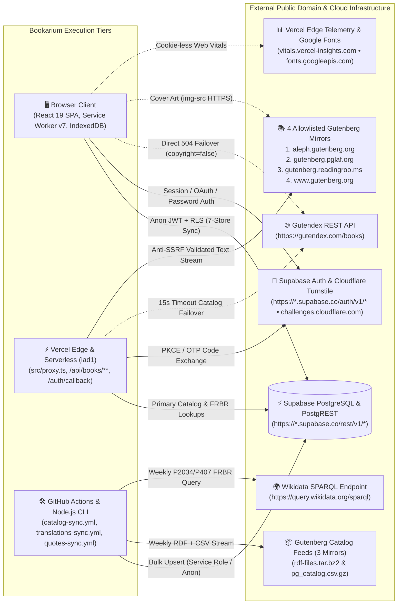

### 2. External Integration Contracts, Timeouts & Security Matrix

| External System / Endpoint | Initiating Layer | Protocol & Auth Mechanism | Timeout & Rate-Limit Policy | Security, Anti-SSRF & Policy Guardrails | Primary Adapter Module |
| :--- | :--- | :--- | :--- | :--- | :--- |
| **Supabase PostgREST (`https://*.supabase.co/rest/v1`)** | Browser Client, Edge Routes & CLI | HTTPS REST • `NEXT_PUBLIC_SUPABASE_ANON_KEY` (RLS JWT) or CLI `SUPABASE_SERVICE_ROLE_KEY` | 60s healthcheck TTL (`supabase-provider.ts`); CLI adaptive batch halving on `57014` | All 14 tables enforce `ENABLE ROW LEVEL SECURITY`; CSP `connect-src https://*.supabase.co`; `sanitizeSupabaseUrl` | [`src/lib/catalog/supabase-provider.ts`](src/lib/catalog/supabase-provider.ts), [`src/lib/supabase/client.ts`](src/lib/supabase/client.ts) |
| **Supabase Auth & Turnstile (`https://*.supabase.co/auth/v1`, `challenges.cloudflare.com`)** | Browser Client, `src/proxy.ts` & `/auth/callback` | HTTPS PKCE Code Exchange, Token-Hash OTP & Turnstile `captchaToken` (`exchangeCodeForSession`, `verifyOtp`) | Document & `/account*` Edge SSR cookie refresh (`updateSession`, bypassing public `rsc=1` & prefetch routes) + client `checkInitialUser` / `fetchProfile` coalescing; 60s email resend cooldown | Open-redirect sanitization (`sanitizeRedirectPath`, `resolveCanonicalAuthOrigin`); Turnstile CAPTCHA & Honeypot bot guard; OWASP current-password re-auth | [`src/app/auth/callback/route.ts`](src/app/auth/callback/route.ts), [`src/components/auth/AuthModal.tsx`](src/components/auth/AuthModal.tsx), [`src/lib/supabase/middleware.ts`](src/lib/supabase/middleware.ts) |
| **Gutendex REST API (`https://gutendex.com/books`)** | `/api/books`, `metadata-cache.ts` & Client `useBooks.ts` | HTTPS GET (`copyright=false` unconditionally enforced; Zero API Keys) | `15,000ms` `AbortController` timeout (`gutendex-provider.ts`); `60 req/min` route rate limit (`booksApiRateLimiter`) | `bookarium-security/enforce-gutenberg-and-copyright-policy` AST rule; `SITE_CONFIG.USER_AGENT` header | [`src/lib/catalog/gutendex-provider.ts`](src/lib/catalog/gutendex-provider.ts), [`src/hooks/queries/useBooks.ts`](src/hooks/queries/useBooks.ts) |
| **Project Gutenberg Mirrors (`aleph`, `pglaf`, `readingroo.ms`, `www.gutenberg.org`)** | `/api/books/content` | HTTPS GET Plain-Text & Binary Cover Stream (Mirror-First Prioritization ahead of `www.gutenberg.org`) | `8s–12s` per-mirror timeout; `30 req/min` sliding-window rate limit (`bookContentRateLimiter`) | Zero-trust `url-validator.ts` (HTTPS-only, 4 allowlisted hostnames, max 3 redirect hops validated per hop, individual-only downloads) | [`src/app/api/books/content/route.ts`](src/app/api/books/content/route.ts), [`src/app/api/books/content/url-validator.ts`](src/app/api/books/content/url-validator.ts) |
| **Gutenberg Catalog Archives (`rdf-files.tar.bz2` & `pg_catalog.csv.gz`)** | Node.js CLI & GitHub Actions (`catalog-sync.yml`) | HTTPS GET Streaming Bzip2/Gzip (`tar -xOjf -` + `zlib.createGunzip` across 3 allowlisted mirrors) | Weekly Sunday `02:00 UTC` schedule; 3-mirror failover + exponential retry backoff (`1s, 2s, 4s`) | Allowlisted feed URLs (`isAllowedRdfFeedUrl`, `isAllowedCsvFeedUrl`), in-RAM `gutenberg-catalog-cache.json.gz` diffing, filters `Text` type only, strips non-public-domain records, computes `max_author_death_year` & 30-day `download_count`, and emits `quote-diff.json` | [`scripts/sync-gutenberg-catalog.js`](scripts/sync-gutenberg-catalog.js) |
| **Wikidata SPARQL (`https://query.wikidata.org/sparql`)** | Node.js CLI & GitHub Actions (`catalog-sync.yml` Step 2 & on-demand `translations-sync.yml`) | HTTPS GET SPARQL JSON (`P2034` Gutenberg ID + `P407` Language) | Weekly Sunday `02:00 UTC` sequential pipeline (`catalog-sync.yml`) + manual `workflow_dispatch`; `30s` query timeout | 5 Pipeline Blockers & 7 Hardening Defenses; offline snapshot fallback (`scripts/data/wikidata-translations-cache.json`) | [`scripts/ingest-translations.js`](scripts/ingest-translations.js) |
| **Google Fonts & Vercel Edge Telemetry** | Root Layout (`src/app/layout.tsx`) | HTTPS Static CSS/WOFF2 & Cookie-Less Beacon (`@vercel/analytics`, `@vercel/speed-insights`) | Browser HTTP cache; non-blocking async beacon | Strictly scoped in `next.config.ts` CSP (`style-src`, `font-src`); zero tracking cookies (GDPR/COPPA compliant) | [`src/app/layout.tsx`](src/app/layout.tsx), [`next.config.ts`](next.config.ts) |

---

## 🛡️ Failure Modes, Circuit Breakers & Retry Topology

Every network, storage, compute, and database dependency in Bookarium is protected by a multi-tier circuit breaker, fallback provider, or self-healing mechanism so the reading experience never crashes:

### 1. Multi-Tier Failover & Self-Healing Decision Diagram

```mermaid
flowchart TD
    subgraph CatalogResilience ["1. Catalog Search Resilience Cascade"]
        CatReq["Catalog Query (/api/books)"] --> SupaHealth{"Supabase Configured &\n60s Healthcheck OK?"}
        SupaHealth -->|"Yes"| SupaQuery["Query public.books (GIN + B-Tree)"]
        SupaHealth -->|"No / Unreachable"| GutServer["Server Failover: gutendex-provider.ts (15s Timeout)"]
        SupaQuery -->|"Error / Empty Seed"| GutServer
        GutServer -->|"HTTP 502 / 504"| GutClient["Client Failover: useBooks.ts Direct Gutendex Fetch"]
        GutClient -->|"Navigator Offline"| OfflineCat["Adaptive Offline Catalog (useOfflineCatalogFallback.ts)\nServes IndexedDB Volumes or CatalogOfflineView.tsx"]
    end

    subgraph ContentResilience ["2. Book Content Streaming Resilience Cascade"]
        TxtReq["Open Volume (/read/[id])"] --> IDBCheck{"Cached in Browser\nIndexedDB?"}
        IDBCheck -->|"Hit (0ms)"| RenderReader["Render Instantaneously Offline"]
        IDBCheck -->|"Miss"| Tier1Supa{"Tier 1: public.books.content\nPresent in Supabase?"}
        Tier1Supa -->|"Hit"| RenderReader
        Tier1Supa -->|"Miss"| Mirror1["Tier 2A: aleph.gutenberg.org"]
        Mirror1 -->|"Timeout / 404 / 5xx"| Mirror2["Tier 2B: gutenberg.pglaf.org"]
        Mirror2 -->|"Timeout / 404 / 5xx"| Mirror3["Tier 2C: gutenberg.readingroo.ms"]
        Mirror3 -->|"Timeout / 404 / 5xx"| Mirror4["Tier 2D: www.gutenberg.org"]
        Mirror4 -->|"Success"| RenderReader
    end

    subgraph ComputeAndSync ["3. Worker Compute & Cloud Outbox Resilience"]
        WorkerTask["Parse Gutenberg Plain Text"] --> WorkerAlive{"Web Worker Thread\nAvailable?"}
        WorkerAlive -->|"Yes"| OffThread["Off-Thread AST Segmentation (gutenberg.worker.ts)"]
        WorkerAlive -->|"Crash / Unsupported"| MainThread["Chunked Async Main-Thread Fallback (setTimeout 0)"]
    end
```

### 2. Comprehensive Failure Mode, Degraded-State & Self-Healing Matrix

| Failure Scenario / Fault Domain | Detection Mechanism | Circuit-Breaker / Retry Policy | Automatic Fallback / Self-Healing Action | User-Facing Experience |
| :--- | :--- | :--- | :--- | :--- |
| **1. Supabase Unconfigured or Unreachable** | `isSupabaseConfigured()` or query error in [`src/lib/catalog/supabase-provider.ts`](src/lib/catalog/supabase-provider.ts) | `60,000ms` healthcheck circuit-breaker TTL prevents repeated failing DB probes | Seamlessly routes `/api/books` to [`src/lib/catalog/gutendex-provider.ts`](src/lib/catalog/gutendex-provider.ts) (`copyright=false`) | 100% transparent catalog browsing with zero configuration or API keys required. |
| **2. `/api/books` Edge Gateway Timeout (`502` / `504`)** | Response status check in [`src/hooks/queries/useBooks.ts`](src/hooks/queries/useBooks.ts) | Immediate client-side failover on `502`/`504` before React Query retry exhaustion | Browser fetches directly from `https://gutendex.com/books` and normalizes payload | Catalog grid populates without error screens even if upstream takes >15s. |
| **3. Primary Gutenberg Mirror Down or Throttled** | Per-mirror `AbortController` timeout or non-200 status in [`src/app/api/books/content/route.ts`](src/app/api/books/content/route.ts) | Sequential 4-mirror cascade (`aleph` -> `pglaf` -> `readingroo.ms` -> `www.gutenberg.org`) | Validates each candidate & redirect hop via [`src/app/api/books/content/url-validator.ts`](src/app/api/books/content/url-validator.ts) until a clean `200 OK` text stream resolves | Book opens reliably even when individual Gutenberg mirrors undergo maintenance. |
| **4. Missing or `"Anonymous"` Author Lifespans** | `isPlaceholderAuthor()` & `!hasVerifiedLifespans()` in [`src/lib/book-metadata.ts`](src/lib/book-metadata.ts) | 3-Tier server LRU ([`src/app/api/books/content/metadata-cache.ts`](src/app/api/books/content/metadata-cache.ts)) + client [`src/hooks/useCollectionAutoHeal.ts`](src/hooks/useCollectionAutoHeal.ts) | Resolves lifespans via Supabase -> Gutendex -> `FEATURED_HERO_BOOKS` and back-fills IndexedDB (`patchOfflineBookAuthors`) & Zustand stores | Prevents false `HTTP 451` blocks and heals legacy saved/offline volumes automatically. |
| **5. Jurisdictional Copyright Restriction (`HTTP 451`)** | `isBookPublicDomainInJurisdiction()` in [`src/lib/copyright-engine.ts`](src/lib/copyright-engine.ts) | Deterministic Berne (`Life+70`, `Life+80`, `Life+100`, Art. 7bis, Art. 2(3)) evaluation | Blocks full-text stream (`HTTP 451`), passes `includeRestrictedMetadata=true` for collection citations, and renders `CopyrightNoticeBanner` | Clear territorial legal notice with exact public-domain unlock year; collection cards keep real titles/authors. |
| **6. Complete Device Offline State (`navigator.onLine = false`)** | `useSyncExternalStore` in [`src/hooks/useNetworkStatus.ts`](src/hooks/useNetworkStatus.ts) & [`public/sw.js`](public/sw.js) | Instantaneous 0ms transition; Service Worker `v7` intercepts `/read/*` & App Shell routes | [`src/hooks/useOfflineCatalogFallback.ts`](src/hooks/useOfflineCatalogFallback.ts) serves IndexedDB volumes in Catalog; uncached books dim with `Not Downloaded` badges | Downloaded volumes read & search 100% offline; uncached triggers cleanly disable with clear offline guidance. |
| **7. Web Worker Initialization or Parse Error** | `worker.onerror` or `Worker === undefined` in [`src/hooks/reader/useGutenbergParserWorker.ts`](src/hooks/reader/useGutenbergParserWorker.ts) | Automatic fallback on worker construction failure or `PARSE_ERROR` message | Executes `parseGutenbergChapters` & `paginateChapterContent` asynchronously on main thread via `setTimeout(..., 0)` | Focus Reader segments chapters and renders pages smoothly even in restricted WebViews. |
| **8. Font-Size or Viewport Reflow Shifting Bookmark Line** | `isBookmarkLayoutReady` & `resolveTextRowSpanInElement` in [`src/lib/reader-bookmark-geometry.ts`](src/lib/reader-bookmark-geometry.ts) | Canonical text-span matching (`findCanonicalTextSpan`) + binary-searched DOM `Range` client rects | Re-anchors `bookmarkRow` to the exact sentence (`bookmarkText`) across font sizes (`12px–36px`) and column widths | Reader silk bookmark and scroll position stay locked to the exact passage across devices and display tweaks. |
| **9. Concurrent Multi-Tab, Strict-Mode Mount or Offline Cloud Sync Mutations** | `inFlightInitialUserCheck` + `coalesceInFlightByUser` (across `useAuthStore`, `sync-utils.ts`, and all individual store syncs) alongside `inFlightOutboxFlushes` & `inFlightCloudSyncs` in [`src/lib/bookshelf-cloud-sync.ts`](src/lib/bookshelf-cloud-sync.ts) | Per-user active Promise identity reuse (`p1 === p2`), mid-flight `dirty*Users` follow-up re-run tracking (retry-loop-safe), `lastSyncTimeRef` `15s` cooldown (`providers.tsx`), & `2,000ms` debounced LWW sync (`preferences-sync.ts`) | Deduplicates overlapping mounts/syncs, queues mutations in persistent `localStorage` outboxes with deletion tombstones, & replays cleanly on `online` | Zero duplicate Supabase `/user` or PostgREST bursts, zero duplicate shelf items, zero resurrected deleted books, and zero race-condition state flicker. |
| **10. PostgreSQL Statement Timeout (`57014`) in CLI Sync** | Error code inspection in [`scripts/sync-gutenberg-catalog.js`](scripts/sync-gutenberg-catalog.js) & [`scripts/ingest-translations.js`](scripts/ingest-translations.js) | Sticky dynamic write chunk sizing (`100 -> 50 -> 25` rows) + recursive batch halving + exponential retry backoff (`1s, 2s, 4s`) | Verifies pre-retry DB state (`filterChangedOrNewBooks`), splits timed-out upsert batches in half, and falls back to `scripts/data/wikidata-translations-cache.json` if Wikidata is down | Weekly 78,000-book catalog and translation sync completes reliably on free-tier database instances. |
| **11. Edge Quote Pool Gateway Unavailable (`GET /api/books?pool=quotes` -> `HTTP 503`)** | `!result` when `queryOptions.pool === "quotes"` in [`src/app/api/books/route.ts`](src/app/api/books/route.ts) & [`src/hooks/queries/useBooks.ts`](src/hooks/queries/useBooks.ts) | Returns `503` with `Cache-Control: no-store, max-age=0` (never falling back to quote-less Gutendex or poisoning Edge CDN cache) | `fetchQuoteEnrichedBooks` cascades from Edge `/api/books?pool=quotes` -> Direct Client Supabase -> `localStorage` (`bookarium-quote-enriched-books-v1`) -> Static Curated Anthology (`FEATURED_HERO_BOOKS` & `LITERARY_QUOTES`) | 3D Hero Book, Classic of the Day, and Words That Shaped Humanity render authentic literary quotes with zero empty states or text swaps. |

---

## 🚀 Deployment, Edge Caching & Operational Topology

### 1. Edge Routing, Regional Compute Pinning (`iad1`) & Autonomous Cron Topology

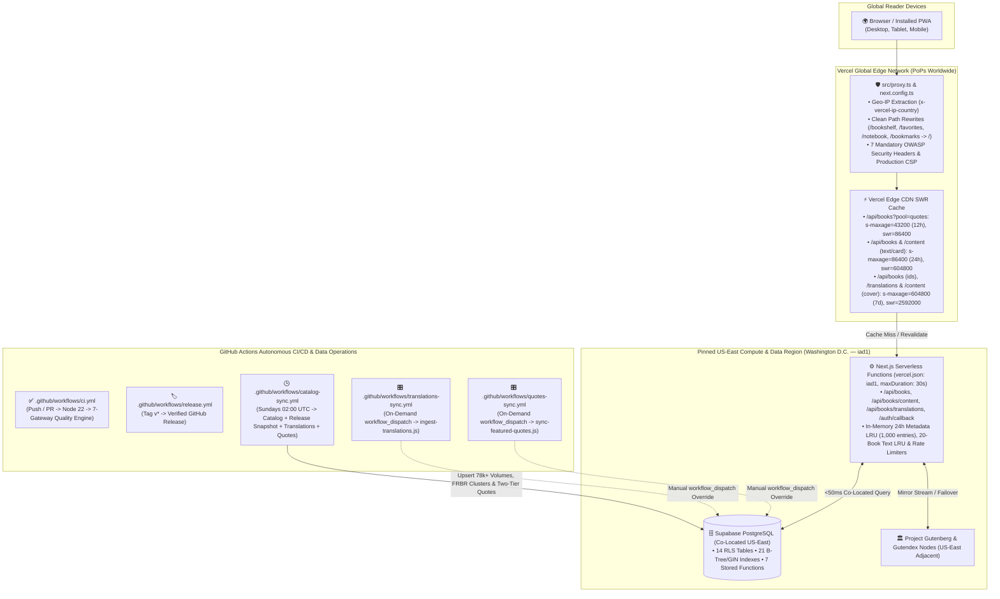

### 2. Multi-Tier Caching, Supabase Egress Shielding & Gutenberg Mirror Cover/Text Waterfall

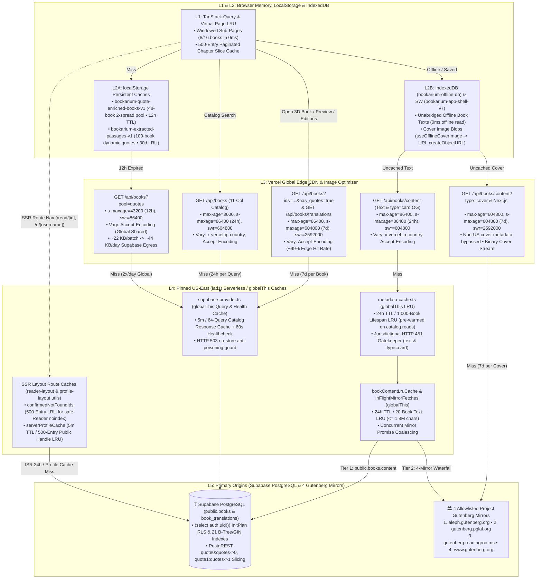

### 3. 5-Layer Caching & TTL Hierarchy Matrix

| Cache Layer | Storage / Execution Location | Cached Artifacts & Scope | TTL & Eviction Policy | Partitioning & Consistency Key |
| :--- | :--- | :--- | :--- | :--- |
| **L1: Browser In-Memory** | TanStack React Query v5 (`QueryClient`) & `pagination.ts` | Windowed catalog sub-pages, predictive next-page prefetches, translations, and paginated chapter slices | Session memory (`staleTime` + `clearPaginationCache()`) | Query keys scoped by `[search, topic, language, era, sort, page, country]` |
| **L2: Browser Persistent** | `localStorage` (10 stores + `bookarium-quote-enriched-books-v1` + `bookarium-extracted-passages-v1`), `IndexedDB` (`bookarium-offline-db`), `CacheStorage` (`bookarium-app-shell-v7`) | User collections/outboxes, 48-volume (`limit <= 600` max) rotating quote pool (`12h` fresh), 30-day LRU extracted book passages (`100` books max), unabridged book texts + cover Blobs (`offline-storage.ts`), and PWA App Shell (`bookarium-app-shell-v7`) | Persistent across restarts; `30d` TTL / `100` LRU entries (`useBookPassageShuffle.ts`); SW `activate` prunes old caches | Origin-locked; IndexedDB texts verified against active jurisdiction on read |
| **L3: Vercel Edge CDN** | Global Edge PoP HTTP Cache (`Cache-Control`) | `GET /api/books` (`s-maxage=86400, swr=604800` Catalog; `s-maxage=43200` `?pool=quotes`; `s-maxage=604800` `?ids=...&has_quotes=true`); `GET /api/books/content` (`max-age=86400, s-maxage=86400` text/`type=card`; `max-age=604800, s-maxage=604800` `type=cover`) & `/translations` (`s-maxage=604800, swr=2592000`) | 12h fresh (Quote Pool); 24h fresh / 7d SWR (Catalog & Content); 7d browser+Edge / 30d SWR (Covers, Quote IDs & Translations) | `Vary: Accept-Encoding` (Global Quote Pool & Restricted-Metadata Lookups) / `Vary: x-vercel-ip-country, Accept-Encoding` (Catalog & Content) |
| **L4: Serverless & `globalThis` Caches** | Node.js Serverless Instance (`iad1`) | Contributor lifespans ([`src/app/api/books/content/metadata-cache.ts`](src/app/api/books/content/metadata-cache.ts), pre-warmed by `supabase-provider.ts`), 20-book text LRU & in-flight mirror coalescing ([`src/app/api/books/content/route.ts`](src/app/api/books/content/route.ts)), 5m / 64-query catalog response cache & 60s healthcheck (`supabase-provider.ts`), `/read/[id]` ISR metadata & `confirmedNotFoundIds` ([`src/app/read/[id]/reader-layout-utils.ts`](src/app/read/[id]/reader-layout-utils.ts)), and `/u/[username]` public handle `serverProfileCache` ([`src/app/u/[username]/profile-layout-utils.ts`](src/app/u/[username]/profile-layout-utils.ts)) | `5m` / `64` queries (Catalog Query Cache); `5m` / `500` max entries (`serverProfileCache`); `500` max entries LRU (`confirmedNotFoundIds`); `24h` / `1,000` max entries (Metadata LRU); `24h` / `20` max books `<= 1.8M` chars (`bookContentLruCache`); `60s` TTL (Healthcheck); `24h` ISR (`/read/[id]`) | Keyed by normalized query options, Gutenberg `bookId`, or normalized lowercase `@username` |
| **L5: Database & Repo Seeds** | Supabase PostgreSQL & `supabase/seed_*.sql` | `78,000+` catalog rows (`public.books`), Two-Tier Bounded Quote Pool (`<= 564` books in `public.books.quotes`), FRBR clusters (`public.book_translations`), and offline Wikidata cache | Updated weekly/periodically by GitHub Actions cron workflows | Indexed by 21 explicit B-Tree & GIN `search_vector` indexes |

### 4. Runtime Performance Budgets, Thresholds & Hardware-Tier Adaptation Matrix

| Subsystem / Parameter | Configured Threshold / Budget | Governing Module | Architectural Rationale |
| :--- | :--- | :--- | :--- |
| **Hardware Performance Tiers (`high` / `medium` / `low`)** | `high`: >=8 cores & >=8GB RAM; `low`: `prefers-reduced-motion` or <=2 cores | [`src/hooks/usePerformanceTier.ts`](src/hooks/usePerformanceTier.ts) | Scales 3D cover animations, navbar underline physics, and transition complexity to guarantee 60fps across devices. |
| **Virtual Page Density** | `5,600 chars/page` (scaled dynamically by `fontSize` & `lineHeight`) | [`src/lib/gutenberg/pagination.ts`](src/lib/gutenberg/pagination.ts) | Prevents DOM bloat on 1,200-page masterworks by rendering only the active virtual page spread in `Paginated` mode. |
| **Reading Streak & Idle Immersion Guard** | `5 minutes` daily threshold • `120,000ms` (2-min) visual idle cutoff (bypassed during active TTS) | [`src/hooks/useReadingTimer.ts`](src/hooks/useReadingTimer.ts), [`src/hooks/reader/useReaderHabitTelemetry.ts`](src/hooks/reader/useReaderHabitTelemetry.ts), [`src/lib/reading-analytics.ts`](src/lib/reading-analytics.ts) | Ensures reading streaks reflect genuine literary immersion while accurately crediting hands-free Read-Aloud listening. |
| **Tactile Spine Tap Choreography** | `120ms` micro-lead elevation (`translate-y-0 scale-105 origin-bottom`) before modal mount | [`src/components/presentation/BookshelfRack.tsx`](src/components/presentation/BookshelfRack.tsx), [`src/components/presentation/bookshelf/BookshelfSpine.tsx`](src/components/presentation/bookshelf/BookshelfSpine.tsx) | Allows the user to visually witness the volume drawing forward from the wooden shelf rail on touch devices with 1:1 hover parity. |
| **Universal Ambient Dock Inactivity Idle Dimming** | `1,600ms` scroll/touch idle timeout -> `opacity-30 hover:opacity-100 focus-within:opacity-100` (<`180ms` wake) | [`src/components/presentation/CollectionBottomDock.tsx`](src/components/presentation/CollectionBottomDock.tsx), [`src/components/presentation/StickyCatalogToolbar.tsx`](src/components/presentation/StickyCatalogToolbar.tsx) | Keeps navigation controls 1 tap away across all screen sizes and page heights while resting unobtrusively without blocking reading real estate. |
| **Catalog Filter Bar Flush Viewport Docking** | Exact `123px` (`7.6875rem`) clearance: `65px` (Navbar) + `(100dvh - 123px)` (Hero) + `58px` (Toolbar) = `100dvh` | [`src/components/presentation/HeroSearch.tsx`](src/components/presentation/HeroSearch.tsx), [`src/components/presentation/StickyCatalogToolbar.tsx`](src/components/presentation/StickyCatalogToolbar.tsx) | Guarantees the catalog filter bar sits 100% flush on the bottom viewport fold without clipping or detached gaps across desktop and tablet viewports. |
| **Tactile Multi-Touch Zoom Prevention** | Non-passive `{ passive: false }` 2-finger `touchmove` & WebKit `gesturestart` `preventDefault()` | [`src/hooks/reader/useReaderGestures.ts`](src/hooks/reader/useReaderGestures.ts), [`src/components/reader/ReaderSurface.tsx`](src/components/reader/ReaderSurface.tsx) | Disambiguates in-app tactile typography zoom gestures from native browser canvas magnification on tactile screens. |
| **Global Stylized Cursor Tooltip Delay** | `300ms` hover delay (`0ms` instant on Favorite/Bookshelf action buttons) | [`src/hooks/useCursorTooltip.ts`](src/hooks/useCursorTooltip.ts), [`src/components/ui/CursorTooltip.tsx`](src/components/ui/CursorTooltip.tsx) | Eliminates accidental tooltip flicker during normal mouse traversal while providing instant feedback on primary actions. |
| **Debounced Cloud Sync Coalescing** | `2,000ms` debounce window (`reading_progress` & `profiles.preferences` JSONB) | [`src/stores/useReaderStore.ts`](src/stores/useReaderStore.ts), [`src/lib/preferences-sync.ts`](src/lib/preferences-sync.ts) | Prevents rapid page flips or slider drags from flooding Supabase PostgREST while preserving Last-Write-Wins accuracy. |
| **API Sliding-Window Rate Limiters** | `60 req/min` (`/api/books`, `/api/books/translations`) • `30 req/min` (`/api/books/content`) per client IP | [`src/lib/rate-limiter.ts`](src/lib/rate-limiter.ts) | Protects serverless compute and upstream Project Gutenberg mirrors from automated scraping or burst abuse. |

---

## 🔐 Environment Variable, Config & Security Trust-Zone Dependency Map

### 1. AST-Extracted Environment Variable Binding Matrix (`.env.example` <-> Codebase AST)

Programmatically extracted from [`.env.example`](.env.example) (variable names only — zero secret values) and cross-referenced via Babel AST against all consuming modules in `src/`, `next.config.ts`, `scripts/`, and `.github/workflows/`:

| Environment Variable | Exposure & Security Scope | Unconfigured / Zero-API-Key Fallback Behavior | Architectural Purpose | AST-Verified Consuming Modules |
| :--- | :--- | :--- | :--- | :--- |
| **`NEXT_PUBLIC_SITE_URL`** | Public Browser & Edge SSR (`NEXT_PUBLIC_*`) | Defaults to `https://bookarium.vercel.app` (`SITE_CONFIG.URL`) or request origin header. | Canonical origin for OpenGraph metadata, `sitemap.xml`, `robots.txt`, shareable book links, and PKCE auth callback validation. | [`src/config/site-config.ts`](src/config/site-config.ts), [`scripts/ingest-catalog.js`](scripts/ingest-catalog.js), [`scripts/sync-featured-quotes.js`](scripts/sync-featured-quotes.js) |
| **`NEXT_PUBLIC_GITHUB_REPO`** | Public Browser & Edge SSR (`NEXT_PUBLIC_*`) | Auto-detected from local Git config, `GITHUB_REPOSITORY` (CI), or `VERCEL_GIT_REPO_*` (Vercel). | Public repository URL displayed in the Navbar GitHub button, Footer links, and DMCA issue intake. | [`src/config/site-config.ts`](src/config/site-config.ts), [`next.config.ts`](next.config.ts), [`scripts/ingest-catalog.js`](scripts/ingest-catalog.js), [`scripts/sync-featured-quotes.js`](scripts/sync-featured-quotes.js) |
| **`NEXT_PUBLIC_SUPABASE_URL`** | Public Browser & Edge SSR (`NEXT_PUBLIC_*`) | 100% Zero-API-Key Guest Mode: Catalog fails over to Gutendex REST API; collections persist in `localStorage` & `IndexedDB`. | Supabase project URL for PostgreSQL catalog queries (`public.books`), FRBR translations, SSR auth cookies, and 7-store cloud sync. | [`src/app/layout.tsx`](src/app/layout.tsx), [`src/lib/catalog/supabase-provider.ts`](src/lib/catalog/supabase-provider.ts), [`src/lib/supabase/client.ts`](src/lib/supabase/client.ts), [`src/lib/supabase/middleware.ts`](src/lib/supabase/middleware.ts), [`src/lib/supabase/server.ts`](src/lib/supabase/server.ts), [`.github/workflows/catalog-sync.yml`](.github/workflows/catalog-sync.yml), [`.github/workflows/quotes-sync.yml`](.github/workflows/quotes-sync.yml), [`.github/workflows/translations-sync.yml`](.github/workflows/translations-sync.yml) |
| **`NEXT_PUBLIC_SUPABASE_ANON_KEY`** | Public Browser & Edge SSR (`NEXT_PUBLIC_*`) | 100% Zero-API-Key Guest Mode: Cloud sync and auth modals gracefully disable live network calls when unconfigured. | Public anonymous JWT key scoped strictly by PostgreSQL Row-Level Security (`ENABLE ROW LEVEL SECURITY` across all 14 tables). | [`src/lib/catalog/supabase-provider.ts`](src/lib/catalog/supabase-provider.ts), [`src/lib/supabase/client.ts`](src/lib/supabase/client.ts), [`src/lib/supabase/middleware.ts`](src/lib/supabase/middleware.ts), [`src/lib/supabase/server.ts`](src/lib/supabase/server.ts) |
| **`NEXT_PUBLIC_TURNSTILE_SITE_KEY`** | Public Browser & Edge SSR (`NEXT_PUBLIC_*`) | Optional: `AuthModal` omits the Turnstile widget and submits directly when unconfigured in local development or offline setups. | Public Cloudflare Turnstile site key mounting a Managed bot-protection challenge in `AuthModal` and passing single-use `captchaToken` verification to Supabase Auth. | [`src/components/auth/AuthModal.tsx`](src/components/auth/AuthModal.tsx) |
| **`NEXT_PUBLIC_LEGAL_CONTACT_FORM`** | Public Browser & Edge SSR (`NEXT_PUBLIC_*`) | Falls back to the repository GitHub Issue Tracker (`SITE_CONFIG.GITHUB_ISSUES_URL`) on `/copyright`. | Optional external intake URL for confidential territorial copyright or DMCA inquiries. | [`src/config/site-config.ts`](src/config/site-config.ts) |
| **`NEXT_PUBLIC_GOOGLE_SITE_VERIFICATION`** | Public Browser & Edge SSR (`NEXT_PUBLIC_*`) | Optional runtime configuration override. | Application environment configuration parameter. | [`src/config/site-config.ts`](src/config/site-config.ts) |
| **`SUPABASE_SERVICE_ROLE_KEY`** | CLI & CI Secret Only (`Client-Forbidden` via Pass 0.5 & AST Rule) | CLI ingestion scripts fall back to `NEXT_PUBLIC_SUPABASE_ANON_KEY` or emit offline SQL seed artifacts (`supabase/seed_*.sql`). | Privileged service-role credential used exclusively by offline Node.js CLI pipelines (`catalog:sync`, `translations:sync`, `quotes:sync`, `catalog:ingest`) for bulk upserts. | [`.github/workflows/catalog-sync.yml`](.github/workflows/catalog-sync.yml), [`.github/workflows/quotes-sync.yml`](.github/workflows/quotes-sync.yml), [`.github/workflows/translations-sync.yml`](.github/workflows/translations-sync.yml) |
| **`GUTENBERG_CONTACT_EMAIL`** | Server-Side Fetcher & CLI Pipelines (Optional) | Omitted: Automated `User-Agent` headers cleanly identify via the public repository URL without exposing private emails. | Optional contact email address appended to `User-Agent` headers across Project Gutenberg mirrors and Wikidata SPARQL queries. | [`src/config/site-config.ts`](src/config/site-config.ts), [`scripts/ingest-catalog.js`](scripts/ingest-catalog.js), [`scripts/sync-featured-quotes.js`](scripts/sync-featured-quotes.js), [`.github/workflows/catalog-sync.yml`](.github/workflows/catalog-sync.yml), [`.github/workflows/quotes-sync.yml`](.github/workflows/quotes-sync.yml), [`.github/workflows/translations-sync.yml`](.github/workflows/translations-sync.yml) |
| **`BOOKARIUM_REPO_URL`** | Server-Side Fetcher, CLI Pipelines & Config (Optional) | Auto-detected from `GITHUB_REPOSITORY` (CI/cron), `VERCEL_GIT_REPO_*` (Vercel), or `NEXT_PUBLIC_SITE_URL`. | Explicit repository URL override used for open-source attribution and `User-Agent` contact headers. | [`src/config/site-config.ts`](src/config/site-config.ts), [`next.config.ts`](next.config.ts), [`scripts/ingest-catalog.js`](scripts/ingest-catalog.js), [`scripts/sync-featured-quotes.js`](scripts/sync-featured-quotes.js) |
| **`GUTENDEX_API_URL`** | Edge / Server Route & Config Override | Defaults to `https://gutendex.com/books` (`API_ENDPOINTS.GUTENDEX_BASE`). | Upstream Gutendex public domain catalog endpoint for failover search and metadata resolution. | [`src/config/api-endpoints.ts`](src/config/api-endpoints.ts) |
| **`DEV_COUNTRY`** | Edge Proxy & Server Route Development Override | Production uses Vercel Edge `x-vercel-ip-country` header -> `bookarium-geo-country` cookie -> IANA timezone inference -> `US` default. | ISO 3166-1 alpha-2 country override (`US`, `GB`, `DE`, `MX`, `ES`) for local testing of multi-jurisdictional copyright rules (`Life+70`, `Life+80`, `Life+100`). | [`src/lib/country-resolver.ts`](src/lib/country-resolver.ts) |
| **`NODE_ENV`** | Framework & Build-Time Runtime Constant | Set automatically by Next.js / Node.js (`development`, `production`, `test`). | Strips `unsafe-eval` from production Content-Security-Policy, enables `Strict-Transport-Security` (`next.config.ts`), activates `public/sw.js` registration, and gates dev overrides. | [`src/components/pwa/ServiceWorkerRegister.tsx`](src/components/pwa/ServiceWorkerRegister.tsx), [`src/lib/country-resolver.ts`](src/lib/country-resolver.ts), [`src/proxy.ts`](src/proxy.ts), [`src/stores/useAuthStore.ts`](src/stores/useAuthStore.ts), [`src/stores/useJurisdictionStore.ts`](src/stores/useJurisdictionStore.ts), [`next.config.ts`](next.config.ts) |

### 2. Security Trust Zones & Intra-Procedural Request-Taint Topology (`Sources -> Sanitizers -> Sinks`)

Enforced continuously by [`scripts/eslint-rules/bookarium-security.js`](scripts/eslint-rules/bookarium-security.js) (`Pass 0.75` & `Pass 6`) and [`scripts/verify-build.js`](scripts/verify-build.js) (`Pass 0.5`):

| Untrusted Input Source (Taint Origin) | Trust Boundary Transition | Canonical Sanitizer / Validator Module | Enforced Security Invariants | Protected Downstream Sink |
| :--- | :--- | :--- | :--- | :--- |
| **Catalog Query Params (`request.url`, `searchParams`)** | Browser / Edge -> `/api/books` | [`src/lib/catalog/query-parser.ts`](src/lib/catalog/query-parser.ts) (`parseCatalogQuery`) | Whitespace normalization, integer clamping (`page`, `authorYearStart/End`), ISO country validation, mandatory `copyright=false` | `SupabaseCatalogProvider` & `GutendexCatalogProvider` |
| **Upstream Mirror URL & Redirect Hops (`?url=`, `Location` header)** | `/api/books/content` -> External Mirror | [`src/app/api/books/content/url-validator.ts`](src/app/api/books/content/url-validator.ts) (`isSafeUpstreamUrl`, `sanitizeUpstreamUrl`) | Strictly `https:` protocol, zero credentials/ports, 4 allowlisted Gutenberg domains, re-validated on every `301`/`302` redirect hop (max 3) | Server `fetch()` in `/api/books/content` |
| **Auth Callback Redirect (`?next=`, `origin`, `x-forwarded-host`)** | External OAuth / Magic Link -> `/auth/callback` | [`src/lib/redirect-sanitizer.ts`](src/lib/redirect-sanitizer.ts) (`sanitizeRedirectPath`, `resolveCanonicalAuthOrigin`) | Rejects `//`, `http:`, `javascript:`, backslash tricks, and foreign hosts; locks redirect origin to `NEXT_PUBLIC_SITE_URL` | `NextResponse.redirect()` in `/auth/callback` |
| **Persisted Cloud Preferences & Dynamic Object Keys (`profiles.preferences`)** | Cloud / Local Storage -> Client State Hydration | [`src/lib/preferences-sync.ts`](src/lib/preferences-sync.ts) (`normalizePreferencesSnapshot`) & [`scripts/eslint-rules/bookarium-security.js`](scripts/eslint-rules/bookarium-security.js) (`no-tainted-request-sink`) | Strict 13-key schema normalization, finite range clamping, and prototype-pollution key rejection (`__proto__`, `constructor`, `prototype`) | Zustand Stores (`usePreferencesStore`, `useReaderStore`, `useThemeStore`) |
| **Privileged Server Credentials (`SUPABASE_SERVICE_ROLE_KEY`)** | Node.js CLI / CI -> Client Bundle Guard | [`scripts/verify-build.js`](scripts/verify-build.js) (`Pass 0.5`) & `no-client-server-boundary-violation` | Transitive Babel AST import graph verifies zero `src/lib/supabase/server` or `SUPABASE_SERVICE_ROLE_KEY` references in `"use client"` graph | Isolated strictly to `scripts/*.js` CLI pipelines |
| **Fellowship Participant Mutations & Handle Lookup (`reader_circles`, `symposium_sessions`)** | Direct Client PostgREST -> Supabase DB | [`supabase/schema.sql`](supabase/schema.sql) (`enforce_fellowship_update_guard`, `lookup_scholar_by_username`, payload `CHECK` constraints) | Locks relational keys, acceptance authority, and opposite-participant progress/identity columns; revokes trigger RPC execution; bounds `@username` lookups to `1..64` chars and clamps text/array lengths | `public.reader_circles`, `public.symposium_sessions`, `public.profiles` |

---

## 🟢 Node.js Runtime, Dependency Stack & Supply-Chain Governance

Bookarium executes on **Node.js `>=22.0.0`** with **npm `>=10.0.0`** (Node 22 LTS / Node 24 LTS recommended). All dependency versions are programmatically synchronized from `package.json` via AST compilation (Rule 2):

| Package | Live Version | Classification & Tier | Architectural Responsibility in Bookarium |
| :--- | :--- | :--- | :--- |
| **`@supabase/ssr`** | `^0.12.7` | Production Runtime | Server-Side Rendering (SSR) cookie-based authentication and Supabase client creation. |
| **`@supabase/supabase-js`** | `^2.119.0` | Production Runtime | Universal client for PostgreSQL, Row-Level Security, GIN search & cloud synchronization. |
| **`@tanstack/react-query`** | `^5.107.1` | Production Runtime | Asynchronous server-state management, cache deduplication & windowed predictive prefetching. |
| **`@vercel/analytics`** | `^2.0.1` | Production Runtime | Privacy-preserving, cookie-less audience telemetry on Vercel Edge. |
| **`@vercel/speed-insights`** | `^2.1.0` | Production Runtime | Real User Monitoring (RUM) for Core Web Vitals (LCP, FID, CLS, INP). |
| **`clsx`** | `^2.1.1` | Production Runtime | Utility for constructing conditional classNames efficiently. |
| **`framer-motion`** | `^11.18.2` | Production Runtime | Hardware-accelerated 3D leaf-flip, FLIP modal geometry and page transitions. |
| **`lucide-react`** | `^1.70.0` | Production Runtime | Accessible SVG icon primitives across reading workbench and UI dialogs. |
| **`next`** | `^16.4.5` | Production Runtime | Next.js 16 App Router full-stack framework with React Server Components and Turbopack. |
| **`react`** | `^19.3.1` | Production Runtime | React 19 declarative component and rendering engine. |
| **`react-dom`** | `^19.3.1` | Production Runtime | DOM renderer for React 19. |
| **`tailwind-merge`** | `^3.7.0` | Production Runtime | Deterministic conflict resolution for Tailwind utility classes with custom shadow groups. |
| **`zustand`** | `^5.1.0` | Production Runtime | Lightweight client-side persistent state stores (IndexedDB, localStorage, outbox reconciliation). |
| **`@babel/parser`** | `^8.1.0` | Development & AST Tooling | Babel parser generating ESTree AST for living documentation and architectural analysis. |
| **`@babel/traverse`** | `^8.1.0` | Development & AST Tooling | AST node traversal for programmatic dependency graph and import/export extraction. |
| **`@tailwindcss/postcss`** | `^4.3.5` | Development & AST Tooling | PostCSS integration for Tailwind CSS v4 Oxide compilation. |
| **`@testing-library/jest-dom`** | `^7.0.1` | Development & AST Tooling | Custom DOM matchers for accessible assertion verification. |
| **`@testing-library/react`** | `^16.1.0` | Development & AST Tooling | Framework-agnostic React component testing verifying authentic user journeys. |
| **`@testing-library/user-event`** | `^14.6.8` | Development & AST Tooling | Simulates authentic pointer and keyboard interactions in test suites. |
| **`@types/node`** | `^22.20.5` | Development & AST Tooling | TypeScript definitions for Node.js runtime and standard library APIs. |
| **`@types/react`** | `^19.3.0` | Development & AST Tooling | TypeScript definitions for React 19 core primitives. |
| **`@types/react-dom`** | `^19.3.0` | Development & AST Tooling | TypeScript definitions for React DOM. |
| **`@vitejs/plugin-react`** | `^6.2.1` | Development & AST Tooling | Fast React transform plugin for Vitest test execution. |
| **`@vitest/coverage-v8`** | `^4.1.12` | Development & AST Tooling | Native V8 code coverage provider enforcing tiered 95/95/92/85% test thresholds. |
| **`@vitest/ui`** | `^4.1.12` | Development & AST Tooling | Interactive graphical browser interface for Vitest execution. |
| **`concurrently`** | `^10.0.7` | Development & AST Tooling | Parallel task orchestration for dev servers, watchers, and browser launchers. |
| **`eslint`** | `^10.14.0` | Development & AST Tooling | Supply-chain override upgrading transitive minimatch in eslint to >=11.0.1 to remediate glob pattern amplification (GHSA-g3hv-75wg-m249). |
| **`eslint-config-next`** | `^16.4.5` | Development & AST Tooling | Next.js 16 ESLint ruleset enforcing App Router, Core Web Vitals, and TypeScript standards. |
| **`husky`** | `^9.1.7` | Development & AST Tooling | Git hooks orchestration gating pre-commit verification. |
| **`jsdom`** | `^25.0.1` | Development & AST Tooling | Headless browser DOM environment for Node.js Vitest test execution. |
| **`knip`** | `^6.44.2` | Development & AST Tooling | Static analysis auditor detecting unused dependencies, dead exports, and orphaned files. |
| **`msw`** | `^2.15.0` | Development & AST Tooling | Mock Service Worker v2 intercepting network requests for isolated deterministic testing. |
| **`postcss`** | `^8.5.32` | Development & AST Tooling | CSS transformer tool for Tailwind CSS v4 processing. |
| **`tailwindcss`** | `^4.3.5` | Development & AST Tooling | Utility-first CSS framework v4 with Oxide compiler engine. |
| **`typescript`** | `^5.9.3` | Development & AST Tooling | Static type system verifying strict compile-time safety (zero any). |
| **`vitest`** | `^4.1.12` | Development & AST Tooling | Fast Vite-native test runner executing all 246 unit and integration suites. |
| **`postcss-selector-parser`** | `^7.1.6` | Supply-Chain Security Override | Supply-chain override pinning selector parser to patched secure release. |
| **`fast-glob`** | `npm:tinyglobby@^0.2.17` | Supply-Chain Security Override | Supply-chain override replacing fast-glob with tinyglobby to eliminate CVE vulnerabilities. |
| **`@typescript-eslint/typescript-estree`** | `minimatch: ^11.0.1` | Supply-Chain Security Override | Supply-chain override upgrading transitive minimatch in typescript-estree to >=11.0.1 to remediate glob pattern amplification (GHSA-g3hv-75wg-m249). |
| **`eslint`** | `minimatch: ^11.0.1` | Supply-Chain Security Override | Supply-chain override upgrading transitive minimatch in eslint to >=11.0.1 to remediate glob pattern amplification (GHSA-g3hv-75wg-m249). |
| **`@eslint/config-array`** | `minimatch: ^11.0.1` | Supply-Chain Security Override | Supply-chain override upgrading transitive minimatch in @eslint/config-array to >=11.0.1 to remediate glob pattern amplification (GHSA-g3hv-75wg-m249). |

---

## 🛠️ Node.js CLI & Automation Scripts Catalog (`scripts/`)

Comprehensive inventory of standalone Node.js automation, ingestion, and verification modules in `scripts/`:

| Script Module | File Path | Primary Invocation | Core Node.js APIs & Engines | Architectural Responsibility |
| :--- | :--- | :--- | :--- | :--- |
| **`verify-build.js`** | [`scripts/verify-build.js`](scripts/verify-build.js) | `npm run verify` | `fs`, `path`, `child_process` | Executes the 7-Gateway Closed-Loop Quality Engine (Pass 0.5 secrets/file-path/env-parity across `src/` & `scripts/`/transitive-graph, Pass 0.75 lockfile/workflows/SAST/OWASP/9-rule-AST-taint, Pass 1 types, Pass 2 MSW, Pass 3 Vitest 95/95/92/85%, Pass 4 direct generator docs sync, Pass 5 ADR/checklist/schema-parity/graph/1:1-test-co-location across `src/app/**` & CLI scripts/advisory-sync/SemVer-7-file-parity, Pass 6 ESLint/Knip, Pass 7 Next.js build). |
| **`eslint-rules/bookarium-security.js`** | [`scripts/eslint-rules/bookarium-security.js`](scripts/eslint-rules/bookarium-security.js) | `npm run lint` & `npm run security:audit` | `fs`, `path`, `@babel/parser`, `@babel/traverse` | In-repo custom ESLint & Babel AST security plugin enforcing 9 rules: unsafe fetch, unvalidated redirects, client/server boundary isolation, dangerous execution primitives, DOM XSS injection, intra-procedural request taint analysis (including Prototype Pollution guards), secret env/public route guards, test anti-tautology checks, and Project Gutenberg & copyright policy enforcement. |
| **`lib/ast-parser.js`** | [`scripts/lib/ast-parser.js`](scripts/lib/ast-parser.js) | _Internal Generator Engine_ | `fs`, `path`, `@babel/parser`, `@babel/traverse` | Babel AST parsing engine extracting module dependency graphs, component catalogs, stores, hooks, utilities, and detecting circular dependencies with zero bloat. |
| **`generate-architecture-matrix.js`** | [`scripts/generate-architecture-matrix.js`](scripts/generate-architecture-matrix.js) | `npm run matrix:generate` (in `docs:sync`) | `fs`, `path`, `scripts/lib/ast-parser.js` | Programmatically compiles docs/ARCHITECTURE.md directly from source AST, mapping topology, databases, Node.js packages, and CLI automation scripts. |
| **`generate-changelog.js`** | [`scripts/generate-changelog.js`](scripts/generate-changelog.js) | `npm run changelog:generate` (in `docs:sync`) | `fs`, `path` | Compiles CHANGELOG.md from SemVer release ledgers and synchronizes package.json, package-lock.json, SECURITY.md, .github/workflows/release.yml, and README.md Latest Release section. |
| **`generate-parser-docs.js`** | [`scripts/generate-parser-docs.js`](scripts/generate-parser-docs.js) | `npm run docs:parser` (in `docs:sync`) | `fs`, `path`, `@babel/parser`, `@babel/traverse` | Analyzes src/lib/gutenberg-parser.ts AST to generate living docs/GUTENBERG_PARSER.md. |
| **`generate-quality-report.js`** | [`scripts/generate-quality-report.js`](scripts/generate-quality-report.js) | `npm run audit:quality` (in `docs:sync`) | `fs`, `path`, `child_process` | Collects test coverage, suite catalogs, ADR counts, and ESLint/Knip metrics, synchronizes README.md framework/engine version badges (`Next.js`, `React`, `TypeScript`, `Tailwind CSS`, `Node.js`) from `package.json`, and generates docs/QUALITY_AUDIT_REPORT.md and docs/quality-audit-results.json. |
| **`generate-roadmap.js`** | [`scripts/generate-roadmap.js`](scripts/generate-roadmap.js) | `npm run roadmap:generate` (in `docs:sync`) | `fs`, `path` | Scans source files and AST features to generate living ROADMAP.md with 0% drift. |
| **`generate-pwa-icons.js`** | [`scripts/generate-pwa-icons.js`](scripts/generate-pwa-icons.js) | `node scripts/generate-pwa-icons.js` | `fs`, `path`, `zlib` | Compiles standards-compliant 32-bit RGBA binary multi-resolution .ico (16, 32, 48) and vector squircle PWA icons with alpha anti-aliasing. |
| **`sync-gutenberg-catalog.js`** | [`scripts/sync-gutenberg-catalog.js`](scripts/sync-gutenberg-catalog.js) | `npm run catalog:sync` | `fs`, `path`, `zlib`, `https`, `child_process` | Streams Project Gutenberg's official `rdf-files.tar.bz2` archive (`streamGutenbergRdfDownloadCounts`) and `pg_catalog.csv.gz` feed across 3 official Gutenberg mirrors (`www.gutenberg.org`, `aleph.gutenberg.org`, `gutenberg.pglaf.org`), diffs all 78,461 volumes in RAM against `--cache-file=gutenberg-catalog-cache.json.gz` (`catalog-cache` GitHub Release asset with cold-start Primary-Key batch fallback) while preserving `quotes`, upserts only new/changed rows with sticky dynamic write pacing (`[25, 100]`), reconciles and prunes withdrawn volumes (`reconcileWithdrawnCatalogBooks`), and emits `--diff-output=quote-diff.json` (`topPopularIds`, `recentIds`) for zero-scan downstream quote sync. |
| **`ingest-catalog.js`** | [`scripts/ingest-catalog.js`](scripts/ingest-catalog.js) | `npm run catalog:ingest` | `fs`, `path`, `readline` | Direct CLI tool (`require.main === module` guarded) for batch ingesting local Gutenberg CSV/JSON metadata dumps into Supabase, exporting pure SQL/URL helpers verified by `ingest-catalog.test.ts`. |
| **`ingest-translations.js`** | [`scripts/ingest-translations.js`](scripts/ingest-translations.js) | `npm run translations:sync` | `fs`, `path`, `https` | Queries Wikidata SPARQL endpoint for multilingual FRBR work clusters and populates public.book_translations with zero false positives. |
| **`sync-featured-quotes.js`** | [`scripts/sync-featured-quotes.js`](scripts/sync-featured-quotes.js) | `npm run quotes:sync` | `fs`, `path` | Maintains a Two-Tier Bounded Quote Pool (`Top 500 Popular` by `download_count DESC` + `Rolling 64 Most Recent` by `id DESC`) in `public.books.quotes`, consuming `--diff-file=quote-diff.json` from `sync-gutenberg-catalog.js` (or Primary-Key-Scoped `books_pkey` `.in('id', chunk).neq('quotes', '[]')` + `idx_books_download_count` fallback on standalone runs in `<15ms`), blending `40 Popular + 10 Recent` unpopulated English volumes per 50-book batch with cross-tier backfill and post-batch `1-for-1` sliding window auto-pruning across selectable PGLAF mirrors (`gutenberg.pglaf.org` default, `aleph.gutenberg.org`, `gutenberg.readingroo.ms`) with independent 8.0s–16.0s randomized float delays, single-line console progress (`formatConsoleSummary`), and Markdown job summary reporting (`formatRunReport`). |
| **`approval-gate.js`** | [`scripts/approval-gate.js`](scripts/approval-gate.js) | `npm run gate:approve` | `fs`, `path` | Pre-commit governance gate validating `.agents/hooks.json` command definitions against `package.json` scripts prior to commit. |
| **`open-browser.js`** | [`scripts/open-browser.js`](scripts/open-browser.js) | `npm run dev:open` | `child_process` | Cross-platform development utility spawning default system browser with connection wait delay. |

---

## 🛡️ 7-Gateway Quality Engine Architecture

Bookarium enforces a deterministic 7-stage quality assurance pipeline (`scripts/verify-build.js` via `npm run verify`) gating all releases and commits:

| Gateway Pass | Stage Name | Target & Tooling | Enforcement & Governance |
| :--- | :--- | :--- | :--- |
| **Pass 0.5** | Secrets, File/Path, Env & Transitive Graph Scanner | Regex, JWT decoder, `.env.example` & Babel AST import graph | Zero live keys/JWTs, forbidden files, undocumented app `process.env.*` vars, or transitive client->server imports |
| **Pass 0.75** | 7-Pillar SAST, Lockfile, Workflow & AST Taint Suite | Lockfile SRI/registry check, workflow scanner, `npm audit`, 9-rule AST taint engine, SQL RLS & HTTP Header auditors | Enforces lockfile SHA-512/registry integrity, GitHub Actions workflow hardening, 0 High/Critical CVEs, intra-procedural request taint guards (SSRF, redirects, DB writes, shell, fs, DOM XSS, Prototype Pollution), PostgreSQL RLS + idempotency + write isolation + `search_path`, and OWASP HTTP headers/CSP |
| **Pass 1** | TypeScript Strict Compilation | `tsc --noEmit` | Strict type safety across all components, stores, hooks, and types |
| **Pass 2** | MSW Server & React Query Validation | `vitest run src/hooks/queries src/app/api` | Validates edge proxy routes, rate limiters, and TanStack Query hooks against MSW |
| **Pass 3** | Unit & Integration Test Suites | `vitest run --coverage` | Tiered 95/95/92/85% coverage floor across all co-located suites |
| **Pass 4** | Living AST Documentation Sync | `docs:sync` toolchain | Auto-generates living `ARCHITECTURE.md`, `GUTENBERG_PARSER.md`, `ROADMAP.md`, `CHANGELOG.md`, and `QUALITY_AUDIT_REPORT.md` |
| **Pass 5** | ADR, Schema, Inventory, Doc Parity & Test Co-Location | Markdown/SQL/TS AST & filesystem co-location verification | Validates contiguous ADR sequence & 4-field schema, 16 mandatory governance docs, semantic command/metric parity, 1:1 `src/`<->`ARCHITECTURE.md` inventory, 1:1 SQL<->TS schema parity, 0 circular/orphan modules, and 100% 1:1 co-located `.test.ts(x)` suites |
| **Pass 6** | Code Quality, Custom AST Security Lint & Dead Code Audit | `eslint . --max-warnings 0` (`bookarium-security`) & Knip | Zero ESLint errors or warnings across Next.js, TypeScript, and 9 custom AST/taint security rules; zero dead files/exports |
| **Pass 7** | Production Application Build | `next build` | Optimized production bundle compilation within byte budget |

---

## 🔒 Verification & Compliance

This architecture document is verified deterministically by **Pass 4 of the 7-Gateway Quality Engine** (`npm run verify`).
