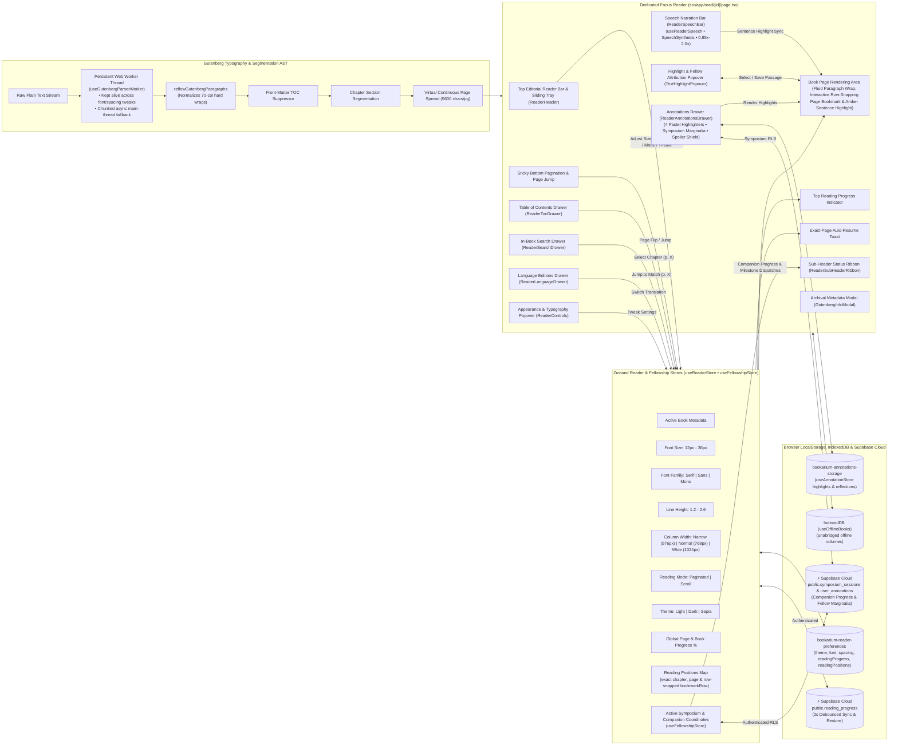
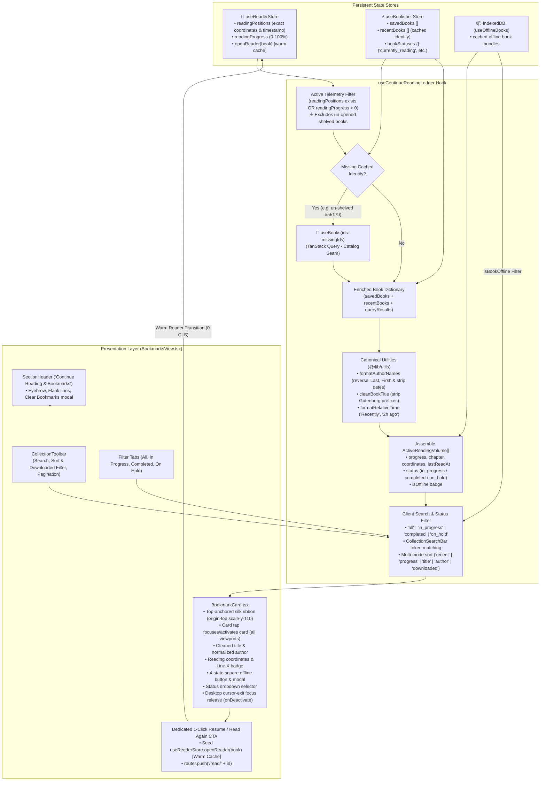

# Architecture Matrix & Living Technical Reference — Bookarium

> **Auto-Generated Living Architecture**: Programmatically compiled from Source AST via `scripts/lib/ast-parser.js` (Governance Rule 2).  
> **Last Synchronized**: `2026-10-25`  
> **Topology Health**: `193` Modules Analyzed • `723` Static Linkages • `0` Circular Dependencies • `0` Orphaned Modules

---

## 🏛️ System Architecture & Data Flow

Bookarium is built on a **100% Pure Live API Architecture** with real-time telemetry, zero local mock archives, and deterministic state isolation.

### 1. End-to-End System Context & Data Flow

```mermaid
flowchart TD
    User["👤 Reader / Public Domain Scholar"]
    
    subgraph FrontendSPA ["Client SPA Layer (Next.js 16 App Router)"]
        Nav["Navbar.tsx\n(Brand Reset, View Switcher, Tier-Adaptive Gliding Active Underline Cradle, Theme Cycler)"]
        Hero["HeroSearch.tsx\n(Dynamic 3D Rotating Spotlight & Search)"]
        Hero3D["HeroFeaturedBook3D.tsx\n(3D Open-Cover Hinge & Leaf-Flip Engine)"]
        Toolbar["StickyCatalogToolbar.tsx\n(Desktop Sticky Sub-Header, Mobile Capsule Dock, Top-Margin Docking & Split Quick-Clear)"]
        FilterDrawer["AdvancedFilterDrawer.tsx\n(Staged Filter Execution, Multi-Select Touch Chips: Eras, Topics, Languages, Formats)"]
        EditorialQuote["EditorialQuoteSection.tsx\n(Classic of the Day & Collision Guard)"]
        LiteraryQuotes["LiteraryQuotes.tsx\n(Words That Shaped Humanity & Safe Shuffling)"]
        CopyrightBanner["CopyrightNoticeBanner.tsx\n(Declarative Territorial Restriction & Public Domain Notice)"]
        ContentAdvisory["ContentAdvisoryBanner.tsx\n(Non-blocking Mature/Historical Context Advisory)"]
        CollectionToolbarNode["CollectionToolbar.tsx\n(Responsive Workbench: Integrated Search, Sort, Downloaded Filter, Tablet Icon Mode Toggles & Top-Pagination)"]
        PaginationNode["Pagination.tsx\n(Accessible Numeric Page Navigation)"]
        BookPreviewModalNode["BookPreviewModal.tsx\n(Desktop 3D Open-Book Preview Spread)"]
        BookshelfRackNode["BookshelfRack.tsx & BookshelfSpine.tsx\n(3D Hardwood Shelf, Custom Shelves & <1024px Touch Modal Trigger)"]
        BookshelfMobileModalNode["BookshelfMobileModal.tsx\n(Mobile & Tablet <1024px Action & Curation Sheet)"]
        RemoveOfflineModalNode["RemoveOfflineBookModal.tsx\n(Offline Cache Eviction Confirmation)"]
        SymposiumInviteModalNode["SymposiumInviteModal.tsx\n(1-on-1 Literary Symposium Companion Picker)"]
        
        subgraph Views ["Primary Application Views (/ & Edge Rewrites)"]
            Grid["Catalog View (/)\n(Smooth Scroll Navigation, 2-Col Mobile Grid, Multi-Col Desktop & 3D Hardwood Shelf)"]
            ShelfView["Bookshelf View (/bookshelf)\n(Curated Library, Custom Named Shelves, Downloaded (N) Smart Shelf, Active-Shelf Clear & 12-Book Row Cap)"]
            FavView["Favorites View (/favorites)\n(Dedicated Cover Grid, Star Ratings & Personal Curation)"]
            MarksView["Bookmarks View (/bookmarks)\n(Tactile Reading Ledger, Row-Level Line Badges, Dedicated Resume CTA & 4-State Offline Controls)"]
            NoteView["Commonplace Notebook (/notebook)\n(Highlights, Reflections, Tags, Single-Column Tablet Grid & Tablet Icon Mode Switcher)"]
            AccView["Account Hub (/account)\n(Library Stats, Cloud Sync & JSON Backup)"]
            PrivacyView["Privacy Architecture (/privacy)\n(Zero-Tracker Manifesto, COPPA/GDPR Art. 8 & Functional Geo-Cookies)"]
            CopyrightView["Copyright Governance (/copyright)\n(Public Domain Manifesto, Multi-Jurisdiction Rules & DMCA Channel)"]
            HabitsCard["AccountHabitsCard.tsx\n(Reading Streaks, Daily Progress, Annual Challenge)"]
            AccoladesCard["AccountAccoladesCard.tsx\n(Literary Honors, Showcase & Ex-Libris Bookplates)"]
            SymposiumCard["AccountSymposiumSection.tsx\n(Reader Circles & Literary Symposiums)"]
            PrefsCard["AccountPreferencesSection.tsx\n(AccountNarrationSubPanel • AccountPortabilitySubPanel)"]
            ProfilePage["Public Scholar Sanctuary (/u/[username])\n(Public Profile, Pinned Accolades & Fellowship CTA)"]
            ReaderPage["Focus Reader Page (/read/[id])\n(Continuous Pagination, Subtitles, AST)"]
        end
        
        subgraph ReaderDrawers ["Portaled Mutual-Exclusion Dialogs (z-10000)"]
            TocDrawer["ReaderTocDrawer\n(Rich Subtitles & Page Numbers)"]
            SearchDrawer["ReaderSearchDrawer\n(In-Volume Live Text Search)"]
            ControlsDrawer["ReaderControls\n(Typography, Speech & Themes)"]
            LangDrawer["ReaderLanguageDrawer\n(International Editions Handoff)"]
            AnnotDrawer["ReaderAnnotationsDrawer\n(In-Volume Highlights, Notes & Deep Links)"]
            DownDrawer["DownloadDrawer\n(In-App Offline Storage & EPUB/MOBI/TXT Direct Streams)"]
        end
        
        subgraph StateStores ["Zustand Persistent State & Offline Engine"]
            StoreShelf[("⚡ useBookshelfStore\n(saved, likes, queue, history, shelves, clearCustomShelfBooks)")]
            StoreReader[("📖 useReaderStore\n(typography, progress map, coordinates)")]
            StoreTheme[("🎨 useThemeStore\n(day, sepia, obsidian)")]
            StoreAuth[("🔐 useAuthStore\n(session, cloud migration, profile)")]
            StorePref[("⚙️ usePreferencesStore\n(sticky scroll, layout choices)")]
            StoreAnnot[("🖍️ useAnnotationStore\n(pastel highlights, notes, tags)")]
            StoreHabits[("🔥 useHabitsStore\n(streak, 5m threshold, dual immersion, cloud)")]
            StoreAccolades[("🎖️ useAccoladesStore\n(accolades, showcase pinning, celebrations, cloud)")]
            StoreFellowship[("🤝 useFellowshipStore\n(reader circles, symposiums, companion progress, cloud)")]
            BookshelfSyncEngine["🔄 bookshelf-cloud-sync.ts\n(Outbox Replay, Tombstone Filtering & Cloud Sync)"]
            BackupValidator["🛡️ backup-validator.ts\n(Schema v1.0–v2.2 Validation & Sanitization)"]
            StoreJurisdiction[("🌐 useJurisdictionStore\n(country, rule, dev override, cookie sync)")]
            StoreOffline[("📦 IndexedDB Engine\n(unabridged offline volume cache)")]
        end
        
        subgraph ReaderEngine ["Reader Runtime & Web Speech Subsystem"]
            SessionHook["📖 useReaderSession\n(Position Memory, Deep Links & Reflow Healing)"]
            SpeechHook["🔊 useReaderSpeech\n(SpeechSynthesis, Boundary Sync, Auto-Flip)"]
            TimerHook["⏱️ useReadingTimer\n(Dual Immersion: 2-min Idle Guard + TTS Audio Bypass)"]
            WorkerHook["⚙️ useGutenbergParserWorker\n(Persistent Worker Chapter AST)"]
            LedgerHook["🔖 useContinueReadingLedger\n(Two-Way Hydration & 0ms Resume)"]
            AnnotatorEngine["🖍️ reader-annotator.ts\n(Computational Interval Partitioning & Highlighter)"]
        end
        
        HookCopyright["⚖️ useBookCopyright\n(Declarative Facade: Rules, Lifespans & Status)"]
        HookAutoHeal["🩺 useCollectionAutoHeal\n(Author Lifespan Scanning & Auto-Rehydration)"]
        HookCatalogFilters["🎛️ useCatalogFilters\n(Default Recently Added Sort, Atomic Filter Staging, Multi-Era Bounding, URL Serialization)"]
        QueryBooks["🔄 useBooks & usePrefetchNextPage\n(Windowed Sub-Pages & Predictive Prefetch)"]
        QueryContent["🔄 useBookContent(url, bookId)\n(IndexedDB Check to CDN Stream)"]
        QueryTranslate["🌐 useBookTranslations\n(International Editions Relational Handoff)"]
        Telemetry["📊 Vercel Telemetry\n(Analytics & Speed Insights)"]
    end

    subgraph ServerLayer ["Next.js Root Proxy & Edge Routing Layer"]
        RootProxy["Next.js 16 Root Proxy (src/proxy.ts)\n(Edge Geo-IP: x-vercel-ip-country, Dev ?country=XX, Cookie Stamping)"]
        ProxyBooks["GET /api/books\n(SWR 3600s Cache, Latency Tracking, Rate Limit, Seam Controller)"]
        CatalogSeam["Catalog Seam & Dual Providers (src/lib/catalog/)\n(supabase-provider.ts • gutendex-provider.ts)"]
        ProxyContent["GET /api/books/content\n(Tier 1 Supabase DB • Tier 2 Gutenberg Multi-Mirror, Anti-SSRF)"]
        ProxyBookTranslations["GET /api/books/translations\n(Edge SWR Cache, Zero False Positives, FRBR Work Mapping)"]
        AuthCallback["GET /auth/callback\n(PKCE & Token-Hash OTP Verification, Origin Sanitizer)"]
        LayoutServer["Server Layout (/read/[id])\n(React.cache, ISR 24h, OpenGraph, JSON-LD)"]
    end

    subgraph LegalLayer ["Jurisdictional Copyright & Content Safety Engine"]
        EngineCore["isBookPublicDomainInJurisdiction\n(US 1930 Cutoff, Life+70, Life+100, Life+80)"]
        JointAuthors["Joint Authorship Guard (Berne Art. 7bis)"]
        Translators["Translator Protection (Berne Art. 2(3))"]
        ContributorFilter["Contributor Role Filter\n(Illustrator/Artist Non-Blocking Exclusion)"]
        ContentScanner["Content Advisory Engine (src/lib/content-advisory.ts)\n(LOC Subject & Bookshelf Lexical Scanner)"]
        CountryResolver["Country Resolver (src/lib/country-resolver.ts)\n(Edge Geo-IP, Cookie Sync, Timezone Inference)"]
        MetaCache["Metadata Lifespan Cache\n(metadata-cache.ts • 24h LRU)"]
    end

    subgraph UpstreamServices ["100% Public Domain & Cloud Infrastructure"]
        Gutendex["🌐 Gutendex Search API\n(Upstream Search Fallback)"]
        GutenbergCDN["🌐 Project Gutenberg Mirrors\n(aleph.gutenberg.org, gutenberg.readingroo.ms, www.gutenberg.org)"]
        WikidataSPARQL["🌐 Wikidata SPARQL (CC0 1.0)\n(P2034 Gutenberg ID & P407/P424 Language Clusters)"]
        SupabaseCloud[("⚡ Supabase Cloud (PostgreSQL)\n(public.books, book_translations, profiles, shelves, progress, habits, accolades)")]
        SyncEngine["🔄 Gutenberg Catalog Sync Engine\n(scripts/sync-gutenberg-catalog.js • .github/workflows/catalog-sync.yml)"]
        SyncTranslations["🔄 Relational Translations Sync\n(scripts/ingest-translations.js • .github/workflows/translations-sync.yml)"]
        VercelEdge["⚡ Vercel Edge Platform\n(Cookie-less Analytics & Speed Insights)"]
    end

    User --> RootProxy
    RootProxy --> Nav
    RootProxy --> Hero
    Hero --> Hero3D
    RootProxy --> Toolbar
    RootProxy --> AuthCallback
    AuthCallback -->|Verified Session Exchange| SupabaseCloud
    Toolbar --> FilterDrawer
    FilterDrawer --> HookCatalogFilters
    HookCatalogFilters --> QueryBooks
    Toolbar --> Grid
    Grid --> CopyrightBanner
    Grid --> ContentAdvisory
    Grid --> HookCopyright
    Grid --> EditorialQuote
    Grid --> LiteraryQuotes
    Grid --> BookPreviewModalNode
    Grid --> BookshelfRackNode
    ShelfView --> BookshelfRackNode
    BookshelfRackNode --> BookshelfMobileModalNode
    BookshelfRackNode --> BookPreviewModalNode
    ShelfView --> RemoveOfflineModalNode
    FavView --> RemoveOfflineModalNode
    MarksView --> RemoveOfflineModalNode
    BookPreviewModalNode --> SymposiumInviteModalNode
    Nav --> Views
    FavView --> HookAutoHeal
    ShelfView --> HookAutoHeal
    MarksView --> HookAutoHeal
    NoteView --> HookAutoHeal
    SymposiumCard --> HookAutoHeal
    HookCopyright --> EngineCore
    ContentAdvisory --> ContentScanner
    DownDrawer --> ContentAdvisory
    AccView --> HabitsCard
    AccView --> AccoladesCard
    AccView --> SymposiumCard
    AccView --> PrefsCard
    PrefsCard --> BackupValidator
    SymposiumCard --> StoreFellowship
    ProfilePage --> StoreFellowship
    StoreShelf --> BookshelfSyncEngine
    BookshelfSyncEngine -->|Cloud Sync via RLS| SupabaseCloud
    StoreFellowship -->|Circles & Symposium Sync| SupabaseCloud
    StoreOffline -->|Offline Volumes & Smart Shelf| ShelfView
    StoreOffline -->|Offline Volumes Filter| LedgerHook
    ShelfView --> CollectionToolbarNode
    FavView --> CollectionToolbarNode
    MarksView --> CollectionToolbarNode
    NoteView --> CollectionToolbarNode
    Grid --> PaginationNode
    ShelfView --> PaginationNode
    FavView --> PaginationNode
    MarksView --> PaginationNode
    NoteView --> PaginationNode
    
    Grid --> QueryBooks
    QueryBooks --> ProxyBooks
    ProxyBooks --> CatalogSeam
    CatalogSeam --> EngineCore
    CatalogSeam -->|"Primary: Estimated-Count Fast Scan / <50ms Single-Book"| SupabaseCloud
    CatalogSeam -.->|Fallback on unseeded/offline| Gutendex
    SyncEngine -->|Weekly Cron pg_catalog.csv.gz Stream| SupabaseCloud
    QueryBooks -.->|Client Failover on 504| Gutendex
    
    ReaderPage --> QueryContent
    ReaderPage --> ReaderDrawers
    ReaderPage --> ReaderEngine
    ReaderPage --> TimerHook
    ReaderPage --> AnnotatorEngine
    AnnotatorEngine --> StoreAnnot
    QueryContent --> ProxyContent
    ProxyContent --> MetaCache
    MetaCache -->|1. Supabase public.books check| SupabaseCloud
    MetaCache -.->|2. Fallback to Gutendex & Featured Fixtures| Gutendex
    MetaCache --> EngineCore
    EngineCore --> JointAuthors
    EngineCore --> Translators
    ProxyContent -->|Tier 1: Instant DB Text| SupabaseCloud
    ProxyContent -->|Tier 2: Multi-Mirror Fallback| GutenbergCDN
    ReaderPage --> QueryTranslate
    LangDrawer --> QueryTranslate
    QueryTranslate -->|Tier 1: Relational Work Mapping| ProxyBookTranslations
    ProxyBookTranslations -->|100% Precision Relational Query| SupabaseCloud
    QueryTranslate -.->|Tier 2: Client Author AST Fallback| Gutendex
    SyncTranslations -->|Weekly & On-Demand Ingestion| SupabaseCloud
    SyncTranslations -.->|Wikidata P2034 Query & Fallback Snapshot| WikidataSPARQL
    
    Views --> StateStores
    HabitsCard --> StoreHabits
    AccoladesCard --> StoreAccolades
    TimerHook --> StoreHabits
    ReaderEngine --> StateStores
    StoreShelf -->|Cloud Sync via RLS| SupabaseCloud
    StoreReader -->|Progress Sync| SupabaseCloud
    StoreAuth -->|Session Auth| SupabaseCloud
    StoreHabits -->|Habits Sync via RLS| SupabaseCloud
    StoreAccolades -->|Accolades Sync via RLS| SupabaseCloud
    Telemetry -.->|Anonymous Metrics| VercelEdge
```

---

### 2. Focus Reader State & Typography Engine

---

### 3. Bookmarks & Continue Reading Ledger Architecture

---

## 🧩 Component Catalog & Props Interface Matrix

Auto-extracted dynamically from **80 Production UI Components** using Babel AST:

| Component | Category | Exported Props Interface | Primary Props & Signals | Module Link |
| :--- | :--- | :--- | :--- | :--- |
| **`AccoladeCelebrationModal`** | Accolades | `AccoladeCelebrationModalProps` | `accolade`, `onDismiss` | [`src/components/accolades/AccoladeCelebrationModal.tsx`](src/components/accolades/AccoladeCelebrationModal.tsx) |
| **`ExLibrisBookplate`** | Accolades | `ExLibrisBookplateProps` | `definition`, `progress`, `onTogglePin`, `isPinningDisabled` | [`src/components/accolades/ExLibrisBookplate.tsx`](src/components/accolades/ExLibrisBookplate.tsx) |
| **`AccountAccoladesCard`** | Account | `AccountAccoladesCardProps` | `userId` | [`src/components/account/AccountAccoladesCard.tsx`](src/components/account/AccountAccoladesCard.tsx) |
| **`AccountDeleteModal`** | Account | `AccountDeleteModalProps` | `isOpen`, `onClose`, `userEmail`, `isSendingDeletionEmail`, `deletionEmailSent`, `deleteError`, `onRequestDeletion` | [`src/components/account/AccountDeleteModal.tsx`](src/components/account/AccountDeleteModal.tsx) |
| **`AccountHabitsCard`** | Account | `AccountHabitsCardProps` | `userId`, `completedBooksCount` | [`src/components/account/AccountHabitsCard.tsx`](src/components/account/AccountHabitsCard.tsx) |
| **`AccountIdentityCard`** | Account | `AccountIdentityCardProps` | `user`, `profile`, `formattedDate`, `displayName`, `onDisplayNameChange`, `onSaveProfile`, `isSaving`, `saveSuccess`, `saveError`, `onResendVerification`, `isResendingVerification`, `resendSuccess`, `resendError`, `resendCooldown`, `stats`, `onOpenLibraryBreakdown` | [`src/components/account/AccountIdentityCard.tsx`](src/components/account/AccountIdentityCard.tsx) |
| **`AccountNarrationSubPanel`** | Account | `AccountNarrationSubPanelProps` | `isActive`, `speechRate`, `onSpeechRateChange`, `speechVoiceURI`, `onSpeechVoiceChange`, `speechAutoPageAdvance`, `onSpeechAutoPageAdvanceChange`, `speechHighlightEnabled`, `onSpeechHighlightEnabledChange`, `onResetSpeechPreferences` | [`src/components/account/AccountNarrationSubPanel.tsx`](src/components/account/AccountNarrationSubPanel.tsx) |
| **`AccountPortabilitySubPanel`** | Account | `AccountPortabilitySubPanelProps` | `isActive`, `userId` | [`src/components/account/AccountPortabilitySubPanel.tsx`](src/components/account/AccountPortabilitySubPanel.tsx) |
| **`AccountPreferencesSection`** | Account | `AccountPreferencesSectionProps` | `theme`, `onThemeChange`, `stickyScrollEnabled`, `onStickyScrollChange`, `speechRate`, `onSpeechRateChange`, `speechVoiceURI`, `onSpeechVoiceChange`, `speechAutoPageAdvance`, `onSpeechAutoPageAdvanceChange`, `speechHighlightEnabled`, `onSpeechHighlightEnabledChange`, `onResetSpeechPreferences`, `userId` | [`src/components/account/AccountPreferencesSection.tsx`](src/components/account/AccountPreferencesSection.tsx) |
| **`AccountPublicProfileSection`** | Account | `AccountPublicProfileSectionProps` | `user`, `profile`, `onUpdateProfile` | [`src/components/account/AccountPublicProfileSection.tsx`](src/components/account/AccountPublicProfileSection.tsx) |
| **`AccountRestoreModal`** | Account | `AccountRestoreModalProps` | `isOpen`, `onClose`, `backupData`, `onRestore`, `isRestoring`, `restoreSuccess`, `restoreError` | [`src/components/account/AccountRestoreModal.tsx`](src/components/account/AccountRestoreModal.tsx) |
| **`AccountSecuritySection`** | Account | `AccountSecuritySectionProps` | `newPassword`, `confirmPassword`, `showPassword`, `copiedPassword`, `isUpdatingPassword`, `passwordSuccess`, `passwordError`, `strength`, `onNewPasswordChange`, `onConfirmPasswordChange`, `onToggleShowPassword`, `onGeneratePassword`, `onUpdatePassword`, `onSignOut`, `onOpenDeleteModal`, `userEmail` | [`src/components/account/AccountSecuritySection.tsx`](src/components/account/AccountSecuritySection.tsx) |
| **`AccountSymposiumSection`** | Account | `AccountSymposiumSectionProps` | `userId` | [`src/components/account/AccountSymposiumSection.tsx`](src/components/account/AccountSymposiumSection.tsx) |
| **`AuthModal`** | Auth | _Autonomous_ | None (Self-Contained) | [`src/components/auth/AuthModal.tsx`](src/components/auth/AuthModal.tsx) |
| **`EmailSentView`** | Auth | `EmailSentViewProps` | `title`, `email`, `messagePrefix`, `subtitle`, `resendSuccess`, `onResend`, `isResending`, `resendCooldown`, `onBackToSignIn`, `backButtonLabel` | [`src/components/auth/EmailSentView.tsx`](src/components/auth/EmailSentView.tsx) |
| **`ReadingStatusSelector`** | Bookshelf | `ReadingStatusSelectorProps` | `status`, `onChange`, `size`, `showClear`, `className` | [`src/components/bookshelf/ReadingStatusSelector.tsx`](src/components/bookshelf/ReadingStatusSelector.tsx) |
| **`motion-config`** | Motion | _Autonomous_ | None (Self-Contained) | [`src/components/motion/motion-config.ts`](src/components/motion/motion-config.ts) |
| **`MotionReveal`** | Motion | `MotionRevealProps` | `children`, `delay`, `className` | [`src/components/motion/MotionReveal.tsx`](src/components/motion/MotionReveal.tsx) |
| **`StaggerGroup`** | Motion | `StaggerGroupProps` | `children`, `className` | [`src/components/motion/StaggerGroup.tsx`](src/components/motion/StaggerGroup.tsx) |
| **`AdvancedFilterDrawer`** | Presentation | `AdvancedFilterDrawerProps` | `isOpen`, `onClose`, `selectedEra`, `onEraChange`, `selectedSort`, `onSortChange`, `selectedTopic`, `onTopicChange`, `selectedLanguage`, `onLanguageChange`, `selectedFormat`, `onFormatChange`, `onApplyFilters`, `onResetAll`, `activeFilterCount` | [`src/components/presentation/AdvancedFilterDrawer.tsx`](src/components/presentation/AdvancedFilterDrawer.tsx) |
| **`BookCard`** | Presentation | `BookCardProps` | `book`, `isOffline`, `onDownloadClick`, `onRemoveOfflineClick`, `onPreviewClick`, `isPreviewActive`, `activeView`, `onTopicClick` | [`src/components/presentation/BookCard.tsx`](src/components/presentation/BookCard.tsx) |
| **`BookGrid`** | Presentation | `BookGridProps` | `books`, `isLoading`, `isError`, `onRetry`, `page`, `onPageChange`, `hasNextPage`, `onDownloadClick`, `onRemoveOfflineClick`, `onPreviewClick`, `activePreviewBookId`, `emptyTitle`, `emptyDescription`, `viewMode`, `onViewModeChange`, `initialViewMode`, `showViewToggle`, `onBrowseCatalog`, `searchQuery`, `onClearSearch`, `activeView`, `showShelfControls`, `totalBooksCount`, `onTopicClick`, `pageSize` | [`src/components/presentation/BookGrid.tsx`](src/components/presentation/BookGrid.tsx) |
| **`BookmarkCard`** | Presentation | `BookmarkCardProps` | `volume`, `isOffline`, `isDownloadingOffline`, `isActive`, `onActivate`, `onDeactivate`, `onToggleOffline`, `onResume`, `onStatusChange`, `onClear` | [`src/components/presentation/BookmarkCard.tsx`](src/components/presentation/BookmarkCard.tsx) |
| **`BookmarksView`** | Presentation | `BookmarksViewProps` | `onBrowseCatalog` | [`src/components/presentation/BookmarksView.tsx`](src/components/presentation/BookmarksView.tsx) |
| **`BookPreviewModal`** | Presentation | `BookPreviewModalProps` | `book`, `originRect`, `isOpen`, `activeView`, `isOffline`, `isDownloadingOffline`, `onToggleOffline`, `onWillClose`, `onClose`, `onReadBook` | [`src/components/presentation/BookPreviewModal.tsx`](src/components/presentation/BookPreviewModal.tsx) |
| **`BookshelfRack`** | Presentation | `BookshelfRackProps` | `books`, `onBookClick`, `onDownloadClick`, `onBrowseCatalog`, `searchQuery`, `onClearSearch`, `showShelfControls`, `totalBooksCount` | [`src/components/presentation/BookshelfRack.tsx`](src/components/presentation/BookshelfRack.tsx) |
| **`CollectionSortDropdown`** | Presentation | `CollectionSortDropdownProps` | `value`, `onChange`, `options`, `ariaLabel`, `className` | [`src/components/presentation/CollectionSortDropdown.tsx`](src/components/presentation/CollectionSortDropdown.tsx) |
| **`CollectionToolbar`** | Presentation | `CollectionToolbarProps` | `searchQuery`, `onSearchChange`, `searchPlaceholder`, `searchAriaLabel`, `clearAriaLabel`, `searchTestId`, `totalCount`, `filteredCount`, `sortValue`, `onSortChange`, `sortOptions`, `sortAriaLabel`, `currentPage`, `totalPages`, `onPageChange`, `paginationAriaLabel`, `itemCountLabel`, `extraControls`, `className` | [`src/components/presentation/CollectionToolbar.tsx`](src/components/presentation/CollectionToolbar.tsx) |
| **`CollectionTopPagination`** | Presentation | `CollectionTopPaginationProps` | `currentPage`, `totalPages`, `onPageChange`, `className`, `ariaLabel` | [`src/components/presentation/CollectionTopPagination.tsx`](src/components/presentation/CollectionTopPagination.tsx) |
| **`ContentAdvisoryBanner`** | Presentation | `ContentAdvisoryBannerProps` | `matchedSubject`, `message`, `title`, `compact`, `testId`, `className` | [`src/components/presentation/ContentAdvisoryBanner.tsx`](src/components/presentation/ContentAdvisoryBanner.tsx) |
| **`CopyrightNoticeBanner`** | Presentation | `CopyrightNoticeBannerProps` | `country`, `ruleDescription`, `reason`, `publicDomainYear`, `title`, `subtext`, `compact`, `testId`, `className` | [`src/components/presentation/CopyrightNoticeBanner.tsx`](src/components/presentation/CopyrightNoticeBanner.tsx) |
| **`DownloadDrawer`** | Presentation | `DownloadDrawerProps` | `book`, `isOpen`, `onClose` | [`src/components/presentation/DownloadDrawer.tsx`](src/components/presentation/DownloadDrawer.tsx) |
| **`EditorialQuoteSection`** | Presentation | `EditorialQuoteSectionProps` | `heroBookId`, `className` | [`src/components/presentation/EditorialQuoteSection.tsx`](src/components/presentation/EditorialQuoteSection.tsx) |
| **`Footer`** | Presentation | _Autonomous_ | None (Self-Contained) | [`src/components/presentation/Footer.tsx`](src/components/presentation/Footer.tsx) |
| **`HeroFeaturedBook3D`** | Presentation | `HeroFeaturedBook3DProps` | `featuredBook`, `onReadFeaturedBook` | [`src/components/presentation/HeroFeaturedBook3D.tsx`](src/components/presentation/HeroFeaturedBook3D.tsx) |
| **`HeroSearch`** | Presentation | `HeroSearchProps` | `search`, `onSearchChange`, `onSearch`, `selectedTopic`, `onTopicChange`, `onTopicSelect`, `selectedLanguage`, `onLanguageChange`, `onReadFeaturedBook`, `featuredBook`, `books` | [`src/components/presentation/HeroSearch.tsx`](src/components/presentation/HeroSearch.tsx) |
| **`LanguageSelector`** | Presentation | `LanguageSelectorProps` | `value`, `onChange`, `variant`, `id`, `dataTestId`, `className`, `showIcon` | [`src/components/presentation/LanguageSelector.tsx`](src/components/presentation/LanguageSelector.tsx) |
| **`LiteraryQuotes`** | Presentation | _Autonomous_ | None (Self-Contained) | [`src/components/presentation/LiteraryQuotes.tsx`](src/components/presentation/LiteraryQuotes.tsx) |
| **`Navbar`** | Presentation | `NavbarProps` | `activeView`, `onViewChange`, `onBrandReset`, `isVisible` | [`src/components/presentation/Navbar.tsx`](src/components/presentation/Navbar.tsx) |
| **`NotablePassagesSpread`** | Presentation | `NotablePassagesSpreadProps` | `passage`, `isRestricted`, `country` | [`src/components/presentation/NotablePassagesSpread.tsx`](src/components/presentation/NotablePassagesSpread.tsx) |
| **`NotebookQuoteCard`** | Presentation | `NotebookQuoteCardProps` | `annotation`, `pairedFellowAnnotation`, `matchingOwnAnnotation`, `bookTitle`, `bookAuthor`, `isRestricted`, `jurisdictionCountry`, `isEditing`, `onStartEdit`, `onCancelEdit`, `onSaveNote`, `onUpdateColor`, `onRequestDeleteReflection`, `onRequestDeleteAnnotation`, `onJumpToReader`, `onSaveFellowAsOwn` | [`src/components/presentation/NotebookQuoteCard.tsx`](src/components/presentation/NotebookQuoteCard.tsx) |
| **`NotebookView`** | Presentation | `NotebookViewProps` | `onBrowseCatalog` | [`src/components/presentation/NotebookView.tsx`](src/components/presentation/NotebookView.tsx) |
| **`StickyCatalogToolbar`** | Presentation | `StickyCatalogToolbarProps` | `page`, `onPageChange`, `hasNextPage`, `viewMode`, `onViewModeChange`, `onOpenFilters`, `isFiltersOpen`, `activeFilterCount`, `activeFilterChips`, `onClearAllFilters`, `isFetching`, `onPrefetchNext`, `latencyMs`, `isError`, `pageSize`, `onPageSizeChange`, `isHeaderVisible`, `isVisible`, `isMobileDockVisible`, `mobileDockThreshold`, `mobileDockIdleTimeoutMs` | [`src/components/presentation/StickyCatalogToolbar.tsx`](src/components/presentation/StickyCatalogToolbar.tsx) |
| **`BookshelfManageModals`** | Presentation (Bookshelf) | `BookshelfManageModalsProps` | `isCreatingShelf`, `newShelfName`, `newShelfIsPublic`, `onNewShelfNameChange`, `onNewShelfIsPublicChange`, `onCloseCreateShelf`, `onCreateShelf`, `editingShelfId`, `editingShelfName`, `editingShelfIsPublic`, `onEditingShelfNameChange`, `onEditingShelfIsPublicChange`, `onCloseRenameShelf`, `onRenameShelf`, `deletingShelfId`, `onCloseDeleteShelf`, `onDeleteShelf`, `isClearingOfflineShelf`, `onCloseClearOfflineShelf`, `onConfirmClearOfflineShelf`, `isSubmitting` | [`src/components/presentation/bookshelf/BookshelfManageModals.tsx`](src/components/presentation/bookshelf/BookshelfManageModals.tsx) |
| **`BookshelfMobileModal`** | Presentation (Bookshelf) | `BookshelfMobileModalProps` | `selectedMobileBook`, `isClosingMobileSheet`, `onClose`, `readingProgress`, `isSaved`, `isFavorite`, `isOffline`, `isDownloadingOffline`, `onToggleSave`, `onToggleFavorite`, `onToggleOffline`, `onBookClick`, `onDownloadClick`, `cloudBookshelves`, `cloudBookshelfItems`, `defaultShelfId`, `currentActiveShelfId`, `userId`, `onMoveBookToShelf`, `activeView`, `className` | [`src/components/presentation/bookshelf/BookshelfMobileModal.tsx`](src/components/presentation/bookshelf/BookshelfMobileModal.tsx) |
| **`BookshelfSpine`** | Presentation (Bookshelf) | `BookshelfSpineProps` | `book`, `bookIndex`, `readingProgress`, `isSaved`, `isFavorite`, `isOffline`, `isDownloadingOffline`, `onToggleSave`, `onToggleFavorite`, `onToggleOffline`, `onSpineClick`, `onBookClick`, `onDownloadClick`, `cloudBookshelves`, `cloudBookshelfItems`, `defaultShelfId`, `currentActiveShelfId`, `userId`, `onMoveBookToShelf` | [`src/components/presentation/bookshelf/BookshelfSpine.tsx`](src/components/presentation/bookshelf/BookshelfSpine.tsx) |
| **`PinnedAccoladesShelf`** | Profile | `PinnedAccoladesShelfProps` | `pinnedItems` | [`src/components/profile/PinnedAccoladesShelf.tsx`](src/components/profile/PinnedAccoladesShelf.tsx) |
| **`PrivateProfileNotice`** | Profile | `PrivateProfileNoticeProps` | `username` | [`src/components/profile/PrivateProfileNotice.tsx`](src/components/profile/PrivateProfileNotice.tsx) |
| **`PublicProfileView`** | Profile | `PublicProfileViewProps` | `profile`, `pinnedAccolades`, `habits`, `bookshelves` | [`src/components/profile/PublicProfileView.tsx`](src/components/profile/PublicProfileView.tsx) |
| **`ServiceWorkerRegister`** | Pwa | _Autonomous_ | None (Self-Contained) | [`src/components/pwa/ServiceWorkerRegister.tsx`](src/components/pwa/ServiceWorkerRegister.tsx) |
| **`DeleteAnnotationModal`** | Reader | `DeleteAnnotationModalProps` | `isOpen`, `onClose`, `onConfirm`, `annotation`, `title`, `description` | [`src/components/reader/DeleteAnnotationModal.tsx`](src/components/reader/DeleteAnnotationModal.tsx) |
| **`GutenbergInfoModal`** | Reader | `GutenbergInfoModalProps` | `isOpen`, `onClose`, `bookId`, `title`, `author`, `theme`, `subjects`, `bookshelves` | [`src/components/reader/GutenbergInfoModal.tsx`](src/components/reader/GutenbergInfoModal.tsx) |
| **`QuoteDeletePreview`** | Reader | `QuoteDeletePreviewProps` | `selectedText`, `note` | [`src/components/reader/QuoteDeletePreview.tsx`](src/components/reader/QuoteDeletePreview.tsx) |
| **`ReaderAnnotationsDrawer`** | Reader | `ReaderAnnotationsDrawerProps` | `isOpen`, `onClose`, `annotations`, `fellowAnnotations`, `hasActiveSymposium`, `symposiumCompanionUsername`, `symposiumCompanionDisplayName`, `activeChapterIndex`, `marginaliaSourceFilter`, `onSourceFilterChange`, `spoilerShieldEnabled`, `onToggleSpoilerShield`, `bookTitle`, `theme`, `onJumpToAnnotation`, `onDeleteAnnotation`, `onUpdateNote`, `onSaveFellowAnnotation` | [`src/components/reader/ReaderAnnotationsDrawer.tsx`](src/components/reader/ReaderAnnotationsDrawer.tsx) |
| **`ReaderControls`** | Reader | `ReaderControlsProps` | `isOpen`, `onClose`, `fontSize`, `onFontSizeChange`, `lineHeight`, `onLineHeightChange`, `fontFamily`, `onFontFamilyChange`, `theme`, `onThemeChange`, `readingMode`, `onReadingModeChange`, `columnWidth`, `onColumnWidthChange` | [`src/components/reader/ReaderControls.tsx`](src/components/reader/ReaderControls.tsx) |
| **`ReaderDrawerShell`** | Reader | `ReaderDrawerShellProps` | `isOpen`, `onClose`, `title`, `titleIcon`, `theme`, `children`, `ariaLabel`, `closeAriaLabel`, `backdropTestId`, `panelTestId`, `className`, `role` | [`src/components/reader/ReaderDrawerShell.tsx`](src/components/reader/ReaderDrawerShell.tsx) |
| **`ReaderErrorView`** | Reader | `ReaderErrorViewProps` | `activeTheme`, `onRetry`, `error`, `bookTitle`, `bookAuthor` | [`src/components/reader/ReaderErrorView.tsx`](src/components/reader/ReaderErrorView.tsx) |
| **`ReaderFooter`** | Reader | `ReaderFooterProps` | `globalPage`, `totalBookPages`, `chapterTitle`, `chapterPage`, `chapterPageCount`, `onPrevPage`, `onNextPage`, `onPageJump`, `isPrevDisabled`, `isNextDisabled`, `readingMode`, `theme`, `currentChapterIndex`, `totalChapters`, `onSelectChapter`, `onToggleToc`, `onToggleControls`, `onToggleSearch`, `onToggleSpeech`, `onToggleAnnotations`, `onToggleTranslations`, `onThemeChange`, `isTocOpen`, `isControlsOpen`, `isSearchOpen`, `isSpeechOpen`, `isAnnotationsOpen`, `isTranslationsOpen` | [`src/components/reader/ReaderFooter.tsx`](src/components/reader/ReaderFooter.tsx) |
| **`ReaderHeader`** | Reader | `ReaderHeaderProps` | `title`, `author`, `bookId`, `progress`, `onBack`, `isTocOpen`, `onToggleToc`, `isSearchOpen`, `onToggleSearch`, `isControlsOpen`, `onToggleControls`, `isTranslationsOpen`, `onToggleTranslations`, `isSpeechOpen`, `onToggleSpeech`, `isAnnotationsOpen`, `onToggleAnnotations`, `annotationsCount`, `theme`, `totalChapters`, `currentChapterIndex`, `onThemeChange`, `resumeNotice`, `onRestart`, `onDismissResume`, `translations`, `isTranslationsLoading`, `onSelectTranslation`, `symposiumCompanion`, `symposiumMilestoneNotice`, `onDismissSymposiumMilestone` | [`src/components/reader/ReaderHeader.tsx`](src/components/reader/ReaderHeader.tsx) |
| **`ReaderLanguageDrawer`** | Reader | `ReaderLanguageDrawerProps` | `isOpen`, `onClose`, `translations`, `onSelectTranslation`, `theme` | [`src/components/reader/ReaderLanguageDrawer.tsx`](src/components/reader/ReaderLanguageDrawer.tsx) |
| **`ReaderLoadingView`** | Reader | `ReaderLoadingViewProps` | `activeTheme` | [`src/components/reader/ReaderLoadingView.tsx`](src/components/reader/ReaderLoadingView.tsx) |
| **`ReaderSearchDrawer`** | Reader | `ReaderSearchDrawerProps` | `isOpen`, `onClose`, `chapters`, `fontSize`, `onSelectMatch`, `bookTitle`, `theme` | [`src/components/reader/ReaderSearchDrawer.tsx`](src/components/reader/ReaderSearchDrawer.tsx) |
| **`ReaderSpeechBar`** | Reader | `ReaderSpeechBarProps` | `speech`, `isOpen`, `onClose`, `isDrawerOpen`, `isPlaying`, `isPaused`, `currentSentenceIndex`, `totalSentences`, `rate`, `availableVoices`, `naturalVoices`, `standardVoices`, `selectedVoice`, `onPlay`, `onPause`, `onResume`, `onSkipNext`, `onSkipPrev`, `onRateChange`, `onVoiceChange`, `theme`, `bookTitle`, `currentPage`, `totalPages`, `isPrevDisabled`, `isNextDisabled` | [`src/components/reader/ReaderSpeechBar.tsx`](src/components/reader/ReaderSpeechBar.tsx) |
| **`ReaderSubHeaderRibbon`** | Reader | `ReaderSubHeaderRibbonProps` | `bookId`, `progress`, `totalChapters`, `currentChapterIndex`, `theme`, `resumeNotice`, `onRestart`, `onDismissResume`, `onOpenInfoModal`, `symposiumCompanion`, `symposiumMilestoneNotice`, `onDismissSymposiumMilestone` | [`src/components/reader/ReaderSubHeaderRibbon.tsx`](src/components/reader/ReaderSubHeaderRibbon.tsx) |
| **`ReaderSurface`** | Reader | `ReaderSurfaceProps` | `theme`, `fontFamily`, `fontSize`, `lineHeight`, `columnWidth`, `readingMode`, `chapter`, `currentPageText`, `chapterPage`, `bookmarkRow`, `onBookmarkRowChange`, `activeChapterIndex`, `totalChapters`, `isLoading`, `isError`, `error`, `onRetry`, `bookTitle`, `bookAuthor`, `onPreviousPage`, `onNextPage`, `onFontSizeChange`, `highlightedSentence`, `annotations`, `targetAnnotationId`, `onSelectAnnotation`, `onTextSelected` | [`src/components/reader/ReaderSurface.tsx`](src/components/reader/ReaderSurface.tsx) |
| **`ReaderTocDrawer`** | Reader | `ReaderTocDrawerProps` | `isOpen`, `onClose`, `chapters`, `activeChapterIndex`, `onSelectChapter`, `bookTitle`, `theme` | [`src/components/reader/ReaderTocDrawer.tsx`](src/components/reader/ReaderTocDrawer.tsx) |
| **`TextHighlightPopover`** | Reader | `TextHighlightPopoverProps` | `isOpen`, `selectedText`, `position`, `activeColor`, `existingNote`, `existingAnnotationId`, `fellowAnnotation`, `isFellowOnly`, `onSelectColor`, `onSaveNote`, `onDelete`, `onCopyQuote`, `onClose`, `theme` | [`src/components/reader/TextHighlightPopover.tsx`](src/components/reader/TextHighlightPopover.tsx) |
| **`SymposiumInviteModal`** | Symposium | `SymposiumInviteModalProps` | `isOpen`, `onClose`, `bookId`, `bookTitle`, `preselectedFellow` | [`src/components/symposium/SymposiumInviteModal.tsx`](src/components/symposium/SymposiumInviteModal.tsx) |
| **`BackToTop`** | UI | `BackToTopProps` | `threshold`, `className` | [`src/components/ui/BackToTop.tsx`](src/components/ui/BackToTop.tsx) |
| **`Badge`** | UI | `BadgeProps` | `variant`, `size` | [`src/components/ui/Badge.tsx`](src/components/ui/Badge.tsx) |
| **`Button`** | UI | _Autonomous_ | None (Self-Contained) | [`src/components/ui/Button.tsx`](src/components/ui/Button.tsx) |
| **`Card`** | UI | `CardProps` | `variant` | [`src/components/ui/Card.tsx`](src/components/ui/Card.tsx) |
| **`CursorTooltip`** | UI | `CursorTooltipProps` | `isVisible`, `mousePos`, `offset`, `children`, `className`, `testId` | [`src/components/ui/CursorTooltip.tsx`](src/components/ui/CursorTooltip.tsx) |
| **`Input`** | UI | `InputProps` | `icon`, `onClear` | [`src/components/ui/Input.tsx`](src/components/ui/Input.tsx) |
| **`Modal`** | UI | `ModalProps` | `isOpen`, `onClose`, `title`, `children`, `className`, `maxWidth`, `showCloseButton`, `backdropClassName`, `backdropTestId`, `testId` | [`src/components/ui/Modal.tsx`](src/components/ui/Modal.tsx) |
| **`Pagination`** | UI | `PaginationProps` | `currentPage`, `totalPages`, `onPageChange`, `totalItems`, `pageSize`, `className` | [`src/components/ui/Pagination.tsx`](src/components/ui/Pagination.tsx) |
| **`PasswordStrengthMeter`** | UI | `PasswordStrengthMeterProps` | `strength`, `className` | [`src/components/ui/PasswordStrengthMeter.tsx`](src/components/ui/PasswordStrengthMeter.tsx) |
| **`RemoveOfflineBookModal`** | UI | `RemoveOfflineBookModalProps` | `isOpen`, `bookTitle`, `onClose`, `onConfirm`, `isLoading` | [`src/components/ui/RemoveOfflineBookModal.tsx`](src/components/ui/RemoveOfflineBookModal.tsx) |
| **`SectionHeader`** | UI | `SectionHeaderProps` | `eyebrow`, `title`, `subtitle`, `titleAs`, `showFlankLines`, `className`, `titleClassName`, `children` | [`src/components/ui/SectionHeader.tsx`](src/components/ui/SectionHeader.tsx) |
| **`StarRating`** | UI | `StarRatingProps` | `value`, `onChange`, `size`, `readOnly`, `showLabel`, `compactOnMobile`, `className` | [`src/components/ui/StarRating.tsx`](src/components/ui/StarRating.tsx) |

---

## ⚡ State Management & Store Architecture

Zustand client-side state stores programmatically verified across **10 Persistent Modules**:

### 1. `useAccoladesStore` ([`src/stores/useAccoladesStore.ts`](src/stores/useAccoladesStore.ts))
* **Storage Key**: `STORAGE_KEYS.ACCOLADES` (localStorage)
* **Role & State**: Deterministic literary accolades evaluation, celebration queues, personal showcase pinning (max 3 bookplates), and bi-directional Supabase cloud synchronization.

### 2. `useAnnotationStore` ([`src/stores/useAnnotationStore.ts`](src/stores/useAnnotationStore.ts))
* **Storage Key**: `STORAGE_KEYS.ANNOTATIONS` (localStorage)
* **Role & State**: Scholar marginalia, categorical pastel highlights (Yellow, Amber, Mint, Rose), co-reader Fellow Marginalia (`fellowAnnotations`), cross-volume global fellow marginalia sync (`fetchAllFellowAnnotations`), companion profile enrichment & placeholder protection (`enrichFellowAnnotations`, `resolveStaleFellowProfiles`), chapter-bound Spoiler Shield (`spoilerShieldEnabled`), reflections, and commonplace book exports.

### 3. `useAuthStore` ([`src/stores/useAuthStore.ts`](src/stores/useAuthStore.ts))
* **Storage Key**: `bookarium-auth-profile` (localStorage)
* **Role & State**: Supabase session authentication, guest status, password generation, and cloud profile synchronization with live companion identity propagation.

### 4. `useBookshelfStore` ([`src/stores/useBookshelfStore.ts`](src/stores/useBookshelfStore.ts))
* **Storage Key**: `STORAGE_KEYS.BOOKSHELF` (localStorage)
* **Role & State**: Personal library collections, reading queue, reading history, custom named shelves, active-shelf-aware book clearing (`clearSavedBooks`, `clearCustomShelfBooks`), deletion tombstones, ratings, and cloud outbox reconciliation via `bookshelf-cloud-sync.ts`.

### 5. `useFellowshipStore` ([`src/stores/useFellowshipStore.ts`](src/stores/useFellowshipStore.ts))
* **Storage Key**: `bookarium-fellowship-storage` (localStorage)
* **Role & State**: Opt-in 1-on-1 Reader Circle fellowships, per-volume Literary Symposium sessions, companion progress coordinates, scholar handle formatting (`formatFellowScholarLabel`, `isPlaceholderUsername`), pending invitation badges, and bi-directional Supabase cloud synchronization.

### 6. `useHabitsStore` ([`src/stores/useHabitsStore.ts`](src/stores/useHabitsStore.ts))
* **Storage Key**: `STORAGE_KEYS.HABITS` (localStorage)
* **Role & State**: Reading streaks with 5-minute active immersion threshold, daily calendar activity dates, annual volume challenge goals, dual immersion telemetry (reading vs listening), and multi-device Supabase cloud synchronization.

### 7. `useJurisdictionStore` ([`src/stores/useJurisdictionStore.ts`](src/stores/useJurisdictionStore.ts))
* **Storage Key**: In-Memory (Ephemeral)
* **Role & State**: Client-side geographic jurisdiction state, cookie synchronization (bookarium-geo-country), developer country overrides, and synchronous regional capability resolution.

### 8. `usePreferencesStore` ([`src/stores/usePreferencesStore.ts`](src/stores/usePreferencesStore.ts))
* **Storage Key**: `STORAGE_KEYS.PREFERENCES` (localStorage)
* **Role & State**: Reader display choices, sticky header auto-hide preferences, and navigation behaviors.

### 9. `useReaderStore` ([`src/stores/useReaderStore.ts`](src/stores/useReaderStore.ts))
* **Storage Key**: `STORAGE_KEYS.READER_SETTINGS` (localStorage)
* **Role & State**: Active book payload with verified lifespan preservation, typography settings (size, family, line height), reading mode (paginated vs scroll), chapter/page/row coordinates (`bookmarkRow`), and bidirectional Supabase `reading_progress` lifespan self-healing.

### 10. `useThemeStore` ([`src/stores/useThemeStore.ts`](src/stores/useThemeStore.ts))
* **Storage Key**: `STORAGE_KEYS.THEME` (localStorage)
* **Role & State**: Global application theme state (Day Paper, Sepia Parchment, Obsidian Dark) with immediate document class application.

---

## 🌐 API Routes, App Router Entrypoints, Query Hooks & Reader Engine

### 1. API & Server Route Handlers (Edge Proxy, Auth & Telemetry)

| Endpoint / Route | Method(s) | Source File | Cache & Security Strategy | Upstream Target |
| :--- | :--- | :--- | :--- | :--- |
| **`/api/books`** | `GET` | [`src/app/api/books/route.ts`](src/app/api/books/route.ts) | `s-maxage=3600, stale-while-revalidate=86400` • Sliding-Window Rate Limit (30 req/min) | Supabase `public.books` -> `https://gutendex.com/books/` |
| **`/api/books/content`** | `GET` | [`src/app/api/books/content/route.ts`](src/app/api/books/content/route.ts) | `s-maxage=86400, stale-while-revalidate=604800` • Anti-SSRF Allowlist & Jurisdictional Gate | Supabase `plain_text` -> Gutenberg Multi-Mirror CDN |
| **`/api/books/translations`** | `GET` | [`src/app/api/books/translations/route.ts`](src/app/api/books/translations/route.ts) | `s-maxage=86400, stale-while-revalidate=604800` • Sliding-Window Rate Limit & Jurisdictional Filter | Supabase `public.book_translations` & `public.books` |
| **`/auth/callback`** | `GET` | [`src/app/auth/callback/route.ts`](src/app/auth/callback/route.ts) | `No-Store Auth Exchange` • PKCE & OTP Verification + Canonical Origin Redirect Sanitizer | Supabase Auth (`exchangeCodeForSession`, `verifyOtp`) |

### 2. App Router Pages, Layouts & Metadata Entrypoints

| Route / URI | Entrypoint Type | Rendering Strategy | Source File | Architectural Responsibility |
| :--- | :--- | :--- | :--- | :--- |
| **`/account`** | Route Layout & SSR Metadata | React Server Component (SSR / Static) | [`src/app/account/layout.tsx`](src/app/account/layout.tsx) | Server layout defining canonical metadata and robots noindex directives for the Scholar Account Hub. |
| **`/account`** | App Page | Client Interactive (`"use client"`) | [`src/app/account/page.tsx`](src/app/account/page.tsx) | Scholar Account Hub for Reading Habits, Literary Accolades, Reader Circles & Symposiums, Cloud Sync, and JSON/CSV library backups. |
| **`/auth/confirm-deletion`** | App Page | Client Interactive (`"use client"`) | [`src/app/auth/confirm-deletion/page.tsx`](src/app/auth/confirm-deletion/page.tsx) | Two-step email-verified account deletion confirmation page executing `delete_current_user()` RPC. |
| **`/copyright`** | App Page | React Server Component (SSR / Static) | [`src/app/copyright/page.tsx`](src/app/copyright/page.tsx) | Multi-Jurisdictional Public Domain Copyright Governance manifesto, territory rules table, and takedown notice channel. |
| **`/`** | App Error Boundary | Client Interactive (`"use client"`) | [`src/app/error.tsx`](src/app/error.tsx) | Route-level React Error Boundary providing graceful recovery UI and diagnostic fallback. |
| **`/`** | App Error Boundary | Client Interactive (`"use client"`) | [`src/app/global-error.tsx`](src/app/global-error.tsx) | Root document-level React Error Boundary catching fatal top-level layout exceptions. |
| **`/`** | Root Layout | React Server Component (SSR / Static) | [`src/app/layout.tsx`](src/app/layout.tsx) | Root HTML shell, font initialization, theme class hydration, and global React Query / Service Worker provider wrapper. |
| **`/manifest.webmanifest`** | PWA Metadata Route | React Server Component (SSR / Static) | [`src/app/manifest.ts`](src/app/manifest.ts) | Progressive Web App (PWA) Web App Manifest configuring standalone display, theme colors, and multi-resolution icons. |
| **`/`** | App 404 Boundary | React Server Component (SSR / Static) | [`src/app/not-found.tsx`](src/app/not-found.tsx) | Editorial 404 Not Found boundary with direct navigation back to the public domain catalog. |
| **`/`** | App Page | Client Interactive (`"use client"`) | [`src/app/page.tsx`](src/app/page.tsx) | Primary SPA workbench hosting Catalog, Bookshelf, Favorites, Bookmarks, and Commonplace Notebook views with edge URL rewrites. |
| **`/privacy`** | Route Layout & SSR Metadata | React Server Component (SSR / Static) | [`src/app/privacy/layout.tsx`](src/app/privacy/layout.tsx) | Server layout defining canonical SEO and OpenGraph metadata for the Privacy Architecture manifesto. |
| **`/privacy`** | App Page | React Server Component (SSR / Static) | [`src/app/privacy/page.tsx`](src/app/privacy/page.tsx) | Zero-Tracker Privacy Architecture manifesto, functional geo-cookie disclosure, and COPPA / GDPR Art. 8 governance. |
| **`/read/[id]`** | Route Layout & SSR Metadata | React Server Component (SSR / Static) | [`src/app/read/[id]/layout.tsx`](src/app/read/[id]/layout.tsx) | Server layout generating ISR 24h dynamic OpenGraph, Twitter Card, and Schema.org Book JSON-LD metadata (`React.cache`). |
| **`/read/[id]`** | App Page | Client Interactive (`"use client"`) | [`src/app/read/[id]/page.tsx`](src/app/read/[id]/page.tsx) | Dedicated distraction-free Focus Reader with continuous pagination, Web Worker AST segmentation, TTS narration, and Symposium marginalia. |
| **`/robots.txt`** | SEO Metadata Route | React Server Component (SSR / Static) | [`src/app/robots.ts`](src/app/robots.ts) | Search engine crawler directives permitting public catalog and reader indexing while protecting `/api/` and `/auth/` routes. |
| **`/sitemap.xml`** | SEO Metadata Route | React Server Component (SSR / Static) | [`src/app/sitemap.ts`](src/app/sitemap.ts) | Dynamic XML sitemap generator indexing primary views, governance pages, and curated public domain masterworks. |
| **`/u/[username]`** | App Page | Client Interactive (`"use client"`) | [`src/app/u/[username]/page.tsx`](src/app/u/[username]/page.tsx) | Public Scholar Sanctuary displaying pinned Ex-Libris bookplates, public profile stats, and 1-on-1 Literary Fellowship invitation actions. |

### 3. Custom Hooks (Data Queries & Reader Subsystems)

| Hook Name | Subsystem / Layer | Source File | Architectural Responsibility |
| :--- | :--- | :--- | :--- |
| **`useBookCopyright`** | Hooks | [`src/hooks/useBookCopyright.ts`](src/hooks/useBookCopyright.ts) | Declarative jurisdictional copyright facade hook coordinating territory rules, author lifespan restrictions, and public domain badges. |
| **`useBookPassageShuffle`** | Hooks | [`src/hooks/useBookPassageShuffle.ts`](src/hooks/useBookPassageShuffle.ts) | Autonomous literary quote selection and multi-chapter shuffle engine. |
| **`useCatalogFilters`** | Hooks | [`src/hooks/useCatalogFilters.ts`](src/hooks/useCatalogFilters.ts) | Catalog filter state URL binding, default Recently Added (descending) sort, atomic filter staging, multi-era bounding calculation, and multi-filter query synchronization. |
| **`useCollectionAutoHeal`** | Hooks | [`src/hooks/useCollectionAutoHeal.ts`](src/hooks/useCollectionAutoHeal.ts) | Unified multi-collection auto-healing pipeline scanning and rehydrating missing author lifespans across Favorites, Bookshelves, Reading Positions, Annotations (Personal & Fellow), and Active Symposiums. |
| **`useCursorTooltip`** | Hooks | [`src/hooks/useCursorTooltip.ts`](src/hooks/useCursorTooltip.ts) | Adaptive unconstrained cursor tooltips for interactive bookshelf elements. |
| **`useHasMounted`** | Hooks | [`src/hooks/useHasMounted.ts`](src/hooks/useHasMounted.ts) | SSR hydration barrier hook preventing client-server markup mismatches. |
| **`useMobileViewSwipe`** | Hooks | [`src/hooks/useMobileViewSwipe.ts`](src/hooks/useMobileViewSwipe.ts) | Tactile touch gesture navigation hook enabling horizontal view swiping across primary views on mobile and tactile tablets. |
| **`useOfflineBooks`** | Hooks | [`src/hooks/useOfflineBooks.ts`](src/hooks/useOfflineBooks.ts) | IndexedDB cache enumeration, reactive cross-instance event broadcast (`OFFLINE_BOOKS_UPDATED_EVENT`), loading state propagation (`OFFLINE_DOWNLOADING_EVENT`), author lifespan normalization (`normalizeOfflineAuthors`), and local offline book download/deletion management. |
| **`usePerformanceTier`** | Hooks | [`src/hooks/usePerformanceTier.ts`](src/hooks/usePerformanceTier.ts) | Hardware concurrency and memory heuristic detection for fluid 60fps animations. |
| **`useReadingTimer`** | Hooks | [`src/hooks/useReadingTimer.ts`](src/hooks/useReadingTimer.ts) | Reader session telemetry tracking visual reading with 2-minute idle guard and TTS narration audio bypass. |
| **`useScrollDirection`** | Hooks | [`src/hooks/useScrollDirection.ts`](src/hooks/useScrollDirection.ts) | Stepped directional scroll detection with user auto-hide preference persistence. |
| **`useTouchDevice`** | Hooks | [`src/hooks/useTouchDevice.ts`](src/hooks/useTouchDevice.ts) | SSR-safe tactile capability and viewport boundary detection enabling touch gestures on tablets and mobile. |
| **`useBookContent`** | Queries | [`src/hooks/queries/useBookContent.ts`](src/hooks/queries/useBookContent.ts) | TanStack Query fetching book plain text with IndexedDB offline-first check, multi-store lifespan verification (`resolveAuthoritativeLocalAuthors`), and online server-gatekeeper deferral. |
| **`useBooks`** | Queries | [`src/hooks/queries/useBooks.ts`](src/hooks/queries/useBooks.ts) | TanStack Query fetching catalog volumes with sub-pagination and client failover. |
| **`useBookTranslations`** | Queries | [`src/hooks/queries/useBookTranslations.ts`](src/hooks/queries/useBookTranslations.ts) | TanStack Query aggregating international language translations and editions. |
| **`useContinueReadingLedger`** | Reader | [`src/hooks/reader/useContinueReadingLedger.ts`](src/hooks/reader/useContinueReadingLedger.ts) | Headless continue reading ledger with authentic telemetry enrollment, query hydration, multi-attribute sorting, and offline volume filtering (useOfflineBooks). |
| **`useGutenbergParserWorker`** | Reader | [`src/hooks/reader/useGutenbergParserWorker.ts`](src/hooks/reader/useGutenbergParserWorker.ts) | Persistent Web Worker chapter segmentation and layout pagination calculations. |
| **`useReaderDrawers`** | Reader | [`src/hooks/reader/useReaderDrawers.ts`](src/hooks/reader/useReaderDrawers.ts) | Mutual exclusivity coordination for in-reader tool drawers and modals. |
| **`useReaderGestures`** | Reader | [`src/hooks/reader/useReaderGestures.ts`](src/hooks/reader/useReaderGestures.ts) | Touch swipe detection, keyboard shortcuts, and selection gesture conflict guards. |
| **`useReaderSession`** | Reader | [`src/hooks/reader/useReaderSession.ts`](src/hooks/reader/useReaderSession.ts) | Reading coordinates restoration, resume ribbons, and cloud session synchronization. |
| **`useReaderSpeech`** | Reader | [`src/hooks/reader/useReaderSpeech.ts`](src/hooks/reader/useReaderSpeech.ts) | Browser-native Web Speech synthesis with boundary word highlighting and auto-flip. |

---

## 🧠 Domain Engines & Pure Computational Utilities

Pure business logic, historical engines, and layout algorithms verified across **41 Domain Modules** using Babel AST:

| Engine / Utility | Subsystem / Layer | Source File | Primary Exported Primitives | Architectural Responsibility |
| :--- | :--- | :--- | :--- | :--- |
| **`metadata-cache`** | Edge Route Engine | [`src/app/api/books/content/metadata-cache.ts`](src/app/api/books/content/metadata-cache.ts) | `CachedMetadata`, `clearBookMetadataCache`, `setBookMetadataCache`, `getBookMetadataCache`, `resolveBookMetadata` | 3-tier in-memory LRU author lifespan cache (24h TTL, 1,000 entries) resolving contributor birth/death years via Supabase `public.books`, upstream Gutendex API, and `FEATURED_HERO_BOOKS` fallback. |
| **`url-validator`** | Edge Route Engine | [`src/app/api/books/content/url-validator.ts`](src/app/api/books/content/url-validator.ts) | `isSafeUpstreamUrl`, `sanitizeUpstreamUrl` | Zero-trust anti-SSRF upstream URL validator enforcing HTTPS and strict Project Gutenberg hostname allowlisting (`gutenberg.org`, `aleph.gutenberg.org`, `gutenberg.readingroo.ms`). |
| **`reader-layout-utils`** | SSR Route Engine | [`src/app/read/[id]/reader-layout-utils.ts`](src/app/read/[id]/reader-layout-utils.ts) | `serverMetadataCache`, `clearServerMetadataCache`, `isClientSideNavigation`, `fetchBookData` | Server-side metadata resolution and Next.js RSC request header detector for `/read/[id]` OpenGraph, Twitter Card, and Schema.org Book JSON-LD generation. |
| **`accolades-engine`** | Core Domain | [`src/lib/accolades-engine.ts`](src/lib/accolades-engine.ts) | `determineBookEra`, `isAncientBook`, `BuildAccoladeContextParams`, `buildAccoladeContext`, `getAccoladeById` _(+2 more)_ | Historical literary accolades evaluation engine, criteria matching, milestone progress calculation, and era determination. |
| **`book.adapter`** | Adapters | [`src/lib/adapters/book.adapter.ts`](src/lib/adapters/book.adapter.ts) | `normalizeAuthorName`, `extractFormatUrl`, `isCanonicalBook`, `toCanonicalBook`, `CloudBookRow` _(+6 more)_ | Bidirectional domain transformation between Gutendex API schemas, canonical Book models, and Supabase cloud persistence payloads. |
| **`api-utils`** | Core Domain | [`src/lib/api-utils.ts`](src/lib/api-utils.ts) | `RateLimitInfo`, `getClientIp`, `createRateLimitErrorResponse` | Server-side API route helpers, IP address extraction, and standardized rate limit error response generation. |
| **`backup-validator`** | Core Domain | [`src/lib/backup-validator.ts`](src/lib/backup-validator.ts) | `LibraryBackupShelf`, `LibraryBackupPayload`, `ValidationResult`, `RestoreSummary`, `validateLibraryBackup` | Strict JSON schema validator and defensive sanitizer for Bookarium library backups (v1.0–v2.2), validating bookshelves, favorite books, reading positions, annotations, session logs, and preferences. |
| **`book-metadata`** | Core Domain | [`src/lib/book-metadata.ts`](src/lib/book-metadata.ts) | `ResolvedBookIdentity`, `ResolveBookMetadataParams`, `cleanBookTitle`, `isPlaceholderAuthor`, `isPlaceholderTitle` _(+1 more)_ | Author and title cleaning, placeholder author heuristics, and defensive editorial metadata normalization. |
| **`book-sorting`** | Core Domain | [`src/lib/book-sorting.ts`](src/lib/book-sorting.ts) | `BookshelfSortOption`, `FavoritesSortOption`, `BOOKSHELF_SORT_OPTIONS`, `FAVORITES_SORT_OPTIONS`, `sortBooks` | Deterministic multi-attribute book sorting algorithms and collection sort/filter options (including Downloaded filter) for title, author, year, downloads, reading progress, and recency. |
| **`book-tags`** | Core Domain | [`src/lib/book-tags.ts`](src/lib/book-tags.ts) | `BookTagSet`, `resolveBookTags` | Semantic book tag normalizer mapping verbose Library of Congress subjects and Gutenberg bookshelves to canonical zero-truncation badges (<= 14 chars) with responsive mobile/desktop allocation and administrative prefix sanitization. |
| **`bookshelf-cloud-sync`** | Core Domain | [`src/lib/bookshelf-cloud-sync.ts`](src/lib/bookshelf-cloud-sync.ts) | `OutboxActionInput`, `OutboxAction`, `BookshelfSyncSlice`, `BookshelfGetState`, `BookshelfSetState` _(+9 more)_ | Bidirectional cloud reconciliation engine for bookshelves, shelf items, and favorite books, managing outbox mutation replay, tombstone filtering, and deterministic ordering. |
| **`gutendex-provider`** | Catalog | [`src/lib/catalog/gutendex-provider.ts`](src/lib/catalog/gutendex-provider.ts) | `GutendexCatalogProvider`, `gutendexProvider` | Upstream Gutendex REST catalog provider implementing ICatalogProvider with 15s timeout control, error mapping, and jurisdictional copyright filtering. |
| **`query-parser`** | Catalog | [`src/lib/catalog/query-parser.ts`](src/lib/catalog/query-parser.ts) | `parseCatalogQuery` | Canonical query parameter extractor and sanitizer for catalog queries, normalizing whitespace, pagination, author lifespans, and edge geo-country fallback cascades. |
| **`supabase-provider`** | Catalog | [`src/lib/catalog/supabase-provider.ts`](src/lib/catalog/supabase-provider.ts) | `CATALOG_METADATA_COLUMNS`, `isSupabaseConfigured`, `mapDatabaseBookToGutendexBook`, `SupabaseCatalogProvider`, `RelationalTranslationOption` _(+1 more)_ | Self-hosted Supabase PostgreSQL catalog provider implementing ICatalogProvider with cached healthcheck (60s TTL), GIN full-text search_vector queries, and author lifespan bounds for sub-50ms single-book lookups and ~1-2s catalog page queries. |
| **`content-advisory`** | Core Domain | [`src/lib/content-advisory.ts`](src/lib/content-advisory.ts) | `ContentAdvisoryResult`, `MATURE_CONTENT_KEYWORDS`, `evaluateContentAdvisory` | Autonomous content advisory evaluation engine scanning Library of Congress subject classifications and bookshelves for mature themes, erotic literature, and sensitive historical context with non-blocking user guidance. |
| **`copyright-engine`** | Core Domain | [`src/lib/copyright-engine.ts`](src/lib/copyright-engine.ts) | `Author`, `JurisdictionRule`, `CopyrightEvaluationResult`, `EU_MEMBER_STATES`, `LIFE_70_COUNTRIES` _(+15 more)_ | Multi-jurisdictional copyright engine evaluating public domain status across US, EU/Berne (Life + 70), Mexico (Life + 100), and Colombia/Spain (Life + 80), with joint authorship (Art. 7bis), translator protection (Art. 2(3)), and longevity heuristics. |
| **`country-resolver`** | Core Domain | [`src/lib/country-resolver.ts`](src/lib/country-resolver.ts) | `GEO_COOKIE_NAME`, `DEV_OVERRIDE_COOKIE_NAME`, `TIMEZONE_COUNTRY_MAP`, `getCountryFromTimezone`, `resolveClientCountry` | Synchronous and edge geographic country resolution coordinating timezone mapping, geo-cookies, and developer overrides. |
| **`gutenberg-parser`** | Core Domain | [`src/lib/gutenberg-parser.ts`](src/lib/gutenberg-parser.ts) | `* (./gutenberg)` | Root domain facade barrel re-exporting all Gutenberg segmentation, pagination, reflow, and passage extraction subsystems. |
| **`index`** | Gutenberg | [`src/lib/gutenberg/index.ts`](src/lib/gutenberg/index.ts) | `* (./types)`, `* (./reflow)`, `* (./pagination)`, `* (./metadata)`, `* (./segmentation)` _(+1 more)_ | Gutenberg subsystem barrel aggregating types, reflow, pagination, metadata, segmentation, and passage algorithms. |
| **`metadata`** | Gutenberg | [`src/lib/gutenberg/metadata.ts`](src/lib/gutenberg/metadata.ts) | `LANGUAGE_NAME_TO_CODE_MAP`, `normalizeLanguageToCode`, `extractGutenbergHeaderMetadata` | Gutenberg plain-text header/footer metadata extraction, author/title/language detection, and ISO code normalization. |
| **`pagination`** | Gutenberg | [`src/lib/gutenberg/pagination.ts`](src/lib/gutenberg/pagination.ts) | `clearPaginationCache`, `paginateChapterContent`, `getCharsPerPage`, `calculateReadingTime`, `calculateVolumePageSpread` | Continuous chapter pagination algorithms, character-per-page geometry calculations, and reading time estimation. |
| **`passages`** | Gutenberg | [`src/lib/gutenberg/passages.ts`](src/lib/gutenberg/passages.ts) | `extractDynamicBookPassages` | Dynamic book passage and quote extraction engine identifying compelling prose segments with dialogue and character markers. |
| **`reflow`** | Gutenberg | [`src/lib/gutenberg/reflow.ts`](src/lib/gutenberg/reflow.ts) | `reflowGutenbergParagraphs` | Typography text-reflow heuristics repairing Project Gutenberg hard line wraps and paragraph boundaries. |
| **`segmentation`** | Gutenberg | [`src/lib/gutenberg/segmentation.ts`](src/lib/gutenberg/segmentation.ts) | `parseGutenbergChapters` | Robust chapter and section boundary detection with Roman numeral, spelled-word, and structural heading patterns. |
| **`types`** | Gutenberg | [`src/lib/gutenberg/types.ts`](src/lib/gutenberg/types.ts) | `ChapterSection`, `GUTENBERG_PARSER_CONFIG`, `DynamicBookPassage` | Canonical TypeScript interfaces and configurations for the Project Gutenberg parsing engine and AST nodes. |
| **`in-book-search`** | Core Domain | [`src/lib/in-book-search.ts`](src/lib/in-book-search.ts) | `BookSearchMatch`, `InBookSearchResult`, `searchInBook` | Full-text in-volume search algorithm with context snippet generation and matched coordinate navigation. |
| **`library-backup`** | Core Domain | [`src/lib/library-backup.ts`](src/lib/library-backup.ts) | `validateLibraryBackup`, `LibraryBackupShelf`, `LibraryBackupPayload`, `ValidationResult`, `RestoreSummary` _(+4 more)_ | Complete library export and import engine handling JSON backup schemas, CSV export, validation, and merge restoration. |
| **`offline-storage`** | Core Domain | [`src/lib/offline-storage.ts`](src/lib/offline-storage.ts) | `OFFLINE_BOOKS_UPDATED_EVENT`, `notifyOfflineStorageChanged`, `OfflineBookMetadata`, `StorageQuotaInfo`, `OfflineBookRecord` _(+10 more)_ | IndexedDB storage abstraction providing offline book content caching, storage change notifications (`notifyOfflineStorageChanged`), quota calculation, and LRU eviction. |
| **`password`** | Core Domain | [`src/lib/password.ts`](src/lib/password.ts) | `PasswordStrength`, `generateStrongPassword`, `evaluatePasswordStrength` | Cryptographically secure password generation and multi-factor entropy evaluation engine. |
| **`rate-limiter`** | Core Domain | [`src/lib/rate-limiter.ts`](src/lib/rate-limiter.ts) | `RateLimitOptions`, `RateLimitResult`, `InMemoryRateLimiter`, `booksApiRateLimiter`, `bookContentRateLimiter` | In-memory sliding-window rate limiter with burst mitigation for API routes. |
| **`reader-annotator`** | Core Domain | [`src/lib/reader-annotator.ts`](src/lib/reader-annotator.ts) | `AnyAnnotation`, `isFellowAnnotation`, `AnnotationSpan`, `UnifiedAnnotationItem`, `SharedQuoteSegments` _(+5 more)_ | Scholarly marginalia interval partitioning, non-destructive HTML text-node highlighter, overlapping annotation pairing (`pairOverlappingAnnotations`), and shared quote span segmentation (`computeSharedQuoteSegments`). |
| **`reading-analytics`** | Core Domain | [`src/lib/reading-analytics.ts`](src/lib/reading-analytics.ts) | `DayActivity`, `StreakStats`, `AnnualGoalProgress`, `ReadingSessionTelemetry`, `formatLocalDate` _(+3 more)_ | Streak calculation, 5-minute immersion thresholds, reading speed metrics, and annual reading goal progress. |
| **`redirect-sanitizer`** | Core Domain | [`src/lib/redirect-sanitizer.ts`](src/lib/redirect-sanitizer.ts) | `sanitizeRedirectPath`, `resolveCanonicalAuthOrigin`, `buildAuthRedirectUrl` | Open-redirect prevention and canonical authentication origin resolver (`sanitizeRedirectPath`, `resolveCanonicalAuthOrigin`, `buildAuthRedirectUrl`). |
| **`scroll-utils`** | Core Domain | [`src/lib/scroll-utils.ts`](src/lib/scroll-utils.ts) | `SmartScrollOptions`, `smartScrollToContent`, `HorizontalScrollOptions`, `attachHorizontalDragAndWheelScroll` | Smart smooth-scrolling engine with visibility viewport heuristics, top offset calculation, header avoidance, and horizontal pointer click-and-drag + wheel scrolling (`attachHorizontalDragAndWheelScroll`). |
| **`smart-search`** | Core Domain | [`src/lib/smart-search.ts`](src/lib/smart-search.ts) | `normalizeSearchText`, `extractSearchTokens`, `matchesSmartSearch`, `getBookSearchHaystack`, `filterBooksSmart` | Fuzzy multi-token search engine querying titles, authors, and subjects with punctuation normalization. |
| **`speech-utils`** | Core Domain | [`src/lib/speech-utils.ts`](src/lib/speech-utils.ts) | `isNaturalVoice`, `cleanVoiceName` | Web Speech API voice selection heuristics identifying natural/neural synthesis voices. |
| **`client`** | Supabase | [`src/lib/supabase/client.ts`](src/lib/supabase/client.ts) | `sanitizeSupabaseUrl`, `createClient` | Browser-side Supabase client initialization with credential sanitization and local session persistence. |
| **`middleware`** | Supabase | [`src/lib/supabase/middleware.ts`](src/lib/supabase/middleware.ts) | `updateSession` | Next.js edge middleware helper managing Supabase auth tokens and cookie refresh cycles. |
| **`server`** | Supabase | [`src/lib/supabase/server.ts`](src/lib/supabase/server.ts) | `createClient` | Server-side Supabase client initialization using Next.js cookies for authenticated route handlers. |
| **`sync-utils`** | Core Domain | [`src/lib/sync-utils.ts`](src/lib/sync-utils.ts) | `CloudSyncable`, `syncAllStoresWithCloud` | Unified bidirectional cloud synchronization coordinator coordinating local Zustand stores with Supabase tables. |
| **`utils`** | Core Domain | [`src/lib/utils.ts`](src/lib/utils.ts) | `cn`, `BookFormatInfo`, `extractBookFormats`, `formatDownloadCount`, `calculateReadingTime` _(+7 more)_ | Core presentation utilities: Tailwind CSS class merging (clsx + twMerge), author formatting, format badges, and blob downloads. |

---

## 🔄 Background Data Pipelines & Automation Engines

Automated ingestion pipelines, periodic synchronization jobs, and GitHub Actions CI/CD workflows (outside `src/`):

| Pipeline / Tool | Execution Mode | Source File | Schedule / Trigger | Architectural Responsibility |
| :--- | :--- | :--- | :--- | :--- |
| **`sync-gutenberg-catalog`** | Node.js Streaming CLI | [`scripts/sync-gutenberg-catalog.js`](scripts/sync-gutenberg-catalog.js) | `npm run catalog:sync` / Weekly Cron | Streams official Project Gutenberg `pg_catalog.csv.gz` (5.5MB) through gunzip and batch-upserts 78,000+ public domain titles with adaptive timeout division. |
| **`ingest-translations`** | Node.js Batch & Sync CLI | [`scripts/ingest-translations.js`](scripts/ingest-translations.js) | `npm run translations:sync` / Weekly Cron | FRBR relational translation ingestion engine enforcing 5 Pipeline Blockers and 7 Hardening Defenses with live Supabase upserting and atomic SQL generation. |
| **`ingest-catalog`** | Node.js Batch CLI | [`scripts/ingest-catalog.js`](scripts/ingest-catalog.js) | `npm run catalog:ingest` / On-Demand | Curated masterworks starter seeding and plain-text caching (`--with-content`) generating `supabase/seed_books.sql`. |
| **`catalog-sync.yml`** | GitHub Actions Workflow | [`.github/workflows/catalog-sync.yml`](.github/workflows/catalog-sync.yml) | `cron: 0 2 * * 0` (Sundays) | Automated CI cron workflow streaming newly added titles into Supabase and chaining translation sync. |
| **`translations-sync.yml`** | GitHub Actions Workflow | [`.github/workflows/translations-sync.yml`](.github/workflows/translations-sync.yml) | `cron: 0 3 * * 0` (Sundays) / On-Demand | Automated weekly CI cron workflow clustering upstream Wikidata editions and syncing to `public.book_translations`. |
| **`ci.yml`** | GitHub Actions Workflow | [`.github/workflows/ci.yml`](.github/workflows/ci.yml) | `push` / `pull_request` (`master`) | Continuous Integration pipeline executing the 7-Gateway Quality Engine, ESLint zero-warning check, Vitest coverage, and production build verification. |

---

## 🗄️ Database Architecture & Row Level Security (RLS) Policies

Bookarium uses Supabase PostgreSQL for optional cloud synchronization, verified across **13 Database Tables** with strict Row Level Security (Rule 9):

| Table Name | RLS Governance | Client State Store | Domain Role & Security Description |
| :--- | :--- | :--- | :--- |
| **`public.profiles`** | Enabled (`auth.uid()`) | `useAuthStore` | User profile display name, `@username` handle, theme preferences, and typography choices (auto-created on signup, with companion identity RLS resolution for Reader Circles & Symposiums). |
| **`public.bookshelves`** | Enabled (`auth.uid()`) | `useBookshelfStore` | Default master "General" shelf and custom user-created named shelves. |
| **`public.bookshelf_items`** | Enabled (`auth.uid()`) | `useBookshelfStore` | Books filed in specific shelves with user-scoped uniqueness constraints. |
| **`public.user_favorites`** | Enabled (`auth.uid()`) | `useBookshelfStore` | Cross-device synchronized favorited titles. |
| **`public.reading_progress`** | Enabled (`auth.uid()`) | `useReaderStore` | Chapter index, progress %, in-page row bookmark offsets, and cached volume metadata. |
| **`public.user_annotations`** | Enabled (`auth.uid()`) | `useAnnotationStore` | Passage text highlights (4 pastel palettes), scholarly notes, and cross-volume Symposium Fellow marginalia. |
| **`public.user_book_curation`** | Enabled (`auth.uid()`) | `useBookshelfStore` | Personal 1–5 star ratings and reading status classification. |
| **`public.user_reading_habits`** | Enabled (`auth.uid()`) | `useHabitsStore` | Reading streaks (5-min threshold), daily activity dates, annual challenge goals, and dual immersion telemetry. |
| **`public.user_accolades`** | Enabled (`auth.uid()`) | `useAccoladesStore` | Unlocked literary accolades, timestamps, showcase pinning, and personal bookplate metadata. |
| **`public.books`** | Enabled (`Public Read`) | `SupabaseCatalogProvider` | Self-hosted public domain catalog with GIN full-text search vector, pre-computed author lifespan bounds, and optional plain-text caching. |
| **`public.book_translations`** | Enabled (`Public Read`) | `useBookTranslations` / `SupabaseCatalogProvider` | Relational FRBR literary work clusters mapping Project Gutenberg editions across languages with zero false positives. |
| **`public.reader_circles`** | Enabled (`auth.uid()`) | `useFellowshipStore` | Mutual Literary Fellowship pairings (pending/accepted) with RLS participant isolation. |
| **`public.symposium_sessions`** | Enabled (`auth.uid()`) | `useFellowshipStore` | Dual-reading Literary Symposium sessions tracking shared volume progress and chapter coordinates for two fellows. |

### Stored Logic, Triggers & Search Indexes

| Database Object | Type | Target Table | Functionality & Security Scope |
| :--- | :--- | :--- | :--- |
| **`public.books_search_vector_trigger`** | Trigger / Function | `public.books` | Automatically generates and updates `search_vector tsvector` from title and subjects on insert/update (execution revoked from public/anon/authenticated; immutable search path). |
| **`idx_books_search_vector`** | GIN Index | `public.books` | Full-text search index over `search_vector` TSVECTOR for rapid multi-word search matching. |
| **`idx_books_languages`** | GIN Index | `public.books` | Inverted index for array containment queries on ISO 639 language codes (`languages && ARRAY[...]`). |
| **`idx_books_subjects`** | GIN Index | `public.books` | Inverted index for subject facet queries (`subjects && ARRAY[...]`). |
| **`idx_books_author_death_year`** | B-Tree Index | `public.books` | Index on `max_author_death_year` for instant server-side jurisdictional copyright enforcement. |
| **`idx_book_translations_book_id`** | B-Tree Index | `public.book_translations` | Single-book translation query index for instant reader drawer lookups. |
| **`idx_book_translations_work_id`** | B-Tree Index | `public.book_translations` | Canonical literary work grouping index for cluster traversal. |
| **`idx_book_translations_work_lang`** | Composite Index | `public.book_translations` | Composite index on `(work_id, language)` for fast language filtering within a literary work cluster. |
| **`public.handle_new_user()`** | Trigger / Function | `auth.users` -> `public.profiles` | Auto-provisions profile and default General shelf on signup (execution revoked from public/anon/authenticated; immutable search path). |
| **`public.handle_profile_identity_sync()`** | Trigger / Function | `public.profiles` -> `reader_circles`, `symposium_sessions` | Propagates scholar `@username` and `display_name` updates across active/pending fellowship circles and symposium sessions on profile update (immutable search path). |
| **`public.delete_current_user()`** | RPC Function | `auth.users` | Cascade user data erasure and complete self-service account deletion (authenticated-only execution, null session guard, immutable search path). |
| **`public.lookup_scholar_by_username()`** | RPC Function | `public.profiles` | Zero-PII handle resolution returning minimal `(id, username, display_name)` so scholars can invite Fellow Scholars by `@username` even when their sanctuary is private (`is_public = false`). |

---

## 📚 Configuration, Anthologies & Design Token Catalog

Programmatically extracted from **13 Configuration Modules** in `src/config/` using Babel AST:

| Configuration Module | Source File | Exported Constants & Fixtures | Exported Pure Functions | Canonical Interfaces / Types |
| :--- | :--- | :--- | :--- | :--- |
| **`accolades-config`** | [`src/config/accolades-config.ts`](src/config/accolades-config.ts) | `ACCOLADE_TIER_CONFIG`, `ACCOLADE_CATEGORIES (6 items)`, `ACCOLADES_CATALOG (14 items)` | _None_ | `TierVisualTokens` |
| **`annotation-tokens`** | [`src/config/annotation-tokens.ts`](src/config/annotation-tokens.ts) | `ANNOTATION_COLOR_CONFIG`, `ANNOTATION_COLOR_LIST`, `ALL_COLORS_FILTER_BADGE` | _None_ | `AnnotationColorTheme` |
| **`api-endpoints`** | [`src/config/api-endpoints.ts`](src/config/api-endpoints.ts) | `API_ENDPOINTS` | _None_ | _None_ |
| **`catalog-filters`** | [`src/config/catalog-filters.ts`](src/config/catalog-filters.ts) | `LITERARY_ERAS (7 items)`, `SORT_OPTIONS (3 items)`, `GENRE_FACETS (11 items)`, `HERO_POPULAR_TOPICS (9 items)`, `CATALOG_LANGUAGES (13 items)`, `FORMAT_FILTERS (5 items)` | _None_ | `EraOption`, `SortOption`, `GenreFacet`, `LanguageOption`, `FormatFilter` |
| **`featured-books`** | [`src/config/featured-books.ts`](src/config/featured-books.ts) | `FEATURED_HERO_BOOKS (27 items)`, `FEATURED_HERO_BOOK` | `getBookPassages`, `getJurisdictionSafeFeaturedBooks`, `getHourlyHeroBook`, `getDailyEditorialBook` | `FeaturedHeroBook`, `BookPassage` |
| **`library-tokens`** | [`src/config/library-tokens.ts`](src/config/library-tokens.ts) | `LIBRARY_THEMES` | `getLibraryTheme` | `LibrarySectionTheme`, `LibrarySectionKey` |
| **`literary-quotes`** | [`src/config/literary-quotes.ts`](src/config/literary-quotes.ts) | `LITERARY_QUOTES (36 items)` | `getJurisdictionSafeLiteraryQuotes` | `LiteraryQuote` |
| **`reader-config`** | [`src/config/reader-config.ts`](src/config/reader-config.ts) | `READER_FONT_CONFIG`, `READER_GESTURE_CONFIG` | _None_ | _None_ |
| **`reader-themes`** | [`src/config/reader-themes.ts`](src/config/reader-themes.ts) | `NEXT_READER_THEME`, `READER_THEMES` | `getReaderTheme` | `ReaderThemeConfig` |
| **`routes`** | [`src/config/routes.ts`](src/config/routes.ts) | `ROUTES` | _None_ | _None_ |
| **`site-config`** | [`src/config/site-config.ts`](src/config/site-config.ts) | `SITE_CONFIG`, `STORAGE_KEYS` | _None_ | _None_ |
| **`translation-languages`** | [`src/config/translation-languages.ts`](src/config/translation-languages.ts) | `POPULAR_TRANSLATION_LANGUAGES (18 items)`, `ALL_TRANSLATION_LANGUAGES` | `resolveTranslationLanguage` | `TranslationLanguage` |
| **`views.config`** | [`src/config/views.config.ts`](src/config/views.config.ts) | `NAV_ITEMS`, `NAVBAR_VIEW_CONFIG`, `VIEW_CONTENT_CONFIG` | _None_ | `NavViewId`, `ViewId`, `NavItemConfig`, `ViewContentStrategy` |

---

## 📐 Domain Type Contracts & Data Models

Programmatically extracted from **4 TypeScript Type Modules** in `src/types/` using Babel AST:

| Type Definition Module | Source File | Exported Interfaces | Exported Type Aliases |
| :--- | :--- | :--- | :--- |
| **`accolades.types`** | [`src/types/accolades.types.ts`](src/types/accolades.types.ts) | `AccoladeEvaluationContext`, `AccoladeDefinition`, `UnlockedAccolade`, `AccoladeProgress`, `AccoladeEvaluationResult` | `AccoladeId`, `AccoladeTier`, `AccoladeCategory` |
| **`book.types`** | [`src/types/book.types.ts`](src/types/book.types.ts) | `Author`, `GutendexBook`, `GutendexResponse`, `BookCuration`, `Book`, `ActiveReadingVolume` | `ReadingStatus`, `LedgerFilter`, `LedgerItemStatus` |
| **`catalog.types`** | [`src/types/catalog.types.ts`](src/types/catalog.types.ts) | `CatalogQueryOptions`, `CatalogQueryResult`, `ICatalogProvider` | _None_ |
| **`database.types`** | [`src/types/database.types.ts`](src/types/database.types.ts) | `Database` | `Json`, `Profile`, `Bookshelf`, `BookshelfItem`, `UserFavorite`, `ReadingProgress`, `UserAnnotation`, `UserBookCuration`, `UserReadingHabits`, `UserAccolade`, `DatabaseBook`, `BookTranslationRow`, `BookTranslationInsert`, `BookTranslationUpdate`, `ReaderCircleRow`, `SymposiumSessionRow` |

---

## ⚙️ Background Web Worker & Offline PWA Architecture

Dedicated off-thread compute and Progressive Web App service worker modules in `src/workers/` and `public/`:

| Worker Module | Source File | Architectural Responsibility |
| :--- | :--- | :--- |
| **`gutenberg.worker`** | [`src/workers/gutenberg.worker.ts`](src/workers/gutenberg.worker.ts) | Dedicated off-thread Web Worker parsing raw Project Gutenberg plain-text AST, calculating chapter segmentation boundaries, and computing fluid paginated layouts without blocking the UI thread. |
| **`sw`** | [`public/sw.js`](public/sw.js) | Progressive Web App (PWA) Service Worker (`bookarium-app-shell-v2`) providing offline App Shell caching, static asset resilience, and `/read/*` RSC navigation fallback for 100% offline reading. |

---

## 🌐 Root Edge Reverse Proxy & Geographic Layer

| Module | Source File | Responsibilities & Security Directives |
| :--- | :--- | :--- |
| **`proxy`** | [`src/proxy.ts`](src/proxy.ts) | Next.js 16 Edge proxy extracting client IP country (`x-vercel-ip-country`), setting `bookarium-geo-country` cookie, handling development query override (`?country=XX`), and enforcing strict security headers. |

---

## 🔗 AST Module Interconnection & Topology Matrix

Every source file is analyzed for upstream imports and downstream consumers to guarantee zero orphaned or unlinked code:

| Module / Component | Upstream Dependencies (Imports) | Downstream Consumers (Consumed By) | Role & Responsibilities |
| :--- | :--- | :--- | :--- |
| [`app/account/layout.tsx`](src/app/account/layout.tsx) | _Root Primitive_ | _App Route Entry_ | App Router Layout |
| [`app/account/page.tsx`](src/app/account/page.tsx) | `stores/useAuthStore`, `stores/useBookshelfStore`, `stores/useAnnotationStore`, `stores/useReaderStore`, `stores/useThemeStore`, `stores/usePreferencesStore`, `stores/useHabitsStore`, `stores/useFellowshipStore`, `hooks/useScrollDirection`, `components/presentation/Navbar`, `components/presentation/Footer`, `components/ui/Button`, `components/ui/BackToTop`, `components/account/AccountIdentityCard`, `components/account/AccountHabitsCard`, `components/account/AccountAccoladesCard`, `components/account/AccountPublicProfileSection`, `components/account/AccountSymposiumSection`, `components/account/AccountSecuritySection`, `components/account/AccountPreferencesSection`, `components/account/AccountDeleteModal`, `lib/password`, `hooks/useMobileViewSwipe`, `config/views.config`, `config/routes`, `types/database.types` | _App Route Entry_ | App Router Page |
| [`metadata-cache.ts`](src/app/api/books/content/metadata-cache.ts) | `config/api-endpoints`, `config/site-config`, `config/featured-books`, `lib/copyright-engine`, `lib/catalog/supabase-provider`, `lib/supabase/client` | `app/api/books/content/route.ts` | Server Route Utility |
| [`app/api/books/content/route.ts`](src/app/api/books/content/route.ts) | `config/site-config`, `lib/rate-limiter`, `lib/api-utils`, `lib/copyright-engine`, `lib/country-resolver`, `./url-validator`, `./metadata-cache`, `lib/catalog/supabase-provider`, `lib/supabase/client` | _App Route Entry_ | Server Route Handler |
| [`url-validator.ts`](src/app/api/books/content/url-validator.ts) | _Root Primitive_ | `app/api/books/content/route.ts` | Server Route Utility |
| [`app/api/books/route.ts`](src/app/api/books/route.ts) | `lib/rate-limiter`, `lib/api-utils`, `lib/copyright-engine`, `lib/catalog/query-parser`, `lib/catalog/gutendex-provider`, `lib/catalog/supabase-provider`, `types/catalog.types` | _App Route Entry_ | Server Route Handler |
| [`app/api/books/translations/route.ts`](src/app/api/books/translations/route.ts) | `lib/rate-limiter`, `lib/api-utils`, `lib/catalog/supabase-provider`, `lib/country-resolver` | _App Route Entry_ | Server Route Handler |
| [`app/auth/callback/route.ts`](src/app/auth/callback/route.ts) | `lib/supabase/server`, `lib/redirect-sanitizer` | _App Route Entry_ | Server Route Handler |
| [`app/auth/confirm-deletion/page.tsx`](src/app/auth/confirm-deletion/page.tsx) | `stores/useAuthStore`, `components/presentation/Navbar`, `components/presentation/Footer`, `components/ui/Button`, `config/routes` | _App Route Entry_ | App Router Page |
| [`app/copyright/page.tsx`](src/app/copyright/page.tsx) | `components/presentation/Navbar`, `components/presentation/Footer`, `components/ui/BackToTop`, `config/routes`, `config/site-config` | _App Route Entry_ | App Router Page |
| [`error.tsx`](src/app/error.tsx) | `components/ui/Button`, `config/routes` | _Direct Root Consumer_ | App Error / 404 Boundary |
| [`global-error.tsx`](src/app/global-error.tsx) | _Root Primitive_ | _Direct Root Consumer_ | App Error / 404 Boundary |
| [`app/layout.tsx`](src/app/layout.tsx) | `./providers`, `config/site-config`, `proxy`, `lib/copyright-engine`, `./globals.css` | _App Route Entry_ | App Router Layout |
| [`manifest.ts`](src/app/manifest.ts) | `config/site-config` | _Direct Root Consumer_ | App Metadata Route |
| [`not-found.tsx`](src/app/not-found.tsx) | `components/ui/Button`, `config/routes` | _Direct Root Consumer_ | App Error / 404 Boundary |
| [`app/page.tsx`](src/app/page.tsx) | `components/presentation/Navbar`, `components/presentation/HeroSearch`, `components/presentation/StickyCatalogToolbar`, `components/presentation/BookGrid`, `components/presentation/EditorialQuoteSection`, `components/presentation/LiteraryQuotes`, `components/presentation/bookshelf/BookshelfMobileModal`, `components/presentation/AdvancedFilterDrawer`, `components/presentation/DownloadDrawer`, `components/presentation/BookPreviewModal`, `app/read/[id]/page`, `components/presentation/NotebookView`, `components/presentation/BookmarksView`, `components/presentation/BookshelfRack`, `components/ui/Modal`, `components/ui/RemoveOfflineBookModal`, `components/ui/SectionHeader`, `components/presentation/Footer`, `components/ui/BackToTop`, `hooks/queries/useBooks`, `hooks/useCatalogFilters`, `hooks/useMobileViewSwipe`, `hooks/useTouchDevice`, `hooks/useScrollDirection`, `stores/useBookshelfStore`, `stores/useReaderStore`, `stores/usePreferencesStore`, `hooks/useOfflineBooks`, `hooks/useCollectionAutoHeal`, `hooks/useHasMounted`, `types/book.types`, `components/ui/Button`, `components/presentation/CollectionToolbar`, `components/ui/Pagination`, `lib/smart-search`, `lib/scroll-utils`, `lib/book-sorting`, `config/routes`, `config/views.config` | _App Route Entry_ | App Router Page |
| [`app/privacy/layout.tsx`](src/app/privacy/layout.tsx) | _Root Primitive_ | _App Route Entry_ | App Router Layout |
| [`app/privacy/page.tsx`](src/app/privacy/page.tsx) | `components/presentation/Navbar`, `components/presentation/Footer`, `components/ui/BackToTop`, `config/routes`, `config/site-config` | _App Route Entry_ | App Router Page |
| [`providers.tsx`](src/app/providers.tsx) | `stores/useAuthStore`, `stores/useJurisdictionStore`, `lib/sync-utils`, `components/pwa/ServiceWorkerRegister`, `components/auth/AuthModal` | `app/layout.tsx` | Root Client Provider |
| [`app/read/[id]/layout.tsx`](src/app/read/[id]/layout.tsx) | `config/site-config`, `lib/book-metadata`, `./reader-layout-utils` | _App Route Entry_ | App Router Layout |
| [`app/read/[id]/page.tsx`](src/app/read/[id]/page.tsx) | `hooks/queries/useBookContent`, `hooks/queries/useBooks`, `hooks/queries/useBookTranslations`, `stores/useReaderStore`, `stores/useThemeStore`, `types/book.types`, `lib/gutenberg-parser`, `hooks/reader/useGutenbergParserWorker`, `config/reader-themes`, `lib/book-metadata`, `lib/reader-annotator`, `components/reader/ReaderHeader`, `components/reader/ReaderFooter`, `components/reader/ReaderTocDrawer`, `components/reader/ReaderSearchDrawer`, `components/reader/ReaderControls`, `components/reader/ReaderLanguageDrawer`, `components/reader/ReaderSpeechBar`, `components/reader/ReaderSurface`, `components/reader/ReaderLoadingView`, `components/reader/TextHighlightPopover`, `components/reader/ReaderAnnotationsDrawer`, `components/reader/DeleteAnnotationModal`, `hooks/reader/useReaderDrawers`, `hooks/reader/useReaderSpeech`, `hooks/reader/useReaderSession`, `hooks/useReadingTimer`, `stores/usePreferencesStore`, `stores/useAnnotationStore`, `stores/useFellowshipStore`, `stores/useAuthStore`, `stores/useBookshelfStore`, `components/ui/StarRating`, `components/ui/Modal`, `components/ui/Button`, `config/routes`, `config/site-config` | `app/page.tsx`, `useOfflineBooks.ts` | App Router Page |
| [`reader-layout-utils.ts`](src/app/read/[id]/reader-layout-utils.ts) | `types/book.types`, `lib/catalog/supabase-provider`, `lib/supabase/client`, `types/database.types` | `app/read/[id]/layout.tsx` | Server Route Utility |
| [`robots.ts`](src/app/robots.ts) | `config/site-config` | _Direct Root Consumer_ | App Metadata Route |
| [`sitemap.ts`](src/app/sitemap.ts) | `config/site-config` | _Direct Root Consumer_ | App Metadata Route |
| [`app/u/[username]/page.tsx`](src/app/u/[username]/page.tsx) | `lib/supabase/client`, `stores/useAuthStore`, `stores/useBookshelfStore`, `config/routes`, `config/accolades-config`, `lib/reading-analytics`, `components/presentation/Navbar`, `components/presentation/Footer`, `components/ui/BackToTop`, `components/profile/PrivateProfileNotice`, `components/profile/PublicProfileView`, `components/profile/PinnedAccoladesShelf` | _App Route Entry_ | App Router Page |
| [`AccoladeCelebrationModal.tsx`](src/components/accolades/AccoladeCelebrationModal.tsx) | `types/accolades.types`, `config/accolades-config`, `stores/useAccoladesStore` | `AccountAccoladesCard.tsx` | Accolades & Bookplate Component |
| [`ExLibrisBookplate.tsx`](src/components/accolades/ExLibrisBookplate.tsx) | `types/accolades.types`, `config/accolades-config`, `lib/accolades-engine` | `AccountAccoladesCard.tsx`, `PinnedAccoladesShelf.tsx` | Accolades & Bookplate Component |
| [`AccountAccoladesCard.tsx`](src/components/account/AccountAccoladesCard.tsx) | `config/accolades-config`, `types/accolades.types`, `stores/useAccoladesStore`, `stores/useHabitsStore`, `stores/useBookshelfStore`, `stores/useAnnotationStore`, `stores/useFellowshipStore`, `lib/accolades-engine`, `components/accolades/ExLibrisBookplate`, `components/accolades/AccoladeCelebrationModal` | `app/account/page.tsx` | Account Hub Component |
| [`AccountDeleteModal.tsx`](src/components/account/AccountDeleteModal.tsx) | `components/ui/Modal`, `components/ui/Button` | `app/account/page.tsx` | Account Hub Component |
| [`AccountHabitsCard.tsx`](src/components/account/AccountHabitsCard.tsx) | `stores/useHabitsStore` | `app/account/page.tsx` | Account Hub Component |
| [`AccountIdentityCard.tsx`](src/components/account/AccountIdentityCard.tsx) | `types/database.types`, `components/ui/Button`, `components/ui/Input`, `config/routes` | `app/account/page.tsx` | Account Hub Component |
| [`AccountNarrationSubPanel.tsx`](src/components/account/AccountNarrationSubPanel.tsx) | `lib/speech-utils` | `AccountPreferencesSection.tsx` | Account Hub Component |
| [`AccountPortabilitySubPanel.tsx`](src/components/account/AccountPortabilitySubPanel.tsx) | `lib/library-backup`, `./AccountRestoreModal` | `AccountPreferencesSection.tsx` | Account Hub Component |
| [`AccountPreferencesSection.tsx`](src/components/account/AccountPreferencesSection.tsx) | `stores/useThemeStore`, `lib/library-backup`, `./AccountNarrationSubPanel`, `./AccountPortabilitySubPanel` | `app/account/page.tsx` | Account Hub Component |
| [`AccountPublicProfileSection.tsx`](src/components/account/AccountPublicProfileSection.tsx) | `types/database.types`, `stores/useAuthStore`, `config/routes`, `components/ui/Button`, `components/ui/Input` | `app/account/page.tsx` | Account Hub Component |
| [`AccountRestoreModal.tsx`](src/components/account/AccountRestoreModal.tsx) | `components/ui/Modal`, `components/ui/Button`, `lib/library-backup` | `AccountPortabilitySubPanel.tsx` | Account Hub Component |
| [`AccountSecuritySection.tsx`](src/components/account/AccountSecuritySection.tsx) | `components/ui/Button`, `components/ui/Input`, `components/ui/PasswordStrengthMeter`, `lib/password` | `app/account/page.tsx` | Account Hub Component |
| [`AccountSymposiumSection.tsx`](src/components/account/AccountSymposiumSection.tsx) | `stores/useFellowshipStore`, `components/ui/Button`, `components/ui/Input`, `config/routes`, `components/symposium/SymposiumInviteModal` | `app/account/page.tsx` | Account Hub Component |
| [`AuthModal.tsx`](src/components/auth/AuthModal.tsx) | `config/routes`, `stores/useAuthStore`, `stores/useBookshelfStore`, `components/ui/Button`, `components/ui/Input`, `components/ui/PasswordStrengthMeter`, `lib/password`, `./EmailSentView` | `providers.tsx` | Authentication Component |
| [`EmailSentView.tsx`](src/components/auth/EmailSentView.tsx) | `components/ui/Button` | `AuthModal.tsx` | Authentication Component |
| [`ReadingStatusSelector.tsx`](src/components/bookshelf/ReadingStatusSelector.tsx) | `types/book.types` | `BookPreviewModal.tsx`, `BookshelfMobileModal.tsx` | Bookshelf Presentation Component |
| [`MotionReveal.tsx`](src/components/motion/MotionReveal.tsx) | `./motion-config` | _Direct Root Consumer_ | Motion & Transition Primitive |
| [`StaggerGroup.tsx`](src/components/motion/StaggerGroup.tsx) | `./motion-config` | _Direct Root Consumer_ | Motion & Transition Primitive |
| [`motion-config.ts`](src/components/motion/motion-config.ts) | _Root Primitive_ | `MotionReveal.tsx`, `StaggerGroup.tsx` | Motion & Transition Primitive |
| [`AdvancedFilterDrawer.tsx`](src/components/presentation/AdvancedFilterDrawer.tsx) | `components/ui/Button`, `config/catalog-filters` | `app/page.tsx` | Presentation Component |
| [`BookCard.tsx`](src/components/presentation/BookCard.tsx) | `hooks/useCursorTooltip`, `components/ui/CursorTooltip`, `types/book.types`, `lib/utils`, `lib/book-tags`, `stores/useBookshelfStore`, `stores/useReaderStore`, `components/ui/Badge`, `components/ui/Button`, `components/ui/Card`, `components/ui/StarRating`, `config/routes`, `hooks/useBookCopyright`, `hooks/useOfflineBooks`, `components/ui/RemoveOfflineBookModal` | `BookGrid.tsx`, `BookPreviewModal.tsx` | Presentation Component |
| [`BookGrid.tsx`](src/components/presentation/BookGrid.tsx) | `types/book.types`, `./BookCard`, `./BookshelfRack`, `components/ui/Button`, `hooks/useOfflineBooks` | `app/page.tsx` | Presentation Component |
| [`BookPreviewModal.tsx`](src/components/presentation/BookPreviewModal.tsx) | `types/book.types`, `hooks/useBookPassageShuffle`, `lib/utils`, `components/ui/Button`, `components/ui/StarRating`, `components/bookshelf/ReadingStatusSelector`, `stores/useBookshelfStore`, `hooks/useBookCopyright`, `components/presentation/ContentAdvisoryBanner`, `lib/content-advisory`, `./BookCard`, `./NotablePassagesSpread` | `app/page.tsx` | Presentation Component |
| [`BookmarkCard.tsx`](src/components/presentation/BookmarkCard.tsx) | `types/book.types`, `components/ui/Button`, `config/routes`, `stores/useReaderStore`, `hooks/useBookCopyright`, `lib/utils`, `components/symposium/SymposiumInviteModal` | `BookmarksView.tsx` | Presentation Component |
| [`BookmarksView.tsx`](src/components/presentation/BookmarksView.tsx) | `hooks/reader/useContinueReadingLedger`, `hooks/useOfflineBooks`, `stores/useReaderStore`, `./BookmarkCard`, `./CollectionToolbar`, `lib/scroll-utils`, `components/ui/Button`, `components/ui/Modal`, `components/ui/RemoveOfflineBookModal`, `components/ui/Pagination`, `components/ui/SectionHeader`, `config/routes`, `types/book.types` | `app/page.tsx` | Presentation Component |
| [`BookshelfRack.tsx`](src/components/presentation/BookshelfRack.tsx) | `types/book.types`, `stores/useBookshelfStore`, `stores/useReaderStore`, `stores/useAuthStore`, `hooks/useOfflineBooks`, `stores/useJurisdictionStore`, `lib/copyright-engine`, `components/ui/Button`, `./bookshelf/BookshelfSpine`, `./bookshelf/BookshelfMobileModal`, `./bookshelf/BookshelfManageModals`, `components/ui/RemoveOfflineBookModal`, `config/routes` | `app/page.tsx`, `BookGrid.tsx` | Presentation Component |
| [`CollectionSortDropdown.tsx`](src/components/presentation/CollectionSortDropdown.tsx) | _Root Primitive_ | `CollectionToolbar.tsx`, `NotebookView.tsx`, `book-sorting.ts` | Presentation Component |
| [`CollectionToolbar.tsx`](src/components/presentation/CollectionToolbar.tsx) | `./CollectionSortDropdown`, `./CollectionTopPagination` | `app/page.tsx`, `BookmarksView.tsx`, `NotebookView.tsx` | Presentation Component |
| [`CollectionTopPagination.tsx`](src/components/presentation/CollectionTopPagination.tsx) | _Root Primitive_ | `CollectionToolbar.tsx` | Presentation Component |
| [`ContentAdvisoryBanner.tsx`](src/components/presentation/ContentAdvisoryBanner.tsx) | _Root Primitive_ | `BookPreviewModal.tsx`, `DownloadDrawer.tsx`, `GutenbergInfoModal.tsx` | Presentation Component |
| [`CopyrightNoticeBanner.tsx`](src/components/presentation/CopyrightNoticeBanner.tsx) | _Root Primitive_ | `BookshelfMobileModal.tsx`, `DownloadDrawer.tsx` | Presentation Component |
| [`DownloadDrawer.tsx`](src/components/presentation/DownloadDrawer.tsx) | `types/book.types`, `lib/utils`, `components/ui/Modal`, `components/ui/Button`, `components/ui/Badge`, `hooks/useBookCopyright`, `hooks/useOfflineBooks`, `components/presentation/CopyrightNoticeBanner`, `components/presentation/ContentAdvisoryBanner`, `lib/content-advisory`, `components/ui/RemoveOfflineBookModal` | `app/page.tsx` | Presentation Component |
| [`EditorialQuoteSection.tsx`](src/components/presentation/EditorialQuoteSection.tsx) | `components/ui/Button`, `config/featured-books`, `config/routes`, `stores/useReaderStore`, `stores/useJurisdictionStore`, `types/book.types` | `app/page.tsx` | Presentation Component |
| [`Footer.tsx`](src/components/presentation/Footer.tsx) | `config/site-config`, `config/routes` | `app/account/page.tsx`, `app/auth/confirm-deletion/page.tsx`, `app/copyright/page.tsx`, `app/page.tsx`, `app/privacy/page.tsx`, `app/u/[username]/page.tsx` | Presentation Component |
| [`HeroFeaturedBook3D.tsx`](src/components/presentation/HeroFeaturedBook3D.tsx) | `types/book.types`, `config/featured-books`, `components/ui/Button`, `hooks/useBookPassageShuffle`, `hooks/usePerformanceTier` | `HeroSearch.tsx` | Presentation Component |
| [`HeroSearch.tsx`](src/components/presentation/HeroSearch.tsx) | `components/ui/Button`, `config/catalog-filters`, `config/featured-books`, `types/book.types`, `lib/utils`, `stores/useJurisdictionStore`, `./LanguageSelector`, `./HeroFeaturedBook3D` | `app/page.tsx` | Presentation Component |
| [`LanguageSelector.tsx`](src/components/presentation/LanguageSelector.tsx) | `config/catalog-filters` | `HeroSearch.tsx` | Presentation Component |
| [`LiteraryQuotes.tsx`](src/components/presentation/LiteraryQuotes.tsx) | `config/literary-quotes`, `config/routes`, `stores/useJurisdictionStore`, `hooks/useHasMounted` | `app/page.tsx` | Presentation Component |
| [`Navbar.tsx`](src/components/presentation/Navbar.tsx) | `stores/useBookshelfStore`, `stores/useAnnotationStore`, `stores/useReaderStore`, `stores/useThemeStore`, `stores/useAuthStore`, `stores/useFellowshipStore`, `hooks/usePerformanceTier`, `components/ui/Button`, `config/routes`, `config/site-config`, `config/library-tokens`, `config/views.config` | `app/account/page.tsx`, `app/auth/confirm-deletion/page.tsx`, `app/copyright/page.tsx`, `app/page.tsx`, `app/privacy/page.tsx`, `app/u/[username]/page.tsx` | Presentation Component |
| [`NotablePassagesSpread.tsx`](src/components/presentation/NotablePassagesSpread.tsx) | _Root Primitive_ | `BookPreviewModal.tsx` | Presentation Component |
| [`NotebookQuoteCard.tsx`](src/components/presentation/NotebookQuoteCard.tsx) | `stores/useAnnotationStore`, `stores/useFellowshipStore`, `lib/reader-annotator`, `components/ui/Button`, `config/annotation-tokens` | `NotebookView.tsx` | Presentation Component |
| [`NotebookView.tsx`](src/components/presentation/NotebookView.tsx) | `./NotebookQuoteCard`, `./CollectionToolbar`, `./CollectionSortDropdown`, `lib/scroll-utils`, `components/reader/DeleteAnnotationModal`, `stores/useAnnotationStore`, `stores/useBookshelfStore`, `stores/useReaderStore`, `stores/useAuthStore`, `stores/useFellowshipStore`, `stores/useJurisdictionStore`, `hooks/useOfflineBooks`, `lib/copyright-engine`, `config/featured-books`, `hooks/queries/useBooks`, `components/ui/Button`, `components/ui/Modal`, `components/ui/Pagination`, `components/ui/SectionHeader`, `lib/book-metadata`, `lib/utils`, `lib/reader-annotator`, `types/book.types`, `config/annotation-tokens` | `app/page.tsx` | Presentation Component |
| [`StickyCatalogToolbar.tsx`](src/components/presentation/StickyCatalogToolbar.tsx) | `components/ui/Button`, `hooks/useHasMounted` | `app/page.tsx` | Presentation Component |
| [`BookshelfManageModals.tsx`](src/components/presentation/bookshelf/BookshelfManageModals.tsx) | `components/ui/Button`, `components/ui/Input`, `components/ui/Modal` | `BookshelfRack.tsx` | Bookshelf Presentation Component |
| [`BookshelfMobileModal.tsx`](src/components/presentation/bookshelf/BookshelfMobileModal.tsx) | `types/book.types`, `types/database.types`, `stores/useReaderStore`, `stores/useBookshelfStore`, `hooks/useBookCopyright`, `components/presentation/CopyrightNoticeBanner`, `components/ui/StarRating`, `components/bookshelf/ReadingStatusSelector`, `components/ui/Button`, `hooks/useHasMounted`, `lib/utils`, `config/routes` | `app/page.tsx`, `BookshelfRack.tsx` | Bookshelf Presentation Component |
| [`BookshelfSpine.tsx`](src/components/presentation/bookshelf/BookshelfSpine.tsx) | `hooks/useCursorTooltip`, `components/ui/CursorTooltip`, `types/book.types`, `types/database.types`, `stores/useReaderStore`, `stores/useBookshelfStore`, `hooks/useBookCopyright`, `components/ui/StarRating`, `lib/utils`, `config/routes` | `BookshelfRack.tsx` | Bookshelf Presentation Component |
| [`PinnedAccoladesShelf.tsx`](src/components/profile/PinnedAccoladesShelf.tsx) | `types/accolades.types`, `components/accolades/ExLibrisBookplate` | `app/u/[username]/page.tsx`, `PublicProfileView.tsx` | Scholar Sanctuary Component |
| [`PrivateProfileNotice.tsx`](src/components/profile/PrivateProfileNotice.tsx) | `config/routes`, `components/ui/Button` | `app/u/[username]/page.tsx`, `PublicProfileView.tsx` | Scholar Sanctuary Component |
| [`PublicProfileView.tsx`](src/components/profile/PublicProfileView.tsx) | `config/routes`, `components/ui/Button`, `components/profile/PrivateProfileNotice`, `components/profile/PinnedAccoladesShelf`, `stores/useAuthStore`, `stores/useFellowshipStore`, `components/symposium/SymposiumInviteModal` | `app/u/[username]/page.tsx` | Scholar Sanctuary Component |
| [`ServiceWorkerRegister.tsx`](src/components/pwa/ServiceWorkerRegister.tsx) | _Root Primitive_ | `providers.tsx` | PWA Lifecycle Component |
| [`DeleteAnnotationModal.tsx`](src/components/reader/DeleteAnnotationModal.tsx) | `components/ui/Modal`, `components/ui/Button`, `./QuoteDeletePreview` | `app/read/[id]/page.tsx`, `NotebookView.tsx`, `ReaderAnnotationsDrawer.tsx` | Focus Reader Component |
| [`GutenbergInfoModal.tsx`](src/components/reader/GutenbergInfoModal.tsx) | `config/site-config`, `config/reader-themes`, `components/ui/Modal`, `lib/utils`, `components/presentation/ContentAdvisoryBanner`, `lib/content-advisory` | `ReaderHeader.tsx` | Focus Reader Component |
| [`QuoteDeletePreview.tsx`](src/components/reader/QuoteDeletePreview.tsx) | _Root Primitive_ | `DeleteAnnotationModal.tsx` | Focus Reader Component |
| [`ReaderAnnotationsDrawer.tsx`](src/components/reader/ReaderAnnotationsDrawer.tsx) | `./ReaderDrawerShell`, `stores/useAnnotationStore`, `lib/reader-annotator`, `stores/useReaderStore`, `stores/useFellowshipStore`, `config/reader-themes`, `config/annotation-tokens`, `lib/scroll-utils`, `./DeleteAnnotationModal` | `app/read/[id]/page.tsx` | Focus Reader Component |
| [`ReaderControls.tsx`](src/components/reader/ReaderControls.tsx) | `stores/useReaderStore`, `config/reader-themes`, `config/reader-config`, `./ReaderDrawerShell` | `app/read/[id]/page.tsx` | Focus Reader Component |
| [`ReaderDrawerShell.tsx`](src/components/reader/ReaderDrawerShell.tsx) | `stores/useReaderStore`, `config/reader-themes`, `hooks/useHasMounted`, `lib/utils` | `ReaderAnnotationsDrawer.tsx`, `ReaderControls.tsx`, `ReaderLanguageDrawer.tsx`, `ReaderSearchDrawer.tsx`, `ReaderTocDrawer.tsx` | Focus Reader Component |
| [`ReaderErrorView.tsx`](src/components/reader/ReaderErrorView.tsx) | `config/reader-themes`, `hooks/queries/useBookContent`, `config/routes` | `ReaderSurface.tsx` | Focus Reader Component |
| [`ReaderFooter.tsx`](src/components/reader/ReaderFooter.tsx) | `stores/useReaderStore`, `config/reader-themes` | `app/read/[id]/page.tsx` | Focus Reader Component |
| [`ReaderHeader.tsx`](src/components/reader/ReaderHeader.tsx) | `stores/useReaderStore`, `config/reader-themes`, `config/featured-books`, `lib/book-metadata`, `hooks/queries/useBookTranslations`, `./GutenbergInfoModal`, `./ReaderSubHeaderRibbon` | `app/read/[id]/page.tsx` | Focus Reader Component |
| [`ReaderLanguageDrawer.tsx`](src/components/reader/ReaderLanguageDrawer.tsx) | `stores/useReaderStore`, `config/reader-themes`, `hooks/queries/useBookTranslations`, `./ReaderDrawerShell` | `app/read/[id]/page.tsx` | Focus Reader Component |
| [`ReaderLoadingView.tsx`](src/components/reader/ReaderLoadingView.tsx) | `config/reader-themes` | `app/read/[id]/page.tsx`, `ReaderSurface.tsx` | Focus Reader Component |
| [`ReaderSearchDrawer.tsx`](src/components/reader/ReaderSearchDrawer.tsx) | `lib/gutenberg-parser`, `lib/in-book-search`, `stores/useReaderStore`, `config/reader-themes`, `config/reader-config`, `./ReaderDrawerShell` | `app/read/[id]/page.tsx` | Focus Reader Component |
| [`ReaderSpeechBar.tsx`](src/components/reader/ReaderSpeechBar.tsx) | `stores/useReaderStore`, `config/reader-themes`, `lib/speech-utils`, `hooks/reader/useReaderSpeech`, `lib/utils` | `app/read/[id]/page.tsx` | Focus Reader Component |
| [`ReaderSubHeaderRibbon.tsx`](src/components/reader/ReaderSubHeaderRibbon.tsx) | `stores/useReaderStore`, `config/reader-themes`, `stores/useFellowshipStore` | `ReaderHeader.tsx` | Focus Reader Component |
| [`ReaderSurface.tsx`](src/components/reader/ReaderSurface.tsx) | `stores/useReaderStore`, `lib/gutenberg-parser`, `stores/useAnnotationStore`, `config/reader-themes`, `config/reader-config`, `config/annotation-tokens`, `hooks/reader/useReaderGestures`, `lib/reader-annotator`, `./ReaderErrorView`, `./ReaderLoadingView` | `app/read/[id]/page.tsx` | Focus Reader Component |
| [`ReaderTocDrawer.tsx`](src/components/reader/ReaderTocDrawer.tsx) | `lib/gutenberg-parser`, `stores/useReaderStore`, `config/reader-themes`, `./ReaderDrawerShell` | `app/read/[id]/page.tsx` | Focus Reader Component |
| [`TextHighlightPopover.tsx`](src/components/reader/TextHighlightPopover.tsx) | `stores/useAnnotationStore`, `stores/useFellowshipStore`, `stores/useReaderStore`, `hooks/useHasMounted`, `config/annotation-tokens` | `app/read/[id]/page.tsx` | Focus Reader Component |
| [`SymposiumInviteModal.tsx`](src/components/symposium/SymposiumInviteModal.tsx) | `components/ui/Modal`, `components/ui/Button`, `stores/useFellowshipStore`, `stores/useBookshelfStore` | `AccountSymposiumSection.tsx`, `BookmarkCard.tsx`, `PublicProfileView.tsx` | Literary Symposium Component |
| [`BackToTop.tsx`](src/components/ui/BackToTop.tsx) | _Root Primitive_ | `app/account/page.tsx`, `app/copyright/page.tsx`, `app/page.tsx`, `app/privacy/page.tsx`, `app/u/[username]/page.tsx` | UI Primitive |
| [`Badge.tsx`](src/components/ui/Badge.tsx) | `lib/utils` | `BookCard.tsx`, `DownloadDrawer.tsx` | UI Primitive |
| [`Button.tsx`](src/components/ui/Button.tsx) | `lib/utils` | `app/account/page.tsx`, `app/auth/confirm-deletion/page.tsx`, `error.tsx`, `not-found.tsx`, `app/page.tsx`, `app/read/[id]/page.tsx`, `AccountDeleteModal.tsx`, `AccountIdentityCard.tsx`, `AccountPublicProfileSection.tsx`, `AccountRestoreModal.tsx`, `AccountSecuritySection.tsx`, `AccountSymposiumSection.tsx`, `AuthModal.tsx`, `EmailSentView.tsx`, `AdvancedFilterDrawer.tsx`, `BookCard.tsx`, `BookGrid.tsx`, `BookmarkCard.tsx`, `BookmarksView.tsx`, `BookPreviewModal.tsx`, `BookshelfManageModals.tsx`, `BookshelfMobileModal.tsx`, `BookshelfRack.tsx`, `DownloadDrawer.tsx`, `EditorialQuoteSection.tsx`, `HeroFeaturedBook3D.tsx`, `HeroSearch.tsx`, `Navbar.tsx`, `NotebookQuoteCard.tsx`, `NotebookView.tsx`, `StickyCatalogToolbar.tsx`, `PrivateProfileNotice.tsx`, `PublicProfileView.tsx`, `DeleteAnnotationModal.tsx`, `SymposiumInviteModal.tsx`, `Pagination.tsx`, `RemoveOfflineBookModal.tsx` | UI Primitive |
| [`Card.tsx`](src/components/ui/Card.tsx) | `lib/utils` | `BookCard.tsx` | UI Primitive |
| [`CursorTooltip.tsx`](src/components/ui/CursorTooltip.tsx) | _Root Primitive_ | `BookCard.tsx`, `BookshelfSpine.tsx` | UI Primitive |
| [`Input.tsx`](src/components/ui/Input.tsx) | `lib/utils` | `AccountIdentityCard.tsx`, `AccountPublicProfileSection.tsx`, `AccountSecuritySection.tsx`, `AccountSymposiumSection.tsx`, `AuthModal.tsx`, `BookshelfManageModals.tsx` | UI Primitive |
| [`Modal.tsx`](src/components/ui/Modal.tsx) | `lib/utils` | `app/page.tsx`, `app/read/[id]/page.tsx`, `AccountDeleteModal.tsx`, `AccountRestoreModal.tsx`, `BookmarksView.tsx`, `BookshelfManageModals.tsx`, `DownloadDrawer.tsx`, `NotebookView.tsx`, `DeleteAnnotationModal.tsx`, `GutenbergInfoModal.tsx`, `SymposiumInviteModal.tsx`, `RemoveOfflineBookModal.tsx` | UI Primitive |
| [`Pagination.tsx`](src/components/ui/Pagination.tsx) | `./Button` | `app/page.tsx`, `BookmarksView.tsx`, `NotebookView.tsx` | UI Primitive |
| [`PasswordStrengthMeter.tsx`](src/components/ui/PasswordStrengthMeter.tsx) | `lib/password` | `AccountSecuritySection.tsx`, `AuthModal.tsx` | UI Primitive |
| [`RemoveOfflineBookModal.tsx`](src/components/ui/RemoveOfflineBookModal.tsx) | `components/ui/Modal`, `components/ui/Button` | `app/page.tsx`, `BookCard.tsx`, `BookmarksView.tsx`, `BookshelfRack.tsx`, `DownloadDrawer.tsx` | UI Primitive |
| [`SectionHeader.tsx`](src/components/ui/SectionHeader.tsx) | `lib/utils` | `app/page.tsx`, `BookmarksView.tsx`, `NotebookView.tsx` | UI Primitive |
| [`StarRating.tsx`](src/components/ui/StarRating.tsx) | _Root Primitive_ | `app/read/[id]/page.tsx`, `BookCard.tsx`, `BookPreviewModal.tsx`, `BookshelfMobileModal.tsx`, `BookshelfSpine.tsx` | UI Primitive |
| [`accolades-config.ts`](src/config/accolades-config.ts) | `types/accolades.types` | `app/u/[username]/page.tsx`, `AccoladeCelebrationModal.tsx`, `ExLibrisBookplate.tsx`, `AccountAccoladesCard.tsx`, `accolades-engine.ts`, `useAccoladesStore.ts` | Configuration & Fixtures |
| [`annotation-tokens.ts`](src/config/annotation-tokens.ts) | `stores/useAnnotationStore` | `NotebookQuoteCard.tsx`, `NotebookView.tsx`, `ReaderAnnotationsDrawer.tsx`, `ReaderSurface.tsx`, `TextHighlightPopover.tsx` | Configuration & Fixtures |
| [`api-endpoints.ts`](src/config/api-endpoints.ts) | _Root Primitive_ | `metadata-cache.ts`, `useBookContent.ts`, `useBooks.ts`, `useOfflineBooks.ts`, `gutendex-provider.ts` | Configuration & Fixtures |
| [`catalog-filters.ts`](src/config/catalog-filters.ts) | _Root Primitive_ | `AdvancedFilterDrawer.tsx`, `HeroSearch.tsx`, `LanguageSelector.tsx`, `useBookTranslations.ts`, `useCatalogFilters.ts` | Configuration & Fixtures |
| [`featured-books.ts`](src/config/featured-books.ts) | `lib/utils`, `lib/copyright-engine` | `metadata-cache.ts`, `EditorialQuoteSection.tsx`, `HeroFeaturedBook3D.tsx`, `HeroSearch.tsx`, `NotebookView.tsx`, `ReaderHeader.tsx`, `useBookContent.ts`, `useBookPassageShuffle.ts`, `useCollectionAutoHeal.ts`, `book-metadata.ts` | Configuration & Fixtures |
| [`library-tokens.ts`](src/config/library-tokens.ts) | `config/routes` | `Navbar.tsx`, `views.config.ts` | Configuration & Fixtures |
| [`literary-quotes.ts`](src/config/literary-quotes.ts) | `lib/copyright-engine` | `LiteraryQuotes.tsx` | Configuration & Fixtures |
| [`reader-config.ts`](src/config/reader-config.ts) | _Root Primitive_ | `ReaderControls.tsx`, `ReaderSearchDrawer.tsx`, `ReaderSurface.tsx`, `useReaderGestures.ts`, `useReaderStore.ts` | Configuration & Fixtures |
| [`reader-themes.ts`](src/config/reader-themes.ts) | `stores/useReaderStore` | `app/read/[id]/page.tsx`, `GutenbergInfoModal.tsx`, `ReaderAnnotationsDrawer.tsx`, `ReaderControls.tsx`, `ReaderDrawerShell.tsx`, `ReaderErrorView.tsx`, `ReaderFooter.tsx`, `ReaderHeader.tsx`, `ReaderLanguageDrawer.tsx`, `ReaderLoadingView.tsx`, `ReaderSearchDrawer.tsx`, `ReaderSpeechBar.tsx`, `ReaderSubHeaderRibbon.tsx`, `ReaderSurface.tsx`, `ReaderTocDrawer.tsx` | Configuration & Fixtures |
| [`routes.ts`](src/config/routes.ts) | _Root Primitive_ | `app/account/page.tsx`, `app/auth/confirm-deletion/page.tsx`, `app/copyright/page.tsx`, `error.tsx`, `not-found.tsx`, `app/page.tsx`, `app/privacy/page.tsx`, `app/read/[id]/page.tsx`, `app/u/[username]/page.tsx`, `AccountIdentityCard.tsx`, `AccountPublicProfileSection.tsx`, `AccountSymposiumSection.tsx`, `AuthModal.tsx`, `BookCard.tsx`, `BookmarkCard.tsx`, `BookmarksView.tsx`, `BookshelfMobileModal.tsx`, `BookshelfSpine.tsx`, `BookshelfRack.tsx`, `EditorialQuoteSection.tsx`, `Footer.tsx`, `LiteraryQuotes.tsx`, `Navbar.tsx`, `PrivateProfileNotice.tsx`, `PublicProfileView.tsx`, `ReaderErrorView.tsx`, `library-tokens.ts`, `useAuthStore.ts` | Configuration & Fixtures |
| [`site-config.ts`](src/config/site-config.ts) | _Root Primitive_ | `metadata-cache.ts`, `app/api/books/content/route.ts`, `app/copyright/page.tsx`, `app/layout.tsx`, `manifest.ts`, `app/privacy/page.tsx`, `app/read/[id]/layout.tsx`, `app/read/[id]/page.tsx`, `robots.ts`, `sitemap.ts`, `Footer.tsx`, `Navbar.tsx`, `GutenbergInfoModal.tsx`, `redirect-sanitizer.ts`, `useAccoladesStore.ts`, `useAnnotationStore.ts`, `useBookshelfStore.ts`, `useHabitsStore.ts`, `usePreferencesStore.ts`, `useReaderStore.ts`, `useThemeStore.ts` | Configuration & Fixtures |
| [`translation-languages.ts`](src/config/translation-languages.ts) | _Root Primitive_ | `useBookTranslations.ts` | Configuration & Fixtures |
| [`views.config.ts`](src/config/views.config.ts) | `config/library-tokens` | `app/account/page.tsx`, `app/page.tsx`, `Navbar.tsx`, `useMobileViewSwipe.ts` | Configuration & Fixtures |
| [`useBookContent.ts`](src/hooks/queries/useBookContent.ts) | `mocks/handlers`, `config/api-endpoints`, `lib/offline-storage`, `stores/useJurisdictionStore`, `lib/copyright-engine`, `stores/useReaderStore`, `stores/useBookshelfStore`, `config/featured-books`, `types/book.types` | `app/read/[id]/page.tsx`, `ReaderErrorView.tsx`, `useBookPassageShuffle.ts` | TanStack Query Hook |
| [`useBookTranslations.ts`](src/hooks/queries/useBookTranslations.ts) | `config/catalog-filters`, `config/translation-languages`, `lib/book-metadata`, `types/book.types` | `app/read/[id]/page.tsx`, `ReaderHeader.tsx`, `ReaderLanguageDrawer.tsx` | TanStack Query Hook |
| [`useBooks.ts`](src/hooks/queries/useBooks.ts) | `types/book.types`, `config/api-endpoints`, `stores/useJurisdictionStore`, `lib/copyright-engine` | `app/page.tsx`, `app/read/[id]/page.tsx`, `NotebookView.tsx`, `useContinueReadingLedger.ts`, `useCollectionAutoHeal.ts` | TanStack Query Hook |
| [`useContinueReadingLedger.ts`](src/hooks/reader/useContinueReadingLedger.ts) | `stores/useReaderStore`, `stores/useBookshelfStore`, `hooks/useHasMounted`, `hooks/queries/useBooks`, `lib/adapters/book.adapter`, `lib/book-metadata`, `lib/copyright-engine`, `hooks/useOfflineBooks`, `types/book.types` | `BookmarksView.tsx` | Reader Subsystem Hook |
| [`useGutenbergParserWorker.ts`](src/hooks/reader/useGutenbergParserWorker.ts) | `lib/gutenberg-parser`, `../../workers/gutenberg.worker.ts` | `app/read/[id]/page.tsx` | Reader Subsystem Hook |
| [`useReaderDrawers.ts`](src/hooks/reader/useReaderDrawers.ts) | _Root Primitive_ | `app/read/[id]/page.tsx` | Reader Subsystem Hook |
| [`useReaderGestures.ts`](src/hooks/reader/useReaderGestures.ts) | `config/reader-config` | `ReaderSurface.tsx` | Reader Subsystem Hook |
| [`useReaderSession.ts`](src/hooks/reader/useReaderSession.ts) | `stores/useReaderStore`, `stores/useAuthStore`, `stores/useBookshelfStore`, `types/book.types`, `lib/gutenberg-parser`, `hooks/useHasMounted` | `app/read/[id]/page.tsx` | Reader Subsystem Hook |
| [`useReaderSpeech.ts`](src/hooks/reader/useReaderSpeech.ts) | `lib/speech-utils` | `app/read/[id]/page.tsx`, `ReaderSpeechBar.tsx` | Reader Subsystem Hook |
| [`useBookCopyright.ts`](src/hooks/useBookCopyright.ts) | `stores/useJurisdictionStore`, `lib/copyright-engine` | `BookCard.tsx`, `BookmarkCard.tsx`, `BookPreviewModal.tsx`, `BookshelfMobileModal.tsx`, `BookshelfSpine.tsx`, `DownloadDrawer.tsx` | Custom React Hook |
| [`useBookPassageShuffle.ts`](src/hooks/useBookPassageShuffle.ts) | `config/featured-books`, `lib/gutenberg/passages`, `hooks/queries/useBookContent` | `BookPreviewModal.tsx`, `HeroFeaturedBook3D.tsx` | Custom React Hook |
| [`useCatalogFilters.ts`](src/hooks/useCatalogFilters.ts) | `config/catalog-filters`, `hooks/useHasMounted` | `app/page.tsx` | Custom React Hook |
| [`useCollectionAutoHeal.ts`](src/hooks/useCollectionAutoHeal.ts) | `stores/useBookshelfStore`, `stores/useReaderStore`, `stores/useAnnotationStore`, `stores/useFellowshipStore`, `hooks/queries/useBooks`, `hooks/useHasMounted`, `config/featured-books`, `lib/copyright-engine`, `lib/utils`, `types/book.types` | `app/page.tsx` | Custom React Hook |
| [`useCursorTooltip.ts`](src/hooks/useCursorTooltip.ts) | _Root Primitive_ | `BookCard.tsx`, `BookshelfSpine.tsx` | Custom React Hook |
| [`useHasMounted.ts`](src/hooks/useHasMounted.ts) | _Root Primitive_ | `app/page.tsx`, `BookshelfMobileModal.tsx`, `LiteraryQuotes.tsx`, `StickyCatalogToolbar.tsx`, `ReaderDrawerShell.tsx`, `TextHighlightPopover.tsx`, `useContinueReadingLedger.ts`, `useReaderSession.ts`, `useCatalogFilters.ts`, `useCollectionAutoHeal.ts`, `useAccoladesStore.ts`, `useAnnotationStore.ts`, `useBookshelfStore.ts`, `useFellowshipStore.ts`, `useHabitsStore.ts`, `useReaderStore.ts` | Custom React Hook |
| [`useMobileViewSwipe.ts`](src/hooks/useMobileViewSwipe.ts) | `config/views.config` | `app/account/page.tsx`, `app/page.tsx` | Custom React Hook |
| [`useOfflineBooks.ts`](src/hooks/useOfflineBooks.ts) | `types/book.types`, `lib/offline-storage`, `config/api-endpoints`, `lib/copyright-engine`, `stores/useBookshelfStore`, `app/read/[id]/page` | `app/page.tsx`, `BookCard.tsx`, `BookGrid.tsx`, `BookmarksView.tsx`, `BookshelfRack.tsx`, `DownloadDrawer.tsx`, `NotebookView.tsx`, `useContinueReadingLedger.ts` | Custom React Hook |
| [`usePerformanceTier.ts`](src/hooks/usePerformanceTier.ts) | _Root Primitive_ | `HeroFeaturedBook3D.tsx`, `Navbar.tsx` | Custom React Hook |
| [`useReadingTimer.ts`](src/hooks/useReadingTimer.ts) | `stores/useHabitsStore` | `app/read/[id]/page.tsx` | Custom React Hook |
| [`useScrollDirection.ts`](src/hooks/useScrollDirection.ts) | _Root Primitive_ | `app/account/page.tsx`, `app/page.tsx` | Custom React Hook |
| [`useTouchDevice.ts`](src/hooks/useTouchDevice.ts) | _Root Primitive_ | `app/page.tsx` | Custom React Hook |
| [`accolades-engine.ts`](src/lib/accolades-engine.ts) | `types/accolades.types`, `config/accolades-config`, `types/book.types`, `stores/useAnnotationStore`, `stores/useHabitsStore` | `ExLibrisBookplate.tsx`, `AccountAccoladesCard.tsx`, `useAccoladesStore.ts` | Domain Engine / Utility |
| [`book.adapter.ts`](src/lib/adapters/book.adapter.ts) | `types/book.types`, `lib/utils`, `lib/book-metadata`, `lib/copyright-engine` | `useContinueReadingLedger.ts`, `bookshelf-cloud-sync.ts`, `useBookshelfStore.ts`, `useReaderStore.ts` | Domain Schema Adapter |
| [`api-utils.ts`](src/lib/api-utils.ts) | _Root Primitive_ | `app/api/books/content/route.ts`, `app/api/books/route.ts`, `app/api/books/translations/route.ts` | Domain Engine / Utility |
| [`backup-validator.ts`](src/lib/backup-validator.ts) | `stores/useReaderStore`, `stores/useAnnotationStore`, `types/book.types` | `library-backup.ts` | Domain Engine / Utility |
| [`book-metadata.ts`](src/lib/book-metadata.ts) | `types/book.types`, `config/featured-books`, `lib/utils`, `lib/copyright-engine` | `app/read/[id]/layout.tsx`, `app/read/[id]/page.tsx`, `NotebookView.tsx`, `ReaderHeader.tsx`, `useBookTranslations.ts`, `useContinueReadingLedger.ts`, `book.adapter.ts`, `book-sorting.ts`, `useAnnotationStore.ts` | Domain Engine / Utility |
| [`book-sorting.ts`](src/lib/book-sorting.ts) | `types/book.types`, `lib/book-metadata`, `lib/utils`, `components/presentation/CollectionSortDropdown` | `app/page.tsx` | Domain Engine / Utility |
| [`book-tags.ts`](src/lib/book-tags.ts) | _Root Primitive_ | `BookCard.tsx` | Domain Engine / Utility |
| [`bookshelf-cloud-sync.ts`](src/lib/bookshelf-cloud-sync.ts) | `types/book.types`, `lib/supabase/client`, `types/database.types`, `lib/adapters/book.adapter` | `useBookshelfStore.ts` | Domain Engine / Utility |
| [`gutendex-provider.ts`](src/lib/catalog/gutendex-provider.ts) | `types/catalog.types`, `types/book.types`, `config/api-endpoints`, `lib/copyright-engine` | `app/api/books/route.ts` | Catalog Provider Seam |
| [`query-parser.ts`](src/lib/catalog/query-parser.ts) | `types/catalog.types`, `lib/country-resolver` | `app/api/books/route.ts` | Catalog Provider Seam |
| [`supabase-provider.ts`](src/lib/catalog/supabase-provider.ts) | `types/catalog.types`, `types/book.types`, `types/database.types`, `lib/supabase/client`, `lib/copyright-engine` | `metadata-cache.ts`, `app/api/books/content/route.ts`, `app/api/books/route.ts`, `app/api/books/translations/route.ts`, `reader-layout-utils.ts` | Catalog Provider Seam |
| [`content-advisory.ts`](src/lib/content-advisory.ts) | _Root Primitive_ | `BookPreviewModal.tsx`, `DownloadDrawer.tsx`, `GutenbergInfoModal.tsx` | Domain Engine / Utility |
| [`copyright-engine.ts`](src/lib/copyright-engine.ts) | `types/book.types` | `metadata-cache.ts`, `app/api/books/content/route.ts`, `app/api/books/route.ts`, `app/layout.tsx`, `BookshelfRack.tsx`, `NotebookView.tsx`, `featured-books.ts`, `literary-quotes.ts`, `useBookContent.ts`, `useBooks.ts`, `useContinueReadingLedger.ts`, `useBookCopyright.ts`, `useCollectionAutoHeal.ts`, `useOfflineBooks.ts`, `book.adapter.ts`, `book-metadata.ts`, `gutendex-provider.ts`, `supabase-provider.ts`, `useJurisdictionStore.ts`, `useReaderStore.ts`, `catalog.types.ts` | Domain Engine / Utility |
| [`country-resolver.ts`](src/lib/country-resolver.ts) | _Root Primitive_ | `app/api/books/content/route.ts`, `app/api/books/translations/route.ts`, `query-parser.ts`, `proxy.ts`, `useJurisdictionStore.ts` | Domain Engine / Utility |
| [`gutenberg-parser.ts`](src/lib/gutenberg-parser.ts) | `./gutenberg` | `app/read/[id]/page.tsx`, `ReaderSearchDrawer.tsx`, `ReaderSurface.tsx`, `ReaderTocDrawer.tsx`, `useGutenbergParserWorker.ts`, `useReaderSession.ts`, `in-book-search.ts`, `gutenberg.worker.ts` | Domain Engine / Utility |
| [`lib/gutenberg/index.ts`](src/lib/gutenberg/index.ts) | `./types`, `./reflow`, `./pagination`, `./metadata`, `./segmentation`, `./passages` | `gutenberg-parser.ts` | Gutenberg AST Engine |
| [`metadata.ts`](src/lib/gutenberg/metadata.ts) | `./types` | `lib/gutenberg/index.ts` | Gutenberg AST Engine |
| [`pagination.ts`](src/lib/gutenberg/pagination.ts) | `./types` | `lib/gutenberg/index.ts` | Gutenberg AST Engine |
| [`passages.ts`](src/lib/gutenberg/passages.ts) | `./types`, `./segmentation` | `useBookPassageShuffle.ts`, `lib/gutenberg/index.ts` | Gutenberg AST Engine |
| [`reflow.ts`](src/lib/gutenberg/reflow.ts) | _Root Primitive_ | `lib/gutenberg/index.ts`, `segmentation.ts` | Gutenberg AST Engine |
| [`segmentation.ts`](src/lib/gutenberg/segmentation.ts) | `./types`, `./reflow` | `lib/gutenberg/index.ts`, `passages.ts` | Gutenberg AST Engine |
| [`types.ts`](src/lib/gutenberg/types.ts) | _Root Primitive_ | `lib/gutenberg/index.ts`, `metadata.ts`, `pagination.ts`, `passages.ts`, `segmentation.ts` | Gutenberg AST Engine |
| [`in-book-search.ts`](src/lib/in-book-search.ts) | `lib/gutenberg-parser`, `lib/smart-search` | `ReaderSearchDrawer.tsx` | Domain Engine / Utility |
| [`library-backup.ts`](src/lib/library-backup.ts) | `stores/useBookshelfStore`, `stores/useReaderStore`, `stores/useAnnotationStore`, `stores/usePreferencesStore`, `stores/useThemeStore`, `types/book.types`, `types/database.types`, `lib/utils`, `lib/offline-storage`, `lib/backup-validator` | `AccountPortabilitySubPanel.tsx`, `AccountPreferencesSection.tsx`, `AccountRestoreModal.tsx` | Domain Engine / Utility |
| [`offline-storage.ts`](src/lib/offline-storage.ts) | `types/book.types` | `useBookContent.ts`, `useOfflineBooks.ts`, `library-backup.ts`, `useBookshelfStore.ts` | Domain Engine / Utility |
| [`password.ts`](src/lib/password.ts) | _Root Primitive_ | `app/account/page.tsx`, `AccountSecuritySection.tsx`, `AuthModal.tsx`, `PasswordStrengthMeter.tsx` | Domain Engine / Utility |
| [`rate-limiter.ts`](src/lib/rate-limiter.ts) | _Root Primitive_ | `app/api/books/content/route.ts`, `app/api/books/route.ts`, `app/api/books/translations/route.ts` | Domain Engine / Utility |
| [`reader-annotator.ts`](src/lib/reader-annotator.ts) | `stores/useAnnotationStore` | `app/read/[id]/page.tsx`, `NotebookQuoteCard.tsx`, `NotebookView.tsx`, `ReaderAnnotationsDrawer.tsx`, `ReaderSurface.tsx` | Domain Engine / Utility |
| [`reading-analytics.ts`](src/lib/reading-analytics.ts) | _Root Primitive_ | `app/u/[username]/page.tsx`, `useHabitsStore.ts` | Domain Engine / Utility |
| [`redirect-sanitizer.ts`](src/lib/redirect-sanitizer.ts) | `config/site-config` | `app/auth/callback/route.ts`, `useAuthStore.ts` | Domain Engine / Utility |
| [`scroll-utils.ts`](src/lib/scroll-utils.ts) | _Root Primitive_ | `app/page.tsx`, `BookmarksView.tsx`, `NotebookView.tsx`, `ReaderAnnotationsDrawer.tsx` | Domain Engine / Utility |
| [`smart-search.ts`](src/lib/smart-search.ts) | `types/book.types` | `app/page.tsx`, `in-book-search.ts` | Domain Engine / Utility |
| [`speech-utils.ts`](src/lib/speech-utils.ts) | _Root Primitive_ | `AccountNarrationSubPanel.tsx`, `ReaderSpeechBar.tsx`, `useReaderSpeech.ts` | Domain Engine / Utility |
| [`client.ts`](src/lib/supabase/client.ts) | `types/database.types` | `metadata-cache.ts`, `app/api/books/content/route.ts`, `reader-layout-utils.ts`, `app/u/[username]/page.tsx`, `bookshelf-cloud-sync.ts`, `supabase-provider.ts`, `middleware.ts`, `server.ts`, `useAccoladesStore.ts`, `useAnnotationStore.ts`, `useAuthStore.ts`, `useBookshelfStore.ts`, `useFellowshipStore.ts`, `useHabitsStore.ts`, `useReaderStore.ts` | Supabase SSR / Client Adapter |
| [`middleware.ts`](src/lib/supabase/middleware.ts) | `types/database.types`, `./client` | `proxy.ts` | Supabase SSR / Client Adapter |
| [`server.ts`](src/lib/supabase/server.ts) | `types/database.types`, `./client` | `app/auth/callback/route.ts` | Supabase SSR / Client Adapter |
| [`sync-utils.ts`](src/lib/sync-utils.ts) | `stores/useBookshelfStore`, `stores/useAnnotationStore`, `stores/useReaderStore`, `stores/useHabitsStore`, `stores/useAccoladesStore`, `stores/useFellowshipStore` | `providers.tsx` | Domain Engine / Utility |
| [`utils.ts`](src/lib/utils.ts) | _Root Primitive_ | `BookCard.tsx`, `BookmarkCard.tsx`, `BookPreviewModal.tsx`, `BookshelfMobileModal.tsx`, `BookshelfSpine.tsx`, `DownloadDrawer.tsx`, `HeroSearch.tsx`, `NotebookView.tsx`, `GutenbergInfoModal.tsx`, `ReaderDrawerShell.tsx`, `ReaderSpeechBar.tsx`, `Badge.tsx`, `Button.tsx`, `Card.tsx`, `Input.tsx`, `Modal.tsx`, `SectionHeader.tsx`, `featured-books.ts`, `useCollectionAutoHeal.ts`, `book.adapter.ts`, `book-metadata.ts`, `book-sorting.ts`, `library-backup.ts`, `useAnnotationStore.ts` | Domain Engine / Utility |
| [`proxy.ts`](src/proxy.ts) | `lib/supabase/middleware`, `lib/country-resolver` | `app/layout.tsx`, `useJurisdictionStore.ts` | Edge Reverse Proxy |
| [`useAccoladesStore.ts`](src/stores/useAccoladesStore.ts) | `config/site-config`, `lib/supabase/client`, `hooks/useHasMounted`, `types/accolades.types`, `config/accolades-config`, `lib/accolades-engine`, `types/database.types` | `AccoladeCelebrationModal.tsx`, `AccountAccoladesCard.tsx`, `sync-utils.ts`, `useAuthStore.ts` | Zustand State Store |
| [`useAnnotationStore.ts`](src/stores/useAnnotationStore.ts) | `config/site-config`, `lib/supabase/client`, `types/database.types`, `stores/useFellowshipStore`, `hooks/useHasMounted`, `lib/book-metadata`, `lib/utils` | `app/account/page.tsx`, `app/read/[id]/page.tsx`, `AccountAccoladesCard.tsx`, `Navbar.tsx`, `NotebookQuoteCard.tsx`, `NotebookView.tsx`, `ReaderAnnotationsDrawer.tsx`, `ReaderSurface.tsx`, `TextHighlightPopover.tsx`, `annotation-tokens.ts`, `useCollectionAutoHeal.ts`, `accolades-engine.ts`, `backup-validator.ts`, `library-backup.ts`, `reader-annotator.ts`, `sync-utils.ts`, `useAuthStore.ts` | Zustand State Store |
| [`useAuthStore.ts`](src/stores/useAuthStore.ts) | `lib/supabase/client`, `types/database.types`, `config/routes`, `lib/redirect-sanitizer`, `stores/useBookshelfStore`, `stores/useFellowshipStore`, `./useFellowshipStore`, `./useAnnotationStore`, `stores/useAnnotationStore`, `stores/useHabitsStore`, `stores/useAccoladesStore`, `stores/useReaderStore` | `app/account/page.tsx`, `app/auth/confirm-deletion/page.tsx`, `providers.tsx`, `app/read/[id]/page.tsx`, `app/u/[username]/page.tsx`, `AccountPublicProfileSection.tsx`, `AuthModal.tsx`, `BookshelfRack.tsx`, `Navbar.tsx`, `NotebookView.tsx`, `PublicProfileView.tsx`, `useReaderSession.ts`, `useBookshelfStore.ts`, `useFellowshipStore.ts`, `useReaderStore.ts` | Zustand State Store |
| [`useBookshelfStore.ts`](src/stores/useBookshelfStore.ts) | `types/book.types`, `hooks/useHasMounted`, `lib/supabase/client`, `types/database.types`, `config/site-config`, `./useAuthStore`, `./useReaderStore`, `lib/adapters/book.adapter`, `lib/offline-storage`, `lib/bookshelf-cloud-sync` | `app/account/page.tsx`, `app/page.tsx`, `app/read/[id]/page.tsx`, `app/u/[username]/page.tsx`, `AccountAccoladesCard.tsx`, `AuthModal.tsx`, `BookCard.tsx`, `BookPreviewModal.tsx`, `BookshelfMobileModal.tsx`, `BookshelfSpine.tsx`, `BookshelfRack.tsx`, `Navbar.tsx`, `NotebookView.tsx`, `SymposiumInviteModal.tsx`, `useBookContent.ts`, `useContinueReadingLedger.ts`, `useReaderSession.ts`, `useCollectionAutoHeal.ts`, `useOfflineBooks.ts`, `library-backup.ts`, `sync-utils.ts`, `useAuthStore.ts` | Zustand State Store |
| [`useFellowshipStore.ts`](src/stores/useFellowshipStore.ts) | `lib/supabase/client`, `stores/useAuthStore`, `hooks/useHasMounted`, `types/database.types` | `app/account/page.tsx`, `app/read/[id]/page.tsx`, `AccountAccoladesCard.tsx`, `AccountSymposiumSection.tsx`, `Navbar.tsx`, `NotebookQuoteCard.tsx`, `NotebookView.tsx`, `PublicProfileView.tsx`, `ReaderAnnotationsDrawer.tsx`, `ReaderSubHeaderRibbon.tsx`, `TextHighlightPopover.tsx`, `SymposiumInviteModal.tsx`, `useCollectionAutoHeal.ts`, `sync-utils.ts`, `useAnnotationStore.ts`, `useAuthStore.ts` | Zustand State Store |
| [`useHabitsStore.ts`](src/stores/useHabitsStore.ts) | `config/site-config`, `lib/supabase/client`, `hooks/useHasMounted`, `lib/reading-analytics` | `app/account/page.tsx`, `AccountAccoladesCard.tsx`, `AccountHabitsCard.tsx`, `useReadingTimer.ts`, `accolades-engine.ts`, `sync-utils.ts`, `useAuthStore.ts` | Zustand State Store |
| [`useJurisdictionStore.ts`](src/stores/useJurisdictionStore.ts) | `lib/copyright-engine`, `lib/country-resolver`, `proxy` | `providers.tsx`, `BookshelfRack.tsx`, `EditorialQuoteSection.tsx`, `HeroSearch.tsx`, `LiteraryQuotes.tsx`, `NotebookView.tsx`, `useBookContent.ts`, `useBooks.ts`, `useBookCopyright.ts` | Zustand State Store |
| [`usePreferencesStore.ts`](src/stores/usePreferencesStore.ts) | `config/site-config` | `app/account/page.tsx`, `app/page.tsx`, `app/read/[id]/page.tsx`, `library-backup.ts` | Zustand State Store |
| [`useReaderStore.ts`](src/stores/useReaderStore.ts) | `types/book.types`, `./useThemeStore`, `./useAuthStore`, `lib/supabase/client`, `config/site-config`, `config/reader-config`, `hooks/useHasMounted`, `lib/adapters/book.adapter`, `lib/copyright-engine` | `app/account/page.tsx`, `app/page.tsx`, `app/read/[id]/page.tsx`, `BookCard.tsx`, `BookmarkCard.tsx`, `BookmarksView.tsx`, `BookshelfMobileModal.tsx`, `BookshelfSpine.tsx`, `BookshelfRack.tsx`, `EditorialQuoteSection.tsx`, `Navbar.tsx`, `NotebookView.tsx`, `ReaderAnnotationsDrawer.tsx`, `ReaderControls.tsx`, `ReaderDrawerShell.tsx`, `ReaderFooter.tsx`, `ReaderHeader.tsx`, `ReaderLanguageDrawer.tsx`, `ReaderSearchDrawer.tsx`, `ReaderSpeechBar.tsx`, `ReaderSubHeaderRibbon.tsx`, `ReaderSurface.tsx`, `ReaderTocDrawer.tsx`, `TextHighlightPopover.tsx`, `reader-themes.ts`, `useBookContent.ts`, `useContinueReadingLedger.ts`, `useReaderSession.ts`, `useCollectionAutoHeal.ts`, `backup-validator.ts`, `library-backup.ts`, `sync-utils.ts`, `useAuthStore.ts`, `useBookshelfStore.ts` | Zustand State Store |
| [`useThemeStore.ts`](src/stores/useThemeStore.ts) | `config/site-config` | `app/account/page.tsx`, `app/read/[id]/page.tsx`, `AccountPreferencesSection.tsx`, `Navbar.tsx`, `library-backup.ts`, `useReaderStore.ts` | Zustand State Store |
| [`accolades.types.ts`](src/types/accolades.types.ts) | _Root Primitive_ | `AccoladeCelebrationModal.tsx`, `ExLibrisBookplate.tsx`, `AccountAccoladesCard.tsx`, `PinnedAccoladesShelf.tsx`, `accolades-config.ts`, `accolades-engine.ts`, `useAccoladesStore.ts` | Domain Type Contract |
| [`book.types.ts`](src/types/book.types.ts) | _Root Primitive_ | `app/page.tsx`, `app/read/[id]/page.tsx`, `reader-layout-utils.ts`, `ReadingStatusSelector.tsx`, `BookCard.tsx`, `BookGrid.tsx`, `BookmarkCard.tsx`, `BookmarksView.tsx`, `BookPreviewModal.tsx`, `BookshelfMobileModal.tsx`, `BookshelfSpine.tsx`, `BookshelfRack.tsx`, `DownloadDrawer.tsx`, `EditorialQuoteSection.tsx`, `HeroFeaturedBook3D.tsx`, `HeroSearch.tsx`, `NotebookView.tsx`, `useBookContent.ts`, `useBooks.ts`, `useBookTranslations.ts`, `useContinueReadingLedger.ts`, `useReaderSession.ts`, `useCollectionAutoHeal.ts`, `useOfflineBooks.ts`, `accolades-engine.ts`, `book.adapter.ts`, `backup-validator.ts`, `book-metadata.ts`, `book-sorting.ts`, `bookshelf-cloud-sync.ts`, `gutendex-provider.ts`, `supabase-provider.ts`, `copyright-engine.ts`, `library-backup.ts`, `offline-storage.ts`, `smart-search.ts`, `useBookshelfStore.ts`, `useReaderStore.ts`, `catalog.types.ts` | Domain Type Contract |
| [`catalog.types.ts`](src/types/catalog.types.ts) | `./book.types`, `lib/copyright-engine` | `app/api/books/route.ts`, `gutendex-provider.ts`, `query-parser.ts`, `supabase-provider.ts` | Domain Type Contract |
| [`database.types.ts`](src/types/database.types.ts) | _Root Primitive_ | `app/account/page.tsx`, `reader-layout-utils.ts`, `AccountIdentityCard.tsx`, `AccountPublicProfileSection.tsx`, `BookshelfMobileModal.tsx`, `BookshelfSpine.tsx`, `bookshelf-cloud-sync.ts`, `supabase-provider.ts`, `library-backup.ts`, `client.ts`, `middleware.ts`, `server.ts`, `useAccoladesStore.ts`, `useAnnotationStore.ts`, `useAuthStore.ts`, `useBookshelfStore.ts`, `useFellowshipStore.ts` | Domain Type Contract |
| [`gutenberg.worker.ts`](src/workers/gutenberg.worker.ts) | `lib/gutenberg-parser` | `useGutenbergParserWorker.ts` | Background Web Worker |

---

## ⚡ Data Pulling & Caching Strategy

1. **Dual-Provider Catalog Architecture**: Primary search queries execute against self-hosted Supabase PostgreSQL (`public.books`) using full-text GIN search (~1–2s catalog responses, <50ms single-book lookups), falling back seamlessly to upstream Gutendex REST API if Supabase is unconfigured, unseeded, or unreachable, unconditionally enforcing `copyright=false`.
2. **Unified Visible Telemetry**: `StickyCatalogToolbar.tsx` renders a unified API connectivity and roundtrip latency pill with pulsing dot (green online / red offline) and precision time formatting (ms under 1000ms, s/1.212s for 1000ms+).
3. **Customizable Batch Sizing**: Readers can dynamically toggle batch sizes (`Show: [8 | 16 | 24 | 32]`) without page reloads.
4. **Edge SWR Caching & Geographic Vary Partitioning**: Catalog queries are cached with `s-maxage=3600, stale-while-revalidate=86400` (`/api/books`) and content/translation streams with `s-maxage=86400, stale-while-revalidate=604800`, partitioned across jurisdictions via `Vary: x-vercel-ip-country, Accept-Encoding` to prevent cross-border cache pollution.
5. **Jurisdictional Copyright Gatekeeping & Bibliographic Preservation**: The streaming route (`/api/books/content`) intercepts requests from non-US jurisdictions, verifying author/translator death years against Berne/local terms and returning `HTTP 451 Unavailable For Legal Reasons` for protected titles. Concurrently, the catalog pipeline supports `includeRestrictedMetadata=true` for explicit IDs, ensuring personal collections (Notebook, Bookmarks) and reader error screens display authentic bibliographic citations (titles, authors, subjects) without opening prohibited full-text streams.
6. **Multi-Tier Text Streaming & Multi-Mirror Failover**: Plain text is served on-demand from Tier 1 (self-hosted Supabase plain-text cache if present) or Tier 2 (multi-mirror fallback across `aleph.gutenberg.org`, `gutenberg.readingroo.ms`, and `www.gutenberg.org`), protected by an in-memory 24h contributor metadata cache and anti-SSRF validator.
7. **Native IndexedDB Offline Cache**: Opened and downloaded unabridged texts are cached in browser IndexedDB for 100% offline access with client-side jurisdictional protection preventing illicit cross-border reading.
8. **Autonomous Weekly Catalog Synchronization**: Project Gutenberg official catalog dump (`pg_catalog.csv.gz`, 78,000+ public domain titles) is streamed and decompressed on-the-fly via GitHub Actions (`.github/workflows/catalog-sync.yml`) or `npm run catalog:sync`, updating Supabase with zero manual SQL intervention and minimal storage footprint (~105 MB).

---

## 🟢 Node.js Runtime, Dependency Stack & Supply-Chain Governance

Bookarium executes on **Node.js `>=20.0.0`** with **npm `>=10.0.0`** (Node 22 LTS recommended). All dependency versions are programmatically synchronized from `package.json` via AST compilation (Rule 2):

| Package | Live Version | Classification & Tier | Architectural Responsibility in Bookarium |
| :--- | :--- | :--- | :--- |
| **`@supabase/ssr`** | `^0.12.7` | Production Runtime | Server-Side Rendering (SSR) cookie-based authentication and Supabase client creation. |
| **`@supabase/supabase-js`** | `^2.118.0` | Production Runtime | Universal client for PostgreSQL, Row-Level Security, GIN search & cloud synchronization. |
| **`@tanstack/react-query`** | `^5.104.3` | Production Runtime | Asynchronous server-state management, cache deduplication & windowed predictive prefetching. |
| **`@vercel/analytics`** | `^2.0.1` | Production Runtime | Privacy-preserving, cookie-less audience telemetry on Vercel Edge. |
| **`@vercel/speed-insights`** | `^2.0.0` | Production Runtime | Real User Monitoring (RUM) for Core Web Vitals (LCP, FID, CLS, INP). |
| **`clsx`** | `^2.1.1` | Production Runtime | Utility for constructing conditional classNames efficiently. |
| **`framer-motion`** | `^11.18.2` | Production Runtime | Hardware-accelerated 3D leaf-flip, FLIP modal geometry and page transitions. |
| **`lucide-react`** | `^1.58.0` | Production Runtime | Accessible SVG icon primitives across reading workbench and UI dialogs. |
| **`next`** | `^16.4.3` | Production Runtime | Next.js 16 App Router full-stack framework with React Server Components and Turbopack. |
| **`react`** | `^19.3.1` | Production Runtime | React 19 declarative component and rendering engine. |
| **`react-dom`** | `^19.3.1` | Production Runtime | DOM renderer for React 19. |
| **`tailwind-merge`** | `^3.7.0` | Production Runtime | Deterministic conflict resolution for Tailwind utility classes with custom shadow groups. |
| **`zustand`** | `^5.0.2` | Production Runtime | Lightweight client-side persistent state stores (IndexedDB, localStorage, outbox reconciliation). |
| **`@babel/parser`** | `^7.29.9` | Development & AST Tooling | Babel parser generating ESTree AST for living documentation and architectural analysis. |
| **`@babel/traverse`** | `^7.29.10` | Development & AST Tooling | AST node traversal for programmatic dependency graph and import/export extraction. |
| **`@tailwindcss/postcss`** | `^4.3.3` | Development & AST Tooling | PostCSS integration for Tailwind CSS v4 Oxide compilation. |
| **`@testing-library/jest-dom`** | `^7.0.1` | Development & AST Tooling | Custom DOM matchers for accessible assertion verification. |
| **`@testing-library/react`** | `^16.1.0` | Development & AST Tooling | Framework-agnostic React component testing verifying authentic user journeys. |
| **`@testing-library/user-event`** | `^14.6.8` | Development & AST Tooling | Simulates authentic pointer and keyboard interactions in test suites. |
| **`@types/babel__traverse`** | `^7.20.6` | Development & AST Tooling | TypeScript definitions for Babel AST traversal. |
| **`@types/node`** | `^22.20.5` | Development & AST Tooling | TypeScript definitions for Node.js runtime and standard library APIs. |
| **`@types/react`** | `^19.3.0` | Development & AST Tooling | TypeScript definitions for React 19 core primitives. |
| **`@types/react-dom`** | `^19.3.0` | Development & AST Tooling | TypeScript definitions for React DOM. |
| **`@vitejs/plugin-react`** | `^6.1.2` | Development & AST Tooling | Fast React transform plugin for Vitest test execution. |
| **`@vitest/coverage-v8`** | `^4.1.12` | Development & AST Tooling | Native V8 code coverage provider enforcing >=85% test threshold. |
| **`@vitest/ui`** | `^4.1.12` | Development & AST Tooling | Interactive graphical browser interface for Vitest execution. |
| **`concurrently`** | `^10.0.6` | Development & AST Tooling | Parallel task orchestration for dev servers, watchers, and browser launchers. |
| **`eslint`** | `^9.39.5` | Development & AST Tooling | Pluggable static analysis linter enforcing code quality and type safety. |
| **`eslint-config-next`** | `^16.4.3` | Development & AST Tooling | Next.js 16 ESLint ruleset enforcing App Router, Core Web Vitals, and TypeScript standards. |
| **`husky`** | `^9.1.7` | Development & AST Tooling | Git hooks orchestration gating pre-commit verification. |
| **`jsdom`** | `^25.0.1` | Development & AST Tooling | Headless browser DOM environment for Node.js Vitest test execution. |
| **`knip`** | `^6.41.0` | Development & AST Tooling | Static analysis auditor detecting unused dependencies, dead exports, and orphaned files. |
| **`msw`** | `^2.15.0` | Development & AST Tooling | Mock Service Worker v2 intercepting network requests for isolated deterministic testing. |
| **`postcss`** | `^8.5.30` | Development & AST Tooling | CSS transformer tool for Tailwind CSS v4 processing. |
| **`tailwindcss`** | `^4.3.3` | Development & AST Tooling | Utility-first CSS framework v4 with Oxide compiler engine. |
| **`typescript`** | `^5.9.3` | Development & AST Tooling | Static type system verifying strict compile-time safety (zero any). |
| **`vitest`** | `^4.1.12` | Development & AST Tooling | Fast Vite-native test runner executing all 187 unit and integration suites. |
| **`postcss-selector-parser`** | `^7.1.6` | Supply-Chain Security Override | Supply-chain override pinning selector parser to patched secure release. |
| **`fast-glob`** | `npm:tinyglobby@^0.2.17` | Supply-Chain Security Override | Supply-chain override replacing fast-glob with tinyglobby to eliminate CVE vulnerabilities. |

---

## 🛠️ Node.js CLI & Automation Scripts Catalog (`scripts/`)

Comprehensive inventory of standalone Node.js automation, ingestion, and verification modules in `scripts/`:

| Script Module | File Path | Primary Invocation | Core Node.js APIs & Engines | Architectural Responsibility |
| :--- | :--- | :--- | :--- | :--- |
| **`verify-build.js`** | [`scripts/verify-build.js`](scripts/verify-build.js) | `npm run verify` | `fs`, `path`, `child_process` | Executes the 7-Gateway Closed-Loop Quality Engine (Pass 0.5 secrets, Pass 0.75 SAST/OWASP, Pass 1 types, Pass 2 MSW, Pass 3 Vitest >=85%, Pass 4 docs sync, Pass 5 ADR, Pass 6 ESLint/Knip, Pass 7 Next.js build). |
| **`lib/ast-parser.js`** | [`scripts/lib/ast-parser.js`](scripts/lib/ast-parser.js) | _Internal Generator Engine_ | `fs`, `path`, `@babel/parser`, `@babel/traverse` | Babel AST parsing engine extracting module dependency graphs, component catalogs, stores, hooks, utilities, and detecting circular dependencies with zero bloat. |
| **`generate-architecture-matrix.js`** | [`scripts/generate-architecture-matrix.js`](scripts/generate-architecture-matrix.js) | `npm run matrix:generate` (in `docs:sync`) | `fs`, `path`, `scripts/lib/ast-parser.js` | Programmatically compiles docs/ARCHITECTURE.md directly from source AST, mapping topology, databases, Node.js packages, and CLI automation scripts. |
| **`generate-changelog.js`** | [`scripts/generate-changelog.js`](scripts/generate-changelog.js) | `npm run changelog:generate` (in `docs:sync`) | `fs`, `path` | Compiles CHANGELOG.md from SemVer release ledgers and synchronizes README.md Latest Release section. |
| **`generate-parser-docs.js`** | [`scripts/generate-parser-docs.js`](scripts/generate-parser-docs.js) | `npm run docs:parser` (in `docs:sync`) | `fs`, `path`, `@babel/parser`, `@babel/traverse` | Analyzes src/lib/gutenberg-parser.ts AST to generate living docs/GUTENBERG_PARSER.md. |
| **`generate-quality-report.js`** | [`scripts/generate-quality-report.js`](scripts/generate-quality-report.js) | `npm run audit:quality` (in `docs:sync`) | `fs`, `path`, `child_process` | Collects test coverage, suite catalogs, ADR counts, ESLint/Knip metrics, and generates docs/QUALITY_AUDIT_REPORT.md and docs/quality-audit-results.json. |
| **`generate-roadmap.js`** | [`scripts/generate-roadmap.js`](scripts/generate-roadmap.js) | `npm run roadmap:generate` (in `docs:sync`) | `fs`, `path` | Scans source files and AST features to generate living ROADMAP.md with 0% drift. |
| **`generate-pwa-icons.js`** | [`scripts/generate-pwa-icons.js`](scripts/generate-pwa-icons.js) | `node scripts/generate-pwa-icons.js` | `fs`, `path`, `zlib` | Compiles standards-compliant 32-bit RGBA binary multi-resolution .ico (16, 32, 48) and vector squircle PWA icons with alpha anti-aliasing. |
| **`sync-gutenberg-catalog.js`** | [`scripts/sync-gutenberg-catalog.js`](scripts/sync-gutenberg-catalog.js) | `npm run catalog:sync` | `fs`, `path`, `zlib`, `https`, `readline` | Streams pg_catalog.csv.gz from Project Gutenberg, parses CSV metadata on-the-fly, and synchronizes 78,000+ volumes into Supabase with author lifespan bounds. |
| **`ingest-catalog.js`** | [`scripts/ingest-catalog.js`](scripts/ingest-catalog.js) | `npm run catalog:ingest` | `fs`, `path`, `readline` | Direct CLI tool for batch ingesting local Gutenberg CSV/JSON metadata dumps into Supabase. |
| **`ingest-translations.js`** | [`scripts/ingest-translations.js`](scripts/ingest-translations.js) | `npm run translations:sync` | `fs`, `path`, `https` | Queries Wikidata SPARQL endpoint for multilingual FRBR work clusters and populates public.book_translations with zero false positives. |
| **`new-adr.js`** | [`scripts/new-adr.js`](scripts/new-adr.js) | `npm run adr:new -- "Title"` | `fs`, `path` | Scaffolds new Architectural Decision Records in docs/DECISIONS.md with auto-incremented sequential ID and schema verification. |
| **`approval-gate.js`** | [`scripts/approval-gate.js`](scripts/approval-gate.js) | `npm run gate:approve` | `fs`, `path` | Pre-commit hook governance verifying mutation approval tokens (.agents/hooks.json). |
| **`open-browser.js`** | [`scripts/open-browser.js`](scripts/open-browser.js) | `npm run dev:open` | `child_process` | Cross-platform development utility spawning default system browser with connection wait delay. |

---

## 🛡️ 7-Gateway Quality Engine Architecture

Bookarium enforces a deterministic 7-stage quality assurance pipeline (`scripts/verify-build.js` via `npm run verify`) gating all releases and commits:

| Gateway Pass | Stage Name | Target & Tooling | Enforcement & Governance |
| :--- | :--- | :--- | :--- |
| **Pass 0.5** | Secrets, Credentials & Client Privilege Scanner | Regex & client-bundle AST boundary scan | Zero live API keys, private keys, tokens, or `SUPABASE_SERVICE_ROLE_KEY` leaks in client modules |
| **Pass 0.75** | 7-Pillar SAST & OWASP Security Suite | `npm audit`, AST taint guards, SQL RLS & HTTP Header auditors | Enforces 0 High/Critical CVEs, SSRF allowlist & rate limiting, DOM XSS guards, open-redirect sanitization, license compliance, PostgreSQL RLS + `SECURITY DEFINER` `search_path`, and OWASP HTTP headers/CSP |
| **Pass 1** | TypeScript Strict Compilation | `tsc --noEmit` | Strict type safety across all components, stores, hooks, and types |
| **Pass 2** | MSW Server & React Query Validation | `vitest run src/hooks/queries src/app/api` | Validates edge proxy routes, rate limiters, and TanStack Query hooks against MSW |
| **Pass 3** | Unit & Integration Test Suites | `vitest run --coverage` | Minimum 80% coverage floor (target >= 85%) across all co-located suites |
| **Pass 4** | Living AST Documentation Sync | `docs:sync` toolchain | Auto-generates living `ARCHITECTURE.md`, `GUTENBERG_PARSER.md`, `ROADMAP.md`, `CHANGELOG.md`, and `QUALITY_AUDIT_REPORT.md` |
| **Pass 5** | ADR Schema & Ledger Validation | Markdown AST verification | Validates all ADRs in `docs/DECISIONS.md` conform to Status, Context, Decision, Consequences |
| **Pass 6** | Code Quality & Dead Code Audit | `eslint . --max-warnings 0` & Knip | Zero ESLint errors or warnings (`--max-warnings 0`), zero unreferenced dead files/exports |
| **Pass 7** | Production Application Build | `next build --webpack` | Optimized production bundle compilation within byte budget |

---

## 🔒 Verification & Compliance

This architecture document is verified deterministically by **Pass 4 of the 7-Gateway Quality Engine** (`npm run verify`).
