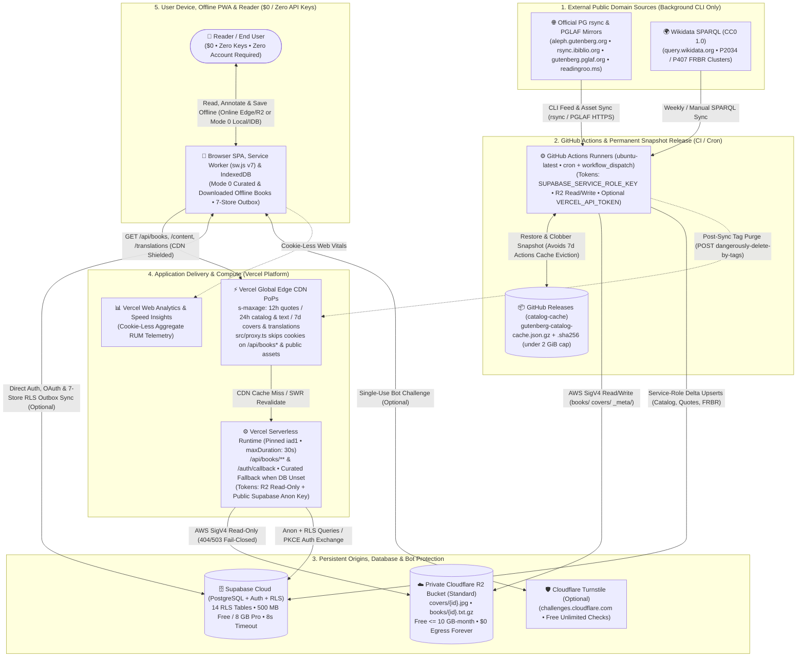

# Infrastructure, Hosting Tiers & Platform Guardrails — Bookarium

Canonical reference for **deployment environments**, **free vs. paid provider tiers and quotas**, and **hard platform coding guardrails** that human maintainers and AI coding agents must respect when modifying database queries, Edge caching, asset pipelines, or CI workflows.

> [!IMPORTANT]
> **Reader Experience vs. Operator Hosting**: Bookarium's reader experience is **100% free with zero registration and zero end-user API keys**. Infrastructure accounts, environment secrets, and storage quotas apply strictly to **developers and self-hosters** operating live online deployments.
>
> **Quota Verification Note**: External SaaS provider quotas and pricing numbers below are **approximate vendor benchmarks (verified November 2026)** and can change without notice—always verify live vendor pricing pages before scaling. Every **Repo Enforcement / Code Guardrail** cites verified active implementation files in this repository.

> **Related Documentation**:
> - Environment variable placement & OAuth / R2 setup steps: [**`DEVELOPMENT.md`**](../DEVELOPMENT.md) and [**`.env.example`**](../.env.example)
> - GitHub Actions triggers, schedules, secrets & `catalog-cache` snapshots: [**`docs/GITHUB_ACTIONS.md`**](GITHUB_ACTIONS.md)
> - 7-Gateway Quality Engine & ingestion pipeline telemetry: [**`docs/PIPELINE_GUIDE.md`**](PIPELINE_GUIDE.md)
> - System topology diagrams, cache hierarchy & security boundaries: [**`docs/ARCHITECTURE.md`**](ARCHITECTURE.md) and [**`SECURITY.md`**](../SECURITY.md)

---

## 1. Deployment Profiles at a Glance (`$0` Local Dev to Full `78,000+` Corpus)

| Deployment Profile | Target Audience | Required External Accounts | Approx. Monthly Cost | What Works & Key Constraints |
| :--- | :--- | :--- | :--- | :--- |
| **Mode 0 — Local Keyless Dev & Test Runner** | Contributors, UI reviewers, CI verification | **None** | **`$0`** | Runs `npm run dev` / `npm run dev:open`, bundled curated classics ([`src/lib/catalog/curated-fallback.ts`](../src/lib/catalog/curated-fallback.ts)), IndexedDB offline books ([`src/lib/offline-storage.ts`](../src/lib/offline-storage.ts)), all MSW v2 Vitest suites, and `npm run verify`. Uncached online `/api/books/content` text/cover calls fail closed cleanly (`503` / `404`). |
| **Mode 1 — Partial / Starter Self-Hosting** | Personal forks, staging demos, curated libraries | Vercel Hobby + Supabase Free + Cloudflare R2 Free + Public GitHub Repo *(Turnstile optional)* | **`$0`** *(strictly personal / non-commercial)* | Hosts the **complete `78,000+` metadata catalog** in Supabase PostgreSQL (`< 500 MB`, because full book texts live outside PostgreSQL) **plus** a curated or top-popular subset of `covers/<id>.jpg` & `books/<id>.txt.gz` seeded into R2 via `npm run r2:sync -- --limit=...` or `--ids=...` within R2's **`10 GB-month`** free storage cap. Subject to Supabase Free's **7-day inactivity pause**. |
| **Mode 2 — Full `78,000+` Corpus Production** | Full self-hosted public library | Vercel Hobby/Pro + Supabase Free/Pro + Cloudflare R2 Paid Standard + Public GitHub Repo *(Turnstile optional)* | **`~$0.25–$0.50/mo`** (R2 storage only on low-traffic personal hosts) up to **`~$45+/mo`** with Vercel Pro + Supabase Pro | Pre-seeding all **`78,000+`** gzipped texts and covers (`~25+ GB` estimated total) crosses R2's **`10 GB`** free storage quota (`~$0.015/GB-month` overage with **`$0` egress fees**). Upgrade to **Vercel Pro** for commercial/team hosting or higher transfer/compute budgets, and **Supabase Pro** for zero-pause SLA, automatic backups, `> 500 MB` DB, or `> 5 GB` DB egress. |

---

## 2. End-to-End Infrastructure-to-User Communication Topology

The diagram below traces how external public-domain sources, GitHub Actions background runners, persistent cloud origins (`Cloudflare R2` & `Supabase`), `Vercel` Edge/Serverless compute, and the user's `Browser PWA` communicate — including **where credentials live**, **which traffic bypasses origin compute via Edge CDN**, and **which requests flow directly from the browser**:

> [!NOTE]
> **Key Isolation Boundaries Shown Above**:
> - **Zero Runtime Project Gutenberg Traffic**: `VercelOrigin` and `BrowserPWA` **never** contact `PGMirrors` or `www.gutenberg.org` — only `GHActions` / local maintainer CLI runs read external mirrors.
> - **Dual-Token Least Privilege**: `VercelOrigin` holds a **Read-Only** Cloudflare R2 token and never holds `SUPABASE_SERVICE_ROLE_KEY`; only `GHActions` holds Read/Write R2 and `service_role` admin credentials.
> - **Direct vs. Edge-Proxied Browser Flows**: Anonymous catalog browsing, covers, plain-text streams, and FRBR translations flow through `EdgeCDN` (`12h`–`7d` `s-maxage`), whereas optional user sign-in and 7-store cloud synchronization connect directly from `BrowserPWA` to `SupaCloud` under strict Row Level Security (`(select auth.uid())`).

---

## 3. Provider Tiers, Quotas & Cost Drivers (Free vs. Paid)

### 3.1 Cloudflare R2 Object Storage (Primary Paid Threshold for Full Corpus)

Bookarium stores gzipped public-domain book texts (`books/<id>.txt.gz`), cover artwork (`covers/<id>.jpg`), and delta sync cooldown state (`_meta/r2-sync-state.json.gz`) in a **private Cloudflare R2 bucket** proxied exclusively through [`src/app/api/books/content/route.ts`](../src/app/api/books/content/route.ts) and [`src/lib/r2-client.ts`](../src/lib/r2-client.ts) (`r2.dev` public URLs disabled, zero runtime Project Gutenberg fallback).

| Metric | R2 Free Tier (Standard Storage) | R2 Paid Standard Overages *(Approx.)* | Primary Bookarium Cost Driver & Mitigation |
| :--- | :--- | :--- | :--- |
| **Storage Capacity** | **`10 GB-month` / month** | `~$0.015 / GB-month` | **#1 Paid Threshold**: Full `78,000+` corpus (`~25+ GB` combined) exceeds `10 GB`; partial `--limit` seeding fits Free Tier. |
| **Internet Egress Bandwidth** | **`$0` (Unlimited)** | **`$0` (Unlimited)** | Serving texts and covers from R2 to Vercel serverless routes or browsers incurs **zero egress fees**. |
| **Class A Operations** *(Writes, Lists, `PutObject`, `ListObjectsV2`)* | **`1,000,000` / month** | `~$4.50 / million` | Full bucket scan via `ListObjectsV2` (`scripts/sync-r2-assets.js`) consumes `~157` calls across `~78,000` keys; missing-asset cooldown (`90 days`) prevents weekly repeat probes. |
| **Class B Operations** *(Reads, `GetObject`)* | **`10,000,000` / month** | `~$0.36 / million` | Shielded upstream by Vercel Edge CDN (`s-maxage=604800` for covers, `s-maxage=86400` for plain text) + server 20-book LRU + client IndexedDB cache; manual `npm run r2:scan` content audits read `1` op per stored text (`< 0.8%` across 78k books; `0` under `--dry-run`). |
| **Deletes** | **Free** | **Free** | Pruning withdrawn/copyrighted objects via `DeleteObject` adds zero operation charges. |

> [!NOTE]
> **Storage Class Selection**: Keep the bucket on **Standard Storage** rather than Infrequent Access (Infrequent Access has **no free tier**, charges `$0.01/GB` retrieval fees on reads, imposes higher Class A/B rates, and enforces a 30-day minimum storage duration).

---

### 3.2 Supabase (PostgreSQL Database, Auth & Row Level Security)

Bookarium keeps PostgreSQL lean by storing structured catalog metadata (`public.books`), compact FRBR mappings (`public.book_translations`, `< 2.5 MB`), bounded literary quote spreads (`<= 564` active rows), and user library/social state (`supabase/schema.sql` across `14` RLS tables).

| Metric | Supabase Free (`$0/mo` Approx.) | Supabase Pro (`~$25/mo` per Org Approx.) | Operational Impact on Bookarium |
| :--- | :--- | :--- | :--- |
| **PostgreSQL Disk Size** | **`500 MB`** | **`8 GB` included** *(`~$0.125/GB` overage)* | Full `78k+` metadata + GIN indexes + translations fits inside `500 MB` **only** because unabridged book `.txt` files live in R2 and `public.books.quotes` is bounded to Top 500 + Rolling 64. |
| **Database Egress** | **`5 GB` uncached** + `5 GB` cached / mo | **`250 GB` included** *(`~$0.09/GB` overage)* | Protected by Vercel Edge CDN `s-maxage`, PostgREST `QUOTE_POOL_COLUMNS` 2-spread slicing (`~22 KB`/request), and weekly RAM snapshot diffing (`gutenberg-catalog-cache.json.gz` saving `~39 MB/week`). |
| **Compute & Memory** | Shared nano-class (~`500 MB` RAM); strict **`8s` SQL `statement_timeout`** | `$10/mo` compute credit included (covers Micro `1 GB` shared RAM baseline; dedicated/larger scales extra) | Heavy full-table sorts across `77,500+` tied zero-download rows time out at `8s` if queries violate Bookarium's B-Tree index rules. |
| **Inactivity Auto-Pause** | **Pauses after `7 days` inactivity** *(manual dashboard restore required)* | **Never pauses** | Scheduled Sunday `catalog-sync.yml` (`cron: 0 2 * * 0`) executes every `7 days`; completely idle personal Free instances risk pausing and require manual unpausing in Supabase Dashboard. |
| **Backups & Logs** | No automatic daily backups; `1-day` logs | Daily automatic backups; `7-day` logs | Production community sites with irreplaceable user annotations/fellowships should run Pro for backups. |
| **Auth MAUs & Storage** | `50,000` MAUs; `1 GB` file storage | `100,000` MAUs; `100 GB` file storage | Account deletion (`public.delete_current_user()`) also purges any user objects from `storage.objects`. |

---

### 3.3 Vercel (Next.js App Router, Edge CDN & Serverless Functions)

Bookarium pins serverless API functions to `iad1` (`us-east-1`, proximate to US East database/mirror endpoints) in [`vercel.json`](file:///d:/Proiecte/Bookarium/vercel.json) and relies heavily on multi-tier `Cache-Control: ... s-maxage=...` headers to serve catalog and cover traffic directly from Edge PoPs.

| Metric | Vercel Hobby (`$0` Approx.) | Vercel Pro (`~$20/mo/seat` Approx.) | Operational Impact on Bookarium |
| :--- | :--- | :--- | :--- |
| **License / ToS** | **Strictly personal, non-commercial use** | **Commercial, team & SaaS projects permitted** | Any commercial, monetized, or team-owned Bookarium instance must use Pro or self-host elsewhere. |
| **Fast Data Transfer (CDN Egress)** | **`100 GB` / month** | **`1 TB` / month** *(metered overages)* | Cover JPEGs (`<= 2 MB` cap) and plain texts stream through `/api/books/content`; high traffic volumes scale directly against CDN egress. |
| **Fast Origin Transfer (Compute -> CDN)** | **`10 GB` / month** | Included Pro allowance *(higher)* | Edge cache hits (`s-maxage`) and short `Vary` headers are mandatory to avoid burning Origin Transfer on repeated misses. |
| **Serverless Duration & Memory** | Modern Fluid Compute **`2 GB / 1 vCPU`** default allocation (non-customizable), **`300s`** max duration | Customizable CPU/memory, **`800s`** Fluid Compute max *(beta up to `1,800s`)* | Bookarium explicitly sets `"maxDuration": 30` in [`vercel.json`](file:///d:/Proiecte/Bookarium/vercel.json) (`src/app/api/books/route.ts`: `30s`; `src/app/api/books/translations/route.ts`: `15s`) so hung upstreams fail fast. |
| **Vercel Crons** | **Once per day max** *(sub-daily crons rejected at deploy)* | Minute-level crons (`100` crons/project) | Bookarium uses **zero Vercel crons**—scheduled weekly sync runs on GitHub Actions (`catalog-sync.yml`), bypassing Vercel cron limits completely. |
| **Image Optimization (`/_next/image`)** | **`5,000` transforms / mo**, `300k` reads, `100k` writes | Usage-based metered past included pool | Bookarium sets `images: { remotePatterns: [] }` in [`next.config.ts`](file:///d:/Proiecte/Bookarium/next.config.ts) and serves pre-sized R2 JPEGs directly via `/api/books/content?type=cover` (`0` Vercel Image Optimizer usage). |

> [!TIP]
> **Optional Vercel Web Analytics & Speed Insights**: [`src/app/layout.tsx`](file:///d:/Proiecte/Bookarium/src/app/layout.tsx) mounts `@vercel/analytics/react` and `@vercel/speed-insights/next` for cookie-less aggregate Core Web Vitals telemetry on Vercel deployments. Check your Vercel plan's included monthly events/data-points allowance before high-traffic launches.

---

### 3.4 GitHub Actions & GitHub Releases (CI/CD & Data Sync Pipelines)

All `11` automation pipelines (`.github/workflows/*.yml`, documented in full in [`docs/GITHUB_ACTIONS.md`](GITHUB_ACTIONS.md)) run on GitHub-hosted Ubuntu runners rather than consuming Vercel compute.

| Resource | Public Repository (GitHub Free) | Private Repository / Fork (GitHub Free) | Bookarium Architecture Adaptation |
| :--- | :--- | :--- | :--- |
| **GitHub-Hosted Runners (`ubuntu-latest`)** | **Free & unlimited minutes** | **`2,000` minutes / month** *(metered overages)* | Keep [`catalog-tag-sync.yml`](../.github/workflows/catalog-tag-sync.yml), [`cache-purge.yml`](../.github/workflows/cache-purge.yml), and [`r2-content-scan.yml`](../.github/workflows/r2-content-scan.yml) at zero `npm ci` (`~5s`); bound workflows (`ci.yml`/`release.yml`: `25m`, `catalog-sync.yml`/`r2-content-scan.yml`: `60m`, `r2-sync.yml`: `90m`). |
| **GitHub Actions Dependency Cache** | **`10 GB` per repo**; **7-day LRU eviction** | **`10 GB` per repo**; **7-day LRU eviction** | Never store `gutenberg-catalog-cache.json.gz` in Actions cache alone—7-day eviction could race weekly Sunday runs. Store snapshots in permanent **`catalog-cache` GitHub Releases** instead. |
| **GitHub Releases Assets** | **Under `2 GiB` per file**; `1,000` assets/release; unlimited downloads | Same per-file **`2 GiB`** & `1,000` assets cap; `500 MB` Packages/Artifacts storage | `gutenberg-catalog-cache.json.gz` (`~4.5–6.4 MB`) + `.sha256` sidecar sit orders of magnitude under the `2 GiB` Release file ceiling. |

---

### 3.5 Cloudflare Turnstile & External Public Data Feeds

| Service | Quota / Limit Summary | Repo Usage & Constraints |
| :--- | :--- | :--- |
| **Cloudflare Turnstile (Free Tier)** | `20` widgets / account, `10` hostnames / widget, **unlimited challenge verifications**, `7-day` analytics lookback *(Enterprise required past `20` widgets)* | Optional bot shield enabled only when `NEXT_PUBLIC_TURNSTILE_SITE_KEY` is configured (`AuthModal`, `EmailSentView`, `/account` recovery). |
| **Official Project Gutenberg Mirrors & `rsync`** | Respect upstream volunteer mirror bandwidth (`aleph.gutenberg.org` ↔ `rsync.ibiblio.org` `rsync`, `gutenberg.pglaf.org`, `aleph.gutenberg.org`, `gutenberg.readingroo.ms`) | Strictly confined to background CLI scripts (`sync-gutenberg-catalog.js`, `sync-r2-assets.js`, `sync-featured-quotes.js` with `8.0s–16.0s` pacing & `User-Agent` contact attribution); **strictly banned** from `src/**` runtime (`www.gutenberg.org` banned everywhere). |
| **Wikidata SPARQL Endpoint (`CC0 1.0`)** | Public query endpoint (`query.wikidata.org`) rate/timeout etiquette | Queried weekly/manually only in CLI `npm run translations:sync` (`scripts/ingest-translations.js`) with offline snapshot fallback. |

---

## 4. Hard Platform Coding Guardrails (Maintainers & AI Agents)

Every rule below maps directly to real platform ceilings. Violating these constraints risks `8s` PostgreSQL crashes, monthly Supabase egress exhaustion, Vercel origin/image billing spikes, R2 Class A/B overages, or Project Gutenberg ToS blocks.

### Guardrail 1 — Supabase `500 MB` Disk & `8s` `statement_timeout` Invariants
- **Never store full book texts in `public.books.content` at 78k scale**: Keep the optional `content` column sparse/empty in production and route unabridged `.txt.gz` objects (`MAX_R2_BOOK_BYTES = 15 MB`) strictly through private Cloudflare R2 (`src/lib/r2-client.ts`).
- **Keep `public.books.quotes` bounded**: `scripts/sync-featured-quotes.js` caps the JSONB spread pool at **Top `500` Popular + Rolling `64` Most Recent** (`<= 564` rows, `~2 MB` total) and prunes out-of-window surplus (`DEFAULT_MAX_PRUNE_PER_RUN = 2000`).
- **Never emit compound SQL `ORDER BY download_count DESC, id ASC`**: Across `78,000+` rows (`77,500+` tied at `download_count = 0`), chaining `.order('id')` forces PostgreSQL past its `8s` `statement_timeout` (`src/lib/catalog/supabase-provider.ts`). Sort ties deterministically **in JavaScript memory**.
- **Never pair `.neq('quotes', '[]')` with `download_count DESC` without PK bounds**: Either query via `books_pkey` chunks (`.in('id', chunk).neq('quotes', '[]')`) or use partial index `idx_books_with_quotes_popular` (`supabase/schema.sql`).
- **Preserve trigger & offset shields**: Keep `IS DISTINCT FROM` inside `public.books_search_vector_trigger()` so `download_count`-only weekly updates do not re-index `idx_books_search_vector`, and keep `MAX_CATALOG_OFFSET = 160_000` plus narrow column projections (`CATALOG_METADATA_COLUMNS`, `QUOTE_POOL_COLUMNS` slicing `quote0`/`quote1` at `DEFAULT_QUOTE_POOL_LIMIT = 48` `~22 KB`).
- **Avoid double-scan counts and timeout retry storms**: Keep `{ count: 'planned' }` on selective filtered searches (`search`, `topic`, `languages`, `authorYearStart`, `authorYearEnd`), omit `{ count }` on `backfillQuery` chunks (`{ includeCount: false }`), preserve `idx_books_author_birth_year` + `idx_books_author_death_year` for era filters, and fail fast with `HTTP 504` (`no-store`) without retrying `SQLSTATE 57014` (`isStatementTimeoutError` in `src/lib/catalog/supabase-provider.ts`, `/api/books/route.ts`, and `shouldRetryCatalogQuery` in `src/hooks/queries/useBooks.ts`).

### Guardrail 2 — Vercel Edge CDN `s-maxage`, Cookie Bypass & Transfer Protection
- **Keep public API and prefetch traffic cookie-free (`src/proxy.ts`)**: Never invoke `updateSession` or attach `Set-Cookie` headers on `/api/books*`, `/auth/*`, `/sw.js`, `/manifest.webmanifest`, prefetch headers, or non-`/account` App Router `rsc=1` navigations (`shouldSkipSessionRefresh`). Attaching cookies or `x-middleware-override-headers` unnecessarily busts Vercel Edge caching and multiplies Supabase database egress and Vercel Fast Origin Transfer. Enforce browser deeplink/cross-site hotlink isolation (`guardContentAssetRequest` -> `403 no-store` on `Sec-Fetch-Dest: document|iframe|frame|embed|object|fencedframe`, `Sec-Fetch-Mode: navigate`, or `Sec-Fetch-Site: cross-site` outside `type=card`) at `src/proxy.ts` and `/api/books/content` **without** adding `Sec-Fetch-*` or `Referer` to `Vary` or introducing per-user signed URL tokens so shared `s-maxage` Edge keys and R2 Class B budgets stay unfragmented.
- **Preserve tiered `Cache-Control`, tight `Vary`, `Vercel-Cache-Tag`, and fail-closed `no-store`**:
  - `GET /api/books?pool=quotes`: `s-maxage=43200` (`12h`), `Vary: Accept-Encoding`, `Vercel-Cache-Tag: quotes`.
  - `GET /api/books` (jurisdiction-independent ID+quote lookup): `s-maxage=604800` (`7d`), `Vary: Accept-Encoding`.
  - `GET /api/books` (standard jurisdiction-filtered catalog): `s-maxage=86400` (`24h`), `Vary: x-vercel-ip-country, cf-ipcountry, x-bookarium-country, Accept-Encoding`, `Vercel-Cache-Tag: catalog` (`catalog,quotes` when `hasQuotes`).
  - `GET /api/books/content` plain text & `type=card`: `s-maxage=86400` (`24h`), `Vary: x-vercel-ip-country, Accept-Encoding`, `Vercel-Cache-Tag: book-content` on plain text (`type=card` and `no-store` errors untagged).
  - `GET /api/books/content?type=cover`: `s-maxage=604800` (`7d`), `Vary: Accept-Encoding`, `Vercel-Cache-Tag: covers`.
  - `GET /api/books/translations`: `s-maxage=604800` (`7d`), `Vary: x-vercel-ip-country`, `Vercel-Cache-Tag: translations`, `maxDuration = 15`.
  - Error responses (`400`, `404`, `451`, `500`, `502`, `503`) and local `source: 'cache'` fallback responses MUST emit `Cache-Control: no-store, max-age=0` (`createNoStoreErrorResponse`) so Edge PoPs never cache outage payloads.
- **Keep post-sync tag invalidation intact**: Run `scripts/purge-vercel-cache.js` cleanly (`exit 0` skip when `VERCEL_*` secrets are absent) whenever live Supabase catalog/quote/translation writes finish or `r2-sync.yml`/`catalog-sync.yml` emits conditional `covers`/`book-content` purge tags (on deletions or `--force` overwrites).

### Guardrail 3 — Serverless Memory Caps, Ephemeral Isolates & Image Bypass
- **Treat serverless RAM state as per-isolate protection, not global shared storage**: `bookContentLruCache` (`MAX_CACHED_BOOKS = 20`, `MAX_CACHEABLE_BOOK_CHARS = 1_800_000`, `24h` TTL in `src/app/api/books/content/metadata-cache.ts`) and `InMemoryRateLimiter` (`maxKeys = 10_000` anchored on `globalThis` in `src/lib/rate-limiter.ts`) prevent isolate OOMs and single-instance floods, while CDN caching shields origin across isolates.
- **Keep covers off Vercel Image Optimization (`/_next/image`)**: Preserve `images: { remotePatterns: [] }` in `next.config.ts` and serve bounded JPEGs (`MAX_R2_COVER_BYTES = 2 MB`, `MAX_R2_BOOK_BYTES = 15 MB`) via `/api/books/content?type=cover`.

### Guardrail 4 — R2 Class A/B Budgets, GitHub Runner Ceilings & Custom WAF Warnings
- **Preserve `_meta/r2-sync-state.json.gz` `90-day` missing-asset cooldown & checkpoint safety**: `scripts/sync-r2-assets.js` uses ~157 `ListObjectsV2` calls to audit the entire bucket in seconds, caches confirmed-missing covers/texts (`DEFAULT_MISSING_RECHECK_DAYS = 90`) using race-safe remote union merges + `try ... finally` state flushes and bounded parallel R2 `PutObject` workers (`DEFAULT_R2_PUT_CONCURRENCY = 8`, keeping `rsync` single-stream per PG etiquette), and refuses to overwrite `_meta/r2-sync-state.json.gz` if the initial read fails or transport errors abort a batch. Never bypass this cooldown by default or re-probe all missing IDs on weekly cron runs.
- **Keep bulk snapshots out of Actions cache & runtime out of PG**: Maintain `gutenberg-catalog-cache.json.gz` (`~4.5–6.4 MB` vs `2 GiB` Release limit) inside the `catalog-cache` GitHub Release, enforce `MIN_ACTIVE_CATALOG_FOR_PRUNE = 50_000` before catalog/R2 pruning, keep zero-runtime PG checks active (`enforce-gutenberg-and-copyright-policy`), and preserve explicit workflow `timeout-minutes` bounds (`5m–90m`).

> [!WARNING]
> **Vercel Edge Rate Limiting vs. Cloudflare Proxy WAF Caution**: Because origin [`src/lib/rate-limiter.ts`](../src/lib/rate-limiter.ts) runs only on CDN cache misses, pair [`src/proxy.ts`](../src/proxy.ts) Fetch Metadata anti-deeplink checks (`guardContentAssetRequest`) with a **Vercel Firewall IP Rate Limit rule** on `/api/books/content` to throttle automated script bursts on warm CDN hits without altering `Vary` or `s-maxage`. If you host Bookarium behind a custom Cloudflare-proxied domain, **do not enable Bot Fight / Under Attack / Interactive Challenge modes** on `/api/books*`, `/sw.js`, or PWA chunks. Challenge interstitials inject `200 text/html` pages that break browser JSON `fetch()` calls and Service Worker offline caching (checked defensively by `isHtmlPayload` in `src/lib/r2-client.ts`).
