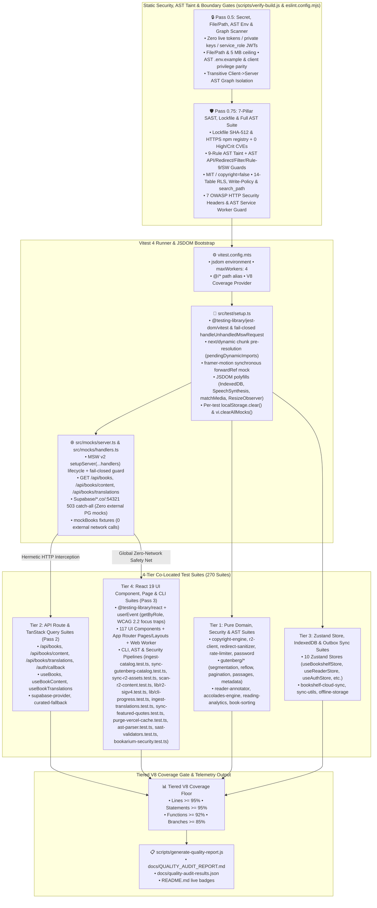

# Testing Pipeline, Repository Topology, AST Call Graph & Node Tooling — Bookarium

> **Auto-Generated Living Architecture Slice** • [← Back to Architecture Hub](../ARCHITECTURE.md)  
> **Last Synchronized**: `2026-11-24`  
> **Topology Health**: `262` Modules Analyzed • `1108` Static Linkages • `0` Circular Dependencies • `0` Layer Violations • `0` Orphaned Modules

---

## 🧪 Hermetic Testing, MSW v2 Network Isolation & Coverage Architecture

Bookarium enforces a 4-tier hermetic testing and security verification architecture across **270 Test Suites** (`258` co-located `src/**/*.test.{ts,tsx}` suites + `12` CLI pipeline suites in `scripts/`) with zero external network calls:

### 1. Hermetic Testing, MSW v2 Interception, SAST/OWASP & V8 Coverage Pipeline

### 2. Test Harness & Interception Primitives Matrix

| Test Harness Module | Source File | Testing Layer | Architectural Responsibility |
| :--- | :--- | :--- | :--- |
| **`setup`** | [`src/test/setup.ts`](../../src/test/setup.ts) | JSDOM & Browser API Test Bootstrap | Global Vitest setup bootstrapping `@testing-library/jest-dom/vitest`, fail-closed MSW v2 server lifecycle (`handleUnhandledMswRequest`, `resetHandlers`, `close`), pre-test `next/dynamic` chunk resolution (`pendingDynamicImports`), `localStorage` sanitization, and deterministic JSDOM polyfills (`matchMedia`, `ResizeObserver`, `IntersectionObserver`, `scrollTo`, `SpeechSynthesis`, `IndexedDB`). |
| **`handlers`** | [`src/mocks/handlers.ts`](../../src/mocks/handlers.ts) | MSW v2 HTTP Interception Handlers | Canonical Mock Service Worker v2 HTTP request handlers, fail-closed `handleUnhandledMswRequest` guard (blocking unmocked external/PG/Supabase URLs and same-origin `/api/*` calls), hosted `*.supabase.co` & local `:54321` `(rest|auth|storage|realtime|functions|graphql)/v1` 503 catch-alls, and `mockBooks` fixtures intercepting `/api/books`, `/api/books/content`, and `/api/books/translations` for zero-network deterministic testing. |
| **`server`** | [`src/mocks/server.ts`](../../src/mocks/server.ts) | MSW v2 Node Server Instance | Node.js `setupServer(...handlers)` singleton providing hermetic request interception across all unit and integration test suites. |
| **`vitest.config.mts`** | [`vitest.config.mts`](../../vitest.config.mts) | Vitest Runner & Tiered V8 Coverage Engine (95/95/92/85) | Vite-native test runner configuration (`jsdom`, `maxWorkers: 4`, `@` path alias) enforcing the hard tiered V8 coverage floor (`lines: 95%`, `statements: 95%`, `functions: 92%`, `branches: 85%`) while excluding non-executable type contracts and barrels. |
| **`bookarium-security.test.ts`** | [`scripts/eslint-rules/bookarium-security.test.ts`](../../scripts/eslint-rules/bookarium-security.test.ts) | AST & Request-Taint Security Suite | Unit & codebase-wide AST verification tests for all 9 `bookarium-security` ESLint rules and intra-procedural request + CLI `process.argv` taint analysis (`Sources -> Sanitizers -> Sinks`, Node `https.get`/`http.get`, and `scripts/` `{ shell: true }` guards). |
| **`ingest-catalog.test.ts`** | [`scripts/ingest-catalog.test.ts`](../../scripts/ingest-catalog.test.ts) | CLI Data Pipeline Test Suite | Hermetic unit tests verifying `ingest-catalog.js` URL/User-Agent resolvers, `CURATED_CLASSICS` SQL seed generation, `computeLifespanBounds`, `--with-content` deprecation behavior, and pure SQL helpers without running the CLI entrypoint. |
| **`ingest-translations.test.ts`** | [`scripts/ingest-translations.test.ts`](../../scripts/ingest-translations.test.ts) | CLI Data Pipeline Test Suite | Hermetic unit & integration tests verifying Wikidata SPARQL `45,000ms` socket timeouts (`WIKIDATA_SPARQL_TIMEOUT_MS`), FRBR work clustering, 5 Pipeline Blockers, 7 Hardening Defenses, strict/empty-catalog FK validation (`filterValidCatalogBookIds`), retry/bisected `upsertTranslationBatchesWithRetry` batches, and SQL seed generation. |
| **`ast-parser.test.ts`** | [`scripts/lib/ast-parser.test.ts`](../../scripts/lib/ast-parser.test.ts) | AST & SQL Analysis Engine Suite | Hermetic fixture & live-repo tests verifying Babel AST dependency graphs, `hasCycles` static circular detection, fail-closed `getAstParseErrors`, architectural `detectLayerViolations`, inherited/intersected `Props` extraction, AST `persist` key & HTTP verb resolution, balanced `extractSqlSchemaEntities` parsing, un-truncated `extractTestsFromSourceAst`, and linear Mermaid syntax/cycle/arrow-chain validation (`validateMermaidDiagramsInMarkdown`). |
| **`cli-progress.test.ts`** | [`scripts/lib/cli-progress.test.ts`](../../scripts/lib/cli-progress.test.ts) | Shared CLI Progress Telemetry Suite | Hermetic unit tests verifying `scripts/lib/cli-progress.js` TTY/CI detection (`GITHUB_ACTIONS`, `CI`, `isTTY`), width-padded `\r` overwrites, throttled CI newline checkpoints (`ciIntervalMs` / `ciPercentStep`), atomic `logEvent()` clearing, `--json` quiet mode, and `formatDuration` / `formatEtaSuffix`. |
| **`r2-sigv4.test.ts`** | [`scripts/lib/r2-sigv4.test.ts`](../../scripts/lib/r2-sigv4.test.ts) | Shared R2 SigV4 Transport Test Suite | Hermetic unit tests verifying `scripts/lib/r2-sigv4.js` strict R2 config validation, `isAllowedR2EndpointUrl` anti-SSRF guards, AWS SigV4 signatures, `CWE-116` single-pass XML entity decoding, paginated `listR2PrefixKeys`/`listR2PrefixIds` (`onPage` callbacks), bounded `.txt.gz` decompression (`fetchR2GzippedText`, `fetchBookTextFromR2`), `runWithConcurrency`, and Markdown summary cell escaping. |
| **`sast-validators.test.ts`** | [`scripts/lib/sast-validators.test.ts`](../../scripts/lib/sast-validators.test.ts) | Stateless SAST Validator Suite | Positive live-repo, refactor-resilience, and adversarial negative AST/SCA fixture suites exercising `validateNextConfigSecurityHeadersAst`, `validateNextBuildHeaderManifest`, `validatePackageLockAndLifecycle` (`BANNED_PACKAGE_LICENSES`), `validateGitHubWorkflowSecurity`, `validateServiceWorkerSecurity`, `validateEnvAndPrivilegeBoundariesAst`, `validateApiRoutesSecurityAst`, `validateRedirectRoutesAst`, `validatePublicDomainFilterAst`, `validateRule9AuthStoreParityAst`, and `validateLiveHttpSecurityResponse` (`scripts/lib/sast-validators.js`). |
| **`purge-vercel-cache.test.ts`** | [`scripts/purge-vercel-cache.test.ts`](../../scripts/purge-vercel-cache.test.ts) | CLI Data Pipeline Test Suite | Hermetic unit tests verifying Vercel Edge cache tag purging (`parsePurgeCliArgs`, `buildVercelCachePurgeUrl`, `appendPurgeStepSummary`, `purgeVercelEdgeCache`), `VERCEL_API_TOKEN` / `VERCEL_PROJECT_ID` / optional `VERCEL_TEAM_ID` handling, clean skip behavior (`exit 0`), `429`/`Retry-After`/`5xx` retry backoff, and `$GITHUB_STEP_SUMMARY` reporting. |
| **`scan-r2-content.test.ts`** | [`scripts/scan-r2-content.test.ts`](../../scripts/scan-r2-content.test.ts) | CLI R2 Content Audit Test Suite | Hermetic unit & integration tests verifying `scan-r2-content.js` CLI allowlisting (`--prefix`, `--terms`, `--ids`, `--concurrency`, `--max-matches`, `--max-minutes`, `--fail-on-match`, `--dry-run`), graceful unconfigured skip vs partial fail-fast, zero-Class-B `--dry-run` inventory, linear ReDoS-safe `indexOf` scanning, CI throttled progress heartbeats, live `[MATCH]` alerts, capped inline read errors, pure `--json` mode, snippet control-char/pipe sanitization, corrupt-gzip isolation, `shouldFailR2ScanRun`, and `$GITHUB_STEP_SUMMARY` reporting. |
| **`sync-featured-quotes.test.ts`** | [`scripts/sync-featured-quotes.test.ts`](../../scripts/sync-featured-quotes.test.ts) | CLI Data Pipeline Test Suite | Hermetic unit & integration tests verifying R2-first `books/<id>.txt.gz` quote extraction ahead of PG mirror failover (`fromR2`, `Cloudflare R2` summary telemetry), Two-Tier Bounded Quote Pool blending (`Top 500 Popular + Rolling 64 Most Recent`, `40 + 10` split with backfill), `--diff-file=quote-diff.json` zero-scan pool consumption, partial-index out-of-window discovery (`fetchAllQuotedBookIds`), Option-A `1-for-1` pruning up to `2,000` (`computeOutOfWindowPrunePlan`, `--max-prune`, `50ms` inter-chunk yield), `shouldFailFeaturedQuotesRun` infra failure gating, console progress & Markdown summary reporting, per-mirror PG workers (`gutenberg.pglaf.org`, `aleph.gutenberg.org`, `gutenberg.readingroo.ms`), and `public.books.quotes` JSONB upserts. |
| **`sync-gutenberg-catalog.test.ts`** | [`scripts/sync-gutenberg-catalog.test.ts`](../../scripts/sync-gutenberg-catalog.test.ts) | CLI Data Pipeline Test Suite | Hermetic unit & integration tests verifying PGLAF-first `rdf-files.tar.bz2` and `pg_catalog.csv.gz` streaming decompression, `--feed-source` host pinning, `isHtmlContentType` outage rejection, wire `SHA-256` digest computation + `Content-Length`/non-zero `tar` truncation fail-closed checks, RDF `<dcterms:rights>` copyright tagging (`isRdfCopyrightedNotice`, `parseRdfCatalogSignalsStream`), `reconcileBatchWithoutRdfRights` RDF-outage copyright preservation & brand-new deferral, CSV RFC 4180 parsing, author lifespan extraction, `.sha256`-verified (`crypto.timingSafeEqual`) in-RAM `--cache-file=gutenberg-catalog-cache.json.gz` snapshot diffing and `--diff-output=quote-diff.json` emission (`hasCatalogMetadataChanged`, `filterChangedOrNewBooks` preserving `quotes` & cached `copyright`), withdrawn-book reconciliation (`reconcileWithdrawnCatalogBooks`), `$GITHUB_STEP_SUMMARY` digest logging, and sticky dynamic Supabase batch upserts. |
| **`sync-r2-assets.test.ts`** | [`scripts/sync-r2-assets.test.ts`](../../scripts/sync-r2-assets.test.ts) | CLI Data Pipeline Test Suite | Hermetic unit & integration tests verifying `sync-r2-assets.js` strict `assertValidR2ConfigIfPresent` partial/malformed config rejection vs zero-secret skip, AWS SigV4 `ListObjectsV2`/`GetObject`/`PutObject`/`DeleteObject` signing, single-pass `XML_ENTITY_MAP` XML entity decoding (`CWE-116` safe), read-fail state protection + race-safe `mergeR2SyncStates` + `try ... finally` state flushes, 90-day missing-asset TTL pruning, `--rsync-host` (`resolveRsyncHostOrder` / `buildRsyncSourcesForOrder`), multi-host `aleph.gutenberg.org` ↔ `rsync.ibiblio.org` `runRsyncCommandWithRetry` failover & `isRsyncTransportError`, `runWithConcurrency`, `--catalog-source`, `--purge-tags-file`, `shouldFailR2SyncRun`, `PRIORITY_HERO_BOOK_IDS` + `download_count DESC` prioritization, strict `copyright !== true` exclusion, `50,000`-row withdrawn safety floor, and bounded `$GITHUB_STEP_SUMMARY` tables. |

### 3. Architectural Layer Test Suite Distribution (270 Suites)

| Architectural Layer | Target File Scope | Co-Located Suites | Verified Assertions | Hermetic & Security Testing Strategy |
| :--- | :--- | :--- | :--- | :--- |
| **App Router Pages, Layouts & API Routes** | `src/app/**/*.test.{ts,tsx}` | `31` | `321` | NextRequest/NextResponse edge route verification, fail-closed R2/DB outage testing, SSR metadata, and full-page user journeys. |
| **React 19 UI & Presentation Components** | `src/components/**/*.test.tsx` | `117` | `1034` | `@testing-library/react` + `userEvent` accessible role assertions (`getByRole`), WCAG 2.2 focus trapping, confirmation modals, and viewport interaction parity. |
| **Zustand Persistent State Stores** | `src/stores/*.test.ts` | `10` | `242` | Local storage hydration, optimistic outbox mutations, tombstone filtering, LWW conflict resolution, per-user in-flight coalescing (`coalesceInFlightByUser`), pre-sync active JWT session verification (`verifyActiveCloudSession`), batched multi-book `reading_progress` upserts, and 10-store session teardown. |
| **Custom Hooks & TanStack Queries** | `src/hooks/**/*.test.{ts,tsx}` | `36` | `351` | `renderHook` with `QueryClientProvider` + MSW v2 network interception, IndexedDB offline-first reads, Web Speech TTS, and reading ledger hydration. |
| **Domain Engines, Security Primitives & Gutenberg AST** | `src/lib/**/*.test.ts` | `48` | `554` | Pure computational & security verification (multi-jurisdictional copyright, R2 SigV4 endpoint & SSRF guards, open-redirect sanitizer, rate limiter, Gutenberg AST segmentation/reflow/pagination, interval annotator). |
| **Configuration, Anthologies & Design Tokens** | `src/config/*.test.ts` | `13` | `58` | Schema integrity, curated 27-masterwork anthology lifespan validation, 12-hour sliding-cache hero/editorial boundary guards (`FEATURED_HERO_ID_SET`, `toFallbackHeroWithRawBook`), and theme/accolade token invariants. |
| **Background Web Worker & Edge Reverse Proxy** | `src/workers/*.test.ts` & `src/proxy.test.ts` | `2` | `16` | Off-thread Web Worker message lifecycle (`PARSE_BOOK`) and Edge Geo-IP / cookie / Supabase session refresh proxy tests. |
| **Hermetic Network Mocks & Test Interception** | `src/mocks/*.test.ts` | `1` | `4` | Fail-closed MSW v2 request/response handler unit contracts, internal route fixtures, and Supabase 503 safety-net verification (`src/mocks/handlers.test.ts`). |
| **CLI Data Ingestion Pipelines & AST Security Rules** | `scripts/**/*.test.ts` | `12` | `198` | Hermetic `pg_catalog.csv.gz` & `rdf-files.tar.bz2` streaming decompression (PGLAF-first failover, `--feed-source` pinning, `<dcterms:rights>` extraction & HTML outage rejection), RFC 4180 CSV parsing, in-RAM `gutenberg-catalog-cache.json.gz` snapshot diffing, Cloudflare R2 `ListObjectsV2` / `rsync --files-from` / PGLAF HTTPS delta asset sync (`_meta/r2-sync-state.json.gz`, copyright/withdrawn pruning, bounded `$GITHUB_STEP_SUMMARY` tables), shared zero-dependency R2 SigV4 helpers (`r2-sigv4.test.ts`), TTY/CI-aware CLI progress telemetry (`cli-progress.test.ts`), & read-only `.txt.gz` integrity scanning (`scan-r2-content.test.ts`), `quote-diff.json` hand-off, R2-first + PGLAF mirror-first featured quotes extraction, Wikidata SPARQL FRBR translation clustering, Babel AST / SQL contract & layer-boundary checks (`ast-parser.test.ts`), stateless SAST validator checks (`sast-validators.test.ts`), and 9-rule ESLint AST & request-taint security verification. |

---

## 🗂️ Repository Directory & Living Documentation Topology Map

### 1. Structural Directory Map

| Workspace Path | Architectural Layer & Contents |
| :--- | :--- |
| **`src/app/`** | Next.js 16 App Router pages, SSR layouts, metadata routes (`manifest.ts`, `robots.ts`, `sitemap.ts`), global providers (`providers.tsx`), and serverless API route handlers (`/api/books/**`, `/auth/callback`). |
| **`src/components/`** | 117 production React 19 UI components & motion config primitives organized across `account/`, `accolades/`, `auth/`, `bookshelf/`, `motion/`, `presentation/` (including `bookshelf/`), `profile/`, `pwa/`, `reader/`, `symposium/`, and `ui/`, each paired with co-located `*.test.{ts,tsx}` suites. |
| **`src/stores/`** | 10 Zustand client-side state stores (`useBookshelfStore`, `useReaderStore`, `useAuthStore`, `useFellowshipStore`, `useAnnotationStore`, `useAccoladesStore`, `useHabitsStore`, `useJurisdictionStore`, `usePreferencesStore`, `useThemeStore`) with `localStorage` persistence and bi-directional Supabase cloud outbox synchronization. |
| **`src/hooks/`** | 36 custom React hooks organized into `queries/` (TanStack Query v5 data fetching), `reader/` (Web Speech TTS, session coordinates, gestures, worker AST, reading ledger), and root UI/network/copyright hooks (`useNetworkStatus`, `useOfflineBooks`, `useBookCopyright`, `useCatalogFilters`, `useCollectionAutoHeal`). |
| **`src/lib/`** | 53 domain computational engines, App Router route helpers, and adapters covering Gutenberg AST segmentation/pagination/reflow (`gutenberg/`), authoritative Supabase & bundled curated-fallback catalog resolution (`catalog/`), Cloudflare R2 S3 SigV4 storage (`r2-client.ts`), Supabase SSR/browser clients (`supabase/`), multi-jurisdictional copyright (`copyright-engine.ts`), IndexedDB storage (`offline-storage.ts`), interval annotation partitioning (`reader-annotator.ts`), cloud bookshelf sync (`bookshelf-cloud-sync.ts`), and co-located `src/app/**` server route utilities (`metadata-cache.ts`, `reader-layout-utils.ts`, `profile-layout-utils.ts`). |
| **`src/config/`** | 13 centralized design token, routing, theme, language, era, literary quote, and 27-masterwork curated anthology configuration modules. |
| **`src/types/`** | 4 canonical TypeScript type contract modules (`book.types.ts`, `database.types.ts`, `catalog.types.ts`, `accolades.types.ts`) defining zero-any domain and PostgreSQL row schemas. |
| **`src/workers/`** | Dedicated off-thread Web Worker (`gutenberg.worker.ts`) executing Gutenberg plain-text segmentation and virtual page layout calculations. |
| **`src/mocks/ & src/test/`** | Hermetic MSW v2 Node interception server (`server.ts`, `handlers.ts`, `handlers.test.ts`, fail-closed `handleUnhandledMswRequest`) and JSDOM test environment bootstrap (`setup.ts`). |
| **`public/`** | Progressive Web App Service Worker (`public/sw.js` `v7`) and multi-resolution soaring open book brand emblem icons (`favicon.ico`, `icon.svg`, `public/icons/*.png`). |
| **`supabase/`** | Idempotent PostgreSQL schema (`schema.sql`) with 14 tables, 47 RLS policies, 9 functions/triggers, and 22 explicit indexes, plus offline SQL seeds (`seed_books.sql`, `seed_translations.sql`). |
| **`scripts/`** | 22 Node.js CLI automation, Babel AST documentation compilation (`lib/ast-parser.js`), stateless SAST verification (`lib/sast-validators.js`), shared zero-dependency R2 SigV4 transport (`lib/r2-sigv4.js`), TTY/CI progress telemetry (`lib/cli-progress.js`), custom ESLint AST & request-taint security rules (`eslint-rules/bookarium-security.js`), 7-Gateway verification (`verify-build.js`), Gutenberg catalog streaming (`sync-gutenberg-catalog.js`), Cloudflare R2 delta syncing & read-only content scanning (`sync-r2-assets.js`, `scan-r2-content.js`), R2-first featured quotes extraction (`sync-featured-quotes.js`), and Wikidata FRBR translation clustering (`ingest-translations.js`) tools, plus offline authority cache (`scripts/data/`) and CLI test suites. |
| **`docs/`** | Living architectural hub (`ARCHITECTURE.md`) + 7 modular subsystem docs in `docs/architecture/`, 86 Architecture Decision Records (`DECISIONS.md`), AST-compiled parser & behavioral contract specifications (`GUTENBERG_PARSER.md`, `SYSTEM_CONTRACTS.md`), CI/CD runbook (`PIPELINE_GUIDE.md`), GitHub Actions operator runbook (`GITHUB_ACTIONS.md`), infrastructure tiers & platform guardrails guide (`INFRASTRUCTURE.md`), and live 7-Gateway quality telemetry (`QUALITY_AUDIT_REPORT.md`, `quality-audit-results.json`). |
| **`.github/workflows/ & .husky/`** | Automated GitHub Actions CI/CD, security scanning & release publisher (`ci.yml`, `codeql.yml`, `dependency-review.yml`, `release.yml`, all 40-char commit-SHA pinned), unified Sunday sequential catalog/R2/translation/quote ingestion (`catalog-sync.yml` with permanent `catalog-cache` GitHub Release snapshot & `quote-diff.json` handoff), automated `catalog-cache` Git tag advancement (`catalog-tag-sync.yml`), on-demand manual maintenance, R2 backfill, R2 content scan & cache purge workflows (`r2-sync.yml`, `r2-content-scan.yml`, `translations-sync.yml`, `quotes-sync.yml`, `cache-purge.yml`), GitHub collaboration/automation templates (`ISSUE_TEMPLATE/*.yml`, `pull_request_template.md`, `dependabot.yml`, `FUNDING.yml`, `.github/assets/README.md`), plus Husky pre-commit quality gates. |

### 2. Living Documentation & Governance Artifacts Catalog

| Document / Artifact | Maintenance Mode | Generator / Verification Script | Scope & Architectural Purpose |
| :--- | :--- | :--- | :--- |
| **[`README.md`](../../README.md)** | Hybrid (Curated + Script-Synced) | `scripts/generate-changelog.js` & `scripts/generate-quality-report.js` | Primary project overview, system architecture diagrams, Supabase setup guide, and live test/coverage/release blocks. |
| **[`docs/ARCHITECTURE.md`](../ARCHITECTURE.md)** | 100% AST-Generated (Hub + `docs/architecture/` Slices) | `scripts/generate-architecture-matrix.js` | Modular 360° repository architecture suite: hub `docs/ARCHITECTURE.md` (Telemetry, End-to-End Diagram 1, Subsystem TOC & Gateway overview) linking 7 focused `docs/architecture/*.md` specifications housing Diagrams 2–15, event/state-flow bus, sequence workflows, integration/failure/caching/env matrices, component/store/hook/utility/config/type catalogs, database schema & indexes, testing harness, and AST dependency topology. |
| **[`docs/DECISIONS.md`](../DECISIONS.md)** | Append-Only Governance Ledger | `_Append-Only Ledger_ (Validated in Pass 5)` | Sequential Architectural Decision Records (ADR-001 through ADR-086) documenting context, trade-offs, and consequences. |
| **[`docs/GUTENBERG_PARSER.md`](../GUTENBERG_PARSER.md)** | 100% AST-Generated | `scripts/generate-parser-docs.js` | Technical reference for the Gutenberg plain-text segmentation, paragraph reflow, virtual pagination, and passage extraction engine. |
| **[`docs/SYSTEM_CONTRACTS.md`](../SYSTEM_CONTRACTS.md)** | 100% AST-Generated | `scripts/generate-contracts-docs.js` | Code-level `@scope`, `@invariant`, `@rationale`, and `@adr` behavioral contracts, AST blast radius, cross-boundary touchpoints, and priority contract queue across all `src/` and `scripts/` modules. |
| **[`docs/QUALITY_AUDIT_REPORT.md`](../QUALITY_AUDIT_REPORT.md)** | 100% Telemetry-Generated | `scripts/generate-quality-report.js` | Human-readable 7-Gateway audit summary, V8 coverage metrics, and collapsible catalog of all 270 test suites and 2,804 tests. |
| **[`docs/quality-audit-results.json`](../quality-audit-results.json)** | 100% Telemetry-Generated | `scripts/generate-quality-report.js` | Machine-readable JSON telemetry of all 7 gateway passes, coverage percentages, ESLint/Knip counts, and suite totals. |
| **[`ROADMAP.md`](../../ROADMAP.md)** | 100% AST-Generated | `scripts/generate-roadmap.js` | Zero-drift product roadmap verifying feature completion directly against source files and AST patterns across Milestones 0–11. |
| **[`CHANGELOG.md`](../../CHANGELOG.md)** | 100% Script-Generated | `scripts/generate-changelog.js` | Chronological Keep a Changelog 1.0.0 & SemVer release ledger across all application versions. |
| **[`docs/PIPELINE_GUIDE.md`](../PIPELINE_GUIDE.md)** | Curated Engineering Runbook | _Source-of-Truth Runbook_ | Operational guide for the 7-Gateway Quality Engine, GitHub Actions workflows, and catalog/translation ingestion pipelines. |
| **[`docs/GITHUB_ACTIONS.md`](../GITHUB_ACTIONS.md)** | Curated Operator Runbook | _Source-of-Truth Runbook (Pass 5 Parity Verified)_ | Complete trigger, schedule, permission, secret, workflow_dispatch input, immutable SHA pin, CI command, and local CLI parity reference for all 11 `.github/workflows/*.yml` pipelines and Dependabot. |
| **[`docs/INFRASTRUCTURE.md`](../INFRASTRUCTURE.md)** | Curated Infrastructure & Hosting Guide | _Source-of-Truth Runbook (Pass 5 Parity Verified)_ | Canonical reference for Mode 0–2 deployment profiles, approximate Free vs. Paid provider quotas (Vercel, Supabase, Cloudflare R2, GitHub Actions/Releases, Turnstile), and hard platform coding guardrails. |
| **[`DEVELOPMENT.md`](../../DEVELOPMENT.md) & [`CONTRIBUTING.md`](../../CONTRIBUTING.md)** | Curated Contributor Guides | _Source-of-Truth Guides_ | Local development environment setup, testing standards, and conventional commit protocols. |
| **[`SECURITY.md`](../../SECURITY.md) & [`CODE_OF_CONDUCT.md`](../../CODE_OF_CONDUCT.md)** | Curated Governance Policies | _Source-of-Truth Policies_ | Vulnerability disclosure policy, OWASP defense-in-depth overview, and Contributor Covenant v2.1 standards. |
| **[`AGENTS.md`](../../AGENTS.md) & [`.agents/AGENTS.md`](../../.agents/AGENTS.md)** | Immutable Agent Governance | _Canonical Agent Rules_ | Master operational rules (Rules 0–9) governing human and AI multi-agent engineering in Bookarium. |

---

## 🔗 AST Module Interconnection & Topology Matrix

Every source file is analyzed for upstream imports, downstream consumers, Babel AST parse integrity (`getAstParseErrors`), static circular dependencies (`hasCycles`), enforced architectural layer boundaries (`detectLayerViolations`: `src/components/ui/**` isolated from `stores/`, `app/`, and feature component folders; `src/lib/**` isolated from `components/`, `hooks/`, and `app/`, with `import type` exempted), runtime cross-boundary callers, and its co-located Vitest suite to guarantee zero broken, circular, boundary-violating, orphaned, or untested code:

### 1. Client & SSR ↔ Internal API Route Callers (AST-Extracted)

| Endpoint Route | Route Handler | AST-Verified Client / SSR Callers |
| :--- | :--- | :--- |
| **`/api/books`** | [`src/app/api/books/route.ts`](../../src/app/api/books/route.ts) | [`src/hooks/queries/useBookTranslations.ts`](../../src/hooks/queries/useBookTranslations.ts), [`src/hooks/queries/useBooks.ts`](../../src/hooks/queries/useBooks.ts) |
| **`/api/books/content`** | [`src/app/api/books/content/route.ts`](../../src/app/api/books/content/route.ts) | [`src/app/read/[id]/layout.tsx`](../../src/app/read/[id]/layout.tsx), [`src/components/presentation/DownloadDrawer.tsx`](../../src/components/presentation/DownloadDrawer.tsx), [`src/hooks/queries/useBookContent.ts`](../../src/hooks/queries/useBookContent.ts), [`src/hooks/useOfflineBooks.ts`](../../src/hooks/useOfflineBooks.ts), [`src/hooks/useOfflineCoverImage.ts`](../../src/hooks/useOfflineCoverImage.ts), [`src/lib/offline-storage.ts`](../../src/lib/offline-storage.ts) |
| **`/api/books/translations`** | [`src/app/api/books/translations/route.ts`](../../src/app/api/books/translations/route.ts) | [`src/hooks/queries/useBookTranslations.ts`](../../src/hooks/queries/useBookTranslations.ts) |
| **`/auth/callback`** | [`src/app/auth/callback/route.ts`](../../src/app/auth/callback/route.ts) | [`src/stores/useAuthStore.ts`](../../src/stores/useAuthStore.ts) |

### 2. Supabase PostgreSQL Tables & RPC Caller Topology (AST-Extracted)

| Database Entity / RPC | Kind | AST-Verified `src/` & `scripts/**/*.js` Callers |
| :--- | :--- | :--- |
| **`public.book_translations`** | PostgreSQL Table | [`scripts/ingest-translations.js`](../../scripts/ingest-translations.js), [`src/lib/catalog/supabase-provider.ts`](../../src/lib/catalog/supabase-provider.ts) |
| **`public.books`** | PostgreSQL Table | [`scripts/ingest-translations.js`](../../scripts/ingest-translations.js), [`scripts/sync-featured-quotes.js`](../../scripts/sync-featured-quotes.js), [`scripts/sync-gutenberg-catalog.js`](../../scripts/sync-gutenberg-catalog.js), [`scripts/sync-r2-assets.js`](../../scripts/sync-r2-assets.js), [`src/app/api/books/content/metadata-cache.ts`](../../src/app/api/books/content/metadata-cache.ts), [`src/app/api/books/content/route.ts`](../../src/app/api/books/content/route.ts), [`src/app/read/[id]/reader-layout-utils.ts`](../../src/app/read/[id]/reader-layout-utils.ts), [`src/hooks/queries/useBooks.ts`](../../src/hooks/queries/useBooks.ts), [`src/lib/catalog/supabase-provider.ts`](../../src/lib/catalog/supabase-provider.ts) |
| **`public.bookshelf_items`** | PostgreSQL Table | [`src/app/u/[username]/page.tsx`](../../src/app/u/[username]/page.tsx), [`src/lib/bookshelf-cloud-sync.ts`](../../src/lib/bookshelf-cloud-sync.ts), [`src/stores/useAuthStore.ts`](../../src/stores/useAuthStore.ts), [`src/stores/useBookshelfStore.ts`](../../src/stores/useBookshelfStore.ts) |
| **`public.bookshelves`** | PostgreSQL Table | [`src/app/u/[username]/page.tsx`](../../src/app/u/[username]/page.tsx), [`src/app/u/[username]/profile-layout-utils.ts`](../../src/app/u/[username]/profile-layout-utils.ts), [`src/lib/bookshelf-cloud-sync.ts`](../../src/lib/bookshelf-cloud-sync.ts), [`src/stores/useAuthStore.ts`](../../src/stores/useAuthStore.ts) |
| **`public.profiles`** | PostgreSQL Table | [`src/app/u/[username]/page.tsx`](../../src/app/u/[username]/page.tsx), [`src/app/u/[username]/profile-layout-utils.ts`](../../src/app/u/[username]/profile-layout-utils.ts), [`src/lib/fellowship-cloud-sync.ts`](../../src/lib/fellowship-cloud-sync.ts), [`src/stores/useAuthStore.ts`](../../src/stores/useAuthStore.ts), [`src/stores/useFellowshipStore.ts`](../../src/stores/useFellowshipStore.ts) |
| **`public.reader_circles`** | PostgreSQL Table | [`src/stores/useAuthStore.ts`](../../src/stores/useAuthStore.ts), [`src/stores/useFellowshipStore.ts`](../../src/stores/useFellowshipStore.ts) |
| **`public.reading_progress`** | PostgreSQL Table | [`src/stores/useAuthStore.ts`](../../src/stores/useAuthStore.ts), [`src/stores/useReaderStore.ts`](../../src/stores/useReaderStore.ts) |
| **`public.symposium_sessions`** | PostgreSQL Table | [`src/stores/useAuthStore.ts`](../../src/stores/useAuthStore.ts), [`src/stores/useFellowshipStore.ts`](../../src/stores/useFellowshipStore.ts) |
| **`public.user_accolades`** | PostgreSQL Table | [`src/app/u/[username]/page.tsx`](../../src/app/u/[username]/page.tsx), [`src/app/u/[username]/profile-layout-utils.ts`](../../src/app/u/[username]/profile-layout-utils.ts), [`src/stores/useAccoladesStore.ts`](../../src/stores/useAccoladesStore.ts), [`src/stores/useAuthStore.ts`](../../src/stores/useAuthStore.ts) |
| **`public.user_annotations`** | PostgreSQL Table | [`src/lib/annotation-cloud-sync.ts`](../../src/lib/annotation-cloud-sync.ts), [`src/stores/useAnnotationStore.ts`](../../src/stores/useAnnotationStore.ts), [`src/stores/useAuthStore.ts`](../../src/stores/useAuthStore.ts) |
| **`public.user_book_curation`** | PostgreSQL Table | [`src/lib/bookshelf-cloud-sync.ts`](../../src/lib/bookshelf-cloud-sync.ts), [`src/stores/useAuthStore.ts`](../../src/stores/useAuthStore.ts), [`src/stores/useBookshelfStore.ts`](../../src/stores/useBookshelfStore.ts) |
| **`public.user_favorites`** | PostgreSQL Table | [`src/lib/bookshelf-cloud-sync.ts`](../../src/lib/bookshelf-cloud-sync.ts), [`src/stores/useAuthStore.ts`](../../src/stores/useAuthStore.ts), [`src/stores/useBookshelfStore.ts`](../../src/stores/useBookshelfStore.ts) |
| **`public.user_reading_habits`** | PostgreSQL Table | [`src/app/u/[username]/page.tsx`](../../src/app/u/[username]/page.tsx), [`src/app/u/[username]/profile-layout-utils.ts`](../../src/app/u/[username]/profile-layout-utils.ts), [`src/stores/useAuthStore.ts`](../../src/stores/useAuthStore.ts), [`src/stores/useHabitsStore.ts`](../../src/stores/useHabitsStore.ts) |
| **`public.delete_current_user()`** | `SECURITY DEFINER` RPC | [`src/stores/useAuthStore.ts`](../../src/stores/useAuthStore.ts) |
| **`public.get_active_sessions()`** | `SECURITY DEFINER` RPC | [`src/stores/useAuthStore.ts`](../../src/stores/useAuthStore.ts) |
| **`public.lookup_scholar_by_username()`** | `SECURITY DEFINER` RPC | [`src/stores/useFellowshipStore.ts`](../../src/stores/useFellowshipStore.ts) |
| **`public.revoke_user_session()`** | `SECURITY DEFINER` RPC | [`src/stores/useAuthStore.ts`](../../src/stores/useAuthStore.ts) |

### 3. Cross-Layer Storage Keys, Caches & SSR Cookies (AST-Extracted)

| Storage Key / Cookie / DB | Zustand Persist Store | AST-Verified Writers | AST-Verified Readers |
| :--- | :--- | :--- | :--- |
| **`BookariumOfflineDB`** | _None_ | [`src/lib/offline-storage.ts`](../../src/lib/offline-storage.ts) | [`src/lib/offline-storage.ts`](../../src/lib/offline-storage.ts) |
| **`bookarium-accolades-storage`** | [`src/stores/useAccoladesStore.ts`](../../src/stores/useAccoladesStore.ts) | _Managed by Persist Middleware_ | _Managed by Persist Middleware_ |
| **`bookarium-annotations-storage`** | [`src/stores/useAnnotationStore.ts`](../../src/stores/useAnnotationStore.ts) | _Managed by Persist Middleware_ | _Managed by Persist Middleware_ |
| **`bookarium-auth-hint`** | _None_ | [`src/app/auth/callback/route.ts`](../../src/app/auth/callback/route.ts), [`src/stores/useAuthStore.ts`](../../src/stores/useAuthStore.ts) | [`src/app/layout.tsx`](../../src/app/layout.tsx), [`src/components/presentation/Navbar.tsx`](../../src/components/presentation/Navbar.tsx) |
| **`bookarium-auth-profile`** | [`src/stores/useAuthStore.ts`](../../src/stores/useAuthStore.ts) | _Managed by Persist Middleware_ | _Managed by Persist Middleware_ |
| **`bookarium-bookshelf-storage`** | [`src/stores/useBookshelfStore.ts`](../../src/stores/useBookshelfStore.ts) | _Managed by Persist Middleware_ | _Managed by Persist Middleware_ |
| **`bookarium-client-ip-sync`** | _None_ | [`src/app/auth/callback/route.ts`](../../src/app/auth/callback/route.ts), [`src/lib/supabase/middleware.ts`](../../src/lib/supabase/middleware.ts), [`src/stores/useAuthStore.ts`](../../src/stores/useAuthStore.ts) | [`src/stores/useAuthStore.ts`](../../src/stores/useAuthStore.ts) |
| **`bookarium-consumed-recovery`** | _None_ | [`src/lib/auth-recovery.ts`](../../src/lib/auth-recovery.ts) | [`src/lib/auth-recovery.ts`](../../src/lib/auth-recovery.ts) |
| **`bookarium-extracted-passages-v1`** | _None_ | [`src/hooks/useBookPassageShuffle.ts`](../../src/hooks/useBookPassageShuffle.ts) | [`src/hooks/useBookPassageShuffle.ts`](../../src/hooks/useBookPassageShuffle.ts) |
| **`bookarium-fellowship-storage`** | [`src/stores/useFellowshipStore.ts`](../../src/stores/useFellowshipStore.ts) | _Managed by Persist Middleware_ | _Managed by Persist Middleware_ |
| **`bookarium-habits-storage`** | [`src/stores/useHabitsStore.ts`](../../src/stores/useHabitsStore.ts) | _Managed by Persist Middleware_ | _Managed by Persist Middleware_ |
| **`bookarium-navigation-preferences`** | [`src/stores/usePreferencesStore.ts`](../../src/stores/usePreferencesStore.ts) | _Managed by Persist Middleware_ | _Managed by Persist Middleware_ |
| **`bookarium-pending-store-cleanup`** | _None_ | [`src/stores/useAuthStore.ts`](../../src/stores/useAuthStore.ts) | [`src/stores/useAuthStore.ts`](../../src/stores/useAuthStore.ts) |
| **`bookarium-quote-enriched-books-v1`** | _None_ | [`src/hooks/queries/useBooks.ts`](../../src/hooks/queries/useBooks.ts) | [`src/hooks/queries/useBooks.ts`](../../src/hooks/queries/useBooks.ts) |
| **`bookarium-reader-preferences`** | [`src/stores/useReaderStore.ts`](../../src/stores/useReaderStore.ts) | _Managed by Persist Middleware_ | _Managed by Persist Middleware_ |
| **`bookarium-theme-preference`** | [`src/stores/useThemeStore.ts`](../../src/stores/useThemeStore.ts) | [`src/stores/useThemeStore.ts`](../../src/stores/useThemeStore.ts) | [`src/app/layout.tsx`](../../src/app/layout.tsx), [`src/stores/useThemeStore.ts`](../../src/stores/useThemeStore.ts) |
| **`bookarium_auto_heal_attempted`** | _None_ | [`src/hooks/useCollectionAutoHeal.ts`](../../src/hooks/useCollectionAutoHeal.ts), [`src/stores/useAuthStore.ts`](../../src/stores/useAuthStore.ts) | [`src/hooks/useCollectionAutoHeal.ts`](../../src/hooks/useCollectionAutoHeal.ts) |

### 4. CLI, AST & Security Script Dependency Matrix (`scripts/`)

| Script Module | Internal `scripts/` Requires | Downstream Script Consumers | DB Tables (`.from()`) |
| :--- | :--- | :--- | :--- |
| [`approval-gate.js`](../../scripts/approval-gate.js) | _Standalone_ | _CLI / Workflow Entrypoint_ | _None_ |
| [`eslint-rules/bookarium-security.js`](../../scripts/eslint-rules/bookarium-security.js) | _Standalone_ | [`generate-architecture-matrix.js`](../../scripts/generate-architecture-matrix.js), [`generate-quality-report.js`](../../scripts/generate-quality-report.js), [`verify-build.js`](../../scripts/verify-build.js) | _None_ |
| [`generate-architecture-matrix.js`](../../scripts/generate-architecture-matrix.js) | [`eslint-rules/bookarium-security.js`](../../scripts/eslint-rules/bookarium-security.js), [`generate-roadmap.js`](../../scripts/generate-roadmap.js), [`lib/ast-parser.js`](../../scripts/lib/ast-parser.js), [`lib/sast-validators.js`](../../scripts/lib/sast-validators.js) | [`verify-build.js`](../../scripts/verify-build.js) | _None_ |
| [`generate-changelog.js`](../../scripts/generate-changelog.js) | _Standalone_ | [`verify-build.js`](../../scripts/verify-build.js) | _None_ |
| [`generate-contracts-docs.js`](../../scripts/generate-contracts-docs.js) | [`lib/ast-parser.js`](../../scripts/lib/ast-parser.js) | [`verify-build.js`](../../scripts/verify-build.js) | _None_ |
| [`generate-parser-docs.js`](../../scripts/generate-parser-docs.js) | [`lib/ast-parser.js`](../../scripts/lib/ast-parser.js) | [`verify-build.js`](../../scripts/verify-build.js) | _None_ |
| [`generate-pwa-icons.js`](../../scripts/generate-pwa-icons.js) | _Standalone_ | _CLI / Workflow Entrypoint_ | _None_ |
| [`generate-quality-report.js`](../../scripts/generate-quality-report.js) | [`eslint-rules/bookarium-security.js`](../../scripts/eslint-rules/bookarium-security.js), [`lib/ast-parser.js`](../../scripts/lib/ast-parser.js) | _CLI / Workflow Entrypoint_ | _None_ |
| [`generate-roadmap.js`](../../scripts/generate-roadmap.js) | _Standalone_ | [`generate-architecture-matrix.js`](../../scripts/generate-architecture-matrix.js), [`verify-build.js`](../../scripts/verify-build.js) | _None_ |
| [`ingest-catalog.js`](../../scripts/ingest-catalog.js) | _Standalone_ | _CLI / Workflow Entrypoint_ | _None_ |
| [`ingest-translations.js`](../../scripts/ingest-translations.js) | _Standalone_ | _CLI / Workflow Entrypoint_ | `public.book_translations`, `public.books` |
| [`lib/ast-parser.js`](../../scripts/lib/ast-parser.js) | _Standalone_ | [`generate-architecture-matrix.js`](../../scripts/generate-architecture-matrix.js), [`generate-contracts-docs.js`](../../scripts/generate-contracts-docs.js), [`generate-parser-docs.js`](../../scripts/generate-parser-docs.js), [`generate-quality-report.js`](../../scripts/generate-quality-report.js), [`verify-build.js`](../../scripts/verify-build.js) | _None_ |
| [`lib/cli-progress.js`](../../scripts/lib/cli-progress.js) | _Standalone_ | [`scan-r2-content.js`](../../scripts/scan-r2-content.js), [`sync-featured-quotes.js`](../../scripts/sync-featured-quotes.js), [`sync-gutenberg-catalog.js`](../../scripts/sync-gutenberg-catalog.js), [`sync-r2-assets.js`](../../scripts/sync-r2-assets.js) | _None_ |
| [`lib/r2-sigv4.js`](../../scripts/lib/r2-sigv4.js) | _Standalone_ | [`scan-r2-content.js`](../../scripts/scan-r2-content.js), [`sync-r2-assets.js`](../../scripts/sync-r2-assets.js) | _None_ |
| [`lib/sast-validators.js`](../../scripts/lib/sast-validators.js) | _Standalone_ | [`generate-architecture-matrix.js`](../../scripts/generate-architecture-matrix.js), [`verify-build.js`](../../scripts/verify-build.js) | _None_ |
| [`open-browser.js`](../../scripts/open-browser.js) | _Standalone_ | _CLI / Workflow Entrypoint_ | _None_ |
| [`purge-vercel-cache.js`](../../scripts/purge-vercel-cache.js) | _Standalone_ | _CLI / Workflow Entrypoint_ | _None_ |
| [`scan-r2-content.js`](../../scripts/scan-r2-content.js) | [`lib/cli-progress.js`](../../scripts/lib/cli-progress.js), [`lib/r2-sigv4.js`](../../scripts/lib/r2-sigv4.js) | _CLI / Workflow Entrypoint_ | _None_ |
| [`sync-featured-quotes.js`](../../scripts/sync-featured-quotes.js) | [`lib/cli-progress.js`](../../scripts/lib/cli-progress.js), [`sync-r2-assets.js`](../../scripts/sync-r2-assets.js) | _CLI / Workflow Entrypoint_ | `public.books` |
| [`sync-gutenberg-catalog.js`](../../scripts/sync-gutenberg-catalog.js) | [`lib/cli-progress.js`](../../scripts/lib/cli-progress.js) | _CLI / Workflow Entrypoint_ | `public.books` |
| [`sync-r2-assets.js`](../../scripts/sync-r2-assets.js) | [`lib/cli-progress.js`](../../scripts/lib/cli-progress.js), [`lib/r2-sigv4.js`](../../scripts/lib/r2-sigv4.js) | [`sync-featured-quotes.js`](../../scripts/sync-featured-quotes.js) | `public.books` |
| [`verify-build.js`](../../scripts/verify-build.js) | [`eslint-rules/bookarium-security.js`](../../scripts/eslint-rules/bookarium-security.js), [`generate-architecture-matrix.js`](../../scripts/generate-architecture-matrix.js), [`generate-changelog.js`](../../scripts/generate-changelog.js), [`generate-contracts-docs.js`](../../scripts/generate-contracts-docs.js), [`generate-parser-docs.js`](../../scripts/generate-parser-docs.js), [`generate-roadmap.js`](../../scripts/generate-roadmap.js), [`lib/ast-parser.js`](../../scripts/lib/ast-parser.js), [`lib/sast-validators.js`](../../scripts/lib/sast-validators.js) | _CLI / Workflow Entrypoint_ | _None_ |

### 5. Source Module AST Topology Matrix (`src/`)

| Module / Component | Upstream Dependencies (`_(type)_` = type-only) | Downstream Consumers (`_(type)_` = type-only) | Co-Located Test Suite | Role & Responsibilities |
| :--- | :--- | :--- | :--- | :--- |
| [`app/account/layout.tsx`](../../src/app/account/layout.tsx) | _Root Primitive_ | _App Route Entry_ | [`app/account/layout.test.tsx`](../../src/app/account/layout.test.tsx) | App Router Layout |
| [`app/account/page.tsx`](../../src/app/account/page.tsx) | `stores/useAuthStore`, `hooks/useNetworkStatus`, `stores/useBookshelfStore`, `stores/useAnnotationStore`, `stores/useReaderStore`, `stores/useThemeStore`, `stores/usePreferencesStore`, `stores/useHabitsStore`, `stores/useFellowshipStore`, `hooks/useScrollDirection`, `components/presentation/Navbar`, `components/presentation/Footer`, `components/ui/Button`, `components/ui/EditorialUnderlineTabs`, `components/account/AccountIdentityCard`, `components/account/AccountHabitsCard`, `components/account/AccountAccoladesCard`, `components/account/AccountPublicProfileSection`, `components/account/AccountSymposiumSection`, `components/account/AccountSecuritySection`, `components/account/AccountPreferencesSection`, `components/account/AccountBottomDock`, `lib/scroll-utils`, `components/account/AccountDeleteModal`, `lib/reading-analytics`, `lib/preferences-sync`, `hooks/useAccountSecurityActions`, `hooks/useMobileViewSwipe`, `config/views.config` _(type)_, `types/accolades.types` _(type)_, `config/routes`, `types/database.types` _(type)_ | `ServiceWorkerRegister.tsx` | [`app/account/page.test.tsx`](../../src/app/account/page.test.tsx) | App Router Page |
| [`metadata-cache.ts`](../../src/app/api/books/content/metadata-cache.ts) | `config/featured-books`, `lib/copyright-engine`, `lib/catalog/supabase-provider`, `lib/supabase/client` | `app/api/books/content/route.ts` | [`metadata-cache.test.ts`](../../src/app/api/books/content/metadata-cache.test.ts) | Server Route Utility |
| [`app/api/books/content/route.ts`](../../src/app/api/books/content/route.ts) | `config/site-config`, `lib/rate-limiter`, `lib/api-utils`, `lib/copyright-engine`, `lib/country-resolver`, `lib/utils`, `lib/reading-card-export`, `lib/r2-client`, `./metadata-cache`, `lib/catalog/supabase-provider`, `lib/supabase/client` | _App Route Entry_ | [`app/api/books/content/route.test.ts`](../../src/app/api/books/content/route.test.ts), [`app/api/books/content/route.security.test.ts`](../../src/app/api/books/content/route.security.test.ts) | Server Route Handler |
| [`app/api/books/route.ts`](../../src/app/api/books/route.ts) | `lib/rate-limiter`, `lib/api-utils`, `lib/copyright-engine`, `lib/catalog/query-parser`, `lib/catalog/curated-fallback`, `lib/catalog/supabase-provider`, `types/catalog.types` | _App Route Entry_ | [`app/api/books/route.test.ts`](../../src/app/api/books/route.test.ts) | Server Route Handler |
| [`app/api/books/translations/route.ts`](../../src/app/api/books/translations/route.ts) | `lib/rate-limiter`, `lib/api-utils`, `lib/catalog/supabase-provider`, `lib/country-resolver` | _App Route Entry_ | [`app/api/books/translations/route.test.ts`](../../src/app/api/books/translations/route.test.ts) | Server Route Handler |
| [`app/api/profiles/card/route.ts`](../../src/app/api/profiles/card/route.ts) | `config/site-config`, `lib/rate-limiter`, `lib/api-utils`, `lib/share-card-primitives`, `lib/profile-card-export`, `app/u/[username]/profile-layout-utils` | _App Route Entry_ | [`app/api/profiles/card/route.test.ts`](../../src/app/api/profiles/card/route.test.ts) | Server Route Handler |
| [`app/auth/callback/route.ts`](../../src/app/auth/callback/route.ts) | `lib/supabase/server`, `config/site-config`, `lib/api-utils`, `lib/redirect-sanitizer` | _App Route Entry_ | [`app/auth/callback/route.test.ts`](../../src/app/auth/callback/route.test.ts) | Server Route Handler |
| [`app/auth/confirm-deletion/layout.tsx`](../../src/app/auth/confirm-deletion/layout.tsx) | _Root Primitive_ | _App Route Entry_ | [`app/auth/confirm-deletion/layout.test.tsx`](../../src/app/auth/confirm-deletion/layout.test.tsx) | App Router Layout |
| [`app/auth/confirm-deletion/page.tsx`](../../src/app/auth/confirm-deletion/page.tsx) | `stores/useAuthStore`, `components/presentation/Navbar`, `components/presentation/Footer`, `components/ui/Button`, `config/routes` | _App Route Entry_ | [`app/auth/confirm-deletion/page.test.tsx`](../../src/app/auth/confirm-deletion/page.test.tsx) | App Router Page |
| [`app/copyright/layout.tsx`](../../src/app/copyright/layout.tsx) | `config/site-config` | _App Route Entry_ | [`app/copyright/layout.test.tsx`](../../src/app/copyright/layout.test.tsx) | App Router Layout |
| [`app/copyright/page.tsx`](../../src/app/copyright/page.tsx) | `components/presentation/Navbar`, `components/presentation/Footer`, `components/ui/BackToTop`, `config/routes`, `config/site-config` | _App Route Entry_ | [`app/copyright/page.test.tsx`](../../src/app/copyright/page.test.tsx) | App Router Page |
| [`error.tsx`](../../src/app/error.tsx) | `components/ui/Button`, `config/routes` | _Direct Root Consumer_ | [`error.test.tsx`](../../src/app/error.test.tsx) | App Error / 404 Boundary |
| [`global-error.tsx`](../../src/app/global-error.tsx) | _Root Primitive_ | _Direct Root Consumer_ | [`global-error.test.tsx`](../../src/app/global-error.test.tsx) | App Error / 404 Boundary |
| [`app/layout.tsx`](../../src/app/layout.tsx) | `./providers`, `config/site-config`, `proxy`, `lib/copyright-engine`, `stores/useThemeStore` _(type)_, `./globals.css` | _App Route Entry_ | [`app/layout.test.tsx`](../../src/app/layout.test.tsx) | App Router Layout |
| [`loading.tsx`](../../src/app/loading.tsx) | `components/ui/BrandLogo`, `config/site-config` | _Direct Root Consumer_ | [`loading.test.tsx`](../../src/app/loading.test.tsx) | App Loading / Splash Boundary |
| [`manifest.ts`](../../src/app/manifest.ts) | `config/site-config` | _Direct Root Consumer_ | [`manifest.test.ts`](../../src/app/manifest.test.ts) | App Metadata Route |
| [`not-found.tsx`](../../src/app/not-found.tsx) | `components/ui/Button`, `config/routes` | _Direct Root Consumer_ | [`not-found.test.tsx`](../../src/app/not-found.test.tsx) | App Error / 404 Boundary |
| [`app/page.tsx`](../../src/app/page.tsx) | `components/presentation/Navbar`, `components/presentation/HeroSearch`, `components/presentation/StickyCatalogToolbar`, `components/presentation/BookGrid`, `components/presentation/EditorialQuoteSection`, `components/presentation/LiteraryQuotes`, `components/presentation/bookshelf/BookshelfMobileModal`, `components/presentation/AdvancedFilterDrawer`, `components/presentation/DownloadDrawer`, `components/presentation/BookPreviewModal`, `app/read/[id]/page`, `components/presentation/NotebookView`, `components/presentation/BookmarksView`, `components/presentation/CatalogOfflineView`, `components/presentation/CollectionBottomDock`, `components/presentation/CollectionFloatingSearch`, `components/presentation/CollectionFilterDrawer`, `components/presentation/CollectionClearConfirmModal`, `components/ui/RemoveOfflineBookModal`, `components/ui/SectionHeader`, `components/presentation/Footer`, `hooks/queries/useBooks`, `hooks/useCatalogFilters`, `hooks/useMobileViewSwipe`, `hooks/useTouchDevice`, `hooks/useScrollDirection`, `stores/useReaderStore`, `stores/usePreferencesStore`, `hooks/useOfflineBooks`, `hooks/useOfflineCatalogFallback`, `hooks/useNetworkStatus`, `hooks/useCollectionAutoHeal`, `hooks/usePersonalCollectionsController`, `hooks/useHasMounted`, `types/book.types` _(type)_, `components/ui/Button`, `components/presentation/CollectionToolbar`, `components/ui/Pagination`, `lib/scroll-utils`, `lib/book-sorting`, `lib/book-metadata`, `config/routes`, `config/site-config`, `config/views.config` | _App Route Entry_ | [`app/page.test.tsx`](../../src/app/page.test.tsx) | App Router Page |
| [`app/privacy/layout.tsx`](../../src/app/privacy/layout.tsx) | `config/site-config` | _App Route Entry_ | [`app/privacy/layout.test.tsx`](../../src/app/privacy/layout.test.tsx) | App Router Layout |
| [`app/privacy/page.tsx`](../../src/app/privacy/page.tsx) | `components/presentation/Navbar`, `components/presentation/Footer`, `components/ui/BackToTop`, `config/routes`, `config/site-config` | _App Route Entry_ | [`app/privacy/page.test.tsx`](../../src/app/privacy/page.test.tsx) | App Router Page |
| [`providers.tsx`](../../src/app/providers.tsx) | `stores/useAuthStore`, `stores/useJurisdictionStore`, `stores/useThemeStore`, `lib/sync-utils`, `components/pwa/ServiceWorkerRegister`, `components/ui/CursorTooltip`, `components/auth/AuthModal` | `app/layout.tsx`, `Navbar.tsx` | [`providers.test.tsx`](../../src/app/providers.test.tsx) | Root Client Provider |
| [`app/read/[id]/layout.tsx`](../../src/app/read/[id]/layout.tsx) | `config/site-config`, `lib/book-metadata`, `lib/reading-card-export`, `./reader-layout-utils` | _App Route Entry_ | [`app/read/[id]/layout.test.tsx`](../../src/app/read/[id]/layout.test.tsx) | App Router Layout |
| [`app/read/[id]/page.tsx`](../../src/app/read/[id]/page.tsx) | `hooks/queries/useBookContent`, `hooks/queries/useBooks`, `hooks/queries/useBookTranslations`, `stores/useReaderStore`, `stores/useThemeStore`, `lib/gutenberg-parser`, `hooks/reader/useGutenbergParserWorker`, `config/reader-themes`, `lib/book-metadata`, `lib/reader-annotator`, `components/reader/ReaderHeader`, `components/reader/ReaderFooter`, `components/reader/ReaderTocDrawer`, `components/reader/ReaderSearchDrawer`, `components/reader/ReaderControls`, `components/reader/ReaderLanguageDrawer`, `components/reader/ReaderSpeechBar`, `components/reader/ReaderSurface`, `components/reader/ReaderLoadingView`, `components/reader/TextHighlightPopover`, `components/reader/ReaderAnnotationsDrawer`, `components/reader/DeleteAnnotationModal`, `components/reader/VolumeCompletionModal`, `components/reader/ReaderExitBookmarkModal`, `hooks/reader/useReaderDrawers`, `hooks/reader/useReaderSpeech`, `hooks/reader/useReaderSession`, `hooks/reader/useReaderHabitTelemetry`, `hooks/reader/useReaderAnnotationActions`, `hooks/reader/useReaderExitBookmark`, `hooks/useNetworkStatus`, `stores/usePreferencesStore`, `lib/preferences-sync`, `stores/useAnnotationStore`, `stores/useFellowshipStore`, `stores/useAuthStore`, `stores/useBookshelfStore`, `config/routes` | `app/page.tsx`, `ServiceWorkerRegister.tsx`, `useOfflineBooks.ts` | [`app/read/[id]/page.test.tsx`](../../src/app/read/[id]/page.test.tsx) | App Router Page |
| [`reader-layout-utils.ts`](../../src/app/read/[id]/reader-layout-utils.ts) | `types/book.types` _(type)_, `config/site-config`, `config/featured-books`, `lib/catalog/supabase-provider`, `lib/supabase/client`, `lib/book-metadata`, `lib/book-tags`, `lib/utils`, `lib/server-rsc-nav`, `types/database.types` _(type)_ | `app/read/[id]/layout.tsx` | [`reader-layout-utils.test.ts`](../../src/app/read/[id]/reader-layout-utils.test.ts) | Server Route Utility |
| [`robots.ts`](../../src/app/robots.ts) | `config/site-config` | _Direct Root Consumer_ | [`robots.test.ts`](../../src/app/robots.test.ts) | App Metadata Route |
| [`sitemap.ts`](../../src/app/sitemap.ts) | `config/site-config`, `config/featured-books` | _Direct Root Consumer_ | [`sitemap.test.ts`](../../src/app/sitemap.test.ts) | App Metadata Route |
| [`app/u/[username]/layout.tsx`](../../src/app/u/[username]/layout.tsx) | `config/site-config`, `config/routes`, `lib/server-rsc-nav`, `lib/share-card-primitives`, `lib/profile-card-export`, `./profile-layout-utils` | _App Route Entry_ | [`app/u/[username]/layout.test.tsx`](../../src/app/u/[username]/layout.test.tsx) | App Router Layout |
| [`app/u/[username]/page.tsx`](../../src/app/u/[username]/page.tsx) | `lib/supabase/client`, `stores/useAuthStore`, `stores/useBookshelfStore`, `stores/useReaderStore`, `stores/useAccoladesStore`, `stores/useHabitsStore`, `config/routes`, `config/accolades-config`, `lib/reading-analytics`, `components/presentation/Navbar`, `components/presentation/Footer`, `components/ui/BackToTop`, `components/profile/PrivateProfileNotice`, `components/profile/PublicProfileView`, `components/profile/PinnedAccoladesShelf` _(type)_ | _App Route Entry_ | [`app/u/[username]/page.test.tsx`](../../src/app/u/[username]/page.test.tsx) | App Router Page |
| [`profile-layout-utils.ts`](../../src/app/u/[username]/profile-layout-utils.ts) | `lib/catalog/supabase-provider`, `lib/supabase/client`, `lib/reading-analytics`, `lib/profile-card-export` | `app/api/profiles/card/route.ts`, `app/u/[username]/layout.tsx` | [`profile-layout-utils.test.ts`](../../src/app/u/[username]/profile-layout-utils.test.ts) | Server Route Utility |
| [`AccoladeCelebrationModal.tsx`](../../src/components/accolades/AccoladeCelebrationModal.tsx) | `hooks/useDialogFocusTrap`, `types/accolades.types`, `config/accolades-config`, `stores/useAccoladesStore` | `AccountAccoladesCard.tsx` | [`AccoladeCelebrationModal.test.tsx`](../../src/components/accolades/AccoladeCelebrationModal.test.tsx) | Accolades & Bookplate Component |
| [`ExLibrisBookplate.tsx`](../../src/components/accolades/ExLibrisBookplate.tsx) | `types/accolades.types`, `config/accolades-config`, `lib/accolades-engine` | `AccountAccoladesCard.tsx`, `PinnedAccoladesShelf.tsx` | [`ExLibrisBookplate.test.tsx`](../../src/components/accolades/ExLibrisBookplate.test.tsx) | Accolades & Bookplate Component |
| [`AccountAccoladesCard.tsx`](../../src/components/account/AccountAccoladesCard.tsx) | `config/accolades-config`, `types/accolades.types`, `stores/useAccoladesStore`, `stores/useHabitsStore`, `stores/useBookshelfStore`, `stores/useReaderStore`, `stores/useAnnotationStore`, `stores/useFellowshipStore`, `lib/accolades-engine`, `lib/reading-analytics`, `components/ui/Alert`, `components/accolades/ExLibrisBookplate`, `components/accolades/AccoladeCelebrationModal` | `app/account/page.tsx` | [`AccountAccoladesCard.test.tsx`](../../src/components/account/AccountAccoladesCard.test.tsx) | Account Hub Component |
| [`AccountBottomDock.tsx`](../../src/components/account/AccountBottomDock.tsx) | `config/accolades-config`, `types/accolades.types` _(type)_, `stores/useThemeStore` _(type)_, `hooks/useAmbientDockScrollState`, `components/ui/AmbientCapsuleDock` | `app/account/page.tsx` | [`AccountBottomDock.test.tsx`](../../src/components/account/AccountBottomDock.test.tsx) | Account Hub Component |
| [`AccountDeleteModal.tsx`](../../src/components/account/AccountDeleteModal.tsx) | `components/ui/Modal`, `components/ui/Button` | `app/account/page.tsx` | [`AccountDeleteModal.test.tsx`](../../src/components/account/AccountDeleteModal.test.tsx) | Account Hub Component |
| [`AccountHabitsCard.tsx`](../../src/components/account/AccountHabitsCard.tsx) | `stores/useHabitsStore` | `app/account/page.tsx` | [`AccountHabitsCard.test.tsx`](../../src/components/account/AccountHabitsCard.test.tsx) | Account Hub Component |
| [`AccountIdentityCard.tsx`](../../src/components/account/AccountIdentityCard.tsx) | `types/database.types` _(type)_, `components/ui/Button`, `components/ui/ConfirmActionModal`, `components/auth/TurnstileWidget` | `app/account/page.tsx` | [`AccountIdentityCard.test.tsx`](../../src/components/account/AccountIdentityCard.test.tsx) | Account Hub Component |
| [`AccountNarrationSubPanel.tsx`](../../src/components/account/AccountNarrationSubPanel.tsx) | `lib/speech-utils`, `components/ui/ConfirmActionModal`, `components/ui/Select` | `AccountPreferencesSection.tsx` | [`AccountNarrationSubPanel.test.tsx`](../../src/components/account/AccountNarrationSubPanel.test.tsx) | Account Hub Component |
| [`AccountPreferencesSection.tsx`](../../src/components/account/AccountPreferencesSection.tsx) | `config/reader-config`, `stores/useThemeStore` _(type)_, `stores/useReaderStore` _(type)_, `components/ui/ConfirmActionModal`, `./AccountNarrationSubPanel`, `./AccountTypographySubPanel` | `app/account/page.tsx` | [`AccountPreferencesSection.test.tsx`](../../src/components/account/AccountPreferencesSection.test.tsx) | Account Hub Component |
| [`AccountPublicProfileSection.tsx`](../../src/components/account/AccountPublicProfileSection.tsx) | `types/database.types` _(type)_, `stores/useAuthStore`, `hooks/useNetworkStatus`, `config/routes`, `config/site-config`, `components/ui/Button`, `components/ui/Input`, `components/ui/Textarea`, `components/ui/Switch`, `components/account/HighlightBioPickerModal` | `app/account/page.tsx` | [`AccountPublicProfileSection.test.tsx`](../../src/components/account/AccountPublicProfileSection.test.tsx) | Account Hub Component |
| [`AccountSecuritySection.tsx`](../../src/components/account/AccountSecuritySection.tsx) | `components/ui/Button`, `components/ui/Input`, `components/ui/Alert`, `components/ui/ConfirmActionModal`, `components/ui/PasswordStrengthMeter`, `components/auth/TurnstileWidget`, `hooks/useNetworkStatus`, `lib/password` _(type)_, `lib/session-device-parser` | `app/account/page.tsx` | [`AccountSecuritySection.test.tsx`](../../src/components/account/AccountSecuritySection.test.tsx) | Account Hub Component |
| [`AccountSymposiumSection.tsx`](../../src/components/account/AccountSymposiumSection.tsx) | `stores/useFellowshipStore`, `hooks/useNetworkStatus`, `hooks/useOfflineBooks`, `components/ui/ConfirmActionModal`, `./symposium/SymposiumPactsSubTab`, `./symposium/ReaderCircleSubTab`, `./symposium/FellowshipInvitationsSubTab`, `components/symposium/SymposiumInviteModal` | `app/account/page.tsx` | [`AccountSymposiumSection.test.tsx`](../../src/components/account/AccountSymposiumSection.test.tsx) | Account Hub Component |
| [`AccountTypographySubPanel.tsx`](../../src/components/account/AccountTypographySubPanel.tsx) | `config/reader-config`, `stores/useThemeStore` _(type)_, `stores/useReaderStore` _(type)_, `components/ui/SegmentedControl` | `AccountPreferencesSection.tsx` | [`AccountTypographySubPanel.test.tsx`](../../src/components/account/AccountTypographySubPanel.test.tsx) | Account Hub Component |
| [`HighlightBioPickerModal.tsx`](../../src/components/account/HighlightBioPickerModal.tsx) | `components/ui/Modal`, `components/ui/Input`, `components/ui/Button`, `stores/useAnnotationStore`, `stores/useBookshelfStore`, `stores/useAuthStore`, `hooks/useOfflineBooks`, `hooks/useNetworkStatus`, `config/featured-books`, `config/site-config`, `lib/book-metadata`, `lib/smart-search`, `lib/utils`, `types/book.types` _(type)_ | `AccountPublicProfileSection.tsx` | [`HighlightBioPickerModal.test.tsx`](../../src/components/account/HighlightBioPickerModal.test.tsx) | Account Hub Component |
| [`FellowshipInvitationsSubTab.tsx`](../../src/components/account/symposium/FellowshipInvitationsSubTab.tsx) | `stores/useFellowshipStore`, `types/database.types` _(type)_, `components/ui/Button` | `AccountSymposiumSection.tsx` | [`FellowshipInvitationsSubTab.test.tsx`](../../src/components/account/symposium/FellowshipInvitationsSubTab.test.tsx) | Account Hub Component |
| [`ReaderCircleSubTab.tsx`](../../src/components/account/symposium/ReaderCircleSubTab.tsx) | `stores/useFellowshipStore`, `components/ui/Button`, `components/ui/Input`, `config/routes` | `AccountSymposiumSection.tsx` | [`ReaderCircleSubTab.test.tsx`](../../src/components/account/symposium/ReaderCircleSubTab.test.tsx) | Account Hub Component |
| [`SymposiumPactsSubTab.tsx`](../../src/components/account/symposium/SymposiumPactsSubTab.tsx) | `stores/useFellowshipStore`, `types/database.types` _(type)_, `components/ui/Button`, `config/routes` | `AccountSymposiumSection.tsx` | [`SymposiumPactsSubTab.test.tsx`](../../src/components/account/symposium/SymposiumPactsSubTab.test.tsx) | Account Hub Component |
| [`AuthModal.tsx`](../../src/components/auth/AuthModal.tsx) | `config/routes`, `stores/useAuthStore`, `stores/useBookshelfStore`, `hooks/useDialogFocusTrap`, `components/ui/Button`, `components/ui/Input`, `components/ui/Alert`, `components/ui/PasswordStrengthMeter`, `lib/password`, `components/motion/ContentCrossfade`, `./EmailSentView`, `./TurnstileWidget` | `providers.tsx` | [`AuthModal.test.tsx`](../../src/components/auth/AuthModal.test.tsx) | Authentication Component |
| [`EmailSentView.tsx`](../../src/components/auth/EmailSentView.tsx) | `components/ui/Button`, `./TurnstileWidget` | `AuthModal.tsx` | [`EmailSentView.test.tsx`](../../src/components/auth/EmailSentView.test.tsx) | Authentication Component |
| [`TurnstileWidget.tsx`](../../src/components/auth/TurnstileWidget.tsx) | _Root Primitive_ | `AccountIdentityCard.tsx`, `AccountSecuritySection.tsx`, `AuthModal.tsx`, `EmailSentView.tsx` | [`TurnstileWidget.test.tsx`](../../src/components/auth/TurnstileWidget.test.tsx) | Authentication Component |
| [`ReadingStatusSelector.tsx`](../../src/components/bookshelf/ReadingStatusSelector.tsx) | `types/book.types` _(type)_, `stores/useReaderStore`, `components/ui/Modal`, `components/ui/Button` | `BookPreviewModal.tsx`, `BookshelfMobileModal.tsx` | [`ReadingStatusSelector.test.tsx`](../../src/components/bookshelf/ReadingStatusSelector.test.tsx) | Bookshelf Presentation Component |
| [`ContentCrossfade.tsx`](../../src/components/motion/ContentCrossfade.tsx) | `lib/utils` | `AuthModal.tsx`, `BookmarksView.tsx`, `ReaderAnnotationsDrawer.tsx`, `ReaderSearchDrawer.tsx`, `ReaderTocDrawer.tsx` | [`ContentCrossfade.test.tsx`](../../src/components/motion/ContentCrossfade.test.tsx) | Motion & Transition Primitive |
| [`MotionReveal.tsx`](../../src/components/motion/MotionReveal.tsx) | `./motion-config` | _Direct Root Consumer_ | [`MotionReveal.test.tsx`](../../src/components/motion/MotionReveal.test.tsx) | Motion & Transition Primitive |
| [`StaggerGroup.tsx`](../../src/components/motion/StaggerGroup.tsx) | `./motion-config` | _Direct Root Consumer_ | [`StaggerGroup.test.tsx`](../../src/components/motion/StaggerGroup.test.tsx) | Motion & Transition Primitive |
| [`motion-config.ts`](../../src/components/motion/motion-config.ts) | _Root Primitive_ | `MotionReveal.tsx`, `StaggerGroup.tsx` | [`motion-config.test.ts`](../../src/components/motion/motion-config.test.ts) | Motion & Transition Primitive |
| [`AdvancedFilterDrawer.tsx`](../../src/components/presentation/AdvancedFilterDrawer.tsx) | `components/ui/BottomSheetDrawerShell`, `config/catalog-filters` | `app/page.tsx` | [`AdvancedFilterDrawer.test.tsx`](../../src/components/presentation/AdvancedFilterDrawer.test.tsx) | Presentation Component |
| [`BookCard.tsx`](../../src/components/presentation/BookCard.tsx) | `hooks/useCursorTooltip`, `components/ui/CursorTooltip`, `types/book.types` _(type)_, `lib/utils`, `lib/book-tags`, `stores/useBookshelfStore`, `stores/useReaderStore`, `components/ui/Badge`, `components/ui/Button`, `components/ui/Card`, `components/ui/StarRating`, `config/routes`, `hooks/useBookCopyright`, `hooks/useOfflineBooks`, `hooks/useOfflineCoverImage`, `hooks/useNetworkStatus`, `components/ui/RemoveOfflineBookModal`, `components/ui/RemoveCollectionBookModal` | `BookGrid.tsx`, `BookPreviewModal.tsx` | [`BookCard.test.tsx`](../../src/components/presentation/BookCard.test.tsx) | Presentation Component |
| [`BookGrid.tsx`](../../src/components/presentation/BookGrid.tsx) | `types/book.types` _(type)_, `./BookCard`, `./BookshelfRack`, `./CollectionEmptyState`, `components/ui/Button`, `components/ui/SegmentedControl`, `hooks/useOfflineBooks` | `app/page.tsx` | [`BookGrid.test.tsx`](../../src/components/presentation/BookGrid.test.tsx) | Presentation Component |
| [`BookPreviewModal.tsx`](../../src/components/presentation/BookPreviewModal.tsx) | `types/book.types` _(type)_, `hooks/useBookPassageShuffle`, `hooks/queries/useBooks`, `lib/utils`, `components/ui/Button`, `components/ui/StarRating`, `components/bookshelf/ReadingStatusSelector`, `stores/useBookshelfStore`, `hooks/useBookCopyright`, `hooks/useNetworkStatus`, `lib/content-advisory`, `./BookCard`, `./NotablePassagesSpread`, `./OpenBookLeftPageSpread` | `app/page.tsx`, `ServiceWorkerRegister.tsx`, `useOfflineBooks.ts` | [`BookPreviewModal.test.tsx`](../../src/components/presentation/BookPreviewModal.test.tsx) | Presentation Component |
| [`BookmarkCard.tsx`](../../src/components/presentation/BookmarkCard.tsx) | `types/book.types` _(type)_, `components/ui/Button`, `components/ui/Select`, `components/ui/CursorTooltip`, `components/ui/RemoveCollectionBookModal`, `config/routes`, `stores/useReaderStore`, `stores/useBookshelfStore`, `lib/adapters/book.adapter`, `hooks/useBookCopyright`, `hooks/useOfflineCoverImage`, `hooks/useNetworkStatus`, `lib/utils`, `components/symposium/SymposiumInviteModal` | `BookmarksView.tsx` | [`BookmarkCard.test.tsx`](../../src/components/presentation/BookmarkCard.test.tsx) | Presentation Component |
| [`BookmarksView.tsx`](../../src/components/presentation/BookmarksView.tsx) | `hooks/reader/useContinueReadingLedger`, `hooks/useMobileViewportCardFocus`, `stores/useReaderStore`, `./BookmarkCard`, `./CollectionEmptyState`, `./CollectionToolbar`, `./CollectionBottomDock`, `./CollectionFloatingSearch`, `./CollectionFilterDrawer`, `lib/scroll-utils`, `components/motion/ContentCrossfade`, `components/ui/Button`, `components/ui/Modal`, `components/ui/RemoveOfflineBookModal`, `components/ui/Pagination`, `components/ui/SectionHeader`, `config/routes`, `types/book.types` _(type)_ | `app/page.tsx` | [`BookmarksView.test.tsx`](../../src/components/presentation/BookmarksView.test.tsx) | Presentation Component |
| [`BookshelfRack.tsx`](../../src/components/presentation/BookshelfRack.tsx) | `types/book.types` _(type)_, `stores/useBookshelfStore`, `stores/useReaderStore`, `stores/useAuthStore`, `hooks/useOfflineBooks`, `hooks/useNetworkStatus`, `hooks/useTouchDevice`, `stores/useJurisdictionStore`, `lib/copyright-engine`, `lib/book-sorting`, `lib/scroll-utils`, `components/ui/Button`, `./bookshelf/BookshelfSpine`, `./bookshelf/BookshelfMobileModal`, `./bookshelf/BookshelfManageModals`, `./CollectionEmptyState`, `components/ui/RemoveOfflineBookModal`, `config/routes` | `BookGrid.tsx`, `useBookshelfCapacity.ts`, `usePersonalCollectionsController.ts` | [`BookshelfRack.test.tsx`](../../src/components/presentation/BookshelfRack.test.tsx) | Presentation Component |
| [`CatalogMobileBottomDock.tsx`](../../src/components/presentation/CatalogMobileBottomDock.tsx) | `hooks/useAmbientDockScrollState`, `components/ui/AmbientCapsuleDock` | `StickyCatalogToolbar.tsx` | [`CatalogMobileBottomDock.test.tsx`](../../src/components/presentation/CatalogMobileBottomDock.test.tsx) | Presentation Component |
| [`CatalogOfflineView.tsx`](../../src/components/presentation/CatalogOfflineView.tsx) | `hooks/useCatalogFilters` _(type)_, `config/routes` | `app/page.tsx` | [`CatalogOfflineView.test.tsx`](../../src/components/presentation/CatalogOfflineView.test.tsx) | Presentation Component |
| [`CatalogTelemetryBadge.tsx`](../../src/components/presentation/CatalogTelemetryBadge.tsx) | _Root Primitive_ | `StickyCatalogToolbar.tsx` | [`CatalogTelemetryBadge.test.tsx`](../../src/components/presentation/CatalogTelemetryBadge.test.tsx) | Presentation Component |
| [`CollectionBottomDock.tsx`](../../src/components/presentation/CollectionBottomDock.tsx) | `hooks/useAmbientDockScrollState`, `components/ui/AmbientCapsuleDock` | `app/page.tsx`, `BookmarksView.tsx`, `NotebookView.tsx` | [`CollectionBottomDock.test.tsx`](../../src/components/presentation/CollectionBottomDock.test.tsx) | Presentation Component |
| [`CollectionClearConfirmModal.tsx`](../../src/components/presentation/CollectionClearConfirmModal.tsx) | `components/ui/Modal`, `components/ui/Button` | `app/page.tsx` | [`CollectionClearConfirmModal.test.tsx`](../../src/components/presentation/CollectionClearConfirmModal.test.tsx) | Presentation Component |
| [`CollectionEmptyState.tsx`](../../src/components/presentation/CollectionEmptyState.tsx) | `components/ui/Button` | `BookGrid.tsx`, `BookmarksView.tsx`, `BookshelfRack.tsx`, `NotebookView.tsx` | [`CollectionEmptyState.test.tsx`](../../src/components/presentation/CollectionEmptyState.test.tsx) | Presentation Component |
| [`CollectionFilterDrawer.tsx`](../../src/components/presentation/CollectionFilterDrawer.tsx) | `components/ui/BottomSheetDrawerShell`, `./CollectionSortDropdown` _(type)_ | `app/page.tsx`, `BookmarksView.tsx`, `NotebookView.tsx` | [`CollectionFilterDrawer.test.tsx`](../../src/components/presentation/CollectionFilterDrawer.test.tsx) | Presentation Component |
| [`CollectionFloatingSearch.tsx`](../../src/components/presentation/CollectionFloatingSearch.tsx) | `hooks/useVisualViewportKeyboard`, `lib/scroll-utils` | `app/page.tsx`, `BookmarksView.tsx`, `NotebookView.tsx` | [`CollectionFloatingSearch.test.tsx`](../../src/components/presentation/CollectionFloatingSearch.test.tsx) | Presentation Component |
| [`CollectionSortDropdown.tsx`](../../src/components/presentation/CollectionSortDropdown.tsx) | `components/ui/Select` | `CollectionFilterDrawer.tsx` _(type)_, `CollectionToolbar.tsx`, `book-sorting.ts` _(type)_, `notebook-sorting.ts` _(type)_ | [`CollectionSortDropdown.test.tsx`](../../src/components/presentation/CollectionSortDropdown.test.tsx) | Presentation Component |
| [`CollectionToolbar.tsx`](../../src/components/presentation/CollectionToolbar.tsx) | `./CollectionSortDropdown`, `./CollectionTopPagination` | `app/page.tsx`, `BookmarksView.tsx`, `NotebookView.tsx` | [`CollectionToolbar.test.tsx`](../../src/components/presentation/CollectionToolbar.test.tsx) | Presentation Component |
| [`CollectionTopPagination.tsx`](../../src/components/presentation/CollectionTopPagination.tsx) | _Root Primitive_ | `CollectionToolbar.tsx` | [`CollectionTopPagination.test.tsx`](../../src/components/presentation/CollectionTopPagination.test.tsx) | Presentation Component |
| [`ContentAdvisoryBanner.tsx`](../../src/components/presentation/ContentAdvisoryBanner.tsx) | _Root Primitive_ | `DownloadDrawer.tsx`, `OpenBookLeftPageSpread.tsx`, `GutenbergInfoModal.tsx` | [`ContentAdvisoryBanner.test.tsx`](../../src/components/presentation/ContentAdvisoryBanner.test.tsx) | Presentation Component |
| [`CopyrightNoticeBanner.tsx`](../../src/components/presentation/CopyrightNoticeBanner.tsx) | _Root Primitive_ | `DownloadDrawer.tsx`, `BookshelfMobileModal.tsx` | [`CopyrightNoticeBanner.test.tsx`](../../src/components/presentation/CopyrightNoticeBanner.test.tsx) | Presentation Component |
| [`DownloadDrawer.tsx`](../../src/components/presentation/DownloadDrawer.tsx) | `types/book.types` _(type)_, `lib/utils`, `config/api-endpoints`, `lib/offline-storage`, `components/ui/Modal`, `components/ui/Button`, `components/ui/Badge`, `components/ui/CursorTooltip`, `hooks/useBookCopyright`, `hooks/useOfflineBooks`, `hooks/useNetworkStatus`, `components/presentation/CopyrightNoticeBanner`, `components/presentation/ContentAdvisoryBanner`, `lib/content-advisory`, `components/ui/RemoveOfflineBookModal` | `app/page.tsx`, `ServiceWorkerRegister.tsx`, `useOfflineBooks.ts` | [`DownloadDrawer.test.tsx`](../../src/components/presentation/DownloadDrawer.test.tsx) | Presentation Component |
| [`EditorialQuoteSection.tsx`](../../src/components/presentation/EditorialQuoteSection.tsx) | `components/ui/Button`, `config/featured-books`, `config/routes`, `stores/useReaderStore`, `stores/useJurisdictionStore`, `hooks/queries/useBooks`, `types/book.types` _(type)_ | `app/page.tsx` | [`EditorialQuoteSection.test.tsx`](../../src/components/presentation/EditorialQuoteSection.test.tsx) | Presentation Component |
| [`Footer.tsx`](../../src/components/presentation/Footer.tsx) | `components/ui/BrandLogo`, `config/site-config`, `config/routes` | `app/account/page.tsx`, `app/auth/confirm-deletion/page.tsx`, `app/copyright/page.tsx`, `app/page.tsx`, `app/privacy/page.tsx`, `app/u/[username]/page.tsx` | [`Footer.test.tsx`](../../src/components/presentation/Footer.test.tsx) | Presentation Component |
| [`HeroFeaturedBook2DCard.tsx`](../../src/components/presentation/HeroFeaturedBook2DCard.tsx) | `types/book.types` _(type)_, `config/featured-books` _(type)_, `components/ui/Button`, `components/ui/CursorTooltip`, `lib/gutenberg/passages` | `HeroFeaturedBook3D.tsx` | [`HeroFeaturedBook2DCard.test.tsx`](../../src/components/presentation/HeroFeaturedBook2DCard.test.tsx) | Presentation Component |
| [`HeroFeaturedBook3D.tsx`](../../src/components/presentation/HeroFeaturedBook3D.tsx) | `types/book.types` _(type)_, `config/featured-books` _(type)_, `components/ui/Button`, `hooks/useBookPassageShuffle`, `hooks/queries/useBooks`, `hooks/usePerformanceTier`, `hooks/useTouchDevice`, `lib/gutenberg/passages`, `./HeroFeaturedBook2DCard`, `./OpenBookLeftPageSpread` | `HeroSearch.tsx` | [`HeroFeaturedBook3D.test.tsx`](../../src/components/presentation/HeroFeaturedBook3D.test.tsx) | Presentation Component |
| [`HeroSearch.tsx`](../../src/components/presentation/HeroSearch.tsx) | `components/ui/Button`, `config/catalog-filters`, `config/featured-books`, `types/book.types` _(type)_, `stores/useJurisdictionStore`, `hooks/queries/useBooks`, `./LanguageSelector`, `./HeroFeaturedBook3D`, `lib/scroll-utils` | `app/page.tsx` | [`HeroSearch.test.tsx`](../../src/components/presentation/HeroSearch.test.tsx) | Presentation Component |
| [`LanguageSelector.tsx`](../../src/components/presentation/LanguageSelector.tsx) | `config/catalog-filters`, `components/ui/Select` | `HeroSearch.tsx` | [`LanguageSelector.test.tsx`](../../src/components/presentation/LanguageSelector.test.tsx) | Presentation Component |
| [`LiteraryQuotes.tsx`](../../src/components/presentation/LiteraryQuotes.tsx) | `config/literary-quotes`, `config/routes`, `lib/utils`, `lib/copyright-engine`, `stores/useJurisdictionStore`, `hooks/useHasMounted`, `hooks/queries/useBooks` | `app/page.tsx` | [`LiteraryQuotes.test.tsx`](../../src/components/presentation/LiteraryQuotes.test.tsx) | Presentation Component |
| [`Navbar.tsx`](../../src/components/presentation/Navbar.tsx) | `stores/useBookshelfStore`, `stores/useAnnotationStore`, `stores/useReaderStore`, `stores/useThemeStore`, `stores/useAuthStore`, `stores/useFellowshipStore`, `hooks/usePerformanceTier`, `hooks/useNetworkStatus`, `components/ui/Button`, `components/ui/BrandLogo`, `config/routes`, `config/site-config`, `config/library-tokens`, `config/views.config`, `app/providers`, `lib/preferences-sync` | `app/account/page.tsx`, `app/auth/confirm-deletion/page.tsx`, `app/copyright/page.tsx`, `app/page.tsx`, `app/privacy/page.tsx`, `app/u/[username]/page.tsx` | [`Navbar.test.tsx`](../../src/components/presentation/Navbar.test.tsx) | Presentation Component |
| [`NotablePassagesSpread.tsx`](../../src/components/presentation/NotablePassagesSpread.tsx) | `lib/copyright-engine` _(type)_, `lib/gutenberg/passages` | `BookPreviewModal.tsx` | [`NotablePassagesSpread.test.tsx`](../../src/components/presentation/NotablePassagesSpread.test.tsx) | Presentation Component |
| [`NotebookQuoteCard.tsx`](../../src/components/presentation/NotebookQuoteCard.tsx) | `stores/useAnnotationStore` _(type)_, `stores/useFellowshipStore`, `lib/reader-annotator`, `components/ui/Button`, `components/ui/Textarea`, `components/ui/CursorTooltip`, `./notebook/QuickColorSwatchPopover` | `NotebookView.tsx` | [`NotebookQuoteCard.test.tsx`](../../src/components/presentation/NotebookQuoteCard.test.tsx) | Presentation Component |
| [`NotebookView.tsx`](../../src/components/presentation/NotebookView.tsx) | `./NotebookQuoteCard`, `./notebook/NotebookFilterStrip`, `./notebook/NotebookVolumeGroup`, `./CollectionEmptyState`, `./CollectionToolbar`, `./CollectionBottomDock`, `./CollectionFloatingSearch`, `./CollectionFilterDrawer`, `lib/scroll-utils`, `components/reader/DeleteAnnotationModal`, `stores/useAnnotationStore`, `stores/useAuthStore`, `hooks/useNotebookMetadataResolver`, `hooks/useMobileViewportCardFocus`, `components/ui/Button`, `components/ui/ConfirmActionModal`, `components/ui/Pagination`, `components/ui/SectionHeader`, `lib/reader-annotator`, `lib/notebook-sorting` | `app/page.tsx` | [`NotebookView.test.tsx`](../../src/components/presentation/NotebookView.test.tsx) | Presentation Component |
| [`OpenBookLeftPageSpread.tsx`](../../src/components/presentation/OpenBookLeftPageSpread.tsx) | `components/presentation/ContentAdvisoryBanner`, `components/ui/CursorTooltip`, `lib/gutenberg/passages` | `BookPreviewModal.tsx`, `HeroFeaturedBook3D.tsx` | [`OpenBookLeftPageSpread.test.tsx`](../../src/components/presentation/OpenBookLeftPageSpread.test.tsx) | Presentation Component |
| [`StickyCatalogToolbar.tsx`](../../src/components/presentation/StickyCatalogToolbar.tsx) | `components/ui/Button`, `components/ui/SegmentedControl`, `hooks/useHasMounted`, `./CatalogTelemetryBadge`, `./CatalogMobileBottomDock` | `app/page.tsx` | [`StickyCatalogToolbar.test.tsx`](../../src/components/presentation/StickyCatalogToolbar.test.tsx) | Presentation Component |
| [`BookshelfManageModals.tsx`](../../src/components/presentation/bookshelf/BookshelfManageModals.tsx) | `components/ui/Button`, `components/ui/Input`, `components/ui/Modal` | `BookshelfRack.tsx` | [`BookshelfManageModals.test.tsx`](../../src/components/presentation/bookshelf/BookshelfManageModals.test.tsx) | Bookshelf Presentation Component |
| [`BookshelfMobileModal.tsx`](../../src/components/presentation/bookshelf/BookshelfMobileModal.tsx) | `types/book.types` _(type)_, `types/database.types` _(type)_, `stores/useReaderStore`, `stores/useBookshelfStore`, `hooks/useBookCopyright`, `hooks/useNetworkStatus`, `components/presentation/CopyrightNoticeBanner`, `components/ui/StarRating`, `components/bookshelf/ReadingStatusSelector`, `components/ui/Button`, `components/ui/Select`, `components/ui/CursorTooltip`, `components/ui/RemoveCollectionBookModal`, `hooks/useHasMounted`, `lib/utils`, `config/routes` | `app/page.tsx`, `BookshelfRack.tsx` | [`BookshelfMobileModal.test.tsx`](../../src/components/presentation/bookshelf/BookshelfMobileModal.test.tsx) | Bookshelf Presentation Component |
| [`BookshelfSpine.tsx`](../../src/components/presentation/bookshelf/BookshelfSpine.tsx) | `hooks/useCursorTooltip`, `components/ui/CursorTooltip`, `types/book.types` _(type)_, `types/database.types` _(type)_, `stores/useReaderStore`, `stores/useBookshelfStore`, `hooks/useBookCopyright`, `hooks/useNetworkStatus`, `components/ui/StarRating`, `components/ui/Select`, `components/ui/RemoveCollectionBookModal`, `lib/utils`, `config/routes` | `BookshelfRack.tsx` | [`BookshelfSpine.test.tsx`](../../src/components/presentation/bookshelf/BookshelfSpine.test.tsx) | Bookshelf Presentation Component |
| [`NotebookFilterStrip.tsx`](../../src/components/presentation/notebook/NotebookFilterStrip.tsx) | `stores/useAnnotationStore` _(type)_, `config/annotation-tokens`, `lib/scroll-utils` | `NotebookView.tsx` | [`NotebookFilterStrip.test.tsx`](../../src/components/presentation/notebook/NotebookFilterStrip.test.tsx) | Presentation Component |
| [`NotebookVolumeGroup.tsx`](../../src/components/presentation/notebook/NotebookVolumeGroup.tsx) | _Root Primitive_ | `NotebookView.tsx` | [`NotebookVolumeGroup.test.tsx`](../../src/components/presentation/notebook/NotebookVolumeGroup.test.tsx) | Presentation Component |
| [`QuickColorSwatchPopover.tsx`](../../src/components/presentation/notebook/QuickColorSwatchPopover.tsx) | `stores/useAnnotationStore` _(type)_, `config/annotation-tokens` | `NotebookQuoteCard.tsx` | [`QuickColorSwatchPopover.test.tsx`](../../src/components/presentation/notebook/QuickColorSwatchPopover.test.tsx) | Presentation Component |
| [`PinnedAccoladesShelf.tsx`](../../src/components/profile/PinnedAccoladesShelf.tsx) | `types/accolades.types` _(type)_, `components/accolades/ExLibrisBookplate` | `app/u/[username]/page.tsx` _(type)_, `PublicProfileView.tsx` | [`PinnedAccoladesShelf.test.tsx`](../../src/components/profile/PinnedAccoladesShelf.test.tsx) | Scholar Sanctuary Component |
| [`PrivateProfileNotice.tsx`](../../src/components/profile/PrivateProfileNotice.tsx) | `config/routes`, `components/ui/Button` | `app/u/[username]/page.tsx`, `PublicProfileView.tsx` | [`PrivateProfileNotice.test.tsx`](../../src/components/profile/PrivateProfileNotice.test.tsx) | Scholar Sanctuary Component |
| [`ProfileShareModal.tsx`](../../src/components/profile/ProfileShareModal.tsx) | `components/ui/Modal`, `components/ui/SegmentedControl`, `components/share/SocialSharePanel`, `lib/share-card-primitives`, `lib/profile-card-export`, `stores/useThemeStore`, `config/site-config`, `lib/redirect-sanitizer` | `PublicProfileView.tsx` | [`ProfileShareModal.test.tsx`](../../src/components/profile/ProfileShareModal.test.tsx) | Scholar Sanctuary Component |
| [`PublicProfileView.tsx`](../../src/components/profile/PublicProfileView.tsx) | `config/routes`, `components/ui/Button`, `components/ui/CursorTooltip`, `components/profile/PrivateProfileNotice`, `components/profile/PinnedAccoladesShelf`, `stores/useAuthStore`, `stores/useFellowshipStore`, `hooks/useNetworkStatus`, `hooks/useOfflineBooks`, `lib/profile-card-export`, `components/symposium/SymposiumInviteModal`, `components/profile/ProfileShareModal` | `app/u/[username]/page.tsx` | [`PublicProfileView.test.tsx`](../../src/components/profile/PublicProfileView.test.tsx) | Scholar Sanctuary Component |
| [`ServiceWorkerRegister.tsx`](../../src/components/pwa/ServiceWorkerRegister.tsx) | `app/read/[id]/page`, `app/account/page`, `components/presentation/BookPreviewModal`, `components/presentation/DownloadDrawer` | `providers.tsx` | [`ServiceWorkerRegister.test.tsx`](../../src/components/pwa/ServiceWorkerRegister.test.tsx) | PWA Lifecycle Component |
| [`DeleteAnnotationModal.tsx`](../../src/components/reader/DeleteAnnotationModal.tsx) | `components/ui/Modal`, `components/ui/Button`, `./QuoteDeletePreview` | `app/read/[id]/page.tsx`, `NotebookView.tsx`, `ReaderAnnotationsDrawer.tsx` | [`DeleteAnnotationModal.test.tsx`](../../src/components/reader/DeleteAnnotationModal.test.tsx) | Focus Reader Component |
| [`GutenbergInfoModal.tsx`](../../src/components/reader/GutenbergInfoModal.tsx) | `config/site-config`, `config/reader-themes`, `components/ui/Modal`, `lib/utils`, `components/presentation/ContentAdvisoryBanner`, `lib/content-advisory` | `ReaderHeader.tsx` | [`GutenbergInfoModal.test.tsx`](../../src/components/reader/GutenbergInfoModal.test.tsx) | Focus Reader Component |
| [`QuoteDeletePreview.tsx`](../../src/components/reader/QuoteDeletePreview.tsx) | _Root Primitive_ | `DeleteAnnotationModal.tsx` | [`QuoteDeletePreview.test.tsx`](../../src/components/reader/QuoteDeletePreview.test.tsx) | Focus Reader Component |
| [`ReaderAnnotationsDrawer.tsx`](../../src/components/reader/ReaderAnnotationsDrawer.tsx) | `./ReaderDrawerShell`, `stores/useAnnotationStore` _(type)_, `lib/reader-annotator`, `stores/useReaderStore` _(type)_, `stores/useFellowshipStore`, `config/reader-themes`, `config/annotation-tokens`, `lib/scroll-utils`, `./DeleteAnnotationModal`, `components/motion/ContentCrossfade`, `components/ui/Textarea` | `app/read/[id]/page.tsx` | [`ReaderAnnotationsDrawer.test.tsx`](../../src/components/reader/ReaderAnnotationsDrawer.test.tsx) | Focus Reader Component |
| [`ReaderControls.tsx`](../../src/components/reader/ReaderControls.tsx) | `stores/useReaderStore` _(type)_, `config/reader-themes`, `config/reader-config`, `./ReaderDrawerShell`, `components/ui/SegmentedControl`, `components/ui/Switch` | `app/read/[id]/page.tsx` | [`ReaderControls.test.tsx`](../../src/components/reader/ReaderControls.test.tsx) | Focus Reader Component |
| [`ReaderDrawerShell.tsx`](../../src/components/reader/ReaderDrawerShell.tsx) | `stores/useReaderStore` _(type)_, `config/reader-themes`, `hooks/useHasMounted`, `lib/utils` | `ReaderAnnotationsDrawer.tsx`, `ReaderControls.tsx`, `ReaderLanguageDrawer.tsx`, `ReaderSearchDrawer.tsx`, `ReaderShareModal.tsx`, `ReaderTocDrawer.tsx` | [`ReaderDrawerShell.test.tsx`](../../src/components/reader/ReaderDrawerShell.test.tsx) | Focus Reader Component |
| [`ReaderErrorView.tsx`](../../src/components/reader/ReaderErrorView.tsx) | `config/reader-themes` _(type)_, `hooks/queries/useBookContent`, `config/routes` | `ReaderSurface.tsx` | [`ReaderErrorView.test.tsx`](../../src/components/reader/ReaderErrorView.test.tsx) | Focus Reader Component |
| [`ReaderExitBookmarkModal.tsx`](../../src/components/reader/ReaderExitBookmarkModal.tsx) | `components/ui/Modal`, `components/ui/Button`, `stores/useReaderStore` _(type)_ | `app/read/[id]/page.tsx` | [`ReaderExitBookmarkModal.test.tsx`](../../src/components/reader/ReaderExitBookmarkModal.test.tsx) | Focus Reader Component |
| [`ReaderFloatingToolsPod.tsx`](../../src/components/reader/ReaderFloatingToolsPod.tsx) | `stores/useReaderStore` _(type)_, `config/reader-themes`, `config/annotation-tokens` | `ReaderFooter.tsx` | [`ReaderFloatingToolsPod.test.tsx`](../../src/components/reader/ReaderFloatingToolsPod.test.tsx) | Focus Reader Component |
| [`ReaderFooter.tsx`](../../src/components/reader/ReaderFooter.tsx) | `stores/useReaderStore` _(type)_, `config/reader-themes`, `./ReaderFloatingToolsPod` | `app/read/[id]/page.tsx` | [`ReaderFooter.test.tsx`](../../src/components/reader/ReaderFooter.test.tsx) | Focus Reader Component |
| [`ReaderHeader.tsx`](../../src/components/reader/ReaderHeader.tsx) | `stores/useReaderStore` _(type)_, `config/reader-themes`, `config/annotation-tokens`, `config/featured-books`, `lib/book-metadata`, `hooks/queries/useBookTranslations` _(type)_, `./GutenbergInfoModal`, `./ReaderShareModal`, `components/ui/CursorTooltip`, `./ReaderSubHeaderRibbon` | `app/read/[id]/page.tsx` | [`ReaderHeader.test.tsx`](../../src/components/reader/ReaderHeader.test.tsx) | Focus Reader Component |
| [`ReaderLanguageDrawer.tsx`](../../src/components/reader/ReaderLanguageDrawer.tsx) | `stores/useReaderStore` _(type)_, `config/reader-themes`, `hooks/queries/useBookTranslations` _(type)_, `hooks/useNetworkStatus`, `hooks/useOfflineBooks`, `./ReaderDrawerShell` | `app/read/[id]/page.tsx` | [`ReaderLanguageDrawer.test.tsx`](../../src/components/reader/ReaderLanguageDrawer.test.tsx) | Focus Reader Component |
| [`ReaderLoadingView.tsx`](../../src/components/reader/ReaderLoadingView.tsx) | `config/reader-themes` _(type)_ | `app/read/[id]/page.tsx`, `ReaderSurface.tsx` | [`ReaderLoadingView.test.tsx`](../../src/components/reader/ReaderLoadingView.test.tsx) | Focus Reader Component |
| [`ReaderRowBookmark.tsx`](../../src/components/reader/ReaderRowBookmark.tsx) | _Root Primitive_ | `ReaderSurface.tsx` | [`ReaderRowBookmark.test.tsx`](../../src/components/reader/ReaderRowBookmark.test.tsx) | Focus Reader Component |
| [`ReaderSearchDrawer.tsx`](../../src/components/reader/ReaderSearchDrawer.tsx) | `lib/gutenberg-parser` _(type)_, `lib/in-book-search`, `stores/useReaderStore` _(type)_, `config/reader-themes`, `config/reader-config`, `components/motion/ContentCrossfade`, `./ReaderDrawerShell` | `app/read/[id]/page.tsx` | [`ReaderSearchDrawer.test.tsx`](../../src/components/reader/ReaderSearchDrawer.test.tsx) | Focus Reader Component |
| [`ReaderShareModal.tsx`](../../src/components/reader/ReaderShareModal.tsx) | `stores/useReaderStore` _(type)_, `config/reader-themes`, `./ReaderDrawerShell`, `lib/reading-card-export`, `config/site-config`, `lib/redirect-sanitizer`, `components/ui/SegmentedControl`, `components/share/SocialSharePanel` | `ReaderHeader.tsx` | [`ReaderShareModal.test.tsx`](../../src/components/reader/ReaderShareModal.test.tsx) | Focus Reader Component |
| [`ReaderSpeechBar.tsx`](../../src/components/reader/ReaderSpeechBar.tsx) | `stores/useReaderStore` _(type)_, `config/reader-themes`, `lib/speech-utils`, `hooks/reader/useReaderSpeech` _(type)_, `lib/utils`, `components/ui/Select` | `app/read/[id]/page.tsx` | [`ReaderSpeechBar.test.tsx`](../../src/components/reader/ReaderSpeechBar.test.tsx) | Focus Reader Component |
| [`ReaderSubHeaderRibbon.tsx`](../../src/components/reader/ReaderSubHeaderRibbon.tsx) | `stores/useReaderStore` _(type)_, `config/reader-themes`, `stores/useFellowshipStore`, `components/ui/ConfirmActionModal` | `ReaderHeader.tsx` | [`ReaderSubHeaderRibbon.test.tsx`](../../src/components/reader/ReaderSubHeaderRibbon.test.tsx) | Focus Reader Component |
| [`ReaderSurface.tsx`](../../src/components/reader/ReaderSurface.tsx) | `stores/useReaderStore` _(type)_, `lib/gutenberg-parser`, `stores/useAnnotationStore` _(type)_, `config/reader-themes`, `config/reader-config`, `config/annotation-tokens`, `hooks/reader/useReaderGestures`, `lib/reader-annotator`, `lib/reader-bookmark-geometry`, `./ReaderErrorView`, `./ReaderLoadingView`, `./ReaderRowBookmark` | `app/read/[id]/page.tsx` | [`ReaderSurface.test.tsx`](../../src/components/reader/ReaderSurface.test.tsx) | Focus Reader Component |
| [`ReaderTocDrawer.tsx`](../../src/components/reader/ReaderTocDrawer.tsx) | `lib/gutenberg-parser`, `stores/useReaderStore` _(type)_, `config/reader-themes`, `components/motion/ContentCrossfade`, `./ReaderDrawerShell` | `app/read/[id]/page.tsx` | [`ReaderTocDrawer.test.tsx`](../../src/components/reader/ReaderTocDrawer.test.tsx) | Focus Reader Component |
| [`TextHighlightPopover.tsx`](../../src/components/reader/TextHighlightPopover.tsx) | `stores/useAnnotationStore` _(type)_, `stores/useFellowshipStore`, `stores/useReaderStore` _(type)_, `hooks/useHasMounted`, `hooks/useVisualViewportKeyboard`, `components/ui/Textarea`, `config/annotation-tokens` | `app/read/[id]/page.tsx` | [`TextHighlightPopover.test.tsx`](../../src/components/reader/TextHighlightPopover.test.tsx) | Focus Reader Component |
| [`VolumeCompletionModal.tsx`](../../src/components/reader/VolumeCompletionModal.tsx) | `components/ui/Modal`, `components/ui/Button`, `components/ui/StarRating` | `app/read/[id]/page.tsx` | [`VolumeCompletionModal.test.tsx`](../../src/components/reader/VolumeCompletionModal.test.tsx) | Focus Reader Component |
| [`SocialSharePanel.tsx`](../../src/components/share/SocialSharePanel.tsx) | `lib/share-card-primitives`, `hooks/useCopyFeedback` | `ProfileShareModal.tsx`, `ReaderShareModal.tsx` | [`SocialSharePanel.test.tsx`](../../src/components/share/SocialSharePanel.test.tsx) | Production Module |
| [`SymposiumInviteModal.tsx`](../../src/components/symposium/SymposiumInviteModal.tsx) | `components/ui/Modal`, `components/ui/Button`, `components/ui/Select`, `components/ui/Alert`, `stores/useFellowshipStore`, `stores/useBookshelfStore` | `AccountSymposiumSection.tsx`, `BookmarkCard.tsx`, `PublicProfileView.tsx` | [`SymposiumInviteModal.test.tsx`](../../src/components/symposium/SymposiumInviteModal.test.tsx) | Literary Symposium Component |
| [`Alert.tsx`](../../src/components/ui/Alert.tsx) | `lib/utils` | `AccountAccoladesCard.tsx`, `AccountSecuritySection.tsx`, `AuthModal.tsx`, `SymposiumInviteModal.tsx` | [`Alert.test.tsx`](../../src/components/ui/Alert.test.tsx) | UI Primitive |
| [`AmbientCapsuleDock.tsx`](../../src/components/ui/AmbientCapsuleDock.tsx) | _Root Primitive_ | `AccountBottomDock.tsx`, `CatalogMobileBottomDock.tsx`, `CollectionBottomDock.tsx` | [`AmbientCapsuleDock.test.tsx`](../../src/components/ui/AmbientCapsuleDock.test.tsx) | UI Primitive |
| [`BackToTop.tsx`](../../src/components/ui/BackToTop.tsx) | _Root Primitive_ | `app/copyright/page.tsx`, `app/privacy/page.tsx`, `app/u/[username]/page.tsx` | [`BackToTop.test.tsx`](../../src/components/ui/BackToTop.test.tsx) | UI Primitive |
| [`Badge.tsx`](../../src/components/ui/Badge.tsx) | `lib/utils` | `BookCard.tsx`, `DownloadDrawer.tsx` | [`Badge.test.tsx`](../../src/components/ui/Badge.test.tsx) | UI Primitive |
| [`BottomSheetDrawerShell.tsx`](../../src/components/ui/BottomSheetDrawerShell.tsx) | `components/ui/Button`, `hooks/useDialogFocusTrap` | `AdvancedFilterDrawer.tsx`, `CollectionFilterDrawer.tsx` | [`BottomSheetDrawerShell.test.tsx`](../../src/components/ui/BottomSheetDrawerShell.test.tsx) | UI Primitive |
| [`BrandLogo.tsx`](../../src/components/ui/BrandLogo.tsx) | _Root Primitive_ | `loading.tsx`, `Footer.tsx`, `Navbar.tsx` | [`BrandLogo.test.tsx`](../../src/components/ui/BrandLogo.test.tsx) | UI Primitive |
| [`Button.tsx`](../../src/components/ui/Button.tsx) | `lib/utils` | `app/account/page.tsx`, `app/auth/confirm-deletion/page.tsx`, `error.tsx`, `not-found.tsx`, `app/page.tsx`, `AccountDeleteModal.tsx`, `AccountIdentityCard.tsx`, `AccountPublicProfileSection.tsx`, `AccountSecuritySection.tsx`, `HighlightBioPickerModal.tsx`, `FellowshipInvitationsSubTab.tsx`, `ReaderCircleSubTab.tsx`, `SymposiumPactsSubTab.tsx`, `AuthModal.tsx`, `EmailSentView.tsx`, `ReadingStatusSelector.tsx`, `BookCard.tsx`, `BookGrid.tsx`, `BookPreviewModal.tsx`, `BookmarkCard.tsx`, `BookmarksView.tsx`, `BookshelfRack.tsx`, `CollectionClearConfirmModal.tsx`, `CollectionEmptyState.tsx`, `DownloadDrawer.tsx`, `EditorialQuoteSection.tsx`, `HeroFeaturedBook2DCard.tsx`, `HeroFeaturedBook3D.tsx`, `HeroSearch.tsx`, `Navbar.tsx`, `NotebookQuoteCard.tsx`, `NotebookView.tsx`, `StickyCatalogToolbar.tsx`, `BookshelfManageModals.tsx`, `BookshelfMobileModal.tsx`, `PrivateProfileNotice.tsx`, `PublicProfileView.tsx`, `DeleteAnnotationModal.tsx`, `ReaderExitBookmarkModal.tsx`, `VolumeCompletionModal.tsx`, `SymposiumInviteModal.tsx`, `BottomSheetDrawerShell.tsx`, `ConfirmActionModal.tsx`, `Pagination.tsx`, `RemoveCollectionBookModal.tsx`, `RemoveOfflineBookModal.tsx` | [`Button.test.tsx`](../../src/components/ui/Button.test.tsx) | UI Primitive |
| [`Card.tsx`](../../src/components/ui/Card.tsx) | `lib/utils` | `BookCard.tsx` | [`Card.test.tsx`](../../src/components/ui/Card.test.tsx) | UI Primitive |
| [`ConfirmActionModal.tsx`](../../src/components/ui/ConfirmActionModal.tsx) | `./Modal`, `./Button` | `AccountIdentityCard.tsx`, `AccountNarrationSubPanel.tsx`, `AccountPreferencesSection.tsx`, `AccountSecuritySection.tsx`, `AccountSymposiumSection.tsx`, `NotebookView.tsx`, `ReaderSubHeaderRibbon.tsx` | [`ConfirmActionModal.test.tsx`](../../src/components/ui/ConfirmActionModal.test.tsx) | UI Primitive |
| [`CursorTooltip.tsx`](../../src/components/ui/CursorTooltip.tsx) | `hooks/useCursorTooltip`, `lib/redirect-sanitizer` | `providers.tsx`, `BookCard.tsx`, `BookmarkCard.tsx`, `DownloadDrawer.tsx`, `HeroFeaturedBook2DCard.tsx`, `NotebookQuoteCard.tsx`, `OpenBookLeftPageSpread.tsx`, `BookshelfMobileModal.tsx`, `BookshelfSpine.tsx`, `PublicProfileView.tsx`, `ReaderHeader.tsx` | [`CursorTooltip.test.tsx`](../../src/components/ui/CursorTooltip.test.tsx) | UI Primitive |
| [`EditorialUnderlineTabs.tsx`](../../src/components/ui/EditorialUnderlineTabs.tsx) | `lib/scroll-utils`, `hooks/usePerformanceTier` | `app/account/page.tsx` | [`EditorialUnderlineTabs.test.tsx`](../../src/components/ui/EditorialUnderlineTabs.test.tsx) | UI Primitive |
| [`Input.tsx`](../../src/components/ui/Input.tsx) | `lib/utils` | `AccountPublicProfileSection.tsx`, `AccountSecuritySection.tsx`, `HighlightBioPickerModal.tsx`, `ReaderCircleSubTab.tsx`, `AuthModal.tsx`, `BookshelfManageModals.tsx` | [`Input.test.tsx`](../../src/components/ui/Input.test.tsx) | UI Primitive |
| [`Modal.tsx`](../../src/components/ui/Modal.tsx) | `lib/utils`, `hooks/useDialogFocusTrap` | `AccountDeleteModal.tsx`, `HighlightBioPickerModal.tsx`, `ReadingStatusSelector.tsx`, `BookmarksView.tsx`, `CollectionClearConfirmModal.tsx`, `DownloadDrawer.tsx`, `BookshelfManageModals.tsx`, `ProfileShareModal.tsx`, `DeleteAnnotationModal.tsx`, `GutenbergInfoModal.tsx`, `ReaderExitBookmarkModal.tsx`, `VolumeCompletionModal.tsx`, `SymposiumInviteModal.tsx`, `ConfirmActionModal.tsx`, `RemoveCollectionBookModal.tsx`, `RemoveOfflineBookModal.tsx` | [`Modal.test.tsx`](../../src/components/ui/Modal.test.tsx) | UI Primitive |
| [`Pagination.tsx`](../../src/components/ui/Pagination.tsx) | `./Button` | `app/page.tsx`, `BookmarksView.tsx`, `NotebookView.tsx` | [`Pagination.test.tsx`](../../src/components/ui/Pagination.test.tsx) | UI Primitive |
| [`PasswordStrengthMeter.tsx`](../../src/components/ui/PasswordStrengthMeter.tsx) | `lib/password` _(type)_ | `AccountSecuritySection.tsx`, `AuthModal.tsx` | [`PasswordStrengthMeter.test.tsx`](../../src/components/ui/PasswordStrengthMeter.test.tsx) | UI Primitive |
| [`RemoveCollectionBookModal.tsx`](../../src/components/ui/RemoveCollectionBookModal.tsx) | `components/ui/Modal`, `components/ui/Button` | `BookCard.tsx`, `BookmarkCard.tsx`, `BookshelfMobileModal.tsx`, `BookshelfSpine.tsx` | [`RemoveCollectionBookModal.test.tsx`](../../src/components/ui/RemoveCollectionBookModal.test.tsx) | UI Primitive |
| [`RemoveOfflineBookModal.tsx`](../../src/components/ui/RemoveOfflineBookModal.tsx) | `components/ui/Modal`, `components/ui/Button` | `app/page.tsx`, `BookCard.tsx`, `BookmarksView.tsx`, `BookshelfRack.tsx`, `DownloadDrawer.tsx` | [`RemoveOfflineBookModal.test.tsx`](../../src/components/ui/RemoveOfflineBookModal.test.tsx) | UI Primitive |
| [`SectionHeader.tsx`](../../src/components/ui/SectionHeader.tsx) | `lib/utils` | `app/page.tsx`, `BookmarksView.tsx`, `NotebookView.tsx` | [`SectionHeader.test.tsx`](../../src/components/ui/SectionHeader.test.tsx) | UI Primitive |
| [`SegmentedControl.tsx`](../../src/components/ui/SegmentedControl.tsx) | `lib/utils` | `AccountTypographySubPanel.tsx`, `BookGrid.tsx`, `StickyCatalogToolbar.tsx`, `ProfileShareModal.tsx`, `ReaderControls.tsx`, `ReaderShareModal.tsx` | [`SegmentedControl.test.tsx`](../../src/components/ui/SegmentedControl.test.tsx) | UI Primitive |
| [`Select.tsx`](../../src/components/ui/Select.tsx) | `lib/utils` | `AccountNarrationSubPanel.tsx`, `BookmarkCard.tsx`, `CollectionSortDropdown.tsx`, `LanguageSelector.tsx`, `BookshelfMobileModal.tsx`, `BookshelfSpine.tsx`, `ReaderSpeechBar.tsx`, `SymposiumInviteModal.tsx` | [`Select.test.tsx`](../../src/components/ui/Select.test.tsx) | UI Primitive |
| [`StarRating.tsx`](../../src/components/ui/StarRating.tsx) | _Root Primitive_ | `BookCard.tsx`, `BookPreviewModal.tsx`, `BookshelfMobileModal.tsx`, `BookshelfSpine.tsx`, `VolumeCompletionModal.tsx` | [`StarRating.test.tsx`](../../src/components/ui/StarRating.test.tsx) | UI Primitive |
| [`Switch.tsx`](../../src/components/ui/Switch.tsx) | `lib/utils` | `AccountPublicProfileSection.tsx`, `ReaderControls.tsx` | [`Switch.test.tsx`](../../src/components/ui/Switch.test.tsx) | UI Primitive |
| [`Textarea.tsx`](../../src/components/ui/Textarea.tsx) | `lib/utils` | `AccountPublicProfileSection.tsx`, `NotebookQuoteCard.tsx`, `ReaderAnnotationsDrawer.tsx`, `TextHighlightPopover.tsx` | [`Textarea.test.tsx`](../../src/components/ui/Textarea.test.tsx) | UI Primitive |
| [`accolades-config.ts`](../../src/config/accolades-config.ts) | `types/accolades.types` | `app/u/[username]/page.tsx`, `AccoladeCelebrationModal.tsx`, `ExLibrisBookplate.tsx`, `AccountAccoladesCard.tsx`, `AccountBottomDock.tsx`, `accolades-engine.ts`, `useAccoladesStore.ts` | [`accolades-config.test.ts`](../../src/config/accolades-config.test.ts) | Configuration & Fixtures |
| [`annotation-tokens.ts`](../../src/config/annotation-tokens.ts) | `stores/useAnnotationStore` _(type)_ | `NotebookFilterStrip.tsx`, `QuickColorSwatchPopover.tsx`, `ReaderAnnotationsDrawer.tsx`, `ReaderFloatingToolsPod.tsx`, `ReaderHeader.tsx`, `ReaderSurface.tsx`, `TextHighlightPopover.tsx` | [`annotation-tokens.test.ts`](../../src/config/annotation-tokens.test.ts) | Configuration & Fixtures |
| [`api-endpoints.ts`](../../src/config/api-endpoints.ts) | _Root Primitive_ | `DownloadDrawer.tsx`, `useBookContent.ts`, `useBooks.ts`, `useOfflineBooks.ts`, `useOfflineCoverImage.ts`, `offline-storage.ts` | [`api-endpoints.test.ts`](../../src/config/api-endpoints.test.ts) | Configuration & Fixtures |
| [`catalog-filters.ts`](../../src/config/catalog-filters.ts) | _Root Primitive_ | `AdvancedFilterDrawer.tsx`, `HeroSearch.tsx`, `LanguageSelector.tsx`, `views.config.ts` _(type)_, `useBookTranslations.ts`, `useCatalogFilters.ts` | [`catalog-filters.test.ts`](../../src/config/catalog-filters.test.ts) | Configuration & Fixtures |
| [`featured-books.ts`](../../src/config/featured-books.ts) | `lib/utils`, `lib/copyright-engine`, `types/book.types` _(type)_ | `metadata-cache.ts`, `reader-layout-utils.ts`, `sitemap.ts`, `HighlightBioPickerModal.tsx`, `EditorialQuoteSection.tsx`, `HeroFeaturedBook2DCard.tsx` _(type)_, `HeroFeaturedBook3D.tsx` _(type)_, `HeroSearch.tsx`, `ReaderHeader.tsx`, `useBookContent.ts`, `useBooks.ts`, `useBookPassageShuffle.ts`, `useCollectionAutoHeal.ts`, `useNotebookMetadataResolver.ts`, `useOfflineBooks.ts`, `book-metadata.ts`, `curated-fallback.ts`, `supabase-provider.ts`, `offline-storage.ts` | [`featured-books.test.ts`](../../src/config/featured-books.test.ts) | Configuration & Fixtures |
| [`library-tokens.ts`](../../src/config/library-tokens.ts) | `config/routes` | `Navbar.tsx`, `views.config.ts` | [`library-tokens.test.ts`](../../src/config/library-tokens.test.ts) | Configuration & Fixtures |
| [`literary-quotes.ts`](../../src/config/literary-quotes.ts) | `lib/copyright-engine` | `LiteraryQuotes.tsx`, `useBooks.ts`, `supabase-provider.ts` | [`literary-quotes.test.ts`](../../src/config/literary-quotes.test.ts) | Configuration & Fixtures |
| [`reader-config.ts`](../../src/config/reader-config.ts) | _Root Primitive_ | `AccountPreferencesSection.tsx`, `AccountTypographySubPanel.tsx`, `ReaderControls.tsx`, `ReaderSearchDrawer.tsx`, `ReaderSurface.tsx`, `useReaderGestures.ts`, `preferences-sync.ts`, `useAuthStore.ts`, `useReaderStore.ts` | [`reader-config.test.ts`](../../src/config/reader-config.test.ts) | Configuration & Fixtures |
| [`reader-themes.ts`](../../src/config/reader-themes.ts) | `stores/useReaderStore` _(type)_ | `app/read/[id]/page.tsx`, `GutenbergInfoModal.tsx`, `ReaderAnnotationsDrawer.tsx`, `ReaderControls.tsx`, `ReaderDrawerShell.tsx`, `ReaderErrorView.tsx` _(type)_, `ReaderFloatingToolsPod.tsx`, `ReaderFooter.tsx`, `ReaderHeader.tsx`, `ReaderLanguageDrawer.tsx`, `ReaderLoadingView.tsx` _(type)_, `ReaderSearchDrawer.tsx`, `ReaderShareModal.tsx`, `ReaderSpeechBar.tsx`, `ReaderSubHeaderRibbon.tsx`, `ReaderSurface.tsx`, `ReaderTocDrawer.tsx` | [`reader-themes.test.ts`](../../src/config/reader-themes.test.ts) | Configuration & Fixtures |
| [`routes.ts`](../../src/config/routes.ts) | _Root Primitive_ | `app/account/page.tsx`, `app/auth/confirm-deletion/page.tsx`, `app/copyright/page.tsx`, `error.tsx`, `not-found.tsx`, `app/page.tsx`, `app/privacy/page.tsx`, `app/read/[id]/page.tsx`, `app/u/[username]/layout.tsx`, `app/u/[username]/page.tsx`, `AccountPublicProfileSection.tsx`, `ReaderCircleSubTab.tsx`, `SymposiumPactsSubTab.tsx`, `AuthModal.tsx`, `BookCard.tsx`, `BookmarkCard.tsx`, `BookmarksView.tsx`, `BookshelfRack.tsx`, `CatalogOfflineView.tsx`, `EditorialQuoteSection.tsx`, `Footer.tsx`, `LiteraryQuotes.tsx`, `Navbar.tsx`, `BookshelfMobileModal.tsx`, `BookshelfSpine.tsx`, `PrivateProfileNotice.tsx`, `PublicProfileView.tsx`, `ReaderErrorView.tsx`, `library-tokens.ts`, `useReaderExitBookmark.ts`, `profile-card-export.ts`, `useAuthStore.ts` | [`routes.test.ts`](../../src/config/routes.test.ts) | Configuration & Fixtures |
| [`site-config.ts`](../../src/config/site-config.ts) | _Root Primitive_ | `app/api/books/content/route.ts`, `app/api/profiles/card/route.ts`, `app/auth/callback/route.ts`, `app/copyright/layout.tsx`, `app/copyright/page.tsx`, `app/layout.tsx`, `loading.tsx`, `manifest.ts`, `app/page.tsx`, `app/privacy/layout.tsx`, `app/privacy/page.tsx`, `app/read/[id]/layout.tsx`, `reader-layout-utils.ts`, `robots.ts`, `sitemap.ts`, `app/u/[username]/layout.tsx`, `AccountPublicProfileSection.tsx`, `HighlightBioPickerModal.tsx`, `Footer.tsx`, `Navbar.tsx`, `ProfileShareModal.tsx`, `GutenbergInfoModal.tsx`, `ReaderShareModal.tsx`, `useBooks.ts`, `useReaderHabitTelemetry.ts`, `profile-card-export.ts`, `reading-card-export.ts`, `redirect-sanitizer.ts`, `middleware.ts`, `useAccoladesStore.ts`, `useAnnotationStore.ts`, `useAuthStore.ts`, `useBookshelfStore.ts`, `useHabitsStore.ts`, `usePreferencesStore.ts`, `useReaderStore.ts`, `useThemeStore.ts` | [`site-config.test.ts`](../../src/config/site-config.test.ts) | Configuration & Fixtures |
| [`translation-languages.ts`](../../src/config/translation-languages.ts) | _Root Primitive_ | `useBookTranslations.ts` | [`translation-languages.test.ts`](../../src/config/translation-languages.test.ts) | Configuration & Fixtures |
| [`views.config.ts`](../../src/config/views.config.ts) | `config/library-tokens`, `config/catalog-filters` _(type)_ | `app/account/page.tsx` _(type)_, `app/page.tsx`, `Navbar.tsx`, `useMobileViewSwipe.ts` _(type)_, `usePersonalCollectionsController.ts` | [`views.config.test.ts`](../../src/config/views.config.test.ts) | Configuration & Fixtures |
| [`useBookContent.ts`](../../src/hooks/queries/useBookContent.ts) | `mocks/handlers`, `config/api-endpoints`, `lib/offline-storage`, `stores/useJurisdictionStore`, `lib/copyright-engine`, `stores/useReaderStore`, `stores/useBookshelfStore`, `config/featured-books`, `types/book.types` _(type)_ | `app/read/[id]/page.tsx`, `ReaderErrorView.tsx`, `useBookPassageShuffle.ts` | [`useBookContent.test.ts`](../../src/hooks/queries/useBookContent.test.ts) | TanStack Query Hook |
| [`useBookTranslations.ts`](../../src/hooks/queries/useBookTranslations.ts) | `config/catalog-filters`, `config/translation-languages`, `lib/book-metadata`, `lib/copyright-engine`, `stores/useJurisdictionStore`, `types/book.types` _(type)_ | `app/read/[id]/page.tsx`, `ReaderHeader.tsx` _(type)_, `ReaderLanguageDrawer.tsx` _(type)_ | [`useBookTranslations.test.ts`](../../src/hooks/queries/useBookTranslations.test.ts) | TanStack Query Hook |
| [`useBooks.ts`](../../src/hooks/queries/useBooks.ts) | `types/book.types` _(type)_, `config/api-endpoints`, `config/site-config`, `config/featured-books`, `config/literary-quotes`, `stores/useJurisdictionStore`, `lib/copyright-engine`, `lib/supabase/client`, `lib/catalog/supabase-provider`, `hooks/useHasMounted`, `hooks/useBookPassageShuffle` | `app/page.tsx`, `app/read/[id]/page.tsx`, `BookPreviewModal.tsx`, `EditorialQuoteSection.tsx`, `HeroFeaturedBook3D.tsx`, `HeroSearch.tsx`, `LiteraryQuotes.tsx`, `useContinueReadingLedger.ts`, `useCollectionAutoHeal.ts`, `useNotebookMetadataResolver.ts` | [`useBooks.test.ts`](../../src/hooks/queries/useBooks.test.ts) | TanStack Query Hook |
| [`useContinueReadingLedger.ts`](../../src/hooks/reader/useContinueReadingLedger.ts) | `stores/useReaderStore`, `stores/useBookshelfStore`, `hooks/useHasMounted`, `hooks/queries/useBooks`, `lib/adapters/book.adapter`, `lib/book-metadata`, `lib/copyright-engine`, `hooks/useOfflineBooks`, `hooks/useNetworkStatus`, `types/book.types` _(type)_ | `BookmarksView.tsx` | [`useContinueReadingLedger.test.ts`](../../src/hooks/reader/useContinueReadingLedger.test.ts) | Reader Subsystem Hook |
| [`useGutenbergParserWorker.ts`](../../src/hooks/reader/useGutenbergParserWorker.ts) | `lib/gutenberg-parser`, `../../workers/gutenberg.worker.ts` | `app/read/[id]/page.tsx` | [`useGutenbergParserWorker.test.ts`](../../src/hooks/reader/useGutenbergParserWorker.test.ts) | Reader Subsystem Hook |
| [`useReaderAnnotationActions.ts`](../../src/hooks/reader/useReaderAnnotationActions.ts) | `lib/reader-annotator`, `stores/useAnnotationStore` _(type)_ | `app/read/[id]/page.tsx` | [`useReaderAnnotationActions.test.ts`](../../src/hooks/reader/useReaderAnnotationActions.test.ts) | Reader Subsystem Hook |
| [`useReaderDrawers.ts`](../../src/hooks/reader/useReaderDrawers.ts) | _Root Primitive_ | `app/read/[id]/page.tsx` | [`useReaderDrawers.test.ts`](../../src/hooks/reader/useReaderDrawers.test.ts) | Reader Subsystem Hook |
| [`useReaderExitBookmark.ts`](../../src/hooks/reader/useReaderExitBookmark.ts) | `stores/useReaderStore`, `types/book.types` _(type)_, `lib/gutenberg-parser`, `lib/reader-annotator`, `lib/reader-bookmark-geometry`, `config/routes` | `app/read/[id]/page.tsx` | [`useReaderExitBookmark.test.ts`](../../src/hooks/reader/useReaderExitBookmark.test.ts) | Reader Subsystem Hook |
| [`useReaderGestures.ts`](../../src/hooks/reader/useReaderGestures.ts) | `config/reader-config` | `ReaderSurface.tsx` | [`useReaderGestures.test.ts`](../../src/hooks/reader/useReaderGestures.test.ts) | Reader Subsystem Hook |
| [`useReaderHabitTelemetry.ts`](../../src/hooks/reader/useReaderHabitTelemetry.ts) | `types/book.types` _(type)_, `lib/book-metadata`, `stores/useBookshelfStore`, `stores/useReaderStore`, `types/database.types` _(type)_, `hooks/useReadingTimer`, `config/site-config` | `app/read/[id]/page.tsx` | [`useReaderHabitTelemetry.test.ts`](../../src/hooks/reader/useReaderHabitTelemetry.test.ts) | Reader Subsystem Hook |
| [`useReaderSession.ts`](../../src/hooks/reader/useReaderSession.ts) | `stores/useReaderStore`, `stores/useAuthStore`, `stores/useBookshelfStore`, `types/book.types` _(type)_, `lib/gutenberg-parser`, `lib/reader-annotator`, `hooks/useHasMounted` | `app/read/[id]/page.tsx` | [`useReaderSession.test.ts`](../../src/hooks/reader/useReaderSession.test.ts) | Reader Subsystem Hook |
| [`useReaderSpeech.ts`](../../src/hooks/reader/useReaderSpeech.ts) | `lib/speech-utils` | `app/read/[id]/page.tsx`, `ReaderSpeechBar.tsx` _(type)_ | [`useReaderSpeech.test.ts`](../../src/hooks/reader/useReaderSpeech.test.ts) | Reader Subsystem Hook |
| [`useAccountSecurityActions.ts`](../../src/hooks/useAccountSecurityActions.ts) | `lib/password`, `lib/session-device-parser` _(type)_ | `app/account/page.tsx` | [`useAccountSecurityActions.test.ts`](../../src/hooks/useAccountSecurityActions.test.ts) | Custom React Hook |
| [`useAmbientDockScrollState.ts`](../../src/hooks/useAmbientDockScrollState.ts) | _Root Primitive_ | `AccountBottomDock.tsx`, `CatalogMobileBottomDock.tsx`, `CollectionBottomDock.tsx` | [`useAmbientDockScrollState.test.ts`](../../src/hooks/useAmbientDockScrollState.test.ts) | Custom React Hook |
| [`useBookCopyright.ts`](../../src/hooks/useBookCopyright.ts) | `stores/useJurisdictionStore`, `lib/copyright-engine` | `BookCard.tsx`, `BookPreviewModal.tsx`, `BookmarkCard.tsx`, `DownloadDrawer.tsx`, `BookshelfMobileModal.tsx`, `BookshelfSpine.tsx` | [`useBookCopyright.test.ts`](../../src/hooks/useBookCopyright.test.ts) | Custom React Hook |
| [`useBookPassageShuffle.ts`](../../src/hooks/useBookPassageShuffle.ts) | `config/featured-books`, `lib/gutenberg/passages`, `hooks/queries/useBookContent` | `BookPreviewModal.tsx`, `HeroFeaturedBook3D.tsx`, `useBooks.ts` | [`useBookPassageShuffle.test.ts`](../../src/hooks/useBookPassageShuffle.test.ts) | Custom React Hook |
| [`useBookshelfCapacity.ts`](../../src/hooks/useBookshelfCapacity.ts) | `components/presentation/BookshelfRack` | `usePersonalCollectionsController.ts` | [`useBookshelfCapacity.test.ts`](../../src/hooks/useBookshelfCapacity.test.ts) | Custom React Hook |
| [`useCatalogFilters.ts`](../../src/hooks/useCatalogFilters.ts) | `config/catalog-filters`, `hooks/useHasMounted` | `app/page.tsx`, `CatalogOfflineView.tsx` _(type)_, `usePersonalCollectionsController.ts` _(type)_ | [`useCatalogFilters.test.ts`](../../src/hooks/useCatalogFilters.test.ts) | Custom React Hook |
| [`useCollectionAutoHeal.ts`](../../src/hooks/useCollectionAutoHeal.ts) | `stores/useBookshelfStore`, `stores/useReaderStore`, `stores/useAnnotationStore`, `stores/useFellowshipStore`, `hooks/queries/useBooks`, `hooks/useHasMounted`, `hooks/useNetworkStatus`, `config/featured-books`, `lib/book-metadata`, `lib/offline-storage`, `lib/utils`, `types/book.types` _(type)_ | `app/page.tsx` | [`useCollectionAutoHeal.test.tsx`](../../src/hooks/useCollectionAutoHeal.test.tsx) | Custom React Hook |
| [`useCopyFeedback.ts`](../../src/hooks/useCopyFeedback.ts) | _Root Primitive_ | `SocialSharePanel.tsx` | [`useCopyFeedback.test.ts`](../../src/hooks/useCopyFeedback.test.ts) | Custom React Hook |
| [`useCursorTooltip.ts`](../../src/hooks/useCursorTooltip.ts) | _Root Primitive_ | `BookCard.tsx`, `BookshelfSpine.tsx`, `CursorTooltip.tsx` | [`useCursorTooltip.test.ts`](../../src/hooks/useCursorTooltip.test.ts) | Custom React Hook |
| [`useDialogFocusTrap.ts`](../../src/hooks/useDialogFocusTrap.ts) | _Root Primitive_ | `AccoladeCelebrationModal.tsx`, `AuthModal.tsx`, `BottomSheetDrawerShell.tsx`, `Modal.tsx` | [`useDialogFocusTrap.test.ts`](../../src/hooks/useDialogFocusTrap.test.ts) | Custom React Hook |
| [`useHasMounted.ts`](../../src/hooks/useHasMounted.ts) | _Root Primitive_ | `app/page.tsx`, `LiteraryQuotes.tsx`, `StickyCatalogToolbar.tsx`, `BookshelfMobileModal.tsx`, `ReaderDrawerShell.tsx`, `TextHighlightPopover.tsx`, `useBooks.ts`, `useContinueReadingLedger.ts`, `useReaderSession.ts`, `useCatalogFilters.ts`, `useCollectionAutoHeal.ts`, `useAccoladesStore.ts`, `useAnnotationStore.ts`, `useBookshelfStore.ts`, `useFellowshipStore.ts`, `useHabitsStore.ts`, `useReaderStore.ts` | [`useHasMounted.test.ts`](../../src/hooks/useHasMounted.test.ts) | Custom React Hook |
| [`useMobileViewSwipe.ts`](../../src/hooks/useMobileViewSwipe.ts) | `config/views.config` _(type)_ | `app/account/page.tsx`, `app/page.tsx` | [`useMobileViewSwipe.test.ts`](../../src/hooks/useMobileViewSwipe.test.ts) | Custom React Hook |
| [`useMobileViewportCardFocus.ts`](../../src/hooks/useMobileViewportCardFocus.ts) | _Root Primitive_ | `BookmarksView.tsx`, `NotebookView.tsx` | [`useMobileViewportCardFocus.test.ts`](../../src/hooks/useMobileViewportCardFocus.test.ts) | Custom React Hook |
| [`useNetworkStatus.ts`](../../src/hooks/useNetworkStatus.ts) | _Root Primitive_ | `app/account/page.tsx`, `app/page.tsx`, `app/read/[id]/page.tsx`, `AccountPublicProfileSection.tsx`, `AccountSecuritySection.tsx`, `AccountSymposiumSection.tsx`, `HighlightBioPickerModal.tsx`, `BookCard.tsx`, `BookPreviewModal.tsx`, `BookmarkCard.tsx`, `BookshelfRack.tsx`, `DownloadDrawer.tsx`, `Navbar.tsx`, `BookshelfMobileModal.tsx`, `BookshelfSpine.tsx`, `PublicProfileView.tsx`, `ReaderLanguageDrawer.tsx`, `useContinueReadingLedger.ts`, `useCollectionAutoHeal.ts`, `useNotebookMetadataResolver.ts` | [`useNetworkStatus.test.ts`](../../src/hooks/useNetworkStatus.test.ts) | Custom React Hook |
| [`useNotebookMetadataResolver.ts`](../../src/hooks/useNotebookMetadataResolver.ts) | `stores/useAnnotationStore`, `stores/useBookshelfStore`, `stores/useReaderStore`, `stores/useFellowshipStore`, `stores/useJurisdictionStore`, `hooks/useOfflineBooks`, `hooks/useNetworkStatus`, `hooks/queries/useBooks`, `lib/copyright-engine`, `config/featured-books`, `lib/book-metadata`, `lib/utils`, `types/book.types` _(type)_ | `NotebookView.tsx` | [`useNotebookMetadataResolver.test.ts`](../../src/hooks/useNotebookMetadataResolver.test.ts) | Custom React Hook |
| [`useOfflineBooks.ts`](../../src/hooks/useOfflineBooks.ts) | `types/book.types` _(type)_, `lib/offline-storage`, `config/api-endpoints`, `lib/copyright-engine`, `lib/book-metadata`, `config/featured-books`, `stores/useBookshelfStore`, `app/read/[id]/page`, `components/presentation/BookPreviewModal`, `components/presentation/DownloadDrawer` | `app/page.tsx`, `AccountSymposiumSection.tsx`, `HighlightBioPickerModal.tsx`, `BookCard.tsx`, `BookGrid.tsx`, `BookshelfRack.tsx`, `DownloadDrawer.tsx`, `PublicProfileView.tsx`, `ReaderLanguageDrawer.tsx`, `useContinueReadingLedger.ts`, `useNotebookMetadataResolver.ts` | [`useOfflineBooks.test.ts`](../../src/hooks/useOfflineBooks.test.ts) | Custom React Hook |
| [`useOfflineCatalogFallback.ts`](../../src/hooks/useOfflineCatalogFallback.ts) | `types/book.types` _(type)_, `lib/smart-search` | `app/page.tsx` | [`useOfflineCatalogFallback.test.ts`](../../src/hooks/useOfflineCatalogFallback.test.ts) | Custom React Hook |
| [`useOfflineCoverImage.ts`](../../src/hooks/useOfflineCoverImage.ts) | `config/api-endpoints`, `lib/offline-storage` | `BookCard.tsx`, `BookmarkCard.tsx` | [`useOfflineCoverImage.test.ts`](../../src/hooks/useOfflineCoverImage.test.ts) | Custom React Hook |
| [`usePerformanceTier.ts`](../../src/hooks/usePerformanceTier.ts) | _Root Primitive_ | `HeroFeaturedBook3D.tsx`, `Navbar.tsx`, `EditorialUnderlineTabs.tsx` | [`usePerformanceTier.test.ts`](../../src/hooks/usePerformanceTier.test.ts) | Custom React Hook |
| [`usePersonalCollectionsController.ts`](../../src/hooks/usePersonalCollectionsController.ts) | `components/presentation/BookshelfRack`, `stores/useBookshelfStore`, `stores/useReaderStore`, `hooks/useBookshelfCapacity`, `lib/smart-search`, `lib/scroll-utils`, `lib/book-sorting`, `config/views.config`, `hooks/useCatalogFilters` _(type)_, `types/book.types` _(type)_ | `app/page.tsx` | [`usePersonalCollectionsController.test.ts`](../../src/hooks/usePersonalCollectionsController.test.ts) | Custom React Hook |
| [`useReadingTimer.ts`](../../src/hooks/useReadingTimer.ts) | `stores/useHabitsStore` | `useReaderHabitTelemetry.ts` | [`useReadingTimer.test.ts`](../../src/hooks/useReadingTimer.test.ts) | Custom React Hook |
| [`useScrollDirection.ts`](../../src/hooks/useScrollDirection.ts) | _Root Primitive_ | `app/account/page.tsx`, `app/page.tsx` | [`useScrollDirection.test.ts`](../../src/hooks/useScrollDirection.test.ts) | Custom React Hook |
| [`useTouchDevice.ts`](../../src/hooks/useTouchDevice.ts) | _Root Primitive_ | `app/page.tsx`, `BookshelfRack.tsx`, `HeroFeaturedBook3D.tsx` | [`useTouchDevice.test.ts`](../../src/hooks/useTouchDevice.test.ts) | Custom React Hook |
| [`useVisualViewportKeyboard.ts`](../../src/hooks/useVisualViewportKeyboard.ts) | _Root Primitive_ | `CollectionFloatingSearch.tsx`, `TextHighlightPopover.tsx` | [`useVisualViewportKeyboard.test.ts`](../../src/hooks/useVisualViewportKeyboard.test.ts) | Custom React Hook |
| [`accolades-engine.ts`](../../src/lib/accolades-engine.ts) | `types/accolades.types`, `config/accolades-config`, `lib/reading-analytics`, `types/book.types` _(type)_, `stores/useAnnotationStore` _(type)_, `stores/useHabitsStore` _(type)_ | `ExLibrisBookplate.tsx`, `AccountAccoladesCard.tsx`, `useAccoladesStore.ts` | [`accolades-engine.test.ts`](../../src/lib/accolades-engine.test.ts) | Domain Engine / Utility |
| [`book.adapter.ts`](../../src/lib/adapters/book.adapter.ts) | `types/book.types` _(type)_, `lib/utils`, `lib/book-metadata`, `lib/copyright-engine` | `BookmarkCard.tsx`, `useContinueReadingLedger.ts`, `bookshelf-cloud-sync.ts`, `useBookshelfStore.ts`, `useReaderStore.ts` | [`book.adapter.test.ts`](../../src/lib/adapters/book.adapter.test.ts) | Domain Schema Adapter |
| [`annotation-cloud-sync.ts`](../../src/lib/annotation-cloud-sync.ts) | `lib/supabase/client`, `types/database.types` _(type)_, `stores/useFellowshipStore`, `lib/fellowship-cloud-sync` | `useAnnotationStore.ts` | [`annotation-cloud-sync.test.ts`](../../src/lib/annotation-cloud-sync.test.ts) | Domain Engine / Utility |
| [`api-utils.ts`](../../src/lib/api-utils.ts) | _Root Primitive_ | `app/api/books/content/route.ts`, `app/api/books/route.ts`, `app/api/books/translations/route.ts`, `app/api/profiles/card/route.ts`, `app/auth/callback/route.ts`, `middleware.ts`, `proxy.ts` | [`api-utils.test.ts`](../../src/lib/api-utils.test.ts) | Domain Engine / Utility |
| [`auth-recovery.ts`](../../src/lib/auth-recovery.ts) | _Root Primitive_ | `useAuthStore.ts` | [`auth-recovery.test.ts`](../../src/lib/auth-recovery.test.ts) | Domain Engine / Utility |
| [`book-metadata.ts`](../../src/lib/book-metadata.ts) | `types/book.types` _(type)_, `config/featured-books`, `lib/utils`, `lib/copyright-engine` | `app/page.tsx`, `app/read/[id]/layout.tsx`, `app/read/[id]/page.tsx`, `reader-layout-utils.ts`, `HighlightBioPickerModal.tsx`, `ReaderHeader.tsx`, `useBookTranslations.ts`, `useContinueReadingLedger.ts`, `useReaderHabitTelemetry.ts`, `useCollectionAutoHeal.ts`, `useNotebookMetadataResolver.ts`, `useOfflineBooks.ts`, `book.adapter.ts`, `book-sorting.ts`, `curated-fallback.ts`, `offline-storage.ts`, `reader-cloud-sync.ts`, `useAnnotationStore.ts`, `useBookshelfStore.ts`, `useReaderStore.ts` | [`book-metadata.test.ts`](../../src/lib/book-metadata.test.ts) | Domain Engine / Utility |
| [`book-sorting.ts`](../../src/lib/book-sorting.ts) | `types/book.types` _(type)_, `lib/book-metadata`, `lib/utils`, `components/presentation/CollectionSortDropdown` _(type)_ | `app/page.tsx`, `BookshelfRack.tsx`, `usePersonalCollectionsController.ts` | [`book-sorting.test.ts`](../../src/lib/book-sorting.test.ts) | Domain Engine / Utility |
| [`book-tags.ts`](../../src/lib/book-tags.ts) | _Root Primitive_ | `reader-layout-utils.ts`, `BookCard.tsx` | [`book-tags.test.ts`](../../src/lib/book-tags.test.ts) | Domain Engine / Utility |
| [`bookshelf-cloud-sync.ts`](../../src/lib/bookshelf-cloud-sync.ts) | `types/book.types` _(type)_, `lib/supabase/client`, `stores/useAuthStore`, `types/database.types` _(type)_, `lib/adapters/book.adapter` | `useBookshelfStore.ts` | [`bookshelf-cloud-sync.test.ts`](../../src/lib/bookshelf-cloud-sync.test.ts) | Domain Engine / Utility |
| [`curated-fallback.ts`](../../src/lib/catalog/curated-fallback.ts) | `types/catalog.types` _(type)_, `types/book.types` _(type)_, `config/featured-books`, `lib/book-metadata`, `lib/copyright-engine` | `app/api/books/route.ts` | [`curated-fallback.test.ts`](../../src/lib/catalog/curated-fallback.test.ts) | Catalog Provider Seam |
| [`query-parser.ts`](../../src/lib/catalog/query-parser.ts) | `types/catalog.types` _(type)_, `lib/country-resolver` | `app/api/books/route.ts` | [`query-parser.test.ts`](../../src/lib/catalog/query-parser.test.ts) | Catalog Provider Seam |
| [`supabase-provider.ts`](../../src/lib/catalog/supabase-provider.ts) | `types/catalog.types`, `types/book.types` _(type)_, `types/database.types` _(type)_, `lib/supabase/client`, `lib/copyright-engine`, `config/featured-books`, `config/literary-quotes` | `metadata-cache.ts`, `app/api/books/content/route.ts`, `app/api/books/route.ts`, `app/api/books/translations/route.ts`, `reader-layout-utils.ts`, `profile-layout-utils.ts`, `useBooks.ts` | [`supabase-provider.test.ts`](../../src/lib/catalog/supabase-provider.test.ts) | Catalog Provider Seam |
| [`content-advisory.ts`](../../src/lib/content-advisory.ts) | _Root Primitive_ | `BookPreviewModal.tsx`, `DownloadDrawer.tsx`, `GutenbergInfoModal.tsx` | [`content-advisory.test.ts`](../../src/lib/content-advisory.test.ts) | Domain Engine / Utility |
| [`copyright-engine.ts`](../../src/lib/copyright-engine.ts) | `types/book.types` _(type)_ | `metadata-cache.ts`, `app/api/books/content/route.ts`, `app/api/books/route.ts`, `app/layout.tsx`, `BookshelfRack.tsx`, `LiteraryQuotes.tsx`, `NotablePassagesSpread.tsx` _(type)_, `featured-books.ts`, `literary-quotes.ts`, `useBookContent.ts`, `useBookTranslations.ts`, `useBooks.ts`, `useContinueReadingLedger.ts`, `useBookCopyright.ts`, `useNotebookMetadataResolver.ts`, `useOfflineBooks.ts`, `book.adapter.ts`, `book-metadata.ts`, `curated-fallback.ts`, `supabase-provider.ts`, `offline-storage.ts`, `reader-cloud-sync.ts`, `useJurisdictionStore.ts`, `catalog.types.ts` _(type)_ | [`copyright-engine.test.ts`](../../src/lib/copyright-engine.test.ts) | Domain Engine / Utility |
| [`country-resolver.ts`](../../src/lib/country-resolver.ts) | _Root Primitive_ | `app/api/books/content/route.ts`, `app/api/books/translations/route.ts`, `query-parser.ts`, `proxy.ts`, `useJurisdictionStore.ts` | [`country-resolver.test.ts`](../../src/lib/country-resolver.test.ts) | Domain Engine / Utility |
| [`fellowship-cloud-sync.ts`](../../src/lib/fellowship-cloud-sync.ts) | `lib/supabase/client` _(type)_, `types/database.types` _(type)_ | `annotation-cloud-sync.ts`, `useFellowshipStore.ts` | [`fellowship-cloud-sync.test.ts`](../../src/lib/fellowship-cloud-sync.test.ts) | Domain Engine / Utility |
| [`gutenberg-parser.ts`](../../src/lib/gutenberg-parser.ts) | `./gutenberg` | `app/read/[id]/page.tsx`, `ReaderSearchDrawer.tsx` _(type)_, `ReaderSurface.tsx`, `ReaderTocDrawer.tsx`, `useGutenbergParserWorker.ts`, `useReaderExitBookmark.ts`, `useReaderSession.ts`, `in-book-search.ts`, `gutenberg.worker.ts` | [`gutenberg-parser.test.ts`](../../src/lib/gutenberg-parser.test.ts) | Domain Engine / Utility |
| [`lib/gutenberg/index.ts`](../../src/lib/gutenberg/index.ts) | `./types`, `./reflow`, `./pagination`, `./metadata`, `./segmentation`, `./passages` | `gutenberg-parser.ts` | _Type Contract / Barrel_ | Gutenberg AST Engine |
| [`metadata.ts`](../../src/lib/gutenberg/metadata.ts) | `./types` | `lib/gutenberg/index.ts` | [`metadata.test.ts`](../../src/lib/gutenberg/metadata.test.ts) | Gutenberg AST Engine |
| [`pagination.ts`](../../src/lib/gutenberg/pagination.ts) | `./types` | `lib/gutenberg/index.ts` | [`pagination.test.ts`](../../src/lib/gutenberg/pagination.test.ts) | Gutenberg AST Engine |
| [`passages.ts`](../../src/lib/gutenberg/passages.ts) | `./types`, `./segmentation` | `HeroFeaturedBook2DCard.tsx`, `HeroFeaturedBook3D.tsx`, `NotablePassagesSpread.tsx`, `OpenBookLeftPageSpread.tsx`, `useBookPassageShuffle.ts`, `lib/gutenberg/index.ts` | [`passages.test.ts`](../../src/lib/gutenberg/passages.test.ts) | Gutenberg AST Engine |
| [`reflow.ts`](../../src/lib/gutenberg/reflow.ts) | _Root Primitive_ | `lib/gutenberg/index.ts`, `segmentation.ts` | [`reflow.test.ts`](../../src/lib/gutenberg/reflow.test.ts) | Gutenberg AST Engine |
| [`segmentation.ts`](../../src/lib/gutenberg/segmentation.ts) | `./types`, `./reflow` | `lib/gutenberg/index.ts`, `passages.ts` | [`segmentation.test.ts`](../../src/lib/gutenberg/segmentation.test.ts) | Gutenberg AST Engine |
| [`types.ts`](../../src/lib/gutenberg/types.ts) | _Root Primitive_ | `lib/gutenberg/index.ts`, `metadata.ts`, `pagination.ts`, `passages.ts`, `segmentation.ts` | _Type Contract / Barrel_ | Gutenberg AST Engine |
| [`in-book-search.ts`](../../src/lib/in-book-search.ts) | `lib/gutenberg-parser`, `lib/reader-annotator`, `lib/smart-search` | `ReaderSearchDrawer.tsx` | [`in-book-search.test.ts`](../../src/lib/in-book-search.test.ts) | Domain Engine / Utility |
| [`notebook-sorting.ts`](../../src/lib/notebook-sorting.ts) | `components/presentation/CollectionSortDropdown` _(type)_, `stores/useAnnotationStore` _(type)_, `lib/reader-annotator` | `NotebookView.tsx` | [`notebook-sorting.test.ts`](../../src/lib/notebook-sorting.test.ts) | Domain Engine / Utility |
| [`offline-storage.ts`](../../src/lib/offline-storage.ts) | `types/book.types` _(type)_, `lib/book-metadata`, `lib/copyright-engine`, `config/featured-books`, `config/api-endpoints`, `stores/useBookshelfStore`, `stores/useReaderStore` | `DownloadDrawer.tsx`, `useBookContent.ts`, `useCollectionAutoHeal.ts`, `useOfflineBooks.ts`, `useOfflineCoverImage.ts`, `useAuthStore.ts`, `useBookshelfStore.ts` | [`offline-storage.test.ts`](../../src/lib/offline-storage.test.ts) | Domain Engine / Utility |
| [`password.ts`](../../src/lib/password.ts) | _Root Primitive_ | `AccountSecuritySection.tsx` _(type)_, `AuthModal.tsx`, `PasswordStrengthMeter.tsx` _(type)_, `useAccountSecurityActions.ts` | [`password.test.ts`](../../src/lib/password.test.ts) | Domain Engine / Utility |
| [`preferences-sync.ts`](../../src/lib/preferences-sync.ts) | `config/reader-config`, `stores/useThemeStore`, `stores/useReaderStore`, `stores/usePreferencesStore`, `stores/useAnnotationStore`, `stores/useAuthStore`, `types/database.types` _(type)_ | `app/account/page.tsx`, `app/read/[id]/page.tsx`, `Navbar.tsx`, `useAuthStore.ts` | [`preferences-sync.test.ts`](../../src/lib/preferences-sync.test.ts) | Domain Engine / Utility |
| [`profile-card-export.ts`](../../src/lib/profile-card-export.ts) | `config/routes`, `config/site-config`, `stores/useThemeStore` _(type)_, `./share-card-primitives` | `app/api/profiles/card/route.ts`, `app/u/[username]/layout.tsx`, `profile-layout-utils.ts`, `ProfileShareModal.tsx`, `PublicProfileView.tsx` | [`profile-card-export.test.ts`](../../src/lib/profile-card-export.test.ts) | Domain Engine / Utility |
| [`r2-client.ts`](../../src/lib/r2-client.ts) | _Root Primitive_ | `app/api/books/content/route.ts` | [`r2-client.test.ts`](../../src/lib/r2-client.test.ts) | Domain Engine / Utility |
| [`rate-limiter.ts`](../../src/lib/rate-limiter.ts) | _Root Primitive_ | `app/api/books/content/route.ts`, `app/api/books/route.ts`, `app/api/books/translations/route.ts`, `app/api/profiles/card/route.ts` | [`rate-limiter.test.ts`](../../src/lib/rate-limiter.test.ts) | Domain Engine / Utility |
| [`reader-annotator.ts`](../../src/lib/reader-annotator.ts) | `stores/useAnnotationStore` _(type)_ | `app/read/[id]/page.tsx`, `NotebookQuoteCard.tsx`, `NotebookView.tsx`, `ReaderAnnotationsDrawer.tsx`, `ReaderSurface.tsx`, `useReaderAnnotationActions.ts`, `useReaderExitBookmark.ts`, `useReaderSession.ts`, `in-book-search.ts`, `notebook-sorting.ts`, `reader-bookmark-geometry.ts` | [`reader-annotator.test.ts`](../../src/lib/reader-annotator.test.ts) | Domain Engine / Utility |
| [`reader-bookmark-geometry.ts`](../../src/lib/reader-bookmark-geometry.ts) | `./reader-annotator` | `ReaderSurface.tsx`, `useReaderExitBookmark.ts` | [`reader-bookmark-geometry.test.ts`](../../src/lib/reader-bookmark-geometry.test.ts) | Domain Engine / Utility |
| [`reader-cloud-sync.ts`](../../src/lib/reader-cloud-sync.ts) | `types/book.types` _(type)_, `lib/copyright-engine`, `lib/book-metadata` | `useReaderStore.ts` | [`reader-cloud-sync.test.ts`](../../src/lib/reader-cloud-sync.test.ts) | Domain Engine / Utility |
| [`reading-analytics.ts`](../../src/lib/reading-analytics.ts) | _Root Primitive_ | `app/account/page.tsx`, `app/u/[username]/page.tsx`, `profile-layout-utils.ts`, `AccountAccoladesCard.tsx`, `accolades-engine.ts`, `useHabitsStore.ts` | [`reading-analytics.test.ts`](../../src/lib/reading-analytics.test.ts) | Domain Engine / Utility |
| [`reading-card-export.ts`](../../src/lib/reading-card-export.ts) | `stores/useReaderStore` _(type)_, `config/site-config`, `./share-card-primitives` | `app/api/books/content/route.ts`, `app/read/[id]/layout.tsx`, `ReaderShareModal.tsx` | [`reading-card-export.test.ts`](../../src/lib/reading-card-export.test.ts) | Domain Engine / Utility |
| [`redirect-sanitizer.ts`](../../src/lib/redirect-sanitizer.ts) | `config/site-config` | `app/auth/callback/route.ts`, `ProfileShareModal.tsx`, `ReaderShareModal.tsx`, `CursorTooltip.tsx`, `useAuthStore.ts` | [`redirect-sanitizer.test.ts`](../../src/lib/redirect-sanitizer.test.ts) | Domain Engine / Utility |
| [`safe-storage.ts`](../../src/lib/safe-storage.ts) | _Root Primitive_ | `useAccoladesStore.ts`, `useAnnotationStore.ts`, `useAuthStore.ts`, `useBookshelfStore.ts`, `useFellowshipStore.ts`, `useHabitsStore.ts`, `usePreferencesStore.ts`, `useReaderStore.ts`, `useThemeStore.ts` | [`safe-storage.test.ts`](../../src/lib/safe-storage.test.ts) | Domain Engine / Utility |
| [`scroll-utils.ts`](../../src/lib/scroll-utils.ts) | _Root Primitive_ | `app/account/page.tsx`, `app/page.tsx`, `BookmarksView.tsx`, `BookshelfRack.tsx`, `CollectionFloatingSearch.tsx`, `HeroSearch.tsx`, `NotebookView.tsx`, `NotebookFilterStrip.tsx`, `ReaderAnnotationsDrawer.tsx`, `EditorialUnderlineTabs.tsx`, `usePersonalCollectionsController.ts` | [`scroll-utils.test.ts`](../../src/lib/scroll-utils.test.ts) | Domain Engine / Utility |
| [`server-rsc-nav.ts`](../../src/lib/server-rsc-nav.ts) | _Root Primitive_ | `reader-layout-utils.ts`, `app/u/[username]/layout.tsx` | [`server-rsc-nav.test.ts`](../../src/lib/server-rsc-nav.test.ts) | Domain Engine / Utility |
| [`session-device-parser.ts`](../../src/lib/session-device-parser.ts) | _Root Primitive_ | `AccountSecuritySection.tsx`, `useAccountSecurityActions.ts` _(type)_, `useAuthStore.ts` _(type)_ | [`session-device-parser.test.ts`](../../src/lib/session-device-parser.test.ts) | Domain Engine / Utility |
| [`share-card-primitives.ts`](../../src/lib/share-card-primitives.ts) | `stores/useThemeStore` _(type)_ | `app/api/profiles/card/route.ts`, `app/u/[username]/layout.tsx`, `ProfileShareModal.tsx`, `SocialSharePanel.tsx`, `profile-card-export.ts`, `reading-card-export.ts` | [`share-card-primitives.test.ts`](../../src/lib/share-card-primitives.test.ts) | Domain Engine / Utility |
| [`smart-search.ts`](../../src/lib/smart-search.ts) | `types/book.types` _(type)_ | `HighlightBioPickerModal.tsx`, `useOfflineCatalogFallback.ts`, `usePersonalCollectionsController.ts`, `in-book-search.ts` | [`smart-search.test.ts`](../../src/lib/smart-search.test.ts) | Domain Engine / Utility |
| [`speech-utils.ts`](../../src/lib/speech-utils.ts) | _Root Primitive_ | `AccountNarrationSubPanel.tsx`, `ReaderSpeechBar.tsx`, `useReaderSpeech.ts` | [`speech-utils.test.ts`](../../src/lib/speech-utils.test.ts) | Domain Engine / Utility |
| [`client.ts`](../../src/lib/supabase/client.ts) | `types/database.types` _(type)_ | `metadata-cache.ts`, `app/api/books/content/route.ts`, `reader-layout-utils.ts`, `app/u/[username]/page.tsx`, `profile-layout-utils.ts`, `useBooks.ts`, `annotation-cloud-sync.ts`, `bookshelf-cloud-sync.ts`, `supabase-provider.ts`, `fellowship-cloud-sync.ts` _(type)_, `middleware.ts`, `server.ts`, `sync-utils.ts`, `useAccoladesStore.ts`, `useAnnotationStore.ts`, `useAuthStore.ts`, `useBookshelfStore.ts`, `useFellowshipStore.ts`, `useHabitsStore.ts`, `useReaderStore.ts` | [`client.test.ts`](../../src/lib/supabase/client.test.ts) | Supabase SSR / Client Adapter |
| [`middleware.ts`](../../src/lib/supabase/middleware.ts) | `types/database.types` _(type)_, `config/site-config`, `lib/api-utils`, `./client` | `proxy.ts` | [`middleware.test.ts`](../../src/lib/supabase/middleware.test.ts) | Supabase SSR / Client Adapter |
| [`server.ts`](../../src/lib/supabase/server.ts) | `types/database.types` _(type)_, `./client` | `app/auth/callback/route.ts` | [`server.test.ts`](../../src/lib/supabase/server.test.ts) | Supabase SSR / Client Adapter |
| [`sync-utils.ts`](../../src/lib/sync-utils.ts) | `lib/supabase/client`, `stores/useAuthStore`, `stores/useBookshelfStore`, `stores/useAnnotationStore`, `stores/useReaderStore`, `stores/useHabitsStore`, `stores/useAccoladesStore`, `stores/useFellowshipStore` | `providers.tsx` | [`sync-utils.test.ts`](../../src/lib/sync-utils.test.ts) | Domain Engine / Utility |
| [`utils.ts`](../../src/lib/utils.ts) | _Root Primitive_ | `app/api/books/content/route.ts`, `reader-layout-utils.ts`, `HighlightBioPickerModal.tsx`, `ContentCrossfade.tsx`, `BookCard.tsx`, `BookPreviewModal.tsx`, `BookmarkCard.tsx`, `DownloadDrawer.tsx`, `LiteraryQuotes.tsx`, `BookshelfMobileModal.tsx`, `BookshelfSpine.tsx`, `GutenbergInfoModal.tsx`, `ReaderDrawerShell.tsx`, `ReaderSpeechBar.tsx`, `Alert.tsx`, `Badge.tsx`, `Button.tsx`, `Card.tsx`, `Input.tsx`, `Modal.tsx`, `SectionHeader.tsx`, `SegmentedControl.tsx`, `Select.tsx`, `Switch.tsx`, `Textarea.tsx`, `featured-books.ts`, `useCollectionAutoHeal.ts`, `useNotebookMetadataResolver.ts`, `book.adapter.ts`, `book-metadata.ts`, `book-sorting.ts`, `useAnnotationStore.ts` | [`utils.test.ts`](../../src/lib/utils.test.ts) | Domain Engine / Utility |
| [`proxy.ts`](../../src/proxy.ts) | `lib/api-utils`, `lib/supabase/middleware`, `lib/country-resolver` | `app/layout.tsx`, `useJurisdictionStore.ts` | [`proxy.test.ts`](../../src/proxy.test.ts) | Edge Reverse Proxy |
| [`useAccoladesStore.ts`](../../src/stores/useAccoladesStore.ts) | `config/site-config`, `lib/safe-storage`, `lib/supabase/client`, `./useAuthStore`, `hooks/useHasMounted`, `types/accolades.types`, `config/accolades-config`, `lib/accolades-engine`, `types/database.types` _(type)_ | `app/u/[username]/page.tsx`, `AccoladeCelebrationModal.tsx`, `AccountAccoladesCard.tsx`, `sync-utils.ts`, `useAuthStore.ts` | [`useAccoladesStore.test.ts`](../../src/stores/useAccoladesStore.test.ts) | Zustand State Store |
| [`useAnnotationStore.ts`](../../src/stores/useAnnotationStore.ts) | `config/site-config`, `lib/safe-storage`, `lib/supabase/client`, `./useAuthStore`, `types/database.types` _(type)_, `stores/useFellowshipStore`, `hooks/useHasMounted`, `lib/book-metadata`, `lib/utils`, `lib/annotation-cloud-sync` | `app/account/page.tsx`, `app/read/[id]/page.tsx`, `AccountAccoladesCard.tsx`, `HighlightBioPickerModal.tsx`, `Navbar.tsx`, `NotebookQuoteCard.tsx` _(type)_, `NotebookView.tsx`, `NotebookFilterStrip.tsx` _(type)_, `QuickColorSwatchPopover.tsx` _(type)_, `ReaderAnnotationsDrawer.tsx` _(type)_, `ReaderSurface.tsx` _(type)_, `TextHighlightPopover.tsx` _(type)_, `annotation-tokens.ts` _(type)_, `useReaderAnnotationActions.ts` _(type)_, `useCollectionAutoHeal.ts`, `useNotebookMetadataResolver.ts`, `accolades-engine.ts` _(type)_, `notebook-sorting.ts` _(type)_, `preferences-sync.ts`, `reader-annotator.ts` _(type)_, `sync-utils.ts`, `useAuthStore.ts`, `useFellowshipStore.ts` | [`useAnnotationStore.test.ts`](../../src/stores/useAnnotationStore.test.ts) | Zustand State Store |
| [`useAuthStore.ts`](../../src/stores/useAuthStore.ts) | `lib/supabase/client`, `types/database.types` _(type)_, `config/routes`, `config/site-config`, `lib/safe-storage`, `lib/redirect-sanitizer`, `lib/auth-recovery`, `lib/session-device-parser` _(type)_, `lib/preferences-sync`, `stores/useBookshelfStore`, `stores/useAnnotationStore`, `stores/useHabitsStore`, `stores/useAccoladesStore`, `stores/useFellowshipStore`, `stores/useReaderStore`, `config/reader-config`, `lib/offline-storage`, `stores/usePreferencesStore`, `stores/useThemeStore`, `./useFellowshipStore`, `./useAnnotationStore` | `app/account/page.tsx`, `app/auth/confirm-deletion/page.tsx`, `providers.tsx`, `app/read/[id]/page.tsx`, `app/u/[username]/page.tsx`, `AccountPublicProfileSection.tsx`, `HighlightBioPickerModal.tsx`, `AuthModal.tsx`, `BookshelfRack.tsx`, `Navbar.tsx`, `NotebookView.tsx`, `PublicProfileView.tsx`, `useReaderSession.ts`, `bookshelf-cloud-sync.ts`, `preferences-sync.ts`, `sync-utils.ts`, `useAccoladesStore.ts`, `useAnnotationStore.ts`, `useBookshelfStore.ts`, `useFellowshipStore.ts`, `useHabitsStore.ts`, `useReaderStore.ts` | [`useAuthStore.test.ts`](../../src/stores/useAuthStore.test.ts) | Zustand State Store |
| [`useBookshelfStore.ts`](../../src/stores/useBookshelfStore.ts) | `types/book.types` _(type)_, `hooks/useHasMounted`, `lib/supabase/client`, `types/database.types` _(type)_, `config/site-config`, `lib/safe-storage`, `./useAuthStore`, `./useReaderStore`, `lib/adapters/book.adapter`, `lib/offline-storage`, `lib/book-metadata`, `lib/bookshelf-cloud-sync` | `app/account/page.tsx`, `app/read/[id]/page.tsx`, `app/u/[username]/page.tsx`, `AccountAccoladesCard.tsx`, `HighlightBioPickerModal.tsx`, `AuthModal.tsx`, `BookCard.tsx`, `BookPreviewModal.tsx`, `BookmarkCard.tsx`, `BookshelfRack.tsx`, `Navbar.tsx`, `BookshelfMobileModal.tsx`, `BookshelfSpine.tsx`, `SymposiumInviteModal.tsx`, `useBookContent.ts`, `useContinueReadingLedger.ts`, `useReaderHabitTelemetry.ts`, `useReaderSession.ts`, `useCollectionAutoHeal.ts`, `useNotebookMetadataResolver.ts`, `useOfflineBooks.ts`, `usePersonalCollectionsController.ts`, `offline-storage.ts`, `sync-utils.ts`, `useAuthStore.ts`, `useHabitsStore.ts` | [`useBookshelfStore.test.ts`](../../src/stores/useBookshelfStore.test.ts) | Zustand State Store |
| [`useFellowshipStore.ts`](../../src/stores/useFellowshipStore.ts) | `lib/supabase/client`, `stores/useAuthStore`, `hooks/useHasMounted`, `lib/safe-storage`, `types/database.types` _(type)_, `lib/fellowship-cloud-sync`, `stores/useAnnotationStore` | `app/account/page.tsx`, `app/read/[id]/page.tsx`, `AccountAccoladesCard.tsx`, `AccountSymposiumSection.tsx`, `FellowshipInvitationsSubTab.tsx`, `ReaderCircleSubTab.tsx`, `SymposiumPactsSubTab.tsx`, `Navbar.tsx`, `NotebookQuoteCard.tsx`, `PublicProfileView.tsx`, `ReaderAnnotationsDrawer.tsx`, `ReaderSubHeaderRibbon.tsx`, `TextHighlightPopover.tsx`, `SymposiumInviteModal.tsx`, `useCollectionAutoHeal.ts`, `useNotebookMetadataResolver.ts`, `annotation-cloud-sync.ts`, `sync-utils.ts`, `useAnnotationStore.ts`, `useAuthStore.ts` | [`useFellowshipStore.test.ts`](../../src/stores/useFellowshipStore.test.ts) | Zustand State Store |
| [`useHabitsStore.ts`](../../src/stores/useHabitsStore.ts) | `config/site-config`, `lib/safe-storage`, `lib/supabase/client`, `./useAuthStore`, `hooks/useHasMounted`, `lib/reading-analytics`, `stores/useBookshelfStore`, `stores/useReaderStore` | `app/account/page.tsx`, `app/u/[username]/page.tsx`, `AccountAccoladesCard.tsx`, `AccountHabitsCard.tsx`, `useReadingTimer.ts`, `accolades-engine.ts` _(type)_, `sync-utils.ts`, `useAuthStore.ts` | [`useHabitsStore.test.ts`](../../src/stores/useHabitsStore.test.ts) | Zustand State Store |
| [`useJurisdictionStore.ts`](../../src/stores/useJurisdictionStore.ts) | `lib/copyright-engine`, `lib/country-resolver`, `proxy` | `providers.tsx`, `BookshelfRack.tsx`, `EditorialQuoteSection.tsx`, `HeroSearch.tsx`, `LiteraryQuotes.tsx`, `useBookContent.ts`, `useBookTranslations.ts`, `useBooks.ts`, `useBookCopyright.ts`, `useNotebookMetadataResolver.ts` | [`useJurisdictionStore.test.ts`](../../src/stores/useJurisdictionStore.test.ts) | Zustand State Store |
| [`usePreferencesStore.ts`](../../src/stores/usePreferencesStore.ts) | `config/site-config`, `lib/safe-storage`, `./useThemeStore` _(type)_, `./useReaderStore` _(type)_ | `app/account/page.tsx`, `app/page.tsx`, `app/read/[id]/page.tsx`, `preferences-sync.ts`, `useAuthStore.ts` | [`usePreferencesStore.test.ts`](../../src/stores/usePreferencesStore.test.ts) | Zustand State Store |
| [`useReaderStore.ts`](../../src/stores/useReaderStore.ts) | `types/book.types` _(type)_, `./useThemeStore`, `./useAuthStore`, `lib/supabase/client`, `config/site-config`, `config/reader-config`, `lib/safe-storage`, `hooks/useHasMounted`, `lib/adapters/book.adapter`, `lib/book-metadata`, `lib/reader-cloud-sync` | `app/account/page.tsx`, `app/page.tsx`, `app/read/[id]/page.tsx`, `app/u/[username]/page.tsx`, `AccountAccoladesCard.tsx`, `AccountPreferencesSection.tsx` _(type)_, `AccountTypographySubPanel.tsx` _(type)_, `ReadingStatusSelector.tsx`, `BookCard.tsx`, `BookmarkCard.tsx`, `BookmarksView.tsx`, `BookshelfRack.tsx`, `EditorialQuoteSection.tsx`, `Navbar.tsx`, `BookshelfMobileModal.tsx`, `BookshelfSpine.tsx`, `ReaderAnnotationsDrawer.tsx` _(type)_, `ReaderControls.tsx` _(type)_, `ReaderDrawerShell.tsx` _(type)_, `ReaderExitBookmarkModal.tsx` _(type)_, `ReaderFloatingToolsPod.tsx` _(type)_, `ReaderFooter.tsx` _(type)_, `ReaderHeader.tsx` _(type)_, `ReaderLanguageDrawer.tsx` _(type)_, `ReaderSearchDrawer.tsx` _(type)_, `ReaderShareModal.tsx` _(type)_, `ReaderSpeechBar.tsx` _(type)_, `ReaderSubHeaderRibbon.tsx` _(type)_, `ReaderSurface.tsx` _(type)_, `ReaderTocDrawer.tsx` _(type)_, `TextHighlightPopover.tsx` _(type)_, `reader-themes.ts` _(type)_, `useBookContent.ts`, `useContinueReadingLedger.ts`, `useReaderExitBookmark.ts`, `useReaderHabitTelemetry.ts`, `useReaderSession.ts`, `useCollectionAutoHeal.ts`, `useNotebookMetadataResolver.ts`, `usePersonalCollectionsController.ts`, `offline-storage.ts`, `preferences-sync.ts`, `reading-card-export.ts` _(type)_, `sync-utils.ts`, `useAuthStore.ts`, `useBookshelfStore.ts`, `useHabitsStore.ts`, `usePreferencesStore.ts` _(type)_ | [`useReaderStore.test.ts`](../../src/stores/useReaderStore.test.ts) | Zustand State Store |
| [`useThemeStore.ts`](../../src/stores/useThemeStore.ts) | `config/site-config`, `lib/safe-storage` | `app/account/page.tsx`, `app/layout.tsx` _(type)_, `providers.tsx`, `app/read/[id]/page.tsx`, `AccountBottomDock.tsx` _(type)_, `AccountPreferencesSection.tsx` _(type)_, `AccountTypographySubPanel.tsx` _(type)_, `Navbar.tsx`, `ProfileShareModal.tsx`, `preferences-sync.ts`, `profile-card-export.ts` _(type)_, `share-card-primitives.ts` _(type)_, `useAuthStore.ts`, `usePreferencesStore.ts` _(type)_, `useReaderStore.ts` | [`useThemeStore.test.ts`](../../src/stores/useThemeStore.test.ts) | Zustand State Store |
| [`accolades.types.ts`](../../src/types/accolades.types.ts) | _Root Primitive_ | `app/account/page.tsx` _(type)_, `AccoladeCelebrationModal.tsx`, `ExLibrisBookplate.tsx`, `AccountAccoladesCard.tsx`, `AccountBottomDock.tsx` _(type)_, `PinnedAccoladesShelf.tsx` _(type)_, `accolades-config.ts`, `accolades-engine.ts`, `useAccoladesStore.ts` | _Type Contract / Barrel_ | Domain Type Contract |
| [`book.types.ts`](../../src/types/book.types.ts) | _Root Primitive_ | `app/page.tsx` _(type)_, `reader-layout-utils.ts` _(type)_, `HighlightBioPickerModal.tsx` _(type)_, `ReadingStatusSelector.tsx` _(type)_, `BookCard.tsx` _(type)_, `BookGrid.tsx` _(type)_, `BookPreviewModal.tsx` _(type)_, `BookmarkCard.tsx` _(type)_, `BookmarksView.tsx` _(type)_, `BookshelfRack.tsx` _(type)_, `DownloadDrawer.tsx` _(type)_, `EditorialQuoteSection.tsx` _(type)_, `HeroFeaturedBook2DCard.tsx` _(type)_, `HeroFeaturedBook3D.tsx` _(type)_, `HeroSearch.tsx` _(type)_, `BookshelfMobileModal.tsx` _(type)_, `BookshelfSpine.tsx` _(type)_, `featured-books.ts` _(type)_, `useBookContent.ts` _(type)_, `useBookTranslations.ts` _(type)_, `useBooks.ts` _(type)_, `useContinueReadingLedger.ts` _(type)_, `useReaderExitBookmark.ts` _(type)_, `useReaderHabitTelemetry.ts` _(type)_, `useReaderSession.ts` _(type)_, `useCollectionAutoHeal.ts` _(type)_, `useNotebookMetadataResolver.ts` _(type)_, `useOfflineBooks.ts` _(type)_, `useOfflineCatalogFallback.ts` _(type)_, `usePersonalCollectionsController.ts` _(type)_, `accolades-engine.ts` _(type)_, `book.adapter.ts` _(type)_, `book-metadata.ts` _(type)_, `book-sorting.ts` _(type)_, `bookshelf-cloud-sync.ts` _(type)_, `curated-fallback.ts` _(type)_, `supabase-provider.ts` _(type)_, `copyright-engine.ts` _(type)_, `offline-storage.ts` _(type)_, `reader-cloud-sync.ts` _(type)_, `smart-search.ts` _(type)_, `useBookshelfStore.ts` _(type)_, `useReaderStore.ts` _(type)_, `catalog.types.ts` _(type)_ | _Type Contract / Barrel_ | Domain Type Contract |
| [`catalog.types.ts`](../../src/types/catalog.types.ts) | `./book.types` _(type)_, `lib/copyright-engine` _(type)_ | `app/api/books/route.ts`, `curated-fallback.ts` _(type)_, `query-parser.ts` _(type)_, `supabase-provider.ts` | _Type Contract / Barrel_ | Domain Type Contract |
| [`database.types.ts`](../../src/types/database.types.ts) | _Root Primitive_ | `app/account/page.tsx` _(type)_, `reader-layout-utils.ts` _(type)_, `AccountIdentityCard.tsx` _(type)_, `AccountPublicProfileSection.tsx` _(type)_, `FellowshipInvitationsSubTab.tsx` _(type)_, `SymposiumPactsSubTab.tsx` _(type)_, `BookshelfMobileModal.tsx` _(type)_, `BookshelfSpine.tsx` _(type)_, `useReaderHabitTelemetry.ts` _(type)_, `annotation-cloud-sync.ts` _(type)_, `bookshelf-cloud-sync.ts` _(type)_, `supabase-provider.ts` _(type)_, `fellowship-cloud-sync.ts` _(type)_, `preferences-sync.ts` _(type)_, `client.ts` _(type)_, `middleware.ts` _(type)_, `server.ts` _(type)_, `useAccoladesStore.ts` _(type)_, `useAnnotationStore.ts` _(type)_, `useAuthStore.ts` _(type)_, `useBookshelfStore.ts` _(type)_, `useFellowshipStore.ts` _(type)_ | _Type Contract / Barrel_ | Domain Type Contract |
| [`gutenberg.worker.ts`](../../src/workers/gutenberg.worker.ts) | `lib/gutenberg-parser` | `useGutenbergParserWorker.ts` | [`gutenberg.worker.test.ts`](../../src/workers/gutenberg.worker.test.ts) | Background Web Worker |
| [`mocks/handlers.ts`](../../src/mocks/handlers.ts) | `types/book.types.ts` | `server.ts`, `setup.ts`, `useBookContent.ts` | [`handlers.test.ts`](../../src/mocks/handlers.test.ts) | MSW v2 Mock Handlers & Fixtures |
| [`mocks/server.ts`](../../src/mocks/server.ts) | `mocks/handlers.ts` | `setup.ts` | [`handlers.test.ts`](../../src/mocks/handlers.test.ts) | MSW v2 Node Server Instance |
| [`test/setup.ts`](../../src/test/setup.ts) | `mocks/server.ts`, `mocks/handlers.ts` | _Global Vitest Bootstrap (`vitest.config.mts`)_ | _Bootstraps All Vitest Suites_ | Vitest JSDOM & MSW Bootstrap |

---

## 🟢 Node.js Runtime, Dependency Stack & Supply-Chain Governance

Bookarium executes on **Node.js `>=22.0.0`** with **npm `>=10.0.0`** (Node 22 LTS / Node 24 LTS recommended). All dependency versions are programmatically synchronized from `package.json` via AST compilation (Rule 2):

| Package | Live Version | Classification & Tier | Architectural Responsibility in Bookarium |
| :--- | :--- | :--- | :--- |
| **`@supabase/ssr`** | `^0.12.7` | Production Runtime | Server-Side Rendering (SSR) cookie-based authentication and Supabase client creation. |
| **`@supabase/supabase-js`** | `^2.119.0` | Production Runtime | Universal client for PostgreSQL, Row-Level Security, GIN search & cloud synchronization. |
| **`@tanstack/react-query`** | `^5.107.1` | Production Runtime | Asynchronous server-state management, cache deduplication & windowed predictive prefetching. |
| **`@vercel/analytics`** | `^2.0.1` | Production Runtime | Privacy-preserving, cookie-less audience telemetry on Vercel Edge. |
| **`@vercel/speed-insights`** | `^2.1.0` | Production Runtime | Real User Monitoring (RUM) for Core Web Vitals (LCP, FID, CLS, INP). |
| **`clsx`** | `^2.1.1` | Production Runtime | Utility for constructing conditional classNames efficiently. |
| **`framer-motion`** | `^11.18.2` | Production Runtime | Hardware-accelerated 3D leaf-flip, FLIP modal geometry and page transitions. |
| **`lucide-react`** | `^1.70.0` | Production Runtime | Accessible SVG icon primitives across reading workbench and UI dialogs. |
| **`next`** | `^16.4.5` | Production Runtime | Next.js 16 App Router full-stack framework with React Server Components and Turbopack. |
| **`react`** | `^19.3.1` | Production Runtime | React 19 declarative component and rendering engine. |
| **`react-dom`** | `^19.3.1` | Production Runtime | DOM renderer for React 19. |
| **`tailwind-merge`** | `^3.7.0` | Production Runtime | Deterministic conflict resolution for Tailwind utility classes with custom shadow groups. |
| **`zustand`** | `^5.1.0` | Production Runtime | Lightweight client-side persistent state stores (IndexedDB, localStorage, outbox reconciliation). |
| **`@babel/parser`** | `^8.1.0` | Development & AST Tooling | Babel parser generating ESTree AST for living documentation and architectural analysis. |
| **`@babel/traverse`** | `^8.1.0` | Development & AST Tooling | AST node traversal for programmatic dependency graph and import/export extraction. |
| **`@tailwindcss/postcss`** | `^4.3.5` | Development & AST Tooling | PostCSS integration for Tailwind CSS v4 Oxide compilation. |
| **`@testing-library/jest-dom`** | `^7.0.1` | Development & AST Tooling | Custom DOM matchers for accessible assertion verification. |
| **`@testing-library/react`** | `^16.1.0` | Development & AST Tooling | Framework-agnostic React component testing verifying authentic user journeys. |
| **`@testing-library/user-event`** | `^14.6.8` | Development & AST Tooling | Simulates authentic pointer and keyboard interactions in test suites. |
| **`@types/node`** | `^22.20.5` | Development & AST Tooling | TypeScript definitions for Node.js runtime and standard library APIs. |
| **`@types/react`** | `^19.3.0` | Development & AST Tooling | TypeScript definitions for React 19 core primitives. |
| **`@types/react-dom`** | `^19.3.0` | Development & AST Tooling | TypeScript definitions for React DOM. |
| **`@vitejs/plugin-react`** | `^6.2.1` | Development & AST Tooling | Fast React transform plugin for Vitest test execution. |
| **`@vitest/coverage-v8`** | `^4.1.12` | Development & AST Tooling | Native V8 code coverage provider enforcing tiered 95/95/92/85% test thresholds. |
| **`@vitest/ui`** | `^4.1.12` | Development & AST Tooling | Interactive graphical browser interface for Vitest execution. |
| **`concurrently`** | `^10.0.7` | Development & AST Tooling | Parallel task orchestration for dev servers, watchers, and browser launchers. |
| **`eslint`** | `^10.14.0` | Development & AST Tooling | Supply-chain override upgrading transitive minimatch in eslint to >=11.0.1 to remediate glob pattern amplification (GHSA-g3hv-75wg-m249). |
| **`eslint-config-next`** | `^16.4.5` | Development & AST Tooling | Next.js 16 ESLint ruleset enforcing App Router, Core Web Vitals, and TypeScript standards. |
| **`husky`** | `^9.1.7` | Development & AST Tooling | Git hooks orchestration gating pre-commit verification. |
| **`jsdom`** | `^25.0.1` | Development & AST Tooling | Headless browser DOM environment for Node.js Vitest test execution. |
| **`knip`** | `^6.44.2` | Development & AST Tooling | Static analysis auditor detecting unused dependencies, dead exports, and orphaned files. |
| **`msw`** | `^2.15.0` | Development & AST Tooling | Mock Service Worker v2 intercepting network requests for isolated deterministic testing. |
| **`postcss`** | `^8.5.32` | Development & AST Tooling | CSS transformer tool for Tailwind CSS v4 processing. |
| **`tailwindcss`** | `^4.3.5` | Development & AST Tooling | Utility-first CSS framework v4 with Oxide compiler engine. |
| **`typescript`** | `^5.9.3` | Development & AST Tooling | Static type system verifying strict compile-time safety (zero any). |
| **`vitest`** | `^4.1.12` | Development & AST Tooling | Fast Vite-native test runner executing all 270 unit and integration suites. |
| **`postcss-selector-parser`** | `^7.1.6` | Supply-Chain Security Override | Supply-chain override pinning selector parser to patched secure release. |
| **`fast-glob`** | `npm:tinyglobby@^0.2.17` | Supply-Chain Security Override | Supply-chain override replacing fast-glob with tinyglobby to eliminate CVE vulnerabilities. |
| **`@typescript-eslint/typescript-estree`** | `minimatch: ^11.0.1` | Supply-Chain Security Override | Supply-chain override upgrading transitive minimatch in typescript-estree to >=11.0.1 to remediate glob pattern amplification (GHSA-g3hv-75wg-m249). |
| **`eslint`** | `minimatch: ^11.0.1` | Supply-Chain Security Override | Supply-chain override upgrading transitive minimatch in eslint to >=11.0.1 to remediate glob pattern amplification (GHSA-g3hv-75wg-m249). |
| **`@eslint/config-array`** | `minimatch: ^11.0.1` | Supply-Chain Security Override | Supply-chain override upgrading transitive minimatch in @eslint/config-array to >=11.0.1 to remediate glob pattern amplification (GHSA-g3hv-75wg-m249). |

---

## 🛠️ Node.js CLI & Automation Scripts Catalog (`scripts/`)

Comprehensive inventory of standalone Node.js automation, ingestion, and verification modules in `scripts/`:

| Script Module | File Path | Primary Invocation | Core Node.js APIs & Engines | Architectural Responsibility |
| :--- | :--- | :--- | :--- | :--- |
| **`verify-build.js`** | [`scripts/verify-build.js`](../../scripts/verify-build.js) | `npm run verify` & `npm run verify:build` | `fs`, `path`, `child_process` | Executes the 7-Gateway Closed-Loop Quality Engine (Pass 0.5 secrets/file-path/AST-env-parity across `src/` & `scripts/`/client-privilege-boundary/transitive-graph, Pass 0.75 lockfile/license/40-char-SHA & permissions workflow scanner/AST API-route, Pillar-3 XSS-eval deduplication, redirect, public-domain, Rule-9 auth-store parity, OWASP header, & Service Worker validators/9-rule-AST-taint, Pass 1 types, Pass 2 MSW, Pass 3 Vitest 95/95/92/85%, Pass 4 direct generator docs & `SECURITY.md` sync, Pass 5 ADR/checklist/circular-`SECURITY.md`-parity (`auditSecurityDocumentationParity`)/`README.md` Diagram 1 & relative Markdown link parity/bidirectional `docs/ARCHITECTURE.md`<->`docs/architecture/*.md` TOC & corpus parity/Mermaid diagram syntax & cycle parity (`validateMermaidDiagramsInMarkdown`)/SQL explicit index & `jurisdictionBaselines` parity/schema-parity/graph (`hasCycles`, `getAstParseErrors`, `detectLayerViolations`, cross-boundary custom-signal & DB-table caller parity, `scripts/` CommonJS parse check, placeholder guards)/dynamic `scripts/` test co-location via `collectScriptFiles` & `STANDALONE_RUNNER_SCRIPTS` across `src/app/**` & CLI/AST scripts/SemVer-9-file-parity, Pass 6 ESLint/Knip, Pass 7 Next.js build + `.next/routes-manifest.json` security header audit + live `next start` loopback HTTP smoke probes). |
| **`eslint-rules/bookarium-security.js`** | [`scripts/eslint-rules/bookarium-security.js`](../../scripts/eslint-rules/bookarium-security.js) | `npm run lint` & `npm run security:audit` | `fs`, `path`, `@babel/parser`, `@babel/traverse` | In-repo custom ESLint & Babel AST security plugin enforcing 9 rules across `src/`, `scripts/`, `public/sw.js`, and `next.config.ts` (with explicit `ast-parse-error` reporting): unsafe fetch & Node `https.get`/`http.get` checks, unvalidated redirects, `@/lib/server-rsc-nav` & client/server boundary isolation, dangerous execution + static `new RegExp()` ReDoS primitives + `scripts/` `{ shell: true }` ban, TS-cast/constant-folded DOM XSS injection & `CWE-116` chained entity double-escaping/double-unescaping detection, intra-procedural server + client `router.push()`/`replace()` + `scripts/` `process.argv` CLI shell/URL taint analysis (with zero-false-positive array/conditional sanitizer intersection, static prefix, & Prototype Pollution guards), arrow/function API handler secret/header/cookie guards, test anti-tautology checks, and Project Gutenberg & copyright policy enforcement. |
| **`lib/ast-parser.js`** | [`scripts/lib/ast-parser.js`](../../scripts/lib/ast-parser.js) | _Internal Generator Engine_ | `fs`, `path`, `@babel/parser`, `@babel/traverse` | Babel AST & SQL parsing engine extracting `src/` module graphs (runtime vs. `_(type)_` edges with OS-independent `compareCodepoint` ordering and `getDeterministicTextOrBinaryBytes` LF-normalized asset sizing), CommonJS `scripts/**/*.js` `require()` graphs (`analyzeScriptsDependencyGraph`), cross-boundary `.from()`/`.rpc()`/API/`CustomEvent`/`BroadcastChannel`/storage coupling (`extractCrossBoundaryCouplingCatalog`), behavioral `@scope`/`@invariant`/`@rationale`/`@adr` contract specs across `PROTECTED_CONTRACTED_MODULES` (`extractBehavioralContractsCatalog`), live runtime & catalog baseline specs (`extractRuntimeSpecConstants` incl. `jurisdictionBaselines`), `.env.example` AST variable bindings (`extractEnvironmentDependencyCatalog`), full `17`-map generator orphan lookup key checks (`findOrphanedGeneratorLookupKeys`), quote-aware linear Mermaid syntax/cycle/HTML-tag verification (`validateMermaidDiagramsInMarkdown` / `splitMermaidEdgeChainSegments`), inherited component `Props` & intersections, `persist` store keys, route HTTP verbs, layer-boundary violations (`detectLayerViolations`), parse-error checks (`getAstParseErrors`), balanced SQL schema entities (`extractSqlSchemaEntities`), AST test titles (`extractTestsFromSourceAst`), and static circular dependencies (`hasCycles`). |
| **`lib/sast-validators.js`** | [`scripts/lib/sast-validators.js`](../../scripts/lib/sast-validators.js) | _Internal SAST Validator Library_ | `fs`, `path`, `@babel/parser`, `@babel/traverse` | Stateless Tier-4 Babel AST, lockfile/license SCA, security-doc parity & live HTTP response validators: `validateNextConfigSecurityHeadersAst`, `validateNextBuildHeaderManifest`, `validatePackageLockAndLifecycle` (`BANNED_PACKAGE_LICENSES` offline GPL/AGPL ban), `validateGitHubWorkflowSecurity`, `validateServiceWorkerSecurity` (`public/sw.js` AST fetch/message/CACHE_URLS guards), `validateEnvAndPrivilegeBoundariesAst`, `validateApiRoutesSecurityAst`, `validateRedirectRoutesAst`, `validatePublicDomainFilterAst`, `validateRule9AuthStoreParityAst`, `validateLiveHttpSecurityResponse`, and `auditSecurityDocumentationParity`. |
| **`generate-architecture-matrix.js`** | [`scripts/generate-architecture-matrix.js`](../../scripts/generate-architecture-matrix.js) | `npm run matrix:generate` (in `docs:sync`) | `fs`, `path`, `scripts/lib/ast-parser.js` | Programmatically compiles content-idempotent docs/ARCHITECTURE.md (hub TOC + Diagram 1) plus 7 modular subsystem specs under docs/architecture/*.md (Diagrams 2–15 & AST topology), README.md executive diagrams, SECURITY.md (`<!-- BEGIN:security-architecture -->`), and docs/GITHUB_ACTIONS.md tables directly from source AST, ESLint security rules, stateless SAST exports, SQL RLS schemas, Node.js packages, dynamic workflow counts, and CLI automation scripts. |
| **`generate-changelog.js`** | [`scripts/generate-changelog.js`](../../scripts/generate-changelog.js) | `npm run changelog:generate` (in `docs:sync`) | `fs`, `path` | Compiles content-idempotent CHANGELOG.md from SemVer release ledgers and synchronizes package.json, package-lock.json, SECURITY.md, .github/workflows/release.yml, .github/ISSUE_TEMPLATE/bug_report.yml, docs/GITHUB_ACTIONS.md, and README.md Latest Release section. |
| **`generate-parser-docs.js`** | [`scripts/generate-parser-docs.js`](../../scripts/generate-parser-docs.js) | `npm run docs:parser` (in `docs:sync`) | `fs`, `path`, `@babel/parser`, `@babel/traverse` | Analyzes `src/lib/gutenberg/*.ts` AST (excluding `@module`/`@scope` contract tags) to generate content-idempotent living `docs/GUTENBERG_PARSER.md`. |
| **`generate-contracts-docs.js`** | [`scripts/generate-contracts-docs.js`](../../scripts/generate-contracts-docs.js) | `npm run docs:contracts` (in `docs:sync`) | `fs`, `path`, `scripts/lib/ast-parser.js` | Compiles content-idempotent docs/SYSTEM_CONTRACTS.md with OS-independent codepoint ordering from Babel AST `@scope`, `@invariant`, `@rationale`, and linked `@adr` JSDoc annotations, Tier-1..Tier-4 protection badges, blast-radius callers, cross-boundary touchpoints (`Helpers` for CLI scripts), and co-located test contracts across `src/`, `scripts/`, `next.config.ts`, and `public/sw.js`. |
| **`generate-quality-report.js`** | [`scripts/generate-quality-report.js`](../../scripts/generate-quality-report.js) | `npm run audit:quality`, `npm run report` (in `docs:sync`) | `fs`, `path`, `child_process` | Collects test coverage, suite catalogs, ADR counts, and ESLint/Knip metrics, synchronizes README.md framework/engine version badges (`Next.js`, `React`, `TypeScript`, `Tailwind CSS`, `Node.js`) from `package.json`, and generates docs/QUALITY_AUDIT_REPORT.md and docs/quality-audit-results.json. |
| **`generate-roadmap.js`** | [`scripts/generate-roadmap.js`](../../scripts/generate-roadmap.js) | `npm run roadmap:generate` (in `docs:sync`) | `fs`, `path` | Scans source files and AST features to generate content-idempotent living ROADMAP.md with 0% drift. |
| **`generate-pwa-icons.js`** | [`scripts/generate-pwa-icons.js`](../../scripts/generate-pwa-icons.js) | `node scripts/generate-pwa-icons.js` | `fs`, `path`, `zlib` | Compiles standards-compliant 32-bit RGBA binary multi-resolution .ico (16, 32, 48) and vector squircle PWA icons with alpha anti-aliasing. |
| **`sync-gutenberg-catalog.js`** | [`scripts/sync-gutenberg-catalog.js`](../../scripts/sync-gutenberg-catalog.js) | `npm run catalog:sync` | `crypto`, `fs`, `path`, `zlib`, `https`, `child_process`, `scripts/lib/cli-progress.js` | Streams Project Gutenberg's official `rdf-files.tar.bz2` archive (`streamGutenbergRdfCatalogSignals`, extracting both 30-day `<pgterms:downloads>` and `<dcterms:rights>` copyright flags via `parseRdfCatalogSignalsStream`) and `pg_catalog.csv.gz` feed exclusively from official PG mirrors (`gutenberg.pglaf.org` -> `aleph.gutenberg.org`, or pinned via `--feed-source`, with `isHtmlContentType` HTML outage rejection, strict `Content-Length` truncation verification, fail-closed non-zero `tar` exit handling, and wire `SHA-256` digest calculation/logging to `$GITHUB_STEP_SUMMARY`), routes RDF/CSV download, batch upsert, and withdrawn-scan progress through `scripts/lib/cli-progress.js` (TTY `\r` locally, throttled `\n` checkpoints in CI), resolves portable `Bookarium-Catalog-Sync/1.0` User-Agent headers (`resolveCatalogUserAgent`, `resolveRepositoryOrSiteUrl`, `resolveSiteOriginFallback`), loads `--cache-file=gutenberg-catalog-cache.json.gz` (companion `.sha256` `crypto.timingSafeEqual` verification + cold-start PK fallback) even under `--update-existing` so `reconcileBatchWithoutRdfRights` preserves cached/live-DB `copyright: true` flags and defers unverified brand-new rows during total RDF outages, diffs all 78,000+ volumes in RAM while preserving `quotes`, upserts only new/changed rows with sticky dynamic write pacing (`[25, 100]`), reconciles and prunes withdrawn volumes (`reconcileWithdrawnCatalogBooks`), and emits `--diff-output=quote-diff.json` (`topPopularIds`, `recentIds`) for zero-scan downstream quote sync. |
| **`lib/cli-progress.js`** | [`scripts/lib/cli-progress.js`](../../scripts/lib/cli-progress.js) | _Internal Shared Progress Telemetry_ | _Zero external dependencies_ | Zero-dependency TTY/CI progress reporter (`createCliProgressReporter`, `isInteractiveTty`, `formatDuration`, `formatEtaSuffix`) rendering padded single-line `\r` tickers in interactive terminals, throttled newline heartbeats (`ciIntervalMs` / `ciPercentStep`) in GitHub Actions logs, atomic `logEvent()` exception/match interruption, and pure `--json` suppression. |
| **`lib/r2-sigv4.js`** | [`scripts/lib/r2-sigv4.js`](../../scripts/lib/r2-sigv4.js) | _Internal Shared R2 SigV4 Module_ | `crypto`, `fs`, `path`, `zlib` | Shared zero-third-party-dependency Cloudflare R2 AWS Signature V4 signing (`signR2Request`), strict credential checks (`assertValidR2ConfigIfPresent`), `isAllowedR2EndpointUrl` SSRF allowlist, single-pass `XML_ENTITY_MAP` XML decoding (`CWE-116` safe), paginated `listR2PrefixKeys` / `listR2PrefixIds` with optional `onPage` discovery callbacks, bounded `.txt.gz` reads (`fetchR2GzippedText`, `fetchBookTextFromR2`), `runWithConcurrency`, and Markdown Step Summary helpers shared across `sync-r2-assets.js` and `scan-r2-content.js`. |
| **`scan-r2-content.js`** | [`scripts/scan-r2-content.js`](../../scripts/scan-r2-content.js) | `npm run r2:scan` / `r2-content-scan.yml` | `fs`, `zlib`, `scripts/lib/r2-sigv4.js`, `scripts/lib/cli-progress.js` | Zero-dependency read-only Cloudflare R2 content integrity scanner enumerating `books/<id>.txt.gz` objects via `ListObjectsV2` (or direct `--ids`) and gunzipping/scanning payloads in parallel streams (`concurrency=32` default) with literal `indexOf` term matching (`asiafilm` default, `CWE-1333` ReDoS-safe), live TTY/CI discovery & scan heartbeats + immediate `[MATCH]` alerts + `MAX_INLINE_SCAN_ERRORS`-capped error logs (strictly silent under `--json`), `--dry-run` `0`-Class-B inventory preview, `--max-minutes` budget cutoffs, optional `--fail-on-match`, and sanitized `$GITHUB_STEP_SUMMARY` reports. |
| **`sync-r2-assets.js`** | [`scripts/sync-r2-assets.js`](../../scripts/sync-r2-assets.js) | `npm run r2:sync` | `crypto`, `fs`, `os`, `path`, `zlib`, `child_process`, `scripts/lib/r2-sigv4.js`, `scripts/lib/cli-progress.js` | Scans private Cloudflare R2 prefixes via paginated AWS SigV4 `ListObjectsV2` (~157 calls across `books/` and `covers/`, emitting live `onPage` inventory progress and decoding XML keys and continuation tokens via single-pass `XML_ENTITY_MAP` / `unescapeXmlEntities`), enforces strict `assertValidR2ConfigIfPresent` partial/malformed config rejection while exiting `0` cleanly when all 4 `R2_*` vars are unset, resolves `--catalog-source=auto|snapshot|supabase`, preserves remote `_meta/r2-sync-state.json.gz` (`90-day` cooldown) across HTTP/corrupt read failures + race-safe `mergeR2SyncStates` union merges + `try ... finally` state checkpoints (and cools down oversized/invalid payloads), enforces `copyright !== true` (`Rule 2/4`), deletes newly copyrighted or withdrawn R2 keys (`DeleteObject` guarded by `MIN_ACTIVE_CATALOG_FOR_PRUNE = 50,000`), prioritizes `PRIORITY_HERO_BOOK_IDS` followed by `download_count DESC`, transfers delta batches via multi-host shell-free `rsync --files-from` failover (`RSYNC_HOSTS` / `resolveRsyncHostOrder` rotating retries between `aleph.gutenberg.org` and `rsync.ibiblio.org` per `--rsync-host=auto|aleph|ibiblio`, `isRsyncTransportError`, and zero-transfer mass-batch protection) or PGLAF HTTPS (with live `createCliProgressReporter` progress heartbeats) and bounded parallel R2 `PutObject` workers (`DEFAULT_R2_PUT_CONCURRENCY = 8`) with mid-batch `isOverBudget()` checks, emits conditional `--purge-tags-file` tags (`covers`/`book-content` strictly on delete or `--force` overwrite), gates infra failures via `shouldFailR2SyncRun`, publishes `formatR2CoverageBanner`, `rsync Host Order / Used` telemetry, & bounded `Changed Volumes` Markdown tables to `$GITHUB_STEP_SUMMARY`, and exports `fetchBookTextFromR2` / `isR2Configured` for `sync-featured-quotes.js`. |
| **`ingest-catalog.js`** | [`scripts/ingest-catalog.js`](../../scripts/ingest-catalog.js) | `npm run catalog:ingest` | `fs`, `path` | Offline CLI seed generator (`require.main === module` guarded) compiling idempotent `supabase/seed_books.sql` starter catalog metadata from `CURATED_CLASSICS` (with legacy `--with-content` PG HTTP text scraping deprecated in favor of Cloudflare R2 + `npm run r2:sync`), resolving portable origin/User-Agent helpers and pure SQL formatters verified by `ingest-catalog.test.ts`. |
| **`ingest-translations.js`** | [`scripts/ingest-translations.js`](../../scripts/ingest-translations.js) | `npm run translations:sync` | `fs`, `path`, `https` | Queries Wikidata SPARQL endpoint with `WIKIDATA_SPARQL_TIMEOUT_MS` (`45,000ms`) socket/request timeout aborts engaging local snapshot fallback (`scripts/data/wikidata-translations-cache.json`) and portable `Bookarium-Gatekeeper/1.0` headers (`resolveUserAgent`, `resolveSiteOriginFallback`) for multilingual FRBR work clusters, runs retry-hardened `copyright !== true` catalog FK pre-checks (`filterValidCatalogBookIds` supporting empty DBs cleanly + strict `throwOnError` from `main()`), and populates `public.book_translations` via retry/bisecting `upsertTranslationBatchesWithRetry` while failing non-zero on persistent DB write failures. |
| **`sync-featured-quotes.js`** | [`scripts/sync-featured-quotes.js`](../../scripts/sync-featured-quotes.js) | `npm run quotes:sync` | `fs`, `path`, `scripts/lib/cli-progress.js` | Maintains a Two-Tier Bounded Quote Pool (`Top 500 Popular` by `download_count DESC` + `Rolling 64 Most Recent` by `id DESC`) in `public.books.quotes` (excluding `copyright === true` across both automated pools and manual `--ids` runs) with selectable `--source=auto|r2|mirrors` retrieval (`auto` checks Supabase `content` and private Cloudflare R2 `books/<id>.txt.gz` via `fetchBookTextFromR2` at 0s delay ahead of 3-mirror `pglaf,aleph,readingroo` fallback with 8.0s–16.0s delays, `r2` enforces R2-only reads and records uncached entries as non-sentinel `r2-miss` skips, `mirrors` bypasses R2 cleanly), consuming `--diff-file=quote-diff.json` from `sync-gutenberg-catalog.js`, scanning all currently quoted rows via partial B-Tree index `idx_books_with_quotes_popular` (`fetchAllQuotedBookIds` + `resolveBookMetadataByIds` + `computeOutOfWindowPrunePlan`) for Option-A `1-for-1` pruning up to `--max-prune=<N>` (`DEFAULT_MAX_PRUNE_PER_RUN = 2000`), evaluating infra failure exit thresholds via `shouldFailFeaturedQuotesRun`, preserving per-book progress logs at `<= 100` books while condensing larger manual runs into throttled `cli-progress.js` heartbeats + exception alerts, and logging startup `Text Source` telemetry plus `From R2` / `R2 miss` / `🧹 Pruned` counts to console and `$GITHUB_STEP_SUMMARY`. |
| **`purge-vercel-cache.js`** | [`scripts/purge-vercel-cache.js`](../../scripts/purge-vercel-cache.js) | CLI / CI Workflow Step | `fs` (`$GITHUB_STEP_SUMMARY`) | Invalidates Vercel Edge Data/CDN cache tags (`POST https://api.vercel.com/v1/edge-cache/dangerously-delete-by-tags?projectIdOrName={projectId}[&teamId={teamId}]`) via `--tags=...` at the end of non-dry-run `catalog-sync.yml` (`catalog,quotes,translations[,covers,book-content]`), `r2-sync.yml` (conditional `covers`/`book-content` when `r2-purge-tags.txt` is non-empty), `quotes-sync.yml` (`quotes`), and `translations-sync.yml` (`translations`) workflows—or selectively on demand via manual `cache-purge.yml` (`catalog`/`quotes`/`translations`/`covers`/`book-content` checkboxes, `--target`, `--dry-run`)—with bounded `429`/`5xx`/network backoff retries, `Retry-After` support, clean `exit 0` skip when `VERCEL_API_TOKEN` or `VERCEL_PROJECT_ID` are unset, and `$GITHUB_STEP_SUMMARY` reporting. |
| **`approval-gate.js`** | [`scripts/approval-gate.js`](../../scripts/approval-gate.js) | `npm run gate:approve` | `fs`, `path` | Pre-commit governance gate validating `.agents/hooks.json` command definitions against `package.json` scripts and verifying `.husky/pre-commit` hook integrity prior to commit. |
| **`open-browser.js`** | [`scripts/open-browser.js`](../../scripts/open-browser.js) | `npm run dev:open` | `child_process`, `http`, `https` | Cross-platform development utility validating local loopback URLs (`sanitizeLocalDevUrl`) and spawning the default system browser cleanly via shell-free `spawn` (`shell: false`) after server readiness. |

---

## 🔧 Workspace Configuration, Styling, Deployment & Governance Matrix

Root build, compiler, styling, deployment, static analysis, and multi-agent governance manifests verified across **21 Workspace Configuration Files**:

| Configuration / Manifest | Source File | Subsystem / Layer | Architectural & Governance Responsibility |
| :--- | :--- | :--- | :--- |
| **`next.config.ts`** | [`next.config.ts`](../../next.config.ts) | Next.js 16 Build, Rewrites & OWASP Headers | Configures Next.js 16 App Router tightened image remote patterns (`remotePatterns: []` — zero external PG hosts), strict CSP `img-src 'self' data: blob:`, clean path Edge rewrites (`/bookshelf`, `/favorites`, `/notebook`, `/bookmarks` -> `/?view=*`), and all 7 mandatory OWASP HTTP security headers (`Content-Security-Policy` with `object-src 'none'`, `frame-ancestors 'none'`, and production `unsafe-eval` stripping, `Strict-Transport-Security`, `X-Content-Type-Options`, `X-Frame-Options: DENY`, `Referrer-Policy`, `Permissions-Policy`, `Cross-Origin-Opener-Policy`). |
| **`vercel.json`** | [`vercel.json`](../../vercel.json) | Edge Deployment & Datacenter Pinning | Pins serverless function execution to `iad1` (Washington D.C. / US-East) alongside US-East Supabase & Cloudflare R2 origins with 1024 MB memory and 30s max duration for `/api/books/**` routes. |
| **`tsconfig.json`** | [`tsconfig.json`](../../tsconfig.json) | TypeScript 5.9 Strict Compiler Config | Enforces `strict: true`, `noEmit: true`, `moduleResolution: "bundler"`, `jsx: "react-jsx"`, and `@/* -> ./src/*` path aliases across all source and test files. |
| **`tailwind.config.ts`** | [`tailwind.config.ts`](../../tailwind.config.ts) | Editorial Design System & Theme Tokens | Defines Booksaw editorial color variables (`background`, `foreground`, `primary`, `surface-elevated`), serif/sans/mono font stacks, `shadow-booksaw` depth shadows, and 3D page-turn keyframes. |
| **`postcss.config.mjs`** | [`postcss.config.mjs`](../../postcss.config.mjs) | Tailwind CSS v4 Oxide PostCSS Pipeline | Registers `@tailwindcss/postcss` v4 Oxide compiler plugin for zero-runtime CSS generation. |
| **`src/app/globals.css`** | [`src/app/globals.css`](../../src/app/globals.css) | Global Theme Palettes, View Slide & 3D Book Physics CSS | Configures `@import "tailwindcss"`, `@config "../../tailwind.config.ts"`, Day (`#fcfbf9`), Cozy Coffee Sepia (`#2b1d16`), and Dark Obsidian (`#0e1117`) CSS custom properties, 3D perspective book spreads (`.book-center-crease`, `.preserve-3d`), directional view-slide keyframes (`.animate-view-slide-left`, `.animate-view-slide-right` with `360ms` tactile slide & nested `.animate-page-turn` suppression inside `@media (max-width: 1366px), (pointer: coarse)` vs. `0ms` outer switch & preserved `180ms` inner `.animate-page-turn` on `> 1366px` non-tactile PCs), and custom reader scrollbars (`--reader-sb-*`). |
| **`eslint.config.mjs`** | [`eslint.config.mjs`](../../eslint.config.mjs) | ESLint 10 Flat Config, Zero-Any & 9-Rule AST Security Gate | Enforces `eslint-config-next/core-web-vitals`, `eslint-config-next/typescript`, strict `@typescript-eslint/no-explicit-any: "error"`, and the in-repo `bookarium-security` AST & intra-procedural taint plugin (9 rules) across both `src/**` and `scripts/**` (`scripts/**/*.js` scoped CJS `require()` allowance) with `--max-warnings 0`. |
| **`knip.json`** | [`knip.json`](../../knip.json) | Dead Code & Orphan Dependency Auditor | Configures Knip entrypoints (`src/proxy.ts`, `src/workers/*.ts`, `src/components/motion/*.tsx`) to guarantee zero unused files, zero dead exports, and zero orphan dependencies in Pass 6. |
| **`vitest.config.mts`** | [`vitest.config.mts`](../../vitest.config.mts) | Vitest Runner & Tiered V8 Coverage Gate (95/95/92/85) | Configures JSDOM test environment, `src/test/setup.ts` bootstrap, `maxWorkers: 4`, and hard V8 coverage thresholds (`lines: 95%`, `statements: 95%`, `functions: 92%`, `branches: 85%`). |
| **`.husky/pre-commit`** | [`.husky/pre-commit`](../../.husky/pre-commit) | Git Pre-Commit Quality & Approval Gate | Executes `npm run gate:approve` (`scripts/approval-gate.js`) and `npm run verify` (`scripts/verify-build.js`), then stages all synchronized release/doc/governance outputs prior to commit creation. |
| **`AGENTS.md & .agents/AGENTS.md`** | [`.agents/AGENTS.md`](../../.agents/AGENTS.md) | Enterprise Multi-Agent Governance Protocol | Canonical specification of Rules 0–9 (Approval-First Execution, Living AST Docs Co-Evolution, Zero-Bloat AST Truth, 95/95/92/85 Co-Located Testing, Public Domain Integrity, Conventional Commits, 7-Gateway Engine, ADRs, Secret Prevention, and Idempotent RLS Schema Co-Evolution). |
| **`.agents/hooks.json`** | [`.agents/hooks.json`](../../.agents/hooks.json) | Deterministic Hook Manifest Ledger | Machine-verified governance hook manifest defining `pre_commit` and `post_doc_sync` npm command bindings validated by `scripts/approval-gate.js`. |
| **`LICENSE`** | [`LICENSE`](../../LICENSE) | MIT Open-Source Licensing Mandate | Canonical MIT license governing all Bookarium source code and verified continuously by Pass 0.75 (Pillar 5) and Pass 5. |
| **`.github/pull_request_template.md`** | [`.github/pull_request_template.md`](../../.github/pull_request_template.md) | GitHub Pull Request Verification Checklist | Structured PR review template enforcing architectural summary, co-located Vitest coverage (`>= 95%`), and 7-Gateway Pass verification. |
| **`.github/dependabot.yml`** | [`.github/dependabot.yml`](../../.github/dependabot.yml) | Automated Dependency Maintenance Config | Weekly Dependabot configuration monitoring npm packages and GitHub Actions versions for security patches and supply-chain freshness. |
| **`.github/ISSUE_TEMPLATE/bug_report.yml`** | [`.github/ISSUE_TEMPLATE/bug_report.yml`](../../.github/ISSUE_TEMPLATE/bug_report.yml) | Version-Synced Issue Intake Form (Bug Report) | Structured YAML issue form with quoted environment choices, `Affected Area / View`, platform-agnostic/orientation-agnostic defaults, and automatic `RELEASES[0].version` (`e.g. vX.Y.Z`) sync during `npm run docs:sync`. |
| **`.github/ISSUE_TEMPLATE/feature_request.yml`** | [`.github/ISSUE_TEMPLATE/feature_request.yml`](../../.github/ISSUE_TEMPLATE/feature_request.yml) | Public-Domain Aligned Feature Intake Form | Structured proposal form (`Proposal Category`, expanded domains including Global UI, `/account`, Collections, and CI/Docs) guarding end-user keyless reading, offline-first PWA, self-hosted Cloudflare R2, and Project Gutenberg compliance boundaries. |
| **`.github/ISSUE_TEMPLATE/good_first_issue.yml`** | [`.github/ISSUE_TEMPLATE/good_first_issue.yml`](../../.github/ISSUE_TEMPLATE/good_first_issue.yml) | Contributor Onboarding Issue Template | Curated starter-task template spanning UI, state, Supabase/API routes, tests, and docs while enforcing the `95%` V8 coverage floor. |
| **`.github/ISSUE_TEMPLATE/config.yml`** | [`.github/ISSUE_TEMPLATE/config.yml`](../../.github/ISSUE_TEMPLATE/config.yml) | GitHub Issue Chooser Configuration | Enforces structured intake (`blank_issues_enabled: false`) across all repository issue workflows. |
| **`.github/FUNDING.yml`** | [`.github/FUNDING.yml`](../../.github/FUNDING.yml) | Open-Source Sponsorship Manifest | Declares optional maintainer patronage metadata to support hosting infrastructure without affecting Bookarium's 100% free, zero-API-key reader experience. |
| **`.github/assets/README.md`** | [`.github/assets/README.md`](../../.github/assets/README.md) | Documentation & Showcase Visual Index | Documents static showcase screenshots and brand banners referenced by root GitHub documentation. |

---

> *Compiled from Source AST by [`scripts/generate-architecture-matrix.js`](../../scripts/generate-architecture-matrix.js) — [← Return to Architecture Hub](../ARCHITECTURE.md).*
