# Background Data Pipelines, Database RLS & Query-to-Index Contracts — Bookarium

> **Auto-Generated Living Architecture Slice** • [← Back to Architecture Hub](../ARCHITECTURE.md)  
> **Last Synchronized**: `2026-11-24`  
> **Topology Health**: `262` Modules Analyzed • `1108` Static Linkages • `0` Circular Dependencies • `0` Layer Violations • `0` Orphaned Modules

---

## 🔄 Background Data Pipelines & Automation Engines

Automated ingestion pipelines, periodic synchronization jobs, and GitHub Actions CI/CD workflows (outside `src/`):

### 1. GitHub Actions & Database Ingestion Topology

```mermaid
flowchart TD
    subgraph Triggers ["GitHub Actions Triggers & Concurrency Locks"]
        CatTrigger["🕒 catalog-sync.yml (Unified Sunday Pipeline)\n• cron: 0 2 * * 0 (Sundays 02:00 UTC) / workflow_dispatch\n• concurrency: gutenberg-catalog-sync • contents: write"]
        R2Trigger["🎛️ r2-sync.yml (Manual Backfill)\n• On-Demand (workflow_dispatch • 90m Budget)\n• concurrency: r2-asset-sync"]
        R2ScanTrigger["🔍 r2-content-scan.yml (Manual Audit)\n• On-Demand (workflow_dispatch • Zero npm ci)\n• concurrency: r2-content-scan"]
        TransTrigger["🎛️ translations-sync.yml (Manual Override)\n• On-Demand (workflow_dispatch)\n• concurrency: gutenberg-translations-sync"]
        QuotesTrigger["🎛️ quotes-sync.yml (Manual Override)\n• On-Demand (workflow_dispatch)\n• concurrency: featured-quotes-sync"]
        PurgeTrigger["🧹 cache-purge.yml (Manual Cache Purge)\n• On-Demand (workflow_dispatch • Unchecked Defaults)\n• concurrency: cache-purge"]
        TagTrigger["🔖 catalog-tag-sync.yml (Snapshot Tag Refresher)\n• push: master / workflow_dispatch • contents: write\n• Advances refs/tags/catalog-cache in place"]
        CITrigger["✅ ci.yml, codeql.yml, dependency-review.yml & release.yml\n• SHA-Pinned Actions • CodeQL (cron: 30 1 * * 1) & Dependency Review\n• Node 22 + 7-Gateway Quality Engine"]
    end

    subgraph UpstreamFeeds ["External Public Domain Feeds, Object Storage & Snapshot Cache"]
        ReleaseCache[("📦 GitHub Release Tag: catalog-cache\ngutenberg-catalog-cache.json.gz + .sha256 (~4.5 MB)\nPermanent Verified Snapshot (--clobber)")]
        R2Bucket[("☁️ Cloudflare R2 Private Bucket\nbooks/{id}.txt.gz • covers/{id}.jpg\n_meta/r2-sync-state.json.gz (90d TTL)")]
        FeedCSV["📦 Project Gutenberg Official Feed Mirrors (2 Mirrors)\nrdf-files.tar.bz2 (121MB) + pg_catalog.csv.gz (5.3MB)"]
        FeedWikidata["🌐 Wikidata SPARQL + Offline Cache\nP2034 Gutenberg ID & P407 Language"]
        FeedMirrors["🏛️ Official PG rsync & PGLAF Mirrors (CLI Only)\naleph.gutenberg.org / rsync.ibiblio.org::gutenberg-epub/gutenberg\ngutenberg.pglaf.org • gutenberg.readingroo.ms"]
    end

    subgraph NodePipelines ["Sequential Node.js CLI Engines (scripts/ • SUPABASE_SERVICE_ROLE_KEY & R2_*)"]
        ScriptCatalog["⚙️ Step 1: scripts/sync-gutenberg-catalog.js\n• Verifies .sha256 Sidecar & Streams PGLAF-First Feeds (Content-Length + tar fail-closed)\n• Extracts dcterms:rights + Preserves DB Copyright Under RDF Outages\n• Diffs 78k Books in RAM & Emits quote-diff.json"]
        ScriptR2["⚙️ Step 2: scripts/sync-r2-assets.js (Fault-Isolated)\n• assertValidR2ConfigIfPresent + Read-Fail/Merged State Checkpoints\n• Multi-Host rsync Failover (aleph ↔ ibiblio) + Concurrency 8 + Mid-Batch Budget\n• Emits r2-purge-tags.txt on Deletes or Force Overwrites"]
        ScriptR2Scan["🔍 scripts/scan-r2-content.js (Manual Audit)\n• Zero-Dep r2-sigv4.js + cli-progress.js\n• Parallel .txt.gz Gunzip + Live Heartbeats & Alerts\n• --dry-run Inventory & Step Summary Report"]
        ScriptTrans["⚙️ Step 3: scripts/ingest-translations.js (Fault-Isolated)\n• 45s Wikidata Socket Timeout + Snapshot Fallback\n• Retry-Hardened Empty-DB Safe FK Checks + Bisected Upserts"]
        ScriptQuotes["⚙️ Step 4: scripts/sync-featured-quotes.js (Fault-Isolated)\n• Consumes quote-diff.json & Reads R2 .txt.gz First (0s Delay)\n• 3-Mirror Failover (pglaf, aleph, readingroo)\n• Option-A 1-for-1 Out-of-Window Prune (max 2,000/run)"]
        ScriptPurge["🧹 Step 5: scripts/purge-vercel-cache.js (if: always)\n• Invalidates catalog, quotes, translations + r2-purge-tags.txt\n• Clean exit 0 skip when Vercel Secrets unset"]
        CIQuality["🛡️ 7-Gateway CI, CodeQL & Releases\n(npm run verify • CodeQL SARIF • v* Releases)"]
    end

    subgraph SupabaseTables ["Supabase PostgreSQL Catalog Tables (Read-Only for Anon / Written by Service Role)"]
        TableBooks[("🗄️ public.books (78,000+ Rows)\n• books_pkey (id)\n• idx_books_download_count (download_count DESC)\n• idx_books_with_quotes_popular (partial WHERE quotes != [] )\n• idx_books_search_vector (GIN TSVECTOR)")]
        TableTrans[("🗄️ public.book_translations (180+ Seeded / Wikidata FRBR)\n• book_translations_pkey (work_id, book_id)\n• idx_book_translations_book_id\n• idx_book_translations_work_lang")]
    end

    CatTrigger --> ScriptCatalog
    TagTrigger -->|"Advances refs/tags/catalog-cache"| ReleaseCache
    CITrigger -->|"Gates Mainline, PRs & Releases"| CIQuality
    ReleaseCache -->|"Restore Snapshot on Start"| ScriptCatalog
    FeedCSV --> ScriptCatalog
    ScriptCatalog -->|"Upsert Delta Rows Only (0 Read Egress)"| TableBooks
    ScriptCatalog -->|"Immediate Snapshot Publish (.sha256 + Ref Advance)"| ReleaseCache
    ScriptCatalog -->|"Chains Fault-Isolated Step 2 With Local Snapshot"| ScriptR2
    ScriptCatalog -->|"Passes quote-diff.json on Disk"| ScriptQuotes
    R2Trigger -.->|"Manual Dispatch (90m Backfill / catalog_source / --ids)"| ScriptR2
    R2ScanTrigger -.->|"Manual Dispatch (terms / --ids / --dry-run)"| ScriptR2Scan
    ScriptR2Scan -.->|"Read-Only ListObjectsV2 / Bounded GetObject .txt.gz"| R2Bucket
    FeedMirrors -->|"Retry-Hardened rsync --files-from / HTTPS Fallback"| ScriptR2
    ScriptR2 <-->|"ListObjectsV2 / Concurrency-8 PutObject / DeleteObject & Merged State"| R2Bucket
    ScriptR2 -->|"Chains Step 3 Even on R2 Partial Failure"| ScriptTrans
    ScriptR2 -.->|"Deletes or Force Overwrites -> Conditional covers/book-content Purge"| ScriptPurge
    TransTrigger -.->|"Manual Dispatch"| ScriptTrans
    FeedWikidata --> ScriptTrans
    ScriptTrans -->|"Upsert FRBR Edition Clusters"| TableTrans
    ScriptTrans -->|"Chains Step 4 Regardless of Translation Outcome"| ScriptQuotes
    ScriptTrans -.->|"Purge translations tag (manual live)"| ScriptPurge
    QuotesTrigger -.->|"Manual Dispatch"| ScriptQuotes
    R2Bucket -.->|"0-Delay books/{id}.txt.gz Read First"| ScriptQuotes
    FeedMirrors -.->|"3-Mirror Fallback (pglaf, aleph, readingroo)"| ScriptQuotes
    TableBooks -->|"idx_books_with_quotes_popular + PK Lookup"| ScriptQuotes
    ScriptQuotes -->|"Upsert 10–16 Quotes/Book & Option-A Prune"| TableBooks
    ScriptQuotes -->|"Purge catalog,quotes,translations + r2-tags / quotes"| ScriptPurge
    PurgeTrigger -.->|"Manual Dispatch (Selected Tags incl. covers & book-content)"| ScriptPurge
```

### 2. CLI Pipelines & GitHub Actions Workflows Inventory

> **Operator Runbook**: For complete trigger schedules, `workflow_dispatch` inputs, required/optional GitHub Secrets, `catalog-cache` release bootstrap behavior, and copy-paste local CLI commands across all 11 workflows, see [`docs/GITHUB_ACTIONS.md`](../GITHUB_ACTIONS.md).

| Pipeline / Tool | Execution Mode | Source File | Schedule / Trigger | Architectural Responsibility & Database Index Contract |
| :--- | :--- | :--- | :--- | :--- |
| **`sync-gutenberg-catalog`** | Node.js Streaming CLI | [`scripts/sync-gutenberg-catalog.js`](../../scripts/sync-gutenberg-catalog.js) | `npm run catalog:sync` / Sunday Cron (`0 2 * * 0`) | Restores `gutenberg-catalog-cache.json.gz` (`--cache-file`, even under `--update-existing` while still disabling diff skip), resolves portable `Bookarium-Catalog-Sync/1.0` headers (`resolveCatalogUserAgent`, `resolveSiteOriginFallback`), streams official Project Gutenberg `rdf-files.tar.bz2` (121MB, `<pgterms:downloads>` + `<dcterms:rights>` copyright flags) and `pg_catalog.csv.gz` (5.3MB) exclusively from PG mirrors (`gutenberg.pglaf.org` -> `aleph.gutenberg.org`, or `--feed-source` host pin, with `isHtmlContentType` outage rejection), preserves live-DB/cached `copyright: true` flags & defers unverified brand-new rows during total RDF outages (`reconcileBatchWithoutRdfRights`), diffs all 78,000+ books and withdrawn IDs 100% in RAM (`filterChangedOrNewBooks` & `reconcileWithdrawnCatalogBooks` preserving `quotes`), upserts only new/changed rows, writes `quote-diff.json` (`--diff-output`), and immediately updates the `catalog-cache` release asset (`>= 50,000` safety floor) ahead of downstream steps. |
| **`sync-r2-assets`** | Node.js Delta & `rsync` CLI | [`scripts/sync-r2-assets.js`](../../scripts/sync-r2-assets.js) | `npm run r2:sync` / Chained Sunday Step 2 (`--max-minutes=25`) & `r2-sync.yml` | Validates R2 secrets via `assertValidR2ConfigIfPresent` (clean `exit 0` skip only when all 4 `R2_*` vars unset; fail-fast on partial/malformed configs), shares AWS SigV4 transport in [`scripts/lib/r2-sigv4.js`](../../scripts/lib/r2-sigv4.js), scans private R2 `books/` and `covers/` prefixes via paginated `ListObjectsV2`, diffs against `--cache-file` or PK-ordered Supabase `public.books` (`--catalog-source=auto\|snapshot\|supabase`), protects `_meta/r2-sync-state.json.gz` (`90-day` cooldown) across HTTP/corrupt read failures + race-safe `mergeR2SyncStates` + `try ... finally` checkpoints, enforces `copyright !== true`, prunes copyrighted/withdrawn objects (`MIN_ACTIVE_CATALOG_FOR_PRUNE = 50,000`), transfers missing assets via multi-host shell-free `rsync --files-from` failover (`--rsync-host=auto\|aleph\|ibiblio` across `aleph.gutenberg.org` ↔ `rsync.ibiblio.org`) + `DEFAULT_R2_PUT_CONCURRENCY = 8` uploads & mid-batch `isOverBudget()` checks prioritizing `PRIORITY_HERO_BOOK_IDS` + `download_count DESC`, writes conditional `--purge-tags-file` (`covers`/`book-content`) on deletes/`--force` overwrites, gates exit status via `shouldFailR2SyncRun`, and logs `Bucket Coverage`, `rsync Host Order / Used`, + bounded `Changed Volumes` tables to `$GITHUB_STEP_SUMMARY`. |
| **`scan-r2-content`** | Node.js Read-Only R2 Scanner | [`scripts/scan-r2-content.js`](../../scripts/scan-r2-content.js), [`scripts/lib/r2-sigv4.js`](../../scripts/lib/r2-sigv4.js) & [`scripts/lib/cli-progress.js`](../../scripts/lib/cli-progress.js) | `npm run r2:scan` / Manual `r2-content-scan.yml` | Zero-dependency read-only R2 integrity audit listing `books/<id>.txt.gz` objects via `ListObjectsV2` (or direct `--ids`) using `scripts/lib/r2-sigv4.js`, streaming live TTY/CI discovery & scan heartbeats, immediate `[MATCH]` alerts, and capped inline error logs via `scripts/lib/cli-progress.js` (silenced cleanly under `--json`), gunzipping up to `MAX_R2_BOOK_BYTES` (`15 MB`) in parallel streams (`concurrency=32` default), matching configurable terms (`asiafilm` default) via `indexOf` (`CWE-1333` ReDoS-safe), supporting `0`-Class-B `--dry-run` inventory checks and `--max-minutes` cutoffs, and publishing sanitized matched book tables to `$GITHUB_STEP_SUMMARY`. |
| **`ingest-translations`** | Node.js Batch & Sync CLI | [`scripts/ingest-translations.js`](../../scripts/ingest-translations.js) | `npm run translations:sync` / Chained Sunday Step 3 | FRBR relational translation ingestion engine with `WIKIDATA_SPARQL_TIMEOUT_MS` (`45,000ms`) socket timeout aborts engaging local snapshot fallback, portable `Bookarium-Gatekeeper/1.0` headers (`resolveUserAgent`, `resolveSiteOriginFallback`), 5 Pipeline Blockers & 7 Hardening Defenses, retry-hardened `copyright !== true` catalog verification (`filterValidCatalogBookIds` supporting empty DBs cleanly + `WHERE b.copyright = false` SQL seeds), and retry/bisected `upsertTranslationBatchesWithRetry` live Supabase upserts (`book_translations_pkey`, `idx_book_translations_work_lang`) failing non-zero on persistent write errors. |
| **`sync-featured-quotes`** | Node.js Multi-Worker CLI | [`scripts/sync-featured-quotes.js`](../../scripts/sync-featured-quotes.js) | `npm run quotes:sync` / Chained Sunday Step 4 | Consumes `quote-diff.json` (`--diff-file`) from Step 1 (or falls back to index scans on standalone runs), supports selectable `--source=auto\|r2\|mirrors` (`auto` reads `books/<id>.txt.gz` from private R2 first via `fetchBookTextFromR2` at 0s delay ahead of 3-mirror `pglaf,aleph,readingroo` failover with `8.0s–16.0s` pacing, `r2` runs R2-only without sentinel writes on misses, `mirrors` bypasses R2) to maintain the Two-Tier Bounded Quote Pool (`Top 500 Popular + Rolling 64 Most Recent`) in `public.books.quotes`, excludes `copyright === true`, scans quoted rows via partial index `idx_books_with_quotes_popular`, applies Option-A `1-for-1` out-of-window pruning up to `2,000` (`--max-prune`), gates infra outages via `shouldFailFeaturedQuotesRun`, and logs `Text Source`, `From R2`, `Out-of-Window (Pruned)`, & `🧹 Pruned` rows in `$GITHUB_STEP_SUMMARY`. |
| **`purge-vercel-cache`** | Node.js CI Cache CLI | [`scripts/purge-vercel-cache.js`](../../scripts/purge-vercel-cache.js) | Chained CI Step (`dry_run != true`) & `cache-purge.yml` | Calls Vercel `POST https://api.vercel.com/v1/edge-cache/dangerously-delete-by-tags?projectIdOrName={projectId}[&teamId={teamId}]` for `--tags=...` (`catalog,quotes,translations[,covers,book-content]`, conditional `r2-sync.yml` purges, or selective manual subsets via `cache-purge.yml` with `--target` & `--dry-run`) with bounded retry backoff, `$GITHUB_STEP_SUMMARY` reporting, and clean `exit 0` skip when `VERCEL_API_TOKEN` / `VERCEL_PROJECT_ID` are unset. |
| **`ingest-catalog`** | Node.js Batch CLI | [`scripts/ingest-catalog.js`](../../scripts/ingest-catalog.js) | `npm run catalog:ingest` / On-Demand | Curated masterworks starter metadata seeding (`supabase/seed_books.sql`) and portable origin/User-Agent resolvers (`resolveSiteOriginFallback`); legacy `--with-content` PG HTTP text scraping deprecated in favor of private Cloudflare R2 + `npm run r2:sync`. |
| **`catalog-sync.yml`** | GitHub Actions Workflow | [`.github/workflows/catalog-sync.yml`](../../.github/workflows/catalog-sync.yml) | `cron: 0 2 * * 0` (Sundays) / On-Demand | Unified weekly Sunday CI cron workflow (`concurrency: gutenberg-catalog-sync`, `permissions: contents: write`) restoring `gutenberg-catalog-cache.json.gz` + `.sha256` sidecar from the permanent `catalog-cache` GitHub Release, streaming `rdf-files.tar.bz2` (extracting `download_count` & `<dcterms:rights>` copyright flags) and `pg_catalog.csv.gz` into `public.books` via 100% in-RAM `.sha256`-verified diffing (`filterChangedOrNewBooks`, `reconcileBatchWithoutRdfRights` & `reconcileWithdrawnCatalogBooks` preserving `quotes` & copyright flags), immediately publishing the updated snapshot + `.sha256` sidecar (`--clobber`) ahead of downstream steps, executing fault-isolated (`continue-on-error: true`) bounded R2 delta sync (`scripts/sync-r2-assets.js --source=rsync --rsync-host=auto --max-minutes=25 --purge-tags-file=r2-purge-tags.txt` with `aleph.gutenberg.org` primary -> `rsync.ibiblio.org` failover, skipping `exit 0` only when all 4 `R2_*` secrets are unset), `ingest-translations.js`, and 3-mirror R2-first `sync-featured-quotes.js --mirrors=pglaf,aleph,readingroo --diff-file=quote-diff.json`, invalidating Vercel Edge `catalog,quotes,translations` + any conditional R2 tags via `if: always()`, and verifying downstream step outcomes. |
| **`catalog-tag-sync.yml`** | GitHub Actions Workflow | [`.github/workflows/catalog-tag-sync.yml`](../../.github/workflows/catalog-tag-sync.yml) | `push` (`master`) / On-Demand (`workflow_dispatch`) | Lightweight (`run-name: Refresh catalog-cache Source Archives (<event> on <branch>)`, `on: push: branches: [master]` + `workflow_dispatch`, zero `npm ci`, zero checkout, `concurrency: catalog-cache-tag-sync`, `permissions: contents: write`) workflow that inspects `catalog-cache` with explicit `GH_REPO` / `--repo` binding (skipping only on `HTTP 404` / `release not found`) and advances `refs/tags/catalog-cache` in place (`PATCH` with `force: true`) so GitHub Release `Source code (zip)` and `(tar.gz)` stay aligned with `master` without touching `gutenberg-catalog-cache.json.gz` or `.sha256` snapshots. |
| **`r2-sync.yml`** | GitHub Actions Workflow | [`.github/workflows/r2-sync.yml`](../../.github/workflows/r2-sync.yml) | On-Demand (`workflow_dispatch`) • Chained in `catalog-sync.yml` | On-Demand (`workflow_dispatch`, `concurrency: r2-asset-sync`, `timeout-minutes: 90`) manual bulk backfill & ID repair workflow selecting `catalog_source` (`auto`, `snapshot`, `supabase` restoring `gutenberg-catalog-cache.json.gz` + `.sha256` or querying PK-ordered Supabase `public.books`) and `rsync_host` (`auto` / `aleph` = `aleph.gutenberg.org` -> `rsync.ibiblio.org`; `ibiblio` = `rsync.ibiblio.org` -> `aleph.gutenberg.org`), skipping `exit 0` only when all 4 `R2_*` secrets are unset, executing `scripts/sync-r2-assets.js` via multi-host retry-hardened native Ubuntu `rsync --files-from` + `DEFAULT_R2_PUT_CONCURRENCY = 8` or PGLAF HTTPS (`limit`, `ids`, `source`, `rsync_host`, `sync_books`/`sync_covers`, `force`, `recheck_missing`, `prune_withdrawn`, `max_minutes=75`, `dry_run`, `--purge-tags-file=r2-purge-tags.txt`), conditionally purging `covers`/`book-content` Edge tags on deletions or `--force` overwrites, and logging `Bucket Coverage` & bounded `Changed Volumes` Markdown tables to `$GITHUB_STEP_SUMMARY`. |
| **`r2-content-scan.yml`** | GitHub Actions Workflow | [`.github/workflows/r2-content-scan.yml`](../../.github/workflows/r2-content-scan.yml) | On-Demand (`workflow_dispatch`) • Zero `npm ci` R2 Content Integrity Audit | Manual-only (`workflow_dispatch`, zero `npm ci`, `concurrency: r2-content-scan`, `permissions: contents: read`, `timeout-minutes: 60`) read-only R2 content audit skipping cleanly (`exit 0`) when all 4 `R2_*` secrets are unset and executing `scripts/scan-r2-content.js` across `books/<id>.txt.gz` objects for configurable terms (`asiafilm` default, `prefix`, `ids`, `concurrency`, `limit`, `max_matches`, `max_minutes`, `case_sensitive`, `fail_on_match`, `dry_run`). |
| **`translations-sync.yml`** | GitHub Actions Workflow | [`.github/workflows/translations-sync.yml`](../../.github/workflows/translations-sync.yml) | On-Demand (`workflow_dispatch`) • Chained in `catalog-sync.yml` | On-demand (`workflow_dispatch`) GitHub Actions workflow (`concurrency: gutenberg-translations-sync`) clustering upstream Wikidata `P2034`/`P407` editions and syncing to `public.book_translations` (`book_translations_pkey`, `idx_book_translations_work_lang`), followed by Vercel Edge `translations` cache tag invalidation via `scripts/purge-vercel-cache.js` when `dry_run != 'true'` (scheduled Sunday execution is unified inside `catalog-sync.yml`). |
| **`quotes-sync.yml`** | GitHub Actions Workflow | [`.github/workflows/quotes-sync.yml`](../../.github/workflows/quotes-sync.yml) | On-Demand (`workflow_dispatch`) • Chained in `catalog-sync.yml` | On-demand (`workflow_dispatch`) GitHub Actions workflow (`concurrency: featured-quotes-sync`, `cancel-in-progress: false`, `timeout-minutes: 30`) populating `10–16` multi-quote spreads per book across the Two-Tier Bounded Quote Pool (`500 Popular + 64 Recent`) or specific `--ids` using selectable `text_source` (`auto` R2-first -> PGLAF HTTPS fallback, `r2` Cloudflare R2 only at 0s delay with non-sentinel `r2-miss` tracking, or `mirrors` selectable HTTPS mirrors only), applying full partial-index Option-A out-of-window pruning (`--max-prune`, default `2000`), and invalidating Vercel Edge `quotes` cache tags via `scripts/purge-vercel-cache.js` when `dry_run != 'true'` (scheduled Sunday execution is unified inside `catalog-sync.yml` via `quote-diff.json`). |
| **`cache-purge.yml`** | GitHub Actions Workflow | [`.github/workflows/cache-purge.yml`](../../.github/workflows/cache-purge.yml) | On-Demand (`workflow_dispatch`) • Standalone Manual Cache Purge | Manual-only (`workflow_dispatch`, zero `npm ci`) GitHub Actions utility workflow (`concurrency: cache-purge`, `permissions: contents: read`) allowing operators to selectively invalidate Vercel Edge CDN cache tags (`purge_catalog`, `purge_quotes`, `purge_translations`, `purge_covers`, `purge_book_content` defaulting unchecked with a fail-fast guard requiring at least one checkbox selected), choose `target` (`production` / `preview`), and run `dry_run` diagnostics via `scripts/purge-vercel-cache.js`. |
| **`ci.yml`** | GitHub Actions Workflow | [`.github/workflows/ci.yml`](../../.github/workflows/ci.yml) | `push` / `pull_request` (`main`, `master`, `dev`) | Continuous Integration pipeline (`concurrency: ci-<workflow>-<ref>`, PR-only `cancel-in-progress`, `timeout-minutes: 25`, SHA-pinned actions, `permissions: contents: read`) executing the 7-Gateway Quality Engine, ESLint zero-warning check, Vitest coverage, production build verification, and deterministic `git diff --exit-code` living-documentation sync enforcement on Node 22. |
| **`codeql.yml`** | GitHub Actions Workflow | [`.github/workflows/codeql.yml`](../../.github/workflows/codeql.yml) | `push` / `pull_request` + `cron: 30 1 * * 1` (Mondays) | Automated CodeQL SAST workflow (`run-name: CodeQL SAST (<event> on <branch>)`, `push`/`pull_request` on `main`/`master`/`dev` + `cron: 30 1 * * 1`, SHA-pinned actions, `security-events: write`) scanning `javascript-typescript` and `actions` targets into GitHub Security alerts. |
| **`dependency-review.yml`** | GitHub Actions Workflow | [`.github/workflows/dependency-review.yml`](../../.github/workflows/dependency-review.yml) | `pull_request` (`main`, `master`, `dev`) | Pull Request supply-chain gate (`run-name: Dependency & License Review (PR #<n>)`, `pull_request` on `main`/`master`/`dev`, SHA-pinned actions, `permissions: contents: read`) running `actions/dependency-review-action` with `fail-on-severity: high` and `GPL`/`AGPL` license exclusions. |
| **`release.yml`** | GitHub Actions Workflow | [`.github/workflows/release.yml`](../../.github/workflows/release.yml) | `push` (`tags: v*`) / On-Demand (`workflow_dispatch`) | Automated GitHub Release publisher (`timeout-minutes: 25`) triggered on `v*` tags or manual `workflow_dispatch`, executing the full 7-Gateway Quality Engine and extracting release notes from `CHANGELOG.md`. |

---

## 🗄️ Database Architecture & Row Level Security (RLS) Policies

Bookarium uses Supabase PostgreSQL for optional cloud synchronization and dedicated database catalog serving, verified across **14 Database Tables** (47 RLS policies & 10 payload ceiling CHECK constraints) with strict Row Level Security (Rule 9):

| Table Name | Read Access / RLS | Write Authority & Mutating Actors | Runtime Consumers (Stores, Providers & CLI) | Domain Role & Security Description |
| :--- | :--- | :--- | :--- | :--- |
| **`supabase_migrations.schema_migrations`** | Enabled (`No Client Access`) | `service_role` / Supabase Migration Runner | _Supabase CLI / Studio Tracker_ | Internal Supabase migration ledger preventing `42P01` dashboard warnings and tracking applied DDL versions with RLS enabled. |
| **`public.profiles`** | Enabled (`auth.uid()`) | `auth.uid() = user_id` (Authenticated Scholar) | `useAuthStore` / `usePreferencesStore` / `useFellowshipStore` (`fellowship-cloud-sync.ts`) / `/u/[username]` (`page.tsx`, `profile-layout-utils.ts`) | User profile display name, `@username` handle, bio with optional highlighted volume attribution (`bio_book_id`, `bio_book_title`, `bio_book_author`), theme preferences, typography choices, and unified `preferences` JSONB (`active` & `customDefaults` presets, auto-created on signup, with opt-in `is_public` anonymous SSR/client reads for `/u/[username]` (`serverProfileCache` 5m LRU + SQL `ILIKE` wildcard post-filter) and companion identity RLS resolution for Reader Circles & Symposiums). |
| **`public.bookshelves`** | Enabled (`auth.uid()`) | `auth.uid() = user_id` (Authenticated Scholar) | `useBookshelfStore` (`bookshelf-cloud-sync.ts`) | Default master "General" shelf and custom user-created named shelves. |
| **`public.bookshelf_items`** | Enabled (`auth.uid()`) | `auth.uid() = user_id` (Authenticated Scholar) | `useBookshelfStore` (`bookshelf-cloud-sync.ts`) | Books filed in specific shelves with user-scoped uniqueness constraints. |
| **`public.user_favorites`** | Enabled (`auth.uid()`) | `auth.uid() = user_id` (Authenticated Scholar) | `useBookshelfStore` (`bookshelf-cloud-sync.ts`) | Cross-device synchronized favorited titles. |
| **`public.reading_progress`** | Enabled (`auth.uid()`) | `auth.uid() = user_id` (Authenticated Scholar) | `useReaderStore` (`reader-cloud-sync.ts`) | Chapter index, progress %, in-page row bookmark offsets, highlighted bookmark line text (`bookmark_text`), and cached volume metadata. |
| **`public.user_annotations`** | Enabled (`auth.uid()`) | `auth.uid() = user_id` (Authenticated Scholar) | `useAnnotationStore` (`annotation-cloud-sync.ts`) | Passage text highlights (4 pastel palettes), scholarly notes, and cross-volume Symposium Fellow marginalia. |
| **`public.user_book_curation`** | Enabled (`auth.uid()`) | `auth.uid() = user_id` (Authenticated Scholar) | `useBookshelfStore` (`bookshelf-cloud-sync.ts`) | Personal 1–5 star ratings and reading status classification. |
| **`public.user_reading_habits`** | Enabled (`auth.uid()`) | `auth.uid() = user_id` (Authenticated Scholar) | `useHabitsStore` | Reading streaks (5-min threshold), daily activity dates, annual challenge goals, completed books count, and dual immersion telemetry. |
| **`public.user_accolades`** | Enabled (`auth.uid()`) | `auth.uid() = user_id` (Authenticated Scholar) | `useAccoladesStore` | Unlocked literary accolades, timestamps, showcase pinning, and personal bookplate metadata. |
| **`public.books`** | Enabled (`Public Read`) | `TO service_role` Only (`catalog-sync.yml`, `quotes-sync.yml`, CLI) | `SupabaseCatalogProvider` / `useFeaturedQuotes` / `useQuoteEnrichedBooks` / `sync-gutenberg-catalog.js` / `sync-featured-quotes.js` | Dedicated Supabase public domain catalog (`78,000+` rows) with GIN full-text search vector, pre-computed author lifespan bounds, primary `quotes` JSONB (`10–16` multi-quote spreads per volume across the `<= 564` Two-Tier Bounded Quote Pool), and optional plain-text caching. |
| **`public.book_translations`** | Enabled (`Public Read`) | `TO service_role` Only (`translations-sync.yml`, `catalog-sync.yml`, CLI) | `useBookTranslations` / `SupabaseCatalogProvider` / `ingest-translations.js` | Relational FRBR literary work clusters (`180+` seeded / Wikidata-clustered rows) mapping Project Gutenberg editions across languages with zero false positives. |
| **`public.reader_circles`** | Enabled (`auth.uid()`) | `auth.uid()` Participant (`requester_id` / `recipient_id`) | `useFellowshipStore` (`fellowship-cloud-sync.ts`) | Mutual Literary Fellowship pairings (pending/accepted) with RLS participant isolation. |
| **`public.symposium_sessions`** | Enabled (`auth.uid()`) | `auth.uid()` Participant (`host_id` / `fellow_id`) | `useFellowshipStore` (`fellowship-cloud-sync.ts`) | Dual-reading Literary Symposium sessions tracking shared volume progress and chapter coordinates for two fellows. |

### 1. Stored Logic, Triggers & RPC Functions (9 Functions / Guards)

Programmatically extracted from `CREATE OR REPLACE FUNCTION` and `CREATE TRIGGER` statements in [`supabase/schema.sql`](../../supabase/schema.sql):

| Database Function / Trigger | Type | Target Table(s) | Functionality & Security Scope |
| :--- | :--- | :--- | :--- |
| **`public.handle_new_user()`** | Trigger / Function (`on_auth_user_created`) | `auth.users` -> `public.profiles`, `public.bookshelves` | Auto-provisions scholar profile and default `General` shelf on signup (`SECURITY DEFINER`, `SET search_path = ''`, RPC execution revoked from `PUBLIC`, `anon`, `authenticated`). |
| **`public.delete_current_user()`** | RPC Function | `auth.users` | Atomic server-side 11-table + `storage.objects` user data erasure prior to `auth.users` account deletion (`SECURITY DEFINER`, `SET search_path = ''`, authenticated-only execution, null session guard). |
| **`public.books_search_vector_trigger()`** | Trigger / Function (`trigger_books_search_vector`) | `public.books` | Automatically generates and updates `search_vector tsvector` from `title`, `subjects`, and `bookshelves` on insert or when `title`, `subjects`, or `bookshelves` change (`IS DISTINCT FROM` guard skips `to_tsvector()` recomputation on `download_count`-only updates; `SET search_path = ''`, RPC execution revoked from `PUBLIC`, `anon`, `authenticated`). |
| **`public.lookup_scholar_by_username()`** | RPC Function | `public.profiles` | Zero-PII handle resolution returning minimal `(id, username, display_name)` so scholars can invite Fellow Scholars by `@username` even when their sanctuary is private (`SECURITY DEFINER`, `SET search_path = ''`, authenticated-only, `1..64` char input bounds guard). |
| **`public.handle_profile_identity_sync()`** | Trigger / Function (`trg_profile_identity_sync`) | `public.profiles` -> `reader_circles`, `symposium_sessions` | Propagates scholar `@username` and `display_name` updates across active/pending fellowship circles and symposium sessions on profile update (`SECURITY DEFINER`, `SET search_path = ''`, RPC execution revoked from `PUBLIC`, `anon`, `authenticated`). |
| **`public.enforce_fellowship_update_guard()`** | Trigger / Function (`trg_reader_circles_update_guard`, `trg_symposium_sessions_update_guard`) | `public.reader_circles`, `public.symposium_sessions` | Locks immutable keys, acceptance authority, and opposite-participant progress/identity columns against unauthorized modification (`SECURITY DEFINER`, `SET search_path = ''`, RPC execution revoked from `PUBLIC`, `anon`, `authenticated`). |
| **`public.get_active_sessions()`** | RPC Function | `auth.sessions` (read-only) | Lists the signed-in user's non-expired sessions from `auth.sessions` with `is_current` claim detection (`auth.jwt() ->> 'session_id'`) and SQL-level IP masking (`127.0.0.1` / `::1` preserved, IPv4 `.x`, IPv6 `/48 ::x`; `SECURITY DEFINER`, `SET search_path = ''`, RPC execution revoked from `PUBLIC` and `anon`, granted strictly to `authenticated`). |
| **`public.revoke_user_session()`** | RPC Function | `auth.sessions` | Deletes a single session row in `auth.sessions` strictly owned by `(select auth.uid())` (`WHERE id = target_session_id AND user_id = auth.uid()`) for individual device revocation (`SECURITY DEFINER`, `SET search_path = ''`, RPC execution revoked from `PUBLIC` and `anon`, granted strictly to `authenticated`). |
| **`public.rls_auto_enable() (Guard)`** | Conditional Hardening Block | `pg_proc` (`public.rls_auto_enable`) | Idempotent `DO $$` guard revoking RPC execution from `PUBLIC, anon, authenticated` and locking `search_path = ''` if provisioned on the remote Supabase instance. |

### 2. Search, Uniqueness & Foreign-Key Indexes (22 Explicit Indexes)

Programmatically extracted from `CREATE [UNIQUE] INDEX IF NOT EXISTS` statements in [`supabase/schema.sql`](../../supabase/schema.sql):

| Index Name | Index Type | Target Table | Indexed Expression & Filter | Query & Integrity Responsibility |
| :--- | :--- | :--- | :--- | :--- |
| **`unique_profile_username_lower`** | Partial Unique Index | `public.profiles` | `(lower(trim(username))) WHERE username IS NOT NULL` | Case-insensitive partial unique index (`lower(trim(username)) WHERE username IS NOT NULL`) enforcing globally unique scholar `@username` handles. |
| **`unique_user_default_bookshelf`** | Partial Unique Index | `public.bookshelves` | `(user_id) WHERE is_default = true` | Partial unique index (`(user_id) WHERE is_default = true`) guaranteeing each scholar has at most one master `General` shelf. |
| **`unique_user_shelf_name`** | Unique B-Tree Index | `public.bookshelves` | `(user_id, lower(trim(name)))` | Case-insensitive composite unique index (`(user_id, lower(trim(name)))`) preventing duplicate custom shelf names per user. |
| **`idx_bookshelf_items_user_id`** | B-Tree Index | `public.bookshelf_items` | `(user_id)` | B-Tree foreign-key index on `(user_id)` accelerating user-scoped shelf item queries and cascading account deletion. |
| **`idx_user_annotations_user_book`** | B-Tree Index | `public.user_annotations` | `(user_id, book_id)` | Composite B-Tree index on `(user_id, book_id)` for fast per-volume highlight and marginalia lookups. |
| **`idx_user_book_curation_user_book`** | B-Tree Index | `public.user_book_curation` | `(user_id, book_id)` | Composite B-Tree index on `(user_id, book_id)` for personal 1–5 star ratings and reading status lookups. |
| **`idx_user_reading_habits_user`** | B-Tree Index | `public.user_reading_habits` | `(user_id)` | B-Tree index on `(user_id)` accelerating streak and dual immersion telemetry queries. |
| **`unique_user_accolade`** | Unique B-Tree Index | `public.user_accolades` | `(user_id, accolade_id)` | Composite unique index on `(user_id, accolade_id)` ensuring idempotent accolade unlocks per scholar. |
| **`idx_user_accolades_user`** | B-Tree Index | `public.user_accolades` | `(user_id)` | B-Tree index on `(user_id)` for fast Ex-Libris bookplate and pinned showcase queries. |
| **`idx_books_search_vector`** | GIN Index | `public.books` | `(search_vector)` | Inverted GIN index on `search_vector` TSVECTOR for sub-second multi-word full-text and subject/bookshelf catalog search. |
| **`idx_books_languages`** | GIN Index | `public.books` | `(languages)` | Inverted GIN index on `languages` TEXT[] for array-containment language filtering (`languages && ARRAY[...]`). |
| **`idx_books_download_count`** | B-Tree Index | `public.books` | `(download_count DESC)` | Descending B-Tree index on `(download_count DESC)` for popularity sorting across 78,000+ volumes. |
| **`idx_books_author_death_year`** | B-Tree Index | `public.books` | `(max_author_death_year)` | B-Tree index on `(max_author_death_year)` for sub-50ms server-side jurisdictional copyright filtering. |
| **`idx_books_author_birth_year`** | B-Tree Index | `public.books` | `(min_author_birth_year)` | B-Tree index on `(min_author_birth_year)` paired with `idx_books_author_death_year` for server-side era and century bounds filtering. |
| **`idx_books_with_quotes_popular`** | Partial B-Tree Index | `public.books` | `(download_count DESC) WHERE quotes <> '[]'::jsonb` | Partial descending B-Tree index on `(download_count DESC) WHERE quotes <> '[]'::jsonb` for sub-10ms lookups of quote-enriched volumes. |
| **`idx_book_translations_book_id`** | B-Tree Index | `public.book_translations` | `(book_id)` | B-Tree index on `(book_id)` for instant single-book translation lookups in `ReaderLanguageDrawer`. |
| **`idx_book_translations_work_lang`** | B-Tree Index | `public.book_translations` | `(work_id, language)` | Composite B-Tree index on `(work_id, language)` for canonical FRBR literary work cluster traversal and language-filtered edition resolution (alongside `book_translations_pkey (work_id, book_id)`). |
| **`idx_reader_circles_requester`** | B-Tree Index | `public.reader_circles` | `(requester_id)` | B-Tree index on `(requester_id)` for outbound Reader Circle fellowship and companion RLS lookups. |
| **`idx_reader_circles_recipient`** | B-Tree Index | `public.reader_circles` | `(recipient_id)` | B-Tree index on `(recipient_id)` for inbound Reader Circle invitation and companion RLS lookups. |
| **`idx_symposium_sessions_host`** | B-Tree Index | `public.symposium_sessions` | `(host_id)` | B-Tree index on `(host_id)` for host-side Literary Symposium and fellow marginalia RLS evaluation. |
| **`idx_symposium_sessions_fellow`** | B-Tree Index | `public.symposium_sessions` | `(fellow_id)` | B-Tree index on `(fellow_id)` for fellow-side Literary Symposium and companion progress queries. |
| **`idx_symposium_sessions_book`** | B-Tree Index | `public.symposium_sessions` | `(book_id)` | B-Tree index on `(book_id)` for volume-scoped Symposium session and shared annotation lookups. |

### 3. Schema DDL, Offline SQL Seeds & Authority Cache Artifacts

| Artifact File | Classification | File Size | Architectural Responsibility |
| :--- | :--- | :--- | :--- |
| [`supabase/schema.sql`](../../supabase/schema.sql) | Canonical Idempotent DDL & RLS Schema | `54.8 KB` | Single source of truth defining all 14 database tables, 47 granular RLS policies (with `(select auth.uid())` `InitPlan` scalar subquery wrapping and single-permissive-policy-per-action consolidation), 9 stored functions/triggers (5 row triggers), 10 payload ceiling CHECK constraints, and 22 explicit search/uniqueness indexes. |
| [`supabase/seed_books.sql`](../../supabase/seed_books.sql) | Curated Public Domain Catalog Seed | `11.2 KB` | Idempotent starter SQL seed (`ON CONFLICT (id) DO UPDATE`) provisioning curated Project Gutenberg masterworks for zero-network local development. |
| [`supabase/seed_translations.sql`](../../supabase/seed_translations.sql) | Relational FRBR Translations Seed | `12.1 KB` | Idempotent SQL seed (`ON CONFLICT (work_id, book_id) DO UPDATE`) linking multilingual Project Gutenberg editions into canonical literary works. |
| [`scripts/data/wikidata-translations-cache.json`](../../scripts/data/wikidata-translations-cache.json) | Offline Wikidata Authority Snapshot | `2.0 KB` | Verified CC0 Wikidata SPARQL authority cache (`P2034` Gutenberg IDs + `P407` language tags) enabling deterministic offline translation clustering when Wikidata is unreachable. |

### 4. Query-to-Index Execution Plan & 78k-Row Anti-Timeout Contracts

Because `public.books` stores `78,000+` volumes (with `77,500+` rows having `download_count = 0` and optional wide `content TEXT` / `quotes JSONB` TOAST columns) under Supabase PostgREST's `8s` `statement_timeout`, every runtime and CLI query adheres to a strict index-alignment contract:

| Query Caller & Module | PostgREST / SQL Query Shape | Target PostgreSQL Index | Chunk / Limit Bound | Enforced Anti-Timeout Invariants (Forbidden Anti-Patterns) |
| :--- | :--- | :--- | :--- | :--- |
| **Catalog Search & Browse** ([`src/lib/catalog/supabase-provider.ts`](../../src/lib/catalog/supabase-provider.ts)) | `SELECT <CATALOG_METADATA_COLUMNS> ... ORDER BY download_count DESC` (or `id ASC/DESC`) + optional `textSearch(search_vector)`, `overlaps(languages)`, `gte/lte(min_author_birth_year, max_author_death_year)` | `idx_books_download_count`, `idx_books_search_vector` (GIN), `idx_books_languages` (GIN), `idx_books_author_death_year`, `idx_books_author_birth_year`, `books_pkey` | `range(from, to)` (`<= 100` rows; short-circuited when `from >= MAX_CATALOG_OFFSET = 160_000` / `MAX_CATALOG_PAGE = 5000`) + `count: "planned"` (filtered) / `count: "estimated"` (unfiltered or `hasQuotes`) / count-free `backfillQuery` | **Never** select `content` or unrequested `quotes` in catalog list queries (`CATALOG_METADATA_COLUMNS` omits `quotes`; only selected via `CATALOG_WITH_QUOTES_COLUMNS` when `hasQuotes=true`); **never** chain `.order('id', { ascending: true })` onto single-column `idx_books_download_count`, emit `count: "estimated"` on selective multi-filter/backfill scans, or retry `57014` statement timeouts (`HTTP 504`). |
| **Single-Book & Batch ID Lookup** ([`src/lib/catalog/supabase-provider.ts`](../../src/lib/catalog/supabase-provider.ts), [`src/hooks/queries/useBooks.ts`](../../src/hooks/queries/useBooks.ts)) | `SELECT ... FROM public.books WHERE id = $1` or `.in('id', normalizedIds)` via 7-day Edge-cached `/api/books?ids=...&has_quotes=true` (`useFeaturedQuotes` when `cachedSpreads.length < 3` and book is opened/shuffled) | `books_pkey` (`INTEGER PRIMARY KEY`) | `1` to `100` IDs per query | Direct B-Tree Primary Key lookup (`< 2ms`); cached 7d on Vercel Edge (`s-maxage=604800`); backfills all 16 spreads on demand when the 2-spread pool is cached. |
| **Quote-Enriched Books Discovery** ([`src/lib/catalog/supabase-provider.ts`](../../src/lib/catalog/supabase-provider.ts) `fetchQuoteEnrichedPool` via `/api/books?pool=quotes` & [`src/hooks/queries/useBooks.ts`](../../src/hooks/queries/useBooks.ts) `fetchQuoteEnrichedBooks`) | Step 1: `FEATURED_HERO_BOOKS` + `LITERARY_QUOTES` IDs + `select('id').order('download_count', DESC).limit(500)` + `order('id', DESC).limit(64)`; Step 2: `selectRotatingQuotePoolCandidateIds` 12h window slice -> `.in('id', selectedCandidateIds).neq('quotes', '[]').order('download_count', DESC).limit(48)` (`DEFAULT_QUOTE_POOL_LIMIT = 48`) with native PostgREST 2-spread projection (`quote0:quotes->0, quote1:quotes->1`) | `idx_books_download_count` + `books_pkey` (`.in('id', selectedCandidateIds)`) | `~564` candidate IDs -> `limit = 48` default (`DEFAULT_QUOTE_POOL_LIMIT = 48`, Edge CDN `s-maxage=43200`, browser `max-age=3600`, `~22 KB` wire transfer) | **Never** execute an unbounded `.neq('quotes', '[]').order('download_count', DESC)` without `.in('id', ...)` (prevents 78,000-row index walk); 14 weekly 12h batches (`672` slots/week) cycle all 564 books at `~44 KB/day`. |
| **Featured Quotes Sync Pipeline** ([`scripts/sync-featured-quotes.js`](../../scripts/sync-featured-quotes.js), `catalog-sync.yml` Step 4 & `quotes-sync.yml`) | Step 1: Consumes `quote-diff.json` (`--diff-file`) from `sync-gutenberg-catalog.js` (or `ORDER BY download_count DESC LIMIT 1000` + `.in('id', PRIORITY_HERO_BOOK_IDS)` + `ORDER BY id DESC LIMIT 320` on standalone manual runs); Step 2: `fetchAllQuotedBookIds` across partial index `idx_books_with_quotes_popular` (`1,000`/page up to `MAX_PAGES = 20` / `20,000` rows max) + `resolveBookMetadataByIds` via `books_pkey`; Step 3: `.in('id', selectedIds)` for `content, quotes` + post-batch `computeOutOfWindowPrunePlan` Option-A `1-for-1` pruning (`<= 2,000`/run) | `books_pkey` & `idx_books_with_quotes_popular` (+ `idx_books_download_count` on standalone fallback) | `1,000` IDs/page (`fetchAllQuotedBookIds`); `200` IDs/chunk (`resolveBookMetadataByIds` / `fetchQuotedBookIds`); `25` IDs/chunk (`pruneOutOfWindowBookQuotes`, `50ms` yield past `500` IDs, `DEFAULT_MAX_PRUNE_PER_RUN = 2000`) | **Zero full-table scans (`< 15ms` per page)**: `idx_books_with_quotes_popular` restricts discovery strictly to quoted rows (`WHERE quotes <> '[]'::jsonb`), `quote-diff.json` eliminates unquoted pool scans on Sunday runs, and `content` is hydrated only for selected batch IDs. |
| **Gutenberg Catalog Sync Pipeline** ([`scripts/sync-gutenberg-catalog.js`](../../scripts/sync-gutenberg-catalog.js) & `catalog-sync.yml` Step 1) | Step 1: In-RAM diff via `gutenberg-catalog-cache.json.gz` (`--cache-file`) in `filterChangedOrNewBooks` (cold-start fallback: `.select(CATALOG_DIFF_SELECT_COLUMNS).in('id', batchIds)`) plus RDF-outage copyright verification (`reconcileBatchWithoutRdfRights` checking uncached `public.books` copyright flags and deferring brand-new unverified IDs); Step 2: `upsert(toUpsert, { onConflict: 'id', ignoreDuplicates: false })` on new/changed rows only via sticky dynamic write chunks (`[25, 100]`); Step 3: In-RAM withdrawn-book detection via `cachedBookIds` in `reconcileWithdrawnCatalogBooks` (cold-start fallback: keyset `select('id').gt('id', lastId).order('id', ASC).limit(1000)`) | `books_pkey` (`ON CONFLICT (id)` & cold-start keyset scan) | `0` DB reads for unchanged rows when snapshot cached (`200` rows/batch on cold start); sticky dynamic write chunks (`100 -> 50 -> 25` on `57014`); `50,000` min-catalog & `500` max-prune circuit breakers | **Zero read egress on unchanged rows, zero `quotes` overwrite, zero RDF-outage copyright downgrade & zero GIN dirtying on `download_count` updates**: `gutenberg-catalog-cache.json.gz` (`catalog-cache` GitHub Release) diffs 78,000+ books in RAM (~39 MB/week egress saved) and writes `quote-diff.json`. |
| **FRBR Translations Sync & Lookup** ([`scripts/ingest-translations.js`](../../scripts/ingest-translations.js), `/api/books/translations`) | `SELECT ... FROM public.book_translations WHERE book_id = $1` -> `WHERE work_id = $2`; write path pre-filters via `.select('id, copyright').in('id', chunk)` and bisects timed-out/FK batches via `upsertTranslationBatchesWithRetry` | `idx_book_translations_book_id`, `book_translations_pkey (work_id, book_id)`, `idx_book_translations_work_lang`, `books_pkey` | `500` IDs/FK pre-check; `250` rows/upsert batch (halving down to `1` on errors) | 2-hop indexed B-Tree join resolves all multilingual editions of a work in `< 5ms` with zero full-table scans, while retry/bisected FK-checked batches survive empty DBs and transient timeouts cleanly. |
| **7-Store Scholar Cloud Outbox Sync** ([`src/lib/sync-utils.ts`](../../src/lib/sync-utils.ts), `bookshelf-cloud-sync.ts`, `reader-cloud-sync.ts`, `annotation-cloud-sync.ts`, `fellowship-cloud-sync.ts`, `preferences-sync.ts`) | Pre-sync active JWT session check (`verifyActiveCloudSession`) + user-scoped `.eq('user_id', user.id)` / `.or('requester_id.eq...,recipient_id.eq...')` with per-user in-flight Promise coalescing (`coalesceInFlightByUser`) & batched multi-book `reading_progress` upsert (`upsertReadingProgressBatch`) | `idx_bookshelf_items_user_id`, `idx_user_annotations_user_book`, `idx_user_book_curation_user_book`, `idx_user_reading_habits_user`, `idx_user_accolades_user`, `idx_reader_circles_*`, `idx_symposium_sessions_*` | Per-user rows (`2,000ms` debounce on single-book `reading_progress`; `500ms` / `0ms` immediate on `profiles.preferences`; batched upsert on multi-book healing) | Every `WHERE user_id = (select auth.uid())` RLS policy is backed by a dedicated B-Tree index on `user_id` / participant ID and guarded against unauthenticated `42501` writes. |

---

> *Compiled from Source AST by [`scripts/generate-architecture-matrix.js`](../../scripts/generate-architecture-matrix.js) — [← Return to Architecture Hub](../ARCHITECTURE.md).*
