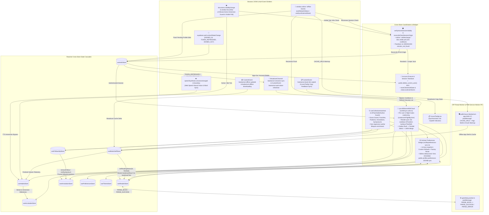
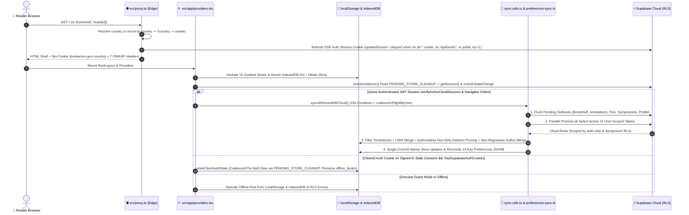
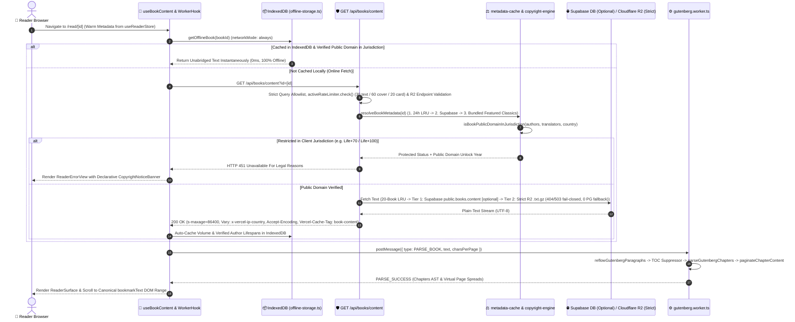
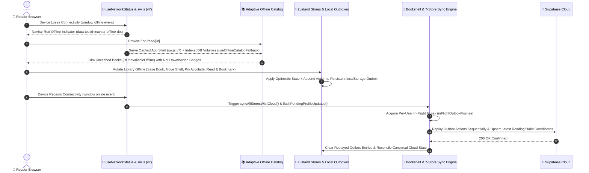

# Event Bus, Reactive Signals & Runtime Execution Workflows — Bookarium

> **Auto-Generated Living Architecture Slice** • [← Back to Architecture Hub](../ARCHITECTURE.md)  
> **Last Synchronized**: `2026-11-27`  
> **Topology Health**: `263` Modules Analyzed • `1124` Static Linkages • `0` Circular Dependencies • `0` Layer Violations • `0` Orphaned Modules

---

## 🔄 Event Bus, Cross-Store Reactivity & State-Flow Topology

Bookarium coordinates state transitions across 10 Zustand stores, IndexedDB, off-thread Web Workers, the PWA Service Worker, and Supabase Cloud via a deterministic reactive event bus:

### 1. Cross-Store, Worker & DOM Event Bus Diagram

### 2. Reactive Signals, Custom Events & Worker IPC Matrix

| Event / Signal Channel | Emitter Module | Subscriber Module(s) | Payload Contract | Architectural Side-Effect |
| :--- | :--- | :--- | :--- | :--- |
| **`BroadcastChannel: bookarium-sessions-sync`** | [`src/hooks/useAccountSecurityActions.ts`](../../src/hooks/useAccountSecurityActions.ts) | [`src/hooks/useAccountSecurityActions.ts`](../../src/hooks/useAccountSecurityActions.ts) | `{ type: "sessions-changed", userId, senderId }` | Synchronizes the Active Device Sessions list across open same-origin sibling tabs (filtering own `senderId` echoes) immediately after single-device revocation or Sign Out Other Devices. |
| **`bookarium:auth-token-refreshed`** | [`src/stores/useAuthStore.ts`](../../src/stores/useAuthStore.ts) | [`src/app/providers.tsx`](../../src/app/providers.tsx), [`src/hooks/useAccountSecurityActions.ts`](../../src/hooks/useAccountSecurityActions.ts) | `CustomEvent<{ userId: string }>` | Bypasses the `15,000ms` sync cooldown to re-trigger `syncAllStoresWithCloud()` immediately after background JWT `TOKEN_REFRESHED` recovery and refreshes active session IP/UA metadata when the Account Security tab is open. |
| **`bookarium:book-link-copied`** | [`src/components/ui/CursorTooltip.tsx`](../../src/components/ui/CursorTooltip.tsx) | [`src/components/ui/CursorTooltip.tsx`](../../src/components/ui/CursorTooltip.tsx) | `CustomEvent<{ bookId: string; url: string }>` | Synchronizes `Copied!` inline indicators and floating `CursorTooltip` feedback (`1,800ms`) across concurrent `[data-copy-book-id]` surfaces. |
| **`bookarium:offline-downloading`** | [`src/hooks/useOfflineBooks.ts`](../../src/hooks/useOfflineBooks.ts) | [`src/hooks/useOfflineBooks.ts`](../../src/hooks/useOfflineBooks.ts) | `CustomEvent<{ bookId: number | null }>` | Synchronizes active download progress indicators across BookCard, BookmarkCard, BookshelfSpine, and DownloadDrawer. |
| **`bookarium:offline-updated`** | [`src/hooks/useOfflineBooks.ts`](../../src/hooks/useOfflineBooks.ts), [`src/lib/offline-storage.ts`](../../src/lib/offline-storage.ts), [`src/stores/useBookshelfStore.ts`](../../src/stores/useBookshelfStore.ts) | [`src/hooks/useOfflineBooks.ts`](../../src/hooks/useOfflineBooks.ts) | `CustomEvent<void>` | Re-enumerates IndexedDB keys/metadata (`useOfflineBooks`) and updates `Downloaded (N)` smart shelf & offline badges across mounted components. |
| **`window` `online` / `offline`** | Browser Network Stack | [`src/hooks/useNetworkStatus.ts`](../../src/hooks/useNetworkStatus.ts), [`src/app/providers.tsx`](../../src/app/providers.tsx) | `Event` (`navigator.onLine`) | Switches UI to offline restriction parity (`isUnavailableOffline`), activates IndexedDB catalog fallback, and flushes all 7 cloud-synced store outboxes upon reconnect. |
| **`supabase.auth.onAuthStateChange`** | [`src/app/providers.tsx`](../../src/app/providers.tsx) | [`src/stores/useAuthStore.ts`](../../src/stores/useAuthStore.ts), [`src/lib/sync-utils.ts`](../../src/lib/sync-utils.ts) | `(event, session)` | Hydrates scholar profile, verifies active JWT session (`verifyActiveCloudSession`), triggers `syncAllStoresWithCloud`, and reconciles `public.profiles.preferences` JSONB. |
| **`setReadingStatus(id, "finished")`** | [`src/stores/useBookshelfStore.ts`](../../src/stores/useBookshelfStore.ts) | [`src/stores/useReaderStore.ts`](../../src/stores/useReaderStore.ts), [`src/stores/useHabitsStore.ts`](../../src/stores/useHabitsStore.ts), [`src/stores/useAccoladesStore.ts`](../../src/stores/useAccoladesStore.ts) | `(bookId: number, status: ReadingStatus)` | Clears `bookmarkRow` (`0`) and `bookmarkText` (`undefined`), updates `completed_books_count`, and evaluates Ex-Libris accolades. |
| **`removeFellow` / `endSymposium`** | [`src/stores/useFellowshipStore.ts`](../../src/stores/useFellowshipStore.ts) | [`src/stores/useAnnotationStore.ts`](../../src/stores/useAnnotationStore.ts) | `(fellowId: string)` / `(sessionId: string)` | Invokes `pruneFellowAnnotationsByFellow` / `pruneFellowAnnotationsForSymposium` to evict stale co-reader marginalia immediately. |
| **`schedulePreferencesCloudSync`** | [`src/lib/preferences-sync.ts`](../../src/lib/preferences-sync.ts) | [`src/stores/usePreferencesStore.ts`](../../src/stores/usePreferencesStore.ts), [`src/stores/useReaderStore.ts`](../../src/stores/useReaderStore.ts), [`src/stores/useThemeStore.ts`](../../src/stores/useThemeStore.ts) | `ProfilePreferencesPayload` (`active`, `customDefaults`, `updatedAt`) | Coalesces 14 typography, theme, layout, exit-bookmark reminder, spoiler-shield, and speech settings into a 500ms debounced / 0ms immediate LWW cloud upsert. |
| **`Worker: PARSE_BOOK`** | [`src/hooks/reader/useGutenbergParserWorker.ts`](../../src/hooks/reader/useGutenbergParserWorker.ts) | [`src/workers/gutenberg.worker.ts`](../../src/workers/gutenberg.worker.ts) | `{ type: "PARSE_BOOK", requestId, text, charsPerPage }` | Executes off-thread paragraph reflow, TOC suppression, chapter segmentation, and virtual page slicing; replies with `PARSE_SUCCESS` or `PARSE_ERROR`. |
| **`ServiceWorker: CACHE_URLS`** | [`src/components/pwa/ServiceWorkerRegister.tsx`](../../src/components/pwa/ServiceWorkerRegister.tsx) | [`public/sw.js`](../../public/sw.js) | `{ type: "CACHE_URLS", urls: string[] }` | Warms `bookarium-app-shell-v7` CacheStorage with `/`, `/account`, `/read/1342`, and discovered `/_next/static/` JS/CSS chunks. |

### 3. Client Storage, Conflict-Resolution & Account Erasure Parity Matrix (Rule 9 / GDPR Art. 17)

| Storage Domain / Store | Local Storage Key & Medium | Cloud PostgreSQL Table(s) | Sync & Conflict-Resolution Strategy | 3-Layer Account Erasure Parity (`deleteAccount`) |
| :--- | :--- | :--- | :--- | :--- |
| **`useBookshelfStore`** | `bookarium-bookshelf-storage` (`localStorage`) | `public.bookshelves`, `public.bookshelf_items`, `public.user_favorites`, `public.user_book_curation` | Sequential Outbox Replay (`outbox[]`) + Deletion Tombstones (`deletedBookIds`, `deletedFavoriteIds`) + Non-Regressive Metadata Merge (`mergeCloudBookWithLocal`) | 1. `delete_current_user()` RPC + `ON DELETE CASCADE` 2. Client `.delete()` fallback 3. `clearBookshelf()` (`savedBooks`, `favoriteBooks`, `outbox`, `cloudBookshelves`) |
| **`useReaderStore`** | `bookarium-reader-preferences` (`localStorage`) | `public.reading_progress` | 2,000ms Debounced Single-Book Upsert + Batched Multi-Book Upsert (`upsertReadingProgressBatch`, `Promise<boolean>` upload verification) + `SELECT`-Gated Ghost Cleanup (`isGhostCloudRow`) & Ghost Dirty-Flag Scrubbing + Authoritative Non-Dirty Deletion Pruning (`lastReaderSyncAt` monotonic anchor, `dirtyPositionBookIds`, `clearUploadedDirtyPositions`, `dirtyReaderSyncUsers` rerun) + `coalesceInFlightByUser` + Timestamp Last-Write-Wins (`lastReadAt >= remoteTime`) + Tombstones (`deletedPositionBookIds`) + Fractional `scroll_offset` (`page + row/1000`) | 1. `delete_current_user()` RPC + `ON DELETE CASCADE` 2. Client `.delete()` fallback 3. `resetReaderSession()` + `clearReadingPositions()` + `resetReaderAppearanceToDefaults()` |
| **`useAnnotationStore`** | `bookarium-annotations-storage` (`localStorage`) | `public.user_annotations` | Outbox Replay (`outbox[]`) + Tombstones (`deletedIds`) + LWW Timestamp (`updatedAt`) + Passive `15s` Mount Cooldown (`lastPassiveAnnotationSyncByUser`) + Symposium RLS (`reconcileFellowAnnotationsWithSymposiums`) | 1. `delete_current_user()` RPC + `ON DELETE CASCADE` 2. Client `.delete()` fallback 3. `clearAnnotations()` (wipes personal & fellow marginalia + outbox) |
| **`useFellowshipStore`** | `bookarium-fellowship-storage` (`localStorage`) | `public.reader_circles`, `public.symposium_sessions` | Outbox Queue (`pendingSymposiumProgress`) + Passive `15s` Mount Cooldown & Mutation Invalidation (`lastFellowshipSyncByUser`) + Participant RLS (`requester_id`/`recipient_id`, `host_id`/`fellow_id`) + Trigger Identity Propagation | 1. `delete_current_user()` RPC + `ON DELETE CASCADE` 2. Client `.or(...)` `.delete()` fallback 3. `clearFellowship()` |
| **`useHabitsStore`** | `bookarium-reading-habits` (`localStorage`) | `public.user_reading_habits` | Union Merge of `activityDates[]` + Max Streak/Minutes/Completed Books Reconciliation | 1. `delete_current_user()` RPC + `ON DELETE CASCADE` 2. Client `.delete()` fallback 3. `clearHabits()` |
| **`useAccoladesStore`** | `bookarium-accolades-storage` (`localStorage`) | `public.user_accolades` | Pending Pin Mutation Queue (`pendingPinUpdates`) + Idempotent `(user_id, accolade_id)` Upsert | 1. `delete_current_user()` RPC + `ON DELETE CASCADE` 2. Client `.delete()` fallback 3. `clearAccolades()` |
| **`useAuthStore`** | `bookarium-auth-profile`, `bookarium-pending-store-cleanup` (`localStorage`), `bookarium-consumed-recovery` (`sessionStorage`) | `public.profiles`, `auth.users`, `auth.sessions`, `storage.objects` | Optimistic Offline Profile Outbox (`pendingProfileUpdates`) + Passive Auth Cooldown (`lastProfileSyncByUser`, `authMinSyncIntervalMs` on mount & token refresh) + Pre-Sync Active JWT Guard (`verifyActiveCloudSession` delegating cookie-clearance teardowns to `resetClientAuthState`), Durable Interrupted-Reload Teardown Marker (`bookarium-pending-store-cleanup` flushed in `initializeAuth`), Fail-Closed JWT AMR & Single-Use Recovery Verification (`verifyPasswordRecoverySession`, `clearConsumedRecoveryMarker`), Throttled Remote Revocation Check (`verifyActiveSessionValidity`), Browser IP/UA Reconciliation (`reconcileClientSessionOrigin`), & Owner-Scoped Device Session Inspection/Revocation (`get_active_sessions`, `revoke_user_session`) | 1. `delete_current_user()` purges 11 tables, `storage.objects`, and `auth.users` alongside `{ scope: 'global' }` sign-out 2. Standard `signOut()`, `verifyActiveCloudSession` resets, and `verifyActiveSessionValidity` teardowns share coalesced `resetClientAuthState` (`scope: 'local'`) clearing all local user stores before setting `user: null`, removing `bookarium-pending-store-cleanup`, preserving IndexedDB `offline_books`, and clearing current-origin cookies without terminating peer devices |
| **`usePreferencesStore` & `useThemeStore`** | `bookarium-preferences-storage`, `bookarium-theme-storage` (`localStorage`) | `public.profiles.preferences` (`JSONB`) | 500ms Debounced (0ms Immediate Theme/Preset) LWW Timestamp (`preferencesUpdatedAt`) across `active` & `customDefaults` 14-key snapshots | Reset to `FACTORY_PREFERENCES` (`theme: "light"`, `stickyScroll: true`, default TTS) via `clearLocalUserStores({ wipeDeviceStorage: true })` |
| **Quote Pool & Passage LRU Caches** | `bookarium-quote-enriched-books-v1`, `bookarium-extracted-passages-v1` (`localStorage`) | `public.books.quotes` (`JSONB`, Read-Only) | `12h` TTL 48-volume (`DEFAULT_QUOTE_POOL_LIMIT = 48`) 2-spread rotating pool (`useBooks.ts`) + `30-day` TTL / `100`-book LRU dynamically extracted passages (`useBookPassageShuffle.ts`) | Public domain literary quote caches (zero user PII); `bookarium-extracted-passages-v1` cleared via `clearCachedBookPassages()` |
| **`offline-storage` (IndexedDB)** | `BookariumOfflineDB` (`v2`: `offline_books` + `cover_cache`) | _Device-Local Unabridged Cache_ | Offline-First Read (`networkMode: "always"`) + Asynchronous Author Lifespan Back-Fill (`patchOfflineBookAuthors`) + R2-Backed Canonical Cover Cache (`300` LRU / `30d` TTL) | Wiped completely via `clearAllOfflineBooks()` during `clearLocalUserStores({ wipeDeviceStorage: true })` |
| **Reader Scroll, Recovery Guard & SSR Hydration Cookies** | `bookarium-reader-scroll-*` & `bookarium-consumed-recovery` (`sessionStorage`), `bookarium-geo-country`, `bookarium-theme-preference`, `bookarium-auth-hint`, `bookarium-client-ip-sync` (`maxAge=120`), `sb-*-auth-token` (`Cookie`) | _Ephemeral / Edge SSR Session_ | Synchronous Edge Geo-IP Stamping (`src/proxy.ts`), Zero-Flash SSR Theme/Auth Hint Hydration (`src/app/layout.tsx`), Post-Server-Login/Refresh IP Sync (`reconcileClientSessionOrigin`), Single-Use Recovery Consumption Guard (`auth-recovery.ts`), & Per-Tab Scroll Offset Restoration | `sessionStorage` scroll & consumed-recovery keys purged on sign-out / account deletion (`clearConsumedRecoveryMarker`); `bookarium-auth-hint` reset to `guest`; `bookarium-client-ip-sync` expired (`max-age=0`); `bookarium-theme-preference` reset to `light`; `sb-*-auth-token` session cookies cleared |

---

## ⏱️ Runtime Execution Workflows (Temporal Sequence Diagrams)

### 1. Cold Launch, Edge Geo-IP Resolution, Hydration & 7-Store Cloud Outbox Reconciliation

### 2. Focus Reader Launch, Jurisdictional Gatekeeping (`HTTP 451`), Cloudflare R2 Streaming & Worker AST

### 3. Offline Mutation Queueing, Adaptive Offline Catalog & Reconnect Outbox Replay

---

> *Compiled from Source AST by [`scripts/generate-architecture-matrix.js`](../../scripts/generate-architecture-matrix.js) — [← Return to Architecture Hub](../ARCHITECTURE.md).*
