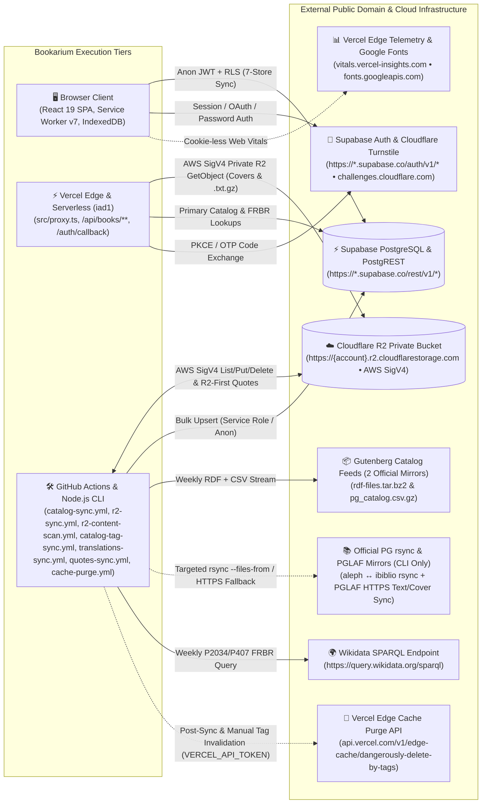
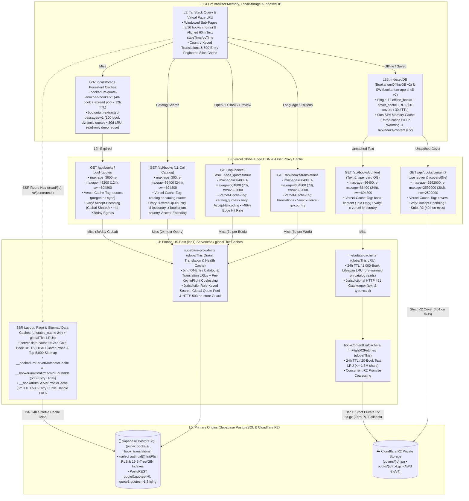

# Caching Strategy, External Integrations, Failure Modes & Edge Ops — Bookarium

> **Auto-Generated Living Architecture Slice** • [← Back to Architecture Hub](../ARCHITECTURE.md)  
> **Last Synchronized**: `2026-11-28`  
> **Topology Health**: `268` Modules Analyzed • `1161` Static Linkages • `0` Circular Dependencies • `0` Layer Violations • `0` Orphaned Modules

---

## ⚡ Data Pulling & Caching Strategy

1. **Authoritative Supabase Catalog & Bundled Curated Fallback**: Primary search queries execute against dedicated Supabase PostgreSQL (`public.books`) using full-text GIN search (~1–2s catalog responses, <50ms single-book lookups), falling back cleanly to the bundled Curated Archive (`src/lib/catalog/curated-fallback.ts`) when Supabase is unconfigured without external third-party catalog REST dependencies, unconditionally enforcing `copyright=false`.
2. **Unified Visible Telemetry & Zero-CLS Radar**: `StickyCatalogToolbar.tsx` (`CatalogTelemetryBadge.tsx`) renders a unified Zero-CLS API connectivity, latency, and archive query radar pill with locked geometry (`min-w-[72px] sm:min-w-[78px]`) supporting 4 states (Online Idle, Active Querying with micro-spinner and pulse `•••`, Pending Measure, and Offline), paired with a collision-aware diagnostic popover card that automatically flips upwards when docked at the hero fold or downwards when stuck at the top, complete with touch tap-toggle interaction and provider telemetry across Bookarium Catalog (`supabase`) and Curated Archive Cache (`cache`).
3. **Customizable Batch Sizing**: Readers can dynamically toggle batch sizes (`Show: [8 | 16 | 24 | 32]`) without page reloads.
4. **Multi-Tier Vercel Edge CDN Caching, Geographic Vary Partitioning, Tag Invalidation & Cloudflare R2 Cover Proxy**: Public API and clean crawler asset routes offload >99% of repeat traffic to the Vercel Global Edge CDN with route-specific TTLs, minimal `Vary` keys, and instant post-ingestion, R2-delete/overwrite, or manual `Vercel-Cache-Tag` purging (`scripts/purge-vercel-cache.js` calling `POST https://api.vercel.com/v1/edge-cache/dangerously-delete-by-tags` at the end of live CI syncs, conditionally after `r2-sync.yml`, or selectively via `.github/workflows/cache-purge.yml`): `/api/books?pool=quotes` caches the 48-volume 2-spread rotating quote pool for `12h` (`max-age=3600, s-maxage=43200, swr=604800, Vary: Accept-Encoding`, `Vercel-Cache-Tag: quotes`); `/api/books` caches 9-column catalog searches for `24h` (`max-age=300, s-maxage=86400, swr=604800, Vary: x-vercel-ip-country, cf-ipcountry, x-bookarium-country, Accept-Encoding`, `Vercel-Cache-Tag: catalog` or `catalog,quotes`); `/api/books?ids=...&has_quotes=true` (`Vercel-Cache-Tag: catalog,quotes`) & `include_restricted_metadata=true` (`Vercel-Cache-Tag: catalog`) cache explicit quote/metadata batches for `7d` (`max-age=86400, s-maxage=604800, swr=2592000, Vary: Accept-Encoding`); `/api/books/translations` caches FRBR work clusters for `7d` (`max-age=86400, s-maxage=604800, swr=2592000, Vary: x-vercel-ip-country`, `Vercel-Cache-Tag: translations`); `/api/books/content` plain text (`Vercel-Cache-Tag: book-content`), `type=card` OG PNGs, and `/og/books/[file]` (`untagged`, `CORP: cross-origin`) cache for `24h` (`max-age=86400, s-maxage=86400, swr=604800`); and both `/api/books/content?type=cover` and crawler-allowed `/covers/[file]` cache private Cloudflare R2 cover images (`covers/<id>.jpg`, `404 no-store` on miss, `Vercel-Cache-Tag: covers`) for `30d` (`max-age=2592000, s-maxage=2592000, swr=2592000`), complemented by 24h `unstable_cache` across `/read/[id]` metadata, R2 `HEAD` cover probes, and the top-5,000 dynamic `sitemap.ts`.
5. **Jurisdictional Copyright Gatekeeping & Bibliographic Preservation**: The streaming route (`/api/books/content`) intercepts requests from non-US jurisdictions, verifying author/translator death years against Berne/local terms and returning `HTTP 451 Unavailable For Legal Reasons` for protected titles. Concurrently, the catalog pipeline supports `includeRestrictedMetadata=true` for explicit IDs, ensuring personal collections (Notebook, Bookmarks) and reader error screens display authentic bibliographic citations (titles, authors, subjects) without opening prohibited full-text streams.
6. **Multi-Tier Text Streaming & Private Cloudflare R2 Hosting (Zero Runtime PG Fallback)**: Plain text is served on-demand from Tier 0 (`bookContentLruCache`: 24h TTL / 20-book lazy in-memory LRU cache preventing repeated R2 reads across jurisdictions) and Tier 1 (private Cloudflare R2 `books/<id>.txt.gz` streamed and decompressed via AWS SigV4 with fail-closed `404` miss / `503` unconfigured / `502` upstream responses, zero Supabase `books.content` queries, and zero runtime PG fallback) with in-flight promise coalescing (`inFlightR2Fetches`) and a 24h contributor metadata cache.
7. **Native IndexedDB Offline Cache**: Opened and downloaded unabridged texts are cached in browser IndexedDB for 100% offline access with client-side jurisdictional protection preventing illicit cross-border reading.
8. **Fault-Isolated Weekly Catalog Synchronization, Checkpointed R2 Delta Assets & Multi-Mirror Quotes**: Project Gutenberg's official `rdf-files.tar.bz2` and `pg_catalog.csv.gz` feeds (`78,000+` public domain titles) are streamed and decompressed on-the-fly from official Gutenberg mirrors (`gutenberg.pglaf.org` -> `aleph.gutenberg.org`) via GitHub Actions (`.github/workflows/catalog-sync.yml`) or `npm run catalog:sync`, preserving cached/DB `copyright: true` flags and deferring unverified brand-new rows on RDF outages (`reconcileBatchWithoutRdfRights`), diffing all 78,000+ rows in RAM against `gutenberg-catalog-cache.json.gz` (~39 MB/week read egress saved), publishing the updated snapshot immediately ahead of downstream steps, and chaining fault-isolated (`continue-on-error: true` + end-of-job outcome checks) Cloudflare R2 delta sync (`scripts/sync-r2-assets.js` with `assertValidR2ConfigIfPresent`, read-fail state protection + remote union merge + `try ... finally` checkpoints, bounded concurrency `8`, mid-batch budget checks, and conditional `covers`/`book-content` purge tags), Wikidata translations (`45s` timeout + bisected FK-safe retries), R2-first 3-mirror quotes (`pglaf,aleph,readingroo`), and `if: always()` Edge cache purging.

---

## 🌍 External Integration & Boundary Contracts Map

Bookarium enforces strict boundary isolation, anti-SSRF hostname validation, and Content-Security-Policy (`connect-src`, `img-src`, `style-src`, `font-src`) across every outbound and inbound external integration:

### 1. External Integration Topology Diagram

### 2. External Integration Contracts, Timeouts & Security Matrix

| External System / Endpoint | Initiating Layer | Protocol & Auth Mechanism | Timeout & Rate-Limit Policy | Security, Anti-SSRF & Policy Guardrails | Primary Adapter Module |
| :--- | :--- | :--- | :--- | :--- | :--- |
| **Cloudflare R2 Private S3 API (`https://<account>.r2.cloudflarestorage.com`)** | `/api/books/content` (`type=cover` & text) + CI `sync-r2-assets.js`, `scan-r2-content.js` & `sync-featured-quotes.js` | HTTPS AWS Signature V4 (`AWS4-HMAC-SHA256`, `REGION=auto`; Read-Only token in Vercel / Read-Write bucket token in GitHub Secrets) | `10s` AbortController timeout (`R2_DEFAULT_TIMEOUT_MS`); mode-scoped `bookCoverRateLimiter` (`60/min`) & `bookContentRateLimiter` (`30/min`); bounded parallel CI `PutObject` concurrency (`DEFAULT_R2_PUT_CONCURRENCY = 8`) & read scan concurrency (`DEFAULT_SCAN_CONCURRENCY = 32`) + per-item `--max-minutes` checks | Zero `NEXT_PUBLIC_*` exposure, strict `assertValidR2ConfigIfPresent` partial/malformed config fail-fast (exit `0` only when all 4 `R2_*` unset), `isAllowedR2EndpointUrl`, `redirect: 'manual'`, read-fail & remote-merge `_meta/r2-sync-state.json.gz` checkpointing, `copyright !== true` upload ban & `MIN_ACTIVE_CATALOG_FOR_PRUNE = 50,000` delete guard, conditional `covers`/`book-content` Edge purge tags, `MAX_R2_BOOK_BYTES` (`15 MB`) & `MAX_R2_COVER_BYTES` (`2 MB`) caps | [`src/lib/r2-client.ts`](../../src/lib/r2-client.ts), [`src/app/api/books/content/route.ts`](../../src/app/api/books/content/route.ts), [`scripts/lib/r2-sigv4.js`](../../scripts/lib/r2-sigv4.js), [`scripts/sync-r2-assets.js`](../../scripts/sync-r2-assets.js), [`scripts/scan-r2-content.js`](../../scripts/scan-r2-content.js), [`scripts/sync-featured-quotes.js`](../../scripts/sync-featured-quotes.js) |
| **Supabase PostgREST (`https://*.supabase.co/rest/v1`)** | Browser Client, Edge Routes & CLI | HTTPS REST • `NEXT_PUBLIC_SUPABASE_ANON_KEY` (RLS JWT) or CLI `SUPABASE_SERVICE_ROLE_KEY` | 60s healthcheck TTL (`supabase-provider.ts`); CLI adaptive batch halving on `57014` | All 14 tables enforce `ENABLE ROW LEVEL SECURITY`; CSP `connect-src https://*.supabase.co`; `sanitizeSupabaseUrl` | [`src/lib/catalog/supabase-provider.ts`](../../src/lib/catalog/supabase-provider.ts), [`src/lib/supabase/client.ts`](../../src/lib/supabase/client.ts) |
| **Supabase Auth & Turnstile (`https://*.supabase.co/auth/v1`, `challenges.cloudflare.com`)** | Browser Client, `src/proxy.ts` & `/auth/callback` | HTTPS PKCE Code Exchange, Token-Hash OTP & Turnstile `captchaToken` (`exchangeCodeForSession`, `verifyOtp`) | Document & `/account*` Edge SSR cookie refresh (`updateSession` with sanitized `User-Agent` forwarding & `bookarium-client-ip-sync` stamping on rotated tokens, bypassing public `rsc=1` & prefetch routes) + client `checkInitialUser` / `fetchProfile` coalescing + visible-tab (`60s`), `visibilitychange`, & `online` `verifyActiveSessionValidity` revocation checks; 60s email resend cooldown | Open-redirect sanitization (`sanitizeRedirectPath`, `resolveCanonicalAuthOrigin`, `stripRecoveryFromRedirectPath`); fail-closed JWT `amr` & single-use recovery verification (`verifyPasswordRecoverySession`, `isRecoverySessionAmrVerified`) + cross-device `recovery_cross_device` routing; browser IP/UA origin reconciliation (`reconcileClientSessionOrigin`); shared `TurnstileWidget` CAPTCHA (`AuthModal`, `EmailSentView` & `/account` recovery/resend) & Honeypot bot guard; OWASP current-password re-auth | [`src/app/auth/callback/route.ts`](../../src/app/auth/callback/route.ts), [`src/lib/auth-recovery.ts`](../../src/lib/auth-recovery.ts), [`src/components/auth/AuthModal.tsx`](../../src/components/auth/AuthModal.tsx), [`src/components/auth/TurnstileWidget.tsx`](../../src/components/auth/TurnstileWidget.tsx), [`src/lib/supabase/middleware.ts`](../../src/lib/supabase/middleware.ts), [`src/lib/supabase/server.ts`](../../src/lib/supabase/server.ts) |
| **Gutenberg Catalog Archives (`rdf-files.tar.bz2` & `pg_catalog.csv.gz`)** | Node.js CLI & GitHub Actions (`catalog-sync.yml`) | HTTPS GET Streaming Bzip2/Gzip (`tar -xOjf -` + `zlib.createGunzip`, PGLAF-first across 2 allowlisted PG mirrors or pinned `--feed-source`) | Weekly Sunday `02:00 UTC` schedule + manual `feed_source`; 2-mirror failover + HTML outage rejection + `Content-Length`/non-zero `tar` truncation fail-closed guards | Allowlisted feed URLs (`isAllowedRdfFeedUrl`, `isAllowedCsvFeedUrl`, `resolveFeedMirrors`), wire `SHA-256` digest computation + `$GITHUB_STEP_SUMMARY` logging, `.sha256`-verified (`timingSafeEqual`) in-RAM `gutenberg-catalog-cache.json.gz` diffing (retained under `--update-existing`), RDF-outage copyright verification & new-book deferral (`reconcileBatchWithoutRdfRights`), extracts `<dcterms:rights>` & 30-day `download_count`, computes `max_author_death_year`, and emits `quote-diff.json` | [`scripts/sync-gutenberg-catalog.js`](../../scripts/sync-gutenberg-catalog.js) |
| **Wikidata SPARQL (`https://query.wikidata.org/sparql`)** | Node.js CLI & GitHub Actions (`catalog-sync.yml` Step 3 & on-demand `translations-sync.yml`) | HTTPS GET SPARQL JSON (`P2034` Gutenberg ID + `P407` Language) | Weekly Sunday `02:00 UTC` sequential pipeline (`catalog-sync.yml`) + manual `workflow_dispatch`; `45s` socket/request timeout (`WIKIDATA_SPARQL_TIMEOUT_MS`) | 5 Pipeline Blockers & 7 Hardening Defenses; offline snapshot fallback (`scripts/data/wikidata-translations-cache.json`); strict retry-hardened FK pre-check + bisected upsert retries | [`scripts/ingest-translations.js`](../../scripts/ingest-translations.js) |
| **Vercel Edge Cache Purge API (`https://api.vercel.com/v1/edge-cache/dangerously-delete-by-tags`)** | GitHub Actions & Node.js CLI (`catalog-sync.yml`, `r2-sync.yml`, `translations-sync.yml`, `quotes-sync.yml`, `cache-purge.yml`) | HTTPS POST JSON (`{ tags, target }`) • Bearer `VERCEL_API_TOKEN`, `?projectIdOrName=VERCEL_PROJECT_ID`, optional `&teamId=VERCEL_TEAM_ID` | Bounded retries (`0..5`, default `2`) on `429`/`5xx`/network faults honoring `Retry-After`; clean `exit 0` skip when secrets unset | Validated purge target (`production`/`preview`), trimmed deduplicated tags (`catalog`, `quotes`, `translations`, `covers`, `book-content`), secret-safe redacted error reporting, `$GITHUB_STEP_SUMMARY` ledger | [`scripts/purge-vercel-cache.js`](../../scripts/purge-vercel-cache.js) |
| **Self-Hosted Google Fonts & Vercel Edge Telemetry** | Root Layout (`src/app/layout.tsx`) | Build-Time Bundled WOFF2 (`next/font/google`), Edge WAF Security Logs & Cookie-Free Beacon (`@vercel/analytics`, `@vercel/speed-insights`) | Local origin cache + 24h ephemeral request hash (IP + UA + daily salt); non-blocking async beacon | Zero runtime Google Fonts requests (CSP `style-src`/`font-src` retained); zero advertising/tracking cookies under ePrivacy Art. 5(3) + GDPR Art. 6(1)(f) WAF disclosure | [`src/app/layout.tsx`](../../src/app/layout.tsx), [`next.config.ts`](../../next.config.ts) |

---

## 🛡️ Failure Modes, Circuit Breakers & Retry Topology

Every network, storage, compute, and database dependency in Bookarium is protected by a multi-tier circuit breaker, fallback provider, or self-healing mechanism so the reading experience never crashes:

### 1. Multi-Tier Failover & Self-Healing Decision Diagram

```mermaid
flowchart TD
    subgraph CatalogResilience ["1. Catalog Search Resilience Cascade"]
        CatReq["Catalog Query (/api/books)"] --> SupaHealth{"Supabase Configured &\n60s Healthcheck OK?"}
        SupaHealth -->|"Yes"| SupaQuery["Query public.books (GIN + B-Tree)"]
        SupaHealth -->|"No / Unconfigured"| CuratedServer["Bundled Curated Fallback\n(curated-fallback.ts • 27 Classics)"]
        SupaQuery -->|"Transient DB Error"| DbError503["HTTP 503 No-Store Error Telemetry"]
        DbError503 -->|"Navigator Offline"| OfflineCat["Adaptive Offline Catalog (useOfflineCatalogFallback.ts)\nServes IndexedDB Volumes or CatalogOfflineView.tsx"]
        CuratedServer -->|"Navigator Offline"| OfflineCat
    end

    subgraph ContentResilience ["2. Book Content & Cover Streaming Resilience Cascade"]
        TxtReq["Open Volume (/read/[id]) or Load Cover"] --> IDBCheck{"Cached in Browser\nIndexedDB?"}
        IDBCheck -->|"Hit (0ms)"| RenderReader["Render Instantaneously Offline"]
        IDBCheck -->|"Miss (Text / Cover)"| R2Check{"R2_* Env Vars\nConfigured?"}
        R2Check -->|"Yes"| FetchR2["Tier 1: Cloudflare R2 (.txt.gz / .jpg)\n404 on Miss -> Dark Typographic Cover"]
        FetchR2 -->|"200 OK"| RenderReader
        R2Check -->|"No (Unconfigured)"| Fail503["Fail Closed (HTTP 503 Text / 404 Cover)\nZero Runtime PG Fallback"]
    end

    subgraph ComputeAndSync ["3. Worker Compute & Cloud Outbox Resilience"]
        WorkerTask["Parse Gutenberg Plain Text"] --> WorkerAlive{"Web Worker Thread\nAvailable?"}
        WorkerAlive -->|"Yes"| OffThread["Off-Thread AST Segmentation (gutenberg.worker.ts)"]
        WorkerAlive -->|"Crash / Unsupported"| MainThread["Chunked Async Main-Thread Fallback (setTimeout 0)"]
        OutboxMut["Offline Shelf / Progress Mutation"] --> OutboxOnline{"Navigator Online?"}
        OutboxOnline -->|"Offline"| OutboxQueue["Queue localStorage Outbox + Tombstones"]
        OutboxOnline -->|"Online Reconnect"| OutboxReplay["coalesceInFlightByUser -> Replay Cloud Sync"]
    end

    subgraph AuthResilience ["4. Password Recovery & Session Revocation Resilience"]
        RecLink["Open Reset Link or /account?recovery=true"] --> PkceCheck{"Same-Device PKCE\nVerifier Present?"}
        PkceCheck -->|"Mismatch"| CrossNotice["/?auth_notice=recovery_cross_device | deletion_cross_device\nOpens AuthModal Notice"]
        PkceCheck -->|"Session Verified"| AmrCheck{"verifyPasswordRecoverySession\nSigned AMR + 3600s TTL + Unused?"}
        AmrCheck -->|"Spoofed / Expired / Consumed"| StripRec["clearRecoveryParamInUrl &\nEnforce Current Password"]
        SessCheck["Visible Tab, Focus, Sync & Boot\n(verifyActiveSessionValidity / verifyActiveCloudSession)"] --> SessState{"400/401/403 Revoked or\nCleared Auth Cookie?"}
        SessState -->|"Yes (Revoked or Cookie Cleared)"| LocalWipe["resetClientAuthState (PENDING_STORE_CLEANUP\nPre-Null Store Wipe, Preserve offline_books)"]
        SessState -->|"Offline or 5xx"| KeepSess["Preserve Local Session Until Online"]
    end
```

### 2. Comprehensive Failure Mode, Degraded-State & Self-Healing Matrix

| Failure Scenario / Fault Domain | Detection Mechanism | Circuit-Breaker / Retry Policy | Automatic Fallback / Self-Healing Action | User-Facing Experience |
| :--- | :--- | :--- | :--- | :--- |
| **1. Supabase Unconfigured or Temporarily Unhealthy** | `isSupabaseConfigured()` & 60s healthcheck in [`src/lib/catalog/supabase-provider.ts`](../../src/lib/catalog/supabase-provider.ts) | `60,000ms` healthcheck circuit-breaker TTL avoids repeated failing DB probes | Routes unconfigured `/api/books` searches cleanly to bundled [`src/lib/catalog/curated-fallback.ts`](../../src/lib/catalog/curated-fallback.ts) (`source: "cache"`, `no-store`) and fails closed with `HTTP 503` on transient configured DB outages | Unconfigured local previews browse curated classics offline; live DB outages report honest recoverable states. |
| **2. `/api/books` Gateway Timeout or Transient `503`/`504`** | `CatalogRequestError` & `isStatementTimeoutError` (`SQLSTATE 57014` -> `HTTP 504`) in [`src/lib/catalog/supabase-provider.ts`](../../src/lib/catalog/supabase-provider.ts) & [`src/hooks/queries/useBooks.ts`](../../src/hooks/queries/useBooks.ts) | Bounded `15,000ms` `AbortController` + `shouldRetryCatalogQuery` failing fast with zero retries on `504`, aborts, `400`, and `429` (1 retry reserved for transient `503`/network drops) + `CatalogTelemetryBadge` error radar | Surfaces recoverable Retry state cleanly in `BookGrid` and degrades to IndexedDB volumes (`useOfflineCatalogFallback.ts`) when offline | Eliminates duplicate `57014` retry storms, third-party outages, and silent data corruption while keeping cached reading uninterrupted. |
| **3. Missing R2 Cover / Unconfigured or Unavailable R2 Text (`!isR2Configured()`)** | Status check in [`src/lib/r2-client.ts`](../../src/lib/r2-client.ts), [`src/app/api/books/content/route.ts`](../../src/app/api/books/content/route.ts) & [`src/app/covers/[file]/route.ts`](../../src/app/covers/[file]/route.ts) | Strict `404` on all R2 cover (`type=cover`, `/covers/[file]`) and plain-text misses (`503` unconfigured / `502` upstream R2 error; zero runtime PG fallback); SSR SEO layouts gate `/covers/<id>.jpg` behind cached `headR2CoverExists` | Missing covers flip `useOfflineCoverImage` directly to `imageError = true` rendering dark typographic cover cards and keep SEO Schema.org `image` anchored on `/og/books/<id>.png` with zero `404` image crawls; unconfigured local environments fall back cleanly to IndexedDB downloaded volumes (`useOfflineBooks`) | Covers fail visibly to crisp typographic cards with zero external hotlinking or SEO `404` schema images; runtime never proxies Project Gutenberg servers. |
| **4. Missing or `"Anonymous"` Author Lifespans** | `isPlaceholderAuthor()` & `!hasVerifiedLifespans()` in [`src/lib/book-metadata.ts`](../../src/lib/book-metadata.ts) | 2-Tier server LRU ([`src/app/api/books/content/metadata-cache.ts`](../../src/app/api/books/content/metadata-cache.ts)) + client [`src/hooks/useCollectionAutoHeal.ts`](../../src/hooks/useCollectionAutoHeal.ts) | Resolves lifespans via Supabase -> `FEATURED_HERO_BOOKS` and back-fills IndexedDB (`patchOfflineBookAuthors`) & Zustand stores | Prevents false `HTTP 451` blocks and heals legacy saved/offline volumes automatically without external API calls. |
| **5. Global & Jurisdictional Copyright Restriction (`HTTP 451`)** | `isBookPublicDomainInJurisdiction()` in [`src/lib/copyright-engine.ts`](../../src/lib/copyright-engine.ts) | Global `copyright === true` gate (US + non-US) plus deterministic Berne (`Life+70`, `Life+80`, `Life+100`, Art. 7bis, Art. 2(3)) evaluation | Blocks streaming and card/text delivery (`HTTP 451`), excludes `copyright: true` from catalog/quotes/translations, and renders `CopyrightNoticeBanner` on saved restricted works | Clear global/territorial legal notice with public-domain unlock year where applicable; personal collection citations keep titles/authors. |
| **6. Complete Device Offline State (`navigator.onLine = false`)** | `useSyncExternalStore` in [`src/hooks/useNetworkStatus.ts`](../../src/hooks/useNetworkStatus.ts) & [`public/sw.js`](../../public/sw.js) | Instantaneous 0ms transition; Service Worker `v7` intercepts `/read/*` & App Shell routes | [`src/hooks/useOfflineCatalogFallback.ts`](../../src/hooks/useOfflineCatalogFallback.ts) serves IndexedDB volumes in Catalog; uncached books dim with `Not Downloaded` badges | Downloaded volumes read & search 100% offline; uncached triggers cleanly disable with clear offline guidance. |
| **7. Web Worker Initialization or Parse Error** | `worker.onerror` or `Worker === undefined` in [`src/hooks/reader/useGutenbergParserWorker.ts`](../../src/hooks/reader/useGutenbergParserWorker.ts) | Automatic fallback on worker construction failure or `PARSE_ERROR` message | Executes `parseGutenbergChapters` & `paginateChapterContent` asynchronously on main thread via `setTimeout(..., 0)` | Focus Reader segments chapters and renders pages smoothly even in restricted WebViews. |
| **8. Font-Size or Viewport Reflow Shifting Bookmark Line** | `isBookmarkLayoutReady` & `resolveTextRowSpanInElement` in [`src/lib/reader-bookmark-geometry.ts`](../../src/lib/reader-bookmark-geometry.ts) | Canonical text-span matching (`findCanonicalTextSpan`) + binary-searched DOM `Range` client rects | Re-anchors `bookmarkRow` to the exact sentence (`bookmarkText`) across font sizes (`12px–36px`) and column widths | Reader silk bookmark and scroll position stay locked to the exact passage across devices and display tweaks. |
| **9. Concurrent Multi-Tab, Strict-Mode Mount, Catalog Burst or Offline Cloud Sync Mutations** | `inFlightInitialUserCheck` + `coalesceInFlightByUser` (across `useAuthStore`, `sync-utils.ts`, and all individual store syncs), `inFlightOutboxFlushes` & `inFlightCloudSyncs` in [`src/lib/bookshelf-cloud-sync.ts`](../../src/lib/bookshelf-cloud-sync.ts), and per-key `inFlight` Promise coalescing in [`src/lib/catalog/supabase-provider.ts`](../../src/lib/catalog/supabase-provider.ts) | Per-user active Promise identity reuse (`p1 === p2`), mid-flight `dirty*Users` follow-up re-run tracking (retry-loop-safe), `lastProfileSyncByUser` (`authMinSyncIntervalMs` = `PASSIVE_SYNC_COOLDOWN_MS` / `15s` on mount & token refresh), `lastSyncTimeRef` `15s` cooldown (`providers.tsx`), `2,000ms` `reading_progress` debounce, & `500ms`/`0ms` LWW sync (`preferences-sync.ts`) | Deduplicates overlapping catalog/DB queries and mount/token-refresh auth syncs, queues mutations in persistent `localStorage` outboxes with deletion tombstones, & replays cleanly on `online` | Zero duplicate Supabase `/user` or PostgREST query bursts, zero duplicate shelf items, zero resurrected deleted books, and zero race-condition state flicker. |
| **10. CLI Sync Timeout (`57014`), Hung SPARQL, RDF Outage, or R2 State/Rsync Fault** | Error/code inspection in [`scripts/sync-gutenberg-catalog.js`](../../scripts/sync-gutenberg-catalog.js), [`scripts/ingest-translations.js`](../../scripts/ingest-translations.js), [`scripts/sync-r2-assets.js`](../../scripts/sync-r2-assets.js), & [`scripts/sync-featured-quotes.js`](../../scripts/sync-featured-quotes.js) | Sticky catalog write chunks (`100 -> 50 -> 25`), `45s` `WIKIDATA_SPARQL_TIMEOUT_MS`, bisected `upsertTranslationBatchesWithRetry` (`250 -> 1`) + retry-hardened empty-DB-safe `filterValidCatalogBookIds`, multi-host `runRsyncCommandWithRetry` failover (`aleph.gutenberg.org` ↔ `rsync.ibiblio.org`, `isRsyncTransportError`), & failure-ratio exit gates (`shouldFailR2SyncRun`, `shouldFailFeaturedQuotesRun`) | Preserves cached/DB `copyright: true` flags and defers brand-new unverified rows via `reconcileBatchWithoutRdfRights` during RDF outages; protects `_meta/r2-sync-state.json.gz` via read-fail guards + union merges + `try ... finally` checkpoints; falls back to `wikidata-translations-cache.json` cleanly | Weekly 78,000-book catalog, R2 asset deltas, quotes, and translations recover deterministically without silent copyright downgrades or corrupted cooldowns. |
| **11. Edge Quote Pool Gateway Unavailable (`GET /api/books?pool=quotes` -> `HTTP 503`)** | `!result` when `queryOptions.pool === "quotes"` in [`src/app/api/books/route.ts`](../../src/app/api/books/route.ts) & [`src/hooks/queries/useBooks.ts`](../../src/hooks/queries/useBooks.ts) | Returns `503` with `Cache-Control: no-store, max-age=0` (never falling back to unquoted fallback data or poisoning Edge CDN cache) | `fetchQuoteEnrichedBooks` cascades from Edge `/api/books?pool=quotes` -> Direct Client Supabase -> `localStorage` (`bookarium-quote-enriched-books-v1`) -> Static Curated Anthology (`FEATURED_HERO_BOOKS` & `LITERARY_QUOTES`) | 3D Hero Book, Classic of the Day, and Words That Shaped Humanity render authentic literary quotes with zero empty states or text swaps. |
| **12. Cross-Device PKCE Reset / Deletion Link or Spoofed / Expired / Replayed `?recovery=true`** | PKCE exchange error with `isRecoveryRedirectPath(next)` / `isConfirmDeletionRedirectPath(next)` in [`src/app/auth/callback/route.ts`](../../src/app/auth/callback/route.ts) & [`src/lib/auth-recovery.ts`](../../src/lib/auth-recovery.ts) (`isRecoverySessionAmrVerified`, `readConsumedRecoverySentAt`) | Strict `3600s` recovery TTL + `10s` clock skew; single-use `bookarium-consumed-recovery` (`sessionStorage` + memory) check before honoring `recovery` | Routes PKCE misses to `/?auth_notice=recovery_cross_device` (opening `AuthModal` in `forgot_password`) or `/?auth_notice=deletion_cross_device` (opening `AuthModal` with same-browser deletion guidance); `verifyPasswordRecoverySession()` refreshes `getUser()` and invokes `clearRecoveryParamInUrl` when unverified, expired, or consumed | Cross-device reset and deletion links provide clear same-browser/resubmit guidance, while spoofed or stale `/account?recovery=true` tabs fail closed to `Current Password` re-auth. |
| **13. Remotely Revoked Session, Cleared Auth Cookie, Interrupted Reload Cleanup, or AWS `18.x` IP Attribution** | [`src/stores/useAuthStore.ts`](../../src/stores/useAuthStore.ts) (`verifyActiveSessionValidity`, `verifyActiveCloudSession`, `resetClientAuthState` & `reconcileClientSessionOrigin`) + `STORAGE_KEYS.PENDING_STORE_CLEANUP` wired in [`src/app/providers.tsx`](../../src/app/providers.tsx), [`src/lib/sync-utils.ts`](../../src/lib/sync-utils.ts) & [`src/lib/supabase/middleware.ts`](../../src/lib/supabase/middleware.ts) | Coalesced `10,000ms` cooldown on `online`/`visible` focus and `60,000ms` visible-only interval (`verifyActiveSessionValidity`), pre-sync cookie check (`verifyActiveCloudSession`), & boot marker scan (`initializeAuth`) | Tears down local state atomically via coalesced `resetClientAuthState` (`scope: "local"`, finishing `clearLocalUserStores({ wipeDeviceStorage: false })` before committing `user: null`) on `400/401/403 session_not_found` or cleared cookies (`!session && !hasSupabaseAuthCookie()`), stamps/flushes `bookarium-pending-store-cleanup` on reload (preserving guest & offline `offline_books`), and reconciles `bookarium-client-ip-sync` (`maxAge=120`) + `sanitizeForwardedUserAgent` | Revoked sessions and expired/cleared auth cookies reset cleanly with zero stranded bookshelf/favorites/notes behind `user: null`, surviving offline drops & reloads while attributing real browser IP/UA cleanly. |
| **14. Post-Sync Vercel Edge Cache Purge Transient Fault, Downstream Chain Error, or Unset Secrets** | `parsePurgeCliArgs` & `purgeVercelEdgeCache` in [`scripts/purge-vercel-cache.js`](../../scripts/purge-vercel-cache.js) paired with `continue-on-error: true` + `if: always()` in `catalog-sync.yml` & `--purge-tags-file` across `r2-sync.yml` | Bounded retry backoff (`maxRetries: 2` default, `0..5`) on `429` (`Retry-After`), `5xx`, and network faults; fault-isolated downstream chaining (`r2_sync`, `trans_sync`, `quotes_sync`) with final `Verify Downstream Step Outcomes` check | Exits cleanly (`exit 0`) with a skip notice when `VERCEL_API_TOKEN` or `VERCEL_PROJECT_ID` are unset; still purges succeeded upstream tags (`catalog,quotes,translations[,covers,book-content]`) when one sibling step fails; recovers selectively via manual `.github/workflows/cache-purge.yml` | Forks and keyless CI runs complete without errors, while live deployments invalidate stale data, cover, and plain-text Edge tags automatically or on demand. |

---

## 🚀 Deployment, Edge Caching & Operational Topology

> **Infrastructure & Hosting Reference**: For the end-to-end **Infrastructure-to-User communication topology** (secret isolation, Edge CDN vs. direct RLS paths), `Mode 0`–`Mode 2` deployment profiles, Free vs. Paid provider quotas, and hard platform coding guardrails, see [`docs/INFRASTRUCTURE.md`](../INFRASTRUCTURE.md).

### 1. Edge Routing, Regional Compute Pinning (`iad1`) & Autonomous Cron Topology

```mermaid
flowchart TD
    subgraph GlobalClients ["Global Reader Devices"]
        Client["🌍 Browser / Installed PWA\n(Desktop, Tablet, Mobile)"]
    end

    subgraph VercelEdgeNetwork ["Vercel Global Edge Network (PoPs Worldwide)"]
        EdgeProxy["🛡️ src/proxy.ts & next.config.ts\n• Geo-IP Extraction (x-vercel-ip-country)\n• Clean Path Rewrites (/bookshelf, /favorites, /notebook, /bookmarks -> /)\n• 7 Mandatory OWASP Security Headers & Production CSP"]
        EdgeCDN["⚡ Vercel Edge CDN SWR Cache (Vercel-Cache-Tag: catalog, quotes, translations, covers, book-content)\n• /api/books?pool=quotes: max-age=3600, s-maxage=43200 (12h), swr=604800\n• /api/books & /content (text/card): s-maxage=86400 (24h), swr=604800\n• /api/books (ids), /translations & /content (cover): s-maxage=2592000 (30d), swr=2592000"]
    end

    subgraph USCompute ["Pinned US-East Compute & Data Region (Washington D.C. — iad1)"]
        Serverless["⚙️ Next.js Serverless Functions (vercel.json: iad1, maxDuration: 30s)\n• /api/books, /api/books/content, /api/books/translations, /auth/callback\n• In-Memory 24h Metadata LRU (1,000 entries), 20-Book Text LRU & Rate Limiters"]
        SupabaseUS[("🗄️ Supabase PostgreSQL (Co-Located US-East)\n• 14 RLS Tables • 19 B-Tree/GIN Indexes • 9 Stored Functions")]
        CloudflareR2US[("☁️ Cloudflare R2 Private Bucket\n(Zero-Egress covers/*.jpg & books/*.txt.gz)")]
        GutenbergUS["🏛️ Official PG rsync & PGLAF Mirrors\n(CLI Sync & Weekly Feeds Only)"]
    end

    subgraph GitHubOps ["GitHub Actions Autonomous CI/CD & Data Operations"]
        CIWorkflow["✅ .github/workflows/ci.yml\n(Push / PR -> SHA-Pinned Node 22 -> 7-Gateway Quality Engine)"]
        CodeQLWorkflow["🔎 .github/workflows/codeql.yml\n(Push / PR / Mon 01:30 UTC -> JS/TS & Actions SARIF)"]
        DepReviewWorkflow["🛡️ .github/workflows/dependency-review.yml\n(PR -> High CVE & License Gate)"]
        ReleaseWorkflow["🏷️ .github/workflows/release.yml\n(Tag v* -> Verified GitHub Release)"]
        CatalogCron["🕒 .github/workflows/catalog-sync.yml\n(Sundays 02:00 UTC -> Catalog + Immediate Snapshot -> Fault-Isolated R2/Trans/Quotes + Purge)"]
        R2Cron["🎛️ .github/workflows/r2-sync.yml\n(On-Demand workflow_dispatch -> sync-r2-assets.js + Conditional covers/book-content Purge)"]
        R2ContentScan["🔍 .github/workflows/r2-content-scan.yml\n(Manual-Only workflow_dispatch -> Zero npm ci scan-r2-content.js)"]
        TransCron["🎛️ .github/workflows/translations-sync.yml\n(On-Demand workflow_dispatch -> ingest-translations.js + Edge Tag Purge)"]
        QuotesCron["🎛️ .github/workflows/quotes-sync.yml\n(On-Demand workflow_dispatch -> sync-featured-quotes.js + Edge Tag Purge)"]
        PurgeManual["🧹 .github/workflows/cache-purge.yml\n(Manual-Only workflow_dispatch -> Selective Tag Purge + Target)"]
        CatalogTagSync["🔖 .github/workflows/catalog-tag-sync.yml\n(Push to master -> Advance refs/tags/catalog-cache in place)"]
        GitHubRepo[("📦 GitHub Repo & Releases\n(master • v* Tags • catalog-cache Release)")]
    end

    Client --> EdgeProxy
    EdgeProxy --> EdgeCDN
    EdgeCDN -->|"Cache Miss / Revalidate"| Serverless
    Serverless <-->|"<50ms Co-Located Query"| SupabaseUS
    Serverless <-->|"AWS SigV4 Private Reads"| CloudflareR2US
    CIWorkflow -->|"Gates Push / PR"| GitHubRepo
    CodeQLWorkflow -->|"Publishes SARIF Alerts"| GitHubRepo
    DepReviewWorkflow -->|"Gates PR Dependencies"| GitHubRepo
    ReleaseWorkflow -->|"Publishes Verified v* Release"| GitHubRepo
    CatalogTagSync -->|"Advances refs/tags/catalog-cache"| GitHubRepo
    CatalogCron -->|"Upsert 78k+ Volumes, FRBR Clusters & Two-Tier Quotes"| SupabaseUS
    CatalogCron -->|"Official Mirror Feeds (rsync / PGLAF)"| GutenbergUS
    CatalogCron <-->|"Step 2 R2 Delta & R2-First Quotes"| CloudflareR2US
    R2Cron -.->|"Targeted rsync/HTTPS Bulk Backfill"| CloudflareR2US
    R2ContentScan -.->|"Read-Only ListObjectsV2 / .txt.gz Term Scan"| CloudflareR2US
    R2Cron -.->|"Conditional Delete/Force Purge: covers,book-content"| EdgeCDN
    CatalogCron -.->|"Purge Tags: catalog,quotes,translations[,r2-tags]"| EdgeCDN
    TransCron -.->|"Manual workflow_dispatch Override"| SupabaseUS
    TransCron -.->|"Purge Tag: translations"| EdgeCDN
    QuotesCron -.->|"Manual workflow_dispatch Override"| SupabaseUS
    QuotesCron -.->|"Purge Tag: quotes"| EdgeCDN
    PurgeManual -.->|"Selective Purge (catalog/quotes/translations/covers/book-content)"| EdgeCDN
```

### 2. Multi-Tier Caching, Supabase Egress Shielding & Cloudflare R2 Cover/Text Serving

### 3. 5-Layer Caching & TTL Hierarchy Matrix

| Cache Layer | Storage / Execution Location | Cached Artifacts & Scope | TTL & Eviction Policy | Partitioning & Consistency Key |
| :--- | :--- | :--- | :--- | :--- |
| **L1: Browser In-Memory** | TanStack React Query v5 (`QueryClient`) & `pagination.ts` | Windowed catalog sub-pages, predictive next-page prefetches, aligned `60m` `useBookContent` (`staleTime` & `gcTime`), `effectiveCountry`-keyed translations, and paginated chapter slices | Session memory (`staleTime`, aligned `gcTime` + `clearPaginationCache()`) | Query keys scoped by `[search, topic, language, era, sort, page, country]`, `["book-content", undefined, bookId]`, and `[bookId, effectiveCountry]` |
| **L2: Browser Persistent** | `localStorage` (10 stores + `bookarium-quote-enriched-books-v1` + `bookarium-extracted-passages-v1`), `IndexedDB` (`BookariumOfflineDB` v2: `offline_books` + `cover_cache`), `CacheStorage` (`bookarium-app-shell-v7`) | User collections/outboxes, 48-volume (`DEFAULT_QUOTE_POOL_LIMIT = 48`) rotating quote pool (`12h` fresh), read-only `>= 3`-spread reuse of 30-day `bookarium-extracted-passages-v1` (`100` books max), single-tx dual-store `getOfflineBookCover` + `{ cache: "force-cache" }` R2-backed cover LRU (`300` covers max, `30d` TTL via `offline-storage.ts`), and PWA App Shell (`bookarium-app-shell-v7`) | Persistent across restarts; `30d` TTL / `100` passage & `300` cover LRU bounds; SW `activate` prunes old caches | Origin-locked; IndexedDB texts verified against active jurisdiction on read |
| **L3: Vercel Edge CDN** | Global Edge PoP HTTP Cache (`Cache-Control` & `Vercel-Cache-Tag`) | `GET /api/books` (`max-age=300, s-maxage=86400, swr=604800`, tag `catalog`/`catalog,quotes`; `max-age=3600, s-maxage=43200, swr=604800` `?pool=quotes`, tag `quotes`; `max-age=86400, s-maxage=604800, swr=2592000` `?ids=...&has_quotes=true` tag `catalog,quotes` & `include_restricted_metadata=true` tag `catalog`); `GET /api/books/content` & `/og/books/[file]` (`max-age=86400, s-maxage=86400` text/OG card, tag `book-content` on plain text); `GET /api/books/content?type=cover` & `/covers/[file]` (`max-age=2592000, s-maxage=2592000`, tag `covers`); `/translations` (`max-age=86400, s-maxage=604800, swr=2592000`, tag `translations`); & `/sitemap.xml` (`revalidate=86400`, top `5,000` IDs) | 12h fresh (Quote Pool); 24h fresh / 7d SWR (Catalog, Content & `/og/books/[file]`); 30d browser+Edge / 30d SWR (Covers `/covers/[file]` & `type=cover`); 7d fresh (Quote IDs & Translations); instant CI `dangerously-delete-by-tags` purge (conditional on R2 delete/`--force`) | `Vary: Accept-Encoding` (Global Quote Pool, Restricted-Metadata, `type=cover` & `/covers/[file]`) / `Vary: x-vercel-ip-country` (`/translations`) / `Vary: x-vercel-ip-country, cf-ipcountry, x-bookarium-country, Accept-Encoding` (Catalog) / `Vary: x-vercel-ip-country, Accept-Encoding` (`/content` text, OG cards & `/og/books/[file]`) |
| **L4: Serverless & `globalThis` Caches** | Node.js Serverless Instance (`iad1`) & Next.js Data Cache | Contributor lifespans ([`src/app/api/books/content/metadata-cache.ts`](../../src/app/api/books/content/metadata-cache.ts), pre-warmed by `supabase-provider.ts`), 20-book text LRU & in-flight R2/upstream coalescing ([`src/app/api/books/content/route.ts`](../../src/app/api/books/content/route.ts) + `asset-renders.ts`), 5m / 64-entry global Quote Pool & `jurisdictionRule`-normalized catalog/translations LRUs (`__bookariumCatalogQueryCache`, `__bookariumTranslationCache`) + per-key `inFlight` coalescing + 60s healthcheck (`supabase-provider.ts`), `createOptionalDataCache` 24h `unstable_cache` across `/read/[id]` DB metadata, R2 `HEAD` cover checks & top-5,000 `sitemap.ts` (`src/lib/server-data-cache.ts`), and `globalThis` SSR anchors `__bookariumServerMetadataCache` / `__bookariumConfirmedNotFoundIds` ([`src/app/read/[id]/reader-layout-utils.ts`](../../src/app/read/[id]/reader-layout-utils.ts)) + `__bookariumServerProfileCache` ([`src/app/u/[username]/profile-layout-utils.ts`](../../src/app/u/[username]/profile-layout-utils.ts)) | `5m` / `64` entries (Catalog & Translations LRUs); `5m` / `500` max entries (`serverProfileCache`); `500` max entries LRU (`serverMetadataCache` / `confirmedNotFoundIds`); `24h` / `1,000` max entries (Metadata LRU); `24h` / `20` max books `<= 1.8M` chars (`bookContentLruCache`); `60s` TTL (Healthcheck); `24h` ISR + `unstable_cache` (`/read/[id]`, R2 HEAD, `sitemap.xml`) | Keyed by normalized query + `jurisdictionRule` / global Quote Pool, `[bookId, jurisdictionRule]`, Gutenberg `bookId`, `reader-book-cover`, `sitemap-top-books`, or normalized lowercase `@username` |
| **L5: Cloud Object Storage, DB & Seeds** | Private Cloudflare R2, Supabase PostgreSQL & `supabase/seed_*.sql` | Pre-seeded R2 `covers/<id>.jpg` & `books/<id>.txt.gz`, `78,000+` catalog rows (`public.books`), Two-Tier Bounded Quote Pool (`<= 564` books in `public.books.quotes`), FRBR clusters (`public.book_translations`), and offline Wikidata cache | R2 served via SigV4 (`s-maxage=2592000` covers / `86400` texts); PostgreSQL catalog updated weekly via GitHub Actions | R2 bucket `covers/` + `books/` prefix keys; Supabase indexed by 19 explicit B-Tree & GIN `search_vector` indexes |

### 4. Runtime Performance Budgets, Thresholds & Hardware-Tier Adaptation Matrix

| Subsystem / Parameter | Configured Threshold / Budget | Governing Module | Architectural Rationale |
| :--- | :--- | :--- | :--- |
| **Hardware Performance Tiers (`high` / `medium` / `low`)** | `high`: >4 cores & >4GB RAM; `medium`: <=4 cores or <=4GB RAM; `low`: `prefers-reduced-motion`, <=2 cores, or <=2GB RAM | [`src/hooks/usePerformanceTier.ts`](../../src/hooks/usePerformanceTier.ts) | Scales 3D cover animations, navbar underline physics, and transition complexity to guarantee 60fps across devices. |
| **Virtual Page Density** | `5,600 chars/page` (scaled dynamically by `fontSize` & `lineHeight`) | [`src/lib/gutenberg/pagination.ts`](../../src/lib/gutenberg/pagination.ts) | Prevents DOM bloat on 1,200-page masterworks by rendering only the active virtual page spread in `Paginated` mode. |
| **Reading Streak & Idle Immersion Guard** | `5 minutes` daily threshold • `120,000ms` (2-min) visual idle cutoff (bypassed during active TTS) | [`src/hooks/useReadingTimer.ts`](../../src/hooks/useReadingTimer.ts), [`src/hooks/reader/useReaderHabitTelemetry.ts`](../../src/hooks/reader/useReaderHabitTelemetry.ts), [`src/lib/reading-analytics.ts`](../../src/lib/reading-analytics.ts) | Ensures reading streaks reflect genuine literary immersion while accurately crediting hands-free Read-Aloud listening. |
| **Tactile Spine Tap Choreography** | `120ms` micro-lead elevation (`translate-y-0 scale-105 origin-bottom`) before modal mount | [`src/components/presentation/BookshelfRack.tsx`](../../src/components/presentation/BookshelfRack.tsx), [`src/components/presentation/bookshelf/BookshelfSpine.tsx`](../../src/components/presentation/bookshelf/BookshelfSpine.tsx) | Allows the user to visually witness the volume drawing forward from the wooden shelf rail on touch devices with 1:1 hover parity. |
| **Universal Ambient Dock Inactivity Idle Dimming** | `1,600ms` scroll/touch idle timeout -> `opacity-30 hover:opacity-100 focus-within:opacity-100` (<`180ms` wake) | [`src/components/presentation/CollectionBottomDock.tsx`](../../src/components/presentation/CollectionBottomDock.tsx), [`src/components/account/AccountBottomDock.tsx`](../../src/components/account/AccountBottomDock.tsx), [`src/components/presentation/StickyCatalogToolbar.tsx`](../../src/components/presentation/StickyCatalogToolbar.tsx) | Keeps navigation controls 1 tap away across all screen sizes and page heights while resting unobtrusively without blocking reading real estate. |
| **Catalog Filter Bar Flush Viewport Docking** | Exact `123px` (`7.6875rem`) clearance: `65px` (Navbar) + `(100dvh - 123px)` (Hero) + `58px` (Toolbar) = `100dvh` | [`src/components/presentation/HeroSearch.tsx`](../../src/components/presentation/HeroSearch.tsx), [`src/components/presentation/StickyCatalogToolbar.tsx`](../../src/components/presentation/StickyCatalogToolbar.tsx) | Guarantees the catalog filter bar sits 100% flush on the bottom viewport fold without clipping or detached gaps across desktop and tablet viewports. |
| **Tactile Multi-Touch Zoom Prevention** | Non-passive `{ passive: false }` 2-finger `touchmove` & WebKit `gesturestart` `preventDefault()` | [`src/hooks/reader/useReaderGestures.ts`](../../src/hooks/reader/useReaderGestures.ts), [`src/components/reader/ReaderSurface.tsx`](../../src/components/reader/ReaderSurface.tsx) | Disambiguates in-app tactile typography zoom gestures from native browser canvas magnification on tactile screens. |
| **Global Stylized Cursor Tooltip Delay** | `300ms` hover delay (`0ms` instant on Favorite/Bookshelf action buttons) | [`src/hooks/useCursorTooltip.ts`](../../src/hooks/useCursorTooltip.ts), [`src/components/ui/CursorTooltip.tsx`](../../src/components/ui/CursorTooltip.tsx) | Eliminates accidental tooltip flicker during normal mouse traversal while providing instant feedback on primary actions. |
| **Debounced Cloud Sync Coalescing** | `2,000ms` debounce window (`reading_progress`) & `500ms` default / `0ms` immediate (`profiles.preferences` JSONB) | [`src/stores/useReaderStore.ts`](../../src/stores/useReaderStore.ts), [`src/lib/preferences-sync.ts`](../../src/lib/preferences-sync.ts) | Prevents rapid page flips, slider drags, or pinch-zoom frames from flooding Supabase PostgREST while preserving Last-Write-Wins accuracy. |
| **API Sliding-Window Rate Limiters (`globalThis`)** | `booksApiRateLimiter`: `60 req/min` (`/api/books`, `/api/books/translations`) • `bookContentRateLimiter`: `30 req/min` (text) • `bookCardRateLimiter`: `20 req/min` (`type=card`) • `bookCoverRateLimiter`: `60 req/min` (`type=cover`) + companion Vercel WAF IP rules | [`src/lib/rate-limiter.ts`](../../src/lib/rate-limiter.ts), [`src/app/api/books/content/route.ts`](../../src/app/api/books/content/route.ts) | Mode-scoped `globalThis` buckets protect serverless compute and private R2 reads from scraping or OG compute abuse without starving text readers during cover/card bursts (keeping Vercel Attack Challenge Mode off). |

---

> *Compiled from Source AST by [`scripts/generate-architecture-matrix.js`](../../scripts/generate-architecture-matrix.js) — [← Return to Architecture Hub](../ARCHITECTURE.md).*
