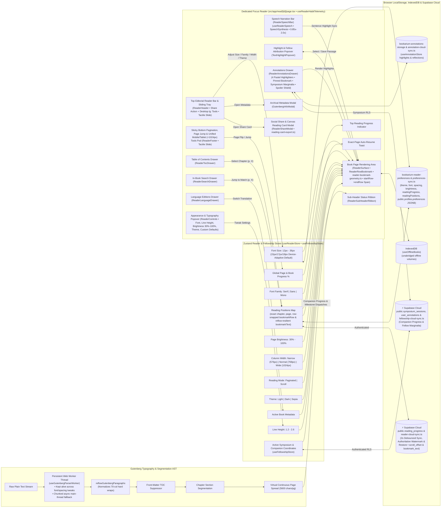
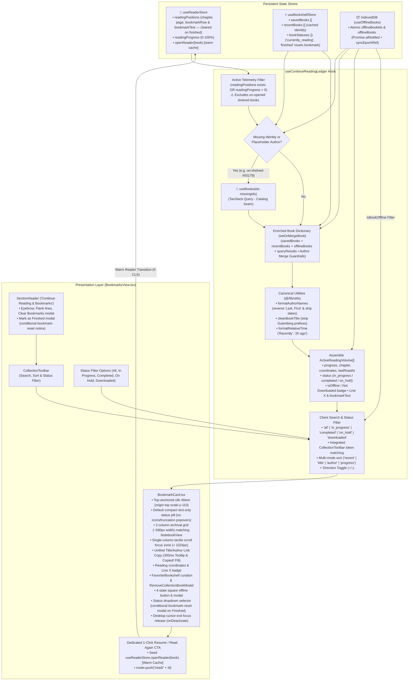

# Focus Reader, Components, Zustand State & Domain Contracts — Bookarium

> **Auto-Generated Living Architecture Slice** • [← Back to Architecture Hub](../ARCHITECTURE.md)  
> **Last Synchronized**: `2026-11-23`  
> **Topology Health**: `256` Modules Analyzed • `1063` Static Linkages • `0` Circular Dependencies • `0` Layer Violations • `0` Orphaned Modules

---

## 🏛️ Focus Reader, Typography & Continue Reading Architecture

### 2. Focus Reader State & Typography Engine

---

### 3. Bookmarks & Continue Reading Ledger Architecture

---

## 🧩 Component Catalog & Props Interface Matrix

Auto-extracted dynamically from **114 Production UI Components** using Babel AST:

| Component | Category | Exported Props Interface | Primary Props & Signals | Module Link |
| :--- | :--- | :--- | :--- | :--- |
| **`AccoladeCelebrationModal`** | Accolades | `AccoladeCelebrationModalProps` | `accolade`, `onDismiss` | [`src/components/accolades/AccoladeCelebrationModal.tsx`](../../src/components/accolades/AccoladeCelebrationModal.tsx) |
| **`ExLibrisBookplate`** | Accolades | `ExLibrisBookplateProps` | `definition`, `progress`, `onTogglePin`, `isPinningDisabled` | [`src/components/accolades/ExLibrisBookplate.tsx`](../../src/components/accolades/ExLibrisBookplate.tsx) |
| **`AccountAccoladesCard`** | Account | `AccountAccoladesCardProps` | `userId`, `activeCategory`, `onCategoryChange`, `onOpenFilter` | [`src/components/account/AccountAccoladesCard.tsx`](../../src/components/account/AccountAccoladesCard.tsx) |
| **`AccountBottomDock`** | Account | `AccountBottomDockProps` | `mode`, `onJumpToSection`, `pendingInvitesCount`, `accoladeCategory`, `onAccoladeCategoryChange`, `accoladeCategoryCounts`, `isFilterOpen`, `onFilterOpenChange`, `theme`, `onCycleTheme`, `onSwitchGuestMode`, `onRefreshSessions`, `isRefreshingSessions`, `isOffline`, `onScrollToTop`, `threshold`, `idleTimeoutMs`, `className` | [`src/components/account/AccountBottomDock.tsx`](../../src/components/account/AccountBottomDock.tsx) |
| **`AccountDeleteModal`** | Account | `AccountDeleteModalProps` | `isOpen`, `onClose`, `userEmail`, `isSendingDeletionEmail`, `deletionEmailSent`, `deleteError`, `onRequestDeletion` | [`src/components/account/AccountDeleteModal.tsx`](../../src/components/account/AccountDeleteModal.tsx) |
| **`AccountHabitsCard`** | Account | `AccountHabitsCardProps` | `userId`, `completedBooksCount` | [`src/components/account/AccountHabitsCard.tsx`](../../src/components/account/AccountHabitsCard.tsx) |
| **`AccountIdentityCard`** | Account | `AccountIdentityCardProps` | `user`, `profile`, `formattedDate`, `onResendVerification`, `isResendingVerification`, `resendSuccess`, `resendError`, `resendCooldown`, `readingStreak`, `onOpenLibraryBreakdown`, `onSignOut` | [`src/components/account/AccountIdentityCard.tsx`](../../src/components/account/AccountIdentityCard.tsx) |
| **`AccountNarrationSubPanel`** | Account | `AccountNarrationSubPanelProps` | `isActive`, `speechRate`, `onSpeechRateChange`, `speechVoiceURI`, `onSpeechVoiceChange`, `speechAutoPageAdvance`, `onSpeechAutoPageAdvanceChange`, `speechHighlightEnabled`, `onSpeechHighlightEnabledChange`, `onResetSpeechPreferences` | [`src/components/account/AccountNarrationSubPanel.tsx`](../../src/components/account/AccountNarrationSubPanel.tsx) |
| **`AccountPreferencesSection`** | Account | `AccountPreferencesSectionProps` | `theme`, `onThemeChange`, `stickyScrollEnabled`, `onStickyScrollChange`, `fontFamily`, `onFontFamilyChange`, `fontSize`, `onFontSizeChange`, `lineHeight`, `onLineHeightChange`, `brightness`, `onBrightnessChange`, `readingMode`, `onReadingModeChange`, `columnWidth`, `onColumnWidthChange`, `spoilerShieldEnabled`, `onSpoilerShieldChange`, `exitBookmarkReminderEnabled`, `onExitBookmarkReminderChange`, `speechRate`, `onSpeechRateChange`, `speechVoiceURI`, `onSpeechVoiceChange`, `speechAutoPageAdvance`, `onSpeechAutoPageAdvanceChange`, `speechHighlightEnabled`, `onSpeechHighlightEnabledChange`, `onResetSpeechPreferences`, `hasCustomDefaults`, `isAtCustomDefaults`, `isAtFactoryDefaults`, `onSaveCustomDefaults`, `onRevertToCustomDefaults`, `onResetToFactoryDefaults` | [`src/components/account/AccountPreferencesSection.tsx`](../../src/components/account/AccountPreferencesSection.tsx) |
| **`AccountPublicProfileSection`** | Account | `AccountPublicProfileSectionProps` | `user`, `profile`, `onUpdateProfile` | [`src/components/account/AccountPublicProfileSection.tsx`](../../src/components/account/AccountPublicProfileSection.tsx) |
| **`AccountSecuritySection`** | Account | `AccountSecuritySectionProps` | `currentPassword`, `newPassword`, `confirmPassword`, `showPassword`, `copiedPassword`, `isUpdatingPassword`, `passwordSuccess`, `passwordError`, `strength`, `isRecoveryMode`, `isSendingResetEmail`, `resetEmailSent`, `resetEmailError`, `resetCooldown`, `onCurrentPasswordChange`, `onNewPasswordChange`, `onConfirmPasswordChange`, `onToggleShowPassword`, `onGeneratePassword`, `onUpdatePassword`, `onRequestPasswordReset`, `onSignOut`, `onOpenDeleteModal`, `userEmail`, `hasGoogleIdentity`, `hasPasswordIdentity`, `canUnlinkGoogle`, `googleIdentityEmail`, `isLinkingGoogle`, `isUnlinkingGoogle`, `identitySuccess`, `identityError`, `onLinkGoogle`, `onUnlinkGoogle`, `sessions`, `isLoadingSessions`, `hasLoadedSessions`, `isSessionsRpcUnavailable`, `sessionsError`, `sessionsSuccess`, `revokingSessionId`, `isSigningOutScope`, `isSignOutAllModalOpen`, `onOpenSignOutAllModal`, `onCloseSignOutAllModal`, `onRefreshSessions`, `onRevokeSession`, `onSignOutOtherDevices`, `onSignOutAllDevices` | [`src/components/account/AccountSecuritySection.tsx`](../../src/components/account/AccountSecuritySection.tsx) |
| **`AccountSymposiumSection`** | Account | `AccountSymposiumSectionProps` | `userId` | [`src/components/account/AccountSymposiumSection.tsx`](../../src/components/account/AccountSymposiumSection.tsx) |
| **`AccountTypographySubPanel`** | Account | `AccountTypographySubPanelProps` | `theme`, `fontFamily`, `onFontFamilyChange`, `fontSize`, `onFontSizeChange`, `lineHeight`, `onLineHeightChange`, `brightness`, `onBrightnessChange`, `readingMode`, `onReadingModeChange`, `columnWidth`, `onColumnWidthChange`, `spoilerShieldEnabled`, `onSpoilerShieldChange`, `exitBookmarkReminderEnabled`, `onExitBookmarkReminderChange` | [`src/components/account/AccountTypographySubPanel.tsx`](../../src/components/account/AccountTypographySubPanel.tsx) |
| **`FellowshipInvitationsSubTab`** | Account/symposium | `FellowshipInvitationsSubTabProps` | `userId`, `pendingCircles`, `pendingSymposiums`, `isOffline`, `onAcceptCircleInvite`, `onDeclineCircleInvite`, `onCancelCircleInvite`, `onAcceptSymposiumInvite`, `onDeclineSymposiumInvite`, `onCancelSymposiumInvite` | [`src/components/account/symposium/FellowshipInvitationsSubTab.tsx`](../../src/components/account/symposium/FellowshipInvitationsSubTab.tsx) |
| **`ReaderCircleSubTab`** | Account/symposium | `ReaderCircleSubTabProps` | `acceptedFellows`, `isOffline`, `inviteHandle`, `onInviteHandleChange`, `isInviting`, `inviteError`, `inviteSuccess`, `onInviteSubmit`, `onOpenSymposiumWithFellow`, `onRequestRemoveFellow` | [`src/components/account/symposium/ReaderCircleSubTab.tsx`](../../src/components/account/symposium/ReaderCircleSubTab.tsx) |
| **`SymposiumPactsSubTab`** | Account/symposium | `SymposiumPactsSubTabProps` | `userId`, `activeSymposiums`, `isOffline`, `isBookOffline`, `onOpenNewSymposiumModal`, `onRequestLeaveSymposium` | [`src/components/account/symposium/SymposiumPactsSubTab.tsx`](../../src/components/account/symposium/SymposiumPactsSubTab.tsx) |
| **`AuthModal`** | Auth | _Autonomous_ | None (Self-Contained) | [`src/components/auth/AuthModal.tsx`](../../src/components/auth/AuthModal.tsx) |
| **`EmailSentView`** | Auth | `EmailSentViewProps` | `title`, `email`, `messagePrefix`, `subtitle`, `resendSuccess`, `onResend`, `isResending`, `resendCooldown`, `onBackToSignIn`, `backButtonLabel` | [`src/components/auth/EmailSentView.tsx`](../../src/components/auth/EmailSentView.tsx) |
| **`TurnstileWidget`** | Auth | `TurnstileWidgetProps` | `active`, `mountKey`, `theme`, `testId`, `className`, `onTokenChange`, `onLoadError` | [`src/components/auth/TurnstileWidget.tsx`](../../src/components/auth/TurnstileWidget.tsx) |
| **`ReadingStatusSelector`** | Bookshelf | `ReadingStatusSelectorProps` | `status`, `onChange`, `bookId`, `bookTitle`, `size`, `showClear`, `className` | [`src/components/bookshelf/ReadingStatusSelector.tsx`](../../src/components/bookshelf/ReadingStatusSelector.tsx) |
| **`ContentCrossfade`** | Motion | `ContentCrossfadeProps` | `transitionKey`, `children`, `variant`, `className`, `style`, `dataTestId` | [`src/components/motion/ContentCrossfade.tsx`](../../src/components/motion/ContentCrossfade.tsx) |
| **`motion-config`** | Motion | _Autonomous_ | None (Self-Contained) | [`src/components/motion/motion-config.ts`](../../src/components/motion/motion-config.ts) |
| **`MotionReveal`** | Motion | `MotionRevealProps` | `children`, `delay`, `className` | [`src/components/motion/MotionReveal.tsx`](../../src/components/motion/MotionReveal.tsx) |
| **`StaggerGroup`** | Motion | `StaggerGroupProps` | `children`, `className` | [`src/components/motion/StaggerGroup.tsx`](../../src/components/motion/StaggerGroup.tsx) |
| **`AdvancedFilterDrawer`** | Presentation | `AdvancedFilterDrawerProps` | `isOpen`, `onClose`, `selectedEra`, `onEraChange`, `selectedSort`, `onSortChange`, `selectedTopic`, `onTopicChange`, `selectedLanguage`, `onLanguageChange`, `selectedFormat`, `onFormatChange`, `onApplyFilters`, `onResetAll`, `activeFilterCount` | [`src/components/presentation/AdvancedFilterDrawer.tsx`](../../src/components/presentation/AdvancedFilterDrawer.tsx) |
| **`BookCard`** | Presentation | `BookCardProps` | `book`, `isOffline`, `hideOfflineBadge`, `onDownloadClick`, `onRemoveOfflineClick`, `onPreviewClick`, `isPreviewActive`, `activeView`, `onTopicClick` | [`src/components/presentation/BookCard.tsx`](../../src/components/presentation/BookCard.tsx) |
| **`BookGrid`** | Presentation | `BookGridProps` | `books`, `isLoading`, `isError`, `onRetry`, `page`, `onPageChange`, `hasNextPage`, `onDownloadClick`, `onRemoveOfflineClick`, `onPreviewClick`, `activePreviewBookId`, `emptyTitle`, `emptyDescription`, `viewMode`, `onViewModeChange`, `initialViewMode`, `showViewToggle`, `onBrowseCatalog`, `searchQuery`, `onClearSearch`, `activeView`, `showShelfControls`, `totalBooksCount`, `favoritesOnly`, `onClearFavoritesOnly`, `onTopicClick`, `pageSize` | [`src/components/presentation/BookGrid.tsx`](../../src/components/presentation/BookGrid.tsx) |
| **`BookmarkCard`** | Presentation | `BookmarkCardProps` | `volume`, `isOffline`, `isDownloadingOffline`, `isActive`, `onActivate`, `onDeactivate`, `onToggleOffline`, `onResume`, `onStatusChange`, `onClear` | [`src/components/presentation/BookmarkCard.tsx`](../../src/components/presentation/BookmarkCard.tsx) |
| **`BookmarksView`** | Presentation | `BookmarksViewProps` | `onBrowseCatalog` | [`src/components/presentation/BookmarksView.tsx`](../../src/components/presentation/BookmarksView.tsx) |
| **`BookPreviewModal`** | Presentation | `BookPreviewModalProps` | `book`, `originRect`, `isOpen`, `activeView`, `isOffline`, `isDownloadingOffline`, `onToggleOffline`, `onWillClose`, `onClose`, `onReadBook` | [`src/components/presentation/BookPreviewModal.tsx`](../../src/components/presentation/BookPreviewModal.tsx) |
| **`BookshelfRack`** | Presentation | `BookshelfRackProps` | `books`, `onBookClick`, `onDownloadClick`, `onBrowseCatalog`, `searchQuery`, `onClearSearch`, `showShelfControls`, `totalBooksCount`, `favoritesOnly`, `onClearFavoritesOnly` | [`src/components/presentation/BookshelfRack.tsx`](../../src/components/presentation/BookshelfRack.tsx) |
| **`CatalogMobileBottomDock`** | Presentation | `CatalogMobileBottomDockProps` | `isMobileDockVisible`, `mobileDockThreshold`, `mobileDockIdleTimeoutMs`, `isSearchOpen`, `onSearchToggle`, `searchQuery`, `isFiltersOpen`, `onOpenFilters`, `activeFilterCount`, `viewMode`, `onViewModeChange`, `currentSort`, `onSortToggle` | [`src/components/presentation/CatalogMobileBottomDock.tsx`](../../src/components/presentation/CatalogMobileBottomDock.tsx) |
| **`CatalogOfflineView`** | Presentation | `CatalogOfflineViewProps` | `onNavigateView`, `savedCount`, `favoriteCount`, `bookmarksCount`, `annotationsCount` | [`src/components/presentation/CatalogOfflineView.tsx`](../../src/components/presentation/CatalogOfflineView.tsx) |
| **`CatalogTelemetryBadge`** | Presentation | `CatalogTelemetryBadgeProps` | `page`, `activeFetching`, `latencyMs`, `catalogSource`, `isError` | [`src/components/presentation/CatalogTelemetryBadge.tsx`](../../src/components/presentation/CatalogTelemetryBadge.tsx) |
| **`CollectionBottomDock`** | Presentation | `CollectionBottomDockProps` | `isVisible`, `threshold`, `idleTimeoutMs`, `searchQuery`, `isSearchOpen`, `onSearchToggle`, `activeFilterCount`, `isFiltersOpen`, `onOpenFilters`, `modeType`, `viewMode`, `onViewModeToggle`, `sortDirection`, `onDirectionToggle`, `isDirectionDisabled`, `onScrollToTop`, `className` | [`src/components/presentation/CollectionBottomDock.tsx`](../../src/components/presentation/CollectionBottomDock.tsx) |
| **`CollectionClearConfirmModal`** | Presentation | `CollectionClearConfirmModalProps` | `isOpen`, `onClose`, `title`, `heading`, `description`, `confirmLabel`, `onConfirm` | [`src/components/presentation/CollectionClearConfirmModal.tsx`](../../src/components/presentation/CollectionClearConfirmModal.tsx) |
| **`CollectionEmptyState`** | Presentation | `CollectionEmptyStateProps` | `icon`, `iconContainerClassName`, `title`, `headingAs`, `description`, `onExploreCatalog`, `showExploreCatalog`, `actions`, `className` | [`src/components/presentation/CollectionEmptyState.tsx`](../../src/components/presentation/CollectionEmptyState.tsx) |
| **`CollectionFilterDrawer`** | Presentation | `CollectionFilterDrawerProps` | `isOpen`, `onClose`, `title`, `subtitle`, `activeFilterCount`, `onResetAll`, `onApply`, `shelfOptions`, `selectedShelfId`, `onSelectShelf`, `shelfSectionTitle`, `favoritesOnly`, `onFavoritesOnlyChange`, `favoritesOnlyCount`, `favoritesSectionTitle`, `viewMode`, `onViewModeChange`, `sortOptions`, `selectedSort`, `onSortChange`, `sortSectionTitle`, `sortDirection`, `onDirectionToggle`, `onDirectionChange`, `isDirectionDisabled` | [`src/components/presentation/CollectionFilterDrawer.tsx`](../../src/components/presentation/CollectionFilterDrawer.tsx) |
| **`CollectionFloatingSearch`** | Presentation | `CollectionFloatingSearchProps` | `isOpen`, `onClose`, `searchQuery`, `onSearchChange`, `searchPlaceholder`, `searchAriaLabel`, `clearAriaLabel`, `submitOnEnter`, `onSubmit`, `contentAnchorId`, `autoCloseOnSubmit` | [`src/components/presentation/CollectionFloatingSearch.tsx`](../../src/components/presentation/CollectionFloatingSearch.tsx) |
| **`CollectionSortDropdown`** | Presentation | `CollectionSortDropdownProps` | `value`, `onChange`, `options`, `ariaLabel`, `className`, `icon`, `hideLeadingIcon`, `sortDirection`, `onDirectionToggle`, `isDirectionDisabled`, `directionAriaLabel`, `dataTestId`, `selectTestId`, `compactOnMobile` | [`src/components/presentation/CollectionSortDropdown.tsx`](../../src/components/presentation/CollectionSortDropdown.tsx) |
| **`CollectionToolbar`** | Presentation | `CollectionToolbarProps` | `searchQuery`, `onSearchChange`, `searchPlaceholder`, `searchAriaLabel`, `clearAriaLabel`, `searchTestId`, `totalCount`, `filteredCount`, `filterValue`, `onFilterChange`, `filterOptions`, `filterAriaLabel`, `filterIcon`, `sortValue`, `onSortChange`, `sortOptions`, `sortAriaLabel`, `sortDirection`, `onDirectionToggle`, `isDirectionDisabled`, `directionAriaLabel`, `currentPage`, `totalPages`, `onPageChange`, `paginationAriaLabel`, `itemCountLabel`, `extraControls`, `singleRowOnMobile`, `hiddenOnMobile`, `className` | [`src/components/presentation/CollectionToolbar.tsx`](../../src/components/presentation/CollectionToolbar.tsx) |
| **`CollectionTopPagination`** | Presentation | `CollectionTopPaginationProps` | `currentPage`, `totalPages`, `onPageChange`, `className`, `ariaLabel` | [`src/components/presentation/CollectionTopPagination.tsx`](../../src/components/presentation/CollectionTopPagination.tsx) |
| **`ContentAdvisoryBanner`** | Presentation | `ContentAdvisoryBannerProps` | `matchedSubject`, `message`, `title`, `compact`, `testId`, `className` | [`src/components/presentation/ContentAdvisoryBanner.tsx`](../../src/components/presentation/ContentAdvisoryBanner.tsx) |
| **`CopyrightNoticeBanner`** | Presentation | `CopyrightNoticeBannerProps` | `country`, `ruleDescription`, `reason`, `publicDomainYear`, `title`, `subtext`, `compact`, `testId`, `className` | [`src/components/presentation/CopyrightNoticeBanner.tsx`](../../src/components/presentation/CopyrightNoticeBanner.tsx) |
| **`DownloadDrawer`** | Presentation | `DownloadDrawerProps` | `book`, `isOpen`, `onClose` | [`src/components/presentation/DownloadDrawer.tsx`](../../src/components/presentation/DownloadDrawer.tsx) |
| **`EditorialQuoteSection`** | Presentation | `EditorialQuoteSectionProps` | `heroBookId`, `className` | [`src/components/presentation/EditorialQuoteSection.tsx`](../../src/components/presentation/EditorialQuoteSection.tsx) |
| **`Footer`** | Presentation | _Autonomous_ | None (Self-Contained) | [`src/components/presentation/Footer.tsx`](../../src/components/presentation/Footer.tsx) |
| **`HeroFeaturedBook2DCard`** | Presentation | `HeroFeaturedBook2DCardProps` | `featuredBook`, `onReadFeaturedBook`, `coverQuote`, `coverLineClampClass`, `quoteRevealClass`, `isTurningLeaf`, `canShuffle`, `onShuffle` | [`src/components/presentation/HeroFeaturedBook2DCard.tsx`](../../src/components/presentation/HeroFeaturedBook2DCard.tsx) |
| **`HeroFeaturedBook3D`** | Presentation | `HeroFeaturedBook3DProps` | `featuredBook`, `onReadFeaturedBook`, `isQuoteDataReady` | [`src/components/presentation/HeroFeaturedBook3D.tsx`](../../src/components/presentation/HeroFeaturedBook3D.tsx) |
| **`HeroSearch`** | Presentation | `HeroSearchProps` | `search`, `onSearchChange`, `onSearch`, `selectedTopic`, `onTopicChange`, `onTopicSelect`, `selectedLanguage`, `onLanguageChange`, `onReadFeaturedBook`, `featuredBook`, `books` | [`src/components/presentation/HeroSearch.tsx`](../../src/components/presentation/HeroSearch.tsx) |
| **`LanguageSelector`** | Presentation | `LanguageSelectorProps` | `value`, `onChange`, `variant`, `id`, `dataTestId`, `className`, `showIcon` | [`src/components/presentation/LanguageSelector.tsx`](../../src/components/presentation/LanguageSelector.tsx) |
| **`LiteraryQuotes`** | Presentation | _Autonomous_ | None (Self-Contained) | [`src/components/presentation/LiteraryQuotes.tsx`](../../src/components/presentation/LiteraryQuotes.tsx) |
| **`Navbar`** | Presentation | `NavbarProps` | `activeView`, `onViewChange`, `onBrandReset`, `isVisible`, `hasShadow`, `initialIsAuthenticated` | [`src/components/presentation/Navbar.tsx`](../../src/components/presentation/Navbar.tsx) |
| **`NotablePassagesSpread`** | Presentation | `NotablePassagesSpreadProps` | `passage`, `title`, `hasContentAdvisory`, `cardHeight`, `isRestricted`, `isUnavailableOffline`, `country`, `isLoading`, `evaluation` | [`src/components/presentation/NotablePassagesSpread.tsx`](../../src/components/presentation/NotablePassagesSpread.tsx) |
| **`NotebookQuoteCard`** | Presentation | `NotebookQuoteCardProps` | `annotation`, `pairedFellowAnnotation`, `matchingOwnAnnotation`, `bookTitle`, `bookAuthor`, `isRestricted`, `isUnavailableOffline`, `jurisdictionCountry`, `isActive`, `onActivate`, `isEditing`, `onStartEdit`, `onCancelEdit`, `onSaveNote`, `onUpdateColor`, `onRequestDeleteReflection`, `onRequestDeleteAnnotation`, `onJumpToReader`, `onSaveFellowAsOwn` | [`src/components/presentation/NotebookQuoteCard.tsx`](../../src/components/presentation/NotebookQuoteCard.tsx) |
| **`NotebookView`** | Presentation | `NotebookViewProps` | `onBrowseCatalog` | [`src/components/presentation/NotebookView.tsx`](../../src/components/presentation/NotebookView.tsx) |
| **`OpenBookLeftPageSpread`** | Presentation | `OpenBookLeftPageSpreadProps` | `bookId`, `title`, `authorDisplay`, `passage`, `rightHeaderLabel`, `primarySubject`, `fullPrimarySubject`, `subjectMaxWidthClass`, `cardHeight`, `hasCommentary`, `isRestricted`, `isUnavailableOffline`, `country`, `contentAdvisory`, `restrictedBadgeTestId`, `offlineBadgeTestId`, `advisoryTestId`, `enableCopyMeta`, `copyMetaTestId`, `copyTooltipAuthor`, `bodyTestId`, `quotesContainerTestId`, `secondaryQuoteTestId`, `tertiaryQuoteTestId`, `quoteRevealClass`, `scrollableBody` | [`src/components/presentation/OpenBookLeftPageSpread.tsx`](../../src/components/presentation/OpenBookLeftPageSpread.tsx) |
| **`StickyCatalogToolbar`** | Presentation | `StickyCatalogToolbarProps` | `page`, `onPageChange`, `hasNextPage`, `viewMode`, `onViewModeChange`, `onOpenFilters`, `isFiltersOpen`, `activeFilterCount`, `activeFilterChips`, `onClearAllFilters`, `isFetching`, `onPrefetchNext`, `latencyMs`, `catalogSource`, `isError`, `pageSize`, `onPageSizeChange`, `isHeaderVisible`, `isVisible`, `isDocked`, `isMobileDockVisible`, `mobileDockThreshold`, `mobileDockIdleTimeoutMs`, `currentSort`, `onSortToggle`, `isSearchOpen`, `onSearchToggle`, `searchQuery` | [`src/components/presentation/StickyCatalogToolbar.tsx`](../../src/components/presentation/StickyCatalogToolbar.tsx) |
| **`BookshelfManageModals`** | Presentation (Bookshelf) | `BookshelfManageModalsProps` | `isCreatingShelf`, `newShelfName`, `newShelfIsPublic`, `onNewShelfNameChange`, `onNewShelfIsPublicChange`, `onCloseCreateShelf`, `onCreateShelf`, `editingShelfId`, `editingShelfName`, `editingShelfIsPublic`, `onEditingShelfNameChange`, `onEditingShelfIsPublicChange`, `onCloseRenameShelf`, `onRenameShelf`, `deletingShelfId`, `onCloseDeleteShelf`, `onDeleteShelf`, `isClearingOfflineShelf`, `onCloseClearOfflineShelf`, `onConfirmClearOfflineShelf`, `isSubmitting` | [`src/components/presentation/bookshelf/BookshelfManageModals.tsx`](../../src/components/presentation/bookshelf/BookshelfManageModals.tsx) |
| **`BookshelfMobileModal`** | Presentation (Bookshelf) | `BookshelfMobileModalProps` | `selectedMobileBook`, `isClosingMobileSheet`, `onClose`, `readingProgress`, `isSaved`, `isFavorite`, `isOffline`, `isDownloadingOffline`, `onToggleSave`, `onToggleFavorite`, `onToggleOffline`, `onBookClick`, `onDownloadClick`, `cloudBookshelves`, `cloudBookshelfItems`, `defaultShelfId`, `currentActiveShelfId`, `userId`, `onMoveBookToShelf`, `activeView`, `className` | [`src/components/presentation/bookshelf/BookshelfMobileModal.tsx`](../../src/components/presentation/bookshelf/BookshelfMobileModal.tsx) |
| **`BookshelfSpine`** | Presentation (Bookshelf) | `BookshelfSpineProps` | `book`, `bookIndex`, `readingProgress`, `isSaved`, `isFavorite`, `isOffline`, `isDownloadingOffline`, `onToggleSave`, `onToggleFavorite`, `onToggleOffline`, `onSpineClick`, `onBookClick`, `onDownloadClick`, `cloudBookshelves`, `cloudBookshelfItems`, `defaultShelfId`, `currentActiveShelfId`, `userId`, `onMoveBookToShelf`, `isActive` | [`src/components/presentation/bookshelf/BookshelfSpine.tsx`](../../src/components/presentation/bookshelf/BookshelfSpine.tsx) |
| **`NotebookFilterStrip`** | Presentation/notebook | `NotebookFilterStripProps` | `selectedColor`, `onSelectColor`, `marginaliaSourceFilter`, `onSelectSourceFilter`, `ownCount`, `fellowCount`, `pairedAllCount`, `sourceFilteredItems` | [`src/components/presentation/notebook/NotebookFilterStrip.tsx`](../../src/components/presentation/notebook/NotebookFilterStrip.tsx) |
| **`NotebookVolumeGroup`** | Presentation/notebook | `NotebookVolumeGroupProps` | `group`, `isUnavailableOffline`, `onOpenVolume`, `renderQuoteCard` | [`src/components/presentation/notebook/NotebookVolumeGroup.tsx`](../../src/components/presentation/notebook/NotebookVolumeGroup.tsx) |
| **`QuickColorSwatchPopover`** | Presentation/notebook | `QuickColorSwatchPopoverProps` | `annotationId`, `activeColor`, `savedColor`, `isEditing`, `onSelectColor` | [`src/components/presentation/notebook/QuickColorSwatchPopover.tsx`](../../src/components/presentation/notebook/QuickColorSwatchPopover.tsx) |
| **`PinnedAccoladesShelf`** | Profile | `PinnedAccoladesShelfProps` | `pinnedItems` | [`src/components/profile/PinnedAccoladesShelf.tsx`](../../src/components/profile/PinnedAccoladesShelf.tsx) |
| **`PrivateProfileNotice`** | Profile | `PrivateProfileNoticeProps` | `username` | [`src/components/profile/PrivateProfileNotice.tsx`](../../src/components/profile/PrivateProfileNotice.tsx) |
| **`PublicProfileView`** | Profile | `PublicProfileViewProps` | `profile`, `pinnedAccolades`, `habits`, `bookshelves` | [`src/components/profile/PublicProfileView.tsx`](../../src/components/profile/PublicProfileView.tsx) |
| **`ServiceWorkerRegister`** | Pwa | _Autonomous_ | None (Self-Contained) | [`src/components/pwa/ServiceWorkerRegister.tsx`](../../src/components/pwa/ServiceWorkerRegister.tsx) |
| **`DeleteAnnotationModal`** | Reader | `DeleteAnnotationModalProps` | `isOpen`, `onClose`, `onConfirm`, `annotation`, `title`, `headline`, `description`, `confirmLabel`, `confirmTestId` | [`src/components/reader/DeleteAnnotationModal.tsx`](../../src/components/reader/DeleteAnnotationModal.tsx) |
| **`GutenbergInfoModal`** | Reader | `GutenbergInfoModalProps` | `isOpen`, `onClose`, `bookId`, `title`, `author`, `theme`, `subjects`, `bookshelves` | [`src/components/reader/GutenbergInfoModal.tsx`](../../src/components/reader/GutenbergInfoModal.tsx) |
| **`QuoteDeletePreview`** | Reader | `QuoteDeletePreviewProps` | `selectedText`, `note` | [`src/components/reader/QuoteDeletePreview.tsx`](../../src/components/reader/QuoteDeletePreview.tsx) |
| **`ReaderAnnotationsDrawer`** | Reader | `ReaderAnnotationsDrawerProps` | `isOpen`, `onClose`, `annotations`, `fellowAnnotations`, `pinnedBookmark`, `isViewingPinnedBookmarkPage`, `onJumpToBookmark`, `onClearBookmark`, `hasActiveSymposium`, `symposiumCompanionUsername`, `symposiumCompanionDisplayName`, `activeChapterIndex`, `marginaliaSourceFilter`, `onSourceFilterChange`, `spoilerShieldEnabled`, `onToggleSpoilerShield`, `bookTitle`, `theme`, `onJumpToAnnotation`, `onDeleteAnnotation`, `onUpdateNote`, `onSaveFellowAnnotation` | [`src/components/reader/ReaderAnnotationsDrawer.tsx`](../../src/components/reader/ReaderAnnotationsDrawer.tsx) |
| **`ReaderControls`** | Reader | `ReaderControlsProps` | `isOpen`, `onClose`, `fontSize`, `onFontSizeChange`, `lineHeight`, `onLineHeightChange`, `fontFamily`, `onFontFamilyChange`, `theme`, `onThemeChange`, `brightness`, `onBrightnessChange`, `readingMode`, `onReadingModeChange`, `columnWidth`, `onColumnWidthChange`, `hasCustomDefaults`, `isAtCustomDefaults`, `isAtFactoryDefaults`, `onRevertToCustomDefaults`, `onResetToFactoryDefaults`, `exitBookmarkReminderEnabled`, `onExitBookmarkReminderChange` | [`src/components/reader/ReaderControls.tsx`](../../src/components/reader/ReaderControls.tsx) |
| **`ReaderDrawerShell`** | Reader | `ReaderDrawerShellProps` | `isOpen`, `onClose`, `title`, `titleIcon`, `theme`, `children`, `ariaLabel`, `closeAriaLabel`, `backdropTestId`, `panelTestId`, `className`, `role` | [`src/components/reader/ReaderDrawerShell.tsx`](../../src/components/reader/ReaderDrawerShell.tsx) |
| **`ReaderErrorView`** | Reader | `ReaderErrorViewProps` | `activeTheme`, `onRetry`, `error`, `bookTitle`, `bookAuthor` | [`src/components/reader/ReaderErrorView.tsx`](../../src/components/reader/ReaderErrorView.tsx) |
| **`ReaderExitBookmarkModal`** | Reader | `ReaderExitBookmarkModalProps` | `isOpen`, `onClose`, `onConfirmExitWithoutSaving`, `onConfirmBookmarkAndExit`, `bookTitle`, `currentPage`, `isUnderThreshold`, `theme`, `initialReminderEnabled`, `onToggleReminder` | [`src/components/reader/ReaderExitBookmarkModal.tsx`](../../src/components/reader/ReaderExitBookmarkModal.tsx) |
| **`ReaderFloatingToolsPod`** | Reader | `ReaderFloatingToolsPodProps` | `theme`, `onToggleSearch`, `onToggleControls`, `onToggleAnnotations`, `onToggleSpeech`, `onToggleTranslations`, `onThemeChange`, `isTocOpen`, `isSearchOpen`, `isControlsOpen`, `isAnnotationsOpen`, `isSpeechOpen`, `isTranslationsOpen`, `isSelectionPopoverOpen`, `annotationsCount`, `hasPinnedBookmark`, `isHidden`, `scheduleIdleDimRef` | [`src/components/reader/ReaderFloatingToolsPod.tsx`](../../src/components/reader/ReaderFloatingToolsPod.tsx) |
| **`ReaderFooter`** | Reader | `ReaderFooterProps` | `globalPage`, `totalBookPages`, `chapterTitle`, `chapterPage`, `chapterPageCount`, `onPrevPage`, `onNextPage`, `onPageJump`, `isPrevDisabled`, `isNextDisabled`, `readingMode`, `theme`, `currentChapterIndex`, `totalChapters`, `onSelectChapter`, `onToggleToc`, `onToggleControls`, `onToggleSearch`, `onToggleSpeech`, `onToggleAnnotations`, `onToggleTranslations`, `onThemeChange`, `isTocOpen`, `isControlsOpen`, `isSearchOpen`, `isSpeechOpen`, `isAnnotationsOpen`, `isTranslationsOpen`, `isSelectionPopoverOpen`, `annotationsCount`, `hasPinnedBookmark`, `isHidden` | [`src/components/reader/ReaderFooter.tsx`](../../src/components/reader/ReaderFooter.tsx) |
| **`ReaderHeader`** | Reader | `ReaderHeaderProps` | `title`, `author`, `bookId`, `progress`, `onBack`, `isTocOpen`, `onToggleToc`, `isSearchOpen`, `onToggleSearch`, `isControlsOpen`, `onToggleControls`, `isTranslationsOpen`, `onToggleTranslations`, `isSpeechOpen`, `onToggleSpeech`, `isAnnotationsOpen`, `onToggleAnnotations`, `annotationsCount`, `hasPinnedBookmark`, `theme`, `totalChapters`, `currentChapterIndex`, `onThemeChange`, `resumeNotice`, `onRestart`, `onDismissResume`, `translations`, `isTranslationsLoading`, `onSelectTranslation`, `symposiumCompanion`, `symposiumMilestoneNotice`, `onDismissSymposiumMilestone`, `isHidden` | [`src/components/reader/ReaderHeader.tsx`](../../src/components/reader/ReaderHeader.tsx) |
| **`ReaderLanguageDrawer`** | Reader | `ReaderLanguageDrawerProps` | `isOpen`, `onClose`, `translations`, `onSelectTranslation`, `theme` | [`src/components/reader/ReaderLanguageDrawer.tsx`](../../src/components/reader/ReaderLanguageDrawer.tsx) |
| **`ReaderLoadingView`** | Reader | `ReaderLoadingViewProps` | `activeTheme` | [`src/components/reader/ReaderLoadingView.tsx`](../../src/components/reader/ReaderLoadingView.tsx) |
| **`ReaderRowBookmark`** | Reader | `ReaderRowBookmarkProps` | `bookmarkElRef`, `effectiveStartRow`, `effectiveEndRow`, `bookmarkSpanRows`, `estimatedMaxBookmarkRows`, `lineStepPx`, `isBookmarkActive`, `isDraggingBookmark`, `getMaxBookmarkRows`, `computeRowFromClientY`, `onStartDrag`, `onEmitRowChange` | [`src/components/reader/ReaderRowBookmark.tsx`](../../src/components/reader/ReaderRowBookmark.tsx) |
| **`ReaderSearchDrawer`** | Reader | `ReaderSearchDrawerProps` | `isOpen`, `onClose`, `chapters`, `fontSize`, `onSelectMatch`, `bookTitle`, `theme` | [`src/components/reader/ReaderSearchDrawer.tsx`](../../src/components/reader/ReaderSearchDrawer.tsx) |
| **`ReaderShareModal`** | Reader | `ReaderShareModalProps` | `isOpen`, `onClose`, `bookId`, `title`, `author`, `theme`, `progress`, `currentChapterIndex`, `totalChapters` | [`src/components/reader/ReaderShareModal.tsx`](../../src/components/reader/ReaderShareModal.tsx) |
| **`ReaderSpeechBar`** | Reader | `ReaderSpeechBarProps` | `speech`, `isOpen`, `onClose`, `isDrawerOpen`, `isPlaying`, `isPaused`, `currentSentenceIndex`, `totalSentences`, `rate`, `availableVoices`, `naturalVoices`, `standardVoices`, `selectedVoice`, `onPlay`, `onPause`, `onResume`, `onSkipNext`, `onSkipPrev`, `onRateChange`, `onVoiceChange`, `theme`, `bookTitle`, `currentPage`, `totalPages`, `isPrevDisabled`, `isNextDisabled` | [`src/components/reader/ReaderSpeechBar.tsx`](../../src/components/reader/ReaderSpeechBar.tsx) |
| **`ReaderSubHeaderRibbon`** | Reader | `ReaderSubHeaderRibbonProps` | `bookId`, `progress`, `totalChapters`, `currentChapterIndex`, `theme`, `resumeNotice`, `onRestart`, `onDismissResume`, `onOpenInfoModal`, `symposiumCompanion`, `symposiumMilestoneNotice`, `onDismissSymposiumMilestone` | [`src/components/reader/ReaderSubHeaderRibbon.tsx`](../../src/components/reader/ReaderSubHeaderRibbon.tsx) |
| **`ReaderSurface`** | Reader | `ReaderSurfaceProps` | `theme`, `brightness`, `fontFamily`, `fontSize`, `lineHeight`, `columnWidth`, `readingMode`, `chapter`, `currentPageText`, `chapterPage`, `bookmarkRow`, `bookmarkText`, `onBookmarkRowChange`, `activeChapterIndex`, `totalChapters`, `isLoading`, `isError`, `error`, `onRetry`, `bookTitle`, `bookAuthor`, `onPreviousPage`, `onNextPage`, `onFontSizeChange`, `onTapSurface`, `isSpeechOpen`, `highlightedSentence`, `annotations`, `targetAnnotationId`, `bookmarkJumpNonce`, `onSelectAnnotation`, `onTextSelected` | [`src/components/reader/ReaderSurface.tsx`](../../src/components/reader/ReaderSurface.tsx) |
| **`ReaderTocDrawer`** | Reader | `ReaderTocDrawerProps` | `isOpen`, `onClose`, `chapters`, `activeChapterIndex`, `onSelectChapter`, `bookTitle`, `theme` | [`src/components/reader/ReaderTocDrawer.tsx`](../../src/components/reader/ReaderTocDrawer.tsx) |
| **`TextHighlightPopover`** | Reader | `TextHighlightPopoverProps` | `isOpen`, `selectedText`, `position`, `activeColor`, `existingNote`, `existingAnnotationId`, `fellowAnnotation`, `isFellowOnly`, `isSpeechOpen`, `onSelectColor`, `onSaveNote`, `onDelete`, `onCopyQuote`, `onClose`, `theme` | [`src/components/reader/TextHighlightPopover.tsx`](../../src/components/reader/TextHighlightPopover.tsx) |
| **`VolumeCompletionModal`** | Reader | `VolumeCompletionModalProps` | `isOpen`, `onClose`, `bookTitle`, `bookRating`, `onRateChange`, `onOpenBookshelf` | [`src/components/reader/VolumeCompletionModal.tsx`](../../src/components/reader/VolumeCompletionModal.tsx) |
| **`SymposiumInviteModal`** | Symposium | `SymposiumInviteModalProps` | `isOpen`, `onClose`, `bookId`, `bookTitle`, `preselectedFellow` | [`src/components/symposium/SymposiumInviteModal.tsx`](../../src/components/symposium/SymposiumInviteModal.tsx) |
| **`Alert`** | UI | `AlertProps` | `variant`, `role`, `icon`, `footer`, `headerClassName`, `dataTestId`, `data-testid`, `className`, `children` | [`src/components/ui/Alert.tsx`](../../src/components/ui/Alert.tsx) |
| **`AmbientCapsuleDock`** | UI | `AmbientCapsuleDockProps` | `effectiveVisible`, `isDockDimmed`, `asideTestId`, `auraTestId`, `ariaLabel`, `maxWidthClass`, `className`, `onPointerEnter`, `onPointerLeave`, `onPointerDown`, `children` | [`src/components/ui/AmbientCapsuleDock.tsx`](../../src/components/ui/AmbientCapsuleDock.tsx) |
| **`BackToTop`** | UI | `BackToTopProps` | `threshold`, `className` | [`src/components/ui/BackToTop.tsx`](../../src/components/ui/BackToTop.tsx) |
| **`Badge`** | UI | `BadgeProps` | `variant`, `size` | [`src/components/ui/Badge.tsx`](../../src/components/ui/Badge.tsx) |
| **`BottomSheetDrawerShell`** | UI | `BottomSheetDrawerShellProps` | `isOpen`, `onClose`, `titleId`, `title`, `subtitle`, `icon`, `dialogTestId`, `backdropTestId`, `closeBtnTestId`, `resetBtnTestId`, `applyBtnTestId`, `activeCount`, `activeFilterCount`, `headerPaddingClass`, `bodyClassName`, `onResetAll`, `onApply`, `children` | [`src/components/ui/BottomSheetDrawerShell.tsx`](../../src/components/ui/BottomSheetDrawerShell.tsx) |
| **`BrandLogo`** | UI | `BrandLogoProps` | `idPrefix`, `className`, `testId` | [`src/components/ui/BrandLogo.tsx`](../../src/components/ui/BrandLogo.tsx) |
| **`Button`** | UI | `ButtonProps` | `as`, `variant`, `size`, `isLoading`, `className`, `children` | [`src/components/ui/Button.tsx`](../../src/components/ui/Button.tsx) |
| **`Card`** | UI | `CardProps` | `variant` | [`src/components/ui/Card.tsx`](../../src/components/ui/Card.tsx) |
| **`ConfirmActionModal`** | UI | `ConfirmActionModalProps` | `isOpen`, `onClose`, `onConfirm`, `title`, `heading`, `description`, `confirmLabel`, `cancelLabel`, `icon`, `children`, `maxWidth`, `buttonSize`, `modalTestId`, `dialogTestId`, `confirmTestId`, `cancelTestId` | [`src/components/ui/ConfirmActionModal.tsx`](../../src/components/ui/ConfirmActionModal.tsx) |
| **`CursorTooltip`** | UI | `CursorTooltipProps` | `isVisible`, `mousePos`, `offset`, `children`, `className`, `testId`, `multiline` | [`src/components/ui/CursorTooltip.tsx`](../../src/components/ui/CursorTooltip.tsx) |
| **`EditorialUnderlineTabs`** | UI | `EditorialUnderlineTabsProps` | `tabs`, `activeTab`, `onSelectTab`, `ariaLabel`, `variant`, `wrapperClassName`, `trackClassName`, `capsuleTestId`, `compactLayout`, `useKeyboardNavigation`, `navRole`, `buttonRole`, `selectionAttr`, `inactiveLabelClass`, `hideInactiveCountOnMobile`, `compactPadding` | [`src/components/ui/EditorialUnderlineTabs.tsx`](../../src/components/ui/EditorialUnderlineTabs.tsx) |
| **`Input`** | UI | `InputProps` | `icon`, `onClear` | [`src/components/ui/Input.tsx`](../../src/components/ui/Input.tsx) |
| **`Modal`** | UI | `ModalProps` | `isOpen`, `onClose`, `title`, `children`, `className`, `maxWidth`, `showCloseButton`, `backdropClassName`, `backdropTestId`, `testId` | [`src/components/ui/Modal.tsx`](../../src/components/ui/Modal.tsx) |
| **`Pagination`** | UI | `PaginationProps` | `currentPage`, `totalPages`, `onPageChange`, `totalItems`, `pageSize`, `className` | [`src/components/ui/Pagination.tsx`](../../src/components/ui/Pagination.tsx) |
| **`PasswordStrengthMeter`** | UI | `PasswordStrengthMeterProps` | `strength`, `className` | [`src/components/ui/PasswordStrengthMeter.tsx`](../../src/components/ui/PasswordStrengthMeter.tsx) |
| **`RemoveCollectionBookModal`** | UI | `RemoveCollectionBookModalProps` | `isOpen`, `collectionType`, `bookTitle`, `onClose`, `onConfirm` | [`src/components/ui/RemoveCollectionBookModal.tsx`](../../src/components/ui/RemoveCollectionBookModal.tsx) |
| **`RemoveOfflineBookModal`** | UI | `RemoveOfflineBookModalProps` | `isOpen`, `bookTitle`, `onClose`, `onConfirm`, `isLoading` | [`src/components/ui/RemoveOfflineBookModal.tsx`](../../src/components/ui/RemoveOfflineBookModal.tsx) |
| **`SectionHeader`** | UI | `SectionHeaderProps` | `eyebrow`, `title`, `subtitle`, `titleAs`, `showFlankLines`, `className`, `titleClassName`, `children` | [`src/components/ui/SectionHeader.tsx`](../../src/components/ui/SectionHeader.tsx) |
| **`SegmentedControl`** | UI | `SegmentedControlProps` | `options`, `value`, `onChange`, `isSelected`, `className`, `optionClassName`, `activeClassName`, `inactiveClassName`, `getOptionClassName`, `role`, `ariaLabel`, `emitAriaPressed` | [`src/components/ui/SegmentedControl.tsx`](../../src/components/ui/SegmentedControl.tsx) |
| **`Select`** | UI | `SelectProps` | `leftIcon`, `rightChevron`, `wrapperClassName` | [`src/components/ui/Select.tsx`](../../src/components/ui/Select.tsx) |
| **`StarRating`** | UI | `StarRatingProps` | `value`, `onChange`, `size`, `readOnly`, `showLabel`, `compactOnMobile`, `className`, `aria-label` | [`src/components/ui/StarRating.tsx`](../../src/components/ui/StarRating.tsx) |
| **`Switch`** | UI | `SwitchProps` | `checked`, `onCheckedChange`, `mode`, `id`, `ariaLabel`, `aria-label`, `dataTestId`, `data-testid`, `disabled`, `className`, `trackClassName`, `thumbClassName` | [`src/components/ui/Switch.tsx`](../../src/components/ui/Switch.tsx) |
| **`Textarea`** | UI | `TextareaProps` | `variant` | [`src/components/ui/Textarea.tsx`](../../src/components/ui/Textarea.tsx) |

---

## ⚡ State Management & Store Architecture

Zustand client-side state stores programmatically verified across **10 Persistent Modules**:

### 1. `useAccoladesStore` ([`src/stores/useAccoladesStore.ts`](../../src/stores/useAccoladesStore.ts))
* **Storage Key**: `STORAGE_KEYS.ACCOLADES` (localStorage)
* **Role & State**: Deterministic literary accolades evaluation, celebration queues, personal showcase pinning (max 3 bookplates), offline pin mutation queue (`pendingPinUpdates`), per-user coalesced (`coalesceInFlightByUser`) Supabase cloud synchronization with dirty-rerun tracking, and opt-in `15,000ms` passive mount cooldown (`lastAccoladesSyncByUser`, `invalidateAccoladesSyncCooldown`).

### 2. `useAnnotationStore` ([`src/stores/useAnnotationStore.ts`](../../src/stores/useAnnotationStore.ts))
* **Storage Key**: `STORAGE_KEYS.ANNOTATIONS` (localStorage)
* **Role & State**: Scholar marginalia, categorical pastel highlights (Yellow, Amber, Mint, Rose), co-reader Fellow Marginalia (`fellowAnnotations`), cross-volume global fellow marginalia sync (`fetchAllFellowAnnotations`), companion profile enrichment & placeholder protection (`enrichFellowAnnotations`, `resolveStaleFellowProfiles`), chapter-bound Spoiler Shield (`spoilerShieldEnabled`), per-user coalesced (`coalesceInFlightByUser`) cloud outbox synchronization with retry-loop-safe dirty tracking, and opt-in `15,000ms` passive mount/drawer cooldowns (`lastPassiveAnnotationSyncByUser`, `lastFellowBookSyncByKey`, `invalidateAnnotationSyncCooldown`) decoupled from persisted `lastAnnotationSyncAt` LWW tracking.

### 3. `useAuthStore` ([`src/stores/useAuthStore.ts`](../../src/stores/useAuthStore.ts))
* **Storage Key**: `bookarium-auth-profile` (localStorage)
* **Role & State**: Supabase session authentication with module-scoped `inFlightInitialUserCheck` Strict-Mode deduplication and synchronous `INITIAL_SESSION` racing protection, Google OAuth PKCE (`signInWithOAuth`), connected identities linking/unlinking (`linkOAuthIdentity`, `unlinkOAuthIdentity`), anti-lockout protection (`hasPasswordIdentity`), transient reload error resilience (`sessionData.session.user` preservation), Cloudflare Turnstile `captchaToken` forwarding (`signInWithPassword`, `signUpWithPassword`, `signInWithOtp`, `resetPasswordForEmail`, `resendVerificationEmail`), fail-closed password recovery verification (`verifyPasswordRecoverySession`, `isPasswordRecovery` validated via Supabase JWT `amr` claims + `3600s` TTL and single-use `bookarium-consumed-recovery` markers via `markRecoveryConsumed` / `clearConsumedRecoveryMarker` in `src/lib/auth-recovery.ts`), anonymous local `getSession()` guard before `getUser()`, scoped sign-out (`signOut(scope = 'local')` default preserving remote/sibling-origin sessions, plus `signOutOtherDevices()` with `{ scope: 'others' }` verifying `verifyActiveSessionValidity({ force: true })` and explicit `{ scope: 'global' }` in `deleteAccount()`), active session inspection and strict per-device revocation (`listActiveSessions`, `revokeSession` via `get_active_sessions`/`revoke_user_session` RPCs checking missing `isCurrent` and explicit boolean `false` already-ended results with graceful `PGRST202`/`42883` fallback), throttled coalesced remote session validation (`verifyActiveSessionValidity` enforcing pre-commit local store teardown via coalesced `resetClientAuthState` on `400/401/403 session_not_found` while preserving transient offline/`5xx` errors), durable reload-safe teardown recovery (`bookarium-pending-store-cleanup` via `STORAGE_KEYS.PENDING_STORE_CLEANUP` stamped synchronously across `resetClientAuthState` and `onAuthStateChange` and flushed cleanly inside `initializeAuth` when interrupted mid-reload), non-blocking server-origin IP/UA reconciliation (`reconcileClientSessionOrigin` consuming `bookarium-client-ip-sync`), pre-sync active JWT session verification (`hasSupabaseAuthCookie`, `shouldVerifyCloudSession`, `verifyActiveCloudSession`) invoking full coalesced `resetClientAuthState` (`wipeDeviceStorage: false`) when cookies are cleared (`bookarium-auth-hint=guest`), offline-persisted profile & user state (`bookarium-auth-profile`), optimistic offline profile outbox (`pendingProfileUpdates`), shared `coalesceInFlightByUser` profile coalescing with opt-in passive cooldown (`lastProfileSyncByUser`, `minSyncIntervalMs`), OWASP current-password re-authentication (`updatePassword`), complete 10-store session teardown & IndexedDB/speech/sessionStorage erasure on account deletion (`clearLocalUserStores`), and cloud profile synchronization with live companion identity propagation.

### 4. `useBookshelfStore` ([`src/stores/useBookshelfStore.ts`](../../src/stores/useBookshelfStore.ts))
* **Storage Key**: `STORAGE_KEYS.BOOKSHELF` (localStorage)
* **Role & State**: Personal library collections, reading queue, reading history, custom named shelves, active-shelf-aware book clearing (`clearSavedBooks`, `clearCustomShelfBooks`), placeholder-to-authentic author & subject/format self-healing (`enrichSavedBooks`), atomic selector hooks (`useIsBookSaved`, `useIsBookFavorite`, `useHydratedBookshelfCounts`, `useBookRating`, `useReadingStatus`), deletion tombstones, ratings, opt-in `15,000ms` passive mount cooldown (`invalidateBookshelfSyncCooldown`), and cloud outbox reconciliation (`DELETE_BOOK`, `INSERT_BOOK`, `DELETE_FAVORITE`, `UPSERT_FAVORITE`, `UPSERT_CURATION`, `DELETE_CURATION`, `MOVE_BOOK`, `UPDATE_SHELF`) via `bookshelf-cloud-sync.ts`.

### 5. `useFellowshipStore` ([`src/stores/useFellowshipStore.ts`](../../src/stores/useFellowshipStore.ts))
* **Storage Key**: `bookarium-fellowship-storage` (localStorage)
* **Role & State**: Opt-in 1-on-1 Reader Circle fellowships, per-volume Literary Symposium sessions, companion progress coordinates, offline symposium progress outbox (`pendingSymposiumProgress`), scholar handle formatting (`formatFellowScholarLabel`, `isPlaceholderUsername`), pending invitation badges, `verifyActiveCloudSession` session guard + per-user coalesced (`coalesceInFlightByUser`) Supabase cloud synchronization, and opt-in `15,000ms` passive mount cooldowns (`lastFellowshipSyncByUser`) automatically invalidated across membership/symposium mutations.

### 6. `useHabitsStore` ([`src/stores/useHabitsStore.ts`](../../src/stores/useHabitsStore.ts))
* **Storage Key**: `STORAGE_KEYS.HABITS` (localStorage)
* **Role & State**: Reading streaks with 5-minute active immersion threshold, daily calendar activity dates, annual volume challenge goals, deduplicated completed books count (`completed_books_count`), dual immersion telemetry (reading vs listening), strict `isRemoteAlreadyConverged` no-op upsert skipping, per-user coalesced (`coalesceInFlightByUser`) Supabase cloud synchronization, and opt-in `15,000ms` passive mount cooldown (`lastHabitsSyncByUser`, `invalidateHabitsSyncCooldown`) bypassed while debounce timers or dirty flags are pending.

### 7. `useJurisdictionStore` ([`src/stores/useJurisdictionStore.ts`](../../src/stores/useJurisdictionStore.ts))
* **Storage Key**: In-Memory (Ephemeral)
* **Role & State**: Client-side geographic jurisdiction state, cookie synchronization (bookarium-geo-country), developer country overrides, and synchronous regional capability resolution.

### 8. `usePreferencesStore` ([`src/stores/usePreferencesStore.ts`](../../src/stores/usePreferencesStore.ts))
* **Storage Key**: `STORAGE_KEYS.PREFERENCES` (localStorage)
* **Role & State**: Reader display choices, sticky header auto-hide preferences, Web Speech API narration configuration (`speechRate`, `speechVoiceURI`, `speechAutoPageAdvance`, `speechHighlightEnabled`), saved personal default preset (`customDefaults`), and cloud sync timestamp (`preferencesUpdatedAt`).

### 9. `useReaderStore` ([`src/stores/useReaderStore.ts`](../../src/stores/useReaderStore.ts))
* **Storage Key**: `STORAGE_KEYS.READER_SETTINGS` (localStorage)
* **Role & State**: Active book payload with verified lifespan preservation, typography settings (size, family, line height), page brightness (`30%–100%`), persistent reading mode (`paginated` vs `scroll`) and column width (`narrow` / `normal` / `wide`), chapter/page/row coordinates (`bookmarkRow`) and cross-display/font-reflow resilient passage anchor (`bookmarkText`, cleared on finished status), bookmark deletion tombstones (`deletedPositionBookIds`), persisted dirty edit tracking (`dirtyPositionBookIds` cleared via snapshot-guarded `clearUploadedDirtyPositions` with `0%` Page-1 ghost dirty-flag scrubbing & stale debounce timer cancellation across `saveReadingPosition`, `syncReadingPositionToCloud` `!row`, and `syncWithCloud`), upload-verified monotonic sync watermark (`lastReaderSyncAt` anchored via `Math.max(syncSnapshotStartedAtMs, maxRemoteTimeMs)` for authoritative cross-device remote deletion pruning without clobbering standalone `Finished` curation), placeholder-to-authentic author & lifespan self-healing (`enrichReadingPositions`, `saveReadingPosition`), opt-in `15,000ms` passive mount cooldown (`lastReaderSyncByUser`, `invalidateReaderSyncCooldown`), and per-user coalesced (`coalesceInFlightByUser`) bidirectional Supabase `reading_progress` sync with `2,000ms` single-book debouncing, batched multi-book `Promise<boolean>` upserts (`buildReadingProgressCloudRow`, `upsertReadingProgressBatch`), `SELECT`-gated legacy orphan `.delete()` (`isGhostCloudRow`), and full `resetReaderSession()` teardown parity.

### 10. `useThemeStore` ([`src/stores/useThemeStore.ts`](../../src/stores/useThemeStore.ts))
* **Storage Key**: `STORAGE_KEYS.THEME` (localStorage)
* **Role & State**: Global application theme state (Day Paper, Sepia Parchment, Obsidian Dark) with immediate document class application and synchronous cookie synchronization (`bookarium-theme-preference`) for Zero-Flash SSR hydration.

---

## 📚 Configuration, Anthologies & Design Token Catalog

Programmatically extracted from **13 Configuration Modules** in `src/config/` using Babel AST:

| Configuration Module | Source File | Exported Constants & Fixtures | Exported Pure Functions | Canonical Interfaces / Types |
| :--- | :--- | :--- | :--- | :--- |
| **`accolades-config`** | [`src/config/accolades-config.ts`](../../src/config/accolades-config.ts) | `ACCOLADE_TIER_CONFIG`, `ACCOLADE_CATEGORIES (6 items)`, `ACCOLADES_CATALOG (14 items)` | _None_ | `TierVisualTokens` |
| **`annotation-tokens`** | [`src/config/annotation-tokens.ts`](../../src/config/annotation-tokens.ts) | `ANNOTATION_COLOR_CONFIG`, `ANNOTATION_COLOR_LIST`, `ALL_COLORS_FILTER_BADGE`, `BOOKMARK_DRAWER_TOKEN` | _None_ | `AnnotationColorTheme`, `BookmarkDrawerTheme` |
| **`api-endpoints`** | [`src/config/api-endpoints.ts`](../../src/config/api-endpoints.ts) | `API_ENDPOINTS` | _None_ | _None_ |
| **`catalog-filters`** | [`src/config/catalog-filters.ts`](../../src/config/catalog-filters.ts) | `INITIAL_VISIBLE_FACET_COUNT`, `INITIAL_VISIBLE_LANGUAGE_COUNT`, `LITERARY_ERAS (7 items)`, `SORT_OPTIONS (3 items)`, `GENRE_FACETS (33 items)`, `HERO_POPULAR_TOPICS (13 items)`, `CATALOG_LANGUAGES (21 items)`, `FORMAT_FILTERS (5 items)` | _None_ | `EraOption`, `SortOption`, `GenreFacet`, `LanguageOption`, `FormatFilter` |
| **`featured-books`** | [`src/config/featured-books.ts`](../../src/config/featured-books.ts) | `BookPassage`, `FEATURED_HERO_BOOKS (27 items)`, `FEATURED_HERO_BOOK` | `getBookPassages`, `hasCuratedBookPassages`, `getJurisdictionSafeFeaturedBooks`, `getHourlyHeroBook`, `getDailyEditorialBook`, `isClassicCatalogBook`, `gutendexBookToFeaturedHeroBook`, `selectHourlyHeroFromPool`, `selectDailyClassicFromPool` | `FeaturedHeroBook` |
| **`library-tokens`** | [`src/config/library-tokens.ts`](../../src/config/library-tokens.ts) | `LIBRARY_THEMES` | `getLibraryTheme` | `LibrarySectionTheme`, `LibrarySectionKey` |
| **`literary-quotes`** | [`src/config/literary-quotes.ts`](../../src/config/literary-quotes.ts) | `LITERARY_QUOTES (36 items)` | `getJurisdictionSafeLiteraryQuotes`, `selectHourlyLiteraryQuotes` | `LiteraryQuote` |
| **`reader-config`** | [`src/config/reader-config.ts`](../../src/config/reader-config.ts) | `READER_FONT_CONFIG`, `READER_GESTURE_CONFIG` | `resolveDefaultReaderFontSize` | _None_ |
| **`reader-themes`** | [`src/config/reader-themes.ts`](../../src/config/reader-themes.ts) | `NEXT_READER_THEME`, `READER_THEMES` | `getReaderTheme` | `ReaderThemeConfig` |
| **`routes`** | [`src/config/routes.ts`](../../src/config/routes.ts) | `ROUTES` | _None_ | _None_ |
| **`site-config`** | [`src/config/site-config.ts`](../../src/config/site-config.ts) | `SITE_CONFIG`, `STORAGE_KEYS` | `normalizeSiteOrigin`, `resolveSiteUrl`, `resolveSiteHost`, `resolveRepositoryUrl`, `buildDescriptiveUserAgent`, `resolveGoogleSiteVerification` | _None_ |
| **`translation-languages`** | [`src/config/translation-languages.ts`](../../src/config/translation-languages.ts) | `POPULAR_TRANSLATION_LANGUAGES (18 items)`, `ALL_TRANSLATION_LANGUAGES` | `resolveTranslationLanguage` | `TranslationLanguage` |
| **`views.config`** | [`src/config/views.config.ts`](../../src/config/views.config.ts) | `NAV_ITEMS`, `NAVBAR_VIEW_CONFIG`, `VIEW_CONTENT_CONFIG` | _None_ | `NavViewId`, `ViewId`, `NavItemConfig`, `ViewContentStrategy` |

---

## 📐 Domain Type Contracts & Data Models

Programmatically extracted from **4 TypeScript Type Modules** in `src/types/` using Babel AST:

| Type Definition Module | Source File | Exported Interfaces | Exported Type Aliases |
| :--- | :--- | :--- | :--- |
| **`accolades.types`** | [`src/types/accolades.types.ts`](../../src/types/accolades.types.ts) | `AccoladeEvaluationContext`, `AccoladeDefinition`, `UnlockedAccolade`, `AccoladeProgress`, `AccoladeEvaluationResult` | `AccoladeId`, `AccoladeTier`, `AccoladeCategory` |
| **`book.types`** | [`src/types/book.types.ts`](../../src/types/book.types.ts) | `Author`, `BookPassage`, `GutendexBook`, `GutendexResponse`, `BookCuration`, `Book`, `ActiveReadingVolume` | `ReadingStatus`, `LedgerFilter`, `LedgerItemStatus` |
| **`catalog.types`** | [`src/types/catalog.types.ts`](../../src/types/catalog.types.ts) | `CatalogQueryOptions`, `CatalogQueryResult`, `ICatalogProvider` | _None_ |
| **`database.types`** | [`src/types/database.types.ts`](../../src/types/database.types.ts) | `Database` | `Json`, `Profile`, `Bookshelf`, `BookshelfItem`, `UserFavorite`, `ReadingProgress`, `UserAnnotation`, `UserBookCuration`, `UserReadingHabits`, `UserAccolade`, `DatabaseBook`, `BookTranslationRow`, `BookTranslationInsert`, `BookTranslationUpdate`, `ReaderCircleRow`, `SymposiumSessionRow` |

---

> *Compiled from Source AST by [`scripts/generate-architecture-matrix.js`](../../scripts/generate-architecture-matrix.js) — [← Return to Architecture Hub](../ARCHITECTURE.md).*
