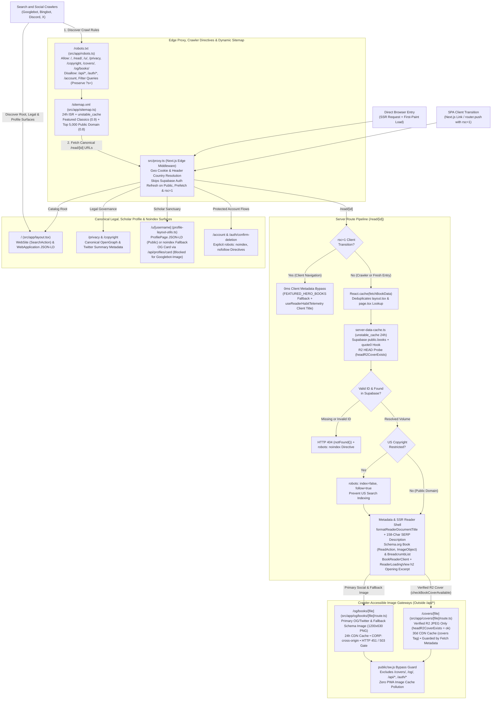

# API Routes, App Router, Hooks, Domain Engines, SEO & Edge Proxy — Bookarium

> **Auto-Generated Living Architecture Slice** • [← Back to Architecture Hub](../ARCHITECTURE.md)  
> **Last Synchronized**: `2026-11-28`  
> **Topology Health**: `268` Modules Analyzed • `1157` Static Linkages • `0` Circular Dependencies • `0` Layer Violations • `0` Orphaned Modules

---

## 🌐 API Routes, App Router Entrypoints, Query Hooks & Reader Engine

### 1. API & Server Route Handlers (Edge Proxy, Auth & Telemetry)

| Endpoint / Route | Method(s) | Source File | Cache & Security Strategy | Upstream Target |
| :--- | :--- | :--- | :--- | :--- |
| **`/api/books`** | `GET` | [`src/app/api/books/route.ts`](../../src/app/api/books/route.ts) | `s-maxage=86400` (Catalog, `Vercel-Cache-Tag: catalog` or `catalog,quotes` when `has_quotes=true`, `MAX_CATALOG_PAGE=5000` / `MAX_CATALOG_OFFSET=160_000`) / `s-maxage=43200` (`?pool=quotes`, `Vercel-Cache-Tag: quotes`, 12h rotating `DEFAULT_QUOTE_POOL_LIMIT=48`) / `s-maxage=604800` (`?ids=...&has_quotes=true` [`Vercel-Cache-Tag: catalog,quotes`] & `include_restricted_metadata=true` [`Vercel-Cache-Tag: catalog`]) • Query Allowlist (`400 no-store`), `CORP: same-origin` & `nosniff` • `globalThis` `booksApiRateLimiter` (`60 req/min`) • `503/504 no-store` DB-down & `57014` timeout guard | Supabase `public.books` (`searchBooks` / `fetchQuoteEnrichedPool`) -> `curated-fallback.ts` (unconfigured search fallback, omits `Vercel-Cache-Tag`) |
| **`/api/books/content`** | `GET` | [`src/app/api/books/content/route.ts`](../../src/app/api/books/content/route.ts) | `max-age=86400, s-maxage=86400, stale-while-revalidate=604800` (plain text `Vercel-Cache-Tag: book-content`, `CORP: same-origin`; `type=card` OpenGraph PNG untagged `CORP: cross-origin` via shared `asset-renders.ts` with dynamic `SITE_CONFIG.SITE_HOST` footer) / `max-age=2592000, s-maxage=2592000, stale-while-revalidate=2592000` (`type=cover` `Vercel-Cache-Tag: covers`, strict R2-only via `asset-renders.ts`, `404 no-store` on miss/unconfigured, `CORP: same-origin`, metadata check bypassed) • Strict Query Allowlist (`id`, `type`, `s` with `s` gated to `type=card`), Edge/Route Fetch Metadata Anti-Deeplink & Cross-Site Guard (`guardContentAssetRequest` -> `403 no-store` outside `type=card` and headerless bots without altering `Vary`), Mode-Scoped `globalThis` Limiters (`30` text / `60` cover / `20` card req/min), 20-Book LRU (`bookContentLruCache`), In-Flight R2 Request Coalescing (`inFlightR2Fetches`), Fail-Closed `503`/`404` R2 Enforcement (Zero Runtime PG Fallback) & Unified US (`copyright === true`) + Non-US `HTTP 451` Gate | Cloudflare R2 (`covers/{id}.jpg`, `books/{id}.txt.gz`) & `next/og` |
| **`/api/books/translations`** | `GET` | [`src/app/api/books/translations/route.ts`](../../src/app/api/books/translations/route.ts) | `max-age=86400, s-maxage=604800, stale-while-revalidate=2592000`, `Vercel-Cache-Tag: translations` (`200` responses) • Query Allowlist, Strict ID (`1..10_000_000`), `CORP: same-origin` & `nosniff` • `globalThis` `booksApiRateLimiter` (`60 req/min`) & Jurisdictional Filter | Supabase `public.book_translations` & `public.books` |
| **`/api/profiles/card`** | `GET` | [`src/app/api/profiles/card/route.ts`](../../src/app/api/profiles/card/route.ts) | `max-age=86400, s-maxage=86400, stale-while-revalidate=604800` (confirmed `public` scholars) / `max-age=300, s-maxage=300, stale-while-revalidate=3600` (uniform neutral `ADR-033` fallback for private/missing/unavailable handles) • Strict Query Allowlist (`username`, visual-only signed `s`), `CORP: cross-origin` & `nosniff`, `profileCardRateLimiter` (`20 req/min`), & `proxy.ts` Cookie/Session Skip | Supabase `public.profiles`, `user_reading_habits`, `user_accolades`, `bookshelves` & `next/og` |
| **`/auth/callback`** | `GET` | [`src/app/auth/callback/route.ts`](../../src/app/auth/callback/route.ts) | `No-Store Auth Exchange` • PKCE (`redirectType=recovery`) & OTP Recovery Scoping, Cross-Device Recovery & Account Deletion Notice Routing, Sanitized `User-Agent` Forwarding, Non-Recovery `bookarium-client-ip-sync` Cookie Stamping + Canonical Origin Redirect Sanitizer | Supabase Auth (`exchangeCodeForSession`, `verifyOtp`) |
| **`/covers/[file]`** | `GET` | [`src/app/covers/[file]/route.ts`](../../src/app/covers/[file]/route.ts) | `max-age=2592000, s-maxage=2592000, stale-while-revalidate=2592000` (`Vercel-Cache-Tag: covers`, crawler-allowed outside `/api/*`, strict R2 JPEG proxy via `asset-renders.ts`, `404 no-store` on invalid `<id>.jpg` or R2 miss, `CORP: same-origin`) • Strict Zero-Param Allowlist (dev `?country` only), Edge/Route Fetch Metadata Anti-Deeplink & Cross-Site Guard (`guardContentAssetRequest` -> `403 no-store` on browser navigation/iframe/cross-site while allowing headerless SEO/social bots and same-origin ``), `bookCoverRateLimiter` (`60 req/min`) | Cloudflare R2 (`covers/{id}.jpg` via shared `asset-renders.ts`) |
| **`/og/books/[file]`** | `GET` | [`src/app/og/books/[file]/route.ts`](../../src/app/og/books/[file]/route.ts) | `max-age=86400, s-maxage=86400, stale-while-revalidate=604800` (crawler-allowed stateless `1200×630` OpenGraph PNG card outside `/api/*` via `asset-renders.ts`, `CORP: cross-origin`, `404 no-store` on non-`<id>.png`) • Strict Allowlist (`s` share token only), Unified US (`copyright === true`) + Non-US `HTTP 451`/`503` Gate (`enforceBookAssetJurisdictionGate`), `bookCardRateLimiter` (`20 req/min`) | Supabase `public.books` Metadata (`metadata-cache.ts`), `CURATED_BOOKS`, & `next/og` (`asset-renders.ts`) |

### 2. App Router Pages, Layouts, Providers & Styling Entrypoints

| Route / URI | Entrypoint Type | Rendering Strategy | Source File | Architectural Responsibility |
| :--- | :--- | :--- | :--- | :--- |
| **`/account`** | Route Layout & SSR Metadata | React Server Component (SSR / Static) | [`src/app/account/layout.tsx`](../../src/app/account/layout.tsx) | Server layout defining canonical metadata and robots noindex directives for the Scholar Account Hub. |
| **`/account`** | App Page | Client Interactive (`"use client"`) | [`src/app/account/page.tsx`](../../src/app/account/page.tsx) | 4-tab Scholar Profile-first Account Hub featuring a `PublicProfileView`-styled identity & streak hero (`AccountIdentityCard`), View/Edit `Scholar Profile` data indicators with two `md:grid-cols-2` pairs (`Display Name` + private `Account Email`, `@username` + `Public Sanctuary URL`) above full-width `Bio` (`400`-char `SCHOLAR_BIO_MAX_LENGTH`, lazy-loaded searchable `HighlightBioPickerModal` for quoting saved highlights with source clearing on custom edits) and footer-only `Edit` / `Cancel` + `Save`, conditional Invitations & stacked single-column Symposium/Circle cards, unified `rounded-3xl` Habits & Accolades, simultaneous Typography + Read-Aloud Preferences, OWASP/JWT AMR Security (`verifyPasswordRecoverySession`, Active Device Sessions), unified `EditorialUnderlineTabs` (`recessed-capsule`) fixed `grid-cols-4` zero-shift `translate3d` gliding-capsule (`mobileLabel` / `md:inline`, `data-no-swipe`) tab bar, legacy `?tab=symposiums` smooth scrolling, 2-tab Guest Offline Workspace, online/offline Guest `Clear All Local Data` controls (`clearGuestDeviceData` + `ConfirmActionModal`), and `AccountBottomDock`. |
| **`/auth/confirm-deletion`** | Route Layout & SSR Metadata | React Server Component (SSR / Static) | [`src/app/auth/confirm-deletion/layout.tsx`](../../src/app/auth/confirm-deletion/layout.tsx) | Server layout enforcing `robots: { index: false, follow: false }` metadata on the account deletion confirmation route. |
| **`/auth/confirm-deletion`** | App Page | Client Interactive (`"use client"`) | [`src/app/auth/confirm-deletion/page.tsx`](../../src/app/auth/confirm-deletion/page.tsx) | Two-step email-verified account deletion confirmation page executing `delete_current_user()` RPC. |
| **`/copyright`** | Route Layout & SSR Metadata | React Server Component (SSR / Static) | [`src/app/copyright/layout.tsx`](../../src/app/copyright/layout.tsx) | Server layout defining canonical SEO, OpenGraph, and Twitter summary metadata for Copyright & Public Domain Governance. |
| **`/copyright`** | App Page | React Server Component (SSR / Static) | [`src/app/copyright/page.tsx`](../../src/app/copyright/page.tsx) | Multi-Jurisdictional Public Domain Copyright Governance manifesto covering US territories, conservative international `Life+70` defaults, `MX`/`CI` evergreen `Life+100`, regional translator terms, global RDF `<dcterms:rights>` exclusion, multi-host `rsync` (`aleph.gutenberg.org` <-> `rsync.ibiblio.org`) & CLI user-agents (`Bookarium-Catalog-Sync/1.0`, `Bookarium-R2-Sync/1.0`, `PUBLIC_USER_AGENT`), human-initiated `offline_books` vs. automatic `cover_cache`, `/og/books/[file]` `HTTP 451` card parity, `bookarium-geo-country` (`Max-Age=7 days`) + `/privacy` Edge WAF cross-reference, takedown notice channel, and verified Project Gutenberg + Wikidata attribution. |
| **`/`** | App Error Boundary | Client Interactive (`"use client"`) | [`src/app/error.tsx`](../../src/app/error.tsx) | Route-level React Error Boundary providing graceful recovery UI and diagnostic fallback. |
| **`/`** | App Error Boundary | Client Interactive (`"use client"`) | [`src/app/global-error.tsx`](../../src/app/global-error.tsx) | Root document-level React Error Boundary catching fatal top-level layout exceptions. |
| **`/ (Global CSS)`** | Tailwind CSS v4 Oxide Theme & 3D Book Surface Stylesheet | PostCSS / Tailwind CSS v4 Oxide Bundle | [`src/app/globals.css`](../../src/app/globals.css) | Tailwind CSS v4 Oxide stylesheet defining Day (`#fcfbf9`), Cozy Coffee Sepia (`#2b1d16`), and Dark Obsidian (`#0e1117`) theme tokens, 3D hardcover book hinge physics (`.book-center-crease`, `.preserve-3d`), directional view-slide keyframes (`.animate-view-slide-left`, `.animate-view-slide-right` with `360ms` tactile slide & nested `.animate-page-turn` suppression inside `@media (max-width: 1366px), (pointer: coarse)` vs. `0ms` outer switch & preserved `180ms` inner `.animate-page-turn` on `> 1366px` non-tactile PCs), and custom reader scrollbars. |
| **`/`** | Root Layout | React Server Component (SSR / Static) | [`src/app/layout.tsx`](../../src/app/layout.tsx) | Root HTML shell, canonical `SITE_CONFIG.NAME` (`Bookarium`) tab/OpenGraph title, font initialization, theme class hydration, SSR hourly/daily featured book seeds (`getHourlyFeaturedBook`, `getDailyClassicBook`), and global React Query / Service Worker provider wrapper. |
| **`/`** | App Streaming & Pre-Hydration Splash Boundary | React Server Component (SSR / Static) | [`src/app/loading.tsx`](../../src/app/loading.tsx) | Next.js App Router streaming & pre-hydration loading splash boundary rendering the vector Bookarium crest and animated loading indicator. |
| **`/manifest.webmanifest`** | PWA Metadata Route | React Server Component (SSR / Static) | [`src/app/manifest.ts`](../../src/app/manifest.ts) | Progressive Web App (PWA) Web App Manifest configuring standalone display, theme colors, and multi-resolution icons. |
| **`/`** | App 404 Boundary | React Server Component (SSR / Static) | [`src/app/not-found.tsx`](../../src/app/not-found.tsx) | Editorial 404 Not Found boundary with direct navigation back to the public domain catalog. |
| **`/`** | App Page | Client Interactive (`"use client"`) | [`src/app/page.tsx`](../../src/app/page.tsx) | Primary SPA workbench hosting Catalog, Bookshelf, Favorites, Bookmarks, and Commonplace Notebook views with edge URL rewrites, sort-aware unfiltered Catalog headings (`CATALOG_SORT_TITLES` resolving `Recent Books`, `Popular Books`, and `Oldest Books` via `VIEW_CONTENT_CONFIG.catalog.getTitle({ search, topic, era, sort })` while preserving `Search Catalog` precedence when filters or search terms are active), asymmetric directional collection transitions (`NAVBAR_TRANSITION_ORDER` slide into/between collections on both tactile swipes and `Navbar` tab clicks/taps + instantaneous `0ms` return to `catalog` so repeated `Catalog` -> `Bookshelf` transitions replay reliably), 12-hour sliding-cache hero/editorial boundary guards (`selectHourlyHeroFromPool`, `selectDailyClassicFromPool`), and dynamic `NAVBAR_VIEW_CONFIG` tab title synchronization (`Bookarium` / `Bookarium | <View>`). |
| **`/privacy`** | Route Layout & SSR Metadata | React Server Component (SSR / Static) | [`src/app/privacy/layout.tsx`](../../src/app/privacy/layout.tsx) | Server layout defining `SITE_CONFIG.SITE_URL` canonical SEO, OpenGraph, and Twitter summary metadata for the Privacy Architecture manifesto. |
| **`/privacy`** | App Page | React Server Component (SSR / Static) | [`src/app/privacy/page.tsx`](../../src/app/privacy/page.tsx) | Zero-Tracker Privacy Architecture manifesto, functional geo-cookie & Supabase masked-IP session metadata disclosures, exhaustive Section 4 sign-up initialization (`display_name`, default shelf, `is_public = false`) & cloud usage inventory, Private Sanctuary (default) vs. opt-in Public Scholar Profile toggle guide (`/account` `Scholar Profile` & `/bookshelf`), COPPA / GDPR Art. 8 governance, itemized 3-Tier Zero-Retention Erasure Protocol, and Guest Reader per-page + `/account` local wipe controls. |
| **`/ (Root Provider)`** | Root Client Provider & Auth/Sync Orchestrator | Client Interactive (`"use client"`) | [`src/app/providers.tsx`](../../src/app/providers.tsx) | Root client provider initializing TanStack `QueryClient`, Strict-Mode-coalesced Supabase authentication (`initializeAuth`, `onAuthStateChange`, `bookarium:auth-token-refreshed` forwarding `{ authMinSyncIntervalMs: PASSIVE_SYNC_COOLDOWN_MS }` with `15,000ms` auth profile cooldown while keeping `visibilitychange` and `online` unthrottled), non-blocking browser IP/UA reconciliation (`reconcileClientSessionOrigin`), visible-tab (`60,000ms`), `visibilitychange`, and `online` remote session revocation detection (`verifyActiveSessionValidity`), auth callback notice handling (`email_verified`, `recovery_cross_device`, and `deletion_cross_device` routing into `AuthModal`), `15,000ms` render-pure `lastSyncTimeRef` cooldown guarding `syncAllStoresWithCloud` reconciliation and `online` / `visibilitychange` flushes, `GlobalTitleTooltip` stylized tooltip delegation, and dynamic `AuthModal` rendering. |
| **`/read/[id]`** | Route Layout & SSR Metadata | React Server Component (SSR / Static) | [`src/app/read/[id]/layout.tsx`](../../src/app/read/[id]/layout.tsx) | Server layout generating 24h `unstable_cache`-backed (`reader-layout-utils.ts`) canonical titles via `formatReaderDocumentTitle` (`<Title> by <Author> — Read Free | Bookarium`), `158`-char SERP descriptions (`ogDescription`), OpenGraph `book:author`/`book:tag`, Twitter Cards, Schema.org Book JSON-LD (`abstract`, `publisher: Bookarium`, `isBasedOn`, `workExample` + `ReadAction`, `ImageObject`, `thumbnailUrl`, contributor lifespans, `MediaObject` encoding), companion `BreadcrumbList` JSON-LD, US copyright `noindex`, and timeout-safe invalid/confirmed-missing `noindex` via `React.cache`, binding `/og/books/<id>.png` (`1200×630`) as primary social/fallback image and `/covers/<id>.jpg` when `checkBookCoverAvailable` confirms R2 artwork. |
| **`/read/[id]`** | App Page | React Server Component (SSR / Static) | [`src/app/read/[id]/page.tsx`](../../src/app/read/[id]/page.tsx) | Async Server Component validating positive numeric book IDs, returning true HTTP `404` (`notFound()`) on invalid IDs or confirmed-missing Supabase records via shared `React.cache(fetchBookData)`, resolving normalized `subjects` and `openingHook`, and hydrating interactive reading via `<BookReaderClient />`. |
| **`/robots.txt`** | SEO Metadata Route | React Server Component (SSR / Static) | [`src/app/robots.ts`](../../src/app/robots.ts) | Search engine crawler directives allowing canonical routes (`/`, `/privacy`, `/copyright`, `/read/`, `/u/`, `/covers/`, `/og/books/`) while blocking catalog filter query permutations (`search`, `topic`, `languages`, `sort`, `era`, `format`, `mime_type`, `page`, `size`, `view`), `/api/*`, `/auth/*`, and `/account` (preserving `?s=` Reading Card share tokens). |
| **`/sitemap.xml`** | SEO Metadata Route | React Server Component (SSR / Static) | [`src/app/sitemap.ts`](../../src/app/sitemap.ts) | 24h ISR + `createOptionalDataCache`-backed dynamic XML sitemap indexing primary views, `/privacy`, `/copyright`, priority `0.9` deduplicated classics (`FEATURED_CLASSIC_BOOK_IDS` + `FEATURED_HERO_BOOKS`), and the top `5,000` popular public-domain (`copyright = false`, `download_count DESC`) volumes from Supabase `public.books` with graceful curated-only fallback. |
| **`/u/[username]`** | Route Layout & SSR Metadata | React Server Component (SSR / Static) | [`src/app/u/[username]/layout.tsx`](../../src/app/u/[username]/layout.tsx) | Server layout emitting dynamic OpenGraph `profile` + `summary_large_image` cards (`GET /api/profiles/card`, verifying `x-bookarium-share-token` visual `?s=` overrides via `decodeProfileCardShareToken`), canonical `/u/<username>`, and `ProfilePage` JSON-LD (including highlight source attribution when `bio_book_id` and `bio_book_title` are set) for opt-in public scholars via `isClientSideNavigation()` fast-path and `fetchPublicScholarProfileSummary`, collapsing private and nonexistent handles to identical `noindex` fallback without profile images. |
| **`/u/[username]`** | App Page | Client Interactive (`"use client"`) | [`src/app/u/[username]/page.tsx`](../../src/app/u/[username]/page.tsx) | Public Scholar Sanctuary displaying pinned Ex-Libris bookplates, public profile stats, conditional offline-aware `Read Book` attribution CTA when Scholar Bio features a Highlight (`bio_book_id`), public shelves, 1-on-1 Literary Fellowship invitation actions, and lazy-loaded `ProfileShareModal` (`1200×630` Scholar Card canvas export, PNG clipboard/download/Device Share, and 8 keyless social intents). |

### 3. Custom Hooks (Data Queries & Reader Subsystems)

| Hook Name | Subsystem / Layer | Source File | Architectural Responsibility |
| :--- | :--- | :--- | :--- |
| **`useAccountSecurityActions`** | Hooks | [`src/hooks/useAccountSecurityActions.ts`](../../src/hooks/useAccountSecurityActions.ts) | Account Hub security, Active Device Sessions inspection/revocation (`get_active_sessions`, `revoke_user_session`), cross-tab `BroadcastChannel("bookarium-sessions-sync")` & `bookarium:auth-token-refreshed` live Security list synchronization, automatic zombie-row refresh when `revokeSession` reports an already-ended session, `ConfirmActionModal`-guarded Google disconnect, session revocation, and scoped sign-out (`local` / `others` / `global`), email verification resend cooldown with optional Turnstile `captchaToken` forwarding, password strength/generation/recovery, and account deletion workflow hook. |
| **`useAmbientDockScrollState`** | Hooks | [`src/hooks/useAmbientDockScrollState.ts`](../../src/hooks/useAmbientDockScrollState.ts) | Shared scroll-idle dimming (`opacity-30`), top-threshold (`isAtTop`), and pointer wake (`onPointerEnter` / `onPointerLeave`) state machine for floating bottom capsule docks (`CatalogMobileBottomDock`, `CollectionBottomDock`, `AccountBottomDock`). |
| **`useBookCopyright`** | Hooks | [`src/hooks/useBookCopyright.ts`](../../src/hooks/useBookCopyright.ts) | Declarative jurisdictional copyright facade hook coordinating territory rules, author lifespan restrictions, and public domain badges. |
| **`useBookPassageShuffle`** | Hooks | [`src/hooks/useBookPassageShuffle.ts`](../../src/hooks/useBookPassageShuffle.ts) | Autonomous 3-tier literary quote selection (`book.quotes` -> 30-day / 100-entry `localStorage` LRU cache `bookarium-extracted-passages-v1` / dynamic passages -> curated fallback), jurisdictional protection suppression (`isRestricted` gating), and multi-chapter shuffle engine (`readCachedBookPassages`, `writeCachedBookPassages`, `clearCachedBookPassages`). |
| **`useBookshelfCapacity`** | Hooks | [`src/hooks/useBookshelfCapacity.ts`](../../src/hooks/useBookshelfCapacity.ts) | Hydration-safe physical shelf spine capacity hook (`useSyncExternalStore`) dynamically coupling Bookshelf page size (2 shelves x capacity) and row limits across mobile (6), tablet (10), laptop (14), and desktop (18). |
| **`useCatalogFilters`** | Hooks | [`src/hooks/useCatalogFilters.ts`](../../src/hooks/useCatalogFilters.ts) | Hydration-safe catalog filter & pagination URL state binding (`parseFiltersFromUrl`), `!prevHasMounted && hasMounted` SSR-to-mobile page preservation, default Recently Added (descending) sort, atomic filter staging, multi-era bounding calculation, and multi-filter query synchronization. |
| **`useCollectionAutoHeal`** | Hooks | [`src/hooks/useCollectionAutoHeal.ts`](../../src/hooks/useCollectionAutoHeal.ts) | Unified multi-collection auto-healing pipeline with zero-network local shelf fast-path enrichment (`savedBooks`, `favoriteBooks`, `recentBooks`) for sparse positions alongside batched `/api/books` recovery of missing author lifespans and placeholder/missing `readingPositions` titles across Favorites, Bookshelves, Reading Positions, Annotations (Personal & Fellow), and Active Symposiums. |
| **`useCopyFeedback`** | Hooks | [`src/hooks/useCopyFeedback.ts`](../../src/hooks/useCopyFeedback.ts) | Transient clipboard copy state hook with automatic timer cleanup (`copy`, `isCopied`, `copiedKey`) for share URLs and scholar handles. |
| **`useCursorTooltip`** | Hooks | [`src/hooks/useCursorTooltip.ts`](../../src/hooks/useCursorTooltip.ts) | Adaptive cursor tooltip hook (`300ms` default delay, `0ms` action buttons, viewport boundary clamping) powering `CursorTooltip` and `GlobalTitleTooltip`. |
| **`useDialogFocusTrap`** | Hooks | [`src/hooks/useDialogFocusTrap.ts`](../../src/hooks/useDialogFocusTrap.ts) | Shared accessible overlay focus-trap, Escape-key dismissal, and trigger-element focus-restoration hook (`autoFocus?: boolean`, `{ preventScroll: true }`) used across `Modal`, `AuthModal`, `BottomSheetDrawerShell`, and `AccoladeCelebrationModal`. |
| **`useHasMounted`** | Hooks | [`src/hooks/useHasMounted.ts`](../../src/hooks/useHasMounted.ts) | SSR hydration barrier hook preventing client-server markup mismatches. |
| **`useMobileViewportCardFocus`** | Hooks | [`src/hooks/useMobileViewportCardFocus.ts`](../../src/hooks/useMobileViewportCardFocus.ts) | Shared single-column (`< 1024px`) viewport scroll focus band (`0.22–0.62` viewport ratio) and outside-tap dismissal hook for `BookmarkCard` and `NotebookQuoteCard`. |
| **`useMobileViewSwipe`** | Hooks | [`src/hooks/useMobileViewSwipe.ts`](../../src/hooks/useMobileViewSwipe.ts) | Tactile touch gesture navigation hook enabling horizontal view swiping across primary views strictly on mobile and tactile tablets (`isSwipeEnabled = (isMobile || isTouchDevice) && !isAnyModalActive`; disabled on `> 1366px` non-tactile desktop PCs). |
| **`useNetworkStatus`** | Hooks | [`src/hooks/useNetworkStatus.ts`](../../src/hooks/useNetworkStatus.ts) | Reactive browser online/offline external store hook (`useSyncExternalStore`) driving red offline Account indicators, adaptive offline Catalog fallback, and network-gated controls. |
| **`useNotebookMetadataResolver`** | Hooks | [`src/hooks/useNotebookMetadataResolver.ts`](../../src/hooks/useNotebookMetadataResolver.ts) | Multi-source volume metadata resolver (`resolveVolumeMeta`, `missingBookIds`, `isMetadataLoading`) healing missing titles, authors, and languages across Personal and Fellow Marginalia. |
| **`useOfflineBooks`** | Hooks | [`src/hooks/useOfflineBooks.ts`](../../src/hooks/useOfflineBooks.ts) | Atomic IndexedDB cache enumeration via `Promise.allSettled` (`readOfflineIdsAndMetas`, `applyOfflineSnapshot`, `syncEpochRef`, `isMountedRef` for `offlineIds`, `offlineBooks`, and `isLoaded`) with synchronous non-blocking quota updates, reactive cross-instance event broadcast (`OFFLINE_BOOKS_UPDATED_EVENT`), loading state propagation (`OFFLINE_DOWNLOADING_EVENT`), author lifespan normalization (`normalizeOfflineAuthors`), idle missing cover backfill, and individual-only offline book download/deletion management with local cover Blob persistence. |
| **`useOfflineCatalogFallback`** | Hooks | [`src/hooks/useOfflineCatalogFallback.ts`](../../src/hooks/useOfflineCatalogFallback.ts) | Local IndexedDB offline catalog filtering, topic/language/author-lifespan matching, sorting, and sub-page slicing hook when offline. |
| **`useOfflineCoverImage`** | Hooks | [`src/hooks/useOfflineCoverImage.ts`](../../src/hooks/useOfflineCoverImage.ts) | Shared local-first cover cache & same-origin R2 routing hook (`getMemoryCachedCoverUrl` -> IndexedDB `offline_books`/`cover_cache` -> `resolveBookCoverUrl` mapping empty, `null`, Gutenberg, and mirror cover inputs strictly to same-origin `/api/books/content?id=<bookId>&type=cover` for `bookId > 0`, fixing `cover_url: null` bookmark renders), with immediate `imageError = true` fallback to dark typographic card artwork on failure, background `warmCoverCache` persistence on load (`onLoad`), and owned `URL.revokeObjectURL` unmount cleanup (`BookCard`, `BookmarkCard`, `BookPreviewModal`). |
| **`usePerformanceTier`** | Hooks | [`src/hooks/usePerformanceTier.ts`](../../src/hooks/usePerformanceTier.ts) | Hardware concurrency and memory heuristic detection for fluid 60fps animations. |
| **`usePersonalCollectionsController`** | Hooks | [`src/hooks/usePersonalCollectionsController.ts`](../../src/hooks/usePersonalCollectionsController.ts) | Centralized controller hook for Bookshelf and Favorites filtering (`!is_default` drawer shelf deduplication, unified top-bar `Favorites` dropdown preset + orthogonal monochrome drawer `shelfFavoritesOnly` switch composable with sort & direction, and contextual empty states), bidirectional sorting, custom shelf resolution, pagination reset, and clear-confirmation modal state (`src/app/page.tsx`). |
| **`useReadingTimer`** | Hooks | [`src/hooks/useReadingTimer.ts`](../../src/hooks/useReadingTimer.ts) | Reader session telemetry tracking visual reading with 2-minute idle guard and TTS narration audio bypass. |
| **`useScrollDirection`** | Hooks | [`src/hooks/useScrollDirection.ts`](../../src/hooks/useScrollDirection.ts) | Stepped directional scroll detection with hero dock tracking (`isDocked`), 3-state navigation visibility (`isHeaderVisible`, `isToolbarVisible`), and user auto-hide preference persistence. |
| **`useTouchDevice`** | Hooks | [`src/hooks/useTouchDevice.ts`](../../src/hooks/useTouchDevice.ts) | SSR-safe tactile capability and viewport boundary detection (`(pointer: coarse)` or `maxTouchPoints > 0` within `<= 1366px`) gating horizontal view swiping on tablets and mobile while excluding `> 1366px` desktop viewports. |
| **`useVisualViewportKeyboard`** | Hooks | [`src/hooks/useVisualViewportKeyboard.ts`](../../src/hooks/useVisualViewportKeyboard.ts) | Mobile software virtual keyboard elevation hook leveraging the Visual Viewport API (`window.visualViewport`) to dynamically elevate floating inputs above tactile on-screen keyboards. |
| **`useBookContent`** | Queries | [`src/hooks/queries/useBookContent.ts`](../../src/hooks/queries/useBookContent.ts) | TanStack Query (`networkMode: "always"`) fetching book plain text with canonical `/api/books/content?id=<bookId>` cache keys (requiring positive numeric `bookId`, rejecting cleanly otherwise), aligned `BOOK_CONTENT_CACHE_TTL_MS` (`60m`) `staleTime` and `gcTime`, IndexedDB offline-first check, multi-store lifespan verification (`resolveAuthoritativeLocalAuthors`), and strict R2/Supabase server-gatekeeper deferral. |
| **`useBooks`** | Queries | [`src/hooks/queries/useBooks.ts`](../../src/hooks/queries/useBooks.ts) | TanStack Query fetching catalog volumes (`useBooks` keyed by `["books", params, effectiveCountry]` with client-side round-trip `performance.now()` latency telemetry, `CatalogRequestError`, and `shouldRetryCatalogQuery` skipping retries on `504` / `15,000ms` timeouts / `400` / `429`), featured book quotes (`useFeaturedQuotes` / `fetchFeaturedQuotesMap` consulting `readCachedQuoteEnrichedBooks` plus read-only `>= 3`-spread `readCachedBookPassages` reuse ahead of 7-day Edge-cached `/api/books?ids=...&has_quotes=true` routing), and the shared `48`-volume (`DEFAULT_QUOTE_POOL_LIMIT = 48`) 12h Edge-cached rotating quote pool (`useQuoteEnrichedBooks` via `/api/books?pool=quotes`, 2-spread quota trimming, 12-hour `!isCacheFresh` gating, zero-swap `ssrMatch` hydration, and an `isPoolSettled` signal with `QUOTE_POOL_SETTLE_TIMEOUT_MS` safety net so consumers reveal quotes exactly once) powering Hero (Full Pool), Classic of the Day (Classics Filter), and Words That Shaped Humanity (3-Distinct-Book Fisher-Yates Rotation) with deterministic sub-pagination, plus exported `clearCachedQuotePool()` local cache reset on device teardown. |
| **`useBookTranslations`** | Queries | [`src/hooks/queries/useBookTranslations.ts`](../../src/hooks/queries/useBookTranslations.ts) | Sequential Two-Tier TanStack Query resolving international language translations and editions keyed by normalized `effectiveCountry` (`useJurisdictionStore`) (`Tier 1` `/api/books/translations?id=<id>` relational lookup -> `Tier 2` `/api/books?search=...` AST fallback gated on `!isDbLoading && !hasDbEditions` and `!isOffline`). |
| **`useContinueReadingLedger`** | Reader | [`src/hooks/reader/useContinueReadingLedger.ts`](../../src/hooks/reader/useContinueReadingLedger.ts) | Headless continue reading ledger with authentic telemetry enrollment, placeholder-author detection (`hasAuthenticAuthor`), non-regressive author merge guardrails (`setOrMergeBook`), `readingPositions` author healing, query hydration, multi-attribute sorting, and offline volume filtering (`useOfflineBooks`). |
| **`useGutenbergParserWorker`** | Reader | [`src/hooks/reader/useGutenbergParserWorker.ts`](../../src/hooks/reader/useGutenbergParserWorker.ts) | Persistent Web Worker chapter segmentation and layout pagination calculations. |
| **`useReaderAnnotationActions`** | Reader | [`src/hooks/reader/useReaderAnnotationActions.ts`](../../src/hooks/reader/useReaderAnnotationActions.ts) | Encapsulated Focus Reader text-selection popover state, overlapping fellow/own annotation matching (`matchedPopoverAnnotations`), Save-gated interactive highlight selection boundary editing (`adjustingAnnotation`, `startAdjustingSelection`, `cancelAdjustingSelection`, `commitAdjustedSelection`), and highlight/note CRUD handlers (`src/components/reader/BookReaderClient.tsx`). |
| **`useReaderDrawers`** | Reader | [`src/hooks/reader/useReaderDrawers.ts`](../../src/hooks/reader/useReaderDrawers.ts) | Mutual exclusivity coordination for in-reader tool drawers and modals. |
| **`useReaderExitBookmark`** | Reader | [`src/hooks/reader/useReaderExitBookmark.ts`](../../src/hooks/reader/useReaderExitBookmark.ts) | Encapsulated reader exit interception, cross-device `findCanonicalTextSpan` bookmark-ahead reflow resolution (`hasBookmarkAhead`), layered drawer-first & `Escape` key dismissal, 3-page activation threshold modal gating, and line-1 bookmark placement with explicit `bookMetadata` persistence (`src/components/reader/BookReaderClient.tsx`). |
| **`useReaderGestures`** | Reader | [`src/hooks/reader/useReaderGestures.ts`](../../src/hooks/reader/useReaderGestures.ts) | Touch swipe detection, tactile single-finger tap detection (`onTapSurface`) for immersive bar toggling, keyboard shortcuts, selection gesture conflict guards, and damped 2-finger pinch-to-zoom (`14px` deadzone `PINCH_DEADZONE_PX` + `24px`/step `PINCH_PIXELS_PER_STEP`) with non-passive touch/WebKit gesture cancellation. |
| **`useReaderHabitTelemetry`** | Reader | [`src/hooks/reader/useReaderHabitTelemetry.ts`](../../src/hooks/reader/useReaderHabitTelemetry.ts) | Reader session lifecycle, un-gated `enrichReadingPositions` book identity self-healing (covering header-only, offline, and late API metadata without requiring lifespans), `formatReaderDocumentTitle` (`<Title> by <Author> — Read Free | Bookarium`) client tab title synchronization, 3-page reading activation threshold (`currently_reading` / `finished`), Literary Symposium companion progress sync, and idle-aware habit telemetry coordinator. |
| **`useReaderSession`** | Reader | [`src/hooks/reader/useReaderSession.ts`](../../src/hooks/reader/useReaderSession.ts) | Reading coordinates restoration, caller-supplied `bookMetadata` (`BookPositionMetadata`) forwarding for direct navigation and restart saves, decoupled `pinnedBookmark` (`PinnedBookmarkCoordinate`) persistence across passive page turns, 3-page activation threshold, cross-page `bookmarkText` reflow self-healing on font-size re-pagination, resume ribbons, and cloud session synchronization. |
| **`useReaderSpeech`** | Reader | [`src/hooks/reader/useReaderSpeech.ts`](../../src/hooks/reader/useReaderSpeech.ts) | Browser-native Web Speech synthesis with boundary word highlighting and auto-flip. |

---

## 🧠 Domain Engines & Pure Computational Utilities

Pure business logic, historical engines, and layout algorithms verified across **55 Domain Modules** using Babel AST:

| Engine / Utility | Subsystem / Layer | Source File | Primary Exported Primitives | Architectural Responsibility |
| :--- | :--- | :--- | :--- | :--- |
| **`asset-renders`** | Edge Route Engine | [`src/app/api/books/content/asset-renders.ts`](../../src/app/api/books/content/asset-renders.ts) | `CONTENT_COVER_CACHE_CONTROL`, `CONTENT_CARD_CACHE_CONTROL`, `CardJurisdictionResult`, `enforceBookAssetJurisdictionGate`, `renderBookCardAssetResponse` _(+1 more)_ | Shared R2 JPEG cover response streamer (`fetchR2CoverAssetResponse` with `30d` CDN caching and strict `404`/`502` `no-store` misses), stateless `1200×630` OpenGraph reading card `next/og` renderer (`renderBookCardAssetResponse`), and unified `HTTP 451`/`503` card jurisdiction gate (`enforceBookAssetJurisdictionGate`) shared across `/api/books/content`, `/covers/[file]`, and `/og/books/[file]`. |
| **`metadata-cache`** | Edge Route Engine | [`src/app/api/books/content/metadata-cache.ts`](../../src/app/api/books/content/metadata-cache.ts) | `CachedMetadata`, `CachedBookContentEntry`, `MAX_METADATA_CACHE_ENTRIES`, `getCachedBookContent`, `setCachedBookContent` _(+5 more)_ | 2-tier external-API-free `globalThis`-anchored in-memory LRU author lifespan cache (`__bookariumMetadataCache`, 24h TTL, 1,000 entries) resolving contributor birth/death years via Supabase `public.books` and bundled `FEATURED_HERO_BOOKS` fallback, paired with a `globalThis`-anchored 20-book plain-text LRU cache (`bookContentLruCache` / `__bookariumContentLruCache`, `getCachedBookContent`, `setCachedBookContent`, `clearBookContentCache`, 24h TTL, <= 1.8M chars) shielding private Cloudflare R2 (`r2`) reads across `Vary: x-vercel-ip-country` edge misses. |
| **`reader-layout-utils`** | SSR Route Engine | [`src/app/read/[id]/reader-layout-utils.ts`](../../src/app/read/[id]/reader-layout-utils.ts) | `isClientSideNavigation`, `MAX_SERVER_METADATA_CACHE_ENTRIES`, `MAX_SERP_DESCRIPTION_LENGTH`, `serverMetadataCache`, `isConfirmedMissingBook` _(+9 more)_ | 2-tier server-side metadata resolution (`fetchBookData`: `24h` `unstable_cache` Supabase `public.books` + `quote0` hook -> bundled `FEATURED_HERO_BOOKS` with zero external HTTP calls and deterministic `buildR2BookFormats`), `24h` cached R2 `HEAD` cover existence gating (`checkBookCoverAvailable` -> `headR2CoverExists`), `globalThis`-anchored metadata LRU (`__bookariumServerMetadataCache`) and confirmed-missing ID tracking (`__bookariumConfirmedNotFoundIds` / `isConfirmedMissingBook`), re-exported `isClientSideNavigation`, and SEO payload builder (`buildReaderSeoMetadataPayload` generating `158`-char `ogDescription`, `openingHook`, `isUsRestricted`, `/og/books/<id>.png` primary/fallback cards, and verified `/covers/<id>.jpg` cover URLs) for `/read/[id]` SSR metadata and Schema.org JSON-LD. |
| **`profile-layout-utils`** | SSR Route Engine | [`src/app/u/[username]/profile-layout-utils.ts`](../../src/app/u/[username]/profile-layout-utils.ts) | `PublicScholarMetadataSummary`, `PublicScholarResolution`, `PublicScholarCardPayload`, `PublicScholarCardResolution`, `MAX_PROFILE_CACHE_ENTRIES` _(+7 more)_ | Zero-PII Public Scholar metadata & card payload resolvers (`fetchPublicScholarProfileSummary`, `fetchPublicScholarCardPayload` including `bio_book_id`, `bio_book_title`, `bio_book_author`, join date, and privacy-gated summary counts), `globalThis`-anchored (`__bookariumServerProfileCache`) 5-minute / 500-entry LRU cache (`hasCachedScholarProfile`), SQL `ILIKE` `_`-wildcard neutralization, and anti-enumeration `private_or_missing` collapsing for `/u/[username]` and `/api/profiles/card`. |
| **`accolades-engine`** | Core Domain | [`src/lib/accolades-engine.ts`](../../src/lib/accolades-engine.ts) | `determineBookEra`, `isAncientBook`, `BuildAccoladeContextParams`, `buildAccoladeContext`, `getAccoladeById` _(+2 more)_ | Historical literary accolades evaluation engine, criteria matching, milestone progress calculation, summary aggregation (`computeAccoladesSummary`), and era determination. |
| **`book.adapter`** | Adapters | [`src/lib/adapters/book.adapter.ts`](../../src/lib/adapters/book.adapter.ts) | `GUTENBERG_COVER_HOSTS`, `normalizeCloudCoverUrl`, `normalizeAuthorName`, `extractFormatUrl`, `isCanonicalBook` _(+10 more)_ | Bidirectional domain transformation between internal catalog DTO schemas (`CatalogBook` / `CatalogResponse`), canonical Book models, and Supabase cloud persistence payloads (`toCatalogBook`, `toCatalogBookFromCloudRow`, `toCloudBookInsert`, `sanitizeCatalogBookCover`, `GUTENBERG_COVER_HOSTS`, and `normalizeCloudCoverUrl`), deriving uniform same-origin R2 defaults via `buildR2BookFormats` and `resolveBookCoverUrl` without synthesizing legacy Gutenberg URLs. |
| **`annotation-cloud-sync`** | Core Domain | [`src/lib/annotation-cloud-sync.ts`](../../src/lib/annotation-cloud-sync.ts) | `HighlightColor`, `MarginaliaSourceFilter`, `Annotation`, `FellowAnnotation`, `AnnotationOutboxAction` _(+11 more)_ | Scholarly annotation and fellow marginalia cloud synchronization helpers, RFC 4122 v4 UUID generator (`generateValidAnnotationUuid`), non-regressive scholar handle resolution (`setOrUpdateFellowMapEntry`, `buildFellowScholarsMap`), and outbox payload mappers. |
| **`api-utils`** | Core Domain | [`src/lib/api-utils.ts`](../../src/lib/api-utils.ts) | `RateLimitInfo`, `ApiCorpPolicy`, `buildApiSecurityHeaders`, `hasUnexpectedQueryParams`, `createNoStoreErrorResponse` _(+5 more)_ | Server-side API route helpers, IP address extraction (`resolveClientIp`), HTTPS proxy/URL detection (`isHttpsRequest`) for protocol-aware `Secure` cookies, `ApiCorpPolicy` / `buildApiSecurityHeaders` (`Cross-Origin-Resource-Policy` & `nosniff`), strict query allowlisting (`hasUnexpectedQueryParams`), W3C Fetch Metadata anti-deeplink & cross-site asset guards (`isBlockedContentAssetRequest`, `guardContentAssetRequest`), `createNoStoreErrorResponse`, and `no-store` `same-origin` `429` rate-limit responses. |
| **`auth-recovery`** | Core Domain | [`src/lib/auth-recovery.ts`](../../src/lib/auth-recovery.ts) | `RECOVERY_LINK_TTL_SECONDS`, `DEFAULT_RECOVERY_CLOCK_SKEW_SECONDS`, `CONSUMED_RECOVERY_STORAGE_KEY`, `AmrMethodEntry`, `AmrMethodInput` _(+5 more)_ | Supabase JWT `amr` claim verification (`isRecoverySessionAmrVerified`) and per-user single-use consumed recovery tracking (`readConsumedRecoverySentAt`, `markRecoveryConsumed`, `clearConsumedRecoveryMarker`) enforcing `3600s` TTL and blocking URL/session replay of `?recovery=true`. |
| **`book-metadata`** | Core Domain | [`src/lib/book-metadata.ts`](../../src/lib/book-metadata.ts) | `ResolvedBookIdentity`, `ResolveBookMetadataParams`, `cleanBookTitle`, `isPlaceholderAuthor`, `isPlaceholderTitle` _(+7 more)_ | Author and title cleaning, placeholder validation (`isPlaceholderTitle`, `isPlaceholderAuthor`, `resolvePrimaryAuthorName`), local shelf/offline `localBook` resolution fallback ahead of Gutenberg headers in `resolveBookMetadata`, verified lifespan checks (`hasVerifiedLifespans`), dictionary author enrichment (`enrichAuthorMap`), canonical SERP title formatting (`formatReaderDocumentTitle`), word-boundary truncation & opening passage snippet resolution (`truncateTextAtWordBoundary`, `resolveBookOpeningSnippet`), and defensive editorial metadata normalization (including `subjects` and `bookshelves` on `ResolvedBookIdentity`). |
| **`book-sorting`** | Core Domain | [`src/lib/book-sorting.ts`](../../src/lib/book-sorting.ts) | `BookshelfSortOption`, `FavoritesSortOption`, `BOOKSHELF_SORT_OPTIONS`, `FAVORITES_SORT_OPTIONS`, `BookSortBaseField` _(+9 more)_ | Deterministic multi-attribute book sorting algorithms, Bookshelf & Favorites sort/preset filter options (`BOOKSHELF_BASE_SORT_OPTIONS` & `BOOKSHELF_DRAWER_SORT_OPTIONS`), and shared offline volume filtering (`filterBooksByOfflineState`) for title, author, year, downloads, reading progress, and recency. |
| **`book-tags`** | Core Domain | [`src/lib/book-tags.ts`](../../src/lib/book-tags.ts) | `BookTagSet`, `resolveBookTags` | Semantic book tag normalizer mapping verbose Library of Congress subjects and Gutenberg bookshelves to canonical zero-truncation badges (<= 14 chars) with responsive mobile/desktop allocation and administrative prefix sanitization. |
| **`bookshelf-cloud-sync`** | Core Domain | [`src/lib/bookshelf-cloud-sync.ts`](../../src/lib/bookshelf-cloud-sync.ts) | `OutboxActionInput`, `OutboxAction`, `BookshelfSyncSlice`, `BookshelfGetState`, `BookshelfSetState` _(+12 more)_ | Bidirectional cloud reconciliation engine for bookshelves, shelf items, and favorite books, featuring non-regressive local metadata preservation (`mergeCloudBookWithLocal` preserving custom/blob covers ahead of R2 defaults and normalizing Gutenberg URLs via `resolveBookCoverUrl`), per-user in-flight mutex & `coalesceInFlightByUser` outbox flushing (`executeFlushOutbox`, `dirtyOutboxFlushUsers`, `markBookshelfOutboxDirty`), opt-in `15,000ms` passive mount cooldown (`invalidateBookshelfSyncCooldown`), concurrent `Promise.all` table fetching, multi-shelf `book_id` deduplication, outbox mutation replay, tombstone filtering, single-commit atomic state reconciliation, and deterministic ordering. |
| **`curated-fallback`** | Catalog | [`src/lib/catalog/curated-fallback.ts`](../../src/lib/catalog/curated-fallback.ts) | `searchCuratedCatalogFallback` | Zero-dependency bundled curated classics catalog provider (`searchCuratedCatalogFallback`) serving jurisdictional public-domain search, filtering, sorting, and pagination from `FEATURED_HERO_BOOKS` (`source: "cache"`) whenever Supabase is unconfigured or unseeded without external REST calls. |
| **`query-parser`** | Catalog | [`src/lib/catalog/query-parser.ts`](../../src/lib/catalog/query-parser.ts) | `DEFAULT_QUOTE_POOL_LIMIT`, `MAX_CATALOG_PAGE`, `MAX_SEARCH_LENGTH`, `MAX_TOPIC_LENGTH`, `MAX_IDS_BATCH` _(+5 more)_ | Canonical query parameter extractor and sanitizer for catalog queries (`parseCatalogQuery`), normalizing whitespace, pagination (`limit <= 100` standard up to `MAX_CATALOG_PAGE = 5000`, or `DEFAULT_QUOTE_POOL_LIMIT = 48` (default and ceiling) when `pool=quotes`), query/batch/language/MIME/era bounds (`MAX_SEARCH_LENGTH = 120`, `MAX_TOPIC_LENGTH = 120`, `MAX_IDS_BATCH = 100`, `MAX_LANGUAGES = 5`, `MAX_MIME_TYPE_LENGTH = 64`), author lifespans, and edge geo-country fallback cascades. |
| **`supabase-provider`** | Catalog | [`src/lib/catalog/supabase-provider.ts`](../../src/lib/catalog/supabase-provider.ts) | `CATALOG_METADATA_COLUMNS`, `isSupportedR2MimeTypeFilter`, `CATALOG_WITH_QUOTES_COLUMNS`, `QUOTE_POOL_COLUMNS`, `DEFAULT_QUOTE_POOL_LIMIT` _(+11 more)_ | Dedicated Supabase PostgreSQL catalog provider implementing ICatalogProvider with passively warmed cached healthcheck (60s TTL), `globalThis`-anchored 5m / 64-entry catalog (`__bookariumCatalogQueryCache`) & error-safe translation (`__bookariumTranslationCache`) LRU caches keyed by global Quote Pool / `jurisdictionRule` (`hasInjectedClient`-isolated per mock client, cloning caller `clientCountry` and cleared via `resetHealthCache`) + per-key `inFlight` Promise coalescing + passive `__bookariumMetadataCache` pre-warming, 9-column `CATALOG_METADATA_COLUMNS` projection (omitting retired `formats`, `content`, and constant `media_type`, deriving `buildR2BookFormats` and `"Text"`), GIN full-text search_vector queries across title/subjects/bookshelves, pre-query `isSupportedR2MimeTypeFilter` short-circuiting ahead of DB queries + MIME charset prefix matching, author lifespan bounds, `{ count: "planned" }` on selective filtered searches vs `{ count: "estimated" }` on unfiltered/`hasQuotes` browse, count-free `backfillQuery` chunks (`includeCount: false`), non-retried `SQLSTATE 57014` -> `HTTP 504` timeout fail-fast (`isStatementTimeoutError`), `MAX_CATALOG_OFFSET = 160_000` empty-page short-circuiting before `getSupabase()` / `buildSearchQuery()`, exact `limit + 1` SQL probing with bounded dynamic backfill (`MAX_BACKFILL_ITERATIONS = 5`), and Primary-Key-Scoped 48-volume (`DEFAULT_QUOTE_POOL_LIMIT = 48`) 12h rotating 2-spread Quote Pool assembly (`fetchQuoteEnrichedPool`, `selectRotatingQuotePoolCandidateIds`) for sub-50ms single-book lookups and ~1-2s catalog page queries. |
| **`content-advisory`** | Core Domain | [`src/lib/content-advisory.ts`](../../src/lib/content-advisory.ts) | `ContentAdvisoryResult`, `MATURE_CONTENT_KEYWORDS`, `evaluateContentAdvisory` | Autonomous content advisory evaluation engine scanning Library of Congress subject classifications and bookshelves for mature themes, erotic literature, and sensitive historical context with non-blocking user guidance. |
| **`copyright-engine`** | Core Domain | [`src/lib/copyright-engine.ts`](../../src/lib/copyright-engine.ts) | `Author`, `JurisdictionRule`, `CopyrightEvaluationResult`, `EU_MEMBER_STATES`, `LIFE_70_COUNTRIES` _(+15 more)_ | Multi-jurisdictional copyright engine evaluating public domain status across US, EU/Berne (Life + 70), Mexico (Life + 100), and Colombia/Spain (Life + 80), with joint authorship (Art. 7bis), translator protection (Art. 2(3)), and longevity heuristics. |
| **`country-resolver`** | Core Domain | [`src/lib/country-resolver.ts`](../../src/lib/country-resolver.ts) | `GEO_COOKIE_NAME`, `DEV_OVERRIDE_COOKIE_NAME`, `TIMEZONE_COUNTRY_MAP`, `getCountryFromTimezone`, `resolveClientCountry` | Synchronous and edge geographic country resolution coordinating timezone mapping, geo-cookies, and developer overrides. |
| **`fellowship-cloud-sync`** | Core Domain | [`src/lib/fellowship-cloud-sync.ts`](../../src/lib/fellowship-cloud-sync.ts) | `ScholarProfileIdentity`, `LegacyOrLeanReaderCircleRow`, `LegacyOrLeanSymposiumSessionRow`, `isPlaceholderUsername`, `formatFellowScholarLabel` _(+5 more)_ | Fellowship scholar handle validation (`isPlaceholderUsername`), label formatting (`formatFellowScholarLabel`), profile identity healing (`healProfileIdentity`), and Supabase `public.profiles` batch lookup (`fetchScholarProfilesMap`). |
| **`gutenberg-parser`** | Core Domain | [`src/lib/gutenberg-parser.ts`](../../src/lib/gutenberg-parser.ts) | `* (./gutenberg)` | Root domain facade barrel re-exporting all Gutenberg segmentation, pagination, reflow, and passage extraction subsystems. |
| **`index`** | Gutenberg | [`src/lib/gutenberg/index.ts`](../../src/lib/gutenberg/index.ts) | `* (./types)`, `* (./reflow)`, `* (./pagination)`, `* (./metadata)`, `* (./segmentation)` _(+1 more)_ | Gutenberg subsystem barrel aggregating types, reflow, pagination, metadata, segmentation, and passage algorithms. |
| **`metadata`** | Gutenberg | [`src/lib/gutenberg/metadata.ts`](../../src/lib/gutenberg/metadata.ts) | `LANGUAGE_NAME_TO_CODE_MAP`, `normalizeLanguageToCode`, `extractGutenbergHeaderMetadata` | Gutenberg plain-text header/footer metadata extraction, author/title/language detection, and ISO code normalization. |
| **`pagination`** | Gutenberg | [`src/lib/gutenberg/pagination.ts`](../../src/lib/gutenberg/pagination.ts) | `clearPaginationCache`, `paginateChapterContent`, `getCharsPerPage`, `calculateReadingTime`, `calculateVolumePageSpread` | Continuous chapter pagination algorithms with UTF-8 curly-quote/guillemet sentence boundary snapping, character-per-page geometry calculations, and reading time estimation. |
| **`passages`** | Gutenberg | [`src/lib/gutenberg/passages.ts`](../../src/lib/gutenberg/passages.ts) | `extractDynamicBookPassages`, `formatCleanQuote`, `SpreadQuoteLayoutOptions`, `ResolvedSpreadQuoteLayout`, `resolveSpreadQuoteLayout` | Dynamic book passage and quote extraction engine identifying compelling prose segments with dialogue and character markers. |
| **`reflow`** | Gutenberg | [`src/lib/gutenberg/reflow.ts`](../../src/lib/gutenberg/reflow.ts) | `formatGutenbergTypography`, `reflowGutenbergParagraphs` | Typography text-reflow heuristics (`reflowGutenbergParagraphs`, `formatGutenbergTypography`) repairing Project Gutenberg hard line wraps while preserving alternating-indent verse, short stanzas, and scene breaks, and normalizing `--` -> `—` and `_italic_` wrappers. |
| **`segmentation`** | Gutenberg | [`src/lib/gutenberg/segmentation.ts`](../../src/lib/gutenberg/segmentation.ts) | `stripDuplicateLeadingChapterHeading`, `parseGutenbergChapters` | Robust chapter and section boundary detection (`parseGutenbergChapters`, `stripDuplicateLeadingChapterHeading`) with Roman numeral, Strategy 1B spelled-word / Stave / Letter divisions, TOC deduplication, and zero-offset-shift display heading deduplication. |
| **`types`** | Gutenberg | [`src/lib/gutenberg/types.ts`](../../src/lib/gutenberg/types.ts) | `ChapterSection`, `GUTENBERG_PARSER_CONFIG`, `DynamicBookPassage` | Canonical TypeScript interfaces and configurations for the Project Gutenberg parsing engine and AST nodes. |
| **`in-book-search`** | Core Domain | [`src/lib/in-book-search.ts`](../../src/lib/in-book-search.ts) | `BookSearchMatch`, `InBookSearchResult`, `searchInBook` | Full-text in-volume search algorithm with canonical typography matching (`--` <-> `—`, curly/straight quotes), diacritic fallback, context snippet generation, and matched coordinate navigation. |
| **`notebook-sorting`** | Core Domain | [`src/lib/notebook-sorting.ts`](../../src/lib/notebook-sorting.ts) | `NotebookDisplayItem`, `NotebookBookDetails`, `NotebookVolumeGroupItem`, `NotebookChronoSortOption`, `NotebookVolumeSortOption` _(+14 more)_ | Pure sorting, filtering, volume grouping (`filterAndGroupNotebookEntries`, `parseNotebookSortValue`), and sort-key decomposition engine for the Commonplace Literary Notebook (`NotebookView`). |
| **`offline-storage`** | Core Domain | [`src/lib/offline-storage.ts`](../../src/lib/offline-storage.ts) | `MAX_CACHED_COVERS`, `COVER_CACHE_TTL_MS`, `getMemoryCachedCoverUrl`, `getOrCreateMemoryCoverUrl`, `OFFLINE_BOOKS_UPDATED_EVENT` _(+22 more)_ | IndexedDB (`BookariumOfflineDB` v2) storage abstraction providing offline book content caching (`offline_books`), R2-backed canonical `cover_cache` LRU (`MAX_CACHED_COVERS = 300`, `30d` TTL), single-transaction dual-store `[offline_books, cover_cache]` `getOfflineBookCover` lookup with legacy schema fallback (deriving `buildR2CoverUrl` & `buildR2BookFormats` with zero Gutenberg fallback URLs in `getAllOfflineBookMetas`), synchronous in-memory `coverObjectUrlCache` (`getMemoryCachedCoverUrl`), concurrency-bounded background warming (`warmCoverCache`) and offline backfill (`fetchAndPatchOfflineCover`) with `{ cache: "force-cache" }` HTTP cache reuse, multi-tab `onversionchange` safety, local store author resolution and asynchronous IndexedDB author back-fill (`patchOfflineBookAuthors`), storage change notifications (`notifyOfflineStorageChanged`), quota calculation, LRU eviction, and dual-store cleanup (`clearAllOfflineBooks`). |
| **`password`** | Core Domain | [`src/lib/password.ts`](../../src/lib/password.ts) | `PasswordStrength`, `generateStrongPassword`, `evaluatePasswordStrength` | Cryptographically secure password generation and multi-factor entropy evaluation engine. |
| **`preferences-sync`** | Core Domain | [`src/lib/preferences-sync.ts`](../../src/lib/preferences-sync.ts) | `ScholarPreferencesSnapshot`, `ReaderAppearanceSnapshot`, `ProfilePreferencesPayload`, `FACTORY_PREFERENCES`, `getFactoryPreferences` _(+13 more)_ | Unified 14-key scholar preferences snapshot coordinator (`ScholarPreferencesSnapshot`, `FACTORY_PREFERENCES`, `getFactoryPreferences` with device-adaptive `15px`/`17px`/`18px` font size), two-tier custom default preset & factory reset actions (`saveCurrentAsCustomDefaults`, `revertToCustomDefaults`, `resetAllPreferencesToFactoryDefaults`, `resetReaderAppearanceToDefaults`), and debounced Last-Write-Wins Supabase `public.profiles.preferences` JSONB cloud synchronization (`schedulePreferencesCloudSync`, `reconcileCloudPreferencesWithLocal`). |
| **`profile-card-export`** | Core Domain | [`src/lib/profile-card-export.ts`](../../src/lib/profile-card-export.ts) | `ProfileCardConfig`, `DecodedProfileCardToken`, `ProfileCardStatsInput`, `resolveScholarInitials`, `buildProfileCardStatPills` _(+6 more)_ | Client-side HTML5 2D `<canvas>` Scholar Sanctuary card renderer (`renderProfileCardToCanvas` with monogram crest seal, bio + `#24` volume attribution, privacy-gated stats pills via `buildProfileCardStatPills`, and canonical `SITE_CONFIG.SITE_HOST` footer), literary copy formatter (`buildProfileShareText`), and handle-salted visual-only `?s=` token codec (`encodeProfileCardShareToken`, `decodeProfileCardShareToken`, `buildProfileCardShareUrl`). |
| **`r2-client`** | Core Domain | [`src/lib/r2-client.ts`](../../src/lib/r2-client.ts) | `MAX_R2_BOOK_BYTES`, `MAX_R2_COVER_BYTES`, `R2_DEFAULT_TIMEOUT_MS`, `R2ClientConfig`, `R2CoverFetchResult` _(+9 more)_ | Zero-dependency server-only Cloudflare R2 S3-compatible AWS Signature V4 (`AWS4-HMAC-SHA256`) and bounded `node:zlib` `gunzip` client (`MAX_R2_BOOK_BYTES`, `MAX_R2_COVER_BYTES`) streaming `covers/<id>.jpg` and `books/<id>.txt.gz` plus signed `HEAD` existence probes (`signR2HeadRequest`, `headR2CoverExists`) with strict `redirect: "manual"` and HTML outage guards. |
| **`rate-limiter`** | Core Domain | [`src/lib/rate-limiter.ts`](../../src/lib/rate-limiter.ts) | `RateLimitOptions`, `RateLimitResult`, `InMemoryRateLimiter`, `booksApiRateLimiter`, `bookContentRateLimiter` _(+3 more)_ | Zero-dependency `globalThis`-anchored sliding-window rate limiters (`booksApiRateLimiter` 60/min, `bookContentRateLimiter` 30/min, `bookCardRateLimiter` 20/min, `bookCoverRateLimiter` 60/min, `profileCardRateLimiter` 20/min) with automatic 30s GC and warm-instance persistence. |
| **`reader-annotator`** | Core Domain | [`src/lib/reader-annotator.ts`](../../src/lib/reader-annotator.ts) | `MIN_ADJUSTED_SELECTION_LENGTH`, `MAX_ADJUSTED_SELECTION_LENGTH`, `AnyAnnotation`, `isFellowAnnotation`, `AnnotationSpan` _(+17 more)_ | Scholarly marginalia interval partitioning (`computeAnnotationSpans` with optional `priorityAnnotationId` live adjust precedence), character-index-mapped canonical span matching (`findCanonicalTextSpan`, `findAllCanonicalTextSpans`), interactive boundary helpers (`resolveInitialSelectionOffsets`, `snapOffsetToWordBoundary`, `stepSelectionBoundaryByWord`, `expandSpanToSentenceBounds`, `expandSpanToParagraphBounds` with whitespace-padded blank-line support and `5,000`-char sentence/word ceiling clamping, `countSpanOccurrencesInText`), overlapping annotation pairing (`pairOverlappingAnnotations`), and shared quote span segmentation (`computeSharedQuoteSegments`). |
| **`reader-bookmark-geometry`** | Core Domain | [`src/lib/reader-bookmark-geometry.ts`](../../src/lib/reader-bookmark-geometry.ts) | `TextNodeSegment`, `collectContentTextSegments`, `measureCharRect`, `findBestTextMatch`, `extractRowTextFromElement` _(+6 more)_ | DOM text-node walker (`collectContentTextSegments`), source-to-DOM character alignment (`buildSourceToDomOffsetMap`), character range measurement (`measureCharRect`), ratio-weighted passage matching (`findBestTextMatch`), binary-searched row text/span resolution (`extractRowTextFromElement`, `resolveTextRowSpanInElement`), and row-snapped highlight crop endpoint geometry (`resolveTextOffsetFromClientPoint`, `stepDomOffsetByRow`, `measureSelectionEndpointRects`). |
| **`reader-cloud-sync`** | Core Domain | [`src/lib/reader-cloud-sync.ts`](../../src/lib/reader-cloud-sync.ts) | `ReaderTheme`, `ReaderFontFamily`, `BookReadingPosition`, `BookPositionMetadata`, `hasEmbeddedLifespans` _(+7 more)_ | Reading position cloud synchronization helpers, cycle-safe position metadata extraction (`extractBookPositionMetadata`, `hasAuthenticPositionTitle`, `hasAuthenticPositionAuthors`), ghost-row filtering (`isGhostReadingPosition`, `isGhostCloudRow`), fractional row-bookmark decoding (`decodeRemoteReadingPosition` with `shouldHealRemoteMetadata` remote `book_title`/`book_authors` backfill), and lifespan-preserving author extraction (`extractVerifiedAuthors`). |
| **`reading-analytics`** | Core Domain | [`src/lib/reading-analytics.ts`](../../src/lib/reading-analytics.ts) | `DayActivity`, `StreakStats`, `AnnualGoalProgress`, `ReadingSessionTelemetry`, `formatLocalDate` _(+6 more)_ | Streak calculation, 5-minute immersion thresholds, reading speed metrics, annual reading goal progress, deduplicated completed volume counting (`calculateCompletedBooksCount`), and public scholar habit telemetry resolution (`resolvePublicReadingHabits`). |
| **`reading-card-export`** | Core Domain | [`src/lib/reading-card-export.ts`](../../src/lib/reading-card-export.ts) | `CARD_DIMENSIONS`, `CARD_PALETTES`, `wrapCanvasText`, `exportReadingCardBlob`, `buildSocialShareUrls` _(+11 more)_ | Client-side HTML5 2D `<canvas>` reading card generator (`renderReadingCardToCanvas` defaulting card footer host to `SITE_CONFIG.SITE_HOST`), book-bound FNV-1a signed Base64URL share token codec (`encodeReadingCardShareToken`, `decodeReadingCardShareToken`, `buildReadingCardShareUrl`, `computeShareTokenSignature`), reading share copy helper (`buildReadingShareText`), and backwards-compatible re-exports from `share-card-primitives.ts`. |
| **`redirect-sanitizer`** | Core Domain | [`src/lib/redirect-sanitizer.ts`](../../src/lib/redirect-sanitizer.ts) | `sanitizeRedirectPath`, `isRecoveryRedirectPath`, `isConfirmDeletionRedirectPath`, `stripRecoveryFromRedirectPath`, `resolveCanonicalAuthOrigin` _(+3 more)_ | Open-redirect prevention, canonical authentication & share origin resolvers (`resolveCanonicalAuthOrigin`, `resolveCanonicalShareOrigin` normalizing ephemeral preview hosts to `SITE_CONFIG.SITE_URL`), recovery & deletion callback query inspection/stripping (`isRecoveryRedirectPath`, `isConfirmDeletionRedirectPath`, `stripRecoveryFromRedirectPath`), and origin-validated book share URL builders (`sanitizeRedirectPath`, `buildAuthRedirectUrl`, `buildBookShareUrl`). |
| **`safe-storage`** | Core Domain | [`src/lib/safe-storage.ts`](../../src/lib/safe-storage.ts) | `safeLocalStorage` | Universal SSR-safe storage adapter (`safeLocalStorage`) for Zustand `persist` middleware, eliminating Node 22 experimental localStorage warnings and providing safe no-op setItem execution during server rendering with browser try/catch boundaries. |
| **`scroll-utils`** | Core Domain | [`src/lib/scroll-utils.ts`](../../src/lib/scroll-utils.ts) | `SmartScrollOptions`, `smartScrollToContent`, `HorizontalScrollOptions`, `attachHorizontalDragAndWheelScroll`, `resolveScrubbedTabId` _(+5 more)_ | Smart smooth-scrolling engine with visibility viewport heuristics, top offset calculation, header avoidance, horizontal pointer click-and-drag + wheel scrolling (`attachHorizontalDragAndWheelScroll`), live touch-swipe / mouse-drag tab scrubbing, and zero-drift scroll preservation (`runPreservingScrollPosition`). |
| **`server-data-cache`** | Core Domain | [`src/lib/server-data-cache.ts`](../../src/lib/server-data-cache.ts) | `createOptionalDataCache` | Cross-isolate Next.js App Router `unstable_cache` wrapper (`createOptionalDataCache`) falling back transparently outside Next.js `incrementalCache` runtimes (e.g., Vitest) while propagating genuine DB/R2 errors so transient outages are never cached cleanly. |
| **`server-rsc-nav`** | Core Domain | [`src/lib/server-rsc-nav.ts`](../../src/lib/server-rsc-nav.ts) | `isClientSideNavigation` | Server-only Next.js App Router RSC navigation and prefetch header detector (`isClientSideNavigation`) isolated from client bundles. |
| **`session-device-parser`** | Core Domain | [`src/lib/session-device-parser.ts`](../../src/lib/session-device-parser.ts) | `ActiveUserSession`, `SessionDeviceType`, `ParsedSessionDevice`, `parseSessionDevice`, `formatSessionIpAddress` _(+1 more)_ | Zero-regex CWE-1333-safe user-agent device/OS/browser classifier (`parseSessionDevice` recognizing `edga/`, `vivaldi/`, and `duckduckgo/` alongside Safari/Chrome/Edge/Firefox/Opera/Samsung Internet), dual-layer masked IP formatter (`formatSessionIpAddress`: IPv4 `.x`, IPv6 `/48 ::x`, localhost labels), and timestamp formatter (`formatSessionTimestamp`) for Account Security active session inspection. |
| **`share-card-primitives`** | Core Domain | [`src/lib/share-card-primitives.ts`](../../src/lib/share-card-primitives.ts) | `SocialPlatformId`, `SocialShareTarget`, `ReadingCardPalette`, `ArchivalCardFrameMetrics`, `CARD_DIMENSIONS` _(+13 more)_ | Shared 1200x630 HTML5 canvas bookplate primitives (`CARD_DIMENSIONS`, `CARD_PALETTES`, `drawCardArchivalFrame`, `drawCardFooterBar`, `wrapCanvasText`, `exportCardBlob`), 8-platform social Web Intent builder (`buildSocialShareUrls`), Base64URL envelope validation, and handle/book-salted FNV-1a signature primitives (`computeSaltedShareSignature`) powering both Reading Cards and Scholar Profile Cards. |
| **`smart-search`** | Core Domain | [`src/lib/smart-search.ts`](../../src/lib/smart-search.ts) | `normalizeSearchText`, `extractSearchTokens`, `matchesSmartSearch`, `getBookSearchHaystack`, `filterBooksSmart` | Fuzzy multi-token search engine querying titles, authors, and subjects with punctuation normalization. |
| **`speech-utils`** | Core Domain | [`src/lib/speech-utils.ts`](../../src/lib/speech-utils.ts) | `normalizeSpeechLang`, `isVoiceLanguageCompatible`, `isNaturalVoice`, `cleanVoiceName`, `getVoiceQualityScore` _(+2 more)_ | Web Speech API voice selection heuristics identifying natural/neural/cloud synthesis voices, BCP-47 locale normalization, book-language voice compatibility filtering, and quality score sorting (`getVoiceQualityScore`, `sortVoicesByQuality`, `resolveBestVoice`). |
| **`client`** | Supabase | [`src/lib/supabase/client.ts`](../../src/lib/supabase/client.ts) | `sanitizeForwardedUserAgent`, `sanitizeSupabaseUrl`, `createClient` | Browser-side Supabase client initialization with credential sanitization (`sanitizeSupabaseUrl`), Edge/SSR-safe forwarded header cleanup (`sanitizeForwardedUserAgent`: CR/LF stripping and 512-char clamping without `next/headers`), and local session persistence. |
| **`middleware`** | Supabase | [`src/lib/supabase/middleware.ts`](../../src/lib/supabase/middleware.ts) | `SUPABASE_AUTH_COOKIE_PATTERN`, `updateSession` | Next.js edge middleware helper managing Supabase auth tokens and cookie refresh cycles, forwarding `sanitizeForwardedUserAgent(request.headers.get("user-agent"))` from `./client` to avoid Vercel egress `"Browser session"` attribution, stamping short-lived `bookarium-client-ip-sync` when rotated `sb-*-auth-token` cookies are issued, and short-circuiting anonymous requests without `sb-*` cookies. |
| **`server`** | Supabase | [`src/lib/supabase/server.ts`](../../src/lib/supabase/server.ts) | `ServerClientOptions`, `createClient` | Server-side Supabase client initialization (`createClient(options?)`) using Next.js cookies for authenticated App Router route handlers and forwarding optional sanitized `userAgent` headers via `sanitizeForwardedUserAgent`. |
| **`sync-utils`** | Core Domain | [`src/lib/sync-utils.ts`](../../src/lib/sync-utils.ts) | `coalesceInFlightByUser`, `hasSupabaseAuthCookie`, `shouldVerifyCloudSession`, `verifyActiveCloudSession`, `SessionVerifiableClient` _(+4 more)_ | Unified bidirectional cloud synchronization coordinator (`syncAllStoresWithCloud`, `clearLocalUserStores`, re-exported `coalesceInFlightByUser`) returning active per-user in-flight Promises directly (`p1 === p2`), forwarding opt-in `PASSIVE_SYNC_COOLDOWN_MS` (`authMinSyncIntervalMs` / `minSyncIntervalMs`), enforcing pre-sync active JWT session verification (`hasSupabaseAuthCookie`, `shouldVerifyCloudSession`, `verifyActiveCloudSession`), and coordinating 10-store local teardown parity. |
| **`utils`** | Core Domain | [`src/lib/utils.ts`](../../src/lib/utils.ts) | `GUTENBERG_COVER_HOSTS`, `buildR2CoverUrl`, `buildR2TextUrl`, `buildR2BookFormats`, `resolveBookCoverUrl` _(+13 more)_ | Core presentation utilities: Tailwind CSS class merging (clsx + twMerge), author formatting, format badges, canonical same-origin R2 helpers (`GUTENBERG_COVER_HOSTS`, `buildR2CoverUrl`, `buildR2TextUrl`, `buildR2BookFormats`, `resolveBookCoverUrl`), and strict HTTPS/blob/same-origin content path format URL sanitization (`sanitizeBookFormatUrl` with `allowInternalContentPath` / `extractBookFormats`). |

---

## ⚙️ Background Web Worker, Offline PWA & Static Asset Pipeline (`src/workers/` & `public/`)

### 1. Off-Thread Compute & Service Worker Runtime

| Worker Module | Source File | Architectural Responsibility |
| :--- | :--- | :--- |
| **`gutenberg.worker`** | [`src/workers/gutenberg.worker.ts`](../../src/workers/gutenberg.worker.ts) | Dedicated off-thread Web Worker parsing raw Project Gutenberg plain-text AST, calculating chapter segmentation boundaries, and computing fluid paginated layouts without blocking the UI thread. |
| **`sw`** | [`public/sw.js`](../../public/sw.js) | Progressive Web App (PWA) Service Worker (`bookarium-app-shell-v7`) providing offline App Shell caching (`/` + `/account` + `/read/1342`), bounded same-origin `CACHE_URLS` sanitization (`<= 100`, excluding `/auth/` and `/api/`), HTML-embedded `/_next/static/` chunk extraction, `_rsc` Flight isolation, cross-origin pass-through, and `/read/*` navigation fallback for 100% offline reading. |

### 2. Static & PWA Multi-Resolution Asset Inventory (`public/` — 9 Assets)

| Asset File | Format | Size | Architectural Role & Platform Target |
| :--- | :--- | :--- | :--- |
| [`public/favicon.ico`](../../public/favicon.ico) | `ICO` | `7.5 KB` | Multi-resolution 32-bit RGBA binary icon container (`16×16`, `32×32`, `48×48`) with soaring book brand emblem for browser tabs. |
| [`public/icon.svg`](../../public/icon.svg) | `SVG` | `7.5 KB` | Scalable vector soaring book brand emblem with 3-tiered page depths, sunlit amber peaks, core terracotta arches, and deep burnt outer wings. |
| [`public/icons/apple-touch-icon.png`](../../public/icons/apple-touch-icon.png) | `PNG` | `88.3 KB` | High-DPI iOS / iPadOS Home Screen Web Clip icon (`512×512` PNG). |
| [`public/icons/icon-1024.png`](../../public/icons/icon-1024.png) | `PNG` | `235.2 KB` | Ultra-High-DPI tablet PWA splash screen and application icon (`1024×1024` PNG, `purpose: "any"`). |
| [`public/icons/icon-192.png`](../../public/icons/icon-192.png) | `PNG` | `31.9 KB` | Standard PWA Web App Manifest home screen icon (`192×192` PNG, `purpose: "any"`). |
| [`public/icons/icon-512.png`](../../public/icons/icon-512.png) | `PNG` | `109.3 KB` | High-DPI PWA splash screen and desktop application icon (`512×512` PNG, `purpose: "any"`). |
| [`public/icons/icon-maskable-192.png`](../../public/icons/icon-maskable-192.png) | `PNG` | `21.1 KB` | Android adaptive launcher maskable icon with safe-zone padding (`192×192` PNG, `purpose: "maskable"`). |
| [`public/icons/icon-maskable-512.png`](../../public/icons/icon-maskable-512.png) | `PNG` | `77.5 KB` | High-DPI Android adaptive launcher maskable icon (`512×512` PNG, `purpose: "maskable"`). |
| [`public/sw.js`](../../public/sw.js) | `JS` | `10.9 KB` | PWA Service Worker (`bookarium-app-shell-v7`) managing bounded same-origin `CACHE_URLS` App Shell precaching, static asset discovery, and offline route navigation fallback. |

---

## 🌐 Root Edge Reverse Proxy & Geographic Layer

| Module | Source File | Responsibilities & Security Directives |
| :--- | :--- | :--- |
| **`proxy`** | [`src/proxy.ts`](../../src/proxy.ts) & [`src/lib/supabase/middleware.ts`](../../src/lib/supabase/middleware.ts) | Next.js 16 Edge proxy short-circuiting `/api/books/content*` browser deeplinks (`Sec-Fetch-Dest: document|iframe|frame|embed|object|fencedframe`, `Sec-Fetch-Mode: navigate`) and `cross-site` subresource hotlinks with `403 no-store` (`guardContentAssetRequest` outside `type=card` and headerless crawlers, keeping `Vary` and `s-maxage` unfragmented), extracting client IP country (`x-vercel-ip-country`), forwarding `x-bookarium-country` on non-`/api/books/content*` routes and setting `bookarium-geo-country` cookie on page routes (delegating SSR refreshes to `updateSession` while skipping `/api/books*`, `/auth/*`, `/sw.js`, `/manifest.webmanifest`, Next.js `<Link>` prefetches, `x-bookarium-sw-precache: 1` warm requests, and public client-side RSC navigations `rsc: 1` outside `/account*` to preserve Vercel Edge CDN `s-maxage` caching and eliminate redundant Supabase Auth `GET /user` bursts; forwarding Edge-safe `sanitizeForwardedUserAgent` from `src/lib/supabase/client.ts` without `next/headers` leaks and stamping `bookarium-client-ip-sync` on rotated auth cookies), returning bare `NextResponse.next()` on unshared `/api/books/content*` requests (`!validShareToken`) so `x-middleware-override-headers` is omitted while forwarding validated `?s=<token>` share parameters via `x-bookarium-share-token` to Server Component layouts, handling development query override (`?country=XX`), and enforcing strict security headers. |

---

## 🔍 Technical SEO, Crawler Discovery & Structured Metadata Architecture

### 1. Technical SEO Crawler Routing and Structured Metadata Architecture

### 2. Surface-by-Surface Indexing, Structured Data & Asset Policy Matrix

| Surface / Route | Source File(s) | Indexing & Robots Rule | Canonical Image & Edge Cache | JSON-LD Structured Data |
| :--- | :--- | :--- | :--- | :--- |
| **Home Catalog (`/` & Views)** | [`src/app/layout.tsx`](../../src/app/layout.tsx), [`src/app/page.tsx`](../../src/app/page.tsx) | `index, follow` (`force-dynamic` geo/theme SSR; zero PG preconnect) | `/icons/apple-touch-icon.png?v=4` | `WebSite` (`SearchAction`) & `WebApplication` (`isAccessibleForFree`) |
| **Focus Reader (`/read/[id]`)** | [`src/app/read/[id]/layout.tsx`](../../src/app/read/[id]/layout.tsx), [`src/app/read/[id]/page.tsx`](../../src/app/read/[id]/page.tsx), [`src/app/read/[id]/reader-layout-utils.ts`](../../src/app/read/[id]/reader-layout-utils.ts) | `index, follow`; HTTP `404` `notFound()` on invalid/missing IDs; `noindex` on US-restricted / fallback missing | `/og/books/<id>.png` primary + conditional `/covers/<id>.jpg` (`headR2CoverExists`); `24h` `unstable_cache` | `Book` (`Book` encoding, `ReadAction`, `ImageObject`, `Person` lifespans) & `BreadcrumbList` |
| **Scholar Profile (`/u/[username]`)** | [`src/app/u/[username]/layout.tsx`](../../src/app/u/[username]/layout.tsx), [`src/app/u/[username]/profile-layout-utils.ts`](../../src/app/u/[username]/profile-layout-utils.ts) | Canonical `/u/<username>` when `is_public`; uniform `noindex, nofollow` anti-enumeration fallback | `/api/profiles/card` (`24h` public / `5m` neutral; social unfurlers only — blocked by `/api/*` for Googlebot) | `ProfilePage` & `Person` (`bio_book_id` attribution when set) |
| **Privacy & Copyright Info** | [`src/app/privacy/layout.tsx`](../../src/app/privacy/layout.tsx), [`src/app/copyright/layout.tsx`](../../src/app/copyright/layout.tsx) | `index, follow` (inherited), listed in `sitemap.xml` (`0.5`) | OpenGraph & Twitter `summary` | Inherits root `WebApplication` |
| **Account & Account Deletion** | [`src/app/account/layout.tsx`](../../src/app/account/layout.tsx), [`src/app/auth/confirm-deletion/layout.tsx`](../../src/app/auth/confirm-deletion/layout.tsx) | Explicit `robots: { index: false, follow: false }` & `robots.ts` `disallow` | None (`Noindex` private hubs) | None |
| **Book Cover Proxy (`/covers/[file]`)** | [`src/app/covers/[file]/route.ts`](../../src/app/covers/[file]/route.ts) | Explicitly `allow`ed in `robots.ts`; browser `document`/`cross-site` hotlinks blocked (`403 no-store`) | Private R2 `covers/<id>.jpg` (`30d` CDN cache, `Vercel-Cache-Tag: covers`; excluded from `sw.js`) | Referenced via `Book.image` / `thumbnailUrl` |
| **OpenGraph Card (`/og/books/[file]`)** | [`src/app/og/books/[file]/route.ts`](../../src/app/og/books/[file]/route.ts) | Explicitly `allow`ed in `robots.ts`; `HTTP 451` / `503` jurisdiction gate | Stateless `1200×630` `next/og` PNG (`24h` CDN cache, `CORP: cross-origin`; excluded from `sw.js`) | Fallback `Book.image` & primary OG/Twitter social image |
| **Robots & Dynamic Sitemap** | [`src/app/robots.ts`](../../src/app/robots.ts), [`src/app/sitemap.ts`](../../src/app/sitemap.ts) | Blocks `/api/*`, `/auth/*`, `/account`, and catalog filter params (preserving `?s=`) | `/sitemap.xml`: `24h` ISR + `unstable_cache`, featured classics (`0.9`) + Top `5,000` (`0.8`) | XML Sitemap Index feed |

---

> *Compiled from Source AST by [`scripts/generate-architecture-matrix.js`](../../scripts/generate-architecture-matrix.js) — [← Return to Architecture Hub](../ARCHITECTURE.md).*
