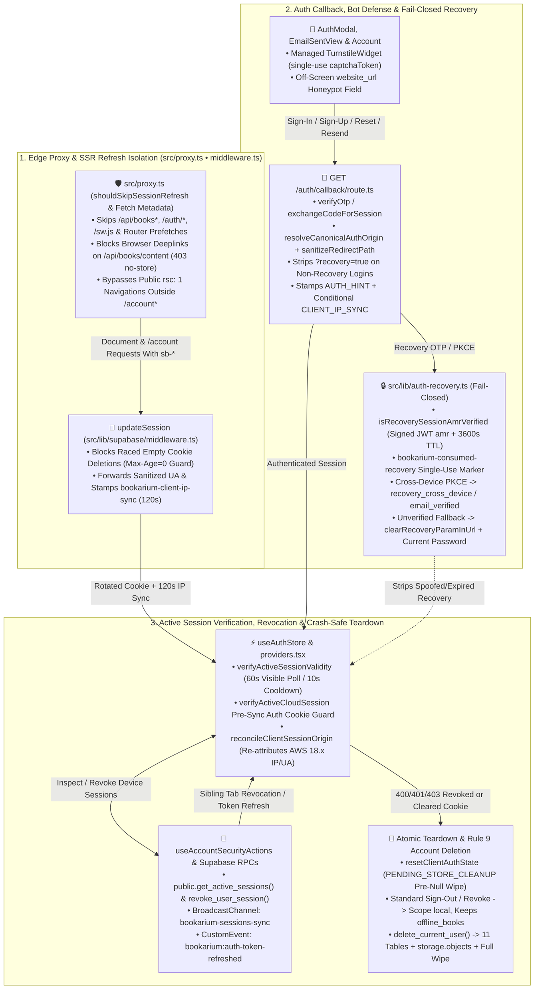
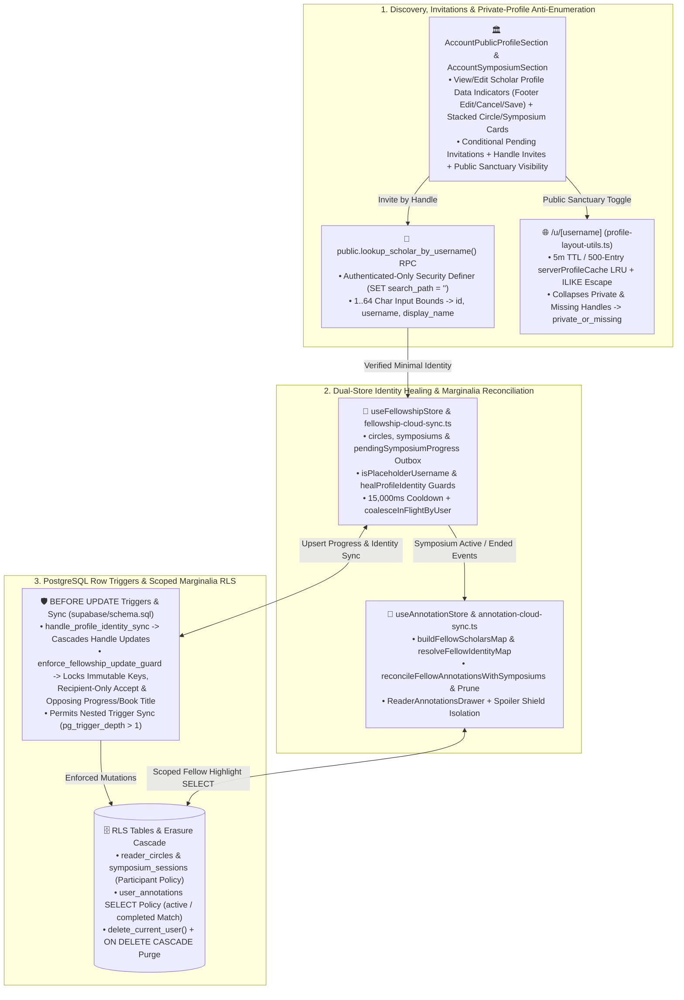

# Environment Bindings, Security Trust Zones & Fellowship Topology — Bookarium

> **Auto-Generated Living Architecture Slice** • [← Back to Architecture Hub](../ARCHITECTURE.md)  
> **Last Synchronized**: `2026-11-28`  
> **Topology Health**: `268` Modules Analyzed • `1157` Static Linkages • `0` Circular Dependencies • `0` Layer Violations • `0` Orphaned Modules

---

## 🔐 Environment Variable, Config & Security Trust-Zone Dependency Map

### 1. AST-Extracted Environment Variable Binding Matrix (`.env.example` <-> Codebase AST)

Programmatically extracted from [`.env.example`](../../.env.example) (variable names only — zero secret values) and cross-referenced via Babel AST against all consuming modules in `src/`, `next.config.ts`, `scripts/`, and `.github/workflows/`:

| Environment Variable | Exposure & Security Scope | Unconfigured / Local Fallback & Operator Notes | Architectural Purpose | AST-Verified Consuming Modules |
| :--- | :--- | :--- | :--- | :--- |
| **`NEXT_PUBLIC_SITE_URL`** | Public Browser & Edge SSR (`NEXT_PUBLIC_*`) | Normalized fallback chain: `NEXT_PUBLIC_SITE_URL` -> `NEXT_PUBLIC_VERCEL_PROJECT_PRODUCTION_URL` -> SSR-only `VERCEL_PROJECT_PRODUCTION_URL` -> `https://bookarium.vercel.app` (`SITE_CONFIG.SITE_URL` / `SITE_CONFIG.SITE_HOST`). | Canonical origin for OpenGraph metadata, `sitemap.xml`, `robots.txt`, shareable book links, reading card host footers, and PKCE auth callback validation. | [`scripts/ingest-catalog.js`](../../scripts/ingest-catalog.js), [`scripts/ingest-translations.js`](../../scripts/ingest-translations.js), [`scripts/sync-featured-quotes.js`](../../scripts/sync-featured-quotes.js), [`scripts/sync-gutenberg-catalog.js`](../../scripts/sync-gutenberg-catalog.js), [`scripts/sync-r2-assets.js`](../../scripts/sync-r2-assets.js), [`src/config/site-config.ts`](../../src/config/site-config.ts) |
| **`NEXT_PUBLIC_GITHUB_REPO`** | Public Browser & Edge SSR (`NEXT_PUBLIC_*`) | Auto-detected from local Git config, `GITHUB_REPOSITORY` (CI), or `VERCEL_GIT_REPO_*` (Vercel). | Public repository URL displayed in the Navbar GitHub button, Footer links, and DMCA issue intake. | [`next.config.ts`](../../next.config.ts), [`scripts/ingest-catalog.js`](../../scripts/ingest-catalog.js), [`scripts/ingest-translations.js`](../../scripts/ingest-translations.js), [`scripts/sync-featured-quotes.js`](../../scripts/sync-featured-quotes.js), [`scripts/sync-gutenberg-catalog.js`](../../scripts/sync-gutenberg-catalog.js), [`scripts/sync-r2-assets.js`](../../scripts/sync-r2-assets.js), [`src/config/site-config.ts`](../../src/config/site-config.ts) |
| **`NEXT_PUBLIC_SUPABASE_URL`** | Public Browser & Edge SSR (`NEXT_PUBLIC_*`) | Offline-First Guest Preview & Tests: Catalog degrades safely to the bundled Curated Archive fallback (`curated-fallback.ts`); offline books and personal collections persist locally in `localStorage` & `IndexedDB` (full 78k+ online catalog & cloud sync require a Supabase project). | Supabase project URL for PostgreSQL catalog queries (`public.books`), FRBR translations, SSR auth cookies, and 7-store cloud sync. | [`.github/workflows/catalog-sync.yml`](../../.github/workflows/catalog-sync.yml), [`.github/workflows/quotes-sync.yml`](../../.github/workflows/quotes-sync.yml), [`.github/workflows/r2-sync.yml`](../../.github/workflows/r2-sync.yml), [`.github/workflows/translations-sync.yml`](../../.github/workflows/translations-sync.yml), [`scripts/ingest-translations.js`](../../scripts/ingest-translations.js), [`scripts/sync-featured-quotes.js`](../../scripts/sync-featured-quotes.js), [`scripts/sync-gutenberg-catalog.js`](../../scripts/sync-gutenberg-catalog.js), [`scripts/sync-r2-assets.js`](../../scripts/sync-r2-assets.js), [`src/app/layout.tsx`](../../src/app/layout.tsx), [`src/lib/catalog/supabase-provider.ts`](../../src/lib/catalog/supabase-provider.ts), [`src/lib/supabase/client.ts`](../../src/lib/supabase/client.ts), [`src/lib/supabase/middleware.ts`](../../src/lib/supabase/middleware.ts), [`src/lib/supabase/server.ts`](../../src/lib/supabase/server.ts) |
| **`NEXT_PUBLIC_SUPABASE_ANON_KEY`** | Public Browser & Edge SSR (`NEXT_PUBLIC_*`) | Offline-First Guest Preview & Tests: Cloud sync and auth modals gracefully disable live network calls when unconfigured. | Public anonymous JWT key scoped strictly by PostgreSQL Row-Level Security (`ENABLE ROW LEVEL SECURITY` across all 14 tables). | [`scripts/ingest-translations.js`](../../scripts/ingest-translations.js), [`scripts/sync-gutenberg-catalog.js`](../../scripts/sync-gutenberg-catalog.js), [`scripts/sync-r2-assets.js`](../../scripts/sync-r2-assets.js), [`src/lib/catalog/supabase-provider.ts`](../../src/lib/catalog/supabase-provider.ts), [`src/lib/supabase/client.ts`](../../src/lib/supabase/client.ts), [`src/lib/supabase/middleware.ts`](../../src/lib/supabase/middleware.ts), [`src/lib/supabase/server.ts`](../../src/lib/supabase/server.ts) |
| **`NEXT_PUBLIC_TURNSTILE_SITE_KEY`** | Public Browser & Edge SSR (`NEXT_PUBLIC_*`) | Optional: `TurnstileWidget` renders nothing (zero external scripts or UI) and `AuthModal`, `EmailSentView`, and `/account` recovery/verification flows submit directly when unconfigured in local development or offline setups. | Public Cloudflare Turnstile site key mounting a shared Managed bot-protection widget (`TurnstileWidget.tsx`) across `AuthModal`, `EmailSentView` resends, and reveal-on-click `/account` password reset & verification resend flows, forwarding single-use `captchaToken` verification to Supabase Auth. | [`src/components/auth/TurnstileWidget.tsx`](../../src/components/auth/TurnstileWidget.tsx) |
| **`NEXT_PUBLIC_LEGAL_CONTACT_FORM`** | Public Browser & Edge SSR (`NEXT_PUBLIC_*`) | Falls back to the repository GitHub Issue Tracker (`SITE_CONFIG.GITHUB_ISSUES_URL`) on `/copyright`. | Optional external intake URL for confidential territorial copyright or DMCA inquiries. | [`src/config/site-config.ts`](../../src/config/site-config.ts) |
| **`NEXT_PUBLIC_GOOGLE_SITE_VERIFICATION`** | Public Browser & Edge SSR (`NEXT_PUBLIC_*`) | Optional: Omit or leave blank to skip emitting the Google site verification `<meta>` tag (`resolveGoogleSiteVerification`). | Google Search Console ownership verification token resolved via `src/config/site-config.ts` and emitted into root layout metadata. | [`src/config/site-config.ts`](../../src/config/site-config.ts) |
| **`SUPABASE_SERVICE_ROLE_KEY`** | CLI & CI Secret Only (`Client-Forbidden` via Pass 0.5 & AST Rule) | CLI ingestion scripts fall back to `NEXT_PUBLIC_SUPABASE_ANON_KEY` or emit offline SQL seed artifacts (`supabase/seed_*.sql`). | Privileged service-role credential used exclusively by offline Node.js CLI pipelines (`catalog:sync`, `translations:sync`, `quotes:sync`, `catalog:ingest`) for bulk upserts. | [`.github/workflows/catalog-sync.yml`](../../.github/workflows/catalog-sync.yml), [`.github/workflows/quotes-sync.yml`](../../.github/workflows/quotes-sync.yml), [`.github/workflows/r2-sync.yml`](../../.github/workflows/r2-sync.yml), [`.github/workflows/translations-sync.yml`](../../.github/workflows/translations-sync.yml), [`scripts/ingest-translations.js`](../../scripts/ingest-translations.js), [`scripts/sync-featured-quotes.js`](../../scripts/sync-featured-quotes.js), [`scripts/sync-gutenberg-catalog.js`](../../scripts/sync-gutenberg-catalog.js), [`scripts/sync-r2-assets.js`](../../scripts/sync-r2-assets.js) |
| **`GUTENBERG_CONTACT_EMAIL`** | Server-Side Fetcher & CLI Pipelines (Optional) | Omitted: Automated `User-Agent` headers cleanly identify via the public repository URL without exposing private emails. | Optional contact email address appended to `User-Agent` headers across Project Gutenberg mirrors and Wikidata SPARQL queries. | [`.github/workflows/catalog-sync.yml`](../../.github/workflows/catalog-sync.yml), [`.github/workflows/quotes-sync.yml`](../../.github/workflows/quotes-sync.yml), [`.github/workflows/r2-sync.yml`](../../.github/workflows/r2-sync.yml), [`.github/workflows/translations-sync.yml`](../../.github/workflows/translations-sync.yml), [`scripts/ingest-catalog.js`](../../scripts/ingest-catalog.js), [`scripts/ingest-translations.js`](../../scripts/ingest-translations.js), [`scripts/sync-featured-quotes.js`](../../scripts/sync-featured-quotes.js), [`scripts/sync-gutenberg-catalog.js`](../../scripts/sync-gutenberg-catalog.js), [`scripts/sync-r2-assets.js`](../../scripts/sync-r2-assets.js), [`src/config/site-config.ts`](../../src/config/site-config.ts) |
| **`BOOKARIUM_REPO_URL`** | Server-Side Fetcher, CLI Pipelines & Config (Optional) | Auto-detected from `GITHUB_REPOSITORY` (CI/cron), `VERCEL_GIT_REPO_*` (Vercel), or `NEXT_PUBLIC_SITE_URL`. | Explicit repository URL override used for open-source attribution and `User-Agent` contact headers. | [`next.config.ts`](../../next.config.ts), [`scripts/ingest-catalog.js`](../../scripts/ingest-catalog.js), [`scripts/ingest-translations.js`](../../scripts/ingest-translations.js), [`scripts/sync-featured-quotes.js`](../../scripts/sync-featured-quotes.js), [`scripts/sync-gutenberg-catalog.js`](../../scripts/sync-gutenberg-catalog.js), [`scripts/sync-r2-assets.js`](../../scripts/sync-r2-assets.js), [`src/config/site-config.ts`](../../src/config/site-config.ts) |
| **`DEV_COUNTRY`** | Edge Proxy & Server Route Development Override | Production uses Vercel Edge `x-vercel-ip-country` header -> `bookarium-geo-country` cookie -> IANA timezone inference -> `US` default. | ISO 3166-1 alpha-2 country override (`US`, `GB`, `DE`, `MX`, `ES`) for local testing of multi-jurisdictional copyright rules (`Life+70`, `Life+80`, `Life+100`). | [`src/lib/country-resolver.ts`](../../src/lib/country-resolver.ts) |
| **`VERCEL_API_TOKEN`** | GitHub Actions Cache Purge CLI (Optional CI) | None (when unset, `scripts/purge-vercel-cache.js` cleanly skips Edge cache invalidation with exit code 0). | Authenticates `POST https://api.vercel.com/v1/edge-cache/dangerously-delete-by-tags?projectIdOrName={projectId}` at the end of catalog, quote, and translation CI workflows and via standalone manual `.github/workflows/cache-purge.yml` runs to purge stale `Vercel-Cache-Tag` entries. | [`.github/workflows/cache-purge.yml`](../../.github/workflows/cache-purge.yml), [`.github/workflows/catalog-sync.yml`](../../.github/workflows/catalog-sync.yml), [`.github/workflows/quotes-sync.yml`](../../.github/workflows/quotes-sync.yml), [`.github/workflows/r2-sync.yml`](../../.github/workflows/r2-sync.yml), [`.github/workflows/translations-sync.yml`](../../.github/workflows/translations-sync.yml), [`scripts/purge-vercel-cache.js`](../../scripts/purge-vercel-cache.js) |
| **`VERCEL_PROJECT_ID`** | GitHub Actions Cache Purge CLI (Optional CI) | None (required together with `VERCEL_API_TOKEN` for Edge tag invalidation; skips gracefully when omitted). | Identifies the target Vercel project (`prj_...` or project name) for Edge Data/CDN cache tag invalidation in `scripts/purge-vercel-cache.js`. | [`.github/workflows/cache-purge.yml`](../../.github/workflows/cache-purge.yml), [`.github/workflows/catalog-sync.yml`](../../.github/workflows/catalog-sync.yml), [`.github/workflows/quotes-sync.yml`](../../.github/workflows/quotes-sync.yml), [`.github/workflows/r2-sync.yml`](../../.github/workflows/r2-sync.yml), [`.github/workflows/translations-sync.yml`](../../.github/workflows/translations-sync.yml), [`scripts/purge-vercel-cache.js`](../../scripts/purge-vercel-cache.js) |
| **`VERCEL_TEAM_ID`** | GitHub Actions Cache Purge CLI (Optional CI) | Omitted when targeting a non-team personal scope; include when deploying under a Vercel team or Hobby personal team. | Appends `&teamId=...` to the Vercel tag-purge API request in `scripts/purge-vercel-cache.js` when targeting a team-owned Vercel project. | [`.github/workflows/cache-purge.yml`](../../.github/workflows/cache-purge.yml), [`.github/workflows/catalog-sync.yml`](../../.github/workflows/catalog-sync.yml), [`.github/workflows/quotes-sync.yml`](../../.github/workflows/quotes-sync.yml), [`.github/workflows/r2-sync.yml`](../../.github/workflows/r2-sync.yml), [`.github/workflows/translations-sync.yml`](../../.github/workflows/translations-sync.yml), [`scripts/purge-vercel-cache.js`](../../scripts/purge-vercel-cache.js) |
| **`R2_ACCOUNT_ID`** | Server-Only & CI Runtime Environment Variable (Vercel, GitHub Actions Secrets & `.env.local`) | Required in production for online covers and plain-text books. When any `R2_*` variable is omitted locally or in tests, `/api/books/content?type=cover` returns `404` (`dark typographic cover` fallback), uncached plain text fails closed with `HTTP 503` (zero runtime PG fallback), CI R2 sync/scan skips cleanly (`exit 0`), and `quotes:sync` uses PGLAF mirror fallback. *Operator note: Full 78k+ R2 storage exceeds Cloudflare R2 10 GB free-tier allowance.* | Cloudflare account identifier building the private R2 S3 endpoint `https://<R2_ACCOUNT_ID>.r2.cloudflarestorage.com` inside `src/lib/r2-client.ts`, `scripts/lib/r2-sigv4.js`, `scripts/sync-r2-assets.js`, and `scripts/scan-r2-content.js`. | [`.github/workflows/catalog-sync.yml`](../../.github/workflows/catalog-sync.yml), [`.github/workflows/quotes-sync.yml`](../../.github/workflows/quotes-sync.yml), [`.github/workflows/r2-content-scan.yml`](../../.github/workflows/r2-content-scan.yml), [`.github/workflows/r2-sync.yml`](../../.github/workflows/r2-sync.yml), [`scripts/lib/r2-sigv4.js`](../../scripts/lib/r2-sigv4.js), [`src/lib/r2-client.ts`](../../src/lib/r2-client.ts) |
| **`R2_BUCKET_NAME`** | Server-Only & CI Runtime Environment Variable (Vercel, GitHub Actions Secrets & `.env.local`) | Omitted in local UI/test runs (`isR2Configured() === false`); online cover/text endpoints fail closed (`404`/`503`) until R2 is configured. | Private Cloudflare R2 bucket name (`bookarium-assets`) storing `covers/<id>.jpg`, `books/<id>.txt.gz`, and `_meta/r2-sync-state.json.gz`. | [`.github/workflows/catalog-sync.yml`](../../.github/workflows/catalog-sync.yml), [`.github/workflows/quotes-sync.yml`](../../.github/workflows/quotes-sync.yml), [`.github/workflows/r2-content-scan.yml`](../../.github/workflows/r2-content-scan.yml), [`.github/workflows/r2-sync.yml`](../../.github/workflows/r2-sync.yml), [`scripts/lib/r2-sigv4.js`](../../scripts/lib/r2-sigv4.js), [`src/lib/r2-client.ts`](../../src/lib/r2-client.ts) |
| **`R2_ACCESS_KEY_ID`** | Server-Only & CI R2 S3 Credential (Vercel Read-Only Recommended, GitHub Secrets Read/Write & `.env.local`) | Omitted in local UI/test runs (`isR2Configured() === false`); online cover/text endpoints fail closed (`404`/`503`) until R2 is configured. | S3 API access key ID used strictly server-side and in CI/CLI pipelines for AWS SigV4 signed `GET` (`r2-client.ts`, `r2-sigv4.js`, `sync-featured-quotes.js`, `scan-r2-content.js`) and `ListObjectsV2`/`PutObject`/`DeleteObject` (`sync-r2-assets.js`). | [`.github/workflows/catalog-sync.yml`](../../.github/workflows/catalog-sync.yml), [`.github/workflows/quotes-sync.yml`](../../.github/workflows/quotes-sync.yml), [`.github/workflows/r2-content-scan.yml`](../../.github/workflows/r2-content-scan.yml), [`.github/workflows/r2-sync.yml`](../../.github/workflows/r2-sync.yml), [`scripts/lib/r2-sigv4.js`](../../scripts/lib/r2-sigv4.js), [`src/lib/r2-client.ts`](../../src/lib/r2-client.ts) |
| **`R2_SECRET_ACCESS_KEY`** | Server-Only & CI Signing Secret (Vercel Read-Only Recommended, GitHub Secrets Read/Write & `.env.local`) | Omitted in local UI/test runs (`isR2Configured() === false`); online cover/text endpoints fail closed (`404`/`503`) until R2 is configured. | HMAC-SHA256 secret signing AWS Signature V4 requests to private Cloudflare R2 storage inside `src/lib/r2-client.ts`, `scripts/lib/r2-sigv4.js`, `scripts/sync-r2-assets.js`, `scripts/scan-r2-content.js`, and `scripts/sync-featured-quotes.js`. | [`.github/workflows/catalog-sync.yml`](../../.github/workflows/catalog-sync.yml), [`.github/workflows/quotes-sync.yml`](../../.github/workflows/quotes-sync.yml), [`.github/workflows/r2-content-scan.yml`](../../.github/workflows/r2-content-scan.yml), [`.github/workflows/r2-sync.yml`](../../.github/workflows/r2-sync.yml), [`scripts/lib/r2-sigv4.js`](../../scripts/lib/r2-sigv4.js), [`src/lib/r2-client.ts`](../../src/lib/r2-client.ts) |
| **`NODE_ENV`** | Framework & Build-Time Runtime Constant | Set automatically by Next.js / Node.js (`development`, `production`, `test`). | Strips `unsafe-eval` from production Content-Security-Policy, enables `Strict-Transport-Security` (`next.config.ts`), activates `public/sw.js` registration, and gates dev overrides. | [`next.config.ts`](../../next.config.ts), [`src/components/pwa/ServiceWorkerRegister.tsx`](../../src/components/pwa/ServiceWorkerRegister.tsx), [`src/lib/api-utils.ts`](../../src/lib/api-utils.ts), [`src/lib/country-resolver.ts`](../../src/lib/country-resolver.ts), [`src/proxy.ts`](../../src/proxy.ts), [`src/stores/useAuthStore.ts`](../../src/stores/useAuthStore.ts), [`src/stores/useJurisdictionStore.ts`](../../src/stores/useJurisdictionStore.ts) |

### 2. Security Trust Zones & Intra-Procedural Request-Taint Topology (`Sources -> Sanitizers -> Sinks`)

Enforced continuously by [`scripts/eslint-rules/bookarium-security.js`](../../scripts/eslint-rules/bookarium-security.js) (`Pass 0.75` & `Pass 6`) and [`scripts/verify-build.js`](../../scripts/verify-build.js) (`Pass 0.5`):

| Untrusted Input Source (Taint Origin) | Trust Boundary Transition | Canonical Sanitizer / Validator Module | Enforced Security Invariants | Protected Downstream Sink |
| :--- | :--- | :--- | :--- | :--- |
| **Public API Query Params, Fetch Metadata, Format URLs & SW `CACHE_URLS`** | Browser / Edge -> `/api/books/**` & `public/sw.js` | [`src/lib/api-utils.ts`](../../src/lib/api-utils.ts) (`hasUnexpectedQueryParams`, `buildApiSecurityHeaders`, `isHttpsRequest`, `guardContentAssetRequest`), [`src/lib/catalog/query-parser.ts`](../../src/lib/catalog/query-parser.ts) (`parseCatalogQuery`), [`src/lib/utils.ts`](../../src/lib/utils.ts) (`sanitizeBookFormatUrl`) & [`public/sw.js`](../../public/sw.js) (`sanitizePrecacheUrl`) | Strict per-route allowlists (`400 no-store`), `403 no-store` browser Fetch Metadata deeplink/cross-site isolation (`type=card` & headerless crawlers exempt, untouched `Vary`), `https:`-only format links (optional `blob:` on `coverImage`), same-origin non-`/auth/`/non-`/api/` bounded `CACHE_URLS` (`<= 100`), `CORP` & `copyright=false` | `SupabaseCatalogProvider`, `BookCard`, `CACHE_NAME` & `next/og` |
| **Private Cloudflare R2 Object Request (`covers/<id>.jpg`, `books/<id>.txt.gz`)** | `/api/books/content` -> Cloudflare R2 | [`src/lib/r2-client.ts`](../../src/lib/r2-client.ts) (`getR2Config`, `signR2GetRequest`, `fetchR2CoverBytes`, `fetchR2BookText`) | Strictly server-only `R2_*` credentials, regex-locked account/bucket identifiers, `AWS4-HMAC-SHA256`, `redirect: 'manual'`, strict `2 MB` cover & bounded `15 MB` gzip `maxOutputLength` caps (`503`/`404` fail-closed; zero runtime PG fallback) | `NextResponse` in `/api/books/content` |
| **Auth Callback & Client Navigation Redirect (`?next=`, `origin`, `x-forwarded-host`, `?recovery=`, `document.referrer`)** | External OAuth / Magic Link / Recovery / Client Query -> `/auth/callback`, `/account` & `router.push`/`replace` | [`src/lib/redirect-sanitizer.ts`](../../src/lib/redirect-sanitizer.ts) (`sanitizeRedirectPath`, `resolveCanonicalAuthOrigin`, `isRecoveryRedirectPath`, `stripRecoveryFromRedirectPath`), [`src/lib/auth-recovery.ts`](../../src/lib/auth-recovery.ts) (`isRecoverySessionAmrVerified`) & [`scripts/eslint-rules/bookarium-security.js`](../../scripts/eslint-rules/bookarium-security.js) (`no-tainted-request-sink`) | Rejects `//`, `http:`, `javascript:`, backslash tricks, and foreign hosts; locks non-local redirect origins to `SITE_CONFIG.SITE_URL` (`NEXT_PUBLIC_SITE_URL` -> normalized `VERCEL_PROJECT_PRODUCTION_URL` fallback); tracks client `useSearchParams()` / `document.referrer` into `router.push()`/`replace()` (exempting static `/path` & `ROUTES.*` prefixes); strips `?recovery=true` on non-recovery flows and enforces JWT `amr` + `3600s` TTL + single-use consumption | `NextResponse.redirect()` in `/auth/callback`, client `useRouter()` navigation, & `AccountSecuritySection` password update mode |
| **Forwarded Browser `User-Agent` Header (`req.headers.get("user-agent")`)** | Incoming HTTP Request -> SSR Auth Client & Edge Refresh | [`src/lib/supabase/client.ts`](../../src/lib/supabase/client.ts) (`sanitizeForwardedUserAgent`) | Strips CR/LF/control header-injection characters, trims whitespace, and clamps strings to `512` chars (`undefined` if empty) without importing `next/headers` into Edge middleware | Outbound `User-Agent` headers in `src/lib/supabase/server.ts`, `middleware.ts`, & `/auth/callback` |
| **Persisted Cloud Preferences & Dynamic Object Keys (`profiles.preferences`)** | Cloud / Local Storage -> Client State Hydration | [`src/lib/preferences-sync.ts`](../../src/lib/preferences-sync.ts) (`normalizePreferencesSnapshot`) & [`scripts/eslint-rules/bookarium-security.js`](../../scripts/eslint-rules/bookarium-security.js) (`no-tainted-request-sink`) | Strict 14-key schema normalization, finite range clamping, and prototype-pollution key rejection (`__proto__`, `constructor`, `prototype`) | Zustand Stores (`usePreferencesStore`, `useReaderStore`, `useThemeStore`) |
| **Privileged Server Credentials (`SUPABASE_SERVICE_ROLE_KEY`, `R2_*`)** | Node.js CLI / Edge / R2 -> Client Bundle Guard | [`scripts/verify-build.js`](../../scripts/verify-build.js) (`Pass 0.5`), [`scripts/lib/sast-validators.js`](../../scripts/lib/sast-validators.js) & `no-client-server-boundary-violation` | Transitive Babel AST import graph and literal checks block `src/lib/supabase/server`, `src/lib/r2-client.ts`, `SUPABASE_SERVICE_ROLE_KEY`, `R2_ACCESS_KEY_ID`, `R2_SECRET_ACCESS_KEY`, and `NEXT_PUBLIC_R2_*` exposure in `"use client"` bundles | Isolated strictly to `scripts/**/*.js` CLI & server-only `src/lib/r2-client.ts` |
| **Fellowship Participant Mutations & Handle Lookup (`reader_circles`, `symposium_sessions`)** | Direct Client PostgREST -> Supabase DB | [`supabase/schema.sql`](../../supabase/schema.sql) (`enforce_fellowship_update_guard`, `lookup_scholar_by_username`, payload `CHECK` constraints) | Locks relational keys, acceptance authority, and opposite-participant progress/identity columns; revokes trigger RPC execution; bounds `@username` lookups to `1..64` chars and clamps text/array lengths | `public.reader_circles`, `public.symposium_sessions`, `public.profiles` |

### 3. Authentication, Password Recovery, Session Revocation & Origin Security Flow

---

## 🤝 Literary Fellowship, Symposium Pacts & Marginalia Guard Topology

### 1. Reader Circles, Symposium Lifecycle, Fellow Marginalia & Trigger Guards

---

> *Compiled from Source AST by [`scripts/generate-architecture-matrix.js`](../../scripts/generate-architecture-matrix.js) — [← Return to Architecture Hub](../ARCHITECTURE.md).*
